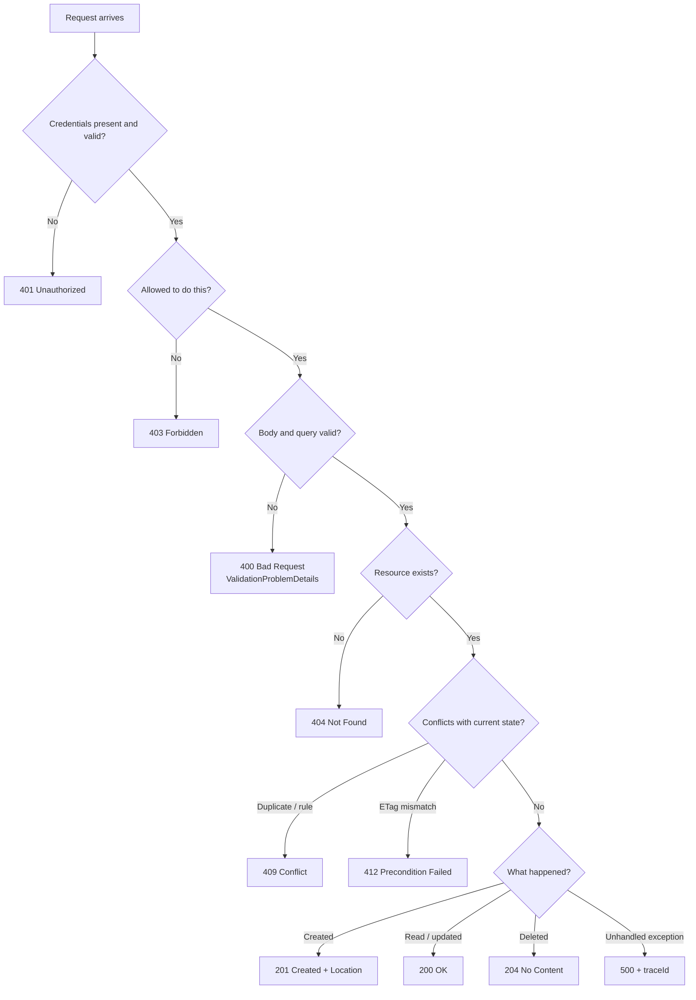
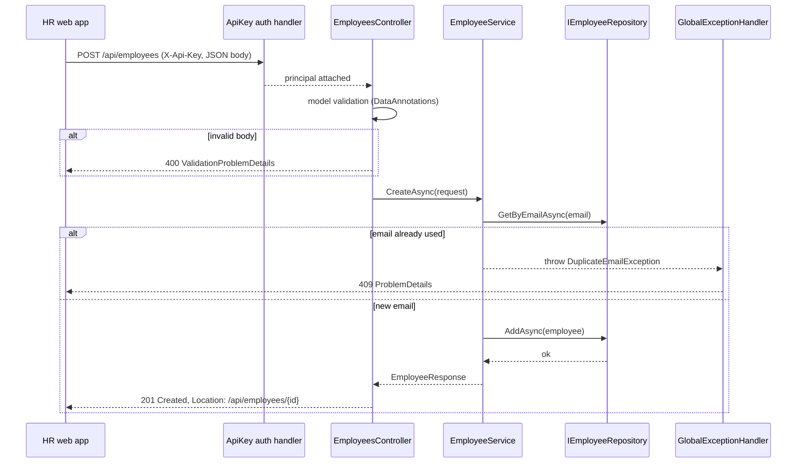
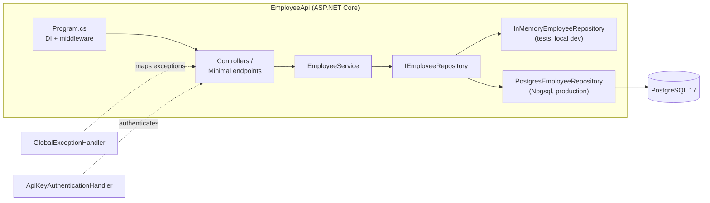

Every web API you will build, from a payroll service to a toll-plaza data feed, is a conversation over HTTP. REST is the set of manners for that conversation. Status codes are the tone of voice. Get them right and other teams can use your API without reading your source code; get them wrong and every integration becomes a support ticket. This lesson also introduces the module project: a complete employee management API that the next three lessons extend.

## Learning objectives

By the end of this lesson you will be able to:

1. Explain what a resource is and design URL paths as nouns, not verbs.
2. Pick the correct HTTP method (GET, POST, PUT, PATCH, DELETE) and say which ones are safe and idempotent.
3. Choose the right status code for success, client error and server error cases, and defend the choice.
4. Return a consistent error body using Problem Details (RFC 9457) from ASP.NET Core.
5. Build an employee management API with controllers, a service layer, a repository interface, in-memory and PostgreSQL implementations, API-key authentication, validation, error handling and logging.
6. Test that API at two levels: unit tests for the service and integration tests through `WebApplicationFactory`.
7. Recognise when strict REST is the wrong tool and an RPC-style or message-based design is simpler.

## Prerequisites

- [Kestrel, middleware, routing, controllers and minimal APIs](#/lesson/m03-kestrel-middleware-routing): you should know how a request reaches an endpoint.
- [DTOs, entities, mapping and validation](#/lesson/m03-dtos-mapping-validation): request and response shapes, and DataAnnotations.
- [Filters, middleware and exception handling](#/lesson/m03-filters-exceptions): `IExceptionHandler` and `ProblemDetails`, which we use for the error model.

If you are new to HTTP, read [HTTP fundamentals](#/lesson/m10-http-fundamentals) first; it covers headers and the request/response shape in more depth.

## Explain it like I'm a beginner

Think of a government office with a well-labelled counter system. Counter 7 is "Driving licences". You do not shout "renew my licence" at a random clerk; you go to the licence counter and hand over a form. The clerk gives you a token with one of a few stamps: **Done**, **Come back tomorrow**, **Form incomplete**, **Not found in records**, or **System down, sorry**. You know what to do next from the stamp alone.

A REST API works the same way:

- Each counter is a **resource**, a thing with its own address, such as `/api/employees` or `/api/employees/42`.
- What you want to do is the **HTTP method** (also called the verb). `GET` means "show me", `POST` means "add a new one", `PUT` means "replace this one", `PATCH` means "change part of it", `DELETE` means "remove it".
- The stamp on the token is the **status code**, a three-digit number. `200` is "done, here it is". `201` is "created". `404` is "not found". `400` is "your form is incomplete". `500` is "our system failed".

Why does this matter? Because the people using your API are other programs, written by people who have never met you. If "employee not found" sometimes comes back as `200` with `{"error":"not found"}` and sometimes as `404`, their code must guess. If it is always `404` with the same error body, their code can be three lines.

Three habits cover most of REST:

1. **Paths are nouns**, plural, lower-case: `/api/employees`, not `/api/getEmployee`.
2. **Methods carry the action**, so you never need `/api/employees/delete/42`.
3. **Status codes are not decoration**; they are the contract. Pick them from a small, well-known set and use them the same way everywhere.

## First-principles explanation

### What REST actually is

REST (Representational State Transfer) was described by Roy Fielding in 2000 as the architectural style of the web itself. In practice, a "REST API" today means an HTTP API that follows a handful of conventions:

- **Resources** are identified by URLs. An employee, a department, a leave request and "the list of all employees in Finance" are all resources.
- **Representations** are how a resource is sent over the wire, almost always JSON today. The same resource could have an XML or CSV representation; the client asks with the `Accept` header.
- **Uniform interface**: the same small set of methods applies to every resource. You do not learn a new vocabulary for each API.
- **Statelessness**: each request carries everything the server needs (authentication, filters, paging). The server does not remember a "current page" for you. This is what lets you add a second server behind a load balancer without sharing session state.

There are more constraints in the original definition (cacheability, layered system, hypermedia links). Most production APIs implement the first four and skip hypermedia. That is fine. Call it "HTTP API" if a purist complains.

### Methods: safe, idempotent, or neither

Two properties decide how clients, proxies and retry logic may treat a method:

- **Safe** means the request does not change server state. Browsers prefetch safe requests; CDNs cache them.
- **Idempotent** means doing it twice has the same effect as doing it once. A network timeout on an idempotent request can be retried blindly.

| Method | Typical use | Safe? | Idempotent? | Success code |
|---|---|---|---|---|
| GET | Read one or many | Yes | Yes | 200 |
| HEAD | Read headers only | Yes | Yes | 200 |
| POST | Create, or run an action | No | **No** | 201 (create), 200/202 (action) |
| PUT | Replace the whole resource | No | Yes | 200 or 204 |
| PATCH | Change part of a resource | No | Not guaranteed | 200 or 204 |
| DELETE | Remove | No | Yes | 204 (or 200 with body) |

The row that matters most in production is POST. If a mobile app on a flaky 4G connection sends `POST /api/employees` and the response is lost, it does not know whether the employee was created. Retrying may create two. The standard fix is an **Idempotency-Key** header: the client sends a unique key, the server stores the first response under that key and replays it for duplicates. We build one in the advanced exercise and go deeper in [Idempotency keys](#/lesson/m10-idempotency).

### Status codes: the small set you actually need

HTTP defines around 60 status codes. You need about 15. Learn the classes first:

- **2xx — it worked.**
- **3xx — look elsewhere** (redirects; rare in JSON APIs).
- **4xx — the client did something wrong.** Fix the request, do not retry as-is.
- **5xx — the server did something wrong.** The request may have been fine; retrying later may work.

The table below is the working set for an employee API. Pin it above your desk.

| Code | Name | Use it when | Body |
|---|---|---|---|
| 200 | OK | A read succeeded, or an update returns the new state | The resource or list |
| 201 | Created | POST made a new resource | The new resource, plus a `Location` header pointing at it |
| 202 | Accepted | You queued work that finishes later (payroll run, PDF export) | A status URL to poll |
| 204 | No Content | Success with nothing to send back (DELETE, some PUTs) | Empty |
| 304 | Not Modified | Client sent `If-None-Match` and the ETag still matches | Empty |
| 400 | Bad Request | The body or query is malformed or fails validation | Problem Details with field errors |
| 401 | Unauthorized | No credentials, or invalid ones. Really means "unauthenticated" | Problem Details, plus `WWW-Authenticate` |
| 403 | Forbidden | We know who you are and you may not do this | Problem Details |
| 404 | Not Found | The resource does not exist (or you may not even know it exists) | Problem Details |
| 405 | Method Not Allowed | `DELETE /api/employees` on a collection you do not allow deleting | `Allow` header |
| 409 | Conflict | The request clashes with current state: duplicate email, deleting a department with staff | Problem Details explaining the clash |
| 412 | Precondition Failed | `If-Match` ETag does not match; someone else changed the resource | Problem Details with the current version |
| 415 | Unsupported Media Type | Client sent XML to a JSON-only API | Problem Details |
| 422 | Unprocessable Content | Well-formed but semantically invalid (join date in the future). Many teams just use 400 | Problem Details |
| 428 | Precondition Required | You require `If-Match` on updates and the client did not send it | Problem Details |
| 429 | Too Many Requests | Rate limit hit | `Retry-After` header |
| 500 | Internal Server Error | An unhandled exception. Never leak the stack trace | Generic Problem Details with a trace id |
| 503 | Service Unavailable | Shutting down, or a dependency is down; see [Health checks and graceful shutdown](#/lesson/m03-health-shutdown) | `Retry-After` if you can estimate |

Two decisions cause most arguments:

**400 versus 422.** Both mean "your request is wrong". The difference is syntax versus meaning. A missing required field is 400; a salary of ₹-5,000 is arguably 422. ASP.NET Core's automatic model validation returns 400 for both. Picking 400 for everything is a defensible, simple rule. Picking 422 for business-rule failures is also fine. What is not fine is mixing them randomly. Write the rule down in your API guidelines.

**404 versus 403 for things you may not see.** If employee 42 exists but belongs to another company in a multi-tenant system, returning 403 confirms that 42 exists. Many APIs return 404 in that case to avoid leaking information. Decide per API, and document it.

### Error bodies: one shape everywhere

Nothing frustrates API consumers more than five different error formats. RFC 9457 **Problem Details** gives one standard JSON shape, and ASP.NET Core produces it for you:

```json
{
  "type": "https://httpstatuses.io/409",
  "title": "Duplicate email",
  "status": 409,
  "detail": "An employee with email priya@rodic.example already exists.",
  "instance": "/api/employees",
  "traceId": "00-6f1c3a...-01"
}
```

`type` is a URL that identifies the *kind* of problem, `title` is a short human summary, `detail` is specific to this occurrence, and you may add extension members such as `traceId` or `errors`. Validation failures use the `ValidationProblemDetails` subtype with an `errors` dictionary keyed by field name. Once clients know this shape, one error-handling function serves your whole API.

### Resource naming rules of thumb

- Plural nouns: `/employees`, `/departments`.
- Hierarchy only when the child cannot exist without the parent: `/departments/finance/budgets`. Do not nest more than two levels; `/companies/1/departments/4/employees/42/leaves/7` is painful. Give leaves their own top-level collection with a filter: `/leave-requests?employeeId=42`.
- Filtering, sorting and paging go in the query string: `/employees?department=Finance&page=2&pageSize=20&sort=-joinedOn`. Details in [API versioning, pagination, filtering and sorting](#/lesson/m03-api-shape).
- Actions that are not CRUD get a sub-resource or a verb-like noun, used sparingly: `POST /leave-requests/7/approval` or `POST /employees/42/resignation`. Model the *result* of the action (an approval, a resignation) as a thing that gets created.
- Lower-case, hyphens, no file extensions, no trailing slashes. Stable ids (`Guid` or a public id), never database row positions.

### When strict REST is the wrong tool

- **Internal service-to-service calls** with a handful of operations are often clearer as RPC (`POST /calculatePayroll`) or gRPC. Nobody benefits from pretending "a payroll calculation" is a resource. See [gRPC](#/lesson/m10-grpc).
- **Long-running jobs** fit better with `202 Accepted` plus a status resource, or with a message queue. See [Background processing and job queues](#/lesson/m11-background-processing).
- **Highly interrelated reads** (a dashboard needing employees, departments and leave balances in one screen) suffer from many round trips in pure REST. A purpose-built read endpoint, or GraphQL, may be the better fit.

REST shines at **public or cross-team APIs with many consumers**, because the conventions are already known.

## Visual explanation

### Choosing the status code



Read it top to bottom. Authentication is checked before authorization, and both before validation, so an anonymous caller never learns whether their body was valid. Existence is checked before conflicts, because "employee not found" is more useful than "version mismatch" when the id is wrong. This order is exactly what the ASP.NET Core pipeline produces when authentication and authorization middleware run before the endpoint, and the endpoint's service layer throws typed exceptions that a global handler maps to codes.

### Creating an employee, end to end



Each participant has one job. The auth handler only answers "who is this?". The controller only translates HTTP to a service call and back. The service owns business rules such as "emails are unique". The repository owns storage. The exception handler owns the mapping from domain failure to status code, so no controller ever writes `return StatusCode(409)` by hand.

### Layers of the module project



The arrow direction is the dependency direction. Controllers know the service; the service knows only the repository *interface*; the two implementations know the interface and their storage. Swapping PostgreSQL for in-memory in tests is one DI registration, and nothing above the interface changes. This is the layering from [Controllers, services, repositories and domain models](#/lesson/m03-layers) applied to a real project.

## Step-by-step example

We will design the employee API before writing it. Doing the design on paper first takes ten minutes and saves days.

### Step 1 — list the resources

Employees. Later lessons add departments and leave requests, but one resource is enough to learn the shape. Each employee has a name, email, department, monthly salary, join date and status (Active, OnLeave, Resigned).

### Step 2 — write the endpoint table

| Operation | Method and path | Success | Failures |
|---|---|---|---|
| List (paged, filter by department) | `GET /api/employees?department=Finance&page=1&pageSize=20` | 200 list | 400 bad paging |
| Get one | `GET /api/employees/{id}` | 200 | 404 |
| Create | `POST /api/employees` | 201 + `Location` | 400 validation, 409 duplicate email |
| Replace | `PUT /api/employees/{id}` with `If-Match` | 200 | 400, 404, 412 stale, 428 missing `If-Match` |
| Delete | `DELETE /api/employees/{id}` | 204 | 404 |

All endpoints require an `X-Api-Key` header; missing or wrong keys give 401.

### Step 3 — decide the error contract

Every non-2xx response is Problem Details JSON with `traceId`. Validation errors include `errors`. Nothing else, ever.

### Step 4 — decide concurrency

Two HR officers editing the same employee is realistic. We give each employee an integer `Version`, send it back as an `ETag` header, and require `If-Match` on PUT. A stale version gets 412. This is optimistic concurrency, cheap and simple, and the same idea as the row version column you will meet in [Deadlocks, optimistic and pessimistic locking](#/lesson/m09-locking).

### Step 5 — write the code

The next section is the complete implementation. Read it in the order the files are listed; each layer builds on the previous one.

## Production-style C# implementation

This is the **module project**: a small but complete employee management API. All `file=` blocks below compile together as one ASP.NET Core 10 application. The PostgreSQL repository and the tests are shown afterwards as snippets, because they need NuGet packages (Npgsql, xUnit, `Microsoft.AspNetCore.Mvc.Testing`) that are not part of the shared framework.

```text
EmployeeApi/
  Program.cs
  Employees/
    Employee.cs                 domain model
    Contracts.cs                request and response DTOs
    IEmployeeRepository.cs      storage contract
    InMemoryEmployeeRepository.cs
    EmployeeService.cs          business rules
    EmployeesController.cs      HTTP (controller style)
    EmployeeEndpoints.cs        HTTP (minimal API style, same service)
  Infrastructure/
    ApiExceptions.cs
    GlobalExceptionHandler.cs
    ApiKeyAuthentication.cs
EmployeeApi.Tests/
    EmployeeServiceTests.cs     unit tests
    EmployeesApiTests.cs        integration tests via WebApplicationFactory
```

### Domain model

```csharp file=Employees/Employee.cs
namespace EmployeeApi.Employees;

public enum EmploymentStatus { Active, OnLeave, Resigned }

/// <summary>The thing we store. Mutable on purpose: the service changes it, the repository persists it.</summary>
public sealed class Employee
{
    public Guid Id { get; init; } = Guid.NewGuid();
    public required string FullName { get; set; }
    public required string Email { get; set; }
    public required string Department { get; set; }
    public decimal MonthlySalary { get; set; }
    public DateOnly JoinedOn { get; set; }
    public EmploymentStatus Status { get; set; } = EmploymentStatus.Active;

    /// <summary>Optimistic concurrency token. Incremented on every successful update and sent to clients as an ETag.</summary>
    public int Version { get; set; } = 1;
    public DateTimeOffset UpdatedAt { get; set; }
}
```

### Contracts (DTOs)

The request types carry validation attributes. The response type is deliberately separate from the domain class so that adding an internal field (say, a PAN number) does not leak over the wire by accident.

```csharp file=Employees/Contracts.cs
using System.ComponentModel.DataAnnotations;

namespace EmployeeApi.Employees;

public sealed class CreateEmployeeRequest
{
    [Required, StringLength(120, MinimumLength = 2)]
    public required string FullName { get; init; }

    [Required, EmailAddress, StringLength(200)]
    public required string Email { get; init; }

    [Required, StringLength(60)]
    public required string Department { get; init; }

    [Range(1, 10_000_000)]
    public decimal MonthlySalary { get; init; }

    public DateOnly JoinedOn { get; init; }
}

public sealed class UpdateEmployeeRequest
{
    [Required, StringLength(120, MinimumLength = 2)]
    public required string FullName { get; init; }

    [Required, StringLength(60)]
    public required string Department { get; init; }

    [Range(1, 10_000_000)]
    public decimal MonthlySalary { get; init; }

    public EmploymentStatus Status { get; init; }
}

public sealed record EmployeeResponse(
    Guid Id, string FullName, string Email, string Department,
    decimal MonthlySalary, DateOnly JoinedOn, EmploymentStatus Status, int Version)
{
    public static EmployeeResponse From(Employee e) =>
        new(e.Id, e.FullName, e.Email, e.Department, e.MonthlySalary, e.JoinedOn, e.Status, e.Version);
}

public sealed record PagedResponse<T>(IReadOnlyList<T> Items, int Page, int PageSize, int TotalItems)
{
    public int TotalPages => PageSize == 0 ? 0 : (int)Math.Ceiling(TotalItems / (double)PageSize);
}

public sealed record EmployeeQuery(string? Department = null, int Page = 1, int PageSize = 20);
```

### Repository contract and in-memory implementation

```csharp file=Employees/IEmployeeRepository.cs
namespace EmployeeApi.Employees;

/// <summary>Storage contract. The service depends only on this, so PostgreSQL and in-memory are interchangeable.</summary>
public interface IEmployeeRepository
{
    Task<Employee?> GetAsync(Guid id, CancellationToken ct);
    Task<Employee?> GetByEmailAsync(string email, CancellationToken ct);
    Task<(IReadOnlyList<Employee> Items, int Total)> ListAsync(EmployeeQuery query, CancellationToken ct);
    Task AddAsync(Employee employee, CancellationToken ct);

    /// <summary>Persists changes only if the stored Version equals <paramref name="expectedVersion"/>.
    /// Returns false when another writer got there first.</summary>
    Task<bool> UpdateAsync(Employee employee, int expectedVersion, CancellationToken ct);
    Task<bool> DeleteAsync(Guid id, CancellationToken ct);

    /// <summary>Cheap connectivity probe used by health checks.</summary>
    Task<bool> PingAsync(CancellationToken ct);
}
```

```csharp file=Employees/InMemoryEmployeeRepository.cs
using System.Collections.Concurrent;

namespace EmployeeApi.Employees;

/// <summary>Thread-safe in-memory store. Used by tests and local development; registered as a singleton.</summary>
public sealed class InMemoryEmployeeRepository : IEmployeeRepository
{
    private readonly ConcurrentDictionary<Guid, Employee> _store = new();
    private readonly object _writeLock = new();

    public Task<Employee?> GetAsync(Guid id, CancellationToken ct) =>
        Task.FromResult(_store.TryGetValue(id, out var e) ? Clone(e) : null);

    public Task<Employee?> GetByEmailAsync(string email, CancellationToken ct) =>
        Task.FromResult(_store.Values
            .FirstOrDefault(e => string.Equals(e.Email, email, StringComparison.OrdinalIgnoreCase)) is { } found
            ? Clone(found) : null);

    public Task<(IReadOnlyList<Employee> Items, int Total)> ListAsync(EmployeeQuery query, CancellationToken ct)
    {
        IEnumerable<Employee> all = _store.Values;
        if (!string.IsNullOrWhiteSpace(query.Department))
            all = all.Where(e => string.Equals(e.Department, query.Department, StringComparison.OrdinalIgnoreCase));
        var list = all.OrderBy(e => e.FullName).ThenBy(e => e.Id).ToList();
        var page = list.Skip((query.Page - 1) * query.PageSize).Take(query.PageSize).Select(Clone).ToList();
        return Task.FromResult<(IReadOnlyList<Employee>, int)>((page, list.Count));
    }

    public Task AddAsync(Employee employee, CancellationToken ct)
    {
        if (!_store.TryAdd(employee.Id, Clone(employee)))
            throw new InvalidOperationException($"Employee {employee.Id} already exists.");
        return Task.CompletedTask;
    }

    public Task<bool> UpdateAsync(Employee employee, int expectedVersion, CancellationToken ct)
    {
        lock (_writeLock)
        {
            if (!_store.TryGetValue(employee.Id, out var current) || current.Version != expectedVersion)
                return Task.FromResult(false);
            var next = Clone(employee);
            next.Version = expectedVersion + 1;
            _store[employee.Id] = next;
            employee.Version = next.Version;
            return Task.FromResult(true);
        }
    }

    public Task<bool> DeleteAsync(Guid id, CancellationToken ct) => Task.FromResult(_store.TryRemove(id, out _));

    public Task<bool> PingAsync(CancellationToken ct) => Task.FromResult(true);

    // Copies protect the store from callers mutating shared instances.
    private static Employee Clone(Employee e) => new()
    {
        Id = e.Id, FullName = e.FullName, Email = e.Email, Department = e.Department,
        MonthlySalary = e.MonthlySalary, JoinedOn = e.JoinedOn, Status = e.Status,
        Version = e.Version, UpdatedAt = e.UpdatedAt,
    };
}
```

### Typed failures

The service never knows about HTTP. It throws small, specific exceptions; one handler converts them to status codes.

```csharp file=Infrastructure/ApiExceptions.cs
namespace EmployeeApi.Infrastructure;

/// <summary>Base for failures that have a well-defined HTTP meaning.</summary>
public abstract class ApiException(int statusCode, string title, string detail) : Exception(detail)
{
    public int StatusCode { get; } = statusCode;
    public string Title { get; } = title;
}

public sealed class NotFoundException(string resource, object key)
    : ApiException(404, "Resource not found", $"{resource} '{key}' was not found.");

public sealed class ConflictException(string detail)
    : ApiException(409, "Conflict", detail);

public sealed class PreconditionFailedException(int currentVersion)
    : ApiException(412, "Precondition failed", $"The resource has changed. Current version is {currentVersion}.")
{
    public int CurrentVersion { get; } = currentVersion;
}

public sealed class PreconditionRequiredException()
    : ApiException(428, "Precondition required", "Send the resource's current version in the If-Match header.");

public sealed class DomainValidationException(string field, string message)
    : ApiException(400, "Validation failed", message)
{
    public string Field { get; } = field;
}
```

### Service layer

```csharp file=Employees/EmployeeService.cs
using EmployeeApi.Infrastructure;
using Microsoft.Extensions.Logging;

namespace EmployeeApi.Employees;

public interface IEmployeeService
{
    Task<PagedResponse<EmployeeResponse>> ListAsync(EmployeeQuery query, CancellationToken ct);
    Task<EmployeeResponse> GetAsync(Guid id, CancellationToken ct);
    Task<EmployeeResponse> CreateAsync(CreateEmployeeRequest request, CancellationToken ct);
    Task<EmployeeResponse> UpdateAsync(Guid id, int expectedVersion, UpdateEmployeeRequest request, CancellationToken ct);
    Task DeleteAsync(Guid id, CancellationToken ct);
}

public sealed class EmployeeService(IEmployeeRepository repository, TimeProvider clock, ILogger<EmployeeService> logger)
    : IEmployeeService
{
    private const int MaxPageSize = 100;

    public async Task<PagedResponse<EmployeeResponse>> ListAsync(EmployeeQuery query, CancellationToken ct)
    {
        if (query.Page < 1) throw new DomainValidationException(nameof(query.Page), "Page must be 1 or greater.");
        if (query.PageSize is < 1 or > MaxPageSize)
            throw new DomainValidationException(nameof(query.PageSize), $"PageSize must be between 1 and {MaxPageSize}.");

        var (items, total) = await repository.ListAsync(query, ct);
        return new PagedResponse<EmployeeResponse>(items.Select(EmployeeResponse.From).ToList(), query.Page, query.PageSize, total);
    }

    public async Task<EmployeeResponse> GetAsync(Guid id, CancellationToken ct)
    {
        var employee = await repository.GetAsync(id, ct) ?? throw new NotFoundException("Employee", id);
        return EmployeeResponse.From(employee);
    }

    public async Task<EmployeeResponse> CreateAsync(CreateEmployeeRequest request, CancellationToken ct)
    {
        var today = DateOnly.FromDateTime(clock.GetUtcNow().UtcDateTime);
        if (request.JoinedOn > today.AddDays(90))
            throw new DomainValidationException(nameof(request.JoinedOn), "Join date cannot be more than 90 days in the future.");

        if (await repository.GetByEmailAsync(request.Email, ct) is not null)
            throw new ConflictException($"An employee with email '{request.Email}' already exists.");

        var employee = new Employee
        {
            FullName = request.FullName.Trim(),
            Email = request.Email.Trim().ToLowerInvariant(),
            Department = request.Department.Trim(),
            MonthlySalary = request.MonthlySalary,
            JoinedOn = request.JoinedOn,
            UpdatedAt = clock.GetUtcNow(),
        };
        await repository.AddAsync(employee, ct);
        logger.LogInformation("Created employee {EmployeeId} in {Department}", employee.Id, employee.Department);
        return EmployeeResponse.From(employee);
    }

    public async Task<EmployeeResponse> UpdateAsync(Guid id, int expectedVersion, UpdateEmployeeRequest request, CancellationToken ct)
    {
        var employee = await repository.GetAsync(id, ct) ?? throw new NotFoundException("Employee", id);
        if (employee.Version != expectedVersion) throw new PreconditionFailedException(employee.Version);

        if (employee.Status == EmploymentStatus.Resigned && request.Status != EmploymentStatus.Resigned)
            throw new ConflictException("A resigned employee cannot be reactivated. Create a new record instead.");

        employee.FullName = request.FullName.Trim();
        employee.Department = request.Department.Trim();
        employee.MonthlySalary = request.MonthlySalary;
        employee.Status = request.Status;
        employee.UpdatedAt = clock.GetUtcNow();

        if (!await repository.UpdateAsync(employee, expectedVersion, ct))
        {
            // Lost the race between our read and our write: report the fresh version.
            var fresh = await repository.GetAsync(id, ct);
            throw new PreconditionFailedException(fresh?.Version ?? expectedVersion + 1);
        }

        logger.LogInformation("Updated employee {EmployeeId} to version {Version}", employee.Id, employee.Version);
        return EmployeeResponse.From(employee);
    }

    public async Task DeleteAsync(Guid id, CancellationToken ct)
    {
        if (!await repository.DeleteAsync(id, ct)) throw new NotFoundException("Employee", id);
        logger.LogInformation("Deleted employee {EmployeeId}", id);
    }
}
```

Notice what the service does **not** do: it never touches `HttpContext`, never returns a status code, and never catches exceptions it cannot handle. That is why it is trivially unit-testable.

### Global exception handler

```csharp file=Infrastructure/GlobalExceptionHandler.cs
using Microsoft.AspNetCore.Diagnostics;
using Microsoft.AspNetCore.Http;
using Microsoft.AspNetCore.Mvc;
using Microsoft.Extensions.Logging;

namespace EmployeeApi.Infrastructure;

/// <summary>Turns typed exceptions into Problem Details. Unknown exceptions become a generic 500 with a trace id.</summary>
public sealed class GlobalExceptionHandler(IProblemDetailsService problemDetails, ILogger<GlobalExceptionHandler> logger)
    : IExceptionHandler
{
    public async ValueTask<bool> TryHandleAsync(HttpContext http, Exception exception, CancellationToken ct)
    {
        var problem = exception switch
        {
            DomainValidationException v => new ValidationProblemDetails(new Dictionary<string, string[]> { [v.Field] = [v.Message] })
            {
                Status = 400, Title = v.Title,
            },
            ApiException api => new ProblemDetails { Status = api.StatusCode, Title = api.Title, Detail = api.Message },
            OperationCanceledException when http.RequestAborted.IsCancellationRequested =>
                new ProblemDetails { Status = 499, Title = "Client closed request" },
            _ => new ProblemDetails { Status = 500, Title = "An unexpected error occurred", Detail = "Quote the traceId when reporting this." },
        };

        if (exception is PreconditionFailedException pf) http.Response.Headers.ETag = $"\"{pf.CurrentVersion}\"";
        if (problem.Status == 500) logger.LogError(exception, "Unhandled exception for {Method} {Path}", http.Request.Method, http.Request.Path);
        else logger.LogWarning("Request failed with {Status}: {Detail}", problem.Status, problem.Detail);

        problem.Instance = http.Request.Path;
        problem.Extensions["traceId"] = http.TraceIdentifier;
        http.Response.StatusCode = problem.Status ?? 500;

        return await problemDetails.TryWriteAsync(new ProblemDetailsContext { HttpContext = http, ProblemDetails = problem, Exception = exception });
    }
}
```

### API-key authentication

A real deployment would use JWT bearer tokens from an identity provider (see [Authentication and authorization](#/lesson/m03-authn-authz)). JWT support lives in a NuGet package, so for a self-contained module project we implement the simplest real scheme: a shared API key in a header. The structure (a scheme, a handler, a principal) is identical.

```csharp file=Infrastructure/ApiKeyAuthentication.cs
using System.Security.Claims;
using System.Text.Encodings.Web;
using Microsoft.AspNetCore.Authentication;
using Microsoft.Extensions.Logging;
using Microsoft.Extensions.Options;

namespace EmployeeApi.Infrastructure;

public sealed class ApiKeyOptions
{
    public const string SectionName = "Auth";
    public string HeaderName { get; set; } = "X-Api-Key";
    public Dictionary<string, string> Keys { get; set; } = new();   // key -> client name
}

public sealed class ApiKeyAuthenticationHandler(
    IOptionsMonitor<AuthenticationSchemeOptions> options,
    IOptions<ApiKeyOptions> apiKeyOptions,
    ILoggerFactory loggerFactory,
    UrlEncoder encoder)
    : AuthenticationHandler<AuthenticationSchemeOptions>(options, loggerFactory, encoder)
{
    public const string SchemeName = "ApiKey";
    private readonly ApiKeyOptions _keys = apiKeyOptions.Value;

    protected override Task<AuthenticateResult> HandleAuthenticateAsync()
    {
        if (!Request.Headers.TryGetValue(_keys.HeaderName, out var values) || values.Count == 0)
            return Task.FromResult(AuthenticateResult.NoResult());

        var presented = values[0] ?? string.Empty;
        foreach (var (key, clientName) in _keys.Keys)
        {
            // Constant-time comparison so response timing does not reveal how many characters matched.
            if (key.Length == presented.Length &&
                System.Security.Cryptography.CryptographicOperations.FixedTimeEquals(
                    System.Text.Encoding.UTF8.GetBytes(key), System.Text.Encoding.UTF8.GetBytes(presented)))
            {
                var identity = new ClaimsIdentity([new Claim(ClaimTypes.Name, clientName), new Claim("scope", "employees:write")], Scheme.Name);
                return Task.FromResult(AuthenticateResult.Success(new AuthenticationTicket(new ClaimsPrincipal(identity), Scheme.Name)));
            }
        }
        return Task.FromResult(AuthenticateResult.Fail("Invalid API key."));
    }

    protected override Task HandleChallengeAsync(AuthenticationProperties properties)
    {
        Response.StatusCode = 401;
        Response.Headers.WWWAuthenticate = $"{SchemeName} header=\"{_keys.HeaderName}\"";
        return Task.CompletedTask;
    }
}
```

### HTTP layer, controller style

```csharp file=Employees/EmployeesController.cs
using EmployeeApi.Infrastructure;
using Microsoft.AspNetCore.Authorization;
using Microsoft.AspNetCore.Http;
using Microsoft.AspNetCore.Mvc;

namespace EmployeeApi.Employees;

[ApiController]
[Route("api/employees")]
[Authorize]
[Produces("application/json")]
public sealed class EmployeesController(IEmployeeService service) : ControllerBase
{
    [HttpGet]
    [ProducesResponseType<PagedResponse<EmployeeResponse>>(StatusCodes.Status200OK)]
    [ProducesResponseType<ValidationProblemDetails>(StatusCodes.Status400BadRequest)]
    public async Task<ActionResult<PagedResponse<EmployeeResponse>>> List([FromQuery] EmployeeQuery query, CancellationToken ct) =>
        Ok(await service.ListAsync(query, ct));

    [HttpGet("{id:guid}")]
    [ProducesResponseType<EmployeeResponse>(StatusCodes.Status200OK)]
    [ProducesResponseType<ProblemDetails>(StatusCodes.Status404NotFound)]
    public async Task<ActionResult<EmployeeResponse>> GetById(Guid id, CancellationToken ct)
    {
        var employee = await service.GetAsync(id, ct);
        Response.Headers.ETag = $"\"{employee.Version}\"";
        return Ok(employee);
    }

    [HttpPost]
    [ProducesResponseType<EmployeeResponse>(StatusCodes.Status201Created)]
    [ProducesResponseType<ValidationProblemDetails>(StatusCodes.Status400BadRequest)]
    [ProducesResponseType<ProblemDetails>(StatusCodes.Status409Conflict)]
    public async Task<ActionResult<EmployeeResponse>> Create(CreateEmployeeRequest request, CancellationToken ct)
    {
        var created = await service.CreateAsync(request, ct);
        Response.Headers.ETag = $"\"{created.Version}\"";
        return CreatedAtAction(nameof(GetById), new { id = created.Id }, created);
    }

    [HttpPut("{id:guid}")]
    [ProducesResponseType<EmployeeResponse>(StatusCodes.Status200OK)]
    [ProducesResponseType<ProblemDetails>(StatusCodes.Status404NotFound)]
    [ProducesResponseType<ProblemDetails>(StatusCodes.Status412PreconditionFailed)]
    [ProducesResponseType<ProblemDetails>(StatusCodes.Status428PreconditionRequired)]
    public async Task<ActionResult<EmployeeResponse>> Replace(Guid id, UpdateEmployeeRequest request,
        [FromHeader(Name = "If-Match")] string? ifMatch, CancellationToken ct)
    {
        var expectedVersion = ParseIfMatch(ifMatch);
        var updated = await service.UpdateAsync(id, expectedVersion, request, ct);
        Response.Headers.ETag = $"\"{updated.Version}\"";
        return Ok(updated);
    }

    [HttpDelete("{id:guid}")]
    [ProducesResponseType(StatusCodes.Status204NoContent)]
    [ProducesResponseType<ProblemDetails>(StatusCodes.Status404NotFound)]
    public async Task<IActionResult> Delete(Guid id, CancellationToken ct)
    {
        await service.DeleteAsync(id, ct);
        return NoContent();
    }

    /// <summary>ETags are quoted strings: If-Match: "3". Accepts the bare number too, to be forgiving.</summary>
    internal static int ParseIfMatch(string? header)
    {
        if (string.IsNullOrWhiteSpace(header)) throw new PreconditionRequiredException();
        var trimmed = header.Trim().Trim('"');
        if (trimmed.StartsWith("W/", StringComparison.Ordinal)) trimmed = trimmed[2..].Trim('"');
        return int.TryParse(trimmed, out var v) ? v : throw new DomainValidationException("If-Match", "If-Match must be a version number ETag.");
    }
}
```

`[ApiController]` gives us three things for free: automatic 400 with `ValidationProblemDetails` when DataAnnotations fail, `[FromBody]` inference for complex parameters, and Problem Details for framework-generated errors.

### HTTP layer, minimal API style

Same service, different front door. Teams pick one style per project; both are shown so you can compare them.

```csharp file=Employees/EmployeeEndpoints.cs
using Microsoft.AspNetCore.Builder;
using Microsoft.AspNetCore.Http;
using Microsoft.AspNetCore.Http.HttpResults;
using Microsoft.AspNetCore.Mvc;
using Microsoft.AspNetCore.Routing;

namespace EmployeeApi.Employees;

public static class EmployeeEndpoints
{
    public static IEndpointRouteBuilder MapEmployeeEndpoints(this IEndpointRouteBuilder app)
    {
        var group = app.MapGroup("/api/v2/employees").WithTags("Employees (minimal)").RequireAuthorization();

        group.MapGet("/", async ([AsParameters] EmployeeQuery query, IEmployeeService service, CancellationToken ct) =>
                TypedResults.Ok(await service.ListAsync(query, ct)))
            .WithName("ListEmployeesV2");

        group.MapGet("/{id:guid}", async Task<Ok<EmployeeResponse>> (Guid id, IEmployeeService service, HttpResponse response, CancellationToken ct) =>
            {
                var employee = await service.GetAsync(id, ct);
                response.Headers.ETag = $"\"{employee.Version}\"";
                return TypedResults.Ok(employee);
            })
            .WithName("GetEmployeeV2")
            .ProducesProblem(StatusCodes.Status404NotFound);

        group.MapPost("/", async Task<Created<EmployeeResponse>> (CreateEmployeeRequest request, IEmployeeService service, CancellationToken ct) =>
            {
                var created = await service.CreateAsync(request, ct);
                return TypedResults.Created($"/api/v2/employees/{created.Id}", created);
            })
            .ProducesValidationProblem()
            .ProducesProblem(StatusCodes.Status409Conflict);

        group.MapDelete("/{id:guid}", async Task<NoContent> (Guid id, IEmployeeService service, CancellationToken ct) =>
            {
                await service.DeleteAsync(id, ct);
                return TypedResults.NoContent();
            })
            .ProducesProblem(StatusCodes.Status404NotFound);

        return app;
    }
}
```

Minimal APIs do not validate DataAnnotations automatically unless you opt in with `builder.Services.AddValidation()` (built into ASP.NET Core 10). We enable it in `Program.cs` so both front doors behave the same.

### Composition root

```csharp file=Program.cs
using EmployeeApi.Employees;
using EmployeeApi.Infrastructure;
using Microsoft.AspNetCore.Authentication;

var builder = WebApplication.CreateBuilder(args);

// HTTP layer
builder.Services.AddControllers();
builder.Services.AddValidation();                 // DataAnnotations for minimal API parameters (.NET 10)
builder.Services.AddProblemDetails(options =>
    options.CustomizeProblemDetails = ctx => ctx.ProblemDetails.Extensions.TryAdd("traceId", ctx.HttpContext.TraceIdentifier));
builder.Services.AddExceptionHandler<GlobalExceptionHandler>();

// Security
builder.Services.Configure<ApiKeyOptions>(builder.Configuration.GetSection(ApiKeyOptions.SectionName));
builder.Services.AddAuthentication(ApiKeyAuthenticationHandler.SchemeName)
    .AddScheme<AuthenticationSchemeOptions, ApiKeyAuthenticationHandler>(ApiKeyAuthenticationHandler.SchemeName, null);
builder.Services.AddAuthorization();

// Application and infrastructure
builder.Services.AddSingleton(TimeProvider.System);
builder.Services.AddSingleton<IEmployeeRepository, InMemoryEmployeeRepository>();   // swap for PostgresEmployeeRepository in production
builder.Services.AddScoped<IEmployeeService, EmployeeService>();

var app = builder.Build();

app.UseExceptionHandler();        // runs GlobalExceptionHandler
app.UseStatusCodePages();         // 401/403/404 without a body become Problem Details too
app.UseAuthentication();
app.UseAuthorization();

app.MapControllers();
app.MapEmployeeEndpoints();

app.Run();

/// <summary>Lets integration tests reference the entry point: WebApplicationFactory&lt;Program&gt;.</summary>
public partial class Program { }
```

`appsettings.Development.json` holds the keys for local work; production keys come from environment variables or a vault (see [Configuration, environment variables and secrets](#/lesson/m03-configuration)):

```json
{
  "Auth": { "Keys": { "dev-key-123": "hr-web-local" } },
  "ConnectionStrings": { "Employees": "Host=localhost;Database=employees;Username=app;Password=secret" }
}
```

### PostgreSQL repository (Npgsql)

This implementation replaces the in-memory one with a single DI line. It uses Npgsql directly so that the SQL is visible; an EF Core version follows.

```sql
CREATE TABLE employees (
    id             uuid PRIMARY KEY,
    full_name      text NOT NULL,
    email          text NOT NULL,
    department     text NOT NULL,
    monthly_salary numeric(12,2) NOT NULL CHECK (monthly_salary > 0),
    joined_on      date NOT NULL,
    status         smallint NOT NULL DEFAULT 0,
    version        integer NOT NULL DEFAULT 1,
    updated_at     timestamptz NOT NULL DEFAULT now()
);
CREATE UNIQUE INDEX employees_email_unique ON employees (lower(email));
CREATE INDEX employees_department_idx ON employees (department, full_name);
```

```csharp
using Npgsql;

namespace EmployeeApi.Employees;

public sealed class PostgresEmployeeRepository(NpgsqlDataSource dataSource) : IEmployeeRepository
{
    public async Task<Employee?> GetAsync(Guid id, CancellationToken ct)
    {
        await using var cmd = dataSource.CreateCommand(
            "SELECT id, full_name, email, department, monthly_salary, joined_on, status, version, updated_at FROM employees WHERE id = $1");
        cmd.Parameters.AddWithValue(id);
        await using var reader = await cmd.ExecuteReaderAsync(ct);
        return await reader.ReadAsync(ct) ? Map(reader) : null;
    }

    public async Task<bool> UpdateAsync(Employee e, int expectedVersion, CancellationToken ct)
    {
        await using var cmd = dataSource.CreateCommand("""
            UPDATE employees
               SET full_name = $2, department = $3, monthly_salary = $4, status = $5,
                   version = version + 1, updated_at = $6
             WHERE id = $1 AND version = $7
            """);
        cmd.Parameters.AddWithValue(e.Id); cmd.Parameters.AddWithValue(e.FullName); cmd.Parameters.AddWithValue(e.Department);
        cmd.Parameters.AddWithValue(e.MonthlySalary); cmd.Parameters.AddWithValue((short)e.Status);
        cmd.Parameters.AddWithValue(e.UpdatedAt); cmd.Parameters.AddWithValue(expectedVersion);
        var rows = await cmd.ExecuteNonQueryAsync(ct);
        if (rows == 1) e.Version = expectedVersion + 1;
        return rows == 1;                        // 0 rows = someone else updated first → 412 upstream
    }

    public async Task AddAsync(Employee e, CancellationToken ct)
    {
        try
        {
            await using var cmd = dataSource.CreateCommand(
                "INSERT INTO employees (id, full_name, email, department, monthly_salary, joined_on, status, version, updated_at) VALUES ($1,$2,$3,$4,$5,$6,$7,1,$8)");
            // ... add parameters ...
            await cmd.ExecuteNonQueryAsync(ct);
        }
        catch (PostgresException ex) when (ex.SqlState == PostgresErrorCodes.UniqueViolation)
        {
            // The service already checked, but two requests can race. The unique index is the real guard.
            throw new ConflictException($"An employee with email '{e.Email}' already exists.");
        }
    }

    public async Task<bool> PingAsync(CancellationToken ct)
    {
        await using var cmd = dataSource.CreateCommand("SELECT 1");
        return (await cmd.ExecuteScalarAsync(ct)) is 1;
    }

    // GetByEmailAsync, ListAsync (with COUNT(*) OVER() for the total), DeleteAsync and Map omitted for length.
}

// Program.cs changes:
// builder.Services.AddNpgsqlDataSource(builder.Configuration.GetConnectionString("Employees")!);
// builder.Services.AddSingleton<IEmployeeRepository, PostgresEmployeeRepository>();
```

The `WHERE id = $1 AND version = $7` clause is the whole optimistic-concurrency mechanism: the database compares and updates atomically, so two concurrent writers cannot both succeed. With EF Core you get the same by marking a property `[ConcurrencyCheck]` or using PostgreSQL's `xmin` system column via `UseXminAsConcurrencyToken()`; a failed save throws `DbUpdateConcurrencyException`, which you translate to `PreconditionFailedException`.

```csharp
// EF Core flavour of the same repository (Npgsql.EntityFrameworkCore.PostgreSQL)
public sealed class EmployeeDbContext(DbContextOptions<EmployeeDbContext> options) : DbContext(options)
{
    public DbSet<Employee> Employees => Set<Employee>();
    protected override void OnModelCreating(ModelBuilder b)
    {
        b.Entity<Employee>(e =>
        {
            e.HasIndex(x => x.Email).IsUnique();
            e.Property(x => x.Version).IsConcurrencyToken();
            e.Property(x => x.MonthlySalary).HasPrecision(12, 2);
        });
    }
}
```

## Bad design vs good design

**Bad**: a single controller that does everything.

```csharp
[HttpPost("createEmployee")]
public IActionResult CreateEmployee([FromBody] Employee e)
{
    if (string.IsNullOrEmpty(e.Email)) return Ok(new { success = false, error = "email required" });
    if (_db.Employees.Any(x => x.Email == e.Email)) return Ok(new { success = false, error = "duplicate" });
    try { _db.Employees.Add(e); _db.SaveChanges(); }
    catch (Exception ex) { return Ok(new { success = false, error = ex.ToString() }); }
    return Ok(new { success = true, data = e });
}
```

What is wrong with it:

- The path has a verb (`createEmployee`), so there will also be `updateEmployee`, `deleteEmployee`, `getEmployeeById`. Every consumer must memorise your vocabulary.
- **Every outcome is 200.** Monitoring dashboards show 100 % success while users cannot register. Clients must parse the body to learn that it failed.
- The domain entity is the request body, so a caller can post `"Version": 99` or any future internal field (over-posting).
- The stack trace is returned to the caller, leaking table names and library versions.
- Business rules, persistence and HTTP are in one method, so you can only test it by running a web server.

**Good**: the implementation above. Nouns in paths, methods carry the action, each outcome has a distinct code and one error shape, DTOs separate the wire from the domain, and failures are typed exceptions mapped in one place.

**When the simple version is acceptable**: a throwaway internal tool with one consumer that you also write. Even then, letting `[ApiController]` return 400s and 404s costs nothing.

:::callout type=tradeoff title="Exceptions or result objects for failures?"
We throw typed exceptions and map them centrally. The alternative is a `Result<T>` return type with an error code that the controller switches on. Results make the failure paths explicit in signatures and avoid the cost of throwing (an exception costs on the order of microseconds, irrelevant for a 409 but noticeable if you throw thousands of times per second in a hot loop). Exceptions keep the service signatures clean and work with minimal APIs and controllers identically. Both are fine; pick one per codebase. See [Error handling and domain exceptions](#/lesson/m07-domain-exceptions).
:::

:::callout type=warning title="Do not return 200 for errors, and do not return 500 for client mistakes"
The two most common status-code bugs. A 200 with `{ "success": false }` breaks every HTTP client library's error handling and every dashboard. A 500 for "employee not found" pages your on-call engineer at 3 a.m. for a typo in a URL.
:::

## Practical playground

The console program below is the status-code decision in miniature: it runs the same request through a tiny pipeline and prints the code chosen. Change the inputs at the bottom of `Main` and predict the output before running.

:::playground type=csharp title="Status code decisions"
```csharp file=Program.cs
using System;
using System.Collections.Generic;

public sealed record Request(string Method, string Path, string? ApiKey, string? Email, bool ResourceExists, int? IfMatch, int StoredVersion);

public static class StatusDecider
{
    private static readonly HashSet<string> ValidKeys = new() { "dev-key-123" };

    public static (int Code, string Reason) Decide(Request r)
    {
        if (r.ApiKey is null || !ValidKeys.Contains(r.ApiKey)) return (401, "no or invalid API key");
        if (r.Method is "POST" or "PUT")
        {
            if (string.IsNullOrWhiteSpace(r.Email) || !r.Email.Contains('@')) return (400, "email invalid");
        }
        if (r.Method is "GET" or "PUT" or "DELETE" && !r.ResourceExists) return (404, "no such employee");
        if (r.Method == "PUT")
        {
            if (r.IfMatch is null) return (428, "If-Match header required");
            if (r.IfMatch != r.StoredVersion) return (412, $"stale version, current is {r.StoredVersion}");
            return (200, "replaced");
        }
        return r.Method switch
        {
            "GET" => (200, "found"),
            "POST" => (201, "created"),
            "DELETE" => (204, "deleted"),
            _ => (405, "method not allowed"),
        };
    }
}

public static class Program
{
    public static void Main()
    {
        var cases = new[]
        {
            new Request("GET", "/api/employees/1", "dev-key-123", null, ResourceExists: true, IfMatch: null, StoredVersion: 1),
            new Request("GET", "/api/employees/9", "dev-key-123", null, ResourceExists: false, IfMatch: null, StoredVersion: 0),
            new Request("POST", "/api/employees", "dev-key-123", "not-an-email", ResourceExists: false, IfMatch: null, StoredVersion: 0),
            new Request("PUT", "/api/employees/1", "dev-key-123", "a@b.c", ResourceExists: true, IfMatch: 2, StoredVersion: 3),
            new Request("DELETE", "/api/employees/1", null, null, ResourceExists: true, IfMatch: null, StoredVersion: 1),
        };
        foreach (var c in cases)
        {
            var (code, reason) = StatusDecider.Decide(c);
            Console.WriteLine($"{c.Method,-6} {c.Path,-20} -> {code} ({reason})");
        }
    }
}
```
:::

Now download the full module project idea: copy the `file=` blocks from the implementation section into a new `dotnet new webapi` project, add `"Auth": { "Keys": { "dev-key-123": "local" } }` to `appsettings.Development.json`, run it, and call it with `curl -H "X-Api-Key: dev-key-123" http://localhost:5000/api/employees`.

## Exercises

:::exercise id=m03-rest-status-codes-ex1 difficulty=beginner kind=code title="Map outcomes to status codes"
The service layer reports what happened as an `OperationOutcome`. Implement `StatusCodeMapper.ToStatusCode` so each outcome maps to the correct HTTP status code from the table in this lesson.
::requirements
- `Created` → 201, `Read` and `Updated` → 200, `Deleted` → 204.
- `ValidationFailed` → 400, `Unauthenticated` → 401, `Forbidden` → 403, `NotFound` → 404.
- `Conflict` → 409, `VersionMismatch` → 412, `PreconditionMissing` → 428, `RateLimited` → 429.
- `UnexpectedError` → 500, `Unavailable` → 503.
- `IsClientError` returns true only for 4xx codes.
::acceptance
- All tests pass.
- No outcome maps to 200 unless it is a success that returns a body.
- An outcome not in the list throws `ArgumentOutOfRangeException`.
::hint
A `switch` expression on the enum is the cleanest shape; the final arm handles unknown values.
::hint
"Unauthenticated" is 401 even though HTTP calls it "Unauthorized". 403 is for a known caller who is not permitted.
::hint
Deleted has no body, so it is 204, not 200. Created is 201, not 200.
::hint
```csharp
public static int ToStatusCode(OperationOutcome o) => o switch
{
    OperationOutcome.Created => 201,
    // ...
    _ => throw new ArgumentOutOfRangeException(nameof(o), o, "Unknown outcome"),
};
```
::starter
```csharp file=StatusCodeMapper.cs
using System;

public enum OperationOutcome
{
    Created, Read, Updated, Deleted,
    ValidationFailed, Unauthenticated, Forbidden, NotFound, Conflict, VersionMismatch, PreconditionMissing, RateLimited,
    UnexpectedError, Unavailable,
}

public static class StatusCodeMapper
{
    public static int ToStatusCode(OperationOutcome outcome) => throw new NotImplementedException();

    public static bool IsClientError(int statusCode) => throw new NotImplementedException();
}
```
::tests
```csharp file=StatusCodeMapperTests.cs
using System;
using Xunit;

public class StatusCodeMapperTests
{
    [Theory]
    [InlineData(OperationOutcome.Created, 201)]
    [InlineData(OperationOutcome.Read, 200)]
    [InlineData(OperationOutcome.Updated, 200)]
    [InlineData(OperationOutcome.Deleted, 204)]
    [InlineData(OperationOutcome.ValidationFailed, 400)]
    [InlineData(OperationOutcome.Unauthenticated, 401)]
    [InlineData(OperationOutcome.Forbidden, 403)]
    [InlineData(OperationOutcome.NotFound, 404)]
    [InlineData(OperationOutcome.Conflict, 409)]
    [InlineData(OperationOutcome.VersionMismatch, 412)]
    [InlineData(OperationOutcome.PreconditionMissing, 428)]
    [InlineData(OperationOutcome.RateLimited, 429)]
    [InlineData(OperationOutcome.UnexpectedError, 500)]
    [InlineData(OperationOutcome.Unavailable, 503)]
    public void Maps_each_outcome(OperationOutcome outcome, int expected) =>
        Assert.Equal(expected, StatusCodeMapper.ToStatusCode(outcome));

    [Fact]
    public void Unknown_outcome_throws() =>
        Assert.Throws<ArgumentOutOfRangeException>(() => StatusCodeMapper.ToStatusCode((OperationOutcome)999));

    [Theory]
    [InlineData(400, true)]
    [InlineData(404, true)]
    [InlineData(499, true)]
    [InlineData(200, false)]
    [InlineData(500, false)]
    [InlineData(399, false)]
    public void Client_errors_are_4xx(int code, bool expected) =>
        Assert.Equal(expected, StatusCodeMapper.IsClientError(code));
}
```
::solution
The mapping is a pure function, which is why it is worth isolating: it can be tested without a web server and reused by both controllers and minimal APIs.

```csharp file=StatusCodeMapper.cs
using System;

public enum OperationOutcome
{
    Created, Read, Updated, Deleted,
    ValidationFailed, Unauthenticated, Forbidden, NotFound, Conflict, VersionMismatch, PreconditionMissing, RateLimited,
    UnexpectedError, Unavailable,
}

public static class StatusCodeMapper
{
    public static int ToStatusCode(OperationOutcome outcome) => outcome switch
    {
        OperationOutcome.Created => 201,
        OperationOutcome.Read => 200,
        OperationOutcome.Updated => 200,
        OperationOutcome.Deleted => 204,
        OperationOutcome.ValidationFailed => 400,
        OperationOutcome.Unauthenticated => 401,
        OperationOutcome.Forbidden => 403,
        OperationOutcome.NotFound => 404,
        OperationOutcome.Conflict => 409,
        OperationOutcome.VersionMismatch => 412,
        OperationOutcome.PreconditionMissing => 428,
        OperationOutcome.RateLimited => 429,
        OperationOutcome.UnexpectedError => 500,
        OperationOutcome.Unavailable => 503,
        _ => throw new ArgumentOutOfRangeException(nameof(outcome), outcome, "Unknown outcome"),
    };

    public static bool IsClientError(int statusCode) => statusCode is >= 400 and <= 499;
}
```
::mistakes
- Mapping `Unauthenticated` to 403 because "the user is not authorized". 401 is "we do not know who you are".
- Returning 200 for `Deleted`. There is no body, so 204 is the honest answer.
- Forgetting the default arm, so an enum value added later silently returns 0.
:::

:::exercise id=m03-rest-status-codes-ex2 difficulty=beginner kind=written title="Pick the code and defend it"
For each situation in the employee API, write the status code you would return, one sentence of justification, and the headers (if any) that must accompany it.

1. `GET /api/employees/7f3a...` for an employee who resigned last year and whose record was archived.
2. `POST /api/employees` with a body where `monthlySalary` is `"twelve thousand"`.
3. `POST /api/employees` with a valid body, but the email already belongs to another employee.
4. `PUT /api/employees/{id}` without an `If-Match` header, in an API that requires it.
5. `DELETE /api/employees/{id}` that succeeds.
6. `GET /api/employees` while the database is being failed over and the connection pool is exhausted.
7. `POST /api/payroll-runs` that starts a 20-minute payroll calculation.
8. `GET /api/employees/{id}` from a client that sent `If-None-Match: "4"` when the current version is 4.
::acceptance
- Each answer names one code from the lesson table.
- Each justification distinguishes client fault from server fault.
- Required headers are listed for 201, 401, 405, 429 and 503 where relevant.
::hint
Start by asking: did it work? If not, whose fault was it?
::hint
Case 1 depends on a design choice. Archived could be 404 (not a current resource) or 200 with `status: Resigned` (it is still an employee record). State your choice.
::hint
Case 7 is the classic 202 case: the work is accepted, not done. Return a URL where the client can poll status.
::solution
1. **200** with `status: "Resigned"` if archived employees stay addressable, which is the usual choice because payroll history references them. If archiving means "deleted from this API", **404** (or 410 Gone if you want to say it existed once). Pick one, document it.
2. **400 Bad Request** with `ValidationProblemDetails` listing `monthlySalary`. The body is malformed for the declared type; this is the client's fault.
3. **409 Conflict**. The request was well-formed; it clashes with current state. Include `detail` naming the problem without leaking the other employee's data.
4. **428 Precondition Required**. Tell the client which header is missing. Using 400 here is acceptable but less specific.
5. **204 No Content**, empty body. Some APIs return 200 with the deleted representation; 204 is more common.
6. **503 Service Unavailable**, plus `Retry-After: 5` if you can estimate. It is the server's fault and transient, so clients should retry with backoff. Do not return 500, which suggests a bug, and never 200.
7. **202 Accepted** with a `Location` header (or body link) to `/api/payroll-runs/{runId}` whose `GET` returns the status and, when done, the result.
8. **304 Not Modified**, empty body, with the `ETag` header repeated. The client keeps its cached copy.
::mistakes
- Returning 500 for anything that goes wrong, including validation and not-found.
- Using 401 and 403 interchangeably.
- Forgetting `Location` on 201 and 202; clients rely on it to find the new resource.
:::

:::exercise id=m03-rest-status-codes-ex3 difficulty=intermediate kind=code title="Optimistic concurrency in the directory"
Implement `EmployeeDirectory.TryUpdate` so that two HR officers cannot silently overwrite each other's changes. Each employee carries a `Version`. An update must present the version the caller last saw; if it matches, apply the change and bump the version; if not, report a conflict with the current version.
::requirements
- `TryUpdate(id, expectedVersion, mutate)` returns `UpdateResult.NotFound` when the id is unknown.
- Returns `UpdateResult.Conflict` with `CurrentVersion` set when `expectedVersion` differs from the stored version. The stored record must not change.
- Returns `UpdateResult.Updated` with the new version when it matches. The stored version increases by exactly 1.
- Must be safe when called from several threads at once (use a lock or `ConcurrentDictionary` update patterns).
::acceptance
- All tests pass, including the parallel test in which exactly one of two concurrent updaters wins.
::hint
Model the three outcomes as a small record with a `Kind` enum and a `CurrentVersion`, so the controller can map them to 404, 412 and 200.
::hint
Read, compare, mutate and write must be one atomic step. A `lock` around the whole operation is the simplest correct approach for in-memory data.
::hint
For the parallel test, two tasks both read version 1 and both try to update with `expectedVersion: 1`. Only the first through the lock should succeed; the second must see version 2 and report `Conflict`.
::hint
```csharp
lock (_gate)
{
    if (!_items.TryGetValue(id, out var e)) return UpdateResult.NotFound();
    if (e.Version != expectedVersion) return UpdateResult.Conflict(e.Version);
    mutate(e);
    e.Version++;
    return UpdateResult.Updated(e.Version);
}
```
::starter
```csharp file=EmployeeDirectory.cs
using System;
using System.Collections.Generic;

public sealed class DirectoryEmployee
{
    public Guid Id { get; init; } = Guid.NewGuid();
    public string FullName { get; set; } = "";
    public string Department { get; set; } = "";
    public int Version { get; set; } = 1;
}

public enum UpdateKind { Updated, NotFound, Conflict }

public sealed record UpdateResult(UpdateKind Kind, int CurrentVersion)
{
    public static UpdateResult Updated(int version) => new(UpdateKind.Updated, version);
    public static UpdateResult NotFound() => new(UpdateKind.NotFound, 0);
    public static UpdateResult Conflict(int currentVersion) => new(UpdateKind.Conflict, currentVersion);
}

public sealed class EmployeeDirectory
{
    private readonly Dictionary<Guid, DirectoryEmployee> _items = new();
    private readonly object _gate = new();

    public DirectoryEmployee Add(string fullName, string department)
    {
        var e = new DirectoryEmployee { FullName = fullName, Department = department };
        lock (_gate) _items[e.Id] = e;
        return e;
    }

    public DirectoryEmployee? Get(Guid id)
    {
        lock (_gate) return _items.TryGetValue(id, out var e) ? e : null;
    }

    public UpdateResult TryUpdate(Guid id, int expectedVersion, Action<DirectoryEmployee> mutate) =>
        throw new NotImplementedException();
}
```
::tests
```csharp file=EmployeeDirectoryTests.cs
using System;
using System.Linq;
using System.Threading;
using System.Threading.Tasks;
using Xunit;

public class EmployeeDirectoryTests
{
    [Fact]
    public void Unknown_id_is_not_found()
    {
        var dir = new EmployeeDirectory();
        var result = dir.TryUpdate(Guid.NewGuid(), 1, e => e.Department = "Finance");
        Assert.Equal(UpdateKind.NotFound, result.Kind);
    }

    [Fact]
    public void Matching_version_updates_and_bumps()
    {
        var dir = new EmployeeDirectory();
        var e = dir.Add("Priya Nair", "Design");
        var result = dir.TryUpdate(e.Id, 1, x => x.Department = "Finance");
        Assert.Equal(UpdateKind.Updated, result.Kind);
        Assert.Equal(2, result.CurrentVersion);
        Assert.Equal("Finance", dir.Get(e.Id)!.Department);
        Assert.Equal(2, dir.Get(e.Id)!.Version);
    }

    [Fact]
    public void Stale_version_conflicts_and_leaves_record_untouched()
    {
        var dir = new EmployeeDirectory();
        var e = dir.Add("Arjun Mehta", "Design");
        dir.TryUpdate(e.Id, 1, x => x.Department = "Finance");      // now version 2
        var result = dir.TryUpdate(e.Id, 1, x => x.Department = "Legal");
        Assert.Equal(UpdateKind.Conflict, result.Kind);
        Assert.Equal(2, result.CurrentVersion);
        Assert.Equal("Finance", dir.Get(e.Id)!.Department);
    }

    [Fact]
    public async Task Exactly_one_of_two_concurrent_updaters_wins()
    {
        var dir = new EmployeeDirectory();
        var e = dir.Add("Sara Khan", "Design");
        using var start = new ManualResetEventSlim(false);
        var tasks = Enumerable.Range(0, 2).Select(i => Task.Run(() =>
        {
            start.Wait();
            return dir.TryUpdate(e.Id, 1, x => x.Department = "Team" + i);
        })).ToArray();
        start.Set();
        var results = await Task.WhenAll(tasks);
        Assert.Equal(1, results.Count(r => r.Kind == UpdateKind.Updated));
        Assert.Equal(1, results.Count(r => r.Kind == UpdateKind.Conflict));
        Assert.Equal(2, dir.Get(e.Id)!.Version);
    }
}
```
::solution
The whole compare-and-update must happen under one lock so that the version check and the write cannot be separated by another thread.

```csharp file=EmployeeDirectory.cs
using System;
using System.Collections.Generic;

public sealed class DirectoryEmployee
{
    public Guid Id { get; init; } = Guid.NewGuid();
    public string FullName { get; set; } = "";
    public string Department { get; set; } = "";
    public int Version { get; set; } = 1;
}

public enum UpdateKind { Updated, NotFound, Conflict }

public sealed record UpdateResult(UpdateKind Kind, int CurrentVersion)
{
    public static UpdateResult Updated(int version) => new(UpdateKind.Updated, version);
    public static UpdateResult NotFound() => new(UpdateKind.NotFound, 0);
    public static UpdateResult Conflict(int currentVersion) => new(UpdateKind.Conflict, currentVersion);
}

public sealed class EmployeeDirectory
{
    private readonly Dictionary<Guid, DirectoryEmployee> _items = new();
    private readonly object _gate = new();

    public DirectoryEmployee Add(string fullName, string department)
    {
        var e = new DirectoryEmployee { FullName = fullName, Department = department };
        lock (_gate) _items[e.Id] = e;
        return e;
    }

    public DirectoryEmployee? Get(Guid id)
    {
        lock (_gate) return _items.TryGetValue(id, out var e) ? e : null;
    }

    public UpdateResult TryUpdate(Guid id, int expectedVersion, Action<DirectoryEmployee> mutate)
    {
        ArgumentNullException.ThrowIfNull(mutate);
        lock (_gate)
        {
            if (!_items.TryGetValue(id, out var e)) return UpdateResult.NotFound();
            if (e.Version != expectedVersion) return UpdateResult.Conflict(e.Version);
            mutate(e);
            e.Version++;
            return UpdateResult.Updated(e.Version);
        }
    }
}
```

In the HTTP layer, `NotFound` becomes 404, `Conflict` becomes 412 with the `ETag` header set to the current version, and `Updated` becomes 200 with the new `ETag`. In PostgreSQL the same logic is `UPDATE ... WHERE id = $1 AND version = $2`, and "0 rows affected" is the conflict signal.
::alternatives
`ConcurrentDictionary.TryUpdate(key, newValue, comparisonValue)` can do the compare-and-swap if employees are immutable records and you create a new instance for every change. That avoids the explicit lock but requires value-based equality on the comparison instance.
::mistakes
- Checking the version outside the lock and then locking only for the write: another thread can slip in between.
- Mutating the record before the version check, so a conflicting caller still changes data.
- Bumping the version even when the update is rejected.
:::

:::exercise id=m03-rest-status-codes-ex4 difficulty=intermediate kind=design title="Design the URL space for leave management"
HR wants to extend the employee API: employees apply for leave, managers approve or reject, and HR can see leave balances per employee. Design the resources, paths, methods and status codes. Approval is not CRUD; a manager either approves or rejects an application, and once decided it cannot be changed.
::requirements
- Cover: apply for leave, list an employee's leave requests, see one request, approve, reject, cancel (by the employee, only while pending), and read a leave balance.
- Avoid verbs in paths. Use a sub-resource or a state-changing POST where an action is needed.
- Specify the success and failure codes for approve and cancel, including what happens on a second approval.
::acceptance
- Every path is a plural noun or a sub-resource of one.
- Approving an already-decided request has a defined code (not 200 and not 500).
- The balance is read-only and says so (no POST/PUT on it).
::hint
Leave requests are their own top-level collection with a filter, not nested four levels under employees.
::hint
Model the decision as a resource that gets created: `POST /leave-requests/{id}/decision` with a body `{ "outcome": "Approved", "comment": "..." }`.
::hint
A second decision is a state conflict: 409. Cancelling an approved request is also 409. Cancelling a pending one is a `DELETE` or a `POST .../cancellation`.
::solution
| Need | Method and path | Success | Failures |
|---|---|---|---|
| Apply | `POST /api/leave-requests` body `{employeeId, from, to, type, reason}` | 201 + `Location` | 400 (dates invalid), 404 (employee), 409 (overlaps an existing request, or insufficient balance) |
| List for an employee | `GET /api/leave-requests?employeeId={id}&status=Pending` | 200 | 400 (bad filter) |
| Read one | `GET /api/leave-requests/{id}` | 200 | 404 |
| Approve or reject | `POST /api/leave-requests/{id}/decision` body `{outcome: Approved|Rejected, comment}` | 201 (decision created) or 200 returning the updated request | 403 (not the manager), 404, 409 (already decided) |
| Cancel while pending | `DELETE /api/leave-requests/{id}` or `POST /api/leave-requests/{id}/cancellation` | 204 | 404, 409 (already approved/rejected) |
| Balance | `GET /api/employees/{id}/leave-balance` | 200 `{casual: 6, earned: 12, sick: 4}` | 404 |

Design notes: the decision is modelled as a thing that is created, which is why POST fits and why doing it twice is a 409 rather than an idempotent PUT. The balance is a derived, read-only sub-resource of the employee; it lives under `/employees/{id}` because it has no identity of its own. Leave requests are top-level because managers and HR query them across employees. If the team prefers, `PATCH /leave-requests/{id}` with `{status: "Approved"}` is an acceptable alternative, but POSTing a decision keeps the audit trail (who decided, when, with what comment) as its own record.
::mistakes
- `POST /approveLeave?id=7` — a verb in the path, and the id in the query string.
- Nesting `/employees/{id}/leave-requests/{lid}/approve`, which makes manager-wide queries awkward.
- Returning 200 for a second approval and silently ignoring it; the client cannot tell its request had no effect.
:::

:::exercise id=m03-rest-status-codes-ex5 difficulty=advanced kind=code title="Idempotent POST with an Idempotency-Key store"
Mobile clients on poor networks retry `POST /api/employees` when they do not receive a response, which creates duplicate employees. Implement an `IdempotencyStore` that lets the endpoint recognise retries.
::requirements
- `Begin(key, requestHash)` returns `Proceed` the first time a key is seen, and records the key as in progress.
- If the same key arrives again while the first request is still running, return `InProgress` (the endpoint will answer 409).
- If the key is complete and the request hash matches, return `Replay` with the stored status code and body.
- If the key is complete but the hash differs (same key, different body), return `Mismatch` (the endpoint answers 422).
- `Complete(key, statusCode, body)` stores the response.
- Entries expire after the configured TTL, measured with the injected `TimeProvider`, so a key reused after expiry is treated as new.
::acceptance
- All tests pass, including the TTL test driven by a fake clock.
- The store is safe for concurrent `Begin` calls on the same key (only one `Proceed`).
::hint
Keep one dictionary entry per key with a state (`InProgress` or `Completed`), the request hash, the stored response, and the time it was created.
::hint
`ConcurrentDictionary.GetOrAdd` gives you an atomic "insert if absent". If the returned entry is the one you just created, you are the first caller.
::hint
Expiry: when you find an existing entry, check `clock.GetUtcNow() - entry.CreatedAt > ttl`. If expired, remove it and treat the key as new.
::hint
```csharp
var fresh = new Entry(requestHash, clock.GetUtcNow());
var entry = _entries.GetOrAdd(key, fresh);
if (ReferenceEquals(entry, fresh)) return IdempotencyDecision.Proceed();
```
::starter
```csharp file=IdempotencyStore.cs
using System;
using System.Collections.Concurrent;

public enum IdempotencyAction { Proceed, InProgress, Replay, Mismatch }

public sealed record IdempotencyDecision(IdempotencyAction Action, int StatusCode = 0, string? Body = null)
{
    public static IdempotencyDecision Proceed() => new(IdempotencyAction.Proceed);
    public static IdempotencyDecision InProgress() => new(IdempotencyAction.InProgress);
    public static IdempotencyDecision Mismatch() => new(IdempotencyAction.Mismatch);
    public static IdempotencyDecision Replay(int statusCode, string body) => new(IdempotencyAction.Replay, statusCode, body);
}

public sealed class IdempotencyStore
{
    private readonly TimeProvider _clock;
    private readonly TimeSpan _ttl;

    public IdempotencyStore(TimeProvider clock, TimeSpan ttl)
    {
        _clock = clock;
        _ttl = ttl;
    }

    public IdempotencyDecision Begin(string key, string requestHash) => throw new NotImplementedException();

    public void Complete(string key, int statusCode, string body) => throw new NotImplementedException();
}
```
::tests
```csharp file=IdempotencyStoreTests.cs
using System;
using System.Linq;
using System.Threading.Tasks;
using Xunit;

public sealed class FakeClock : TimeProvider
{
    private DateTimeOffset _now = new(2026, 1, 1, 9, 0, 0, TimeSpan.Zero);
    public override DateTimeOffset GetUtcNow() => _now;
    public void Advance(TimeSpan by) => _now += by;
}

public class IdempotencyStoreTests
{
    [Fact]
    public void First_call_proceeds_second_call_while_running_is_in_progress()
    {
        var store = new IdempotencyStore(new FakeClock(), TimeSpan.FromHours(24));
        Assert.Equal(IdempotencyAction.Proceed, store.Begin("k1", "h1").Action);
        Assert.Equal(IdempotencyAction.InProgress, store.Begin("k1", "h1").Action);
    }

    [Fact]
    public void Completed_key_with_same_hash_replays_stored_response()
    {
        var store = new IdempotencyStore(new FakeClock(), TimeSpan.FromHours(24));
        store.Begin("k2", "h1");
        store.Complete("k2", 201, "{\"id\":\"abc\"}");
        var d = store.Begin("k2", "h1");
        Assert.Equal(IdempotencyAction.Replay, d.Action);
        Assert.Equal(201, d.StatusCode);
        Assert.Equal("{\"id\":\"abc\"}", d.Body);
    }

    [Fact]
    public void Completed_key_with_different_hash_is_mismatch()
    {
        var store = new IdempotencyStore(new FakeClock(), TimeSpan.FromHours(24));
        store.Begin("k3", "h1");
        store.Complete("k3", 201, "{}");
        Assert.Equal(IdempotencyAction.Mismatch, store.Begin("k3", "h2").Action);
    }

    [Fact]
    public void Expired_key_is_treated_as_new()
    {
        var clock = new FakeClock();
        var store = new IdempotencyStore(clock, TimeSpan.FromMinutes(10));
        store.Begin("k4", "h1");
        store.Complete("k4", 201, "{}");
        clock.Advance(TimeSpan.FromMinutes(11));
        Assert.Equal(IdempotencyAction.Proceed, store.Begin("k4", "h1").Action);
    }

    [Fact]
    public async Task Concurrent_begins_yield_exactly_one_proceed()
    {
        var store = new IdempotencyStore(new FakeClock(), TimeSpan.FromHours(1));
        var results = await Task.WhenAll(Enumerable.Range(0, 20).Select(_ => Task.Run(() => store.Begin("race", "h"))));
        Assert.Equal(1, results.Count(r => r.Action == IdempotencyAction.Proceed));
        Assert.Equal(19, results.Count(r => r.Action == IdempotencyAction.InProgress));
    }
}
```
::solution
`GetOrAdd` makes the first-writer-wins decision atomic. Expiry is checked lazily on access; a production version would also sweep old entries on a timer or use Redis with a TTL so memory does not grow without bound.

```csharp file=IdempotencyStore.cs
using System;
using System.Collections.Concurrent;

public enum IdempotencyAction { Proceed, InProgress, Replay, Mismatch }

public sealed record IdempotencyDecision(IdempotencyAction Action, int StatusCode = 0, string? Body = null)
{
    public static IdempotencyDecision Proceed() => new(IdempotencyAction.Proceed);
    public static IdempotencyDecision InProgress() => new(IdempotencyAction.InProgress);
    public static IdempotencyDecision Mismatch() => new(IdempotencyAction.Mismatch);
    public static IdempotencyDecision Replay(int statusCode, string body) => new(IdempotencyAction.Replay, statusCode, body);
}

public sealed class IdempotencyStore
{
    private sealed class Entry(string requestHash, DateTimeOffset createdAt)
    {
        public string RequestHash { get; } = requestHash;
        public DateTimeOffset CreatedAt { get; } = createdAt;
        public volatile bool Completed;
        public int StatusCode;
        public string? Body;
    }

    private readonly ConcurrentDictionary<string, Entry> _entries = new();
    private readonly TimeProvider _clock;
    private readonly TimeSpan _ttl;

    public IdempotencyStore(TimeProvider clock, TimeSpan ttl)
    {
        _clock = clock;
        _ttl = ttl;
    }

    public IdempotencyDecision Begin(string key, string requestHash)
    {
        ArgumentException.ThrowIfNullOrWhiteSpace(key);
        while (true)
        {
            var fresh = new Entry(requestHash, _clock.GetUtcNow());
            var entry = _entries.GetOrAdd(key, fresh);
            if (ReferenceEquals(entry, fresh)) return IdempotencyDecision.Proceed();

            if (_clock.GetUtcNow() - entry.CreatedAt > _ttl)
            {
                // Expired: remove exactly this instance and try again so a racing caller cannot also win.
                _entries.TryRemove(new System.Collections.Generic.KeyValuePair<string, Entry>(key, entry));
                continue;
            }

            if (!entry.Completed) return IdempotencyDecision.InProgress();
            return entry.RequestHash == requestHash
                ? IdempotencyDecision.Replay(entry.StatusCode, entry.Body ?? string.Empty)
                : IdempotencyDecision.Mismatch();
        }
    }

    public void Complete(string key, int statusCode, string body)
    {
        if (!_entries.TryGetValue(key, out var entry)) return;
        entry.StatusCode = statusCode;
        entry.Body = body;
        entry.Completed = true;   // written last; readers check Completed before reading the response
    }
}
```

Wiring it into the API: a small endpoint filter or middleware reads the `Idempotency-Key` header, hashes the request body with SHA-256, calls `Begin`, and either replays, returns 409/422, or lets the request through and calls `Complete` with the captured response. The full treatment, including storing keys in PostgreSQL or Redis so they survive restarts and work across instances, is in [Idempotency keys](#/lesson/m10-idempotency).
::mistakes
- Using `ContainsKey` then `TryAdd` as two steps, which lets two concurrent callers both proceed.
- Keying only on the idempotency key and ignoring the body hash, so a client bug that reuses a key with different data silently gets the old response.
- Never expiring entries; memory grows by one entry per create forever.
:::

## Automated testing

The module project is tested at two levels. Both test projects reference the real xUnit packages; they are shown here without `file=` because the offline checker has no NuGet access.

### Unit tests: the service with the in-memory repository

No web server, no mocks. The in-memory repository *is* the test double, and because it implements the same interface as PostgreSQL, the tests exercise real behaviour.

```csharp
using EmployeeApi.Employees;
using EmployeeApi.Infrastructure;
using Microsoft.Extensions.Logging.Abstractions;
using Microsoft.Extensions.Time.Testing;   // FakeTimeProvider from Microsoft.Extensions.TimeProvider.Testing
using Xunit;

public class EmployeeServiceTests
{
    private readonly FakeTimeProvider _clock = new(new DateTimeOffset(2026, 10, 19, 9, 0, 0, TimeSpan.Zero));
    private readonly EmployeeService _service;

    public EmployeeServiceTests() =>
        _service = new EmployeeService(new InMemoryEmployeeRepository(), _clock, NullLogger<EmployeeService>.Instance);

    private static CreateEmployeeRequest Priya(string email = "priya@rodic.example") => new()
    {
        FullName = "Priya Nair", Email = email, Department = "Design", MonthlySalary = 85_000m, JoinedOn = new DateOnly(2026, 10, 1),
    };

    [Fact]
    public async Task Create_then_get_round_trips()
    {
        var created = await _service.CreateAsync(Priya(), CancellationToken.None);
        var fetched = await _service.GetAsync(created.Id, CancellationToken.None);
        Assert.Equal("priya@rodic.example", fetched.Email);
        Assert.Equal(1, fetched.Version);
    }

    [Fact]
    public async Task Duplicate_email_is_a_conflict()
    {
        await _service.CreateAsync(Priya(), CancellationToken.None);
        await Assert.ThrowsAsync<ConflictException>(() => _service.CreateAsync(Priya("PRIYA@rodic.example"), CancellationToken.None));
    }

    [Fact]
    public async Task Stale_version_fails_precondition()
    {
        var created = await _service.CreateAsync(Priya(), CancellationToken.None);
        var update = new UpdateEmployeeRequest { FullName = "Priya N.", Department = "Design", MonthlySalary = 90_000m, Status = EmploymentStatus.Active };
        await _service.UpdateAsync(created.Id, 1, update, CancellationToken.None);          // version becomes 2
        var ex = await Assert.ThrowsAsync<PreconditionFailedException>(() => _service.UpdateAsync(created.Id, 1, update, CancellationToken.None));
        Assert.Equal(2, ex.CurrentVersion);
    }

    [Fact]
    public async Task Join_date_too_far_ahead_is_rejected()
    {
        await Assert.ThrowsAsync<DomainValidationException>(() => _service.CreateAsync(
            new CreateEmployeeRequest { FullName = "X Y", Email = "x@y.example", Department = "Ops", MonthlySalary = 1, JoinedOn = new DateOnly(2027, 3, 1) },
            CancellationToken.None));
    }
}
```

### Integration tests: the whole pipeline with `WebApplicationFactory`

`WebApplicationFactory<Program>` (package `Microsoft.AspNetCore.Mvc.Testing`) boots the real `Program.cs` in-process with a test server. Requests go through routing, authentication, model validation, the controller, the service and the exception handler, exactly as in production, but against the in-memory repository. The `public partial class Program { }` line at the bottom of `Program.cs` is what makes the type visible to the test project.

```csharp
using System.Net;
using System.Net.Http.Json;
using Microsoft.AspNetCore.Mvc;
using Microsoft.AspNetCore.Mvc.Testing;
using Microsoft.Extensions.DependencyInjection;
using Xunit;

public class EmployeesApiTests : IClassFixture<WebApplicationFactory<Program>>
{
    private readonly HttpClient _client;

    public EmployeesApiTests(WebApplicationFactory<Program> factory)
    {
        var configured = factory.WithWebHostBuilder(b => b.ConfigureServices(services =>
        {
            // Override configuration-bound options for the test run.
            services.PostConfigure<EmployeeApi.Infrastructure.ApiKeyOptions>(o => o.Keys["test-key"] = "tests");
        }));
        _client = configured.CreateClient();
        _client.DefaultRequestHeaders.Add("X-Api-Key", "test-key");
    }

    [Fact]
    public async Task Missing_api_key_is_401_with_challenge_header()
    {
        var anonymous = new HttpClient { BaseAddress = _client.BaseAddress };
        var response = await anonymous.GetAsync("/api/employees");
        Assert.Equal(HttpStatusCode.Unauthorized, response.StatusCode);
        Assert.Contains("ApiKey", response.Headers.WwwAuthenticate.ToString());
    }

    [Fact]
    public async Task Create_returns_201_with_location_and_etag()
    {
        var response = await _client.PostAsJsonAsync("/api/employees", new
        {
            fullName = "Arjun Mehta", email = "arjun@rodic.example", department = "Finance", monthlySalary = 72000, joinedOn = "2026-10-01",
        });
        Assert.Equal(HttpStatusCode.Created, response.StatusCode);
        Assert.StartsWith("/api/employees/", response.Headers.Location!.PathAndQuery);
        Assert.Equal("\"1\"", response.Headers.ETag!.Tag);
    }

    [Fact]
    public async Task Invalid_body_is_400_validation_problem()
    {
        var response = await _client.PostAsJsonAsync("/api/employees", new { fullName = "A", email = "not-an-email", department = "", monthlySalary = 0 });
        Assert.Equal(HttpStatusCode.BadRequest, response.StatusCode);
        var problem = await response.Content.ReadFromJsonAsync<ValidationProblemDetails>();
        Assert.Contains("Email", problem!.Errors.Keys);
    }

    [Fact]
    public async Task Put_without_if_match_is_428()
    {
        var created = await (await _client.PostAsJsonAsync("/api/employees", new
            { fullName = "Sara Khan", email = "sara@rodic.example", department = "Legal", monthlySalary = 95000, joinedOn = "2026-09-15" }))
            .Content.ReadFromJsonAsync<EmployeeApi.Employees.EmployeeResponse>();
        var response = await _client.PutAsJsonAsync($"/api/employees/{created!.Id}", new
            { fullName = "Sara K.", department = "Legal", monthlySalary = 99000, status = "Active" });
        Assert.Equal(HttpStatusCode.PreconditionRequired, response.StatusCode);
    }

    [Fact]
    public async Task Unknown_id_is_404_problem_details()
    {
        var response = await _client.GetAsync($"/api/employees/{Guid.NewGuid()}");
        Assert.Equal(HttpStatusCode.NotFound, response.StatusCode);
        Assert.Equal("application/problem+json", response.Content.Headers.ContentType!.MediaType);
    }
}
```

What to cover at each level: business rules and edge cases in unit tests (fast, hundreds of them); one happy path and one failure per endpoint in integration tests (slower, prove the wiring). For the PostgreSQL repository, write a third, smaller suite against a real database in a container (Testcontainers) that runs the same `IEmployeeRepository` contract tests as the in-memory one; if both implementations pass the same tests, swapping them is safe.

## Real-world application

- **Payment gateways** such as UPI switches or card processors live or die by idempotent POSTs. A duplicate debit is a regulatory incident, which is why every serious payment API documents an idempotency key and a 409 for in-progress duplicates.
- **Government data portals** (tender feeds, GST returns, land records) expose read-heavy REST APIs where correct 304/ETag handling saves real bandwidth: a client polling every minute for changes downloads nothing until something changes.
- **Infrastructure project platforms** that track progress across hundreds of sites typically model progress reports, inspections and RFIs as resources with explicit state transitions, and use 409 to stop a second inspector closing an already-closed RFI.
- **ASP.NET Core itself** follows these conventions: `[ApiController]` emits `ValidationProblemDetails`, `UseStatusCodePages` emits Problem Details for empty 4xx responses, and `Results.Problem`/`TypedResults.Problem` exist precisely so teams do not invent their own error JSON.
- **Public SaaS APIs** (payments, messaging, cloud providers) are the reference reading. Open any of their docs and you will find the same table of codes as in this lesson. That shared vocabulary is the point.

## Interview questions

:::interview
::q beginner
What is the difference between PUT and PATCH, and which one is idempotent?
::a
PUT replaces the whole resource with the representation sent; sending it twice leaves the same final state, so it is idempotent. PATCH applies a partial change (for example, "set department to Finance" or, with JSON Patch, "increment counter"). A set-style PATCH is idempotent in practice; an increment-style PATCH is not, and HTTP does not guarantee PATCH idempotency. Use PUT when the client has the full object and PATCH for small, well-defined field updates.
::q beginner
A request to `GET /api/employees/123` returns `200 OK` with the body `{"error": "Employee not found"}`. What is wrong, and what should it return?
::a
The status code lies. 200 tells clients, proxies, dashboards and retry logic that the request succeeded, so the error is invisible to all of them. It should return `404 Not Found` with a Problem Details body (`application/problem+json`) containing `title`, `status`, `detail` and a `traceId`. The client then handles all errors with one code path.
::q intermediate
When would you return 409 versus 412 versus 422?
::a
**409 Conflict**: the request clashes with the current state of the resource in a way the client might fix by changing the request, such as a duplicate email or approving an already-approved leave request. **412 Precondition Failed**: the client sent a conditional header (`If-Match: "3"`) and the condition is false because the resource changed; the client should re-read and retry. **422 Unprocessable Content**: the request is syntactically fine but semantically invalid, like a leave request ending before it starts. Many teams fold 422 into 400; the important thing is to pick a rule and apply it consistently.
::q intermediate
How does the employee API in this lesson keep HTTP concerns out of the service layer, and why does that matter?
::a
The service throws typed exceptions (`NotFoundException`, `ConflictException`, `PreconditionFailedException`) that carry a status code and title but never touch `HttpContext`. A single `IExceptionHandler` maps them to Problem Details. Controllers and minimal API endpoints only translate input and output. This matters because the service can be unit-tested without a web server, the same service serves both controller and minimal API front doors, and the status-code policy lives in one file instead of being repeated in every action.
::q advanced
Two HR officers open the same employee record, and both save changes. Design the API so the second save does not silently overwrite the first, and explain what happens in PostgreSQL.
::a
Use optimistic concurrency. Every employee has a `version` integer. `GET` returns it as an `ETag: "3"` header. `PUT` requires `If-Match: "3"`; a missing header gets 428. The repository runs `UPDATE employees SET ..., version = version + 1 WHERE id = $1 AND version = $2`. If zero rows are affected, someone else updated first, and the service throws `PreconditionFailedException`, which becomes 412 with the current `ETag` so the client can refresh and merge. No row locks are held between the read and the write, so throughput stays high; the database's atomic compare in the `WHERE` clause is the only synchronisation needed. For high-contention rows, pessimistic `SELECT ... FOR UPDATE` inside a transaction is the alternative, at the cost of lock waits.
::q advanced
A client retries `POST /api/employees` after a timeout and creates duplicates. Walk through how you would make creation safe to retry across multiple API instances.
::a
Add an `Idempotency-Key` header that the client generates per logical operation (a GUID). On the server, before executing: hash the body, then atomically insert `(key, body_hash, status = in_progress)` into a shared store, PostgreSQL with a unique constraint on the key or Redis `SET NX` with a TTL. If the insert fails because the key exists: if it is in progress, return 409; if it is complete with the same hash, replay the stored status code and body; if the hash differs, return 422. After the real handler runs, store the response against the key and mark it complete. Keys expire after, say, 24 hours. Using a shared store rather than process memory is what makes it work behind a load balancer. The unique email index remains as the last line of defence for clients that do not send a key.
:::

## Summary and revision

**Key takeaways**

- Resources are nouns at stable URLs; HTTP methods carry the action. Paths like `/getEmployee` or `/employees/delete/42` are a smell.
- GET is safe and idempotent; PUT and DELETE are idempotent; POST is neither, so creation needs an idempotency strategy if clients retry.
- Learn about 15 status codes well. 2xx worked, 4xx fix your request, 5xx our fault. Never 200 for errors, never 500 for client mistakes.
- Use Problem Details for every error. ASP.NET Core produces it for you through `AddProblemDetails`, `[ApiController]`, `UseExceptionHandler` and `UseStatusCodePages`.
- Keep HTTP out of the service layer: typed exceptions in, one handler mapping them to codes.
- Optimistic concurrency with a version column, `ETag` and `If-Match` prevents lost updates cheaply.
- The repository interface lets you test the service with an in-memory store and run production on PostgreSQL with one changed registration.

**Terminology**: resource, representation, safe method, idempotent method, status class, Problem Details, ValidationProblemDetails, ETag, If-Match, precondition, idempotency key, optimistic concurrency, composition root.

:::flashcards
Q: Which HTTP methods are idempotent?
A: GET, HEAD, PUT, DELETE (and OPTIONS). POST is not; PATCH is not guaranteed.
Q: What status code and header does a successful POST that creates a resource return?
A: 201 Created with a Location header pointing to the new resource.
Q: 401 or 403 for a request with no credentials?
A: 401 Unauthorized (really "unauthenticated"), with a WWW-Authenticate header. 403 is for a known caller who is not permitted.
Q: What does 412 Precondition Failed mean in an update?
A: The client's If-Match ETag did not match the current version; the resource changed since they read it.
Q: What is the standard JSON shape for API errors in ASP.NET Core?
A: Problem Details (RFC 9457): type, title, status, detail, instance, plus extensions such as traceId and errors.
Q: What does [ApiController] give you for validation?
A: Automatic 400 responses with ValidationProblemDetails when DataAnnotations fail, before the action runs.
Q: Why separate request DTOs from the domain entity?
A: To prevent over-posting of internal fields (like Version) and to let the wire shape evolve independently of storage.
Q: How do you make the service layer testable without a web server?
A: It depends only on IEmployeeRepository and throws typed exceptions; no HttpContext, no status codes. Use the in-memory repository in tests.
Q: What is the one SQL clause that implements optimistic concurrency?
A: UPDATE ... WHERE id = $1 AND version = $2; zero rows affected means a conflict.
:::

## Knowledge check

:::quiz pass=70
::q single
A client sends `DELETE /api/employees/42`, the employee is removed, and there is nothing useful to return. Which response is most appropriate?
- [ ] 200 OK with `{ "success": true }`
- [x] 204 No Content with an empty body
- [ ] 202 Accepted
- [ ] 201 Created
> 204 is "it worked and there is no body". 202 would mean the deletion is queued and not yet done.
::q single
`POST /api/employees` is sent with a valid body, but the email is already used by another employee. Which status code fits best?
- [ ] 400 Bad Request
- [ ] 404 Not Found
- [x] 409 Conflict
- [ ] 500 Internal Server Error
> The request is well-formed; it conflicts with existing state. 400 is for malformed or invalid input in isolation.
::q multi
Which statements about HTTP methods are correct? (Select all that apply.)
- [x] GET must not change server state.
- [x] Sending the same PUT twice leaves the resource in the same state as sending it once.
- [ ] POST is idempotent by definition.
- [x] A client may safely retry an idempotent request after a network timeout.
> POST is the one common method with no idempotency guarantee, which is why creation endpoints often use an Idempotency-Key header.
::q single
An unhandled `NullReferenceException` happens inside the service. What should the client receive?
- [ ] 200 with the exception message so they can debug it.
- [ ] 400 because the request caused the exception.
- [x] 500 with a generic Problem Details body containing a traceId, while the full exception is logged server-side.
- [ ] 503 with Retry-After.
> A bug is the server's fault (5xx). Never leak stack traces; log them and give the client a trace id to quote.
::q single
Why does the employee API require `If-Match` on `PUT` and return 428 when it is missing?
- [ ] To authenticate the caller.
- [x] To force clients to state which version they are updating, so concurrent edits produce a 412 instead of a silent overwrite.
- [ ] Because PUT is not allowed without a header in HTTP.
- [ ] To enable response caching.
> If-Match carries the ETag the client last saw. Without it the server cannot detect a lost update.
::q single
Where does the mapping from `ConflictException` to status code 409 live in the module project, and why?
- [ ] In every controller action, so each one can choose.
- [x] In one `IExceptionHandler`, so the policy is defined once and both controllers and minimal APIs share it.
- [ ] In the repository, because that is where conflicts are detected.
- [ ] In `appsettings.json`.
> Centralising the mapping keeps HTTP out of the service and prevents inconsistent codes across endpoints.
::q single
Which URL design follows REST conventions best for approving a leave request?
- [ ] `GET /api/approveLeave?id=7`
- [ ] `POST /api/leave/approve/7`
- [x] `POST /api/leave-requests/7/decision` with a body stating the outcome
- [ ] `PUT /api/leave-requests/7?action=approve`
> The decision is modelled as a thing that gets created; a repeated decision is a 409. GET must never change state.
:::

## Completion criteria

You have finished this lesson when you can:

- [ ] Score at least 70 % on the knowledge check.
- [ ] Complete exercises 1 and 3 with all tests passing in your downloaded project.
- [ ] Complete exercise 2 or 4 and compare your answers with the solutions.
- [ ] Run the module project locally, create an employee with `curl` or a REST client, and observe 201, 400, 404, 409, 412 and 428 responses with your own eyes.
- [ ] Explain in under two minutes why a service layer should throw typed exceptions rather than return status codes.
