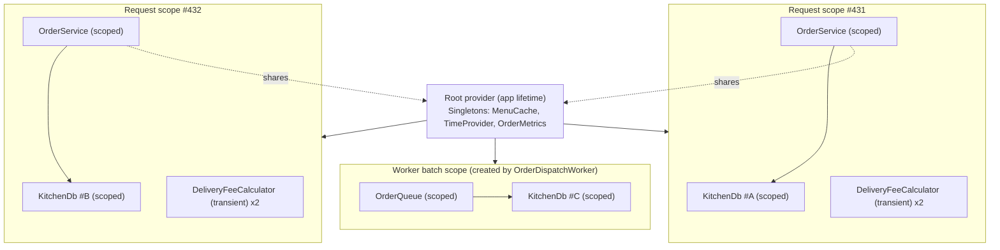
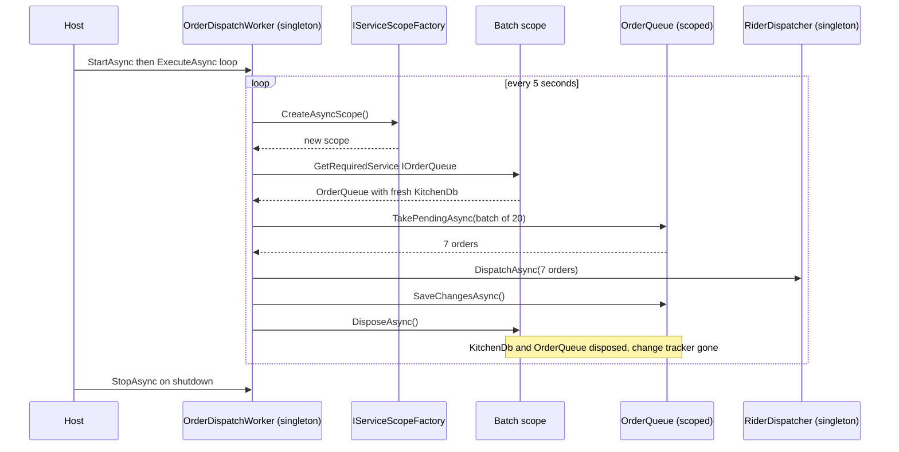

In [Dependency injection](#/lesson/m03-dependency-injection) the container decided *which* class to create. This lesson is about *how long* each object lives once created, which is called its **lifetime**. Lifetimes are where most real DI bugs live: data from one customer's request leaking into another's, "a second operation was started on this context" errors under load, memory that grows until the app restarts, and background jobs that work for an hour and then fail. The running example is a cloud kitchen in Mumbai that takes food orders through an API and dispatches them to riders from a background worker.

## Learning objectives

By the end of this lesson you will be able to:

1. Define singleton, scoped and transient lifetimes and predict how many instances exist in a given situation.
2. Explain what a **scope** is, who creates it in ASP.NET Core, and when the container disposes the objects it created.
3. Apply the lifetime rule ("depend only on equal or longer lifetimes") and recognise a **captive dependency** in code and in error messages.
4. Turn on and interpret **scope validation**, and know what it does and does not catch.
5. Explain why `DbContext` is scoped, when to use `IDbContextFactory` or pooling, and what goes wrong otherwise.
6. Use `IServiceScopeFactory` and `CreateAsyncScope` correctly in a `BackgroundService` and in singletons that need scoped services.
7. Make singletons safe under concurrent requests.

## Prerequisites

- [Dependency injection](#/lesson/m03-dependency-injection): registrations, constructor injection and the container's object graph.
- [HTTP request and response lifecycle](#/lesson/m03-request-lifecycle): you know that `HttpContext.RequestServices` exists and that many requests run at the same time.
- Comfortable with `async`/`await` and `using` statements.

## Explain it like I'm a beginner

Picture the cloud kitchen on a busy Friday night.

- **The kitchen's gas pipeline and the menu board are singletons.** There is exactly one, installed when the kitchen opened, shared by every cook and every order, and it stays until the kitchen closes. Because everyone uses it at once, it must be safe to share: two cooks can read the menu board at the same time without problems, but if one cook rubs out a price while another reads it, someone gets the wrong number.
- **The order ticket is scoped.** Each incoming order gets its own ticket. Everyone working on *that order* (the cook, the packer, the billing person) writes on the *same* ticket. When the order leaves the kitchen, the ticket is filed away (disposed). Ticket #431 never gets mixed up with ticket #432.
- **Paper napkins are transient.** Whoever needs one takes a fresh one. Nobody shares a napkin and nobody cares which napkin they got.

Now the classic mistake. Imagine the menu board (singleton) has *one order ticket stapled to it permanently* (a scoped object captured by a singleton). Every cook writes every order on that same ticket. Order #431's "no onions" ends up on order #432's biryani. That is a **captive dependency**: a short-lived thing trapped inside a long-lived thing.

In ASP.NET Core:

- **Singleton**: one instance for the whole application, created on first use (or at registration if you pass an instance).
- **Scoped**: one instance per **scope**. In a web app, the framework creates one scope per HTTP request.
- **Transient**: a new instance every time one is requested.

## First-principles explanation

### Counting instances

Suppose `OrderService` depends on `IPricing` and `IAuditLog`, and an endpoint asks for both `OrderService` and `IAuditLog`. How many `IAuditLog` instances exist in one request?

- **Singleton**: 1 for the entire app, shared by every request.
- **Scoped**: 1 for this request. `OrderService` and the endpoint receive the *same* object. The next request gets a different one.
- **Transient**: 2 in this request, one for the endpoint and one for `OrderService`. Every resolution is new.

A useful habit: whenever you register a service, say the instance count out loud. "One per app", "one per request", "one per injection".

### What a scope is

A **scope** (`IServiceScope`) is a container session with its own cache for scoped instances and its own list of disposable objects to clean up. The **root provider**, created by `builder.Build()`, is also a kind of scope that lasts for the whole application.

In ASP.NET Core, for every request:

1. The framework calls `IServiceScopeFactory.CreateAsyncScope()` at the start of the request.
2. `HttpContext.RequestServices` points at that scope's provider. Endpoint parameters, controller constructors and `InvokeAsync` parameters are resolved from it.
3. At the end of the request, the scope is disposed. The container calls `Dispose` or `DisposeAsync` on every scoped **and transient** disposable object it created *within that scope*, in reverse order of creation.

Outside HTTP requests there is no automatic scope. In a console app, a unit test, or a background service, *you* create scopes with `CreateScope()` or `CreateAsyncScope()`.

### Disposal: who cleans up

The container disposes objects **it created**:

- Singletons it created: disposed when the root provider is disposed, at app shutdown.
- Scoped and transient objects: disposed when the scope that resolved them ends.
- Instances you created yourself and passed in (`AddSingleton(new Foo())`): **not** disposed by the container. You own them.

Two consequences matter in practice:

1. **Do not dispose injected services yourself.** If `OrderService` calls `_db.Dispose()`, the next consumer in the same request gets a disposed object and `ObjectDisposedException`.
2. **Transient disposables resolved from the root provider leak.** The root keeps a reference to every disposable transient it creates so it can dispose them at shutdown. Resolve a transient `IDisposable` from the root once per message in a loop, and you hold a growing list of objects until the app restarts. Resolve from a scope and dispose the scope instead.

### The lifetime rule

> A service may depend only on services whose lifetime is **equal to or longer than** its own.

| Consumer \ Dependency | Singleton | Scoped | Transient |
|---|---|---|---|
| **Singleton** | OK | **Captive (bug)** | Becomes effectively singleton (bug if it has per-use state) |
| **Scoped** | OK | OK | OK (one per scoped instance) |
| **Transient** | OK | OK | OK |

Why the rule exists: a consumer holds its dependencies in fields for as long as it lives. If a singleton holds a scoped `KitchenDbContext`, that one context is now shared by every request, on many threads at once, for the lifetime of the app.

### Captive dependencies and what they look like in production

A **captive dependency** is a shorter-lived service held captive by a longer-lived one. Three common shapes:

1. **Singleton captures a scoped `DbContext`.** Under light load it seems fine. Under real load, two requests use the same context concurrently and EF Core throws `InvalidOperationException: A second operation was started on this context instance before a previous operation completed.` The context's change tracker also grows forever, holding every entity ever loaded, so memory climbs and queries slow down.
2. **Singleton captures a scoped "current user" or "current tenant" context.** The first request's user is frozen into the singleton. Every later request sees order history for the *first* customer who called the API after startup. This is a data-leak bug, not just a crash.
3. **Singleton captures a typed `HttpClient`.** Typed clients are registered as transient so that `IHttpClientFactory` can rotate the underlying handlers. Captured in a singleton, the handler is never rotated and DNS changes (for example, a payment gateway failing over to a new IP) are never seen. Use `IHttpClientFactory` inside the singleton, or a `SocketsHttpHandler` with `PooledConnectionLifetime`.

Middleware is a special case you already met: convention-based middleware is constructed once, so it is effectively a singleton, and scoped services must come through `InvokeAsync` parameters instead of the constructor.

### Scope validation

The container can detect the singleton-captures-scoped case for you:

```csharp
builder.Host.UseDefaultServiceProvider(o =>
{
    o.ValidateScopes = true;    // already true in Development
    o.ValidateOnBuild = true;   // already true in Development
});
```

With `ValidateScopes` on, two things throw:

- Resolving a singleton whose dependency chain contains a scoped service: `Cannot consume scoped service 'Kitchen.Data.KitchenDb' from singleton 'Kitchen.Menu.MenuCache'.`
- Resolving a scoped service directly from the root provider: `Cannot resolve scoped service 'Kitchen.Data.KitchenDb' from root provider.`

Combined with `ValidateOnBuild`, the first error appears during `Build()`, so the app refuses to start. What scope validation **does not** catch:

- A singleton capturing a **transient** that has per-use state. The container considers this legal.
- Dependencies obtained manually through `IServiceProvider.GetService` inside a factory or method, after startup.
- Your own static fields and caches holding references to scoped objects.

Because validation is on by default only in Development, a team that never runs Development locally (or tests only in Release containers) may never see the error. Enabling it explicitly in every environment is cheap, a few milliseconds of startup for a typical app (estimate), and catches the problem in CI.

### Choosing a lifetime

Ask three questions in order:

1. **Does it hold per-request or per-operation state** (the current user, a unit of work, a change tracker)? Then **scoped**.
2. **Does it depend on anything scoped?** Then scoped or transient, never singleton.
3. **Is it stateless, or is its state immutable or properly synchronised, and is it safe to use from many threads at once?** Then **singleton** is the cheapest choice: created once, no allocation per request.

Use **transient** for lightweight, stateless objects where you want a fresh instance each time, or when you are unsure and the class is cheap to create. For a stateless service, transient and singleton behave the same functionally; singleton just allocates less.

Typical choices in a web app:

| Service | Lifetime | Reason |
|---|---|---|
| `TimeProvider`, `IOptions<T>`, caches, `IHttpClientFactory` | Singleton | Shared, thread-safe |
| Stateless calculators (GST, delivery fee) | Singleton or transient | No state, cheap |
| `DbContext`, repositories over it, unit of work | Scoped | One unit of work per request |
| Current user, tenant, correlation id holders | Scoped | Per-request state |
| Typed `HttpClient` clients | Transient (set by `AddHttpClient`) | Factory rotates handlers |
| `IOptionsSnapshot<T>` | Scoped | Re-reads configuration once per request |

### `DbContext` and its lifetime

`AddDbContext<KitchenDbContext>(...)` registers the context as **scoped** by default. That is deliberate:

- A `DbContext` is a **unit of work**: it tracks the entities you load and change, and `SaveChangesAsync` writes them in one transaction. One request is one natural unit of work.
- It is **not thread-safe**. Two concurrent operations on one instance are not supported, and EF Core throws when it detects them. A request is handled by one logical flow of `await`s, so a scoped context is used sequentially.
- Its change tracker grows with every entity loaded. A short-lived context stays small.

Related tools:

- **`AddDbContextFactory<T>()`** registers `IDbContextFactory<T>` (a singleton) that creates a fresh context on demand. Use it in singletons, in Blazor Server components, and when you genuinely need **parallel** queries in one request (one context per parallel task). You own each created context and must dispose it.
- **`AddDbContextPool<T>()`** keeps a pool of context instances and resets them between requests to save allocation cost. It is still effectively scoped from your point of view. Do not store per-request state in fields of a pooled context; it is reset, not recreated.

```csharp
// EF Core shown for reference. Not compiled in this lesson (EF Core is not available offline).
builder.Services.AddDbContext<KitchenDbContext>(o => o.UseNpgsql(builder.Configuration.GetConnectionString("Kitchen")));
builder.Services.AddDbContextFactory<ReportingDbContext>(o => o.UseNpgsql(builder.Configuration.GetConnectionString("Reporting")));
```

A common bug: `Task.WhenAll(orders.Select(o => _db.Orders.FindAsync(o.Id)))` on one scoped context. That is concurrent use and fails. Either `await` sequentially, query once with `WHERE id = ANY(@ids)`, or create one context per task from the factory.

### Background services and `IServiceScopeFactory`

Hosted services, including every `BackgroundService`, are registered as **singletons**. A dispatch worker that loops forever cannot take `KitchenDbContext` in its constructor: scope validation blocks it, and even without validation a single context would live for days.

The pattern is: inject `IServiceScopeFactory` (a singleton), and create **one scope per unit of work** — per batch, per message, per iteration:

```csharp
while (await timer.WaitForNextTickAsync(stoppingToken))
{
    await using var scope = scopeFactory.CreateAsyncScope();
    var queue = scope.ServiceProvider.GetRequiredService<IOrderQueue>();
    // ... process one batch with fresh scoped services ...
}   // scope disposed here: context and repositories cleaned up
```

Why per batch and not one scope for the whole loop? A scope that lives as long as the worker is a captive dependency in disguise: the context's change tracker grows with every batch, stale data is served from its identity map, and a failed `SaveChanges` leaves the context in a broken state for all later batches. One scope per batch means a failure in batch 17 does not poison batch 18.

Prefer `CreateAsyncScope()` with `await using`. If any service in the scope implements only `IAsyncDisposable` (common for database connections), disposing the scope synchronously throws.

The same pattern applies to a **singleton that occasionally needs a scoped service**, such as a menu cache that refreshes prices from the database every 5 minutes: inject `IServiceScopeFactory`, create a scope inside the refresh method, and dispose it before returning.

Resolving from `scope.ServiceProvider` is one of the few legitimate uses of the provider directly. Keep it in thin infrastructure code (the worker loop) and put the real logic in a scoped service resolved from the scope, so the logic stays testable through its constructor.

### Thread safety of singletons

A singleton is used by every concurrent request. In a kitchen API taking 300 orders per minute at peak, several threads can be inside the same singleton method at once. Rules:

- Prefer **immutable** state: build a new dictionary and swap the reference (`Volatile.Write` or a simple reference assignment, which is atomic).
- Use **concurrent collections** (`ConcurrentDictionary`) and `Interlocked` for counters.
- Use `lock` only around short, non-`await` sections. Never `await` inside a `lock` (the compiler forbids it); use `SemaphoreSlim` if you must serialise async work.
- Never store per-request data (user id, order id) in a singleton field.

Scoped services do not need this care in normal request code: one request's scope is used by one logical flow at a time. The exception is code that starts parallel tasks inside one request and shares scoped services between them.

### Trade-offs

| Lifetime | Gains | Costs and risks |
|---|---|---|
| Singleton | One allocation, shared caches, fastest to resolve | Must be thread-safe, cannot depend on scoped services, state lives until restart |
| Scoped | Natural per-request unit of work, no thread-safety worries in normal use | Needs a scope: background code must create one, and resolving from root throws |
| Transient | No sharing surprises, simple | More allocations, disposables from root leak, captured by singletons silently |

**A simpler alternative**: many small services are stateless. Making them all singletons (or all transient) and keeping state out of them removes most lifetime questions. Reserve scoped for the few things that truly are per request: the data context and request identity.

## Visual explanation

### Scopes in a running web app



The root provider at the top owns the singletons, shared by everything below it (the dotted arrows). Each request gets its own scope with its own `KitchenDb` (#A and #B never meet) and its own `OrderService`. Transient calculators appear twice per request because two classes asked for one. The third box is the important one for background work: the worker created that scope itself, exactly like the framework does for a request, so the worker's `KitchenDb #C` is isolated too. When each scope ends, its scoped and transient disposables are disposed; the singletons survive until shutdown.

### A background worker doing it right



Each tick creates a new scope, resolves scoped services from it, does one batch of work, saves, and disposes the scope. The singleton dispatcher is shared across ticks, which is fine because it is thread-safe and holds no per-batch state. If `SaveChangesAsync` fails in one tick, the next tick starts with a brand-new scope and context, so the failure does not spread. Compare this with injecting `OrderQueue` into the worker's constructor: one context for the whole life of the process.

## Step-by-step example

### Step 1 — see the three lifetimes

Register a small `InstanceTag` class (it just holds a `Guid`) three times under different interfaces, one per lifetime. Create two scopes and resolve each interface twice per scope. Print the ids. You will see one id for the singleton, two ids for scoped (one per scope) and four ids for transient. The playground below does exactly this.

### Step 2 — introduce the per-request unit of work

`KitchenDb` represents the data context. Register it as scoped. `OrderService` (scoped) and `PlaceOrderEndpoint` both use it in one request and get the same instance, so a change made by `OrderService` is visible to the endpoint and saved once.

### Step 3 — make the mistake

Register `MenuCache` as a singleton that takes `KitchenDb` in its constructor. Run in Development: the app fails at startup with "Cannot consume scoped service 'KitchenDb' from singleton 'MenuCache'". Turn validation off and it starts, and then under concurrent load you would see the shared-context errors. Turn validation back on.

### Step 4 — fix it with a scope factory

Change `MenuCache` to take `IServiceScopeFactory`. Its `RefreshAsync` creates an async scope, resolves `IMenuRepository`, loads prices, swaps an immutable dictionary, and disposes the scope. The cache stays a singleton; the database access is scoped and short-lived.

### Step 5 — the background dispatcher

Write `OrderDispatchWorker : BackgroundService` with a `PeriodicTimer`. Each tick creates a scope and processes one batch. Exceptions in one batch are logged and counted; the loop continues.

## Production-style C# implementation

Project layout:

```text
Kitchen.Api/
  Program.cs
  Data/KitchenDb.cs
  Data/InMemoryOrderStore.cs
  Requests/RequestContext.cs
  Menu/MenuCache.cs
  Orders/OrderService.cs
  Orders/OrderMetrics.cs
  Workers/OrderDispatchWorker.cs
```

`KitchenDb` below is an in-memory stand-in for an EF Core `DbContext`, so the code compiles without EF Core. It deliberately reproduces the two properties that matter for lifetimes: it tracks changes until `SaveChangesAsync`, and it detects concurrent use.

```csharp file=Data/InMemoryOrderStore.cs
using System.Collections.Concurrent;

namespace Kitchen.Data;

public enum OrderStatus { Pending, Dispatched }

public sealed record Order(Guid Id, string CustomerMobile, string[] Items, decimal Total, OrderStatus Status);

public sealed record MenuItem(string Code, string Name, decimal Price);

/// <summary>Singleton "database". Thread-safe because every request and the worker share it.</summary>
public sealed class InMemoryOrderStore
{
    public ConcurrentDictionary<Guid, Order> Orders { get; } = new();

    public ConcurrentDictionary<string, MenuItem> Menu { get; } = new(new Dictionary<string, MenuItem>
    {
        ["VADA"] = new("VADA", "Vada pav", 30m),
        ["BIRY"] = new("BIRY", "Chicken biryani", 260m),
        ["PBM"] = new("PBM", "Pav bhaji", 140m),
    });
}
```

```csharp file=Data/KitchenDb.cs
namespace Kitchen.Data;

/// <summary>
/// Stand-in for an EF Core DbContext: a scoped unit of work that tracks changes and is not thread-safe.
/// </summary>
public sealed class KitchenDb(InMemoryOrderStore store) : IAsyncDisposable
{
    private readonly List<Order> _pending = [];
    private int _busy;
    private bool _disposed;

    public Guid InstanceId { get; } = Guid.NewGuid();

    public void Add(Order order) { Guard(); _pending.Add(order); }

    public void Update(Order order) { Guard(); _pending.Add(order); }

    public async Task<IReadOnlyList<Order>> PendingOrdersAsync(int max, CancellationToken ct)
    {
        Enter();
        try
        {
            await Task.Yield();   // simulate I/O
            return store.Orders.Values.Where(o => o.Status == OrderStatus.Pending).Take(max).ToList();
        }
        finally { Exit(); }
    }

    public IReadOnlyCollection<MenuItem> MenuItems() { Guard(); return store.Menu.Values.ToArray(); }

    public async Task<int> SaveChangesAsync(CancellationToken ct)
    {
        Enter();
        try
        {
            await Task.Yield();
            foreach (var o in _pending) store.Orders[o.Id] = o;
            var count = _pending.Count;
            _pending.Clear();
            return count;
        }
        finally { Exit(); }
    }

    public ValueTask DisposeAsync() { _disposed = true; _pending.Clear(); return ValueTask.CompletedTask; }

    private void Guard() => ObjectDisposedException.ThrowIf(_disposed, this);

    private void Enter()
    {
        Guard();
        if (Interlocked.Exchange(ref _busy, 1) == 1)
            throw new InvalidOperationException("A second operation was started on this KitchenDb before a previous operation completed.");
    }

    private void Exit() => Volatile.Write(ref _busy, 0);
}
```

```csharp file=Requests/RequestContext.cs
using Microsoft.AspNetCore.Http;

namespace Kitchen.Requests;

/// <summary>Per-request state. Scoped: one per request, never shared.</summary>
public sealed class RequestContext
{
    public string CorrelationId { get; set; } = "";
    public string? CustomerMobile { get; set; }
}

/// <summary>
/// Convention-based middleware is effectively a singleton, so the scoped RequestContext
/// is taken as an InvokeAsync parameter (resolved per request), not in the constructor.
/// </summary>
public sealed class RequestContextMiddleware(RequestDelegate next)
{
    public async Task InvokeAsync(HttpContext http, RequestContext context)
    {
        context.CorrelationId = http.Request.Headers["X-Correlation-Id"].FirstOrDefault() ?? http.TraceIdentifier;
        context.CustomerMobile = http.Request.Headers["X-Customer-Mobile"].FirstOrDefault();
        http.Response.Headers["X-Correlation-Id"] = context.CorrelationId;
        await next(http);
    }
}
```

```csharp file=Menu/MenuCache.cs
using Kitchen.Data;
using Microsoft.Extensions.DependencyInjection;

namespace Kitchen.Menu;

/// <summary>
/// Singleton cache that needs a scoped dependency only during refresh.
/// It takes IServiceScopeFactory instead of KitchenDb, so it never captures a scoped instance.
/// </summary>
public sealed class MenuCache(IServiceScopeFactory scopes, TimeProvider clock)
{
    // Immutable snapshot swapped atomically: readers never see a half-built dictionary.
    private IReadOnlyDictionary<string, MenuItem> _items = new Dictionary<string, MenuItem>();

    public DateTimeOffset? LastRefreshed { get; private set; }

    public async Task RefreshAsync(CancellationToken ct)
    {
        await using var scope = scopes.CreateAsyncScope();
        var db = scope.ServiceProvider.GetRequiredService<KitchenDb>();
        var fresh = db.MenuItems().ToDictionary(i => i.Code, StringComparer.OrdinalIgnoreCase);
        Volatile.Write(ref _items, fresh);
        LastRefreshed = clock.GetUtcNow();
    }

    public MenuItem? Find(string code) => Volatile.Read(ref _items).GetValueOrDefault(code);
}
```

```csharp file=Orders/OrderMetrics.cs
using System.Collections.Concurrent;

namespace Kitchen.Orders;

/// <summary>Singleton shared by every request: all state is thread-safe.</summary>
public sealed class OrderMetrics
{
    private long _placed;
    private readonly ConcurrentDictionary<string, long> _byItem = new(StringComparer.OrdinalIgnoreCase);

    public void Record(IEnumerable<string> itemCodes)
    {
        Interlocked.Increment(ref _placed);
        foreach (var code in itemCodes) _byItem.AddOrUpdate(code, 1, (_, n) => n + 1);
    }

    public long Placed => Interlocked.Read(ref _placed);

    public IReadOnlyDictionary<string, long> ByItem => new Dictionary<string, long>(_byItem);
}
```

```csharp file=Orders/OrderService.cs
using Kitchen.Data;
using Kitchen.Menu;
using Kitchen.Requests;

namespace Kitchen.Orders;

public sealed record PlaceOrderRequest(string[] ItemCodes);

/// <summary>Scoped: shares the request's KitchenDb and RequestContext. Depends on singletons freely.</summary>
public sealed class OrderService(KitchenDb db, RequestContext request, MenuCache menu, OrderMetrics metrics)
{
    public async Task<Order?> PlaceAsync(PlaceOrderRequest input, CancellationToken ct)
    {
        if (request.CustomerMobile is null || input.ItemCodes.Length == 0) return null;

        var items = input.ItemCodes.Select(menu.Find).ToArray();
        if (items.Any(i => i is null)) return null;

        var order = new Order(Guid.NewGuid(), request.CustomerMobile, input.ItemCodes,
            items.Sum(i => i!.Price), OrderStatus.Pending);
        db.Add(order);
        await db.SaveChangesAsync(ct);
        metrics.Record(input.ItemCodes);
        return order;
    }
}
```

```csharp file=Workers/OrderDispatchWorker.cs
using Kitchen.Data;
using Microsoft.Extensions.DependencyInjection;
using Microsoft.Extensions.Hosting;
using Microsoft.Extensions.Logging;

namespace Kitchen.Workers;

public interface IRiderDispatcher
{
    Task DispatchAsync(IReadOnlyList<Order> orders, CancellationToken ct);
}

public sealed class LoggingRiderDispatcher(ILogger<LoggingRiderDispatcher> logger) : IRiderDispatcher
{
    public Task DispatchAsync(IReadOnlyList<Order> orders, CancellationToken ct)
    {
        foreach (var o in orders) logger.LogInformation("Rider assigned to order {OrderId} (Rs {Total})", o.Id, o.Total);
        return Task.CompletedTask;
    }
}

/// <summary>Hosted services are singletons. One async scope per batch keeps every KitchenDb short-lived.</summary>
public sealed class OrderDispatchWorker(
    IServiceScopeFactory scopes,
    IRiderDispatcher dispatcher,
    ILogger<OrderDispatchWorker> logger) : BackgroundService
{
    private static readonly TimeSpan Interval = TimeSpan.FromSeconds(5);

    protected override async Task ExecuteAsync(CancellationToken stoppingToken)
    {
        using var timer = new PeriodicTimer(Interval);
        while (await timer.WaitForNextTickAsync(stoppingToken))
        {
            try
            {
                var count = await RunBatchAsync(stoppingToken);
                if (count > 0) logger.LogInformation("Dispatched {Count} orders", count);
            }
            catch (Exception ex) when (ex is not OperationCanceledException)
            {
                // One bad batch must not stop the worker. The next tick gets a fresh scope.
                logger.LogError(ex, "Dispatch batch failed");
            }
        }
    }

    public async Task<int> RunBatchAsync(CancellationToken ct)
    {
        await using var scope = scopes.CreateAsyncScope();
        var db = scope.ServiceProvider.GetRequiredService<KitchenDb>();

        var pending = await db.PendingOrdersAsync(max: 20, ct);
        if (pending.Count == 0) return 0;

        await dispatcher.DispatchAsync(pending, ct);
        foreach (var order in pending) db.Update(order with { Status = OrderStatus.Dispatched });
        await db.SaveChangesAsync(ct);
        return pending.Count;
    }
}
```

```csharp file=Program.cs
using Kitchen.Data;
using Kitchen.Menu;
using Kitchen.Orders;
using Kitchen.Requests;
using Kitchen.Workers;

var builder = WebApplication.CreateBuilder(args);

// Singletons: shared, thread-safe, no scoped dependencies.
builder.Services.AddSingleton(TimeProvider.System);
builder.Services.AddSingleton<InMemoryOrderStore>();
builder.Services.AddSingleton<MenuCache>();
builder.Services.AddSingleton<OrderMetrics>();
builder.Services.AddSingleton<IRiderDispatcher, LoggingRiderDispatcher>();

// Scoped: one per request (or per worker batch).
builder.Services.AddScoped<KitchenDb>();            // with EF Core: AddDbContext<KitchenDbContext>(...)
builder.Services.AddScoped<RequestContext>();
builder.Services.AddScoped<OrderService>();

// Hosted services are singletons.
builder.Services.AddHostedService<OrderDispatchWorker>();

// Catch captive dependencies in every environment, not only Development.
builder.Host.UseDefaultServiceProvider(o =>
{
    o.ValidateScopes = true;
    o.ValidateOnBuild = true;
});

var app = builder.Build();

app.UseMiddleware<RequestContextMiddleware>();

app.MapPost("/orders", async (PlaceOrderRequest body, OrderService orders, CancellationToken ct) =>
    await orders.PlaceAsync(body, ct) is { } order
        ? Results.Created($"/orders/{order.Id}", order)
        : Results.BadRequest(new { error = "Unknown item or missing X-Customer-Mobile header" }));

app.MapGet("/metrics/orders", (OrderMetrics metrics) => Results.Ok(new { metrics.Placed, metrics.ByItem }));

app.MapPost("/admin/menu/refresh", async (MenuCache menu, CancellationToken ct) =>
{
    await menu.RefreshAsync(ct);
    return Results.Ok(new { menu.LastRefreshed });
});

// Warm the singleton cache once at startup. A scope is created inside RefreshAsync.
await app.Services.GetRequiredService<MenuCache>().RefreshAsync(CancellationToken.None);

app.Run();
```

Things to notice:

- `MenuCache` and `OrderDispatchWorker` are singletons that need scoped `KitchenDb`. Both take `IServiceScopeFactory` and create a short scope per operation.
- `RequestContextMiddleware` takes `RequestContext` in `InvokeAsync`, not its constructor.
- `OrderService` (scoped) depends on singletons (`MenuCache`, `OrderMetrics`) and scoped services (`KitchenDb`, `RequestContext`): both directions allowed by the lifetime rule.
- `KitchenDb` throws if two operations overlap, the same safety check EF Core performs. A captive `KitchenDb` in a singleton would hit it under load.
- The startup warm-up resolves `MenuCache` from `app.Services` (the root). That is fine for a singleton; resolving `KitchenDb` there would throw with scope validation on.

## Bad design vs good design

**Bad**: a singleton cache with a captured context, and a worker with one scope for its whole life.

```csharp
builder.Services.AddScoped<KitchenDb>();
builder.Services.AddSingleton<MenuCache>();           // MenuCache(KitchenDb db): captive dependency

public sealed class DispatchWorker(IServiceProvider sp) : BackgroundService
{
    protected override async Task ExecuteAsync(CancellationToken ct)
    {
        using var scope = sp.CreateScope();             // one scope for days
        var db = scope.ServiceProvider.GetRequiredService<KitchenDb>();
        while (!ct.IsCancellationRequested)
        {
            var orders = await db.PendingOrdersAsync(20, ct);
            await Task.WhenAll(orders.Select(o => db.SaveChangesAsync(ct)));   // concurrent use of one context
            await Task.Delay(5000, ct);
        }
    }
}
```

Four problems: the cache shares one context across all requests (blocked at startup by scope validation, or a concurrency failure under load without it); the worker's single scope means the context lives for days and grows; `Task.WhenAll` on one context is concurrent use; and an exception anywhere ends the loop for good, silently stopping dispatch.

**Good**: the production code above: `IServiceScopeFactory` in singletons, `CreateAsyncScope` per batch, sequential use of the context, and a try/catch around each batch.

:::callout type=warning title="A captive dependency can leak data, not just crash"
A singleton that captures a scoped "current customer" object serves the first customer's identity to everyone. That is a privacy incident. Keep per-request identity strictly scoped, and treat any singleton with a scoped-sounding field (`_currentUser`, `_tenant`, `_db`) as a review red flag.
:::

:::callout type=tip title="When in doubt, keep services stateless"
If a service holds no state, its lifetime barely matters. Most lifetime bugs come from a few stateful objects: data contexts, request identity, caches. Spend your care there.
:::

## Practical playground

This program prints instance ids for each lifetime across two scopes, then shows the two errors scope validation raises: a singleton consuming a scoped service, and a scoped service resolved from the root. Try changing `AddScoped<Ticket>` to `AddTransient<Ticket>` and see which error disappears and why that is not necessarily good news.

:::playground type=csharp title="Lifetimes and scope validation"
```csharp file=Program.cs
using System;
using Microsoft.Extensions.DependencyInjection;

public sealed class Tag { public string Id { get; } = Guid.NewGuid().ToString()[..4]; }
public interface ISingletonTag { Tag Tag { get; } }
public interface IScopedTag { Tag Tag { get; } }
public interface ITransientTag { Tag Tag { get; } }
public sealed class TagHolder : ISingletonTag, IScopedTag, ITransientTag { public Tag Tag { get; } = new(); }

public sealed class Ticket : IDisposable
{
    public void Dispose() => Console.WriteLine("  Ticket disposed");
}
public sealed class MenuBoard { public MenuBoard(Ticket ticket) { } }   // singleton capturing scoped

public static class Program
{
    public static void Main()
    {
        var services = new ServiceCollection();
        services.AddSingleton<ISingletonTag, TagHolder>();
        services.AddScoped<IScopedTag, TagHolder>();
        services.AddTransient<ITransientTag, TagHolder>();
        using var sp = services.BuildServiceProvider(new ServiceProviderOptions { ValidateScopes = true });

        for (var s = 1; s <= 2; s++)
        {
            using var scope = sp.CreateScope();
            var p = scope.ServiceProvider;
            Console.WriteLine($"scope {s}: singleton {p.GetRequiredService<ISingletonTag>().Tag.Id}/{p.GetRequiredService<ISingletonTag>().Tag.Id}" +
                              $"  scoped {p.GetRequiredService<IScopedTag>().Tag.Id}/{p.GetRequiredService<IScopedTag>().Tag.Id}" +
                              $"  transient {p.GetRequiredService<ITransientTag>().Tag.Id}/{p.GetRequiredService<ITransientTag>().Tag.Id}");
        }

        var bad = new ServiceCollection();
        bad.AddScoped<Ticket>();          // try AddTransient
        bad.AddSingleton<MenuBoard>();
        using var badSp = bad.BuildServiceProvider(new ServiceProviderOptions { ValidateScopes = true });

        try { badSp.GetRequiredService<MenuBoard>(); Console.WriteLine("MenuBoard resolved (captive dependency not detected!)"); }
        catch (InvalidOperationException ex) { Console.WriteLine("Captive: " + ex.Message); }

        try { badSp.GetRequiredService<Ticket>(); Console.WriteLine("Ticket resolved from root"); }
        catch (InvalidOperationException ex) { Console.WriteLine("Root:    " + ex.Message); }

        Console.WriteLine("Disposing a scope that resolved a Ticket:");
        using (var scope = badSp.CreateScope()) scope.ServiceProvider.GetRequiredService<Ticket>();
    }
}
```
:::

Expected: the singleton id is identical everywhere, the scoped id is the same twice within a scope but differs between scopes, and the transient id differs on every call. Then "Cannot consume scoped service 'Ticket' from singleton 'MenuBoard'" and "Cannot resolve scoped service 'Ticket' from root provider", and finally "Ticket disposed" when the scope ends. With `AddTransient<Ticket>` both errors vanish, but `MenuBoard` now silently holds one `Ticket` forever: validation does not catch singleton-captures-transient.

## Exercises

:::exercise id=m03-service-lifetimes-ex1 difficulty=beginner kind=code title="Count instances and disposals per lifetime"
Write `LifetimeProbe`, which registers a probe class with a given lifetime, exercises it in two scopes, and reports how many distinct instances were created and whether instances are disposed when their scope ends.
::requirements
- `DistinctInstances(ServiceLifetime lifetime)`: register `Probe` with that lifetime, create **two** scopes, resolve `Probe` **twice** in each, and return the number of distinct instances (by reference).
- `DisposedAtScopeEnd(ServiceLifetime lifetime)`: register `Probe` with that lifetime, resolve it inside one scope, dispose the scope, and return `probe.IsDisposed`. Dispose the root provider only after reading the result.
- Use `ServiceDescriptor` (or `services.Add(new ServiceDescriptor(typeof(Probe), typeof(Probe), lifetime))`) so one code path handles all three lifetimes.
::acceptance
- Singleton: 1 instance, not disposed at scope end.
- Scoped: 2 instances, disposed at scope end.
- Transient: 4 instances, disposed at scope end.
::hint
`ReferenceEqualityComparer.Instance` with a `HashSet<object>` counts distinct objects by reference.
::hint
`services.Add(new ServiceDescriptor(typeof(Probe), typeof(Probe), lifetime));` registers with any lifetime. Declare the variable as `IServiceCollection`, because `ServiceCollection` implements `Add` explicitly.
::hint
For the disposal check, keep a reference to the probe outside the `using` block for the scope, then read `IsDisposed` after the block.
::hint
```csharp
using var sp = services.BuildServiceProvider();
Probe probe;
using (var scope = sp.CreateScope()) probe = scope.ServiceProvider.GetRequiredService<Probe>();
return probe.IsDisposed;
```
::starter
```csharp file=LifetimeProbe.cs
using System;
using System.Collections.Generic;
using Microsoft.Extensions.DependencyInjection;

public sealed class Probe : IDisposable
{
    public bool IsDisposed { get; private set; }
    public void Dispose() => IsDisposed = true;
}

public static class LifetimeProbe
{
    public static int DistinctInstances(ServiceLifetime lifetime) => throw new NotImplementedException();

    public static bool DisposedAtScopeEnd(ServiceLifetime lifetime) => throw new NotImplementedException();
}
```
::tests
```csharp file=LifetimeProbeTests.cs
using Microsoft.Extensions.DependencyInjection;
using Xunit;

public class LifetimeProbeTests
{
    [Theory]
    [InlineData(ServiceLifetime.Singleton, 1)]
    [InlineData(ServiceLifetime.Scoped, 2)]
    [InlineData(ServiceLifetime.Transient, 4)]
    public void Counts_instances(ServiceLifetime lifetime, int expected)
    {
        Assert.Equal(expected, LifetimeProbe.DistinctInstances(lifetime));
    }

    [Theory]
    [InlineData(ServiceLifetime.Singleton, false)]
    [InlineData(ServiceLifetime.Scoped, true)]
    [InlineData(ServiceLifetime.Transient, true)]
    public void Disposal_at_scope_end(ServiceLifetime lifetime, bool expected)
    {
        Assert.Equal(expected, LifetimeProbe.DisposedAtScopeEnd(lifetime));
    }
}
```
::solution
```csharp file=LifetimeProbe.cs
using System;
using System.Collections.Generic;
using Microsoft.Extensions.DependencyInjection;

public sealed class Probe : IDisposable
{
    public bool IsDisposed { get; private set; }
    public void Dispose() => IsDisposed = true;
}

public static class LifetimeProbe
{
    private static ServiceProvider Build(ServiceLifetime lifetime)
    {
        // Typed as the interface: ServiceCollection implements Add explicitly.
        IServiceCollection services = new ServiceCollection();
        services.Add(new ServiceDescriptor(typeof(Probe), typeof(Probe), lifetime));
        return services.BuildServiceProvider(new ServiceProviderOptions { ValidateScopes = true });
    }

    public static int DistinctInstances(ServiceLifetime lifetime)
    {
        using var sp = Build(lifetime);
        var seen = new HashSet<object>(ReferenceEqualityComparer.Instance);
        for (var s = 0; s < 2; s++)
        {
            using var scope = sp.CreateScope();
            seen.Add(scope.ServiceProvider.GetRequiredService<Probe>());
            seen.Add(scope.ServiceProvider.GetRequiredService<Probe>());
        }
        return seen.Count;
    }

    public static bool DisposedAtScopeEnd(ServiceLifetime lifetime)
    {
        using var sp = Build(lifetime);
        Probe probe;
        using (var scope = sp.CreateScope())
            probe = scope.ServiceProvider.GetRequiredService<Probe>();
        return probe.IsDisposed;
    }
}
```

The singleton is not disposed when the scope ends because the root provider owns it; it is disposed when `sp` is disposed at the end of the method. Transients resolved in a scope are owned by that scope.
::mistakes
- Comparing instances with `Equals` on a type that overrides equality; count by reference.
- Resolving from `sp` instead of `scope.ServiceProvider`, which (with validation) throws for scoped services and otherwise hides the per-scope behaviour.
::extensions
Add `DisposedWhenResolvedFromRoot(ServiceLifetime.Transient)` and observe that the transient is only disposed when the root provider is disposed. That is the "transient disposables leak from root" problem.
:::

:::exercise id=m03-service-lifetimes-ex2 difficulty=beginner kind=written title="Spot the lifetime bugs in a registration list"
A hospital OPD token API registers these services. For each line, say whether it is fine, a captive dependency, a thread-safety risk, or a leak, and how to fix it.

```csharp
builder.Services.AddDbContext<OpdDbContext>(...);                          // scoped by default
builder.Services.AddSingleton<ITokenCounter, TokenCounter>();              // TokenCounter has: private int _next; public int Next() => ++_next;
builder.Services.AddSingleton<IPatientLookup, PatientLookup>();            // PatientLookup(OpdDbContext db)
builder.Services.AddScoped<ICurrentDoctor, CurrentDoctorFromClaims>();
builder.Services.AddSingleton<ConsultationService>();                      // ConsultationService(ICurrentDoctor doctor, ITokenCounter counter)
builder.Services.AddTransient<ISmsClient, SmsClient>();                    // SmsClient : IDisposable, resolved in a loop with app.Services.GetRequiredService
builder.Services.AddScoped<IReportBuilder, ReportBuilder>();               // ReportBuilder(OpdDbContext db, ITokenCounter counter)
```
::acceptance
- Identifies `PatientLookup` and `ConsultationService` as captive dependencies and gives a fix for each.
- Identifies `TokenCounter` as not thread-safe and proposes `Interlocked.Increment` (and notes it resets on restart).
- Identifies resolving a disposable transient from the root in a loop as a leak.
- Confirms `ReportBuilder` (scoped depending on scoped and singleton) is fine.
::hint
Apply the rule to each consumer: list its dependencies' lifetimes and check none is shorter.
::hint
`++_next` is a read, an add and a write. What happens when two requests run it at the same time?
::hint
Who disposes a transient resolved from `app.Services`, and when?
::solution
1. `AddDbContext<OpdDbContext>`: fine, scoped per request.
2. `TokenCounter` singleton with `++_next`: **thread-safety risk**. Two concurrent requests can read the same value and issue duplicate token numbers. Use `Interlocked.Increment(ref _next)`. Also note that an in-memory counter resets on restart and is not shared across two app instances; for real OPD tokens, use a PostgreSQL sequence or a row with `UPDATE ... RETURNING`.
3. `PatientLookup` singleton taking `OpdDbContext`: **captive dependency**. Make it scoped, or inject `IDbContextFactory<OpdDbContext>` and create a context per call.
4. `CurrentDoctorFromClaims` scoped: fine; per-request identity.
5. `ConsultationService` singleton taking `ICurrentDoctor`: **captive dependency and data-leak risk**: the first doctor's identity would be used for every consultation. Make `ConsultationService` scoped. Its dependency on the singleton `ITokenCounter` is fine.
6. Disposable transient `SmsClient` resolved from the root in a loop: **leak**. The root provider keeps every disposable transient until shutdown. Create a scope per iteration, or register the client as a singleton if it is thread-safe, or use `IHttpClientFactory`.
7. `ReportBuilder` scoped with a scoped context and a singleton counter: fine.
::mistakes
- Fixing the captive `PatientLookup` by making the context a singleton, which turns one bug into a worse one.
- Wrapping `++_next` in `lock` and calling it done without noticing the multi-instance problem.
:::

:::exercise id=m03-service-lifetimes-ex3 difficulty=intermediate kind=code title="Fix a captive dependency with IServiceScopeFactory"
`PriceCache` is a singleton that must load prices from a scoped `IMenuRepository`. Implement it so it never captures the repository: each refresh creates its own async scope.
::requirements
- Constructor: `PriceCache(IServiceScopeFactory scopes)`.
- `RefreshAsync()` creates an async scope, resolves `IMenuRepository`, calls `LoadPricesAsync()`, stores the result as an immutable snapshot, and disposes the scope before returning.
- `TryGetPrice(code, out price)` reads from the latest snapshot, case-insensitively.
- `Version` increments on every successful refresh.
::acceptance
- A provider built with `ValidateScopes = true` and `ValidateOnBuild = true` can resolve `PriceCache` as a singleton.
- Two refreshes use two different repository instances, and each is disposed after its refresh.
- After a refresh with new data, `TryGetPrice` returns the new price.
- Before any refresh, `TryGetPrice` returns false.
::hint
`await using var scope = _scopes.CreateAsyncScope();` then `scope.ServiceProvider.GetRequiredService<IMenuRepository>()`.
::hint
Store the snapshot in a field of type `IReadOnlyDictionary<string, decimal>` and replace the whole reference. Never mutate the dictionary readers are using.
::hint
`new Dictionary<string, decimal>(prices, StringComparer.OrdinalIgnoreCase)` gives case-insensitive lookups.
::hint
```csharp
public async Task RefreshAsync()
{
    await using var scope = _scopes.CreateAsyncScope();
    var repo = scope.ServiceProvider.GetRequiredService<IMenuRepository>();
    var prices = await repo.LoadPricesAsync();
    Volatile.Write(ref _snapshot, new Dictionary<string, decimal>(prices, StringComparer.OrdinalIgnoreCase));
    Interlocked.Increment(ref _version);
}
```
::starter
```csharp file=PriceCache.cs
using System;
using System.Collections.Generic;
using System.Threading;
using System.Threading.Tasks;
using Microsoft.Extensions.DependencyInjection;

public interface IMenuRepository
{
    Task<IReadOnlyDictionary<string, decimal>> LoadPricesAsync();
}

public sealed class PriceCache
{
    private readonly IServiceScopeFactory _scopes;
    private IReadOnlyDictionary<string, decimal> _snapshot = new Dictionary<string, decimal>();
    private int _version;

    public PriceCache(IServiceScopeFactory scopes) => _scopes = scopes;

    public int Version => Volatile.Read(ref _version);

    public Task RefreshAsync() => throw new NotImplementedException();

    public bool TryGetPrice(string code, out decimal price) => throw new NotImplementedException();
}
```
::tests
```csharp file=PriceCacheTests.cs
using System;
using System.Collections.Generic;
using System.Threading.Tasks;
using Microsoft.Extensions.DependencyInjection;
using Xunit;

public class PriceCacheTests
{
    private sealed class Tracker
    {
        public List<FakeMenuRepository> Created { get; } = new();
        public decimal BiryaniPrice { get; set; } = 260m;
    }

    private sealed class FakeMenuRepository : IMenuRepository, IAsyncDisposable
    {
        private readonly Tracker _tracker;
        public FakeMenuRepository(Tracker tracker) { _tracker = tracker; tracker.Created.Add(this); }
        public bool Disposed { get; private set; }
        public Task<IReadOnlyDictionary<string, decimal>> LoadPricesAsync() =>
            Task.FromResult<IReadOnlyDictionary<string, decimal>>(new Dictionary<string, decimal> { ["BIRY"] = _tracker.BiryaniPrice, ["VADA"] = 30m });
        public ValueTask DisposeAsync() { Disposed = true; return ValueTask.CompletedTask; }
    }

    private static (ServiceProvider sp, Tracker tracker) Build()
    {
        var tracker = new Tracker();
        var services = new ServiceCollection();
        services.AddSingleton(tracker);
        services.AddScoped<IMenuRepository, FakeMenuRepository>();
        services.AddSingleton<PriceCache>();
        var sp = services.BuildServiceProvider(new ServiceProviderOptions { ValidateScopes = true, ValidateOnBuild = true });
        return (sp, tracker);
    }

    [Fact]
    public void Resolves_as_singleton_under_validation()
    {
        var (sp, _) = Build();
        Assert.Same(sp.GetRequiredService<PriceCache>(), sp.GetRequiredService<PriceCache>());
    }

    [Fact]
    public async Task Each_refresh_uses_and_disposes_a_fresh_repository()
    {
        var (sp, tracker) = Build();
        var cache = sp.GetRequiredService<PriceCache>();
        await cache.RefreshAsync();
        await cache.RefreshAsync();
        Assert.Equal(2, tracker.Created.Count);
        Assert.NotSame(tracker.Created[0], tracker.Created[1]);
        Assert.True(tracker.Created[0].Disposed);
        Assert.True(tracker.Created[1].Disposed);
        Assert.Equal(2, cache.Version);
    }

    [Fact]
    public async Task New_prices_are_visible_after_refresh()
    {
        var (sp, tracker) = Build();
        var cache = sp.GetRequiredService<PriceCache>();
        await cache.RefreshAsync();
        Assert.True(cache.TryGetPrice("biry", out var before));
        Assert.Equal(260m, before);
        tracker.BiryaniPrice = 280m;
        await cache.RefreshAsync();
        Assert.True(cache.TryGetPrice("BIRY", out var after));
        Assert.Equal(280m, after);
    }

    [Fact]
    public void Empty_before_first_refresh()
    {
        var (sp, _) = Build();
        Assert.False(sp.GetRequiredService<PriceCache>().TryGetPrice("BIRY", out _));
    }
}
```
::solution
The singleton holds only a scope factory (itself a singleton) and an immutable snapshot. The repository lives for exactly one refresh.

```csharp file=PriceCache.cs
using System;
using System.Collections.Generic;
using System.Threading;
using System.Threading.Tasks;
using Microsoft.Extensions.DependencyInjection;

public interface IMenuRepository
{
    Task<IReadOnlyDictionary<string, decimal>> LoadPricesAsync();
}

public sealed class PriceCache
{
    private readonly IServiceScopeFactory _scopes;
    private IReadOnlyDictionary<string, decimal> _snapshot = new Dictionary<string, decimal>();
    private int _version;

    public PriceCache(IServiceScopeFactory scopes) => _scopes = scopes;

    public int Version => Volatile.Read(ref _version);

    public async Task RefreshAsync()
    {
        await using var scope = _scopes.CreateAsyncScope();
        var repository = scope.ServiceProvider.GetRequiredService<IMenuRepository>();
        var prices = await repository.LoadPricesAsync();
        var snapshot = new Dictionary<string, decimal>(prices, StringComparer.OrdinalIgnoreCase);
        Volatile.Write(ref _snapshot, snapshot);
        Interlocked.Increment(ref _version);
    }

    public bool TryGetPrice(string code, out decimal price) =>
        Volatile.Read(ref _snapshot).TryGetValue(code, out price);
}
```
::alternatives
If the repository is backed by EF Core, inject `IDbContextFactory<MenuDbContext>` instead of a scope factory and `await using var db = await factory.CreateDbContextAsync()`. That is more explicit when only the context is needed. A scope factory is more general when the refresh needs several scoped services.
::mistakes
- Using `CreateScope()` with `using`: the fake repository only implements `IAsyncDisposable`, and synchronous disposal of the scope throws.
- Mutating the existing dictionary during refresh while requests read it, which can throw or return torn data.
- Storing the resolved repository in a field "to reuse next time", which recreates the captive dependency.
::extensions
Add a `PeriodicTimer`-based `BackgroundService` that calls `RefreshAsync` every 5 minutes, and make concurrent refresh calls coalesce with a `SemaphoreSlim`.
:::

:::exercise id=m03-service-lifetimes-ex4 difficulty=intermediate kind=code title="A thread-safe singleton counter"
`KitchenLoadTracker` is a singleton that every order request calls. Make it correct under heavy concurrency.
::requirements
- `Record(string kitchenId)` increments the count for that kitchen. Kitchen ids are case-insensitive.
- `Count(string kitchenId)` returns the current count (0 if unknown).
- `Total` returns the sum of all recorded orders.
- `Busiest()` returns the kitchen id with the highest count, or `null` if nothing was recorded.
- Must be correct when called from many threads at once. No `lock` around the whole class needed.
::acceptance
- 10,000 parallel `Record` calls spread over 4 kitchens produce exact counts and an exact total.
- `"andheri"` and `"ANDHERI"` count as the same kitchen.
- `Busiest()` returns `null` when empty.
::hint
A plain `Dictionary<string, int>` with `dict[k]++` is a read-modify-write race and can also corrupt the dictionary itself.
::hint
`ConcurrentDictionary<string, long>` with `AddOrUpdate(key, 1, (_, n) => n + 1)` is atomic per key.
::hint
For `Total`, either sum the dictionary values or keep a separate `long` updated with `Interlocked.Increment`.
::hint
```csharp
private readonly ConcurrentDictionary<string, long> _counts = new(StringComparer.OrdinalIgnoreCase);
private long _total;
public void Record(string id) { _counts.AddOrUpdate(id, 1, (_, n) => n + 1); Interlocked.Increment(ref _total); }
```
::starter
```csharp file=KitchenLoadTracker.cs
using System;
using System.Collections.Concurrent;
using System.Linq;
using System.Threading;

public sealed class KitchenLoadTracker
{
    public void Record(string kitchenId) => throw new NotImplementedException();

    public long Count(string kitchenId) => throw new NotImplementedException();

    public long Total => throw new NotImplementedException();

    public string? Busiest() => throw new NotImplementedException();
}
```
::tests
```csharp file=KitchenLoadTrackerTests.cs
using System.Threading.Tasks;
using Microsoft.Extensions.DependencyInjection;
using Xunit;

public class KitchenLoadTrackerTests
{
    [Fact]
    public void Parallel_records_are_exact()
    {
        var services = new ServiceCollection().AddSingleton<KitchenLoadTracker>().BuildServiceProvider();
        var kitchens = new[] { "andheri", "bandra", "powai", "thane" };
        Parallel.For(0, 10_000, i =>
        {
            var tracker = services.GetRequiredService<KitchenLoadTracker>();
            tracker.Record(kitchens[i % 4]);
        });
        var t = services.GetRequiredService<KitchenLoadTracker>();
        Assert.Equal(10_000L, t.Total);
        foreach (var k in kitchens) Assert.Equal(2_500L, t.Count(k));
    }

    [Fact]
    public void Ids_are_case_insensitive()
    {
        var t = new KitchenLoadTracker();
        t.Record("andheri");
        t.Record("ANDHERI");
        t.Record("Bandra");
        Assert.Equal(2L, t.Count("Andheri"));
        Assert.Equal("andheri", t.Busiest()!.ToLowerInvariant());
    }

    [Fact]
    public void Empty_tracker()
    {
        var t = new KitchenLoadTracker();
        Assert.Null(t.Busiest());
        Assert.Equal(0L, t.Count("powai"));
        Assert.Equal(0L, t.Total);
    }
}
```
::solution
```csharp file=KitchenLoadTracker.cs
using System;
using System.Collections.Concurrent;
using System.Linq;
using System.Threading;

public sealed class KitchenLoadTracker
{
    private readonly ConcurrentDictionary<string, long> _counts = new(StringComparer.OrdinalIgnoreCase);
    private long _total;

    public void Record(string kitchenId)
    {
        _counts.AddOrUpdate(kitchenId, 1, (_, n) => n + 1);
        Interlocked.Increment(ref _total);
    }

    public long Count(string kitchenId) => _counts.TryGetValue(kitchenId, out var n) ? n : 0;

    public long Total => Interlocked.Read(ref _total);

    public string? Busiest()
    {
        var snapshot = _counts.ToArray();
        return snapshot.Length == 0 ? null : snapshot.MaxBy(kv => kv.Value).Key;
    }
}
```

`AddOrUpdate` may call the update function more than once under contention, but it applies exactly one successful update per call, so counts stay exact. `ToArray()` takes a moment-in-time snapshot for `Busiest`.
::alternatives
For very hot counters across many cores, `System.Diagnostics.Metrics` counters (exported via OpenTelemetry) are the production answer: they are designed for this and give you dashboards for free. Keep a hand-written tracker for logic that must read the value back.
::mistakes
- `Dictionary` plus `lock` on every read and write: correct but serialises all requests through one lock.
- Forgetting that an in-memory singleton is per process: with 3 app instances behind a load balancer, each has its own counts.
::extensions
Add a sliding one-minute window so `Busiest()` reflects current load, not the total since startup.
:::

:::exercise id=m03-service-lifetimes-ex5 difficulty=advanced kind=code title="A background worker with one scope per batch"
Implement `DispatchWorker`, a `BackgroundService` that processes orders in batches. Each batch must run in its own async scope with fresh scoped services, a failing batch must not stop the worker, and the scope must be disposed even when the batch fails.
::requirements
- Constructor: `DispatchWorker(IServiceScopeFactory scopes, TimeSpan interval)`.
- `RunOnceAsync(ct)`: create an async scope, resolve the scoped `IOrderBatch`, call `TakeAsync()` to get order ids, call `MarkDispatchedAsync(ids)` if there are any, and return the number processed. The scope is disposed whether or not an exception occurs; exceptions propagate to the caller.
- `ExecuteAsync`: loop with `PeriodicTimer(interval)` until cancelled. Call `RunOnceAsync` each tick; on an exception other than cancellation, increment `FailedBatches` and continue. Increment `SucceededBatches` on success.
::acceptance
- Two `RunOnceAsync` calls use two different `IOrderBatch` instances, each disposed afterwards.
- A batch that throws still disposes its scope, and the exception reaches the caller of `RunOnceAsync`.
- Started as a hosted service, a worker whose first batch throws keeps running and records at least one successful batch afterwards.
::hint
`await using var scope = _scopes.CreateAsyncScope();` disposes the scope when the method exits, including by exception.
::hint
`using var timer = new PeriodicTimer(_interval); while (await timer.WaitForNextTickAsync(stoppingToken)) { ... }` ends with `OperationCanceledException` when the host stops.
::hint
Catch with a filter: `catch (Exception) when (!stoppingToken.IsCancellationRequested)`, so shutdown is not counted as a failure.
::hint
`BackgroundService.StopAsync` cancels the token passed to `ExecuteAsync` and waits for it. A `WaitForNextTickAsync` that throws `OperationCanceledException` at shutdown is normal; let it end `ExecuteAsync`.
::hint
Use `Interlocked.Increment` for the counters, since tests read them from another thread.
::starter
```csharp file=DispatchWorker.cs
using System;
using System.Collections.Generic;
using System.Threading;
using System.Threading.Tasks;
using Microsoft.Extensions.DependencyInjection;
using Microsoft.Extensions.Hosting;

public interface IOrderBatch
{
    Task<IReadOnlyList<Guid>> TakeAsync();
    Task MarkDispatchedAsync(IReadOnlyList<Guid> ids);
}

public sealed class DispatchWorker : BackgroundService
{
    private readonly IServiceScopeFactory _scopes;
    private readonly TimeSpan _interval;
    private int _failed;
    private int _succeeded;

    public DispatchWorker(IServiceScopeFactory scopes, TimeSpan interval)
    {
        _scopes = scopes;
        _interval = interval;
    }

    public int FailedBatches => Volatile.Read(ref _failed);
    public int SucceededBatches => Volatile.Read(ref _succeeded);

    public Task<int> RunOnceAsync(CancellationToken ct) => throw new NotImplementedException();

    protected override Task ExecuteAsync(CancellationToken stoppingToken) => throw new NotImplementedException();
}
```
::tests
```csharp file=DispatchWorkerTests.cs
using System;
using System.Collections.Generic;
using System.Linq;
using System.Threading;
using System.Threading.Tasks;
using Microsoft.Extensions.DependencyInjection;
using Xunit;

public class DispatchWorkerTests
{
    private sealed class World
    {
        public List<FakeBatch> Created { get; } = new();
        public int FailFirstN { get; set; }
        public int Calls;
    }

    private sealed class FakeBatch : IOrderBatch, IAsyncDisposable
    {
        private readonly World _world;
        public FakeBatch(World world) { _world = world; lock (world.Created) world.Created.Add(this); }
        public bool Disposed { get; private set; }
        public List<Guid> Marked { get; } = new();
        public Task<IReadOnlyList<Guid>> TakeAsync()
        {
            var n = Interlocked.Increment(ref _world.Calls);
            if (n <= _world.FailFirstN) throw new InvalidOperationException("database unavailable");
            return Task.FromResult<IReadOnlyList<Guid>>(new[] { Guid.NewGuid(), Guid.NewGuid() });
        }
        public Task MarkDispatchedAsync(IReadOnlyList<Guid> ids) { Marked.AddRange(ids); return Task.CompletedTask; }
        public ValueTask DisposeAsync() { Disposed = true; return ValueTask.CompletedTask; }
    }

    private static (DispatchWorker worker, World world) Build(int failFirst, TimeSpan interval)
    {
        var world = new World { FailFirstN = failFirst };
        var services = new ServiceCollection();
        services.AddSingleton(world);
        services.AddScoped<IOrderBatch, FakeBatch>();
        var sp = services.BuildServiceProvider(new ServiceProviderOptions { ValidateScopes = true });
        return (new DispatchWorker(sp.GetRequiredService<IServiceScopeFactory>(), interval), world);
    }

    [Fact]
    public async Task Each_run_gets_a_fresh_disposed_scope()
    {
        var (worker, world) = Build(failFirst: 0, TimeSpan.FromSeconds(1));
        Assert.Equal(2, await worker.RunOnceAsync(CancellationToken.None));
        Assert.Equal(2, await worker.RunOnceAsync(CancellationToken.None));
        Assert.Equal(2, world.Created.Count);
        Assert.NotSame(world.Created[0], world.Created[1]);
        Assert.True(world.Created.All(b => b.Disposed));
        Assert.Equal(2, world.Created[0].Marked.Count);
    }

    [Fact]
    public async Task Failing_run_still_disposes_and_propagates()
    {
        var (worker, world) = Build(failFirst: 1, TimeSpan.FromSeconds(1));
        await Assert.ThrowsAsync<InvalidOperationException>(() => worker.RunOnceAsync(CancellationToken.None));
        Assert.True(world.Created[0].Disposed);
    }

    [Fact]
    public async Task Worker_survives_a_failed_batch()
    {
        var (worker, _) = Build(failFirst: 1, TimeSpan.FromMilliseconds(20));
        await worker.StartAsync(CancellationToken.None);
        var deadline = DateTime.UtcNow.AddSeconds(5);
        while (worker.SucceededBatches < 1 && DateTime.UtcNow < deadline) await Task.Delay(20);
        await worker.StopAsync(CancellationToken.None);
        Assert.True(worker.FailedBatches >= 1, "expected a failed batch");
        Assert.True(worker.SucceededBatches >= 1, "expected a later successful batch");
    }
}
```
::solution
The loop is thin infrastructure; each batch is isolated by its own scope, and `await using` guarantees disposal on every exit path.

```csharp file=DispatchWorker.cs
using System;
using System.Collections.Generic;
using System.Threading;
using System.Threading.Tasks;
using Microsoft.Extensions.DependencyInjection;
using Microsoft.Extensions.Hosting;

public interface IOrderBatch
{
    Task<IReadOnlyList<Guid>> TakeAsync();
    Task MarkDispatchedAsync(IReadOnlyList<Guid> ids);
}

public sealed class DispatchWorker : BackgroundService
{
    private readonly IServiceScopeFactory _scopes;
    private readonly TimeSpan _interval;
    private int _failed;
    private int _succeeded;

    public DispatchWorker(IServiceScopeFactory scopes, TimeSpan interval)
    {
        _scopes = scopes;
        _interval = interval;
    }

    public int FailedBatches => Volatile.Read(ref _failed);
    public int SucceededBatches => Volatile.Read(ref _succeeded);

    public async Task<int> RunOnceAsync(CancellationToken ct)
    {
        await using var scope = _scopes.CreateAsyncScope();
        var batch = scope.ServiceProvider.GetRequiredService<IOrderBatch>();
        var ids = await batch.TakeAsync();
        if (ids.Count > 0) await batch.MarkDispatchedAsync(ids);
        return ids.Count;
    }

    protected override async Task ExecuteAsync(CancellationToken stoppingToken)
    {
        using var timer = new PeriodicTimer(_interval);
        try
        {
            while (await timer.WaitForNextTickAsync(stoppingToken))
            {
                try
                {
                    await RunOnceAsync(stoppingToken);
                    Interlocked.Increment(ref _succeeded);
                }
                catch (Exception) when (!stoppingToken.IsCancellationRequested)
                {
                    // In production: log with ILogger, include the exception, and alert if failures repeat.
                    Interlocked.Increment(ref _failed);
                }
            }
        }
        catch (OperationCanceledException) when (stoppingToken.IsCancellationRequested)
        {
            // Normal shutdown.
        }
    }
}
```
::alternatives
For queue-driven work (RabbitMQ, Azure Service Bus, a PostgreSQL `SKIP LOCKED` queue), create the scope per **message** instead of per tick. For CPU-heavy batches, consider `Channel<T>` with a fixed number of consumer tasks, each creating its own scope; never share one scope between parallel consumers. [Background services and hosted workers](#/lesson/m03-background-services) covers these designs.
::mistakes
- Creating the scope once before the `while` loop, so every batch shares one context.
- Catching every exception including cancellation, so the worker logs a spurious failure on every shutdown.
- Letting the exception escape `ExecuteAsync`: since .NET 6 the default `BackgroundServiceExceptionBehavior.StopHost` stops the whole application.
::extensions
Add exponential back-off after consecutive failures (5 s, 10 s, 20 s, capped at 2 minutes) and reset it after a success.
:::

## Automated testing

Lifetime bugs are invisible in single-threaded unit tests, so test for them deliberately.

**1. Build the real composition root with validation on.** One test that registers everything as `Program.cs` does and calls `BuildServiceProvider(new ServiceProviderOptions { ValidateScopes = true, ValidateOnBuild = true })` catches every singleton-consumes-scoped mistake. With `WebApplicationFactory<Program>`, the Development defaults already validate, but set the environment explicitly so a test run in `Production` still validates.

**2. Assert lifetimes directly when they matter.** A test that resolves a service twice in one scope and once in another, and asserts `Same`/`NotSame`, documents the intended lifetime and fails if someone "optimises" a scoped service into a singleton.

```csharp
[Fact]
public void RequestContext_is_per_request()
{
    using var sp = BuildAppServices();
    using var a = sp.CreateScope();
    using var b = sp.CreateScope();
    Assert.Same(a.ServiceProvider.GetRequiredService<RequestContext>(), a.ServiceProvider.GetRequiredService<RequestContext>());
    Assert.NotSame(a.ServiceProvider.GetRequiredService<RequestContext>(), b.ServiceProvider.GetRequiredService<RequestContext>());
}
```

**3. Concurrency tests for singletons.** `Parallel.For` with thousands of iterations (exercise 4) is crude but effective at exposing non-atomic updates. Run them a few times; a race that appears 1 run in 10 is still a bug.

**4. Background workers.** Expose a `RunOnceAsync` (or `RunBatchAsync`) method so most tests call one iteration directly and deterministically, and keep only one or two tests that start the hosted service and wait with a timeout.

**5. Integration tests for request isolation.** Fire two concurrent HTTP requests with different `X-Customer-Mobile` headers through `WebApplicationFactory` and assert each response contains only its own customer. This catches captive request-context bugs that validation cannot, such as a singleton holding a value copied from a scoped service.

## Real-world application

- **EF Core in every ASP.NET Core API.** The scoped `DbContext` per request is the default architecture for most .NET web apps with PostgreSQL or SQL Server. Knowing why it is scoped is what lets you use `IDbContextFactory` safely in the few places that need something else.
- **Multi-tenant SaaS.** A scoped `TenantContext`, filled by middleware from a subdomain or JWT claim, drives connection strings or query filters. A single captive reference to it in a singleton would mix tenants' data, so teams add an integration test with two tenants in parallel.
- **Order and payment workers.** Food delivery, e-commerce and ticketing platforms run workers that poll or consume queues. One scope per message, with the message's database work in one unit of work, is the standard design, often combined with the outbox pattern.
- **Caches and reference data.** Rate cards, GST slabs, menu prices: singleton caches with immutable snapshots, refreshed through a short-lived scope, serve thousands of reads per second without touching the database.
- **Blazor Server.** A "scoped" service in Blazor Server lives for the whole user circuit, potentially hours, not one HTTP request. Teams use `IDbContextFactory` there instead of a scoped context. Same container, different scope boundary.

## Interview questions

:::interview
::q beginner
What is the difference between singleton, scoped and transient lifetimes?
::a
A singleton has one instance for the whole application, created on first use and disposed at shutdown. A scoped service has one instance per scope; ASP.NET Core creates a scope per HTTP request, so all classes in one request share it and it is disposed when the request ends. A transient service is created every time it is requested, so two consumers in the same request get two instances; disposable transients are disposed when the scope that created them ends.
::q beginner
Why is DbContext registered as scoped?
::a
A DbContext is a unit of work that tracks loaded and changed entities and saves them together, which maps naturally to one request. It is not thread-safe, and a request uses it sequentially, so one instance per request avoids concurrent use. A short lifetime also keeps the change tracker small and releases connections promptly. A singleton context would be shared across concurrent requests and grow forever; a transient one would break the unit of work because each repository would get its own context.
::q intermediate
What is a captive dependency and how do you detect it?
::a
It is a service with a shorter lifetime captured by one with a longer lifetime, typically a scoped service (DbContext, current user) injected into a singleton. The scoped object then lives as long as the singleton and is shared across requests, causing concurrency errors, stale data or data leaks between users. `ValidateScopes` (on by default in Development) detects singleton-consumes-scoped and resolving scoped services from the root, especially with `ValidateOnBuild` at startup. It does not detect singletons capturing transients or dependencies resolved manually later, so code review and isolation tests remain necessary.
::q intermediate
How should a BackgroundService use a scoped service such as a DbContext?
::a
Hosted services are singletons, so they must not take scoped services in their constructor. Inject `IServiceScopeFactory`, and for each unit of work (each batch, message or tick) create a scope with `await using var scope = factory.CreateAsyncScope()`, resolve the scoped services from `scope.ServiceProvider`, do the work, and let the scope dispose them. Do not create one scope for the entire loop, which recreates a long-lived context, and catch per-iteration exceptions so one failure does not stop the worker or, by default, the host.
::q advanced
Your API occasionally returns another customer's order history under load. Lifetimes are suspected. How do you investigate and fix it?
::a
Look for per-request identity held beyond a request: a singleton with a field set from the current user, a singleton depending on a scoped user or tenant context (check whether `ValidateScopes` is on in that environment), a static or singleton cache keyed without the customer id, a convention-based middleware storing request data in a field, or a captured `HttpContext` (use `IHttpContextAccessor` only when needed and never store the context). Reproduce with an integration test sending concurrent requests for two customers. Fix by making identity holders scoped, passing ids explicitly, keying caches by customer, and enabling scope validation in all environments. Add the concurrent isolation test to CI and treat the incident as a data breach for reporting purposes.
::q advanced
When would you use `IDbContextFactory` or `AddDbContextPool` instead of a plain scoped DbContext?
::a
Use `IDbContextFactory` when the consumer is not request-scoped (singletons, Blazor Server components whose scope lasts a circuit, background services that want explicit control) or when one operation needs several contexts in parallel, one per task. You create and dispose each context yourself. Use `AddDbContextPool` for high-throughput APIs where context construction cost shows up in profiles; contexts are reset and reused rather than recreated, so you must not keep custom per-request state in the context's fields. Neither changes the core rule: one context per unit of work, never used concurrently.
:::

## Summary and revision

**Key takeaways**

- Singleton: one per app. Scoped: one per scope (per HTTP request in ASP.NET Core). Transient: one per resolution.
- The container disposes what it created: singletons at shutdown, scoped and transient objects when their scope ends. Disposable transients resolved from the root leak until shutdown.
- Depend only on equal or longer lifetimes. A singleton capturing a scoped service is a captive dependency; it causes concurrency failures, unbounded growth and data leaks.
- `ValidateScopes` and `ValidateOnBuild` catch singleton-consumes-scoped at startup. Enable them in every environment. They do not catch singleton-captures-transient.
- `DbContext` is scoped because it is a non-thread-safe unit of work. Use `IDbContextFactory` for singletons and parallel work, and pooling for throughput.
- Background services and singletons that need scoped services use `IServiceScopeFactory.CreateAsyncScope()` per unit of work.
- Singletons must be thread-safe: immutable snapshots, concurrent collections, `Interlocked`.

**Terminology**: lifetime, scope, root provider, `IServiceScope`, `IServiceScopeFactory`, `CreateAsyncScope`, captive dependency, scope validation, unit of work, `IDbContextFactory`, DbContext pooling, thread safety.

:::flashcards
Q: How many instances of a scoped service exist across 3 concurrent requests?
A: Three, one per request scope. Everything inside one request shares that request's instance.
Q: When is a transient IDisposable disposed?
A: When the scope that resolved it is disposed. If resolved from the root provider, only at app shutdown, which is a memory leak in loops.
Q: State the lifetime rule.
A: A service may depend only on services with an equal or longer lifetime.
Q: What error does ValidateScopes give for a singleton that needs a scoped service?
A: "Cannot consume scoped service 'X' from singleton 'Y'."
Q: Which captive dependency does scope validation not catch?
A: A singleton capturing a transient (and anything resolved manually through IServiceProvider after startup).
Q: How does a BackgroundService get a DbContext safely?
A: Inject IServiceScopeFactory and create a new async scope per batch or message, resolving the context from scope.ServiceProvider.
Q: Why prefer CreateAsyncScope with await using?
A: Services that implement only IAsyncDisposable (for example database connections) throw if the scope is disposed synchronously.
Q: Why must convention-based middleware take scoped services in InvokeAsync?
A: The middleware instance is created once, so constructor dependencies are effectively singletons. InvokeAsync parameters are resolved per request.
:::

## Knowledge check

:::quiz pass=70
::q single
Under load, an API logs "A second operation was started on this context instance before a previous operation completed." The `DbContext` is registered with `AddDbContext`. What is the most likely cause?
- [ ] The database server is too slow.
- [x] A singleton service captured the context, so concurrent requests share it.
- [ ] `AddDbContext` registers the context as transient.
- [ ] The connection pool is too small.
> A scoped context used by one request is used sequentially. Concurrent use almost always means the context was captured by something longer-lived, or a single request ran `Task.WhenAll` on one context.
::q single
An endpoint takes `IAuditLog` and also `OrderService`, which itself takes `IAuditLog`. `IAuditLog` is registered as transient. How many `IAuditLog` instances exist for one request?
- [ ] 1
- [x] 2
- [ ] 1 per application
- [ ] 0 until the first log call
> Transient means one instance per resolution: one for the endpoint parameter, one for `OrderService`'s constructor.
::q single
A `BackgroundService` needs a scoped `IOrderRepository`. Which approach is correct?
- [ ] Take `IOrderRepository` in the constructor.
- [ ] Register the repository as a singleton.
- [x] Inject `IServiceScopeFactory` and create an async scope for each batch.
- [ ] Create one scope in the constructor and reuse it for the life of the worker.
> Hosted services are singletons. A scope per unit of work keeps the repository and its context short-lived and isolated.
::q multi
Which situations does `ValidateScopes = true` detect? (Select all that apply.)
- [x] A singleton whose constructor needs a scoped service.
- [x] Resolving a scoped service directly from the root provider.
- [ ] A singleton whose constructor needs a transient service.
- [ ] A scoped service stored in a static field.
> Validation tracks the container's own scope rules. Singleton-captures-transient is legal to the container, and static fields are invisible to it.
::q single
A singleton `TokenCounter` uses `private int _next; public int Next() => ++_next;`. What goes wrong?
- [ ] Nothing, singletons are thread-safe by default.
- [x] Concurrent requests can read the same value and issue duplicate tokens.
- [ ] Scope validation throws at startup.
- [ ] The counter resets on every request.
> `++` is a read, an add and a write. Use `Interlocked.Increment`, and for durable unique numbers use the database.
::q single
A worker resolves a transient `PdfRenderer : IDisposable` from `app.Services` once per invoice in a loop that runs all day. What happens?
- [ ] Each renderer is disposed at the end of its loop iteration.
- [x] The root provider keeps every renderer until shutdown, so memory grows.
- [ ] The container throws because transients cannot be resolved from the root.
- [ ] The renderer becomes a singleton automatically.
> Disposable transients are tracked by the scope that created them. For the root, that is the app lifetime. Create a scope per iteration.
::q single
Which lifetime best fits a service that holds the current request's tenant id, filled by middleware?
- [ ] Singleton
- [x] Scoped
- [ ] Transient
- [ ] Any, as long as it is an interface
> It is per-request state shared by everything in the request. Transient would give each consumer an empty copy, and singleton would leak tenants.
::q single
Blazor Server components need database access, and a circuit can last hours. What is the recommended approach?
- [ ] A scoped `DbContext`, because Blazor scopes are per request.
- [x] `IDbContextFactory<T>`, creating a short-lived context per operation.
- [ ] A singleton `DbContext` shared by all circuits.
- [ ] A transient `DbContext` injected into the component.
> In Blazor Server a scope is the whole circuit, so a scoped context would live for hours. A factory gives one context per unit of work.
:::

## Completion criteria

You have finished this lesson when you can:

- [ ] Score at least 70 % on the knowledge check.
- [ ] Complete exercises 1, 3 and 5 with all tests passing.
- [ ] For any registration list, state the instance count per request for each service and identify every captive dependency.
- [ ] Write a `BackgroundService` from memory that uses `CreateAsyncScope` per batch and survives a failing batch.
- [ ] Explain to a colleague why `DbContext` is scoped and when you would use `IDbContextFactory` instead.
