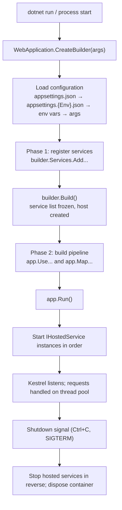
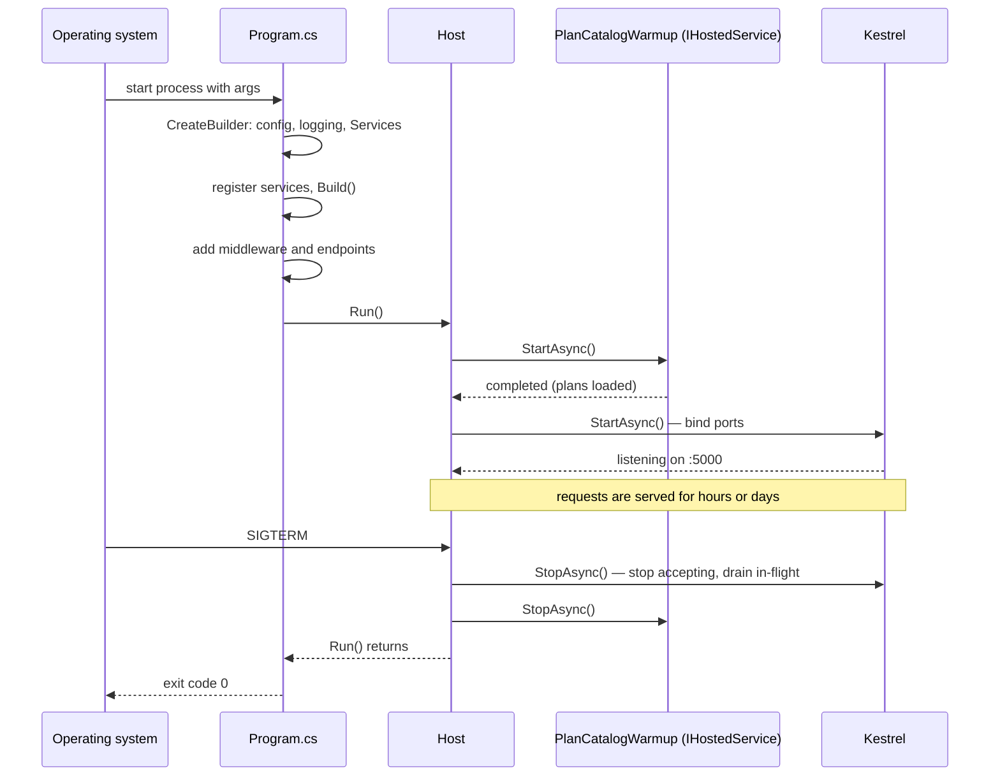

Every ASP.NET Core application, from a weekend side project to a payment gateway handling thousands of requests per second, starts the same way: one file called `Program.cs`, about twenty lines long. Those twenty lines decide what the app can do, where it reads its settings from, how it logs, and how it listens for requests. Understanding them is the difference between copying a template and knowing what you are running.

## Learning objectives

By the end of this lesson you will be able to:

1. Read a `Program.cs` from top to bottom and say, line by line, what each statement sets up.
2. Explain what `WebApplication.CreateBuilder(args)` does for you behind the scenes (configuration, logging, the web server and the service container).
3. Separate the two startup phases: **registering services** before `Build()` and **building the request pipeline** after it, and explain why the order cannot be swapped.
4. Describe what the *host* is and what `app.Run()` actually does while your app is "running".
5. Use environments (`Development`, `Staging`, `Production`) to change behaviour and settings without changing code.
6. Add a hosted service that runs work at startup and shuts down cleanly.
7. Diagnose the common startup mistakes: services registered after `Build()`, wrong environment, settings file not found, and a startup that blocks forever.

## Prerequisites

- [Classes, objects, fields, properties and methods](#/lesson/m01-classes-objects): you should be comfortable creating objects and calling methods on them.
- [Interfaces and abstract classes](#/lesson/m01-interfaces-abstract): the host talks to your code through interfaces such as `IHostedService`.
- [Client-server architecture](#/lesson/m02-client-server): you know that a web app is a program that waits for requests and sends responses.

You do **not** need to know dependency injection or middleware yet. This lesson introduces both just enough to understand startup. They get their own lessons next: [Dependency injection](#/lesson/m03-dependency-injection) and [Kestrel, middleware, routing](#/lesson/m03-kestrel-middleware-routing).

## Explain it like I'm a beginner

Think about a gym opening for the day. Before the first member walks in at 6 a.m., a lot has to happen, and it has to happen in a specific order:

1. **Read today's notice board.** The manager checks the fee chart (₹1,500 a month, ₹4,000 a quarter), the opening hours, and whether this week's 10 % festive offer is on. Changing the fee chart does not require rebuilding the gym.
2. **Bring in and brief the staff.** The front-desk person, the trainers, the cleaner. Each one knows their job and whom to call for help. Nobody is serving members yet; this is pure preparation.
3. **Set up the entry flow.** Door → membership-card scanner → locker desk → workout floor. Each member passes these stations in this order. Put the workout floor before the card scanner and people train without paying.
4. **Unlock the door.** Now, and only now, members start coming in. The gym keeps running until someone decides to close it for the night.

An ASP.NET Core app starts in exactly these four steps:

1. **Read configuration** (`appsettings.json`, environment variables, command-line arguments).
2. **Register services**: the objects your app will need, such as a database connection factory or a membership fee calculator. This is the *service registration phase*, done on `builder.Services`.
3. **Build the request pipeline**: the ordered list of steps every HTTP request passes through (this is the *middleware pipeline*). Done on `app` after `Build()`.
4. **Run**: start the web server (Kestrel) and wait for requests until a shutdown signal arrives.

The thing that coordinates all four steps, keeps the app alive, and shuts it down tidily is called the **host**. Think of the host as the gym manager: they do not train anyone themselves, but nothing happens without them.

## First-principles explanation

### The smallest possible Program.cs

```csharp
var builder = WebApplication.CreateBuilder(args);
var app = builder.Build();
app.MapGet("/", () => "Gym membership API is up");
app.Run();
```

Four lines, and it is a complete web server. Let's unpack each line, because almost everything in this module hangs off them.

### Line 1: `WebApplication.CreateBuilder(args)`

This single call does the boring but essential work that used to take a hundred lines. It creates a `WebApplicationBuilder` that has already:

- **Set up configuration** (a merged, read-only view of all your settings, called `IConfiguration`). Sources are loaded in this order, and later sources override earlier ones: `appsettings.json` → `appsettings.{Environment}.json` → user secrets (only in Development) → environment variables → command-line arguments. So `dotnet run --Membership:MonthlyFee=1800` beats the value in `appsettings.json`. This is why you never need to edit a JSON file to change a setting on a server; you set an environment variable.
- **Set up logging** (`ILogger<T>`) with console and debug output by default, reading levels from the `Logging` section of configuration.
- **Detected the environment** from the `ASPNETCORE_ENVIRONMENT` variable (falling back to `DOTNET_ENVIRONMENT`, then to `Production`). More on this below.
- **Configured Kestrel**, the built-in web server, to listen on the URLs from configuration (`ASPNETCORE_URLS`, `ASPNETCORE_HTTP_PORTS`, the `Kestrel` section) or, under `dotnet run`, from `launchSettings.json`, where project templates put randomly chosen local ports. With nothing configured it listens on `http://localhost:5000`; the official .NET container images set `ASPNETCORE_HTTP_PORTS=8080`.
- **Created an empty service container** (`IServiceCollection`, exposed as `builder.Services`) and pre-registered the framework's own services in it: logging, configuration, `IHostEnvironment`, `IHostApplicationLifetime` and options support. Things such as `IHttpClientFactory`, controllers or your own `TimeProvider` registration you add yourself.

`args` is passed in so command-line arguments become configuration. Always pass it.

### Phase 1 — registering services (before `Build()`)

Between `CreateBuilder` and `Build()`, you describe what your app needs. You do not create objects here; you write down *recipes* for creating them:

```csharp
builder.Services.AddSingleton<IPlanCatalog, ConfiguredPlanCatalog>();
builder.Services.AddScoped<IRenewalCalculator, RenewalCalculator>();
builder.Services.Configure<MembershipOptions>(builder.Configuration.GetSection("Membership"));
```

Each line says: "when someone asks for `IPlanCatalog`, give them a `ConfiguredPlanCatalog`". The container figures out the constructor parameters itself. This is dependency injection, and it has [its own lesson](#/lesson/m03-dependency-injection). For now, the key fact is **timing**: `builder.Services` is a list of recipes, and `Build()` freezes that list. Registrations after `Build()` throw an exception, because the container (`IServiceProvider`) has already been created from the frozen list.

A useful mental test: anything that answers "what objects exist in this app and how are they made?" belongs before `Build()`.

### `Build()` — the point of no return

`builder.Build()` does three things:

1. Builds the service provider from the registered recipes (and in Development, validates them; see [Service lifetimes](#/lesson/m03-service-lifetimes)).
2. Creates the host: the object that owns the server, the lifetime, and all `IHostedService` instances.
3. Returns a `WebApplication`, which is simultaneously the host (you can `Run` it), an endpoint route builder (you can `MapGet` on it), and an application builder (you can `Use` middleware on it).

After `Build()`, the variable name changes from `builder` to `app`, and the questions you answer change too.

### Phase 2 — building the pipeline (after `Build()`)

Now you describe what happens to each request, in order:

```csharp
if (!app.Environment.IsDevelopment())
    app.UseExceptionHandler("/error");   // safe errors for the public; Development gets the detailed page automatically
app.UseHttpsRedirection();
app.UseAuthentication();
app.UseAuthorization();
app.MapGet("/members/{id}/renewal", (int id, IRenewalCalculator calc) => calc.QuoteFor(id));
```

Each `Use*` call adds one station to the entry flow. Each `Map*` call registers an endpoint, which is the final station where your code runs. Order matters here in the same way it matters at the gym door: `UseAuthorization` before `UseAuthentication` means you check permissions before knowing who the user is. [The middleware lesson](#/lesson/m03-kestrel-middleware-routing) covers the correct order in detail.

A mental test for this phase: anything that answers "what happens to a request?" belongs after `Build()`.

### `app.Run()` — what "running" means

`Run()` looks like a single line but it is where the app spends 99.99 % of its life. Internally it:

1. Starts every registered `IHostedService` in registration order (the Kestrel server is itself a hosted service, started last by default in ASP.NET Core so your services are ready before traffic arrives).
2. Logs "Now listening on: http://localhost:5000" and "Application started".
3. **Blocks the main thread** waiting for a shutdown signal: Ctrl+C in a terminal, `SIGTERM` from Kubernetes or systemd, or `IHostApplicationLifetime.StopApplication()` from your own code.
4. On that signal, stops accepting new connections, gives in-flight requests a grace period (30 s by default, configurable via `HostOptions.ShutdownTimeout`), calls `StopAsync` on every hosted service in reverse order, and disposes the service provider.

So nothing after `app.Run()` executes until the app is shutting down. A common beginner surprise: code written below `app.Run()` "never runs". It runs, but only at shutdown.

Why does the framework run requests on other threads if the main thread is blocked? Because Kestrel uses the thread pool: each request is handled asynchronously on pool threads; the main thread's only job is to stay alive so the process does not exit.

### Environments

An **environment** is a single string naming where the app is running. The three conventional values are `Development`, `Staging` and `Production`, but you can invent your own (`UAT`, `Training`). It is read from `ASPNETCORE_ENVIRONMENT` and exposed as `builder.Environment` / `app.Environment` (`IWebHostEnvironment`).

Since .NET 6, `WebApplication` turns on the developer exception page by itself when the environment is `Development`, so you no longer write `UseDeveloperExceptionPage()` in new code.

Two things change with the environment:

1. **Which settings file is layered on top.** `appsettings.Development.json` is loaded only when the environment is `Development`. A typical layout: connection strings and log levels differ per file; everything shared stays in `appsettings.json`.
2. **Which code paths you choose.** `if (app.Environment.IsDevelopment())` is the normal way to enable the OpenAPI document and UI, seed test data, or relax CORS. In production those are a security risk.

If the variable is not set, the environment is **Production**. That is a deliberate safe default: an app that forgets to set its environment on a server gets production behaviour, not debug pages leaking stack traces.

A sanity rule: if you need more than three or four environment checks in `Program.cs`, move the difference into configuration instead. Code that branches on environment is harder to test than code that reads a setting.

### Hosted services — work that is not a request

Some work is not triggered by HTTP: warming a cache at startup, polling a queue, sending a nightly report. The host offers `IHostedService` for this: two methods, `StartAsync` (called during `Run()`, before the server accepts traffic) and `StopAsync` (called during shutdown). `BackgroundService` is a convenience base class with one `ExecuteAsync` method for long-running loops. [Background services](#/lesson/m03-background-services) goes deep; here we use one to show the start/stop sequence.

An important detail: hosted services start **in registration order**, and the host waits for each `StartAsync` to finish before starting the next. A `StartAsync` that does five minutes of work delays your whole app by five minutes. Kick long work off to a background task and return quickly, or use `BackgroundService`, whose `ExecuteAsync` runs without blocking startup. (From .NET 10 the *whole* of `ExecuteAsync` runs in the background; in earlier versions the synchronous part before the first `await` still blocked startup.)

Two newer knobs exist but are rarely needed: `HostOptions.ServicesStartConcurrently` / `ServicesStopConcurrently` (since .NET 8) start or stop hosted services in parallel, and `IHostedLifecycleService` adds `StartingAsync`, `StartedAsync`, `StoppingAsync` and `StoppedAsync` hooks around the normal two. Keep the default sequential start unless you have measured a slow startup.

### What happens without understanding this

- Developers register a service after `Build()` and get `InvalidOperationException: Cannot modify ServiceCollection after application is built`.
- A UAT server runs with no `ASPNETCORE_ENVIRONMENT`, so `appsettings.UAT.json` is silently ignored and the app points at the live payment gateway and the wrong database.
- A `StartAsync` that calls a slow external API makes a Kubernetes pod fail its startup probe and restart forever.
- A developer puts a cleanup call after `app.Run()` and is confused why it only logs at shutdown.

### Trade-offs

| You gain | You pay |
|---|---|
| One file shows the whole shape of the app | `Program.cs` can become a 300-line dumping ground; split registrations into extension methods |
| Configuration layering means no code change per environment | Precedence rules must be learned; "which value won?" is a frequent question |
| Hosted services get lifetime management for free | A slow or faulty `StartAsync` blocks the whole app |
| Sensible defaults (Production fallback, console logging) | Defaults hide what is happening until you read what `CreateBuilder` does |

## Visual explanation

### The two phases



Read it top to bottom. Everything above `Build()` is about *what exists*; everything below it is about *what happens*. The box at the bottom is the part most tutorials skip: shutdown is part of startup design, because the same host that started your services is responsible for stopping them in reverse order.

### The host, the server and your code



Notice that `Program.cs` hands control to the host and does not get it back until shutdown. Also notice the order: your hosted service starts *before* Kestrel binds its ports, and stops *after* Kestrel stops. That guarantees your warm-up finishes before the first request and your cleanup runs after the last one.

## Step-by-step example

We will build a small API for a gym chain's members app (fees, plans, renewals) in four small steps, matching the four phases.

### Step 1 — settings only

Create `appsettings.json`:

```json
{
  "Membership": { "GymName": "FitZone Indiranagar", "MonthlyFee": 1500, "QuarterlyFee": 4000, "OfferDiscountPercent": 0 },
  "Logging": { "LogLevel": { "Default": "Information" } }
}
```

And `appsettings.Development.json`, which only lists the differences:

```json
{
  "Membership": { "GymName": "FitZone Indiranagar (DEV)" },
  "Logging": { "LogLevel": { "Default": "Debug" } }
}
```

Run with `ASPNETCORE_ENVIRONMENT=Development` and the gym name becomes "FitZone Indiranagar (DEV)"; the fees come from the base file because the Development file did not override them. Configuration is merged key by key, not file by file.

### Step 2 — register what the app needs

```csharp
builder.Services.Configure<MembershipOptions>(builder.Configuration.GetSection("Membership"));
builder.Services.AddSingleton<IPlanCatalog, ConfiguredPlanCatalog>();
```

`Configure<MembershipOptions>` binds the `Membership` section to a plain C# class so the rest of the code never deals with string keys. `AddSingleton` says one `ConfiguredPlanCatalog` is created and shared for the whole app, which is right for a read-only list of plans and fees.

### Step 3 — describe the request path

```csharp
app.MapGet("/plans/{plan}", (string plan, IPlanCatalog catalog) =>
    catalog.TryGetFee(plan, out var fee) ? Results.Ok(new { plan, fee }) : Results.NotFound());
```

The lambda's `IPlanCatalog catalog` parameter is filled by the container. The `plan` parameter comes from the URL (`/plans/monthly`). This is the endpoint, the last station in the flow.

### Step 4 — warm up and run

```csharp
builder.Services.AddHostedService<PlanCatalogWarmup>();   // registered in phase 1
...
app.Run();
```

`PlanCatalogWarmup.StartAsync` loads the plan catalogue and logs a summary before the server opens. If the configuration is broken (a negative fee, a missing gym name), it throws, and the app refuses to start. That is the right behaviour: an app that would charge members an unknown fee should not open at all.

## Production-style C# implementation

Project layout:

```text
GymMembership.Api/
  Program.cs
  appsettings.json
  appsettings.Development.json
  Plans/MembershipOptions.cs
  Plans/IPlanCatalog.cs
  Plans/ConfiguredPlanCatalog.cs
  Plans/PlanCatalogWarmup.cs
  Hosting/LifetimeLogger.cs
```

```csharp file=Plans/MembershipOptions.cs
namespace GymMembership.Plans;

/// <summary>Bound from the "Membership" configuration section. Plain properties, no logic.</summary>
public sealed class MembershipOptions
{
    public const string SectionName = "Membership";

    public string GymName { get; set; } = "";
    public decimal MonthlyFee { get; set; }
    public decimal QuarterlyFee { get; set; }
    public decimal OfferDiscountPercent { get; set; }
}
```

```csharp file=Plans/IPlanCatalog.cs
namespace GymMembership.Plans;

public interface IPlanCatalog
{
    string GymName { get; }
    IReadOnlyDictionary<string, decimal> Fees { get; }
    bool TryGetFee(string plan, out decimal fee);
}
```

```csharp file=Plans/ConfiguredPlanCatalog.cs
using Microsoft.Extensions.Options;

namespace GymMembership.Plans;

/// <summary>Reads fees once from options. Registered as a singleton because it never changes while running.</summary>
public sealed class ConfiguredPlanCatalog : IPlanCatalog
{
    private readonly Dictionary<string, decimal> _fees;

    public ConfiguredPlanCatalog(IOptions<MembershipOptions> options)
    {
        var o = options.Value;
        if (string.IsNullOrWhiteSpace(o.GymName))
            throw new InvalidOperationException("Membership:GymName is required.");
        if (o.MonthlyFee <= 0 || o.QuarterlyFee <= 0)
            throw new InvalidOperationException("Membership fees must be positive.");

        GymName = o.GymName;
        var factor = 1m - o.OfferDiscountPercent / 100m;
        _fees = new Dictionary<string, decimal>(StringComparer.OrdinalIgnoreCase)
        {
            ["monthly"] = Math.Round(o.MonthlyFee * factor, 2),
            ["quarterly"] = Math.Round(o.QuarterlyFee * factor, 2),
        };
    }

    public string GymName { get; }
    public IReadOnlyDictionary<string, decimal> Fees => _fees;
    public bool TryGetFee(string plan, out decimal fee) => _fees.TryGetValue(plan, out fee);
}
```

```csharp file=Plans/PlanCatalogWarmup.cs
using Microsoft.Extensions.Hosting;
using Microsoft.Extensions.Logging;

namespace GymMembership.Plans;

/// <summary>Runs before Kestrel starts listening. If the plan catalogue is invalid, startup fails loudly.</summary>
public sealed class PlanCatalogWarmup(IPlanCatalog catalog, ILogger<PlanCatalogWarmup> logger) : IHostedService
{
    public Task StartAsync(CancellationToken cancellationToken)
    {
        // Resolving IPlanCatalog already validated the options in its constructor.
        logger.LogInformation("Plan catalogue for {Gym} loaded with {Count} plans: {Fees}",
            catalog.GymName, catalog.Fees.Count,
            string.Join(", ", catalog.Fees.Select(f => $"{f.Key}=₹{f.Value}")));
        return Task.CompletedTask;
    }

    public Task StopAsync(CancellationToken cancellationToken)
    {
        logger.LogInformation("Plan catalogue service stopping for {Gym}", catalog.GymName);
        return Task.CompletedTask;
    }
}
```

```csharp file=Hosting/LifetimeLogger.cs
using Microsoft.Extensions.Hosting;
using Microsoft.Extensions.Logging;

namespace GymMembership.Hosting;

/// <summary>Subscribes to the three lifetime events so operators can see exactly when the app opened and closed.</summary>
public sealed class LifetimeLogger(IHostApplicationLifetime lifetime, ILogger<LifetimeLogger> logger, TimeProvider clock) : IHostedService
{
    public Task StartAsync(CancellationToken cancellationToken)
    {
        lifetime.ApplicationStarted.Register(() =>
            logger.LogInformation("Application started at {Time:O}", clock.GetUtcNow()));
        lifetime.ApplicationStopping.Register(() =>
            logger.LogInformation("Shutdown requested at {Time:O}; draining in-flight requests", clock.GetUtcNow()));
        lifetime.ApplicationStopped.Register(() =>
            logger.LogInformation("Application stopped at {Time:O}", clock.GetUtcNow()));
        return Task.CompletedTask;
    }

    public Task StopAsync(CancellationToken cancellationToken) => Task.CompletedTask;
}
```

```csharp file=Program.cs
using GymMembership.Hosting;
using GymMembership.Plans;

var builder = WebApplication.CreateBuilder(args);

// ---------- Phase 1: what exists ----------
builder.Services.Configure<MembershipOptions>(builder.Configuration.GetSection(MembershipOptions.SectionName));
builder.Services.AddSingleton<IPlanCatalog, ConfiguredPlanCatalog>();
builder.Services.AddSingleton(TimeProvider.System);
builder.Services.AddProblemDetails();
builder.Services.AddHostedService<LifetimeLogger>();      // starts first
builder.Services.AddHostedService<PlanCatalogWarmup>();   // starts second

// Fail fast on a slow shutdown instead of hanging a deployment.
builder.Services.Configure<HostOptions>(o => o.ShutdownTimeout = TimeSpan.FromSeconds(15));

var app = builder.Build();

// ---------- Phase 2: what happens to a request ----------
// In Development, WebApplication already shows the developer exception page.
// Everywhere else, return a safe Problem Details 500 instead of a stack trace.
if (!app.Environment.IsDevelopment())
{
    app.UseExceptionHandler();
}

app.MapGet("/", (IHostEnvironment env, IPlanCatalog catalog) =>
    Results.Ok(new { gym = catalog.GymName, environment = env.EnvironmentName }));

app.MapGet("/plans/{plan}", (string plan, IPlanCatalog catalog) =>
    catalog.TryGetFee(plan, out var fee)
        ? Results.Ok(new { plan = plan.ToLowerInvariant(), fee })
        : Results.NotFound(new { error = $"Unknown membership plan '{plan}'" }));

// ---------- Phase 3: run until told to stop ----------
app.Run();
```

A few things to notice:

- The comment blocks make the phases visible. In a real codebase, when `Program.cs` passes about 60 lines, move groups of registrations into extension methods such as `builder.Services.AddMembershipPlans(builder.Configuration)` and keep `Program.cs` as a table of contents.
- `TimeProvider.System` is registered so that `LifetimeLogger` can be tested with a fake clock. Avoid `DateTime.UtcNow` inside services.
- `HostOptions.ShutdownTimeout` is set to 15 seconds. Kubernetes gives a pod 30 seconds by default (`terminationGracePeriodSeconds`) before killing it; your drain time must be shorter than that.
- There is no `UseDeveloperExceptionPage()` call: `WebApplication` adds it in Development. Outside Development, `UseExceptionHandler()` with `AddProblemDetails()` returns a safe JSON error. [Filters, middleware and exception handling](#/lesson/m03-filters-exceptions) builds on this.

### Reading the environment at startup

Sometimes you need to know the environment before `Build()`, for example to add a configuration source only in Development:

```csharp
if (builder.Environment.IsDevelopment())
{
    builder.Configuration.AddUserSecrets<Program>();   // already done for you by CreateBuilder, shown here for clarity
}
```

`builder.Environment` and `app.Environment` are the same object. Use whichever is in scope.

## Bad design vs good design

**Bad**: a `Program.cs` where phases are mixed and the environment is hard-coded.

```csharp
var builder = WebApplication.CreateBuilder(args);
var app = builder.Build();
app.UseDeveloperExceptionPage();                        // always on, even in production
var connection = "Host=prod-db;Username=admin;Password=Pa55w0rd"; // secret in source control
builder.Services.AddSingleton<IPlanCatalog, ConfiguredPlanCatalog>(); // after Build(): throws
app.MapGet("/plans/{p}", (string p) => new ConfiguredPlanCatalog(null!).TryGetFee(p, out var f) ? f : 0);
app.Run();
Console.WriteLine("Started");                           // prints only at shutdown
```

Five separate problems: a debug page that leaks stack traces to the public, a password in code, a registration that throws at startup, an endpoint that constructs its own dependencies (and passes `null!`), and a log line that misleads.

**Good**: the implementation above. Phases are separated; secrets come from configuration (user secrets locally, environment variables or a vault on servers); the developer page is gated on the environment; dependencies are injected; startup failures are loud and early.

:::callout type=tip title="A simpler alternative when the app is tiny"
For a one-endpoint internal tool, a four-line `Program.cs` with no options class and no hosted service is perfectly fine. Add structure when you have a second environment or a second developer. Do not build a gym chain's back office for one treadmill.
:::

:::callout type=warning title="Startup should fail fast"
If a required setting is missing, throw during startup, not during the first request at 2 a.m. Orchestrators (Kubernetes, Azure App Service) notice a crashed start immediately; they do not notice a request returning 500 unless you have alerts. Validate options at startup (`ValidateOnStart()` from the options pattern, or a check in a hosted service).
:::

## Practical playground

This console program uses the same **generic host** that `WebApplication` is built on, minus the web server. It registers two hosted services, starts the host, and stops it again, so you can see the start/stop ordering in the output. Change the registration order and run it again.

:::playground type=csharp title="Watch the host start and stop services"
```csharp file=Program.cs
using System;
using System.Threading;
using System.Threading.Tasks;
using Microsoft.Extensions.DependencyInjection;
using Microsoft.Extensions.Hosting;

public sealed class NamedService : IHostedService
{
    private readonly string _name;
    public NamedService(string name) => _name = name;
    public Task StartAsync(CancellationToken ct) { Console.WriteLine($"START {_name}"); return Task.CompletedTask; }
    public Task StopAsync(CancellationToken ct)  { Console.WriteLine($"STOP  {_name}"); return Task.CompletedTask; }
}

public static class Program
{
    public static async Task Main(string[] args)
    {
        var builder = Host.CreateApplicationBuilder(args);

        // Phase 1: what exists. Try swapping these two lines.
        builder.Services.AddSingleton<IHostedService>(_ => new NamedService("LifetimeLogger"));
        builder.Services.AddSingleton<IHostedService>(_ => new NamedService("PlanCatalogWarmup"));

        var host = builder.Build();
        Console.WriteLine($"Environment: {host.Services.GetRequiredService<IHostEnvironment>().EnvironmentName}");

        await host.StartAsync();          // Run() would block here until Ctrl+C
        Console.WriteLine("...serving...");
        await host.StopAsync();           // reverse order
    }
}
```
:::

Expected output: the environment name (Production, because nothing set it), `START LifetimeLogger`, `START PlanCatalogWarmup`, `...serving...`, then `STOP PlanCatalogWarmup`, `STOP LifetimeLogger`. Stops run in reverse so that the thing that started last shuts down first.

## Exercises

:::exercise id=m03-startup-ex1 difficulty=beginner kind=code title="Build configuration with the right precedence"
Implement `MembershipConfig.Build`, which builds an `IConfigurationRoot` from three in-memory sources in the same order ASP.NET Core uses: base settings, then environment-specific settings, then environment variables. Later sources must win.
::requirements
- Use `ConfigurationBuilder` with `AddInMemoryCollection` for each source.
- Environment-specific settings are applied only when `environmentName` is not null or empty.
- Keys use the `Section:Key` convention, e.g. `Membership:MonthlyFee`.
::acceptance
- A key present only in base settings is returned unchanged.
- A key in both base and environment settings returns the environment value.
- A key in all three returns the environment-variable value.
- When `environmentName` is empty, environment-specific settings are ignored.
::hint
`new ConfigurationBuilder().AddInMemoryCollection(dict).Build()` is the whole mechanism. Each `Add*` call is one layer.
::hint
Later layers override earlier ones with the same key. So the order of `Add*` calls is the precedence.
::hint
Guard the environment layer with `if (!string.IsNullOrEmpty(environmentName))`.
::hint
```csharp
var cb = new ConfigurationBuilder();
cb.AddInMemoryCollection(baseSettings);
if (!string.IsNullOrEmpty(environmentName)) cb.AddInMemoryCollection(envSettings);
cb.AddInMemoryCollection(envVars);
return cb.Build();
```
::starter
```csharp file=MembershipConfig.cs
using System;
using System.Collections.Generic;
using Microsoft.Extensions.Configuration;

public static class MembershipConfig
{
    /// <summary>Layers: base → environment-specific (if environmentName set) → environment variables.</summary>
    public static IConfigurationRoot Build(
        string? environmentName,
        IDictionary<string, string?> baseSettings,
        IDictionary<string, string?> envSettings,
        IDictionary<string, string?> envVars)
    {
        throw new NotImplementedException();
    }
}
```
::tests
```csharp file=MembershipConfigTests.cs
using System.Collections.Generic;
using Xunit;

public class MembershipConfigTests
{
    private static readonly Dictionary<string, string?> Base = new()
    {
        ["Membership:GymName"] = "FitZone Indiranagar",
        ["Membership:MonthlyFee"] = "1500",
        ["Membership:QuarterlyFee"] = "4000",
    };
    private static readonly Dictionary<string, string?> Dev = new()
    {
        ["Membership:GymName"] = "FitZone Indiranagar (DEV)",
        ["Membership:MonthlyFee"] = "1",
    };
    private static readonly Dictionary<string, string?> EnvVars = new()
    {
        ["Membership:MonthlyFee"] = "1800",
    };

    [Fact]
    public void Base_only_key_is_returned()
    {
        var cfg = MembershipConfig.Build("Development", Base, Dev, EnvVars);
        Assert.Equal("4000", cfg["Membership:QuarterlyFee"]);
    }

    [Fact]
    public void Environment_file_overrides_base()
    {
        var cfg = MembershipConfig.Build("Development", Base, Dev, EnvVars);
        Assert.Equal("FitZone Indiranagar (DEV)", cfg["Membership:GymName"]);
    }

    [Fact]
    public void Environment_variable_overrides_everything()
    {
        var cfg = MembershipConfig.Build("Development", Base, Dev, EnvVars);
        Assert.Equal("1800", cfg["Membership:MonthlyFee"]);
    }

    [Fact]
    public void No_environment_means_no_environment_file()
    {
        var cfg = MembershipConfig.Build("", Base, Dev, new Dictionary<string, string?>());
        Assert.Equal("FitZone Indiranagar", cfg["Membership:GymName"]);
        Assert.Equal("1500", cfg["Membership:MonthlyFee"]);
    }
}
```
::solution
The order of `Add*` calls is the precedence. This mirrors exactly what `CreateBuilder` does with JSON files and real environment variables.

```csharp file=MembershipConfig.cs
using System;
using System.Collections.Generic;
using Microsoft.Extensions.Configuration;

public static class MembershipConfig
{
    public static IConfigurationRoot Build(
        string? environmentName,
        IDictionary<string, string?> baseSettings,
        IDictionary<string, string?> envSettings,
        IDictionary<string, string?> envVars)
    {
        var cb = new ConfigurationBuilder();
        cb.AddInMemoryCollection(baseSettings);
        if (!string.IsNullOrEmpty(environmentName))
            cb.AddInMemoryCollection(envSettings);
        cb.AddInMemoryCollection(envVars);
        return cb.Build();
    }
}
```
::mistakes
- Adding environment variables before the environment file. Then a server-level override loses to a file checked into source control.
- Forgetting the `environmentName` guard, so `appsettings.Development.json` values leak into production.
::extensions
Add a fourth layer for command-line arguments (`AddCommandLine(args)`) and a test proving `--Membership:MonthlyFee=2000` wins over everything.
:::

:::exercise id=m03-startup-ex2 difficulty=beginner kind=written title="Trace a Program.cs line by line"
Read this `Program.cs` and write, for each numbered line, (a) which phase it belongs to (configuration, service registration, pipeline, run) and (b) what would go wrong if it were moved one line up or down.

```csharp
var builder = WebApplication.CreateBuilder(args);                 // 1
builder.Services.AddScoped<IMemberService, MemberService>();      // 2
var app = builder.Build();                                        // 3
if (app.Environment.IsDevelopment()) app.UseDeveloperExceptionPage(); // 4
app.UseAuthentication();                                          // 5
app.UseAuthorization();                                           // 6
app.MapGet("/members/{id}", (int id, IMemberService s) => s.Get(id)); // 7
app.Run();                                                        // 8
Console.WriteLine("Goodbye");                                     // 9
```
::acceptance
- Correctly identifies lines 1–2 as before `Build()`, 4–7 as pipeline, 8 as run.
- Explains that moving line 2 after line 3 throws because the service collection is frozen.
- Explains that swapping 5 and 6 breaks authorization because the user is not yet known.
- Explains that line 9 runs only after shutdown.
::hint
Which object does each line use: `builder` or `app`? That alone tells you the phase.
::hint
What does `Build()` do to `builder.Services`?
::hint
Think of middleware as stations at the gym entrance. Does it make sense to check whether someone's plan includes the pool before scanning their card to see who they are?
::solution
- **Line 1**: configuration and host setup. Everything depends on it; nothing can move above it.
- **Line 2**: service registration (phase 1). Moved below line 3, it throws `InvalidOperationException` because `Build()` has frozen the service collection.
- **Line 3**: the boundary. Creates the service provider and the host.
- **Line 4**: pipeline. It must come first in the pipeline so it can catch exceptions from everything after it. Moved below line 7 it would still compile, but an exception thrown by authentication would not reach it. (In new code you can delete this line: `WebApplication` adds the developer exception page in Development automatically.)
- **Lines 5–6**: pipeline. Authentication establishes *who*, authorization decides *allowed or not*. Swapped, every protected endpoint returns 401 because the user is still anonymous when authorization runs.
- **Line 7**: an endpoint, the last station. `IMemberService` is injected because of line 2.
- **Line 8**: run. Blocks until shutdown.
- **Line 9**: executes only after `Run()` returns, i.e. at shutdown. Misleading name; it is really "shutting down".
::mistakes
- Thinking `Console.WriteLine("Goodbye")` never runs. It does, at the end.
- Assuming middleware order is cosmetic.
:::

:::exercise id=m03-startup-ex3 difficulty=intermediate kind=code title="Validate options at startup with a hosted service"
Implement `MembershipOptionsValidator`, an `IHostedService` that checks `MembershipOptions` when the host starts. If the options are invalid, `StartAsync` must throw `InvalidOperationException` with a message naming every problem, so that the app refuses to start.
::requirements
- Problems to detect: empty `GymName`; `MonthlyFee <= 0`; `QuarterlyFee <= 0`; `OfferDiscountPercent` outside 0–100.
- Collect all problems and report them in one exception message, separated by `"; "`.
- `StopAsync` does nothing.
::acceptance
- Valid options: `StartAsync` completes without throwing.
- Invalid options: `StartAsync` throws `InvalidOperationException` whose message mentions each failing property name.
- The validator is resolved from a real `ServiceCollection` as an `IHostedService`.
::hint
Inject `IOptions<MembershipOptions>` and read `.Value` inside `StartAsync`.
::hint
Build a `List<string>` of problems, then `if (problems.Count > 0) throw new InvalidOperationException(string.Join("; ", problems))`.
::hint
Property names in messages: use `nameof(MembershipOptions.MonthlyFee)` so renames stay in sync.
::hint
```csharp
var o = options.Value;
var problems = new List<string>();
if (string.IsNullOrWhiteSpace(o.GymName)) problems.Add($"{nameof(o.GymName)} is required");
```
::starter
```csharp file=MembershipOptionsValidator.cs
using System;
using System.Collections.Generic;
using System.Threading;
using System.Threading.Tasks;
using Microsoft.Extensions.Hosting;
using Microsoft.Extensions.Options;

public sealed class MembershipOptions
{
    public string GymName { get; set; } = "";
    public decimal MonthlyFee { get; set; }
    public decimal QuarterlyFee { get; set; }
    public decimal OfferDiscountPercent { get; set; }
}

public sealed class MembershipOptionsValidator : IHostedService
{
    private readonly IOptions<MembershipOptions> _options;
    public MembershipOptionsValidator(IOptions<MembershipOptions> options) => _options = options;

    public Task StartAsync(CancellationToken cancellationToken) => throw new NotImplementedException();
    public Task StopAsync(CancellationToken cancellationToken) => Task.CompletedTask;
}
```
::tests
```csharp file=MembershipOptionsValidatorTests.cs
using System;
using System.Linq;
using System.Threading;
using System.Threading.Tasks;
using Microsoft.Extensions.DependencyInjection;
using Microsoft.Extensions.Hosting;
using Xunit;

public class MembershipOptionsValidatorTests
{
    private static IHostedService Resolve(Action<MembershipOptions> configure)
    {
        var services = new ServiceCollection();
        services.Configure<MembershipOptions>(configure);
        services.AddHostedService<MembershipOptionsValidator>();
        return services.BuildServiceProvider().GetServices<IHostedService>().Single();
    }

    [Fact]
    public async Task Valid_options_start_cleanly()
    {
        var svc = Resolve(o => { o.GymName = "FitZone Indiranagar"; o.MonthlyFee = 1500; o.QuarterlyFee = 4000; o.OfferDiscountPercent = 10; });
        await svc.StartAsync(CancellationToken.None);
    }

    [Fact]
    public async Task Missing_name_and_bad_fee_are_both_reported()
    {
        var svc = Resolve(o => { o.GymName = ""; o.MonthlyFee = 0; o.QuarterlyFee = 4000; });
        var ex = await Assert.ThrowsAsync<InvalidOperationException>(() => svc.StartAsync(CancellationToken.None));
        Assert.Contains("GymName", ex.Message);
        Assert.Contains("MonthlyFee", ex.Message);
    }

    [Fact]
    public async Task Discount_over_100_is_rejected()
    {
        var svc = Resolve(o => { o.GymName = "X"; o.MonthlyFee = 1; o.QuarterlyFee = 1; o.OfferDiscountPercent = 150; });
        var ex = await Assert.ThrowsAsync<InvalidOperationException>(() => svc.StartAsync(CancellationToken.None));
        Assert.Contains("OfferDiscountPercent", ex.Message);
    }
}
```
::solution
Collect every problem first, then throw once. Operators fixing a broken deployment want the full list, not one problem per restart.

```csharp file=MembershipOptionsValidator.cs
using System;
using System.Collections.Generic;
using System.Threading;
using System.Threading.Tasks;
using Microsoft.Extensions.Hosting;
using Microsoft.Extensions.Options;

public sealed class MembershipOptions
{
    public string GymName { get; set; } = "";
    public decimal MonthlyFee { get; set; }
    public decimal QuarterlyFee { get; set; }
    public decimal OfferDiscountPercent { get; set; }
}

public sealed class MembershipOptionsValidator : IHostedService
{
    private readonly IOptions<MembershipOptions> _options;
    public MembershipOptionsValidator(IOptions<MembershipOptions> options) => _options = options;

    public Task StartAsync(CancellationToken cancellationToken)
    {
        var o = _options.Value;
        var problems = new List<string>();
        if (string.IsNullOrWhiteSpace(o.GymName)) problems.Add($"{nameof(o.GymName)} is required");
        if (o.MonthlyFee <= 0) problems.Add($"{nameof(o.MonthlyFee)} must be positive");
        if (o.QuarterlyFee <= 0) problems.Add($"{nameof(o.QuarterlyFee)} must be positive");
        if (o.OfferDiscountPercent < 0 || o.OfferDiscountPercent > 100)
            problems.Add($"{nameof(o.OfferDiscountPercent)} must be between 0 and 100");

        if (problems.Count > 0)
            throw new InvalidOperationException("Invalid Membership options: " + string.Join("; ", problems));
        return Task.CompletedTask;
    }

    public Task StopAsync(CancellationToken cancellationToken) => Task.CompletedTask;
}
```
::alternatives
The options pattern has this built in: `builder.Services.AddOptions<MembershipOptions>().Bind(section).ValidateDataAnnotations().ValidateOnStart()`. Use that in real projects; the hosted-service version shows you what it does underneath and lets you run checks that need other services (for example, "does the database contain this gym branch?").
::mistakes
- Throwing on the first problem, so operators fix one, redeploy, hit the next.
- Doing validation in `ExecuteAsync` of a `BackgroundService`. It runs alongside the server, so Kestrel may already be serving requests with bad settings; since .NET 6 an unhandled exception there stops the host (`BackgroundServiceExceptionBehavior.StopHost`), but only after the fact, and before .NET 6 it was silently ignored.
:::

:::exercise id=m03-startup-ex4 difficulty=intermediate kind=design title="Design the settings layout for three environments"
A gym chain's membership API runs in `Development` (laptops), `UAT` (a shared test server where the chain's front-desk staff try new features) and `Production`. Settings that differ: database connection string, the payment gateway URL and keys (test mode vs live), log level, whether the OpenAPI document and UI are enabled, and the API key for the SMS provider that sends renewal reminders.

Design which settings go in which file or source and justify each choice.
::acceptance
- Shared settings live in `appsettings.json`; only differences go in environment files.
- No secret (connection password, API key) appears in any JSON file in source control.
- Explains how UAT is selected (`ASPNETCORE_ENVIRONMENT=UAT`) and what happens if the variable is missing.
- Explains how API docs are enabled per environment without an `if` for every environment.
::hint
Separate "differs by environment" from "is secret". They are two different problems with two different solutions.
::hint
Secrets: user secrets on laptops, environment variables or a vault (Azure Key Vault, AWS Secrets Manager) on servers. Both override JSON files.
::hint
Instead of `if (env.IsDevelopment() || env.IsEnvironment("UAT")) app.MapOpenApi()`, add a boolean setting `Features:ApiDocsEnabled` and set it per environment file.
::solution
**`appsettings.json`** (shared): logging format, default log level `Information`, retry counts, `Features:ApiDocsEnabled = false`, page sizes, renewal-reminder days.

**`appsettings.Development.json`**: `Logging:LogLevel:Default = Debug`, `Features:ApiDocsEnabled = true`, `Payments:Mode = test`, connection string **host and database name only**, pointing at a local PostgreSQL. Password via `dotnet user-secrets set ConnectionStrings:Main "..."`, which overrides the JSON on that laptop only.

**`appsettings.UAT.json`**: `Features:ApiDocsEnabled = true` (testers use it), `Payments:Mode = test`, `LogLevel = Information`. No secrets.

**`appsettings.Production.json`**: usually nearly empty; `Payments:Mode = live`. No secrets.

**Secrets** (`ConnectionStrings:Main`, `Payments:KeySecret`, `Sms:ApiKey`): environment variables on the UAT and Production hosts (`ConnectionStrings__Main` with double underscore), or a Key Vault configuration provider. They override whatever is in JSON, so a placeholder in JSON is harmless.

**Selection**: the deployment sets `ASPNETCORE_ENVIRONMENT=UAT`. If it is missing, the app runs as Production: API docs off, live payment mode. That is safe for data leaks but dangerous for money (a tester's ₹1,500 test renewal becomes a real charge if live keys are also present), so so the `/` health endpoint should return the environment name for a quick check.

**API docs**: `if (app.Configuration.GetValue<bool>("Features:ApiDocsEnabled")) app.MapOpenApi();` (from the `Microsoft.AspNetCore.OpenApi` package, the default since .NET 9; add a UI such as Swagger UI or Scalar on top). One line, no environment names in code, and you can enable it temporarily elsewhere by flipping a variable.
::mistakes
- Putting the UAT database password in `appsettings.UAT.json` "because UAT is not production".
- Using `IsDevelopment()` as the switch for everything, so UAT behaves like production and testers cannot see the API docs.
- Keeping live payment keys on the UAT server "just in case", so one missing environment variable turns test renewals into real charges.
:::

:::exercise id=m03-startup-ex5 difficulty=advanced kind=code title="Ordered startup tasks that fail fast"
Large apps have several things to do before serving traffic: run database migrations, warm a cache, verify an external dependency. Implement `StartupTaskRunner`, an `IHostedService` that runs every registered `IStartupTask` in ascending `Order`, stops at the first failure, and throws a `StartupFailedException` naming the failed task.
::requirements
- `IStartupTask` has `int Order { get; }`, `string Name { get; }` and `Task RunAsync(CancellationToken ct)`.
- Tasks run one at a time, lowest `Order` first. Ties keep registration order (use a stable sort such as `OrderBy`).
- On the first exception, wrap it in `StartupFailedException` (message includes the task `Name`, inner exception preserved) and do not run remaining tasks.
- Honour the cancellation token: pass it to each task.
::acceptance
- Three tasks with orders 20, 10, 30 run as 10, 20, 30.
- When the second task throws, the third task never runs and `StartupFailedException` names the second task.
- With no tasks registered, `StartAsync` completes.
::hint
Inject `IEnumerable<IStartupTask>`; the container gives you every registered implementation.
::hint
`tasks.OrderBy(t => t.Order)` is stable, so equal orders keep registration order.
::hint
Wrap each `await task.RunAsync(ct)` in try/catch and rethrow as `StartupFailedException($"Startup task '{task.Name}' failed", ex)`.
::hint
```csharp
foreach (var t in _tasks.OrderBy(t => t.Order))
{
    try { await t.RunAsync(ct); }
    catch (Exception ex) { throw new StartupFailedException(t.Name, ex); }
}
```
::starter
```csharp file=StartupTaskRunner.cs
using System;
using System.Collections.Generic;
using System.Linq;
using System.Threading;
using System.Threading.Tasks;
using Microsoft.Extensions.Hosting;

public interface IStartupTask
{
    int Order { get; }
    string Name { get; }
    Task RunAsync(CancellationToken ct);
}

public sealed class StartupFailedException : Exception
{
    public string TaskName { get; }
    public StartupFailedException(string taskName, Exception inner)
        : base($"Startup task '{taskName}' failed: {inner.Message}", inner) => TaskName = taskName;
}

public sealed class StartupTaskRunner : IHostedService
{
    private readonly IEnumerable<IStartupTask> _tasks;
    public StartupTaskRunner(IEnumerable<IStartupTask> tasks) => _tasks = tasks;

    public Task StartAsync(CancellationToken cancellationToken) => throw new NotImplementedException();
    public Task StopAsync(CancellationToken cancellationToken) => Task.CompletedTask;
}
```
::tests
```csharp file=StartupTaskRunnerTests.cs
using System;
using System.Collections.Generic;
using System.Threading;
using System.Threading.Tasks;
using Microsoft.Extensions.DependencyInjection;
using Microsoft.Extensions.Hosting;
using Xunit;

public class StartupTaskRunnerTests
{
    private sealed class RecordingTask : IStartupTask
    {
        private readonly List<string> _log;
        private readonly bool _fail;
        public RecordingTask(string name, int order, List<string> log, bool fail = false) { Name = name; Order = order; _log = log; _fail = fail; }
        public int Order { get; }
        public string Name { get; }
        public Task RunAsync(CancellationToken ct)
        {
            _log.Add(Name);
            if (_fail) throw new InvalidOperationException("boom");
            return Task.CompletedTask;
        }
    }

    private static IHostedService Build(params IStartupTask[] tasks)
    {
        var services = new ServiceCollection();
        foreach (var t in tasks) services.AddSingleton<IStartupTask>(t);
        services.AddHostedService<StartupTaskRunner>();
        var sp = services.BuildServiceProvider();
        foreach (var s in sp.GetServices<IHostedService>()) return s;
        throw new InvalidOperationException("no hosted service");
    }

    [Fact]
    public async Task Runs_in_ascending_order()
    {
        var log = new List<string>();
        var runner = Build(new RecordingTask("warm-cache", 20, log), new RecordingTask("migrate", 10, log), new RecordingTask("ping-sms", 30, log));
        await runner.StartAsync(CancellationToken.None);
        Assert.Equal(new[] { "migrate", "warm-cache", "ping-sms" }, log);
    }

    [Fact]
    public async Task Stops_at_first_failure_and_names_it()
    {
        var log = new List<string>();
        var runner = Build(new RecordingTask("migrate", 10, log), new RecordingTask("warm-cache", 20, log, fail: true), new RecordingTask("ping-sms", 30, log));
        var ex = await Assert.ThrowsAsync<StartupFailedException>(() => runner.StartAsync(CancellationToken.None));
        Assert.Equal("warm-cache", ex.TaskName);
        Assert.IsType<InvalidOperationException>(ex.InnerException);
        Assert.Equal(new[] { "migrate", "warm-cache" }, log);
    }

    [Fact]
    public async Task No_tasks_is_fine()
    {
        var runner = Build();
        await runner.StartAsync(CancellationToken.None);
    }
}
```
::solution
```csharp file=StartupTaskRunner.cs
using System;
using System.Collections.Generic;
using System.Linq;
using System.Threading;
using System.Threading.Tasks;
using Microsoft.Extensions.Hosting;

public interface IStartupTask
{
    int Order { get; }
    string Name { get; }
    Task RunAsync(CancellationToken ct);
}

public sealed class StartupFailedException : Exception
{
    public string TaskName { get; }
    public StartupFailedException(string taskName, Exception inner)
        : base($"Startup task '{taskName}' failed: {inner.Message}", inner) => TaskName = taskName;
}

public sealed class StartupTaskRunner : IHostedService
{
    private readonly IEnumerable<IStartupTask> _tasks;
    public StartupTaskRunner(IEnumerable<IStartupTask> tasks) => _tasks = tasks;

    public async Task StartAsync(CancellationToken cancellationToken)
    {
        foreach (var task in _tasks.OrderBy(t => t.Order))
        {
            cancellationToken.ThrowIfCancellationRequested();
            try
            {
                await task.RunAsync(cancellationToken);
            }
            catch (Exception ex) when (ex is not OperationCanceledException)
            {
                throw new StartupFailedException(task.Name, ex);
            }
        }
    }

    public Task StopAsync(CancellationToken cancellationToken) => Task.CompletedTask;
}
```

Register it **last** among hosted services if other hosted services do not depend on it, or **first** if they do; the host runs `StartAsync` in registration order. Because this runner is itself a hosted service, Kestrel will not accept requests until every startup task has finished.
::alternatives
Run independent tasks in parallel with `Task.WhenAll` grouped by `Order`, so tasks with the same order run concurrently. Only do this when you have measured startup time and found it matters; parallel startup is harder to debug.
::mistakes
- Running tasks in `ExecuteAsync` of a `BackgroundService`, which lets Kestrel start before migrations finish.
- Swallowing the exception and logging it, so the app serves traffic against an un-migrated database.
:::

## Automated testing

Startup code is often left untested because "it is just wiring". Three cheap tests catch most wiring bugs:

**1. The container can build every service.** Register everything the way `Program.cs` does, then build with validation on. This catches missing registrations and lifetime mistakes before deployment.

```csharp
[Fact]
public void All_services_resolve()
{
    var services = new ServiceCollection();
    services.AddLogging();
    services.Configure<MembershipOptions>(o => { o.GymName = "Test"; o.MonthlyFee = 1; o.QuarterlyFee = 1; });
    services.AddSingleton<IPlanCatalog, ConfiguredPlanCatalog>();
    services.AddSingleton(TimeProvider.System);
    services.AddHostedService<PlanCatalogWarmup>();

    using var sp = services.BuildServiceProvider(new ServiceProviderOptions { ValidateOnBuild = true, ValidateScopes = true });
    Assert.NotNull(sp.GetRequiredService<IPlanCatalog>());
}
```

**2. Hosted services start and stop without throwing.** Resolve `IEnumerable<IHostedService>`, call `StartAsync` then `StopAsync` on each. Exercises 3 and 5 are examples.

**3. Configuration precedence.** Exercise 1 shows the approach: build configuration from in-memory dictionaries and assert which value wins.

For a full end-to-end check (does `/plans/monthly` return 200?), ASP.NET Core provides `WebApplicationFactory<Program>` in the `Microsoft.AspNetCore.Mvc.Testing` package. It boots your real `Program.cs` in memory with a test HTTP client, no ports needed. We use it in [Health checks and graceful shutdown](#/lesson/m03-health-shutdown).

Edge cases worth a test: the environment name is unknown (`"Uat"` vs `"UAT"` — environment names are case-insensitive for `IsEnvironment`, but file names on Linux are case-sensitive, so `appsettings.Uat.json` will not load for `UAT`), `args` containing an unknown switch, and shutdown while a hosted service is still starting.

## Real-world application

- **Containers and Kubernetes.** `Run()` blocking until `SIGTERM` is exactly what a container runtime expects. The 30-second default shutdown timeout lines up with Kubernetes' default `terminationGracePeriodSeconds`. Readiness probes depend on your hosted services finishing `StartAsync` before Kestrel opens, which is why the start order matters.
- **Twelve-factor configuration.** Reading settings from environment variables with overrides is the "config" factor of the twelve-factor app methodology. The same container image runs in UAT and Production; only the variables differ.
- **Multi-tenant SaaS.** A gym-management platform serving 40 fitness chains (each with its own plans, GST number and payment keys) might load per-tenant settings at startup through a hosted service that pulls from a database, failing fast if any tenant's configuration is invalid.
- **Worker services.** The same generic host (`Host.CreateApplicationBuilder`) runs queue consumers and schedulers with no web server. Everything in this lesson except Kestrel applies unchanged.
- **Azure Functions (isolated worker) and AWS Lambda for .NET** build on the same generic host or something close to it, with a services phase and then a run phase, so the two-phase mental model carries over.

## Interview questions

:::interview
::q beginner
What does `WebApplication.CreateBuilder(args)` set up for you?
::a
Configuration (JSON files, user secrets in Development, environment variables, command-line arguments, in that precedence order, later winning), logging (console and debug providers reading the `Logging` section), the environment name from `ASPNETCORE_ENVIRONMENT`, Kestrel as the web server, and an `IServiceCollection` with the framework's own services pre-registered. It returns a `WebApplicationBuilder` on which you register your services before calling `Build()`.
::q beginner
Why can't you register a service after `builder.Build()`?
::a
`Build()` creates the service provider (the container) from the current list of registrations and freezes that list. The provider has already decided how to construct every type. Adding a registration afterwards throws `InvalidOperationException`. The design rule: *what exists* is decided before `Build()`; *what happens to a request* is decided after.
::q intermediate
What does `app.Run()` do, and why does code after it not seem to run?
::a
`Run()` starts all `IHostedService` instances in registration order (Kestrel is one of them, started last), logs the listening addresses, then blocks the main thread waiting for a shutdown signal. Requests are served on thread-pool threads meanwhile. On `SIGTERM` or Ctrl+C it stops the server, drains in-flight requests up to `HostOptions.ShutdownTimeout`, stops hosted services in reverse order, disposes the container and returns. Code after `Run()` therefore executes only during shutdown.
::q intermediate
How do environments change behaviour, and what is the default if `ASPNETCORE_ENVIRONMENT` is not set?
::a
The environment name selects which `appsettings.{Environment}.json` is layered over `appsettings.json`, whether user secrets are loaded (Development only), and which branches run in code such as `if (app.Environment.IsDevelopment())`. The default is `Production`, a safe choice: no detailed error pages, no developer-only features. A frequent bug is a UAT server with no variable set, silently running with production settings.
::q advanced
A startup takes 90 seconds and Kubernetes keeps restarting the pod. How do you diagnose and fix it?
::a
First measure: add timing logs around each hosted service's `StartAsync`, or use `dotnet-trace` / `dotnet-counters`. Common causes: a hosted service doing network calls or migrations synchronously in `StartAsync`; `ValidateOnBuild` resolving a service whose constructor does I/O; a huge configuration source such as Key Vault with hundreds of secrets. Fixes: move long work into `BackgroundService.ExecuteAsync` or an ordered startup-task runner with a readiness health check that flips to healthy when done; keep constructors free of I/O; cache Key Vault secrets; and extend `startupProbe` so Kubernetes waits longer before killing the pod. Never "fix" it by deleting the validation that revealed a real problem.
::q advanced
Compare validating options in a hosted service versus `ValidateOnStart()`. When is each appropriate?
::a
`AddOptions<T>().Validate(...).ValidateOnStart()` is declarative, runs before any hosted service, and covers pure-data checks (ranges, required fields). A hosted service is better when validation needs other services or I/O: checking that the database contains the configured gym branch, that an API key is accepted by the provider, or that a file path exists on this host. Use both: data validation via options, environment validation via a startup task. In either case failures should throw so the orchestrator sees a crashed start, not a healthy pod returning 500s.
:::

## Summary and revision

**Key takeaways**

- `Program.cs` has two phases separated by `Build()`: before it you register *what exists* (`builder.Services`); after it you describe *what happens to a request* (`app.Use...`, `app.Map...`).
- `CreateBuilder` sets up configuration, logging, the environment, Kestrel and the service container. Configuration layers: JSON → environment JSON → user secrets (Dev) → environment variables → command line; later wins.
- `Run()` starts hosted services in order, then Kestrel, then blocks until a shutdown signal; on shutdown it drains requests and stops services in reverse.
- The environment defaults to `Production`. Prefer settings over `if (IsDevelopment())` branches.
- Validate at startup and fail fast; a crashed start is visible, a 500 at 2 a.m. is not.

**Terminology**: host, `WebApplicationBuilder`, `WebApplication`, service collection, service provider, middleware pipeline, endpoint, environment, `IHostedService`, `IHostApplicationLifetime`, shutdown timeout.

:::flashcards
Q: What are the two phases of an ASP.NET Core Program.cs and what separates them?
A: Service registration (what exists) before `Build()`, pipeline/endpoints (what happens to a request) after it.
Q: In what order are configuration sources applied by CreateBuilder?
A: appsettings.json → appsettings.{Env}.json → user secrets (Development only) → environment variables → command-line args; later wins.
Q: What is the default environment when ASPNETCORE_ENVIRONMENT is unset?
A: Production.
Q: What does app.Run() do after starting the server?
A: Blocks the main thread until a shutdown signal, then drains requests and stops hosted services in reverse order.
Q: In what order do IHostedService instances start, and how does Kestrel fit in?
A: Registration order, one after another; the Kestrel server starts after your hosted services so warm-up completes before traffic arrives.
Q: Why should startup validation throw rather than log?
A: A thrown exception crashes the start, which orchestrators detect immediately; a logged warning leaves a broken app serving errors.
Q: What exception do you get registering a service after Build()?
A: InvalidOperationException — the service collection is read-only once the provider is built.
Q: What is IHostApplicationLifetime for?
A: Subscribing to ApplicationStarted / ApplicationStopping / ApplicationStopped events and requesting shutdown via StopApplication().
:::

## Knowledge check

:::quiz pass=70
::q single
A teammate adds `builder.Services.AddScoped<IReceiptPrinter, ThermalPrinter>();` directly after `var app = builder.Build();`. What happens when the app starts?
- [ ] The printer is registered normally.
- [x] An `InvalidOperationException` is thrown because the service collection is read-only after `Build()`.
- [ ] The registration is silently ignored.
- [ ] The app starts but `/print` returns 404.
> `Build()` freezes the service list and creates the provider. Registrations belong before it.
::q single
Your UAT server charges real money through the live payment gateway although `appsettings.UAT.json` sets `Payments:Mode` to `test`. What is the most likely cause?
- [ ] `appsettings.UAT.json` has a syntax error.
- [x] `ASPNETCORE_ENVIRONMENT` is not set on the server, so the app runs as Production and never loads the UAT file.
- [ ] Environment-specific files are only loaded in Development.
- [ ] Test mode must be set with a command-line argument.
> With no environment variable the default is Production. The UAT file is simply not in the configuration chain.
::q single
Where does code placed after `app.Run();` execute?
- [ ] Immediately after the server starts listening.
- [ ] On every request.
- [x] Only after the host receives a shutdown signal and finishes stopping.
- [ ] Never.
> `Run()` blocks until shutdown completes, then returns.
::q multi
Which of these belong in the phase *before* `Build()`? (Select all that apply.)
- [x] `builder.Services.AddHostedService<PlanCatalogWarmup>()`
- [ ] `app.UseAuthorization()`
- [x] `builder.Services.Configure<MembershipOptions>(...)`
- [ ] `app.MapGet("/", ...)`
- [x] `builder.Configuration.AddJsonFile("plans.json")`
> Anything on `builder` (services, configuration, logging, host settings) is phase 1. Anything on `app` is phase 2.
::q single
A hosted service's `StartAsync` loads two years of member check-in history (2 GB) into a cache and takes four minutes. What is the effect?
- [ ] No effect; hosted services run in parallel with the server.
- [x] Kestrel does not start listening until the load completes, so the app is unavailable for four minutes.
- [ ] The host times out after 30 seconds and skips the service.
- [ ] Requests are queued and served after the load.
> Hosted services start sequentially before the server. Move long work into `BackgroundService.ExecuteAsync` and expose readiness separately.
::q single
`appsettings.json` has `"Membership:MonthlyFee": 1500`, `appsettings.Development.json` has `"Membership:MonthlyFee": 1`, and the server has environment variable `Membership__MonthlyFee=1800`. The app runs in Development. What is `MonthlyFee`?
- [ ] 1500
- [ ] 1
- [x] 1800
- [ ] The app throws because of conflicting values.
> Environment variables come after both JSON files in the chain, so 1800 wins. The double underscore maps to the `:` separator.
::q single
Which is the safest way to enable the OpenAPI document and UI in Development and UAT but not Production?
- [ ] `if (app.Environment.IsDevelopment() || app.Environment.EnvironmentName == "UAT")`
- [x] A `Features:ApiDocsEnabled` setting set to true in the Development and UAT settings files.
- [ ] Enable it everywhere; API docs are harmless.
- [ ] Enable it only via a command-line flag at deploy time.
> A setting keeps environment names out of code, is testable, and can be flipped on a running environment without a rebuild.
:::

## Completion criteria

You have finished this lesson when you can:

- [ ] Score at least 70 % on the knowledge check.
- [ ] Complete exercises 1 and 3; `dotnet test` on the downloaded projects passes.
- [ ] Write a `Program.cs` from memory with the two phases clearly separated and one hosted service.
- [ ] Explain to a colleague, in under two minutes, what happens between `dotnet run` and the first request, and what happens on Ctrl+C.
