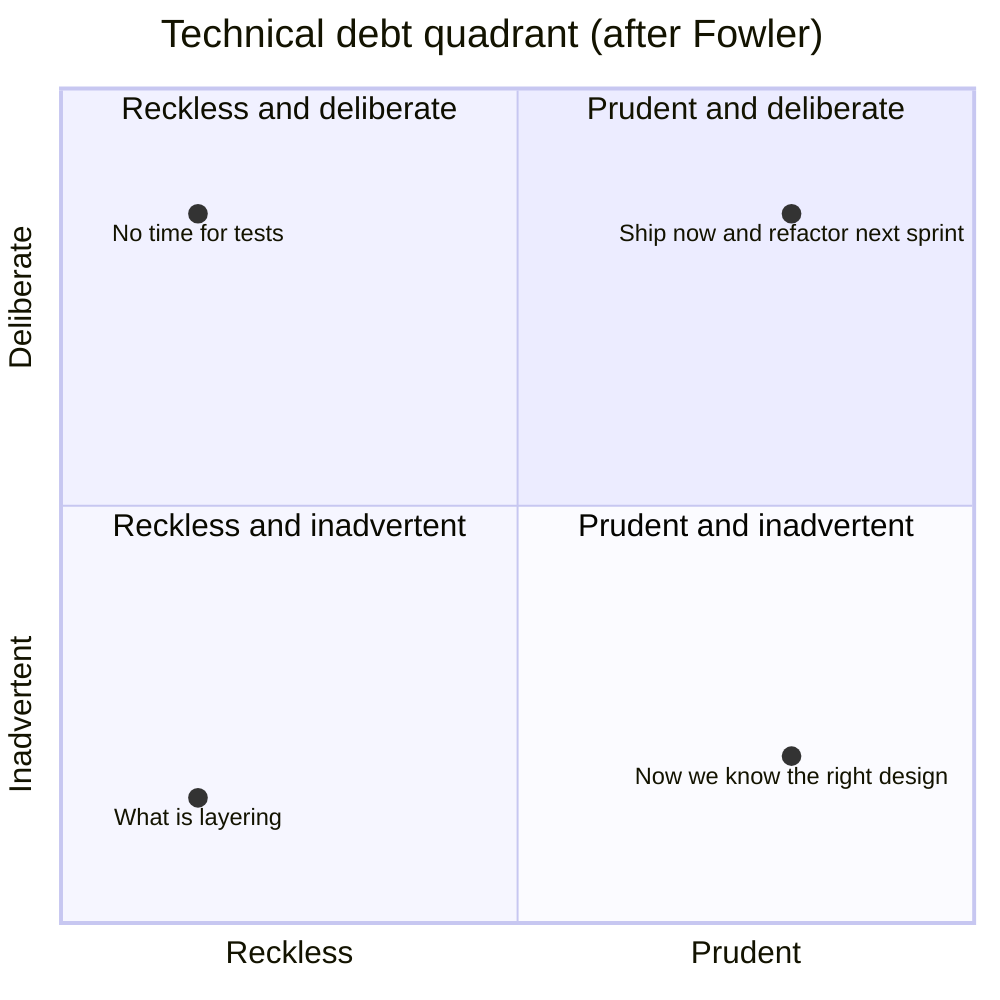
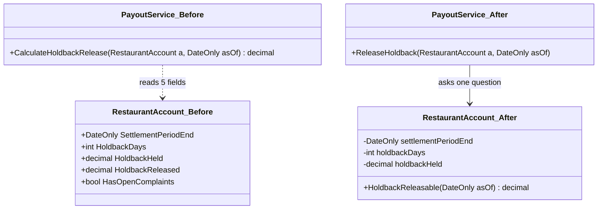
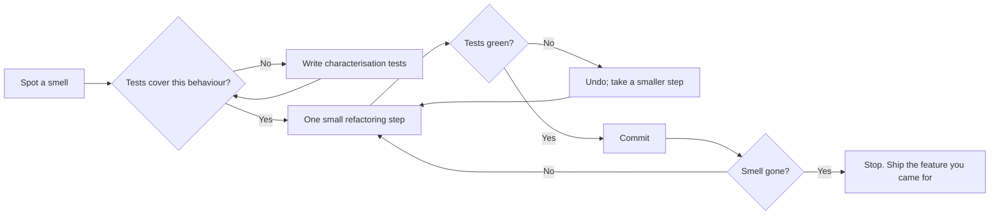

A **code smell** is a surface sign that *might* point to a deeper design problem. The term comes from Kent Beck and Martin Fowler's *Refactoring* (1999). A smell isn't a bug: the code works. It's a hint that the next change will be harder than it should be. **Technical debt** is the total cost of those hints: the extra time every future change pays because of shortcuts taken earlier. This lesson gives you a catalogue of 14 smells, each with the refactoring that usually fixes it, and a way to decide which debt is worth paying off.

## Learning objectives

By the end of this lesson you will be able to:

1. Define a code smell and explain why it's a heuristic, not a rule.
2. Recognise 14 classic smells in C# code and name the refactoring for each.
3. Refactor safely: tests first, small steps, behaviour unchanged.
4. Replace primitive obsession and data clumps with value objects, and feature envy with moved methods.
5. Classify technical debt with Fowler's quadrant and explain "principal" and "interest".
6. Prioritise debt using change frequency and business impact, instead of fixing whatever looks ugliest.

## Prerequisites

- [Single Responsibility Principle](#/lesson/m04-srp): many smells are SRP violations seen from different angles.
- [DRY, KISS and YAGNI](#/lesson/m04-dry-kiss-yagni): duplication and speculative generality appear in the catalogue.
- [Unit testing fundamentals](#/lesson/m01-testing-debugging): refactoring without tests is just editing.

## Explain it like I'm a beginner

Walk into your kitchen and smell gas. It doesn't prove anything is wrong — maybe someone just lit the stove — but anyone sensible *checks*, because it's often the first sign of a leak.

Code smells work the same way. A 400-line method, a `BillManager` class with 60 methods, a method with 11 parameters: none is a bug, but each often means the next change will be slower and riskier.

**Technical debt** is like a loan. A shortcut to hit a deadline borrows time. The **principal** is the work to clean it up; the **interest** is the extra time every later change costs meanwhile. Debt taken on purpose and repaid is a business tool. Debt that piles up unnoticed ends with the team paying interest full time.

- A **smell** is a symptom. A **refactoring** is a small, behaviour-preserving change that removes it.
- **Refactoring** means changing the structure of code *without changing what it does*. If behaviour changes, it's not refactoring; it's a feature or a bug fix.

## First-principles explanation

### What a smell is, and isn't

Fowler's definition: "a surface indication that usually corresponds to a deeper problem in the system." Two words matter:

- **Surface** — smells are quick to spot, often by looking at size or shape, before you understand the code.
- **Usually** — not always. A 60-line method that parses a fixed-format bank statement line by line may be perfectly clear. A `switch` over an enum in one place is fine. Judgement decides; the smell only tells you where to look.

### Why smells cost money

Every smell raises the cost of **understanding** (where to change, what will break), **changing** (how many places to edit) or **verifying** (how hard it is to test in isolation). Most business systems spend more time changing existing code than writing new code, so these costs compound.

### How refactoring works

Refactoring is a disciplined loop:

1. **Pin current behaviour with tests.** For legacy code, write *characterisation tests* that record what it does today, even if it looks wrong ([Refactoring legacy code](#/lesson/m04-refactoring-legacy)).
2. **Make one small change** — rename, extract method, move method. IDEs automate many of these safely.
3. **Run the tests.** Green → commit. Red → undo and take a smaller step.

Never mix refactoring and behaviour change in one commit: reviewers can't tell them apart, and a revert removes both.

### The smell catalogue

Fourteen smells from Fowler's catalogue, each with what it looks like, why it hurts and the usual refactoring. Names of refactorings follow [refactoring.com](https://refactoring.com/catalog/).

#### 1. Long method

**Looks like:** a method you must scroll to read; comments like `// --- step 3: validate ---` separating sections. **Hurts because:** you can't name what it does in one phrase, can't test one part alone, and local variables leak between sections. **Refactor:** *Extract Method* for each commented section (the comment usually becomes the method name); *Decompose Conditional* for complex `if`s; *Replace Temp with Query* to remove local variables that block extraction.

#### 2. Large class

**Looks like:** `BillManager` with 60 methods and 25 fields; groups of fields used only by groups of methods. **Hurts because:** many reasons to change, merge conflicts, slow onboarding. **Refactor:** *Extract Class* along the field groups (fields used together go together). See [Refactoring large classes](#/lesson/m07-refactoring-large-classes).

#### 3. Long parameter list

**Looks like:** `Process(string, int, string, string, int, int, int, int, string, ...)`. Callers pass `null` or `0` for half. **Hurts because:** easy to swap two `int`s silently; every new input changes every caller. **Refactor:** *Introduce Parameter Object*; *Preserve Whole Object* (pass the `Order`, not five of its fields); remove flag parameters by splitting the method.

#### 4. Feature envy

**Looks like:** a method that calls `other.A`, `other.B`, `other.C` more than it uses its own class. **Hurts because:** rules live far from their data, and the other class must expose its internals. **Refactor:** *Move Method* (or *Extract Method* then move the extracted part). Exception: deliberate separation, such as a reporting query that reads many entities.

#### 5. Data clumps

**Looks like:** the same three to five values travelling together: `pickupLat, pickupLng, dropLat, dropLng, roadMetres`, or `street, city, state, pincode`. **Hurts because:** validation is repeated wherever the clump appears, and the concept has no name. **Refactor:** *Extract Class* / *Introduce Parameter Object* — here, a `DeliveryTrip`. Test: if you deleted one value, would the others still make sense? If not, it's a clump.

#### 6. Primitive obsession

**Looks like:** `string gstin`, `decimal amountInRupees`, `int distanceMetres`, `string status = "DELIVERED"`. **Hurts because:** every method re-validates; nothing stops you passing an FSSAI licence number where a GSTIN is expected, or kilometres where metres are expected. **Refactor:** *Replace Primitive with Object* (value objects such as `Gstin`, `Money`, `Distance`); *Replace Type Code with Subclasses* or an enum for status strings.

#### 7. Switch statements

**Looks like:** the same `switch` on a type code repeated in several places, or cases for every *combination* of options. **Hurts because:** adding a type means finding every `switch` (shotgun surgery). **Refactor:** *Replace Conditional with Polymorphism* (often the [Strategy pattern](#/lesson/m06-strategy)), or a dictionary lookup. One `switch` in a factory is fine; the smell is *repeated* switching.

#### 8. Shotgun surgery

**Looks like:** one small business change ("GSTIN validation must accept the new UN body format") needs edits in eight files. **Hurts because:** someone always misses one. **Refactor:** *Move Method* / *Move Field* to bring the scattered logic into one class; *Inline Class* if a concept has been spread too thin.

#### 9. Divergent change

**Looks like:** the opposite: one class changes for many unrelated reasons. `OrderBillProcessor` changes when offer rules change, when the email template changes and when the database schema changes. **Hurts because:** unrelated changes collide in one file. **Refactor:** *Extract Class* by reason to change ([SRP](#/lesson/m04-srp)).

#### 10. Speculative generality

**Looks like:** abstract base classes with one subclass, unused parameters "for later", hooks nobody calls. **Hurts because:** it's YAGNI's cost of carry. **Refactor:** *Collapse Hierarchy*, *Inline Class*, *Remove Parameter*, delete dead code. See [DRY, KISS and YAGNI](#/lesson/m04-dry-kiss-yagni).

#### 11. Message chains

**Looks like:** `order.Restaurant.Outlet.Address.State.Code`. **Hurts because:** the caller depends on the whole navigation path; any change in the chain breaks it. **Refactor:** *Hide Delegate* — give the first object a method that answers the real question (`order.PlaceOfSupplyStateCode()`). This is the Law of Demeter in practice.

#### 12. Middle man

**Looks like:** a class whose methods mostly forward to another class: `OrderFacade.GetBills() => _billService.GetBills()`. **Hurts because:** an extra hop with no added value. **Refactor:** *Remove Middle Man* — callers use the real class. Note the tension with #11: hiding delegates too eagerly creates middle men. Balance them.

#### 13. Temporary field

**Looks like:** a field that is only set and used in some situations: `WalletBalance` only for the offer mode that redeems wallet credit. **Hurts because:** readers can't tell when it's valid; it carries state between calls by accident. **Refactor:** *Extract Class* to give the field and the code that uses it their own home (a `WalletRedemptionRule`), or pass the value in as an explicit input; *Introduce Special Case* for the "not applicable" situation.

#### 14. Refused bequest

**Looks like:** a subclass that inherits methods it doesn't want and overrides them to throw or do nothing: `class ReadOnlyOrderRepository : OrderRepository { override Save() => throw ... }`. **Hurts because:** the inheritance is lying; it breaks [Liskov substitution](#/lesson/m04-lsp). **Refactor:** *Replace Inheritance with Delegation* ([composition](#/lesson/m04-composition-inheritance)), or *Push Down Method* so only subclasses that need it have it.

:::callout type=tip title="Smells come in families"
Long method, large class and divergent change usually appear together. So do data clumps, primitive obsession and long parameter lists. Fixing the value-object family first often shrinks the methods and classes for free.
:::

### Technical debt: the quadrant

Not all debt is equal. Fowler's **technical debt quadrant** sorts it on two axes: was it **deliberate** or **inadvertent**, and was it **prudent** or **reckless**?

- **Prudent, deliberate** — "Ship with one PostgreSQL instance; add a read replica before the Diwali sale." A conscious trade with a plan.
- **Reckless, deliberate** — "No time for tests." Usually costs more than it saves, within weeks.
- **Reckless, inadvertent** — "What's dependency injection?" A skills gap: fix with training and review, not blame.
- **Prudent, inadvertent** — "Now we know how it should have been designed." The normal result of learning.

### Principal, interest and where to pay

Interest is paid only when someone changes the code (or its risk materialises). A messy module untouched for three years charges none. So prioritise **hotspots**: code that is both *complex* and *frequently changed*, found by crossing `git log` churn with complexity metrics — an approach popularised by Adam Tornhill's *Your Code as a Crime Scene*.

### When smell-hunting is unnecessary

- **Throwaway code**, such as a one-off migration script.
- **Stable, untouched code** — no interest is being paid.
- **Code about to be replaced** by a [strangler migration](#/lesson/m16-strangler-acl).

### Trade-offs

| You gain | You pay |
|---|---|
| Cheaper, safer future changes | Time now, with no new feature to show |
| Code new joiners can understand | Risk of breaking behaviour if tests are weak |
| Smaller, more testable units | More types and files (if you over-extract) |
| Visible, managed debt | Effort to track and justify it to stakeholders |

## Visual explanation

### The technical debt quadrant



Read it as two questions about each piece of debt. Up–down: did we *choose* this shortcut, or did it happen without our knowing? Left–right: was it a sensible trade (we understood the cost and had a plan) or careless? The top-right corner is healthy business debt. The top-left is the one to stop. The bottom-left is a skills gap, fixed by pairing and code review. The bottom-right is the normal result of learning, repaid by refactoring as understanding grows.

### Feature envy, before and after Move Method



The example comes from restaurant payouts on a food-delivery platform. The platform holds back part of each restaurant's earnings for 30 days to cover refunds, then releases it if there are no open complaints. Before: `PayoutService` pulls five fields out of `RestaurantAccount` and does the calculation itself. It "envies" the account's data. Every rule about the holdback lives far from the data it's about, and `RestaurantAccount` must expose all of its internals. After: the calculation moved to `RestaurantAccount`, which now keeps its fields private and answers one question. The service just asks. This is **Move Method**, the standard fix for feature envy.

### The refactoring loop



The loop has two safety valves. Missing tests send you to write them first. A red test sends you back with a *smaller* step rather than debugging a big change. The last box matters too: refactoring is in service of a change you need to make. Stop when the code is good enough for that change, not when it's perfect.

## Step-by-step example

The system: order billing for a food-delivery app. When a customer checks out, the app builds the bill: menu price × quantity for each item, plus a delivery fee that depends on the road distance from the restaurant, minus discounts (a coupon, a membership discount and wallet credit up to a cap). Here's the legacy core, simplified:

```csharp
public class OrderBillProcessor
{
    public decimal WalletBalance;      // only used when the offer mode redeems wallet credit
    public string LastError = "";

    public decimal Process(string orderId, string customerPhone, string restaurantGstin, string fssaiNo,
        double pickupLat, double pickupLng, double dropLat, double dropLng, int roadMetres,
        List<(string item, int qty)> cart, Dictionary<string, decimal> menu, string offerMode, DateTime orderTime)
    {
        decimal itemTotal = 0;
        foreach (var c in cart)
        {
            if (!menu.ContainsKey(c.item)) { LastError = "Unknown item " + c.item; return -1; }
            itemTotal += Math.Round(c.qty * menu[c.item], 2);
        }
        decimal deliveryFee = roadMetres < 3000 ? 25 : roadMetres < 7000 ? 45 : 70;   // also copied in the rider app API
        // ... 40 lines validating GSTIN and FSSAI numbers with regexes, also copied in RestaurantOnboardingController ...
        decimal discounts = 0;
        switch (offerMode)
        {
            case "COUPON": discounts += itemTotal * 0.10m; break;
            case "COUPON+GOLD": discounts += itemTotal * 0.10m + itemTotal * 0.05m; break;
            case "COUPON+GOLD+WALLET":
                var credit = Math.Min(itemTotal * 0.10m, WalletBalance);
                WalletBalance -= credit;
                discounts += itemTotal * 0.10m + itemTotal * 0.05m + credit; break;
            // 6 more cases...
        }
        // ... 60 lines building the receipt email, 30 lines writing to the database ...
        return itemTotal + deliveryFee - discounts;
    }
}
```

Let's walk through it with the smell catalogue above and name each problem.

### Step 1 — name the smells

| What you see | Smell |
|---|---|
| `Process` is ~200 lines doing pricing, validation, email and SQL | Long method, divergent change |
| 13 parameters | Long parameter list |
| `pickupLat, pickupLng, dropLat, dropLng, roadMetres` always travel together | Data clumps |
| GSTIN, distance and money as `string`/`int`/`decimal` | Primitive obsession |
| `switch (offerMode)` with combined modes | Switch statements |
| `WalletBalance` only meaningful for one mode | Temporary field |
| GSTIN regex and the delivery-fee slabs copied into other classes | Duplicated knowledge → shotgun surgery when the rule changes |
| `return -1` plus `LastError` | Not in the classic list, but a hidden error channel |

### Step 2 — pin behaviour

Before touching anything, write characterisation tests: for three real past orders (taken from production, with customer details removed), assert the amount that `Process` returns today. If the legacy result looks wrong, still pin it, and raise a ticket. Refactoring must not change behaviour silently.

### Step 3 — small steps, in a sensible order

1. **Introduce Parameter Object**: `DeliveryTrip` replaces the five location parameters.
2. **Replace Primitive with Object**: `Gstin`, `Money`, `Distance` and `GeoPoint` value objects. The copied regexes and fee slabs now live in one place each.
3. **Extract Method** on the item total, then **Move Method** into `Cart`, which owns the data.
4. **Replace Conditional with Polymorphism**: one `IDiscountRule` per discount instead of one `switch` case per *combination*. An order has a list of active rules. Nine combination cases become three rule classes.
5. **Extract Class** for the email and persistence parts, which change for different reasons (divergent change).
6. Replace `-1` + `LastError` with an exception or a result type.

Each step is a commit with green tests. The production code below is the result.

## Production-style C# implementation

The refactored order-billing core. Value objects remove primitive obsession and data clumps; the cart owns its calculation (no feature envy); each discount is a rule (no switch, no temporary field). To keep the example focused, every discount applies to the item total and GST is left out.

```csharp file=Billing/ValueObjects.cs
using System.Globalization;
using System.Text.RegularExpressions;

namespace FoodDelivery.Billing;

public readonly record struct Money(decimal Amount) : IComparable<Money>
{
    public static readonly Money Zero = new(0m);
    public static Money Rupees(decimal amount) => new(Math.Round(amount, 2, MidpointRounding.AwayFromZero));
    public static Money operator +(Money a, Money b) => new(a.Amount + b.Amount);
    public static Money operator -(Money a, Money b) => new(a.Amount - b.Amount);
    public Money Percent(decimal percent) => Rupees(Amount * percent / 100m);
    public static Money Min(Money a, Money b) => a.Amount <= b.Amount ? a : b;
    public int CompareTo(Money other) => Amount.CompareTo(other.Amount);
    public override string ToString() => "₹" + Amount.ToString("N2", CultureInfo.InvariantCulture);
}

/// <summary>A road distance stored as whole metres. Parses "3.5 km" or "850 m".</summary>
public readonly record struct Distance(int Metres) : IComparable<Distance>
{
    private static readonly Regex Format = new(@"^(\d{1,4}(?:\.\d{1,3})?)\s?(km|m)$", RegexOptions.Compiled | RegexOptions.IgnoreCase);

    public static Distance Kilometres(decimal km) => new((int)(km * 1000m));

    public static Distance Parse(string text)
    {
        var m = Format.Match(text.Trim());
        if (!m.Success) throw new FormatException($"Distance '{text}' must look like 3.5 km or 850 m.");
        var value = decimal.Parse(m.Groups[1].Value, CultureInfo.InvariantCulture);
        var isKm = m.Groups[2].Value.Equals("km", StringComparison.OrdinalIgnoreCase);
        if (!isKm && value != decimal.Truncate(value)) throw new FormatException($"Metres must be whole: '{text}'.");
        return new Distance((int)(isKm ? value * 1000m : value));
    }

    public int CompareTo(Distance other) => Metres.CompareTo(other.Metres);
    public override string ToString() => Metres < 1000
        ? $"{Metres} m"
        : (Metres / 1000m).ToString("0.###", CultureInfo.InvariantCulture) + " km";
}

/// <summary>A latitude/longitude pair that cannot be out of range.</summary>
public sealed record GeoPoint
{
    public double Latitude { get; }
    public double Longitude { get; }

    public GeoPoint(double latitude, double longitude)
    {
        if (latitude is < -90 or > 90) throw new ArgumentOutOfRangeException(nameof(latitude));
        if (longitude is < -180 or > 180) throw new ArgumentOutOfRangeException(nameof(longitude));
        (Latitude, Longitude) = (latitude, longitude);
    }
}

/// <summary>Replaces the data clump (pickupLat, pickupLng, dropLat, dropLng, roadMetres).</summary>
public sealed record DeliveryTrip
{
    public GeoPoint Pickup { get; }
    public GeoPoint Drop { get; }
    /// <summary>Road distance from a routing service, not the straight-line distance between the points.</summary>
    public Distance RoadDistance { get; }

    public DeliveryTrip(GeoPoint pickup, GeoPoint drop, Distance roadDistance)
    {
        if (roadDistance.Metres <= 0) throw new ArgumentException("Road distance must be positive.", nameof(roadDistance));
        (Pickup, Drop, RoadDistance) = (pickup, drop, roadDistance);
    }
}

/// <summary>Replaces "string gstin" and the regex copied into three classes.</summary>
public sealed record Gstin
{
    private static readonly Regex Format = new(@"^\d{2}[A-Z]{5}\d{4}[A-Z][1-9A-Z]Z[0-9A-Z]$", RegexOptions.Compiled);
    public string Value { get; }
    private Gstin(string value) => Value = value;

    public static Gstin Parse(string text)
    {
        var v = text.Trim().ToUpperInvariant();
        return Format.IsMatch(v) ? new Gstin(v) : throw new FormatException($"'{text}' is not a valid GSTIN.");
    }

    public string StateCode => Value[..2];
    public override string ToString() => Value;
}
```

```csharp file=Billing/Cart.cs
namespace FoodDelivery.Billing;

public sealed record MenuItem(string Code, string Name, Money Price);
public sealed record CartLine(string ItemCode, int Quantity);

/// <summary>Owns the cart lines and the calculation over them (fixes feature envy).</summary>
public sealed class Cart
{
    private readonly List<CartLine> _lines = new();
    public IReadOnlyList<CartLine> Lines => _lines;

    public void Add(CartLine line)
    {
        if (line.Quantity <= 0) throw new ArgumentOutOfRangeException(nameof(line), "Quantity must be positive.");
        _lines.Add(line);
    }

    public Money ItemTotal(IReadOnlyDictionary<string, MenuItem> menu)
    {
        var total = Money.Zero;
        foreach (var line in _lines)
        {
            if (!menu.TryGetValue(line.ItemCode, out var item))
                throw new InvalidOperationException($"Cart refers to unknown menu item '{line.ItemCode}'.");
            total += Money.Rupees(line.Quantity * item.Price.Amount);
        }
        return total;
    }
}
```

```csharp file=Billing/DeliveryFees.cs
namespace FoodDelivery.Billing;

/// <summary>One slab of the delivery-fee table: From (inclusive) to To (exclusive).</summary>
public sealed record DistanceSlab
{
    public Distance From { get; }
    public Distance To { get; }
    public Money Fee { get; }

    public DistanceSlab(Distance from, Distance to, Money fee)
    {
        if (to.CompareTo(from) <= 0) throw new ArgumentException($"Slab end {to} must be after start {from}.");
        (From, To, Fee) = (from, to, fee);
    }

    public bool Contains(Distance d) => d.Metres >= From.Metres && d.Metres < To.Metres;
}

/// <summary>The fee slabs used to be hard-coded in two places; now they are one piece of configuration.</summary>
public sealed class DeliveryFeeSchedule(IReadOnlyList<DistanceSlab> slabs)
{
    public Money FeeFor(Distance roadDistance) =>
        slabs.FirstOrDefault(s => s.Contains(roadDistance))?.Fee
        ?? throw new InvalidOperationException($"{roadDistance} is outside the delivery radius.");
}
```

```csharp file=Billing/Discounts.cs
namespace FoodDelivery.Billing;

public sealed record AppliedDiscount(string Code, Money Amount);

public sealed record BillContext(string OrderId, Money ItemTotal, Money WalletBalance);

/// <summary>One discount per class. An order has a list of active rules; no switch over combinations.</summary>
public interface IDiscountRule
{
    string Code { get; }
    AppliedDiscount Apply(BillContext context);
}

public sealed class CouponDiscountRule(decimal percent) : IDiscountRule
{
    public string Code => "COUPON";
    public AppliedDiscount Apply(BillContext c) => new(Code, c.ItemTotal.Percent(percent));
}

public sealed class MembershipDiscountRule(decimal percent) : IDiscountRule
{
    public string Code => "GOLD";
    public AppliedDiscount Apply(BillContext c) => new(Code, c.ItemTotal.Percent(percent));
}

/// <summary>The old temporary field (WalletBalance) now arrives in the context; the rule is stateless.</summary>
public sealed class WalletRedemptionRule(decimal percentOfBill) : IDiscountRule
{
    public string Code => "WALLET";
    public AppliedDiscount Apply(BillContext c) => new(Code, Money.Min(c.ItemTotal.Percent(percentOfBill), c.WalletBalance));
}
```

```csharp file=Billing/OrderBillCalculator.cs
namespace FoodDelivery.Billing;

public sealed record OrderBill(string OrderId, Money ItemTotal, Money DeliveryFee, IReadOnlyList<AppliedDiscount> Discounts)
{
    public Money TotalDiscounts => Discounts.Aggregate(Money.Zero, (sum, d) => sum + d.Amount);
    public Money NetPayable => ItemTotal + DeliveryFee - TotalDiscounts;
}

public sealed record PricingTerms(IReadOnlyDictionary<string, MenuItem> Menu, DeliveryFeeSchedule DeliveryFees, IReadOnlyList<IDiscountRule> Discounts);

/// <summary>Small, single-purpose: calculation only. Receipt email and persistence live in their own classes.</summary>
public static class OrderBillCalculator
{
    public static OrderBill Calculate(PricingTerms terms, string orderId, Cart cart, DeliveryTrip trip, Money walletBalance)
    {
        var itemTotal = cart.ItemTotal(terms.Menu);
        var deliveryFee = terms.DeliveryFees.FeeFor(trip.RoadDistance);
        var context = new BillContext(orderId, itemTotal, walletBalance);
        var discounts = terms.Discounts.Select(rule => rule.Apply(context)).ToList();
        var bill = new OrderBill(orderId, itemTotal, deliveryFee, discounts);

        if (bill.NetPayable.Amount < 0)
            throw new InvalidOperationException($"Discounts {bill.TotalDiscounts} exceed the bill on order {orderId}.");
        return bill;
    }
}
```

```csharp file=Program.cs
using FoodDelivery.Billing;

var builder = WebApplication.CreateBuilder(args);
var app = builder.Build();

// Illustrative data; a real system loads the menu, fee table, active offers and wallet balance from the database.
var terms = new PricingTerms(
    new Dictionary<string, MenuItem>
    {
        ["BIR-01"] = new("BIR-01", "Chicken biryani", Money.Rupees(320m)),
        ["NAAN-02"] = new("NAAN-02", "Butter naan", Money.Rupees(60m)),
    },
    new DeliveryFeeSchedule(new[]
    {
        new DistanceSlab(Distance.Parse("0 m"), Distance.Parse("3 km"), Money.Rupees(25m)),
        new DistanceSlab(Distance.Parse("3 km"), Distance.Parse("7 km"), Money.Rupees(45m)),
        new DistanceSlab(Distance.Parse("7 km"), Distance.Parse("12 km"), Money.Rupees(70m)),
    }),
    new IDiscountRule[] { new CouponDiscountRule(10m), new MembershipDiscountRule(5m), new WalletRedemptionRule(10m) });
var walletBalances = new Dictionary<string, decimal> { ["cust-881"] = 50m };

app.MapPost("/customers/{customerId}/orders/{orderId}/bill-preview",
    (string customerId, string orderId, BillPreviewRequest request) =>
{
    var cart = new Cart();
    foreach (var line in request.Lines) cart.Add(new CartLine(line.ItemCode, line.Quantity));

    var trip = new DeliveryTrip(new GeoPoint(request.PickupLat, request.PickupLng),
        new GeoPoint(request.DropLat, request.DropLng), Distance.Parse(request.RoadDistance));

    // Prices and the wallet balance come from the server, never from the request body.
    var wallet = Money.Rupees(walletBalances.GetValueOrDefault(customerId));
    var bill = OrderBillCalculator.Calculate(terms, orderId, cart, trip, wallet);
    return Results.Ok(new { bill.ItemTotal, bill.DeliveryFee, bill.Discounts, bill.NetPayable });
});

app.Run();

public sealed record CartLineInput(string ItemCode, int Quantity);
public sealed record BillPreviewRequest(CartLineInput[] Lines, double PickupLat, double PickupLng,
    double DropLat, double DropLng, string RoadDistance);
```

What each change bought:

- **`Distance`, `GeoPoint` and `DeliveryTrip`** — "3.5 km" parsing, range checks and "distance must be positive" live in one place each. Passing kilometres where metres are expected, or swapping a latitude with a longitude parameter, is now hard to write.
- **`Cart.ItemTotal`** — the calculation sits with its data; the unknown-item rule throws instead of returning `-1`.
- **`DeliveryFeeSchedule`** — the fee slabs that were hard-coded in two places are one piece of configuration. Changing the 3 km boundary is a data change, not a hunt through the code.
- **`IDiscountRule`** — nine combination cases became three rules. A new bank-card offer is one new class; nothing else changes.
- **No temporary field** — the wallet balance is an *input* to the calculation, not hidden mutable state on a service. Debiting the wallet happens later, as a separate, explicit step after payment succeeds, and it must be idempotent (keyed by order id) so that a retried payment callback doesn't debit twice.

## Bad design vs good design

**Bad:** `OrderBillProcessor.Process` from the step-by-step section, with every smell in the table there.

One deserves emphasis: the temporary field. The checkout screen calls `Process` to show the customer a bill preview, and `Process` reduces `WalletBalance`. Open checkout twice, or let the app retry the call after a timeout, and the wallet credit on the real order is wrong. Smells aren't just style; they hide real defects.

**Good:** the production code above. Each type has one job, inputs are explicit, and invalid values can't be constructed.

### When smell-fixing goes wrong

:::callout type=mistake title="Refactoring without tests, or without a reason"
Two common failures: (1) a "big clean-up" PR that touches 80 files with no characterisation tests, which changes behaviour nobody noticed until restaurants complained about their weekly payouts; (2) polishing code that nobody needs to change, while the real hotspot stays ugly. Refactor *in front of* the feature you're about to build, in small steps, with tests.
:::

- **Over-extraction.** Splitting a clear 25-line method into eight 3-line methods scatters the logic. The smell is about *comprehension*, not line count.
- **Value objects for everything.** A `RestaurantName` wrapper around `string` that adds no rules is ceremony. Create value objects where there's validation, formatting or arithmetic to protect.
- **Hiding every delegate.** Fixing every message chain with forwarding methods creates middle men. Use Hide Delegate when the caller needs a *business answer*, not to avoid every dot.
- **Treating metrics as targets.** "Every method under 10 lines" or "cyclomatic complexity below 5" become goals people game. Use metrics to find candidates, then use judgement.

## Practical playground

`PrintBillSummary` is a long method with three commented sections. Extract each section into a well-named private method **without changing the printed output**. Run it before and after; the output must be identical. That output is your characterisation test.

:::playground type=csharp title="Extract Method on a long method"
```csharp file=Program.cs
using System;
using System.Collections.Generic;
using System.Globalization;
using System.Linq;

public static class BillReport
{
    public static string PrintBillSummary(string orderId, List<(string Item, int Qty, decimal Price)> lines,
        decimal deliveryFee, decimal walletBalance)
    {
        // --- item total ---
        decimal itemTotal = 0;
        foreach (var l in lines) itemTotal += Math.Round(l.Qty * l.Price, 2, MidpointRounding.AwayFromZero);

        // --- discounts ---
        var coupon = Math.Round(itemTotal * 0.10m, 2, MidpointRounding.AwayFromZero);
        var gold = Math.Round(itemTotal * 0.05m, 2, MidpointRounding.AwayFromZero);
        var wallet = Math.Min(Math.Round(itemTotal * 0.10m, 2, MidpointRounding.AwayFromZero), walletBalance);

        // --- format ---
        var c = CultureInfo.InvariantCulture;
        return string.Join(Environment.NewLine,
            $"Order {orderId}",
            $"Items:     {itemTotal.ToString("N2", c)}",
            $"Delivery:  {deliveryFee.ToString("N2", c)}",
            $"Coupon:    -{coupon.ToString("N2", c)}",
            $"Gold:      -{gold.ToString("N2", c)}",
            $"Wallet:    -{wallet.ToString("N2", c)}",
            $"To pay:    {(itemTotal + deliveryFee - coupon - gold - wallet).ToString("N2", c)}");
    }
}

public static class Program
{
    public static void Main()
    {
        var lines = new List<(string, int, decimal)> { ("BIR-01", 2, 320m), ("NAAN-02", 4, 60m) };
        // Expected: items 880.00, delivery 45.00, coupon 88.00, gold 44.00, wallet 50.00, to pay 743.00
        Console.WriteLine(BillReport.PrintBillSummary("ORD-20931", lines, 45m, 50m));
    }
}
```
:::

## Exercises

:::exercise id=m04-code-smells-ex1 difficulty=beginner kind=code title="Cure primitive obsession with a Distance value object"
Delivery distances are passed around as `double km`, `int metres` and strings like `"3.5 km"` or `"850 m"`, parsed differently in four places. One bug already charged a customer the 7–12 km fee for a 1.2 km trip because a caller passed metres where kilometres were expected. Implement `Distance` and `DistanceSlab` so the rules live in one place.
::requirements
- `Distance.Parse("3.5 km")` → 3,500 metres; `Distance.Parse("850 m")` → 850 metres. The unit is `km` or `m` (any letter case), with at most one space before it. Kilometres may have up to three decimals; metres must be whole.
- `ToString()` gives `"850 m"` below 1,000 m, otherwise kilometres without trailing zeros: `"3.5 km"`, `"12 km"`. So `Distance.Parse("0.75 km").ToString()` gives `"750 m"`.
- Invalid text (`"3.5"`, `"km"`, `"-2 km"`, `"3,5 km"`, `"850.5 m"`, `""`) throws `FormatException`.
- `new DistanceSlab(from, to)` throws `ArgumentException` when `to` is not after `from`. `Contains(d)` is true when `from ≤ d < to`.
::acceptance
- All parse, format and slab tests pass.
- No caller needs to know the text format or the unit conversion.
::hint
A `readonly record struct` gives you value equality for free.
::hint
Store one number, total metres. Convert only when parsing and formatting.
::hint
A regex like `^(\d{1,4}(?:\.\d{1,3})?)\s?(km|m)$` with `RegexOptions.IgnoreCase` enforces the format. Parse the number as `decimal` with `CultureInfo.InvariantCulture`, so a comma never sneaks in through the user's locale.
::hint
```csharp
var value = decimal.Parse(m.Groups[1].Value, CultureInfo.InvariantCulture);
var isKm = m.Groups[2].Value.Equals("km", StringComparison.OrdinalIgnoreCase);
if (!isKm && value != decimal.Truncate(value)) throw new FormatException(...);
return new Distance((int)(isKm ? value * 1000m : value));
```
::starter
```csharp file=Distance.cs
using System;
using System.Text.RegularExpressions;

public readonly record struct Distance(int Metres)
{
    public static Distance Parse(string text) => throw new NotImplementedException();
    public override string ToString() => throw new NotImplementedException();
}

public sealed record DistanceSlab
{
    public Distance From { get; }
    public Distance To { get; }

    public DistanceSlab(Distance from, Distance to) => throw new NotImplementedException();

    public bool Contains(Distance d) => throw new NotImplementedException();
}
```
::tests
```csharp file=DistanceTests.cs
using System;
using Xunit;

public class DistanceTests
{
    [Fact] public void Parses_kilometres() => Assert.Equal(3_500, Distance.Parse("3.5 km").Metres);
    [Fact] public void Parses_metres() => Assert.Equal(850, Distance.Parse("850 m").Metres);
    [Fact] public void Formats_kilometres() => Assert.Equal("3.5 km", Distance.Parse("3.5 km").ToString());
    [Fact] public void Formats_whole_kilometres_and_ignores_case() => Assert.Equal("12 km", Distance.Parse("12 KM").ToString());
    [Fact] public void Formats_short_distances_in_metres() => Assert.Equal("750 m", Distance.Parse("0.75 km").ToString());
    [Fact] public void Values_are_equal_by_value() => Assert.Equal(Distance.Parse("3 km"), new Distance(3000));

    [Theory]
    [InlineData("3.5")]
    [InlineData("km")]
    [InlineData("-2 km")]
    [InlineData("3,5 km")]
    [InlineData("850.5 m")]
    [InlineData("")]
    public void Rejects_bad_format(string text) => Assert.Throws<FormatException>(() => Distance.Parse(text));

    [Fact]
    public void Slab_includes_start_and_excludes_end()
    {
        var slab = new DistanceSlab(Distance.Parse("3 km"), Distance.Parse("7 km"));
        Assert.True(slab.Contains(Distance.Parse("3 km")));
        Assert.True(slab.Contains(Distance.Parse("6.999 km")));
        Assert.False(slab.Contains(Distance.Parse("7 km")));
    }

    [Fact]
    public void Slab_must_go_forward() =>
        Assert.Throws<ArgumentException>(() => new DistanceSlab(Distance.Parse("7 km"), Distance.Parse("3 km")));
}
```
::solution
```csharp file=Distance.cs
using System;
using System.Globalization;
using System.Text.RegularExpressions;

public readonly record struct Distance(int Metres)
{
    private static readonly Regex Format = new(@"^(\d{1,4}(?:\.\d{1,3})?)\s?(km|m)$", RegexOptions.IgnoreCase);

    public static Distance Parse(string text)
    {
        var m = Format.Match(text?.Trim() ?? "");
        if (!m.Success) throw new FormatException($"Distance '{text}' must look like 3.5 km or 850 m.");

        var value = decimal.Parse(m.Groups[1].Value, CultureInfo.InvariantCulture);
        var isKm = m.Groups[2].Value.Equals("km", StringComparison.OrdinalIgnoreCase);
        if (!isKm && value != decimal.Truncate(value)) throw new FormatException($"Metres must be whole: '{text}'.");
        return new Distance((int)(isKm ? value * 1000m : value));
    }

    public override string ToString() => Metres < 1000
        ? $"{Metres} m"
        : (Metres / 1000m).ToString("0.###", CultureInfo.InvariantCulture) + " km";
}

public sealed record DistanceSlab
{
    public Distance From { get; }
    public Distance To { get; }

    public DistanceSlab(Distance from, Distance to)
    {
        if (to.Metres <= from.Metres) throw new ArgumentException($"Slab end {to} must be after start {from}.");
        From = from;
        To = to;
    }

    public bool Contains(Distance d) => d.Metres >= From.Metres && d.Metres < To.Metres;
}
```

Four parsers become one, the unit conversion happens in exactly one place, and a slab that runs backwards can no longer exist anywhere in the system.
::mistakes
- Storing the value as `double` kilometres: `0.1 + 0.2` style rounding errors appear at slab boundaries, and equality becomes unreliable.
- Accepting `"3,5 km"` by parsing with the current culture: the same text means 3.5 on one server and fails (or means 35) on another. Ambiguous input should be rejected, not guessed.
- Validating in the callers instead of in `Parse` and the constructor.
:::

:::exercise id=m04-code-smells-ex2 difficulty=beginner kind=written title="Name the smells"
Name every smell you can find in this code from a food-delivery platform's rider-operations team, and the refactoring you'd apply first for each.

```csharp
public class RiderReportService : BaseReportService
{
    public string? CachedWeather;   // set only when includeWeather is true

    public string Build(string riderId, int y, int m, bool includeWeather, bool includeMap,
                        bool pdf, string hubManagerName, string hubManagerMobile, string hubManagerEmail)
    {
        var state = _riders.Get(riderId).Hub.City.Address.State.Name;
        if (includeWeather) CachedWeather = _weather.Get(state);
        // 150 lines...
    }

    public override void Archive() { /* not used for rider reports */ }
}
```
::acceptance
- At least five smells named correctly.
- Each with a concrete first refactoring.
::hint
Count the parameters, then look at which ones travel together.
::hint
Look at the field's lifetime, the long chain of dots, and the empty override.
::hint
Boolean flags that change output format are also worth naming.
::solution
- **Long parameter list** (9) → *Introduce Parameter Object* `RiderReportRequest`.
- **Data clump** — `hubManagerName`, `hubManagerMobile`, `hubManagerEmail` → *Extract Class* `HubManagerContact` (and `y, m` → a `YearMonth` value).
- **Flag arguments** — `pdf`, `includeMap`, `includeWeather` → split into separate methods or a request object with clear options; `pdf` likely belongs to a separate renderer (divergent change).
- **Temporary field** — `CachedWeather` → make it a local variable or a parameter; it leaks state between calls (and between concurrent requests if the service is a singleton).
- **Message chain** — `.Hub.City.Address.State.Name` → *Hide Delegate*: `_riders.GetHubState(riderId)`.
- **Long method** (150 lines) → *Extract Method* by section.
- **Refused bequest** — empty `Archive()` override → *Replace Inheritance with Delegation*; the base class probably isn't a true "is-a".
- **Primitive obsession** — `riderId`, `hubManagerMobile` as strings → value objects where rules exist (a `PhoneNumber` that validates the +91 format, for example).
::mistakes
- Calling the base class a "large class" without evidence. Name what you can see.
:::

:::exercise id=m04-code-smells-ex3 difficulty=intermediate kind=code title="Move Method to cure feature envy"
A food-delivery platform holds back part of each restaurant's earnings for a while after each settlement period, to cover refunds and chargebacks. `PayoutService.CalculateHoldbackRelease` reads five properties of `RestaurantAccount` and uses nothing of its own. Move the logic into `RestaurantAccount.HoldbackReleasable(DateOnly asOf)` and delete it from `PayoutService`.

Rules:
- Nothing is releasable before `SettlementPeriodEnd + HoldbackDays` (default 30 days).
- Nothing is releasable while `HasOpenComplaints` is true.
- Otherwise, releasable = `HoldbackHeld − HoldbackReleased` (never negative).
::acceptance
- `RestaurantAccount.HoldbackReleasable` returns the right amount in all three cases.
- `PayoutService` no longer has `CalculateHoldbackRelease`.
- `PayoutService.ReleaseHoldback` still works, by asking the account.
::hint
Copy the method body into `RestaurantAccount` first, replacing `a.` with nothing. Then make the old method call the new one. Then delete the old one.
::hint
Once the calculation is inside `RestaurantAccount`, ask: does anything outside still need the raw fields?
::hint
`ReleaseHoldback` becomes: `var amount = account.HoldbackReleasable(asOf); account.RecordRelease(amount); return amount;`
::starter
```csharp file=Holdback.cs
using System;

public sealed class RestaurantAccount
{
    public required string RestaurantId { get; init; }
    public required DateOnly SettlementPeriodEnd { get; init; }
    public int HoldbackDays { get; init; } = 30;
    public decimal HoldbackHeld { get; set; }
    public decimal HoldbackReleased { get; set; }
    public bool HasOpenComplaints { get; set; }

    public decimal HoldbackReleasable(DateOnly asOf) => throw new NotImplementedException();

    public void RecordRelease(decimal amount)
    {
        if (amount < 0) throw new ArgumentOutOfRangeException(nameof(amount));
        HoldbackReleased += amount;
    }
}

public sealed class PayoutService
{
    // Feature envy: uses only RestaurantAccount's data.
    public decimal CalculateHoldbackRelease(RestaurantAccount a, DateOnly asOf)
    {
        if (asOf < a.SettlementPeriodEnd.AddDays(a.HoldbackDays)) return 0m;
        if (a.HasOpenComplaints) return 0m;
        return Math.Max(0m, a.HoldbackHeld - a.HoldbackReleased);
    }

    public decimal ReleaseHoldback(RestaurantAccount a, DateOnly asOf)
    {
        var amount = CalculateHoldbackRelease(a, asOf);
        a.RecordRelease(amount);
        return amount;
    }
}
```
::tests
```csharp file=HoldbackTests.cs
using System;
using Xunit;

public class HoldbackTests
{
    private static RestaurantAccount NewAccount() => new()
    {
        RestaurantId = "BLR-0427",
        SettlementPeriodEnd = new DateOnly(2026, 3, 31),
        HoldbackHeld = 1_25_000m,
        HoldbackReleased = 25_000m,
    };

    [Fact] public void Nothing_before_holdback_period_ends() => Assert.Equal(0m, NewAccount().HoldbackReleasable(new DateOnly(2026, 4, 29)));

    [Fact] public void Balance_after_holdback_period() => Assert.Equal(1_00_000m, NewAccount().HoldbackReleasable(new DateOnly(2026, 4, 30)));

    [Fact]
    public void Nothing_with_open_complaints()
    {
        var a = NewAccount();
        a.HasOpenComplaints = true;
        Assert.Equal(0m, a.HoldbackReleasable(new DateOnly(2026, 6, 1)));
    }

    [Fact]
    public void Service_releases_by_asking_the_account()
    {
        var a = NewAccount();
        Assert.Equal(1_00_000m, new PayoutService().ReleaseHoldback(a, new DateOnly(2026, 5, 1)));
        Assert.Equal(0m, a.HoldbackReleasable(new DateOnly(2026, 5, 2)));
    }

    [Fact]
    public void Envious_method_is_gone() => Assert.Null(typeof(PayoutService).GetMethod("CalculateHoldbackRelease"));
}
```
::solution
```csharp file=Holdback.cs
using System;

public sealed class RestaurantAccount
{
    public required string RestaurantId { get; init; }
    public required DateOnly SettlementPeriodEnd { get; init; }
    public int HoldbackDays { get; init; } = 30;
    public decimal HoldbackHeld { get; set; }
    public decimal HoldbackReleased { get; set; }
    public bool HasOpenComplaints { get; set; }

    public decimal HoldbackReleasable(DateOnly asOf)
    {
        if (asOf < SettlementPeriodEnd.AddDays(HoldbackDays)) return 0m;
        if (HasOpenComplaints) return 0m;
        return Math.Max(0m, HoldbackHeld - HoldbackReleased);
    }

    public void RecordRelease(decimal amount)
    {
        if (amount < 0) throw new ArgumentOutOfRangeException(nameof(amount));
        HoldbackReleased += amount;
    }
}

public sealed class PayoutService
{
    public decimal ReleaseHoldback(RestaurantAccount a, DateOnly asOf)
    {
        var amount = a.HoldbackReleasable(asOf);
        a.RecordRelease(amount);
        return amount;
    }
}
```

The next step (not required here) is to make `HoldbackHeld`, `HoldbackReleased` and `HasOpenComplaints` private-set, since nothing outside needs to write them any more. That's how Move Method leads to better encapsulation.
::mistakes
- Moving the method but leaving a forwarding copy in `PayoutService` "for compatibility" inside the same codebase — a middle man.
- Changing behaviour while moving (for example, adding a partial release when complaints are small). Move first, change later, in separate commits.
:::

:::exercise id=m04-code-smells-ex4 difficulty=intermediate kind=code title="Replace the discount switch with rules"
`DiscountCalculator` has a `switch` with a case for every **combination** of discounts a food order can get. Replace it with one class per discount and an `OrderDiscounts` aggregator, then delete `DiscountCalculator`.
::requirements
- `CouponDiscountRule(percent)`, `MembershipDiscountRule(percent)` and `WalletRedemptionRule(percentOfBill)` implement `IDiscountRule`.
- Wallet redemption is `percentOfBill` of the item total, but never more than the wallet balance.
- Every amount is rounded to 2 decimals, half away from zero.
- `OrderDiscounts.Total(itemTotal, walletBalance)` sums all configured rules.
::acceptance
- Item total ₹2,000 with a 10 % coupon, 5 % membership discount, and wallet credit of up to 10 % with ₹150 in the wallet → total ₹450 (200 + 100 + 150).
- A new rule defined only in the test file works without changing `OrderDiscounts`.
- `DiscountCalculator` no longer exists.
::hint
Each `case` in the old switch adds the same pieces in different combinations. What are the pieces?
::hint
The pieces are the rules. An order's offers become a *list* of rules instead of a mode string.
::hint
`OrderDiscounts` takes `IEnumerable<IDiscountRule>` and sums `rule.Amount(itemTotal, walletBalance)`.
::hint
```csharp
public decimal Amount(decimal itemTotal, decimal walletBalance) => Math.Min(Round(itemTotal * percentOfBill / 100m), walletBalance);
```
::starter
```csharp file=Discounts.cs
using System;
using System.Collections.Generic;
using System.Linq;

public static class DiscountCalculator
{
    public static decimal Calculate(string mode, decimal itemTotal, decimal walletBalance)
    {
        decimal R(decimal v) => Math.Round(v, 2, MidpointRounding.AwayFromZero);
        switch (mode)
        {
            case "COUPON": return R(itemTotal * 0.10m);
            case "COUPON+GOLD": return R(itemTotal * 0.10m) + R(itemTotal * 0.05m);
            case "COUPON+WALLET": return R(itemTotal * 0.10m) + Math.Min(R(itemTotal * 0.10m), walletBalance);
            case "COUPON+GOLD+WALLET": return R(itemTotal * 0.10m) + R(itemTotal * 0.05m) + Math.Min(R(itemTotal * 0.10m), walletBalance);
            default: throw new ArgumentException($"Unknown mode {mode}");
        }
    }
}

public interface IDiscountRule
{
    string Code { get; }
    decimal Amount(decimal itemTotal, decimal walletBalance);
}

public sealed class CouponDiscountRule(decimal percent) : IDiscountRule
{
    public string Code => "COUPON";
    public decimal Amount(decimal itemTotal, decimal walletBalance) => throw new NotImplementedException();
}

public sealed class MembershipDiscountRule(decimal percent) : IDiscountRule
{
    public string Code => "GOLD";
    public decimal Amount(decimal itemTotal, decimal walletBalance) => throw new NotImplementedException();
}

public sealed class WalletRedemptionRule(decimal percentOfBill) : IDiscountRule
{
    public string Code => "WALLET";
    public decimal Amount(decimal itemTotal, decimal walletBalance) => throw new NotImplementedException();
}

public sealed class OrderDiscounts(IEnumerable<IDiscountRule> rules)
{
    public decimal Total(decimal itemTotal, decimal walletBalance) => throw new NotImplementedException();
}
```
::tests
```csharp file=DiscountTests.cs
using System;
using Xunit;

public class DiscountTests
{
    private sealed class BankCardOfferRule : IDiscountRule
    {
        public string Code => "BANK";
        public decimal Amount(decimal itemTotal, decimal walletBalance) => Math.Round(itemTotal * 0.01m, 2);
    }

    [Fact]
    public void Full_set_of_rules()
    {
        IDiscountRule[] rules = { new CouponDiscountRule(10m), new MembershipDiscountRule(5m), new WalletRedemptionRule(10m) };
        Assert.Equal(450m, new OrderDiscounts(rules).Total(2_000m, 150m));
    }

    [Fact]
    public void Wallet_credit_never_exceeds_balance() =>
        Assert.Equal(150m, new WalletRedemptionRule(10m).Amount(2_000m, 150m));

    [Fact]
    public void Wallet_credit_is_percent_when_balance_is_enough() =>
        Assert.Equal(200m, new WalletRedemptionRule(10m).Amount(2_000m, 500m));

    [Fact]
    public void Rounds_half_away_from_zero() => Assert.Equal(0.05m, new MembershipDiscountRule(5m).Amount(0.9m, 0m));

    [Fact]
    public void New_rule_needs_no_change_to_aggregator()
    {
        IDiscountRule[] rules = { new MembershipDiscountRule(5m), new BankCardOfferRule() };
        Assert.Equal(120m, new OrderDiscounts(rules).Total(2_000m, 0m));
    }

    [Fact]
    public void Switch_class_is_gone() => Assert.Null(Type.GetType("DiscountCalculator"));
}
```
::solution
```csharp file=Discounts.cs
using System;
using System.Collections.Generic;
using System.Linq;

public interface IDiscountRule
{
    string Code { get; }
    decimal Amount(decimal itemTotal, decimal walletBalance);
}

internal static class Rupees
{
    public static decimal Round(decimal value) => Math.Round(value, 2, MidpointRounding.AwayFromZero);
}

public sealed class CouponDiscountRule(decimal percent) : IDiscountRule
{
    public string Code => "COUPON";
    public decimal Amount(decimal itemTotal, decimal walletBalance) => Rupees.Round(itemTotal * percent / 100m);
}

public sealed class MembershipDiscountRule(decimal percent) : IDiscountRule
{
    public string Code => "GOLD";
    public decimal Amount(decimal itemTotal, decimal walletBalance) => Rupees.Round(itemTotal * percent / 100m);
}

public sealed class WalletRedemptionRule(decimal percentOfBill) : IDiscountRule
{
    public string Code => "WALLET";
    public decimal Amount(decimal itemTotal, decimal walletBalance) =>
        Math.Min(Rupees.Round(itemTotal * percentOfBill / 100m), walletBalance);
}

public sealed class OrderDiscounts(IEnumerable<IDiscountRule> rules)
{
    private readonly IReadOnlyList<IDiscountRule> _rules = rules.ToList();
    public decimal Total(decimal itemTotal, decimal walletBalance) => _rules.Sum(r => r.Amount(itemTotal, walletBalance));
}
```

Four combination cases (nine in the real system) became three rules. A new offer is one class plus one line of configuration. The `Rupees.Round` helper is shared because the rounding rule is one piece of knowledge.
::alternatives
If discounts are purely "percent of item total" with no special logic, a single `PercentDiscount(code, percent)` class configured from the database is simpler than one class per discount. Keep separate classes only for rules with real differences, like the wallet cap. Real offer engines also need ordering (does the wallet apply before or after the coupon?) and stacking rules ("coupon and bank offer can't combine"); those belong in the aggregator or a small policy object, not back in a switch.
::mistakes
- Keeping the mode string and mapping it to rules in a new switch — the combinations are still enumerated.
- Making `WalletRedemptionRule` mutate a wallet-balance field: that recreates the temporary-field bug.
:::

:::exercise id=m04-code-smells-ex5 difficulty=advanced kind=written title="Build and prioritise a technical-debt register"
You lead a team of six maintaining the restaurant-partner side of a food-delivery platform (menus, orders, weekly payouts). The backlog has these debt items. Using the quadrant and hotspot thinking, classify each, estimate whether it's paying interest, and propose an order of work for the next quarter, assuming about 20 % of capacity for debt (a common team convention, not a rule).

| # | Item | Commits in last 6 months | Incidents | Notes |
|---|---|---|---|---|
| A | `PayoutStatementBuilder` — 2,400 lines, no tests | 61 | 3 wrong payouts | Changed for every new commission plan |
| B | Old PDF library for invoices, unsupported | 2 | 0 | Works; security scan flags a known vulnerability |
| C | Copy-pasted GSTIN validation in 7 places | 9 | 1 | Format change expected |
| D | Admin screens with inline SQL | 1 | 0 | Rarely used |
| E | Shortcut: one database server, no replica, "until launch" (chosen 2 years ago) | — | 1 outage, 40 min, during dinner peak | Restaurant SLA now 99.9 % |
| F | Inconsistent naming in DTOs | 14 | 0 | Annoys developers |
::acceptance
- Each item placed in a quadrant with a reason.
- Interest assessed from change frequency and impact, not ugliness.
- An ordered plan with the first concrete step for the top two items.
- At least one item explicitly left alone, with the reason.
::hint
Interest is paid when code changes or when its risk materialises. Which items change often? Which carry risk even without change?
::hint
Security and availability debt can charge interest without any commits.
::hint
For the biggest hotspot, what must exist before you refactor it?
::hint
Think in increments: what can be done in two weeks that reduces interest straight away?
::solution
**Classification**

- **A** — reckless/inadvertent (grew without design). Highest interest: 61 changes, 3 incidents. **Top priority.**
- **B** — prudent/inadvertent (was fine when chosen). Low change, but **security risk** is interest. Medium priority; time-box a replacement.
- **C** — reckless/inadvertent duplication; a known upcoming change turns it into shotgun surgery. **High priority, cheap**: one `Gstin` value object.
- **D** — any quadrant; almost no interest. **Leave it**, but add a note; fix if a change is ever needed.
- **E** — prudent/deliberate *when taken*, but the plan was never executed, and the SLA changed. Now its interest is real: 99.9 % allows about 43 minutes of downtime a month, and one outage already used 40 of them during the busiest hour of the day. **High priority.**
- **F** — low interest; fix opportunistically (boy-scout rule) when touching those DTOs.

**Order:** C (a week, prevents a known incident) → A → E (replica plus tested failover) → B (replace behind an `IPdfRenderer` port) → F opportunistically → D only if touched.

**First steps:** for **A**, golden-file tests for five real weekly payout statements, then *Extract Method* on the commission section that caused the wrong payouts. For **C**, create `Gstin.Parse` and replace one call site per commit.
::mistakes
- Ordering by ugliness ("D's SQL is the worst code") instead of by interest.
- Proposing a rewrite of A from scratch instead of incremental refactoring behind tests.
- Treating E as "not code" and ignoring it: architectural debt is debt too.
:::

## Automated testing

Tests make refactoring safe, and value objects make tests sharper.

**1. Characterisation (golden) tests before refactoring.** Pin today's output for real inputs:

```csharp
public class OrderBillCharacterisationTests
{
    [Fact]
    public void Order_20931_matches_legacy_result()
    {
        var terms = new PricingTerms(
            new Dictionary<string, MenuItem>
            {
                ["BIR-01"] = new("BIR-01", "Chicken biryani", Money.Rupees(320m)),
                ["NAAN-02"] = new("NAAN-02", "Butter naan", Money.Rupees(60m)),
            },
            new DeliveryFeeSchedule(new[]
            {
                new DistanceSlab(Distance.Parse("0 m"), Distance.Parse("3 km"), Money.Rupees(25m)),
                new DistanceSlab(Distance.Parse("3 km"), Distance.Parse("7 km"), Money.Rupees(45m)),
            }),
            new IDiscountRule[] { new CouponDiscountRule(10m), new MembershipDiscountRule(5m), new WalletRedemptionRule(10m) });
        var cart = new Cart();
        cart.Add(new CartLine("BIR-01", 2));
        cart.Add(new CartLine("NAAN-02", 4));
        var trip = new DeliveryTrip(new GeoPoint(12.9716, 77.5946), new GeoPoint(12.9352, 77.6245), Distance.Parse("4.2 km"));

        var bill = OrderBillCalculator.Calculate(terms, "ORD-20931", cart, trip, Money.Rupees(50m));

        // items 2 x 320 + 4 x 60 = 880; delivery 45 (3-7 km slab);
        // coupon 88; Gold 44; wallet min(88, 50) = 50; to pay 880 + 45 - 182 = 743
        Assert.Equal(880m, bill.ItemTotal.Amount);
        Assert.Equal(743m, bill.NetPayable.Amount);
    }
}
```

Run the same inputs through the old `OrderBillProcessor` and the new code during the transition, and assert they agree. Once the old code is deleted, these become ordinary regression tests.

**2. Value-object tests.** `Distance`, `Gstin` and `Money` each get a small `[Theory]` table of valid and invalid inputs. Every class that uses them inherits that safety.

**3. Rule tests in isolation.** Each `IDiscountRule` is tested alone with two or three rows, including the boundaries (wallet credit exactly equal to the balance; a distance of exactly 3 km falls in the second fee slab).

**4. Guard against regression.** The .NET code-metrics analyzers, such as CA1502 (avoid excessive complexity, off by default and enabled in `.editorconfig`), can warn in CI. Keep them as warnings, not hard gates, to avoid metric-gaming.

## Real-world application

- **Billing, pricing and offer engines** accumulate switch-on-combination and temporary-field smells, because rules are added offer by offer and customer segment by customer segment. Rule objects and explicit inputs fix both.
- **Payments and government-integration code** (GST e-invoicing, UPI, bank transfers) is prone to primitive obsession: GSTINs, PANs, UPI IDs, IFSC codes and state codes as strings. Value objects pay off fast when formats change.
- **Hotspot analysis** from version control is used by many teams to direct refactoring effort, often with tools that combine `git log` churn with complexity metrics.
- **Debt registers** are commonly kept as labelled backlog items with an "interest" note, so product owners can weigh them against features.
- **Strangler migrations**: when a module is too smelly to refactor safely, teams wrap it and replace it piece by piece ([Strangler fig](#/lesson/m16-strangler-acl)).

## Interview questions

:::interview
::q beginner
What is a code smell? Is it a bug?
::a
A surface sign in code that *usually* indicates a deeper design problem, such as a very long method, a class with many unrelated responsibilities, or a method with many parameters. It's not a bug: the code works. It signals that future changes will be slower or riskier. It's a heuristic, so judgement decides whether to act.
::q beginner
What does "refactoring" mean, precisely?
::a
Changing the internal structure of code without changing its observable behaviour, in small steps, each verified by tests. Rename, Extract Method, Move Method and Introduce Parameter Object are examples. If behaviour changes, it's a feature or fix, and it should be in a separate commit from the refactoring.
::q intermediate
Explain feature envy and how to fix it.
::a
A method that uses another object's data more than its own — for example, a `PayoutService` method that reads five properties of `RestaurantAccount` to decide how much held-back money can be released. The rule is far from its data, and the account must expose internals. Fix with *Move Method*: put the calculation on `RestaurantAccount` and let the service ask. Then tighten the account's setters, since outsiders no longer need them. The exception is code whose job is to combine many objects, such as a report query.
::q intermediate
What's the difference between shotgun surgery and divergent change?
::a
They're mirror images. **Shotgun surgery**: one change requires edits in many classes (GSTIN validation copied into seven places). Fix by consolidating the logic into one place. **Divergent change**: one class changes for many unrelated reasons (a processor that changes for offer rules, receipt templates and database schema). Fix by splitting the class by reason to change. Together they describe misplaced responsibility in both directions.
::q advanced
Explain Fowler's technical debt quadrant and how you'd use it with a product owner.
::a
Two axes: deliberate vs inadvertent, prudent vs reckless. Prudent-deliberate debt is a business trade with a plan; reckless-deliberate ("no time for tests") is usually a false economy; reckless-inadvertent reveals skill gaps; prudent-inadvertent is the normal result of learning. With a product owner I'd use it to frame each item's *origin*, then talk about *interest* — cost per change and risk (incidents, security, SLA) — and prioritise by interest × likelihood of change, repaying in increments alongside features.
::q advanced
You inherit a 3,000-line class that causes most of the team's bugs. How do you approach it?
::a
Don't rewrite it. Confirm it's a hotspot (churn, incidents). Then: (1) characterisation tests with golden files for real inputs; (2) find seams to inject dependencies; (3) extract the most-changed, most-buggy section first (Extract Method, then Extract Class), committing on green; (4) introduce value objects, which often shrinks methods; (5) route new features through the extracted classes so the old one shrinks. Measure progress by incidents and change lead time, not line count.
:::

## Summary and revision

**Key takeaways**

- A smell is a *surface* sign that *usually* points to a deeper problem. Use judgement.
- Refactoring changes structure, not behaviour: tests first, small steps, commit on green, never mixed with features.
- Smells come in families: size (long method, large class, divergent change), value (primitive obsession, data clumps, long parameter list), placement (feature envy, shotgun surgery, message chains, middle man), state (temporary field), hierarchy (refused bequest, speculative generality), and conditionals (switch statements).
- Technical debt has principal and interest; interest is paid only when code changes or its risk materialises.
- Classify debt with the quadrant; prioritise by hotspots (complexity × change frequency) and business impact.
- Don't over-correct: over-extraction, wrapper value objects and metric targets are smells of their own.

**Terminology**: code smell, refactoring, characterisation test, Extract Method, Move Method, Introduce Parameter Object, Replace Primitive with Object, Replace Conditional with Polymorphism, Hide Delegate, Remove Middle Man, technical debt, principal, interest, hotspot.

:::flashcards
Q: What is a code smell?
A: A surface indication that usually corresponds to a deeper design problem. A heuristic, not a bug.
Q: Feature envy — fix?
A: Move Method: put the logic on the class whose data it uses.
Q: Data clumps — fix?
A: Extract Class / Introduce Parameter Object (e.g. DeliveryTrip for pickupLat, pickupLng, dropLat, dropLng, roadMetres).
Q: Primitive obsession — fix?
A: Replace Primitive with Object: value objects like Gstin, Money, Distance that validate themselves.
Q: Shotgun surgery vs divergent change?
A: Shotgun: one change, many classes (consolidate). Divergent: one class, many reasons to change (split).
Q: Message chain vs middle man?
A: Chain: a.B.C.D navigation (Hide Delegate). Middle man: class that only forwards (Remove Middle Man). Balance them.
Q: Temporary field — fix?
A: Extract Class for the field and the code that uses it, or pass the value as an explicit input.
Q: Refused bequest — fix?
A: Replace Inheritance with Delegation, or Push Down Method to the subclasses that need it.
Q: Four quadrants of technical debt?
A: Prudent-deliberate, reckless-deliberate, reckless-inadvertent, prudent-inadvertent.
Q: Where does technical-debt interest get paid?
A: In code that changes (or risk that materialises). Prioritise hotspots: complex and frequently changed.
:::

## Knowledge check

:::quiz pass=70
::q single
A method `CalculateGst(Invoice inv)` in `ReportService` reads `inv.Lines`, `inv.SupplierGstin`, `inv.BuyerGstin` and `inv.PlaceOfSupply`, and nothing from `ReportService`. Which smell and fix?
- [ ] Middle man; Remove Middle Man.
- [x] Feature envy; Move Method to `Invoice` (or a tax module that owns the rule).
- [ ] Large class; Extract Class.
- [ ] Speculative generality; Inline Method.
> The method envies `Invoice`'s data. Moving it puts the rule next to the data it uses.
::q single
GSTIN validation is copied into seven classes, and the format is about to change. What is this situation called, and what's the first refactoring?
- [ ] Divergent change; split the classes.
- [x] Shotgun surgery waiting to happen; Replace Primitive with Object (a `Gstin` value object) and route every caller through it.
- [ ] Message chain; Hide Delegate.
- [ ] Refused bequest; Replace Inheritance with Delegation.
> One change would need seven edits. Consolidating the knowledge into one type removes the scatter.
::q single
Every time a customer opens the checkout screen, their wallet balance drops a little, even though they haven't paid. Which smell most likely caused this?
- [ ] Long parameter list
- [x] Temporary field — mutable state on the service that's only meaningful for one calculation
- [ ] Middle man
- [ ] Speculative generality
> The wallet balance was a field mutated as a side effect of calculating the bill. Passing it as an explicit input makes the calculation repeatable; debiting happens once, after payment.
::q multi
Which are signs that you should *not* refactor a smelly module right now? (Select all that apply.)
- [x] It hasn't changed in three years and has no incidents.
- [x] It's scheduled to be replaced next quarter via a strangler migration.
- [ ] You're about to add a feature to it.
- [x] There are no tests and no time to write characterisation tests before the change.
> Untouched code charges no interest; code about to be replaced isn't worth polishing; and refactoring without tests is risky. (In the last case, the right move is usually to add tests first, then refactor.)
::q single
Your team says "no time for tests, we'll add them later" to hit a demo. Which quadrant?
- [ ] Prudent and deliberate
- [x] Reckless and deliberate
- [ ] Reckless and inadvertent
- [ ] Prudent and inadvertent
> It's a conscious choice, but without a realistic repayment plan and with a cost that arrives almost immediately.
::q single
How should you prioritise technical-debt items?
- [ ] By how ugly the code looks.
- [ ] Alphabetically by module.
- [x] By interest: change frequency and business impact (incidents, security, SLA risk), plus how cheap the fix is.
- [ ] Always fix the oldest debt first.
> Interest is paid where code changes or risk materialises. That's where repayment buys the most.
::q single
A teammate's refactoring PR also changes how the membership discount is rounded. What's the best review comment?
- [ ] Approve; it's all improvement.
- [x] Split it: one PR for the behaviour-preserving refactoring, another for the rounding change with its own tests.
- [ ] Reject all refactoring PRs.
- [ ] Ask them to squash it into one commit.
> Mixing structural and behavioural changes makes review and revert hard.
:::

## Completion criteria

You have finished this lesson when you can:

- [ ] Score at least 70 % on the knowledge check.
- [ ] Complete exercises 1, 3 and 4, with `dotnet test` passing.
- [ ] Name all 14 smells from memory with one refactoring each.
- [ ] Place three debt items from your own work in the quadrant and say which one charges the most interest.
