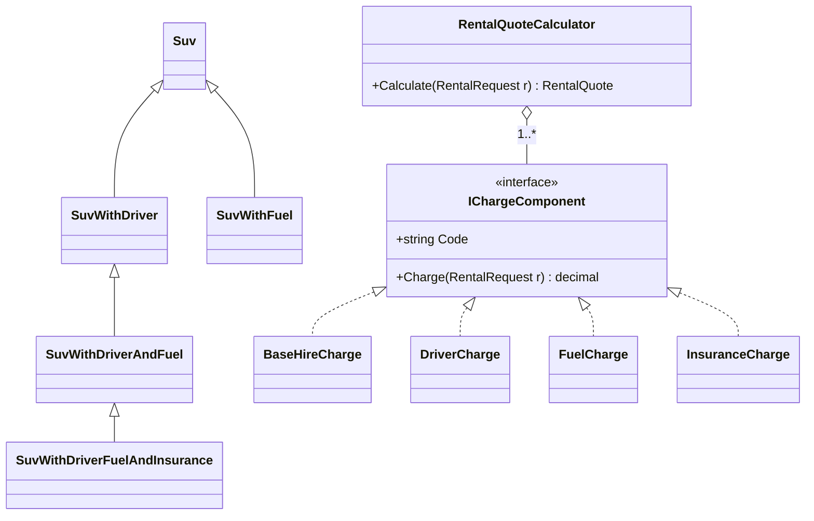
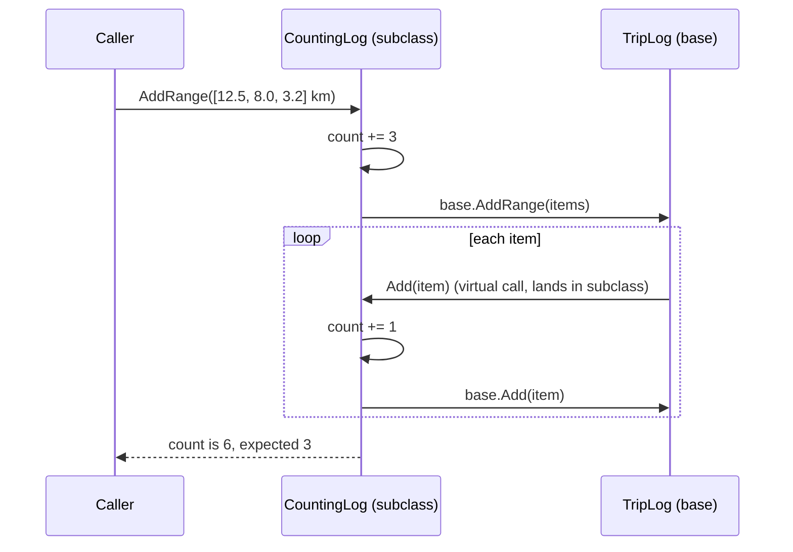
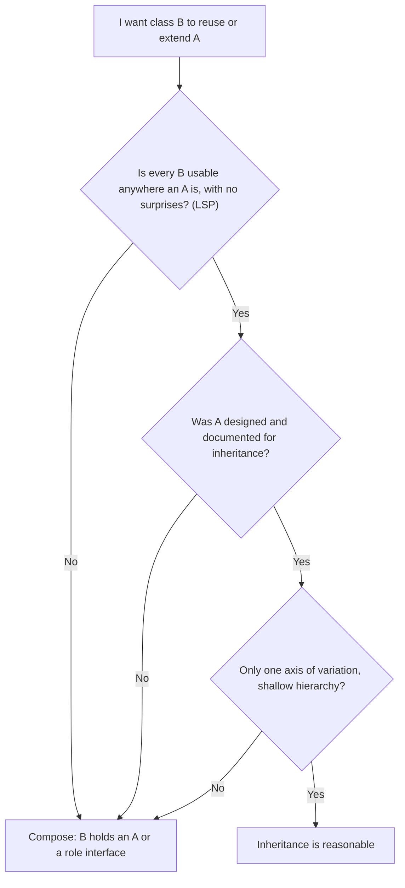
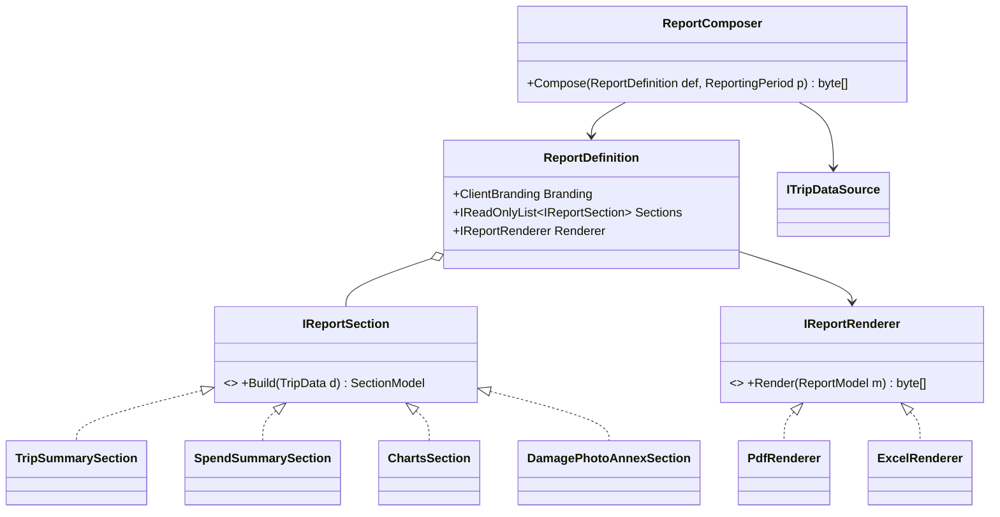

"Favour composition over inheritance" is one of the most repeated lines in object-oriented design. It comes from the 1994 *Design Patterns* book, and it's good advice — but it's often heard as "never use inheritance", which isn't what it says. This lesson explains what goes wrong with inheritance, how composition fixes it, how to refactor from one to the other in C#, and where inheritance is still the clearest design.

## Learning objectives

By the end of this lesson you will be able to:

1. Explain the difference between "is-a" (inheritance) and "has-a" (composition) relationships, with examples.
2. Describe the fragile base class problem and show it in C# code.
3. Recognise class explosion from combining features through subclasses, and replace it with composed parts.
4. Refactor inheritance into delegation (wrapping an object and forwarding to it) safely.
5. Use C# features that support composition: interfaces, primary constructors, `sealed`, default interface methods.
6. Decide when inheritance is the better choice: framework extension points, true subtypes, and closed hierarchies.

## Prerequisites

- [Encapsulation, abstraction, inheritance and polymorphism](#/lesson/m01-oop-pillars): `virtual`, `override`, `base`.
- [Interfaces and abstract classes](#/lesson/m01-interfaces-abstract).
- [Liskov Substitution Principle](#/lesson/m04-lsp): most bad inheritance is an LSP violation.

## Explain it like I'm a beginner

Think about renting a self-drive car on an app for a weekend trip from Bengaluru to Coorg. You can rent an SUV. You can also add a driver (chauffeur), prepaid fuel, damage protection, or a child seat. Any combination is possible.

**Inheritance thinking** says: "An SUV with a driver is a *kind of* SUV." So you create `SuvWithDriver`. Then `SuvWithDriverAndFuel`. Then `SuvWithFuelAndInsurance`. With four optional add-ons, that's 2⁴ = 16 classes — for one vehicle type. Add hatchbacks, sedans and motorbikes, and you have 64 classes, most of them nearly identical.

**Composition thinking** says: "A rental quote *has* a list of charges." The SUV's daily rent is one charge. The driver is another. Fuel is another. You build a quote by putting together the charges the customer picked, like filling a thali with the dishes you want instead of ordering a separate fixed thali for every combination. Four add-ons means four small classes, and any combination works.

- **Inheritance** ("is-a"): a class gets the fields and methods of a parent class and can override some of them. `class Suv : Vehicle`.
- **Composition** ("has-a"): a class holds references to other objects and uses them to do its work. `class RentalQuote { List<IChargeComponent> charges; }`.
- **Delegation**: a class passes ("delegates") a job to an object it holds, instead of inheriting the method.

## First-principles explanation

### What inheritance really gives you

Inheritance bundles two different things:

1. **A type relationship (subtyping).** A `Suv` can be used wherever a `Vehicle` is expected.
2. **Code reuse (implementation inheritance).** `Suv` gets `Vehicle`'s fields and method bodies for free.

Interfaces give you (1) without (2). Composition gives you (2) without (1). Most inheritance problems come from wanting one of these and getting both.

### Why inheritance causes trouble

**1. Tight coupling to the parent's internals.** A subclass depends not just on the parent's public methods, but on *how* they're implemented: which methods call which, in what order. That's called *white-box reuse*, because the subclass can see inside. Composition is *black-box reuse*: you only use the other object's public contract.

**2. The fragile base class problem.** A harmless-looking change in a base class breaks subclasses that nobody changed. The classic example (Joshua Bloch's `InstrumentedHashSet` in *Effective Java*, retold here with a trip log that stores distances in km):

- `TripLog.AddRange` loops and calls the virtual `Add` for each item.
- `CountingLog : TripLog` overrides both `Add` and `AddRange` to count entries. `AddRange` adds the range length, then calls `base.AddRange`... which calls `Add` for each item, which counts again. Adding 3 entries counts 6.
- The subclass author "fixes" it by not counting in `AddRange`. Six months later, the base class author optimises `AddRange` to insert directly without calling `Add`. Now the subclass counts 0. Nobody touched `CountingLog`, but it's broken again.

The subclass relied on a self-call inside the base class, which was never part of any contract.

**3. Class explosion.** Each independent dimension of variation (vehicle type × driver × fuel × insurance) multiplies the number of subclasses. Inheritance lets you vary along only one axis cleanly.

**4. Inheritance is fixed at compile time.** An object can't change its parent class at runtime. A composed object can swap a part: replace the `FuelCharge` with a `CustomerSuppliedFuel` charge for one quote.

**5. Refused bequest.** Subclasses inherit everything, including methods that make no sense for them, so they override them to throw. That breaks [Liskov substitution](#/lesson/m04-lsp).

### How composition works

The composed class holds its parts as fields — usually as interfaces, injected through the constructor — and calls them. In C#:

```csharp
public sealed class RentalQuoteCalculator(IEnumerable<IChargeComponent> components)
{
    public decimal Total(RentalRequest r) => components.Sum(c => c.Charge(r));
}
```

Each part is small, testable on its own, and unaware of the others. New behaviour means a new part, not a new subclass.

Two composition techniques are especially common:

- **Strategy** — hold one interchangeable part for a varying step ([Strategy](#/lesson/m06-strategy)).
- **Decorator** — wrap an object that implements the same interface and add behaviour before or after forwarding ([Decorator](#/lesson/m06-decorator)). The counting log is a natural decorator.

### C# features that matter here

- **Single class inheritance.** A C# class has one base class but can implement many interfaces, so inheritance can't express "has a driver *and* fuel". Composition can.
- **`virtual` is opt-in.** Methods aren't overridable unless marked `virtual`, which limits (but doesn't remove) fragility.
- **`sealed`.** Marking classes `sealed` by default states "not designed for inheritance". It also lets the JIT devirtualise calls in some cases. Unseal deliberately, when you design for extension.
- **`new` hides; it doesn't override.** `public new void Add(...)` on a `List<T>` subclass is silently bypassed when the object is used as `IList<T>` or `List<T>`. A common trap (see the playground).
- **Primary constructors** (C# 12+) make delegation cheap: `sealed class CountingLog(ITripLog inner) : ITripLog`.
- **Default interface methods** let interfaces carry a little shared behaviour without a base class. Use sparingly.

### When inheritance is the right tool

- **Framework extension points designed for it.** `ControllerBase`, `BackgroundService`, `DbContext`, `Collection<T>` (with its `protected virtual InsertItem`), `JsonConverter<T>`, `DelegatingHandler`. Their authors documented which members to override and promised to keep that contract.
- **True subtypes that pass LSP.** Every `CorporateBooking` really can be used anywhere a `Booking` is, with no surprises.
- **Closed sets of data variants.** `abstract record QuoteOutcome` with `Quoted` and `Unavailable` subtypes, matched with `switch` expressions. The hierarchy is shallow, and the variants are data, not behaviour bundles.
- **Template Method** with a small, stable skeleton and one or two clearly documented hooks ([Template Method](#/lesson/m06-template-method)).

### When composition is overkill

- Forwarding 25 methods by hand to reuse one. If the "is-a" relationship is genuine and the base class was designed for extension, inherit.
- Splitting a tiny, stable class into five injected parts that always appear together.
- Building deep object graphs that take 40 lines to construct, when a simple subclass would be clearer.

### Trade-offs

| Inheritance | Composition |
|---|---|
| Less code for a true "is-a" | Some forwarding/wiring code |
| Polymorphism built in | Polymorphism via interfaces |
| Fixed at compile time | Parts swappable at runtime |
| Subclass coupled to parent's internals | Coupled only to parts' public contracts |
| One axis of variation | Many independent axes |
| Easy to misuse for "code sharing" | Easy to over-split into tiny parts |

## Visual explanation

### Class explosion versus composed charges



The left half shows the inheritance approach after a few months: a chain of subclasses, one per combination, and it's already missing "fuel and insurance without a driver". The right half shows composition: one calculator holding any number of charge components, each implementing one interface. Four add-on classes cover all 16 combinations. A new add-on (child seat) is one new class.

### The fragile base class, step by step



This is why the problem is so hard to see. The base class's `AddRange` calls `Add` virtually, so the call jumps *back down* into the subclass's override, which counts again. The subclass author didn't know about that self-call, because it's an implementation detail of the base class. A decorator that wraps an `ITripLog` can't be fooled this way: when it forwards `AddRange` to the inner object, the inner object's internal calls never come back to the decorator.

### Choosing: a quick decision path



Three questions, and a "no" to any of them points to composition. The second question is the one people skip: inheriting from a class that wasn't built for it (like `List<T>`) couples you to internals its authors never promised to keep.

## Step-by-step example

The system: a self-drive car rental app that quotes hatchbacks, sedans and SUVs to travellers, with an optional driver, prepaid fuel and damage protection (insurance).

### Step 1 — the inheritance version and its symptoms

```csharp
public class SuvRental
{
    public virtual decimal DailyRate => 3_000m;
    public virtual decimal Quote(int days) => DailyRate * days;
}
public class SuvRentalWithDriver : SuvRental
{
    public override decimal Quote(int days) => base.Quote(days) + 1_000m * days;
}
public class SuvRentalWithDriverAndFuel : SuvRentalWithDriver
{
    public override decimal Quote(int days) => base.Quote(days) + days * 150 / 15 * 104m;   // 150 km/day, 15 km/L, ₹104/L
}
```

Symptoms: every combination is a class; rates for a hatchback need a parallel hierarchy (`HatchbackRental`, `HatchbackRentalWithDriver`, ...); the petrol price and the 150 km/day guess are hard-coded in a subclass; and the quote can't show a line-by-line breakdown because the parts are fused by `base.Quote` calls.

### Step 2 — find the independent dimensions

List what varies independently: **vehicle** (daily rate, mileage, insured value), **driver** (yes/no, how many), **fuel** (prepaid with us or filled by the customer), **insurance** (yes/no). Four dimensions. Inheritance can model one; the rest must be composed.

### Step 3 — make each dimension a part

Each add-on becomes an `IChargeComponent` with a `Code` (for the breakdown) and `Charge(RentalRequest)`. The vehicle becomes *data* (`VehicleSpec` record), not a class per type — hatchbacks and SUVs differ in numbers, not in behaviour.

### Step 4 — compose per request

A quote for "SUV, 5 days, 150 km a day, with driver and fuel" is built by choosing the matching components. The calculator just sums them and returns line items.

### Step 5 — keep inheritance where it fits

The rental app also has an hourly job that flags overdue returns. That inherits from `BackgroundService`, a framework class designed for it. And quote results are a small closed set: `Quoted` or `Unavailable`. A sealed record hierarchy with pattern matching is the clearest model for that.

## Production-style C# implementation

```text
Rentals.Api/
  Program.cs
  Rentals/RentalModels.cs
  Rentals/ChargeComponents.cs
  Rentals/RentalQuoteCalculator.cs
  Rentals/OverdueReturnMonitor.cs
```

```csharp file=Rentals/RentalModels.cs
namespace Rentals;

/// <summary>Vehicles differ in numbers, not behaviour, so they are data — not a subclass per vehicle type.</summary>
public sealed record VehicleSpec(string Code, string Name, decimal DailyRate, decimal KmPerLitre, decimal InsuredValue);

public sealed record RentalRequest(VehicleSpec Vehicle, int Days, int KmPerDay, bool WithDriver, bool WithFuel, bool WithInsurance)
{
    public int Days { get; } = Days is > 0 and <= 90 ? Days : throw new ArgumentOutOfRangeException(nameof(Days));
    public int KmPerDay { get; } = KmPerDay is > 0 and <= 1_000 ? KmPerDay : throw new ArgumentOutOfRangeException(nameof(KmPerDay));
}

public sealed record QuoteLine(string Code, decimal Amount);

/// <summary>A closed set of outcomes: a good fit for a shallow, sealed record hierarchy.</summary>
public abstract record QuoteOutcome
{
    private QuoteOutcome() { }
    public sealed record Quoted(string VehicleCode, IReadOnlyList<QuoteLine> Lines) : QuoteOutcome
    {
        public decimal Total => Lines.Sum(l => l.Amount);
    }
    public sealed record Unavailable(string VehicleCode, string Reason) : QuoteOutcome;
}

public sealed record RentalPricingOptions
{
    public decimal DriverDailyFee { get; init; } = 1_000m;
    public decimal PetrolPricePerLitre { get; init; } = 104m;
    public decimal InsurancePercentOfHire { get; init; } = 10m;
    /// <summary>Driver duty limit: plans longer than this per day need a second driver.</summary>
    public int MaxKmPerDriverPerDay { get; init; } = 300;
}
```

```csharp file=Rentals/ChargeComponents.cs
using Microsoft.Extensions.Options;

namespace Rentals;

/// <summary>One independent dimension of a rental price. Components know nothing about each other.</summary>
public interface IChargeComponent
{
    string Code { get; }
    bool AppliesTo(RentalRequest request);
    decimal Charge(RentalRequest request);
}

internal static class Rupees
{
    public static decimal Round(decimal v) => Math.Round(v, 2, MidpointRounding.AwayFromZero);
}

public sealed class BaseHireCharge : IChargeComponent
{
    public string Code => "HIRE";
    public bool AppliesTo(RentalRequest r) => true;
    public decimal Charge(RentalRequest r) => Rupees.Round(r.Vehicle.DailyRate * r.Days);
}

public sealed class DriverCharge(IOptions<RentalPricingOptions> options) : IChargeComponent
{
    public string Code => "DRIVER";
    public bool AppliesTo(RentalRequest r) => r.WithDriver;
    public decimal Charge(RentalRequest r)
    {
        // Driver duty limits: a plan longer than one driver's daily limit needs a second driver.
        var drivers = r.KmPerDay > options.Value.MaxKmPerDriverPerDay ? 2 : 1;
        return Rupees.Round(options.Value.DriverDailyFee * drivers * r.Days);
    }
}

public sealed class FuelCharge(IOptions<RentalPricingOptions> options) : IChargeComponent
{
    public string Code => "FUEL";
    public bool AppliesTo(RentalRequest r) => r.WithFuel;
    public decimal Charge(RentalRequest r) =>
        Rupees.Round((decimal)r.KmPerDay * r.Days / r.Vehicle.KmPerLitre * options.Value.PetrolPricePerLitre);
}

/// <summary>Insurance is priced on the hire charge; it composes another component rather than inheriting from it.</summary>
public sealed class InsuranceCharge(BaseHireCharge hire, IOptions<RentalPricingOptions> options) : IChargeComponent
{
    public string Code => "INSURANCE";
    public bool AppliesTo(RentalRequest r) => r.WithInsurance;
    public decimal Charge(RentalRequest r) => Rupees.Round(hire.Charge(r) * options.Value.InsurancePercentOfHire / 100m);
}
```

```csharp file=Rentals/RentalQuoteCalculator.cs
namespace Rentals;

public interface IVehicleAvailability
{
    bool IsAvailable(string vehicleCode, int days);
}

/// <summary>Composes charge components. Adding a "child seat" charge is one new IChargeComponent and one registration.</summary>
public sealed class RentalQuoteCalculator(IEnumerable<IChargeComponent> components, IVehicleAvailability availability)
{
    private readonly IReadOnlyList<IChargeComponent> _components = components.ToList();

    public QuoteOutcome Quote(RentalRequest request)
    {
        if (!availability.IsAvailable(request.Vehicle.Code, request.Days))
            return new QuoteOutcome.Unavailable(request.Vehicle.Code, "No car of this type is free for the requested dates.");

        var lines = _components.Where(c => c.AppliesTo(request))
                               .Select(c => new QuoteLine(c.Code, c.Charge(request)))
                               .ToList();
        return new QuoteOutcome.Quoted(request.Vehicle.Code, lines);
    }
}

public sealed class AlwaysAvailable : IVehicleAvailability
{
    public bool IsAvailable(string vehicleCode, int days) => true;
}
```

```csharp file=Rentals/OverdueReturnMonitor.cs
using Microsoft.Extensions.Hosting;
using Microsoft.Extensions.Logging;

namespace Rentals;

/// <summary>Inheritance used where it fits: BackgroundService is a framework base class designed for extension,
/// with one documented hook (ExecuteAsync).</summary>
public sealed class OverdueReturnMonitor(TimeProvider clock, ILogger<OverdueReturnMonitor> logger) : BackgroundService
{
    protected override async Task ExecuteAsync(CancellationToken stoppingToken)
    {
        using var timer = new PeriodicTimer(TimeSpan.FromHours(1), clock);
        while (await timer.WaitForNextTickAsync(stoppingToken))
        {
            logger.LogInformation("Checking for overdue car returns at {Now}", clock.GetUtcNow());
            // Query rentals past their return time and notify the customer and the branch (omitted).
        }
    }
}
```

```csharp file=Program.cs
using Rentals;

var builder = WebApplication.CreateBuilder(args);

builder.Services.Configure<RentalPricingOptions>(builder.Configuration.GetSection("Rentals:Pricing"));
builder.Services.AddSingleton(TimeProvider.System);
builder.Services.AddSingleton<IVehicleAvailability, AlwaysAvailable>();

// Composition: each charge is a part. Order of registration = order of quote lines.
builder.Services.AddSingleton<BaseHireCharge>();
builder.Services.AddSingleton<IChargeComponent>(sp => sp.GetRequiredService<BaseHireCharge>());
builder.Services.AddSingleton<IChargeComponent, DriverCharge>();
builder.Services.AddSingleton<IChargeComponent, FuelCharge>();
builder.Services.AddSingleton<IChargeComponent, InsuranceCharge>();
builder.Services.AddSingleton<RentalQuoteCalculator>();

builder.Services.AddHostedService<OverdueReturnMonitor>();

var app = builder.Build();

var catalogue = new Dictionary<string, VehicleSpec>(StringComparer.OrdinalIgnoreCase)
{
    ["HB-AUTO"] = new("HB-AUTO", "Hatchback, automatic", 1_800m, 20m, 6_50_000m),
    ["SUV-7S"] = new("SUV-7S", "7-seater SUV", 3_000m, 15m, 18_00_000m),
};

app.MapGet("/quotes/{code}", (string code, int days, int kmPerDay, bool driver, bool fuel, bool insurance, RentalQuoteCalculator calc) =>
{
    if (!catalogue.TryGetValue(code, out var spec)) return Results.NotFound();
    if (days is < 1 or > 90 || kmPerDay is < 1 or > 1_000) return Results.BadRequest("days must be 1-90 and kmPerDay 1-1000.");
    return calc.Quote(new RentalRequest(spec, days, kmPerDay, driver, fuel, insurance)) switch
    {
        QuoteOutcome.Quoted q => Results.Ok(new { q.VehicleCode, q.Lines, q.Total }),
        QuoteOutcome.Unavailable u => Results.Conflict(u.Reason),
        _ => Results.Problem("Unexpected quote outcome"),
    };
});

app.Run();
```

What to notice:

- **Vehicles are data.** `VehicleSpec` records replace a subclass per vehicle type. Behaviour differs only by numbers.
- **Each dimension is a component.** Driver, fuel and insurance each know one rule. Any combination is a choice of components.
- **`InsuranceCharge` composes `BaseHireCharge`** to reuse its calculation. That's reuse through a held object, not through a parent class.
- **Inheritance appears twice, deliberately.** `OverdueReturnMonitor : BackgroundService` uses a framework extension point. `QuoteOutcome` is a closed, shallow data hierarchy; the private constructor stops anyone adding a third outcome outside the type.
- **Everything is `sealed`** unless designed for extension.
- **Bad input is rejected at the edge.** The endpoint returns 400 for out-of-range days or distance before the record constructor would throw, so a typo in a query string never becomes a 500.

:::callout type=note title="What a senior reviewer would add"
A quote is a promise about money. In production, save each quote with an id, the prices used and an expiry (say 15 minutes), and charge the saved quote at checkout instead of recomputing it — otherwise a petrol-price change between quote and payment silently changes what the customer pays. Composition makes this easy: the saved line items *are* the breakdown.
:::

## Bad design vs good design

### The bad version: inheriting to reuse code

```csharp
public class TripLog
{
    protected readonly List<decimal> Items = new();
    public virtual void Add(decimal distanceKm) => Items.Add(distanceKm);
    public virtual void AddRange(IEnumerable<decimal> distances) { foreach (var q in distances) Add(q); }
    public int Count => Items.Count;
}

public class CountingLog : TripLog
{
    public int AddedCount { get; private set; }
    public override void Add(decimal distanceKm) { AddedCount++; base.Add(distanceKm); }
    public override void AddRange(IEnumerable<decimal> distances)
    {
        var list = distances.ToList();
        AddedCount += list.Count;
        base.AddRange(list);   // calls Add for each item -> counted twice
    }
}

public class ReadOnlyLog : TripLog
{
    public override void Add(decimal distanceKm) => throw new NotSupportedException();   // refused bequest
}
```

### What's wrong, in detail

1. **Fragile base class.** `CountingLog` depends on whether `TripLog.AddRange` calls `Add`. That's an implementation detail, so any base-class optimisation silently breaks the count in one direction or the other.
2. **Exposed internals.** `protected Items` lets every subclass bypass the base class's rules. If the base later adds validation ("distance must be positive") in `Add`, a subclass writing to `Items` directly skips it.
3. **Refused bequest.** `ReadOnlyLog` "is a" log that can't be added to. Code that takes a `TripLog` and calls `Add` blows up. This is an LSP violation, and the ISP fix is a read-only role interface ([ISP](#/lesson/m04-isp)).
4. **One axis only.** Want a counting *and* read-only *and* audited log? Inheritance offers `CountingAuditedReadOnlyLog`. Composition offers three wrappers stacked in any order.

### The good version: role interfaces plus decorators

```csharp
public interface ITripReader { int Count { get; } IReadOnlyList<decimal> Items { get; } }
public interface ITripLog : ITripReader { void Add(decimal q); void AddRange(IEnumerable<decimal> q); }

public sealed class TripLog : ITripLog { /* private list, validation in one place */ }

public sealed class CountingLog(ITripLog inner) : ITripLog
{
    public int AddedCount { get; private set; }
    public int Count => inner.Count;
    public IReadOnlyList<decimal> Items => inner.Items;
    public void Add(decimal q) { inner.Add(q); AddedCount++; }
    public void AddRange(IEnumerable<decimal> q) { var list = q.ToList(); inner.AddRange(list); AddedCount += list.Count; }
}
```

The decorator counts what *it* forwarded, so it's right whatever `TripLog.AddRange` does internally. A read-only consumer takes `ITripReader`, so there's no `Add` to refuse. `TripLog` is `sealed` and keeps its list private, so its rules can't be bypassed.

### When applying "composition over inheritance" blindly is harmful

:::callout type=mistake title="Forwarding boilerplate for a true is-a"
Wrapping `DbContext`, `ControllerBase` or `BackgroundService` "to avoid inheritance" means hand-forwarding dozens of members and losing framework features that depend on the subtype (model building, filters, hosting lifecycle). Those classes are *designed* for inheritance; use them that way.
:::

- **Over-splitting.** Turning a 30-line class into seven injected parts that always travel together adds wiring without adding flexibility.
- **Replacing closed data hierarchies with "has-a".** A payment result that is either `Succeeded` or `Failed` is clearer as two sealed records than as one class with a `Status` field and nullable properties for each case.
- **Deep object graphs.** If constructing a composed object takes 40 lines in every test, consider builders, sensible defaults, or whether some parts should be plain data.
- **Ignoring LSP in interfaces.** Composition doesn't magically fix bad contracts. A decorator that changes the meaning of a method (caching data that must be fresh) is as harmful as a misbehaving subclass.

:::callout type=tradeoff title="Inheritance from your own base classes"
Inheriting from your *own* abstract base class is safest when the base class is small, has no public `virtual` methods other than the documented hooks, keeps state `private`, and lives in the same assembly as all its subclasses. If a base class grows past a couple of hooks, or is shared across teams, prefer composition.
:::

## Practical playground

`AuditedList` keeps booking ids. It inherits from `List<string>` and uses `new` to "override" `Add`. Run it: when the same object is used through `IList<string>`, the audit count is bypassed. Then fix it two ways: (1) inherit from `Collection<string>` and override `InsertItem`, which *is* designed for extension; (2) wrap a `List<string>` and implement only the methods you need. Both should report 3 additions.

:::playground type=csharp title="When inheritance from List<T> lies"
```csharp file=Program.cs
using System;
using System.Collections.Generic;

public class AuditedList : List<string>
{
    public int Additions { get; private set; }
    public new void Add(string item) { Additions++; base.Add(item); }   // hides, does not override
}

public static class Program
{
    public static void Main()
    {
        var list = new AuditedList();
        list.Add("BK-101");                     // counted
        IList<string> asInterface = list;
        asInterface.Add("BK-102");              // NOT counted: calls List<T>.Add
        List<string> asBase = list;
        asBase.Add("BK-103");                   // NOT counted either

        Console.WriteLine($"Items: {list.Count}, audited additions: {list.Additions}");
        // TODO: fix with Collection<string> + override InsertItem, or with a wrapper class.
    }
}
```
:::

## Exercises

:::exercise id=m04-composition-inheritance-ex1 difficulty=beginner kind=code title="Fix the double count with a decorator"
`CountingLog` inherits from `TripLog` and counts twice when `AddRange` is used. Implement `CountingLogDecorator`, which wraps any `ITripLog` and counts every trip distance it forwards — correctly, whatever the inner log does internally.
::requirements
- `CountingLogDecorator(ITripLog inner)` implements `ITripLog`.
- `Add` and `AddRange` forward to `inner` and update `AddedCount`.
- `Count` returns the inner log's count.
- Don't change `TripLog` or `ITripLog`.
::acceptance
- `AddRange` of 3 items gives `AddedCount == 3`, both over `TripLog` (which calls `Add` internally) and over a log whose `AddRange` doesn't.
- `Add` once more gives `AddedCount == 4`.
- `Count` matches the inner log.
::hint
The decorator *is* an `ITripLog` and *has* an `ITripLog`.
::hint
Count in the decorator, based on what *you* forwarded — never on what the inner object does internally.
::hint
Materialise the sequence once (`ToList()`) so you can both count it and forward it.
::hint
```csharp
public void AddRange(IEnumerable<decimal> q) { var list = q.ToList(); inner.AddRange(list); AddedCount += list.Count; }
```
::starter
```csharp file=CountingLog.cs
using System;
using System.Collections.Generic;
using System.Linq;

public interface ITripLog
{
    void Add(decimal distanceKm);
    void AddRange(IEnumerable<decimal> distances);
    int Count { get; }
}

public class TripLog : ITripLog
{
    private readonly List<decimal> _items = new();
    public virtual void Add(decimal distanceKm)
    {
        if (distanceKm <= 0) throw new ArgumentOutOfRangeException(nameof(distanceKm));
        _items.Add(distanceKm);
    }
    public virtual void AddRange(IEnumerable<decimal> distances) { foreach (var q in distances) Add(q); }
    public int Count => _items.Count;
}

/// <summary>The inheritance version: double-counts on AddRange.</summary>
public class CountingLog : TripLog
{
    public int AddedCount { get; private set; }
    public override void Add(decimal distanceKm) { AddedCount++; base.Add(distanceKm); }
    public override void AddRange(IEnumerable<decimal> distances)
    {
        var list = distances.ToList();
        AddedCount += list.Count;
        base.AddRange(list);
    }
}

public sealed class CountingLogDecorator : ITripLog
{
    public CountingLogDecorator(ITripLog inner) => throw new NotImplementedException();
    public int AddedCount => throw new NotImplementedException();
    public int Count => throw new NotImplementedException();
    public void Add(decimal distanceKm) => throw new NotImplementedException();
    public void AddRange(IEnumerable<decimal> distances) => throw new NotImplementedException();
}
```
::tests
```csharp file=CountingLogTests.cs
using System.Collections.Generic;
using Xunit;

public class CountingLogTests
{
    /// <summary>A different inner implementation whose AddRange does NOT call Add.</summary>
    private sealed class BulkLog : ITripLog
    {
        private readonly List<decimal> _items = new();
        public void Add(decimal distanceKm) => _items.Add(distanceKm);
        public void AddRange(IEnumerable<decimal> distances) => _items.AddRange(distances);
        public int Count => _items.Count;
    }

    private static readonly decimal[] Three = { 12.5m, 8.0m, 3.2m };

    [Fact]
    public void Inheritance_version_double_counts() => Assert.Equal(6, Run(new CountingLog()));

    private static int Run(CountingLog log) { log.AddRange(Three); return log.AddedCount; }

    [Fact]
    public void Decorator_counts_correctly_over_TripLog()
    {
        var log = new CountingLogDecorator(new TripLog());
        log.AddRange(Three);
        Assert.Equal(3, log.AddedCount);
        log.Add(1m);
        Assert.Equal(4, log.AddedCount);
        Assert.Equal(4, log.Count);
    }

    [Fact]
    public void Decorator_counts_correctly_over_bulk_log()
    {
        var log = new CountingLogDecorator(new BulkLog());
        log.AddRange(Three);
        Assert.Equal(3, log.AddedCount);
        Assert.Equal(3, log.Count);
    }

    [Fact]
    public void Decorator_works_with_lazy_sequences()
    {
        var log = new CountingLogDecorator(new TripLog());
        log.AddRange(Generate());
        Assert.Equal(2, log.AddedCount);
        Assert.Equal(2, log.Count);
    }

    private static IEnumerable<decimal> Generate() { yield return 1m; yield return 2m; }
}
```
::solution
```csharp file=CountingLog.cs
using System;
using System.Collections.Generic;
using System.Linq;

public interface ITripLog
{
    void Add(decimal distanceKm);
    void AddRange(IEnumerable<decimal> distances);
    int Count { get; }
}

public class TripLog : ITripLog
{
    private readonly List<decimal> _items = new();
    public virtual void Add(decimal distanceKm)
    {
        if (distanceKm <= 0) throw new ArgumentOutOfRangeException(nameof(distanceKm));
        _items.Add(distanceKm);
    }
    public virtual void AddRange(IEnumerable<decimal> distances) { foreach (var q in distances) Add(q); }
    public int Count => _items.Count;
}

/// <summary>The inheritance version: double-counts on AddRange.</summary>
public class CountingLog : TripLog
{
    public int AddedCount { get; private set; }
    public override void Add(decimal distanceKm) { AddedCount++; base.Add(distanceKm); }
    public override void AddRange(IEnumerable<decimal> distances)
    {
        var list = distances.ToList();
        AddedCount += list.Count;
        base.AddRange(list);
    }
}

public sealed class CountingLogDecorator(ITripLog inner) : ITripLog
{
    public int AddedCount { get; private set; }
    public int Count => inner.Count;

    public void Add(decimal distanceKm)
    {
        inner.Add(distanceKm);
        AddedCount++;
    }

    public void AddRange(IEnumerable<decimal> distances)
    {
        var list = distances.ToList();
        inner.AddRange(list);
        AddedCount += list.Count;
    }
}
```

The decorator only counts what it forwarded. The inner log's internal calls (`AddRange` calling `Add`) stay inside the inner object and never come back up, because there's no virtual dispatch between them. Counting *after* forwarding also means a rejected distance (the inner log throws) isn't counted.
::mistakes
- Counting before forwarding, so a rejected distance is still counted.
- Enumerating the input twice (`distances.Count()` then forwarding), which breaks for one-shot sequences.
- Making the decorator inherit from `TripLog` "to save typing" — that brings the fragile self-call back.
:::

:::exercise id=m04-composition-inheritance-ex2 difficulty=beginner kind=written title="Is-a or has-a?"
For each pair, say whether inheritance ("is-a") or composition ("has-a") is the better model, and why. Check LSP for every "is-a".

1. `Suv` and `Vehicle` in a fleet register where every vehicle has a registration number, a purchase date and a depreciation schedule.
2. `BranchAgent` and `Employee`, where a person can move from front-desk agent to branch manager.
3. `ReadOnlyRepository` and `Repository`.
4. `InvoiceController` and ASP.NET Core's `ControllerBase`.
5. `GpsTrackedCar` and `Car`, where GPS trackers can be fitted and removed.
6. `PaymentResult` with `Succeeded` and `Failed` variants.
::acceptance
- Each answer names the relationship and gives a reason.
- At least one answer uses LSP to reject inheritance.
- At least one answer recognises a framework extension point.
::hint
Can the relationship change over the object's lifetime? Inheritance can't.
::hint
Would every subclass honour every parent method without surprises?
::hint
Is the parent class designed and documented for inheritance?
::solution
1. **Inheritance is reasonable**, or even better, **data**: if SUVs differ only by numbers, a single `Vehicle` with a type field works. Subclass only if SUVs have genuinely different behaviour (a different depreciation method), and keep it shallow.
2. **Composition.** A role can change; an object can't change its class. `Employee` *has* a `Role` (or a list of role assignments with dates).
3. **Composition / role interfaces.** A read-only repository can't honour `Save`, so it fails LSP. Use `IBookingReader` and `IBookingWriter`.
4. **Inheritance.** `ControllerBase` is a framework extension point designed for it.
5. **Composition.** Trackers are fitted and removed; `Car` *has* an optional `ITelemetryDevice`.
6. **Inheritance of a closed set**: `abstract record PaymentResult` with sealed `Succeeded` and `Failed` records, matched with `switch`. Shallow, closed, data-like.
::mistakes
- Modelling roles or temporary capabilities as subclasses.
- Wrapping `ControllerBase` "to avoid inheritance".
:::

:::exercise id=m04-composition-inheritance-ex3 difficulty=intermediate kind=code title="Compose a rental quote"
Replace the `SuvRentalWithDriverAndFuel`-style hierarchy with composed charge components. Implement the four components and `QuoteCalculator`.
::requirements
- `BaseHireCharge`: daily rate × days. Always applies.
- `DriverCharge(dailyFee)`: fee × days; two drivers when `KmPerDay > 300`. Applies when `WithDriver`.
- `FuelCharge(pricePerLitre)`: km/day × days ÷ km per litre × price. Applies when `WithFuel`.
- `InsuranceCharge(percent)`: percent of the **base hire** charge. Applies when `WithInsurance`. It must reuse `BaseHireCharge` by holding one, not by inheriting.
- `QuoteCalculator.Lines` returns `(Code, Amount)` for applicable components in the order given; `Total` sums them. Round each amount to 2 decimals, half away from zero.
::acceptance
- SUV at ₹3,000/day, 15 km/L, 5 days × 150 km, with driver (₹1,000/day), fuel (₹104/L) and insurance (10 %) → HIRE 15,000; DRIVER 5,000; FUEL 5,200 (750 km ÷ 15 = 50 L); INSURANCE 1,500; total 26,700.
- 350 km/day doubles the driver charge.
- Without add-ons, only HIRE appears.
- `InsuranceCharge` does not inherit from `BaseHireCharge`.
::hint
Each component answers two questions: does it apply, and how much is it?
::hint
`InsuranceCharge` takes a `BaseHireCharge` in its constructor and calls its `Amount`.
::hint
The calculator filters with `AppliesTo`, then maps to lines. Order is the order of the list it was given.
::hint
```csharp
public IReadOnlyList<(string Code, decimal Amount)> Lines(RentalRequest r) =>
    _components.Where(c => c.AppliesTo(r)).Select(c => (c.Code, c.Amount(r))).ToList();
```
::starter
```csharp file=RentalQuote.cs
using System;
using System.Collections.Generic;
using System.Linq;

public sealed record VehicleSpec(string Code, decimal DailyRate, decimal KmPerLitre);
public sealed record RentalRequest(VehicleSpec Vehicle, int Days, int KmPerDay, bool WithDriver, bool WithFuel, bool WithInsurance);

public interface IChargeComponent
{
    string Code { get; }
    bool AppliesTo(RentalRequest request);
    decimal Amount(RentalRequest request);
}

public sealed class BaseHireCharge : IChargeComponent
{
    public string Code => "HIRE";
    public bool AppliesTo(RentalRequest request) => throw new NotImplementedException();
    public decimal Amount(RentalRequest request) => throw new NotImplementedException();
}

public sealed class DriverCharge(decimal dailyFee) : IChargeComponent
{
    public string Code => "DRIVER";
    public bool AppliesTo(RentalRequest request) => throw new NotImplementedException();
    public decimal Amount(RentalRequest request) => throw new NotImplementedException();
}

public sealed class FuelCharge(decimal pricePerLitre) : IChargeComponent
{
    public string Code => "FUEL";
    public bool AppliesTo(RentalRequest request) => throw new NotImplementedException();
    public decimal Amount(RentalRequest request) => throw new NotImplementedException();
}

public sealed class InsuranceCharge(BaseHireCharge hire, decimal percent) : IChargeComponent
{
    public string Code => "INSURANCE";
    public bool AppliesTo(RentalRequest request) => throw new NotImplementedException();
    public decimal Amount(RentalRequest request) => throw new NotImplementedException();
}

public sealed class QuoteCalculator(IEnumerable<IChargeComponent> components)
{
    public IReadOnlyList<(string Code, decimal Amount)> Lines(RentalRequest request) => throw new NotImplementedException();
    public decimal Total(RentalRequest request) => throw new NotImplementedException();
}
```
::tests
```csharp file=RentalQuoteTests.cs
using System.Linq;
using Xunit;

public class RentalQuoteTests
{
    private static readonly VehicleSpec Suv = new("SUV-7S", 3_000m, 15m);

    private static QuoteCalculator Calculator()
    {
        var hire = new BaseHireCharge();
        IChargeComponent[] parts = { hire, new DriverCharge(1_000m), new FuelCharge(104m), new InsuranceCharge(hire, 10m) };
        return new QuoteCalculator(parts);
    }

    [Fact]
    public void Full_quote_breakdown()
    {
        var lines = Calculator().Lines(new RentalRequest(Suv, 5, 150, true, true, true));
        Assert.Equal(new[] { "HIRE", "DRIVER", "FUEL", "INSURANCE" }, lines.Select(l => l.Code).ToArray());
        Assert.Equal(new[] { 15_000m, 5_000m, 5_200m, 1_500m }, lines.Select(l => l.Amount).ToArray());
    }

    [Fact]
    public void Full_quote_total() =>
        Assert.Equal(26_700m, Calculator().Total(new RentalRequest(Suv, 5, 150, true, true, true)));

    [Fact]
    public void Long_drives_need_two_drivers() =>
        Assert.Equal(10_000m, Calculator().Lines(new RentalRequest(Suv, 5, 350, true, false, false)).Single(l => l.Code == "DRIVER").Amount);

    [Fact]
    public void Exactly_300_km_needs_one_driver() =>
        Assert.Equal(5_000m, Calculator().Lines(new RentalRequest(Suv, 5, 300, true, false, false)).Single(l => l.Code == "DRIVER").Amount);

    [Fact]
    public void Fuel_rounds_to_paise() =>
        Assert.Equal(1_386.67m, Calculator().Lines(new RentalRequest(Suv, 1, 200, false, true, false)).Single(l => l.Code == "FUEL").Amount);

    [Fact]
    public void No_add_ons_only_hire() =>
        Assert.Equal("HIRE", Calculator().Lines(new RentalRequest(Suv, 3, 150, false, false, false)).Single().Code);

    [Fact]
    public void Insurance_composes_rather_than_inherits() =>
        Assert.Equal(typeof(object), typeof(InsuranceCharge).BaseType);
}
```
::solution
```csharp file=RentalQuote.cs
using System;
using System.Collections.Generic;
using System.Linq;

public sealed record VehicleSpec(string Code, decimal DailyRate, decimal KmPerLitre);
public sealed record RentalRequest(VehicleSpec Vehicle, int Days, int KmPerDay, bool WithDriver, bool WithFuel, bool WithInsurance);

public interface IChargeComponent
{
    string Code { get; }
    bool AppliesTo(RentalRequest request);
    decimal Amount(RentalRequest request);
}

internal static class Rupees
{
    public static decimal Round(decimal v) => Math.Round(v, 2, MidpointRounding.AwayFromZero);
}

public sealed class BaseHireCharge : IChargeComponent
{
    public string Code => "HIRE";
    public bool AppliesTo(RentalRequest request) => true;
    public decimal Amount(RentalRequest r) => Rupees.Round(r.Vehicle.DailyRate * r.Days);
}

public sealed class DriverCharge(decimal dailyFee) : IChargeComponent
{
    public string Code => "DRIVER";
    public bool AppliesTo(RentalRequest request) => request.WithDriver;
    public decimal Amount(RentalRequest r) => Rupees.Round(dailyFee * (r.KmPerDay > 300 ? 2 : 1) * r.Days);
}

public sealed class FuelCharge(decimal pricePerLitre) : IChargeComponent
{
    public string Code => "FUEL";
    public bool AppliesTo(RentalRequest request) => request.WithFuel;
    public decimal Amount(RentalRequest r) => Rupees.Round((decimal)r.KmPerDay * r.Days / r.Vehicle.KmPerLitre * pricePerLitre);
}

public sealed class InsuranceCharge(BaseHireCharge hire, decimal percent) : IChargeComponent
{
    public string Code => "INSURANCE";
    public bool AppliesTo(RentalRequest request) => request.WithInsurance;
    public decimal Amount(RentalRequest r) => Rupees.Round(hire.Amount(r) * percent / 100m);
}

public sealed class QuoteCalculator(IEnumerable<IChargeComponent> components)
{
    private readonly IReadOnlyList<IChargeComponent> _components = components.ToList();

    public IReadOnlyList<(string Code, decimal Amount)> Lines(RentalRequest request) =>
        _components.Where(c => c.AppliesTo(request)).Select(c => (c.Code, c.Amount(request))).ToList();

    public decimal Total(RentalRequest request) => Lines(request).Sum(l => l.Amount);
}
```

Four small classes cover all 16 add-on combinations, for every vehicle type. A child-seat charge is one more component; nothing else changes. Note the fuel formula multiplies before rounding: 200 km ÷ 15 km/L × ₹104 = ₹1,386.666…, rounded once to ₹1,386.67. Rounding the litres first (13.33 L × 104 = ₹1,386.32) gives a different bill — decide where rounding happens and test it.
::alternatives
If every add-on is "rate × days" with no special rules, a single `PerDayCharge(code, rate, Func<RentalRequest, bool> applies)` configured from data is even simpler. Use separate classes only where rules differ (two drivers for long drives, insurance on hire).
::mistakes
- `InsuranceCharge : BaseHireCharge` to reuse `Amount` — now insurance "is a" hire charge and inherits `Code` and `AppliesTo` semantics it shouldn't have.
- Computing insurance on the running total, which makes the result depend on component order.
:::

:::exercise id=m04-composition-inheritance-ex4 difficulty=intermediate kind=code title="Replace a refused bequest with delegation"
`ReadOnlyBranchRepository` inherits from `BranchRepository` and throws on `Save` and `Delete`. The customer-facing "find a pickup branch" page only needs to read. Implement `BranchDirectory`, which **holds** a `BranchRepository` and exposes only `Find` and `ActiveInState`.
::requirements
- `BranchDirectory(BranchRepository repository)` — delegation, not inheritance.
- `Find(code)` returns the branch or `null`.
- `ActiveInState(stateCode)` returns active branches in that state, ordered by code.
- `BranchDirectory` has no `Save` or `Delete` methods at all.
::acceptance
- Reads delegate to the repository.
- Reflection finds no `Save` or `Delete` on `BranchDirectory`.
- `BranchDirectory` doesn't inherit from `BranchRepository`.
::hint
This is Fowler's "Replace Superclass with Delegate".
::hint
Store the repository in a field (or a primary-constructor parameter) and forward the two reads.
::hint
`ActiveInState` can filter `repository.All()` — the logic is new, the data access is delegated.
::starter
```csharp file=BranchDirectory.cs
using System;
using System.Collections.Generic;
using System.Linq;

public sealed record Branch(string Code, string Name, string StateCode, bool IsActive);

public class BranchRepository
{
    private readonly Dictionary<string, Branch> _branches = new(StringComparer.OrdinalIgnoreCase);
    public virtual Branch? Find(string code) => _branches.GetValueOrDefault(code);
    public virtual IReadOnlyList<Branch> All() => _branches.Values.ToList();
    public virtual void Save(Branch branch) => _branches[branch.Code] = branch;
    public virtual void Delete(string code) => _branches.Remove(code);
}

/// <summary>The refused-bequest version.</summary>
public class ReadOnlyBranchRepository : BranchRepository
{
    public override void Save(Branch branch) => throw new NotSupportedException();
    public override void Delete(string code) => throw new NotSupportedException();
}

public sealed class BranchDirectory
{
    public BranchDirectory(BranchRepository repository) => throw new NotImplementedException();
    public Branch? Find(string code) => throw new NotImplementedException();
    public IReadOnlyList<Branch> ActiveInState(string stateCode) => throw new NotImplementedException();
}
```
::tests
```csharp file=BranchDirectoryTests.cs
using System.Linq;
using Xunit;

public class BranchDirectoryTests
{
    private static BranchDirectory Create()
    {
        var repo = new BranchRepository();
        repo.Save(new Branch("UK-RSH-01", "Rishikesh Tapovan", "05", true));
        repo.Save(new Branch("UK-DDN-01", "Dehradun ISBT", "05", true));
        repo.Save(new Branch("UK-HDW-01", "Haridwar railway station", "05", false));
        repo.Save(new Branch("MH-PNQ-01", "Pune airport", "27", true));
        return new BranchDirectory(repo);
    }

    [Fact] public void Finds_by_code() => Assert.Equal("Pune airport", Create().Find("mh-pnq-01")!.Name);

    [Fact] public void Missing_is_null() => Assert.Null(Create().Find("XX"));

    [Fact]
    public void Active_in_state_sorted() =>
        Assert.Equal(new[] { "UK-DDN-01", "UK-RSH-01" }, Create().ActiveInState("05").Select(b => b.Code).ToArray());

    [Fact]
    public void Has_no_write_methods()
    {
        Assert.Null(typeof(BranchDirectory).GetMethod("Save"));
        Assert.Null(typeof(BranchDirectory).GetMethod("Delete"));
    }

    [Fact]
    public void Does_not_inherit_repository() => Assert.False(typeof(BranchRepository).IsAssignableFrom(typeof(BranchDirectory)));
}
```
::solution
```csharp file=BranchDirectory.cs
using System;
using System.Collections.Generic;
using System.Linq;

public sealed record Branch(string Code, string Name, string StateCode, bool IsActive);

public class BranchRepository
{
    private readonly Dictionary<string, Branch> _branches = new(StringComparer.OrdinalIgnoreCase);
    public virtual Branch? Find(string code) => _branches.GetValueOrDefault(code);
    public virtual IReadOnlyList<Branch> All() => _branches.Values.ToList();
    public virtual void Save(Branch branch) => _branches[branch.Code] = branch;
    public virtual void Delete(string code) => _branches.Remove(code);
}

/// <summary>The refused-bequest version.</summary>
public class ReadOnlyBranchRepository : BranchRepository
{
    public override void Save(Branch branch) => throw new NotSupportedException();
    public override void Delete(string code) => throw new NotSupportedException();
}

public sealed class BranchDirectory(BranchRepository repository)
{
    public Branch? Find(string code) => repository.Find(code);

    public IReadOnlyList<Branch> ActiveInState(string stateCode) =>
        repository.All()
                  .Where(b => b.IsActive && b.StateCode == stateCode)
                  .OrderBy(b => b.Code, StringComparer.Ordinal)
                  .ToList();
}
```

The branch-finder page now *can't* call `Save`, because the method doesn't exist, rather than failing at runtime. Once nothing uses `ReadOnlyBranchRepository`, delete it. A further step is to depend on a read-only role interface (`IBranchReader`) instead of the concrete repository ([ISP](#/lesson/m04-isp)).
::mistakes
- Keeping `BranchDirectory : BranchRepository` and hiding `Save` with `new` — callers using the base type still reach it.
- Exposing the inner repository as a public property, which re-opens the write path.
:::

:::exercise id=m04-composition-inheritance-ex5 difficulty=advanced kind=design title="Flatten a four-level report hierarchy"
The rental company sends each corporate client a monthly travel report through this hierarchy:

`ReportBase` → `PdfReport` → `MonthlyPdfReport` → `MonthlyPdfReportWithCharts` → `GlobexMonthlyPdfReportWithCharts`

Each level overrides some of `LoadData()`, `BuildSections()`, `RenderHeader()`, `Render()` and calls `base.X()` at different points. A new corporate client wants the same monthly report as **Excel**, without charts but with an annex of damage photos taken at car return. Nobody can say which overrides run in which order.

Propose a composition-based design: name the parts, draw the class diagram, show how the new Excel report is assembled, and say what (if anything) should stay as inheritance.
::acceptance
- Independent dimensions identified (data, period, sections, output format, client branding).
- A class diagram with interfaces for the parts and one assembling class.
- The new Excel + damage-photo-annex report built without a new subclass.
- A justified decision about any remaining inheritance.
::hint
List what varies: where data comes from, which period, which sections, which format, which branding. Each is a candidate part.
::hint
A report is a pipeline: load → build sections → render. Each stage can be a part.
::hint
`IReportSection` with many implementations (trip summary, spend summary, charts, damage-photo annex) and `IReportRenderer` (PDF, Excel) cover most of it.
::hint
A small, sealed Template Method may still fit inside one renderer, where the skeleton is fixed.
::solution
**Dimensions:** data source (`ITripDataSource`), period (`ReportingPeriod` value object), sections (`IReportSection`), format (`IReportRenderer`), branding (`ClientBranding` record: logo, colours, header text).



The composer loads data once, asks each section in the definition to build a format-neutral `SectionModel`, and hands the assembled `ReportModel` to the renderer. Sections never know the output format; renderers never know the business rules.

**The new report** is configuration: `new ReportDefinition(clientBranding, [tripSummary, spendSummary, damagePhotos], excelRenderer)`. No new class unless the photo annex is new, and then it's one `IReportSection`.

**Inheritance kept:** none in the pipeline. Inside `PdfRenderer`, a small sealed template (header → body → footer) is fine, because the skeleton is fixed and private to that class. The existing Globex-specific behaviour becomes a `ClientBranding` plus a section list, not a subclass.

**Migration:** write golden-file tests for each existing report, build the composer, re-express each old subclass as a `ReportDefinition`, compare outputs, then delete the hierarchy level by level from the bottom.
::mistakes
- Replacing the hierarchy with one class plus flags (`includeCharts`, `isExcel`).
- Letting sections format their own output, which couples them to PDF.
- A big-bang rewrite without golden-file tests.
:::

## Automated testing

Composition makes each part testable alone, and decorators testable against any inner implementation.

**1. Component tests.** Each charge is a pure function of the request:

```csharp
public class ChargeComponentTests
{
    private static readonly VehicleSpec Hatchback = new("HB-AUTO", "Hatchback, automatic", 1_800m, 20m, 6_50_000m);
    private static readonly IOptions<RentalPricingOptions> Pricing = Options.Create(new RentalPricingOptions());

    [Fact]
    public void Fuel_for_hatchback() =>
        Assert.Equal(6_240m, new FuelCharge(Pricing).Charge(new RentalRequest(Hatchback, 5, 240, false, true, false))); // 1,200 km / 20 km/L = 60 L x 104

    [Fact]
    public void Insurance_is_on_hire_only() =>
        Assert.Equal(900m, new InsuranceCharge(new BaseHireCharge(), Pricing).Charge(new RentalRequest(Hatchback, 5, 240, true, true, true))); // 10% of 9,000
}
```

**2. Composer tests with fake parts.** Test the calculator's own rules (filtering, order, availability) without real pricing:

```csharp
public class RentalQuoteCalculatorTests
{
    private sealed class Fixed(string code, decimal amount, bool applies = true) : IChargeComponent
    {
        public string Code => code;
        public bool AppliesTo(RentalRequest r) => applies;
        public decimal Charge(RentalRequest r) => amount;
    }

    private sealed class NoneAvailable : IVehicleAvailability { public bool IsAvailable(string c, int d) => false; }

    private static readonly RentalRequest Request = new(new VehicleSpec("SUV-7S", "7-seater SUV", 3_000m, 15m, 18_00_000m), 2, 150, false, false, false);

    [Fact]
    public void Skips_components_that_do_not_apply()
    {
        var calc = new RentalQuoteCalculator(new IChargeComponent[] { new Fixed("A", 10m), new Fixed("B", 20m, applies: false) }, new AlwaysAvailable());
        var quoted = Assert.IsType<QuoteOutcome.Quoted>(calc.Quote(Request));
        Assert.Equal(10m, quoted.Total);
    }

    [Fact]
    public void Unavailable_vehicle_is_an_outcome_not_an_exception() =>
        Assert.IsType<QuoteOutcome.Unavailable>(new RentalQuoteCalculator(new IChargeComponent[] { new Fixed("A", 1m) }, new NoneAvailable()).Quote(Request));
}
```

**3. Decorator contract tests.** Run the same test against the decorator wrapping *two different* inner implementations (as in exercise 1). If it passes over both, it doesn't depend on the inner object's internals.

**4. Subclass tests for framework extension points.** For `OverdueReturnMonitor`, test the logic it calls (move the "find overdue rentals" query into a separate class) rather than the hosting loop. Keep subclasses of framework types thin.

## Real-world application

- **ASP.NET Core middleware and `DelegatingHandler`** are composition: each piece wraps the next and adds behaviour, so logging, retries and authentication stack in any order.
- **`Stream` wrappers** (`GZipStream`, `BufferedStream`, `CryptoStream`) wrap another `Stream` and are themselves `Stream`s — composition through the decorator shape, using an abstract base class designed for it.
- **`Collection<T>` vs `List<T>`**: .NET guidance says to derive from `Collection<T>` (designed for extension, with `protected virtual InsertItem`) rather than `List<T>` (not designed for it). That's the "designed for inheritance?" question built into the framework.
- **Pricing and rating engines** — insurance premiums, parcel shipping rates, car and bike rentals — are usually built from composed rate components so that new riders or surcharges don't need new product classes.
- **Game engines and UI frameworks** commonly use entity–component designs, where an object is a bag of components rather than a node in a deep class tree.
- **Domain models** often use shallow sealed record hierarchies for closed variants (payment outcomes, approval decisions) and composition for everything else.

## Interview questions

:::interview
::q beginner
What's the difference between inheritance and composition?
::a
Inheritance ("is-a") makes a class a subtype of a parent and reuses the parent's implementation; it's fixed at compile time. Composition ("has-a") makes a class hold other objects and delegate work to them; parts can be swapped and combined. Example: `Suv : Vehicle` is inheritance; `RentalQuote` holding a list of `IChargeComponent`s is composition.
::q beginner
Why do people say "favour composition over inheritance"?
::a
Because inheritance couples a subclass to the parent's internal implementation, can only vary along one axis, and is fixed at compile time. That leads to fragile base classes, class explosions for combinations of features, and subclasses that refuse inherited methods. Composition couples only to public contracts, combines freely and can change at runtime. "Favour" doesn't mean "never": inheritance is still right for true subtypes and framework extension points.
::q intermediate
Explain the fragile base class problem with an example.
::a
A subclass depends on how the base class implements its methods, not just on what they do. Example: `TripLog.AddRange` calls the virtual `Add`. `CountingLog` overrides both and counts in each, so `AddRange` of 3 items counts 6. If the subclass is "fixed" by not counting in `AddRange`, a later base-class optimisation that stops calling `Add` makes it count 0. The subclass broke without being changed. A decorator avoids this: it counts what it forwards, and the inner object's self-calls never come back to it.
::q intermediate
When is inheritance the better choice in C#?
::a
(1) Framework extension points designed for it: `ControllerBase`, `BackgroundService`, `DbContext`, `Collection<T>`, `JsonConverter<T>`, `DelegatingHandler`. (2) True subtypes that pass LSP, in a shallow hierarchy. (3) Closed sets of data variants, such as an abstract record with sealed `Succeeded`/`Failed` subtypes used with pattern matching. (4) A small Template Method with documented hooks. Otherwise, mark classes `sealed` and compose.
::q advanced
A colleague inherits from `List<T>` and uses `new` to add auditing to `Add`. What's wrong, and what would you suggest?
::a
`new` hides the method; it doesn't override it. `List<T>.Add` isn't virtual, so any call through `List<T>`, `IList<T>` or `ICollection<T>` bypasses the audit — and most APIs pass collections through those types. Also, `List<T>` isn't designed for inheritance, so other mutating methods (`AddRange`, `Insert`, indexer set) aren't covered. Suggest either deriving from `Collection<T>` and overriding `InsertItem`/`SetItem` (designed hooks that every mutation goes through), or wrapping a `List<T>` and exposing only the operations you need through your own interface.
::q advanced
How do you migrate a deep inheritance hierarchy to composition without breaking production?
::a
First, pin behaviour with characterisation or golden-file tests for each concrete subclass. Identify the independent dimensions the hierarchy encodes (data, format, sections, branding). Introduce interfaces for those parts and a composing class. Re-express each existing subclass as a configuration of parts, and run old and new side by side, comparing outputs. Switch callers one at a time behind a flag, then delete hierarchy levels from the bottom up. Keep any genuinely fixed skeleton as a small sealed template inside one part. Throughout, avoid replacing subclasses with flag parameters, which just moves the explosion into conditionals.
:::

## Summary and revision

**Key takeaways**

- Inheritance bundles subtyping and implementation reuse; interfaces give the first, composition the second.
- Inheritance couples you to the parent's internals (fragile base class), handles only one axis of variation (class explosion), and is fixed at compile time.
- Composition holds parts behind interfaces and delegates to them: small, testable, combinable, swappable.
- Decorators (wrap the same interface) and strategies (hold a varying step) are the workhorses of composition.
- Use inheritance for framework extension points, true LSP-respecting subtypes, closed data variants, and small fixed templates.
- In C#: `sealed` by default, never `new` to "override", derive from `Collection<T>` not `List<T>`, and use primary constructors for cheap delegation.
- Don't over-correct: forwarding boilerplate for a true is-a, over-split parts and flag-ridden replacements are their own problems.

**Terminology**: is-a, has-a, delegation, white-box vs black-box reuse, fragile base class, class explosion, refused bequest, decorator, extension point, sealed hierarchy.

:::flashcards
Q: Is-a vs has-a?
A: Is-a = inheritance (subtype). Has-a = composition (holds a part and delegates to it).
Q: What two things does class inheritance bundle?
A: Subtyping (substitutability) and implementation reuse. Interfaces give the first; composition gives the second.
Q: What is the fragile base class problem?
A: A subclass breaks when the base class's internal implementation changes (e.g. AddRange stops calling Add), even though the subclass wasn't touched.
Q: Why does a decorator avoid the double-count bug?
A: It counts what it forwards; the inner object's internal self-calls never dispatch back to the decorator.
Q: How many subclasses for 4 optional add-ons via inheritance? Via composition?
A: Up to 2^4 = 16 subclasses per vehicle type, versus 4 component classes.
Q: Why not inherit from List<T>?
A: It isn't designed for extension; its methods aren't virtual, so `new` methods are bypassed through base types and interfaces. Use Collection<T> or wrap.
Q: Name three good uses of inheritance in .NET.
A: Framework extension points (ControllerBase, BackgroundService, DbContext), true LSP subtypes, closed sealed record hierarchies.
Q: What does `sealed` communicate?
A: "Not designed for inheritance" — and it can let the JIT devirtualise calls.
:::

## Knowledge check

:::quiz pass=70
::q single
A car-rental app offers hatchbacks, sedans and SUVs, each optionally with a driver, prepaid fuel and damage protection. What's the best model?
- [ ] A subclass for each vehicle-and-add-on combination.
- [x] Vehicles as data (specs), add-ons as composed charge components.
- [ ] One class with a boolean flag per add-on and a big `if` chain.
- [ ] Multiple inheritance from `Driver`, `Fuel` and `Insurance` classes.
> Independent dimensions multiply subclasses. Composition handles any combination with one class per dimension, and C# has no multiple class inheritance anyway.
::q single
`CountingLog : TripLog` counts 6 after `AddRange` of 3 items. What's the root cause?
- [ ] A bug in `List<T>`.
- [x] The base class's `AddRange` calls the virtual `Add`, which dispatches back into the subclass's counting override.
- [ ] The subclass should use `new` instead of `override`.
- [ ] Integer overflow.
> The subclass depended on an internal self-call in the base class. That's the fragile base class problem.
::q single
A class derives from `List<Booking>` and declares `public new void Add(Booking item)` with auditing. Which call is audited?
- [x] `auditedList.Add(item)` where the variable's static type is the derived class.
- [ ] `((IList<Booking>)auditedList).Add(item)`
- [ ] `((List<Booking>)auditedList).Add(item)`
- [ ] All of the above.
> `new` hides rather than overrides. Calls through the base class or interfaces go to `List<T>.Add`.
::q multi
Which are good uses of inheritance? (Select all that apply.)
- [x] `InvoiceController : ControllerBase`
- [x] `abstract record ApprovalDecision` with sealed `Approved` and `Rejected` records
- [ ] `ReadOnlyRepository : Repository` overriding `Save` to throw
- [x] `NightlySyncWorker : BackgroundService`
> The read-only repository refuses its bequest and breaks LSP; the others are extension points or closed data variants.
::q single
An employee can move from front-desk agent to branch manager. How should roles be modelled?
- [ ] `BranchAgent : Employee` and `BranchManager : Employee`.
- [x] `Employee` has a role (or a dated list of role assignments).
- [ ] `Employee : BranchAgent, BranchManager`.
- [ ] Copy the employee into a new object of the other subclass on promotion.
> An object can't change its class at runtime. Roles that change are composition.
::q single
A teammate wraps `DbContext` in a composed class that hand-forwards 30 members "to avoid inheritance". Best feedback?
- [ ] Good — inheritance should always be avoided.
- [x] `DbContext` is designed for inheritance; deriving from it is the intended use, and forwarding loses framework features.
- [ ] Make it a static class instead.
- [ ] Use `new` to hide the members you don't want.
> "Favour composition" doesn't mean "never inherit". Framework extension points are the clearest case for inheritance.
::q single
Damage protection is priced as 10 % of the hire charge. How should `InsuranceCharge` reuse the hire calculation?
- [ ] Inherit from `BaseHireCharge` and call `base.Charge`.
- [x] Hold a `BaseHireCharge` and call its `Charge` method.
- [ ] Copy the hire formula into `InsuranceCharge`.
- [ ] Compute it from the running total of the quote.
> Holding the part reuses the calculation without making insurance "a kind of" hire charge, and without depending on component order.
:::

## Completion criteria

You have finished this lesson when you can:

- [ ] Score at least 70 % on the knowledge check.
- [ ] Complete exercises 1, 3 and 4, with `dotnet test` passing.
- [ ] Explain the fragile base class problem with a code example, from memory.
- [ ] Name three places in .NET where inheritance is the intended design, and one where it's a trap.
