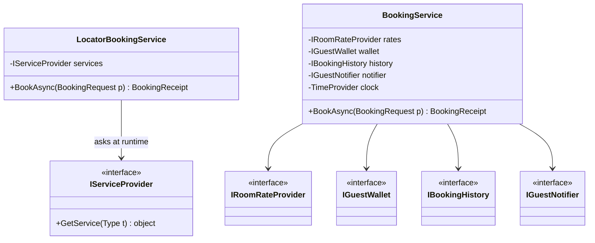
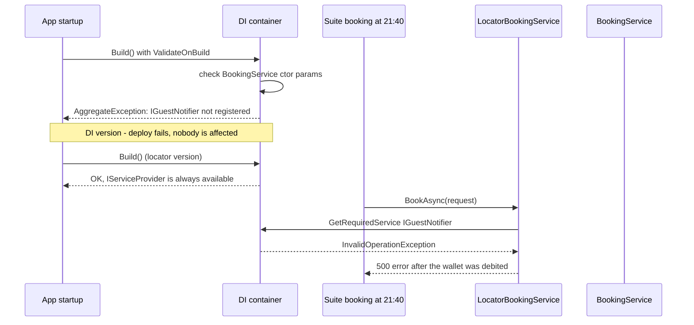

Both dependency injection and service locator answer the same question: "how does this class get the objects it needs?" They give opposite answers. One makes the needs visible and checks them before the app serves its first request. The other hides them until a particular line of code runs, which may be at 2 a.m. on a Sunday. This lesson shows the difference with a hotel booking service, then covers the handful of places where the "bad" option is actually correct.

## Learning objectives

By the end of this lesson you will be able to:

1. Explain the difference between being *given* your dependencies (dependency injection) and *fetching* them yourself (service locator).
2. Recognise the three common shapes of service locator in .NET code: a static `ServiceLocator` class, an injected `IServiceProvider`, and `HttpContext.RequestServices`.
3. List the concrete costs of service locator: hidden dependencies, runtime failures, harder tests, and lifetime bugs.
4. Refactor a locator-based class to constructor injection, and turn on `ValidateOnBuild` and `ValidateScopes` so wiring mistakes fail at startup.
5. Use `IServiceScopeFactory` correctly in a `BackgroundService`, which is one of the legitimate places to resolve from the container.
6. Replace "pick an implementation by name at runtime" locator code with a typed resolver or keyed services.

## Prerequisites

- [Dependency injection](#/lesson/m03-dependency-injection): you should know what `builder.Services.AddScoped<IFoo, Foo>()` does.
- [Singleton, scoped and transient services](#/lesson/m03-service-lifetimes): lifetimes matter a lot in this lesson, especially the "captive dependency" bug.
- [Dependency Inversion Principle](#/lesson/m04-dip): DI is the most common way to apply it.

## Explain it like I'm a beginner

Think of two cooks in a restaurant kitchen.

**Cook A** gets a tray from the head chef before the shift starts. On the tray: a knife, a pan, 2 kg of onions and a bottle of oil. The head chef looked at the menu, saw what Cook A needs, and checked everything was on the tray. If the oil is missing, the head chef notices at 5 p.m., before the restaurant opens.

**Cook B** gets nothing. Whenever Cook B needs something, they walk to the store room and shout "give me oil!" Most days it works. But one Saturday at 9 p.m., with a full restaurant, Cook B shouts for saffron, and there is none. Nobody knew Cook B needed saffron, because it was never written down anywhere. The order fails in front of a customer.

- Cook A is **dependency injection** (DI). Needs are listed up front, in the constructor, and something else (the head chef, which in .NET is the DI container) hands them over.
- Cook B is a **service locator**. Needs are fetched on demand from a central store (the container), from wherever in the code they happen to be needed.

Both cooks use the same store room. The difference is **who asks, and when**. With DI, the class never talks to the store room at all. It just receives a tray. With a service locator, the class depends on the store room *and* on everything it might ask the store room for, but you can't see that list without reading every line of the class.

## First-principles explanation

### What each one is

**Dependency injection** means a class declares what it needs, usually as constructor parameters, and receives those objects from outside. The class doesn't know or care who built them.

```csharp
public sealed class BookingService(IRoomRateProvider rates, IGuestWallet wallet, TimeProvider clock)
{
    // rates, wallet and clock are simply there
}
```

**Service locator** means a class is given (or reaches for) a general-purpose registry, and asks it for specific services while it runs.

```csharp
public sealed class LocatorBookingService(IServiceProvider services)
{
    public async Task BookAsync(BookingRequest p)
    {
        var rates = services.GetRequiredService<IRoomRateProvider>();
        var wallet  = services.GetRequiredService<IGuestWallet>();
        // ...and maybe, 80 lines later, something else
    }
}
```

Martin Fowler described both in 2004 as two ways to separate *configuring* objects from *using* them. Both achieve that separation. The difference is in what the consumer can see and what can be checked ahead of time.

### The three shapes of service locator in .NET

1. **A static locator**: `ServiceLocator.Current.GetInstance<IFoo>()` or a home-grown `static class Services`. It is common in code that started on .NET Framework before built-in DI existed.
2. **An injected `IServiceProvider`**: the class takes `IServiceProvider` in its constructor and calls `GetService<T>()` inside methods. This one looks like DI because something is injected, but what's injected is the whole container.
3. **`HttpContext.RequestServices`**: grabbing services from the current request inside a controller action, filter or helper, for example `HttpContext.RequestServices.GetService<IEmailSender>()`.

All three share one property. The real dependencies are not in the constructor signature, so neither the compiler, nor the container's validation, nor a reader can see them.

### Why service locator causes problems

**1. Hidden dependencies.** The constructor is a class's public statement of what it needs. With a locator, the statement is "I need everything". To learn the real list, you read every method body. In a 600-line class, people miss one. Code review gets harder too: a new `GetService<ISmsGateway>()` on line 412 adds a dependency without changing a single signature.

**2. Failures move from startup to runtime.** The .NET container can check, when the app starts, that every registered service's constructor parameters can be satisfied (`ValidateOnBuild`). It can only check what it can see. If the dependency is fetched inside a method, the check passes, and the app crashes the first time that method runs. If that method only runs when someone books a suite, it could take weeks.

**3. Tests become guesswork.** To test a DI class, you pass fakes into the constructor. The compiler tells you exactly what's required. To test a locator class, you build a container (or a fake `IServiceProvider`) and register whatever you *think* the method will ask for. Forget one and you get `InvalidOperationException: No service for type ...` from inside the method under test. Add a new lookup in production code and unrelated tests start failing.

**4. Lifetime bugs become easy.** If a singleton holds the *root* `IServiceProvider` and resolves a scoped service such as a `DbContext` from it, that `DbContext` is created in the root scope. It lives for the whole app and is shared across requests. `DbContext` isn't thread-safe, so concurrent requests corrupt each other's change tracking. With constructor injection and `ValidateScopes = true`, the container refuses to build the singleton in the first place.

**5. It breaks the Dependency Inversion Principle quietly.** The class now depends on the container abstraction (`IServiceProvider`). That's a framework detail, and it tells you nothing about the domain. Move the class to a project without DI and it stops working.

### Why constructor injection works

Constructor injection works because of three simple facts:

- **The constructor runs once, before any method.** If construction succeeds, every dependency is present. You never get "half a service".
- **The signature is checked by the compiler and the container.** Tests that use `new` must pass every argument. The container's `ValidateOnBuild` walks the graph of every registered service at startup.
- **The constructor is honest documentation.** A constructor with 9 parameters is a visible warning that the class does too much (see [Single Responsibility Principle](#/lesson/m04-srp)). A locator hides that warning, and many teams adopt one specifically *because* constructors got long. That treats the symptom, not the disease.

### How the .NET container resolves things internally

When you call `builder.Build()`, the default container (`Microsoft.Extensions.DependencyInjection`) creates a `ServiceProvider`. On the first request for a type, it builds a *call site*: a recipe that says "to make `BookingService`, first make `IRoomRateProvider` (singleton, cached), then a scoped `IBookingHistory` (one per scope), then …". It caches and compiles that recipe, so later resolutions are fast.

With `ValidateOnBuild = true`, it builds the call sites for every registration up front, without creating any objects. A missing constructor dependency throws an `AggregateException` from `Build()`. With `ValidateScopes = true` as well, a singleton that depends (directly or indirectly) on a scoped service is also reported at `Build()`, and at runtime the provider refuses to resolve scoped services from the root provider. In the `Development` environment, ASP.NET Core turns both on by default; in other environments they are **off** unless you turn them on. Many teams turn them on in every environment, because the startup cost is small (an estimate: tens of milliseconds for a few hundred registrations) and the payoff is large.

Two blind spots to know about:

- **Method bodies.** A `GetService` call inside a method is invisible to validation. That is the whole argument of this lesson in one sentence.
- **Factory lambdas.** For `AddScoped<IFoo>(sp => new Foo(sp.GetRequiredService<IBar>()))`, the container only knows "call this lambda". It can't see that the lambda needs `IBar`, so a missing `IBar` is reported only when `IFoo` is first resolved. Prefer plain type registrations, or `ActivatorUtilities.CreateInstance<Foo>(sp, "extra arg")` inside the lambda when you must pass a value the container doesn't have; and cover factories with a wiring test (see Automated testing).

Keyed services (.NET 8+) follow the same rules: `AddKeyedScoped<IFoo, Foo>("x")` plus a constructor parameter `[FromKeyedServices("x")] IFoo foo` is visible to validation; `sp.GetRequiredKeyedService<IFoo>(key)` in a method body is not.

### When resolving from the container is legitimate

Service locator is an anti-pattern when *application code* uses it to fetch its own dependencies. Some code has to talk to the container, though, because something has to build the object graph. The rule of thumb: **only infrastructure code that creates scopes or bridges into a framework should call `GetService`.** Examples:

| Situation | Why it's acceptable |
|---|---|
| `Program.cs` (the composition root) | This is where the graph is assembled; it *is* the head chef. |
| A `BackgroundService` creating a scope per message with `IServiceScopeFactory` | A hosted service is a singleton, so it can't take scoped dependencies directly. It must create a scope, and resolve the top-level handler from it. |
| Factory registrations: `AddScoped<IFoo>(sp => new Foo(sp.GetRequiredService<IBar>(), "config"))` | The lambda is part of the composition root, just written inline. |
| Middleware `InvokeAsync(HttpContext ctx, IScopedThing thing)` | The framework injects per-request services as method parameters. That's still injection, not location. |
| Framework extension points that hand you an `IServiceProvider` (filters via `TypeFilter`, `ActivatorUtilities.CreateInstance`) | The framework requires it. Keep the code tiny and resolve one top-level object. |

What these have in common: they resolve **one root object** per unit of work (a request, a message, a job) and then let constructor injection take over below it.

### When DI itself is overkill

DI is a tool, not a religion. You don't need a container for:

- Value objects and records (`Money`, `BookingRequest`). Create them with `new`.
- Pure helpers with no dependencies (`Math.Round`, a static `GstRounding.ToPaise` function).
- Tiny console tools or scripts with three classes. Wiring by hand with `new` in `Main` is still dependency injection: "pure DI", without a container.

The goal is visible, swappable dependencies at the boundaries where things vary (I/O, time, external services), not "every class must be registered".

## Visual explanation

### Class diagram: two versions of the same service



How to read it: on the left, `LocatorBookingService` has exactly one visible arrow, to `IServiceProvider`. Its real dependencies exist, but the diagram (and the compiler, and the container's validator) can't see them. On the right, `BookingService` has an arrow for every dependency. The diagram is longer, but it's *true*. If you generated this diagram from code with a tool, the locator version would silently lie.

### Sequence diagram: where the failure shows up



The top half is the DI version. The container checks the constructor at startup, finds the missing `IGuestNotifier`, and the deployment fails in the pipeline. The bottom half is the locator version. Startup succeeds because the only declared dependency is `IServiceProvider`, which always exists. The bug waits until a real guest books a suite. Same bug, very different cost.

## Step-by-step example

We'll refactor the booking service of a small hotel chain's app, the kind where a guest picks a hotel, a room type and a number of nights, and pays from a prepaid wallet in the app (topped up by UPI or card). The example rules are simplified: a nightly rate per room type per hotel, and a **repeat-guest discount** of 10 % when the same guest booked the same hotel within the last 30 days. The discount is granted once: a booking that itself got the discount doesn't make the next one discounted.

### Step 1 — the locator version

```csharp
public sealed class LegacyBookingService
{
    public async Task<BookingReceipt> BookAsync(BookingRequest r)
    {
        var rates = ServiceLocator.Current.Get<IRoomRateProvider>();
        var price = rates.GetNightlyRate(r.HotelCode, r.RoomType) * r.Nights;

        var history = ServiceLocator.Current.Get<IBookingHistory>();
        var earlier = await history.FindLatestBookingSinceAsync(r.GuestId, r.HotelCode, DateTimeOffset.UtcNow.AddDays(-30), default);
        var amount = earlier is { RepeatGuest: false } ? price * 0.9m : price;

        var wallet = ServiceLocator.Current.Get<IGuestWallet>();
        if (!await wallet.TryDebitAsync(r.GuestId, amount, r.BookingId, default)) throw new InsufficientBalanceException(r.GuestId, amount);

        var receipt = new BookingReceipt(r.BookingId, r.GuestId, r.HotelCode, amount, earlier is not null, DateTimeOffset.UtcNow);
        await history.SaveAsync(receipt, default);

        if (r.RoomType == RoomType.Suite)                                // only for suites!
            await ServiceLocator.Current.Get<IGuestNotifier>().NotifyConfirmedAsync(receipt, default);
        return receipt;
    }
}
```

Count the problems:

- Four hidden dependencies, one of which is only touched for suite bookings. If `IGuestNotifier` is never registered, the bug appears only when the first guest books a suite, which at a 40-room hotel with two suites might be weeks after the release.
- Worse, that failure happens **after the wallet was debited and the booking saved**. The guest paid, then saw "Something went wrong". Many will tap "Book" again.
- `DateTimeOffset.UtcNow` is a fifth hidden dependency: the clock. You can't test the 30-day rule without waiting 30 days.
- `IBookingHistory` wraps a database context, so it should be scoped. A static locator has no idea which request it's in, so it either returns a shared instance (lifetime bug) or needs a hack such as thread-static storage.
- There's no `CancellationToken`. If the client disconnects, the work carries on.
- A small extra bug: `earlier is not null` marks the receipt as discounted even when the discount wasn't applied.

### Step 2 — list the real dependencies

Read the method and write down everything it fetches: rates, history, wallet, notifier, clock. That list becomes the constructor. This step is mechanical, and that's good: refactoring should be boring.

### Step 3 — move them into the constructor

```csharp
public sealed class BookingService(
    IRoomRateProvider rates, IGuestWallet wallet, IBookingHistory history,
    IGuestNotifier notifier, TimeProvider clock, ILogger<BookingService> logger)
```

Each `ServiceLocator.Current.Get<T>()` call becomes a field read. `DateTimeOffset.UtcNow` becomes `clock.GetUtcNow()`. Add a `CancellationToken` parameter while you're there.

### Step 4 — register, and validate at startup

Register every dependency with the right lifetime. Turn on validation so a missing registration fails the deployment:

```csharp
builder.Host.UseDefaultServiceProvider(o => { o.ValidateOnBuild = true; o.ValidateScopes = true; });
```

### Step 5 — delete the locator

Once nothing calls `ServiceLocator.Current`, delete the class. If it stays around, someone will use it again "just this once".

## Production-style C# implementation

Project structure:

```text
Hotels.Api/
  Program.cs
  Booking/
    BookingModels.cs       records, enum, exception
    BookingPorts.cs        interfaces the service depends on
    BookingService.cs      the business logic, constructor-injected
    InMemoryAdapters.cs    simple implementations for the demo
    BookingQueue.cs        in-process queue + BackgroundService worker
```

```csharp file=Booking/BookingModels.cs
namespace Hotels.Booking;

public enum RoomType { Standard, Deluxe, Family, Suite }

public sealed record BookingRequest(Guid BookingId, string GuestId, string HotelCode, RoomType RoomType, int Nights);

public sealed record BookingReceipt(Guid BookingId, string GuestId, string HotelCode, decimal Amount, bool RepeatGuest, DateTimeOffset BookedAt);

public sealed class InsufficientBalanceException(string guestId, decimal needed)
    : Exception($"Wallet of guest {guestId} has insufficient balance for {needed:0.00}.")
{
    public string GuestId { get; } = guestId;
    public decimal Needed { get; } = needed;
}
```

```csharp file=Booking/BookingPorts.cs
namespace Hotels.Booking;

/// <summary>Rate card. Singleton: read-mostly reference data.</summary>
public interface IRoomRateProvider
{
    decimal GetNightlyRate(string hotelCode, RoomType roomType);
}

/// <summary>Prepaid guest wallet (a payments provider in real life).</summary>
public interface IGuestWallet
{
    /// <summary>Debits once per idempotency key; a retry with the same key returns the original outcome.</summary>
    Task<bool> TryDebitAsync(string guestId, decimal amount, Guid idempotencyKey, CancellationToken ct);
}

/// <summary>Persistence for bookings. Scoped, like a DbContext-backed repository.</summary>
public interface IBookingHistory
{
    Task<BookingReceipt?> FindLatestBookingSinceAsync(string guestId, string hotelCode, DateTimeOffset since, CancellationToken ct);
    Task SaveAsync(BookingReceipt receipt, CancellationToken ct);
}

public interface IGuestNotifier
{
    Task NotifyConfirmedAsync(BookingReceipt receipt, CancellationToken ct);
}
```

```csharp file=Booking/BookingService.cs
using Microsoft.Extensions.Logging;

namespace Hotels.Booking;

/// <summary>Every dependency is in the constructor, so the container validates the graph at startup
/// and tests pass fakes with plain `new`.</summary>
public sealed class BookingService(
    IRoomRateProvider rates,
    IGuestWallet wallet,
    IBookingHistory history,
    IGuestNotifier notifier,
    TimeProvider clock,
    ILogger<BookingService> logger)
{
    public static readonly TimeSpan RepeatGuestWindow = TimeSpan.FromDays(30);
    private const decimal RepeatGuestFactor = 0.9m;   // example rule: 10 % off for a repeat guest

    public async Task<BookingReceipt> BookAsync(BookingRequest request, CancellationToken ct)
    {
        ArgumentNullException.ThrowIfNull(request);
        ArgumentOutOfRangeException.ThrowIfLessThan(request.Nights, 1);

        var now = clock.GetUtcNow();
        var price = rates.GetNightlyRate(request.HotelCode, request.RoomType) * request.Nights;
        var earlier = await history.FindLatestBookingSinceAsync(request.GuestId, request.HotelCode, now - RepeatGuestWindow, ct);

        // The discount is granted once: a booking that was itself discounted doesn't make the next one discounted.
        var isRepeat = earlier is { RepeatGuest: false };
        var amount = isRepeat ? Math.Round(price * RepeatGuestFactor, 2, MidpointRounding.AwayFromZero) : price;

        if (!await wallet.TryDebitAsync(request.GuestId, amount, request.BookingId, ct))
            throw new InsufficientBalanceException(request.GuestId, amount);

        var receipt = new BookingReceipt(request.BookingId, request.GuestId, request.HotelCode, amount, isRepeat, now);
        await history.SaveAsync(receipt, ct);

        try
        {
            await notifier.NotifyConfirmedAsync(receipt, ct);
        }
        catch (Exception ex) when (ex is not OperationCanceledException)
        {
            // The money has moved and the room is booked; a failed WhatsApp message must not turn into a failed booking.
            logger.LogWarning(ex, "Confirmation message failed for booking {BookingId}", request.BookingId);
        }

        logger.LogInformation("Booked {HotelCode} for guest {GuestId}: {Amount} (repeat guest: {Repeat})",
            request.HotelCode, request.GuestId, amount, isRepeat);
        return receipt;
    }
}
```

```csharp file=Booking/InMemoryAdapters.cs
using System.Collections.Concurrent;
using Microsoft.Extensions.Logging;

namespace Hotels.Booking;

public sealed class InMemoryRoomRateProvider(IReadOnlyDictionary<(string Hotel, RoomType Room), decimal> nightlyRates) : IRoomRateProvider
{
    public decimal GetNightlyRate(string hotelCode, RoomType roomType) =>
        nightlyRates.TryGetValue((hotelCode, roomType), out var rate)
            ? rate
            : throw new KeyNotFoundException($"No rate for {roomType} at hotel {hotelCode}.");
}

public sealed class InMemoryGuestWallet : IGuestWallet
{
    private readonly ConcurrentDictionary<string, decimal> _balances = new();
    private readonly ConcurrentDictionary<Guid, bool> _outcomes = new();
    private readonly Lock _gate = new();

    public void TopUp(string guestId, decimal amount) => _balances.AddOrUpdate(guestId, amount, (_, b) => b + amount);

    public Task<bool> TryDebitAsync(string guestId, decimal amount, Guid idempotencyKey, CancellationToken ct)
    {
        lock (_gate)
        {
            if (_outcomes.TryGetValue(idempotencyKey, out var previous)) return Task.FromResult(previous);
            var balance = _balances.GetValueOrDefault(guestId);
            var ok = balance >= amount;
            if (ok) _balances[guestId] = balance - amount;
            _outcomes[idempotencyKey] = ok;
            return Task.FromResult(ok);
        }
    }
}

/// <summary>Singleton "database". The scoped repository below plays the role of a DbContext over it.</summary>
public sealed class InMemoryBookingStore
{
    public ConcurrentBag<BookingReceipt> Receipts { get; } = [];
}

public sealed class BookingHistory(InMemoryBookingStore store) : IBookingHistory
{
    public Task<BookingReceipt?> FindLatestBookingSinceAsync(string guestId, string hotelCode, DateTimeOffset since, CancellationToken ct) =>
        Task.FromResult(store.Receipts
            .Where(r => r.GuestId == guestId && r.HotelCode == hotelCode && r.BookedAt >= since)
            .OrderByDescending(r => r.BookedAt)
            .FirstOrDefault());

    public Task SaveAsync(BookingReceipt receipt, CancellationToken ct)
    {
        store.Receipts.Add(receipt);
        return Task.CompletedTask;
    }
}

public sealed class LoggingGuestNotifier(ILogger<LoggingGuestNotifier> logger) : IGuestNotifier
{
    public Task NotifyConfirmedAsync(BookingReceipt receipt, CancellationToken ct)
    {
        logger.LogInformation("WhatsApp to guest {GuestId}: booking at {HotelCode} confirmed, {Amount} paid",
            receipt.GuestId, receipt.HotelCode, receipt.Amount);
        return Task.CompletedTask;
    }
}
```

The worker below is the one place in this app (outside `Program.cs`) that resolves from the container. Bookings also arrive from partner travel sites (online travel agencies) as a feed, and those are processed in the background. The worker is a singleton, so it can't take the scoped `BookingService` in its constructor. Instead it creates one scope per booking and resolves **one** root object from it. Everything below that object is constructor-injected.

```csharp file=Booking/BookingQueue.cs
using System.Threading.Channels;
using Microsoft.Extensions.Logging;

namespace Hotels.Booking;

public sealed class BookingQueue
{
    private readonly Channel<BookingRequest> _channel = Channel.CreateBounded<BookingRequest>(
        new BoundedChannelOptions(10_000) { FullMode = BoundedChannelFullMode.Wait });

    public ValueTask EnqueueAsync(BookingRequest request, CancellationToken ct) => _channel.Writer.WriteAsync(request, ct);
    public IAsyncEnumerable<BookingRequest> ReadAllAsync(CancellationToken ct) => _channel.Reader.ReadAllAsync(ct);
}

public sealed class BookingWorker(BookingQueue queue, IServiceScopeFactory scopes, ILogger<BookingWorker> logger) : BackgroundService
{
    protected override async Task ExecuteAsync(CancellationToken stoppingToken)
    {
        await foreach (var request in queue.ReadAllAsync(stoppingToken))
        {
            // Legitimate container use: infrastructure code creating a unit-of-work scope.
            await using var scope = scopes.CreateAsyncScope();
            var service = scope.ServiceProvider.GetRequiredService<BookingService>();
            try
            {
                await service.BookAsync(request, stoppingToken);
            }
            catch (InsufficientBalanceException ex)
            {
                logger.LogWarning("Booking {BookingId} rejected: {Message}", request.BookingId, ex.Message);
            }
            catch (Exception ex) when (ex is not OperationCanceledException)
            {
                logger.LogError(ex, "Booking {BookingId} failed; it should go to a dead-letter store", request.BookingId);
            }
        }
    }
}
```

```csharp file=Program.cs
using Hotels.Booking;

var builder = WebApplication.CreateBuilder(args);

// Fail the deployment, not the request: check the whole graph at startup in every environment.
builder.Host.UseDefaultServiceProvider(o =>
{
    o.ValidateOnBuild = true;
    o.ValidateScopes = true;
});

builder.Services.AddSingleton(TimeProvider.System);
builder.Services.AddSingleton<IRoomRateProvider>(new InMemoryRoomRateProvider(new Dictionary<(string, RoomType), decimal>
{
    [("GOA-BAGA-01", RoomType.Standard)] = 4_500m,
    [("GOA-BAGA-01", RoomType.Deluxe)] = 6_500m,
    [("GOA-BAGA-01", RoomType.Family)] = 8_000m,
    [("GOA-BAGA-01", RoomType.Suite)] = 14_000m,
}));
builder.Services.AddSingleton<InMemoryGuestWallet>();
builder.Services.AddSingleton<IGuestWallet>(sp => sp.GetRequiredService<InMemoryGuestWallet>()); // composition root: fine
builder.Services.AddSingleton<InMemoryBookingStore>();
builder.Services.AddScoped<IBookingHistory, BookingHistory>();
builder.Services.AddSingleton<IGuestNotifier, LoggingGuestNotifier>();
builder.Services.AddScoped<BookingService>();

builder.Services.AddSingleton<BookingQueue>();
builder.Services.AddHostedService<BookingWorker>();

var app = builder.Build();

// Partner travel-site feed posts bookings; the worker processes them in the background.
app.MapPost("/partner-bookings", async (BookingRequest request, BookingQueue queue, CancellationToken ct) =>
{
    await queue.EnqueueAsync(request, ct);
    return Results.Accepted();
});

// The app's own synchronous booking: the endpoint parameter is injected per request (injection, not location).
app.MapPost("/bookings", async (BookingRequest request, BookingService service, CancellationToken ct) =>
{
    try { return Results.Ok(await service.BookAsync(request, ct)); }
    catch (InsufficientBalanceException ex) { return Results.Problem(ex.Message, statusCode: StatusCodes.Status402PaymentRequired); }
});

app.MapPost("/wallets/{guestId}/topup", (string guestId, decimal amount, InMemoryGuestWallet wallet) =>
{
    wallet.TopUp(guestId, amount);
    return Results.NoContent();
});

app.Run();
```

Notes on the design choices:

- **`BookingService` is scoped** because it depends on the scoped `IBookingHistory`. If you registered it as a singleton, startup validation would fail with "Cannot consume scoped service ... from singleton ...". That's a bug the locator version would never have reported.
- **The wallet uses the booking id as an idempotency key.** If the worker crashes after debiting and the booking is retried, or the guest double-taps "Book", the wallet isn't charged twice. DI doesn't give you this, but constructor injection makes it easy to test with a fake wallet.
- **`TimeProvider` is injected**, so tests can control "now" and check the 30-day rule at 29 days 23 hours and at 30 days 1 hour.
- **Not shown, but needed in production:** checking room availability (and holding the room) in the same transaction as saving the booking, and an outbox for the confirmation message so it is sent even if the process dies right after the save. Those are separate topics; they don't change the DI story.

## Bad design vs good design

### Bad: an injected `IServiceProvider` in domain code

```csharp
public sealed class InvoiceService(IServiceProvider sp)
{
    public async Task<Invoice> CreateAsync(Order order)
    {
        var numbering = sp.GetRequiredService<IInvoiceNumbering>();
        var gst = sp.GetRequiredService<IGstCalculator>();
        var db = sp.GetRequiredService<AppDbContext>();     // scoped, resolved from... which scope?
        // ...
    }
}
```

If `InvoiceService` is registered as a singleton, `sp` is the root provider. `AppDbContext` is then created once and shared by every request. Under load (say 50 concurrent requests), you get errors like "A second operation was started on this context instance before a previous operation completed". With `ValidateScopes = true` you'd get an exception instead, but only when `CreateAsync` runs, not at startup.

### Bad: "dependency bags"

```csharp
public sealed class AppServices(IInvoiceNumbering numbering, IGstCalculator gst, IEmailSender email, ISmsSender sms, IClock clock) { /* properties */ }
public sealed class InvoiceService(AppServices services) { ... }
```

This looks like DI, but it's a locator in disguise. Every class that takes `AppServices` can reach everything, and you can't tell which part it really uses. Tests need the whole bag.

### Bad: resolving in a controller action

```csharp
public IActionResult Export(string format) =>
    File(HttpContext.RequestServices.GetRequiredKeyedService<IReportFormatter>(format).Render(rows), "...");
```

An unknown `format` throws `InvalidOperationException` and becomes a 500, when it should be a 400 with a helpful message.

### Good

- Domain and application classes take exactly what they use in the constructor.
- Runtime choice ("which formatter?") goes through a small typed resolver with a clear error for unknown keys, or through keyed services with `[FromKeyedServices("csv")]` when the key is fixed at compile time.
- Only the composition root, hosted services and framework glue touch `IServiceProvider` or `IServiceScopeFactory`, and each resolves one root object per unit of work.
- `ValidateOnBuild` and `ValidateScopes` are on, plus a wiring test that builds the real `ServiceCollection`.

:::callout type=tradeoff title="Long constructors are a signal, not a reason for a locator"
If a constructor has 8 or more parameters, the class probably has more than one job. Split it, or group parameters that always travel together into a meaningful object (`RoomPricing` holding the rate card, discount rules and the clock). Don't hide them behind `IServiceProvider` — the class still has 8 dependencies, you just can't see them.
:::

:::callout type=mistake title="Disposing what you resolved"
If you call `scope.ServiceProvider.GetRequiredService<T>()`, don't dispose `T` yourself. The scope owns it and disposes it when the scope ends. Dispose the *scope*, with `await using`.
:::

## Practical playground

The program below registers an invoice service two ways. The locator version builds fine and crashes when its method runs. The injected version fails at `BuildServiceProvider` because validation sees the missing registration. Run it, then add the missing registration and run it again.

:::playground type=csharp title="Startup failure vs runtime failure"
```csharp file=Program.cs
using System;
using Microsoft.Extensions.DependencyInjection;

public interface IGstRateTable { decimal RateFor(string hsnCode); }
public interface IInvoiceNumbering { string Next(); }

public sealed class FlatGstRates : IGstRateTable { public decimal RateFor(string hsnCode) => 0.18m; }
public sealed class SequentialNumbering : IInvoiceNumbering
{
    private int _n = 1000;
    public string Next() => $"INV-2026-{++_n}";
}

// Service locator: the only visible dependency is the container.
public sealed class LocatorInvoiceService(IServiceProvider services)
{
    public string Create(decimal net)
    {
        var gst = services.GetRequiredService<IGstRateTable>();
        var numbering = services.GetRequiredService<IInvoiceNumbering>(); // hidden dependency
        return $"{numbering.Next()}: net {net:0.00}, GST {net * gst.RateFor("996311"):0.00}";
    }
}

// Constructor injection: the dependencies are in the signature.
public sealed class InjectedInvoiceService(IGstRateTable gst, IInvoiceNumbering numbering)
{
    public string Create(decimal net) => $"{numbering.Next()}: net {net:0.00}, GST {net * gst.RateFor("996311"):0.00}";
}

public static class Program
{
    public static void Main()
    {
        var services = new ServiceCollection();
        services.AddSingleton<IGstRateTable, FlatGstRates>();
        // services.AddSingleton<IInvoiceNumbering, SequentialNumbering>();   // <- try uncommenting
        services.AddSingleton<LocatorInvoiceService>();
        services.AddSingleton<InjectedInvoiceService>();

        Console.WriteLine("1) Locator version, no validation:");
        using (var sp = services.BuildServiceProvider())
        {
            var svc = sp.GetRequiredService<LocatorInvoiceService>();
            Console.WriteLine("   resolved OK at startup...");
            try { Console.WriteLine("   " + svc.Create(10_000m)); }
            catch (InvalidOperationException ex) { Console.WriteLine("   FAILED AT RUNTIME: " + ex.Message); }
        }

        Console.WriteLine("2) Injected version, ValidateOnBuild = true:");
        try
        {
            using var sp = services.BuildServiceProvider(new ServiceProviderOptions { ValidateOnBuild = true, ValidateScopes = true });
            Console.WriteLine("   " + sp.GetRequiredService<InjectedInvoiceService>().Create(10_000m));
        }
        catch (AggregateException ex)
        {
            Console.WriteLine("   FAILED AT STARTUP: " + ex.InnerExceptions[0].Message);
        }
    }
}
```
:::

Things to try:

1. Uncomment the `IInvoiceNumbering` registration. Both versions now work. The difference was never "does it work", only "when do you find out".
2. Register `IInvoiceNumbering` as **scoped** and keep the services as singletons. Run again with validation on. Read the error message; it names the captive dependency.
3. Add a third dependency to `LocatorInvoiceService` inside `Create`. Notice that no signature changed and no test that only constructs it would notice.

## Exercises

:::exercise id=m04-di-vs-service-locator-ex1 difficulty=beginner kind=code title="Replace a static locator with constructor injection"
A mall parking system calculates fees with `LegacyParkingFeeService`, which fetches its rate card from a static `ServiceLocator` and reads the system clock directly. Implement `ParkingFeeService`, which gets both through its constructor.
::requirements
- Fee = number of *started* hours × hourly rate for the zone. Minimum 1 hour (even 5 minutes costs 1 hour).
- Each full 24-hour block costs at most the zone's daily cap. Leftover hours after full days are charged hourly, also capped at the daily cap.
- An entry time in the future throws `ArgumentException`. A null zone throws `ArgumentNullException`.
- "Now" comes from the injected `TimeProvider`. Do not use `DateTimeOffset.UtcNow`.
::acceptance
- 2 h 10 min in zone "B1" at ₹40/h, cap ₹300 → ₹120.
- 10 hours at ₹40/h, cap ₹300 → ₹300 (capped).
- 26 hours → ₹300 (one day) + 2 × ₹40 = ₹380.
- 5 minutes → ₹40.
- Future entry → `ArgumentException`.
::hint
Start by listing what the legacy class fetches from the locator, including things that aren't obviously "services". The clock counts.
::hint
Store both constructor parameters in private readonly fields. `ArgumentNullException.ThrowIfNull` guards against nulls.
::hint
Duration = `clock.GetUtcNow() - entry`. Started hours = `Math.Ceiling(duration.TotalHours)`, but at least 1.
::hint
Split started hours into `fullDays = hours / 24` and `rest = hours % 24`. Fee = `fullDays * cap + Math.Min(rest * rate, cap)`.
::hint
```csharp
var hours = Math.Max(1, (int)Math.Ceiling(duration.TotalHours));
return hours / 24 * cap + Math.Min(hours % 24 * rate, cap);
```
::starter
```csharp file=ParkingFeeService.cs
using System;
using System.Collections.Generic;

public interface IRateCard
{
    decimal HourlyRate(string zone);
    decimal DailyCap(string zone);
}

// ---- Legacy code, kept for reference. Do not change. ----
public static class ServiceLocator
{
    private static readonly Dictionary<Type, object> Services = new();
    public static void Register<T>(T instance) where T : notnull => Services[typeof(T)] = instance;
    public static T Get<T>() => (T)Services[typeof(T)];
}

public sealed class LegacyParkingFeeService
{
    public decimal Calculate(string zone, DateTimeOffset entry)
    {
        var rates = ServiceLocator.Get<IRateCard>();          // hidden dependency 1
        var now = DateTimeOffset.UtcNow;                       // hidden dependency 2
        var hours = Math.Max(1, (int)Math.Ceiling((now - entry).TotalHours));
        return hours / 24 * rates.DailyCap(zone) + Math.Min(hours % 24 * rates.HourlyRate(zone), rates.DailyCap(zone));
    }
}
// ----------------------------------------------------------

public sealed class ParkingFeeService
{
    public ParkingFeeService(IRateCard rates, TimeProvider clock)
    {
        throw new NotImplementedException();
    }

    public decimal Calculate(string zone, DateTimeOffset entry)
    {
        throw new NotImplementedException();
    }
}
```
::tests
```csharp file=ParkingFeeServiceTests.cs
using System;
using Xunit;

public class ParkingFeeServiceTests
{
    private sealed class FixedClock(DateTimeOffset now) : TimeProvider
    {
        public override DateTimeOffset GetUtcNow() => now;
    }

    private sealed class StubRates : IRateCard
    {
        public decimal HourlyRate(string zone) => zone == "B1" ? 40m : 60m;
        public decimal DailyCap(string zone) => zone == "B1" ? 300m : 500m;
    }

    private static readonly DateTimeOffset Now = new(2026, 10, 18, 18, 0, 0, TimeSpan.Zero);
    private static ParkingFeeService Svc() => new(new StubRates(), new FixedClock(Now));

    [Fact] public void Two_hours_ten_minutes_is_three_started_hours() =>
        Assert.Equal(120m, Svc().Calculate("B1", Now.AddHours(-2).AddMinutes(-10)));

    [Fact] public void Ten_hours_is_capped() => Assert.Equal(300m, Svc().Calculate("B1", Now.AddHours(-10)));

    [Fact] public void Twenty_six_hours_is_one_cap_plus_two_hours() => Assert.Equal(380m, Svc().Calculate("B1", Now.AddHours(-26)));

    [Fact] public void Five_minutes_costs_one_hour() => Assert.Equal(40m, Svc().Calculate("B1", Now.AddMinutes(-5)));

    [Fact] public void Other_zone_uses_its_own_rates() => Assert.Equal(180m, Svc().Calculate("C2", Now.AddHours(-3)));

    [Fact] public void Future_entry_is_rejected() =>
        Assert.Throws<ArgumentException>(() => Svc().Calculate("B1", Now.AddMinutes(5)));

    [Fact] public void Null_dependencies_are_rejected() =>
        Assert.Throws<ArgumentNullException>(() => new ParkingFeeService(null!, new FixedClock(Now)));
}
```
::solution
The two hidden dependencies (rate card and clock) become constructor parameters. The arithmetic doesn't change at all, which is a good sign: we changed *how the class gets its dependencies*, not *what it does*.

```csharp file=ParkingFeeService.cs
using System;
using System.Collections.Generic;

public interface IRateCard
{
    decimal HourlyRate(string zone);
    decimal DailyCap(string zone);
}

// ---- Legacy code, kept for reference. Do not change. ----
public static class ServiceLocator
{
    private static readonly Dictionary<Type, object> Services = new();
    public static void Register<T>(T instance) where T : notnull => Services[typeof(T)] = instance;
    public static T Get<T>() => (T)Services[typeof(T)];
}

public sealed class LegacyParkingFeeService
{
    public decimal Calculate(string zone, DateTimeOffset entry)
    {
        var rates = ServiceLocator.Get<IRateCard>();
        var now = DateTimeOffset.UtcNow;
        var hours = Math.Max(1, (int)Math.Ceiling((now - entry).TotalHours));
        return hours / 24 * rates.DailyCap(zone) + Math.Min(hours % 24 * rates.HourlyRate(zone), rates.DailyCap(zone));
    }
}
// ----------------------------------------------------------

public sealed class ParkingFeeService
{
    private readonly IRateCard _rates;
    private readonly TimeProvider _clock;

    public ParkingFeeService(IRateCard rates, TimeProvider clock)
    {
        ArgumentNullException.ThrowIfNull(rates);
        ArgumentNullException.ThrowIfNull(clock);
        _rates = rates;
        _clock = clock;
    }

    public decimal Calculate(string zone, DateTimeOffset entry)
    {
        ArgumentNullException.ThrowIfNull(zone);
        var duration = _clock.GetUtcNow() - entry;
        if (duration < TimeSpan.Zero) throw new ArgumentException("Entry time is in the future.", nameof(entry));

        var hours = Math.Max(1, (int)Math.Ceiling(duration.TotalHours));
        var rate = _rates.HourlyRate(zone);
        var cap = _rates.DailyCap(zone);
        return hours / 24 * cap + Math.Min(hours % 24 * rate, cap);
    }
}
```
::mistakes
- Keeping `DateTimeOffset.UtcNow` "because the clock isn't a service". Time is the most common hidden dependency, and it makes date rules untestable.
- Injecting `IServiceProvider` into `ParkingFeeService` and calling `GetService<IRateCard>()`. That's still a service locator, just a non-static one.
- Using `TotalHours` without `Math.Ceiling`, which bills 2 h 10 min as 2 hours.
::extensions
Delete `ServiceLocator` and `LegacyParkingFeeService`, then add a wiring test that builds a `ServiceCollection` and resolves `ParkingFeeService` (exercise 2 does exactly this).
:::

:::exercise id=m04-di-vs-service-locator-ex2 difficulty=beginner kind=code title="Register services so wiring mistakes fail at startup"
Implement the `AddParking` extension method so that the parking feature is registered with correct lifetimes. The tests build the container with `ValidateOnBuild` and `ValidateScopes` on, just as production does.
::requirements
- `TimeProvider` → `TimeProvider.System` as a singleton, **unless** one is already registered (tests register their own clock first).
- `IRateCard` → `FixedRateCard` singleton. `ParkingFeeService` singleton.
- `IParkingSessionStore` → `InMemoryParkingSessionStore` **scoped** (it stands in for a DbContext).
- `ParkingCheckoutHandler` scoped.
- Return the same `IServiceCollection` so calls can be chained.
::acceptance
- The provider builds with `ValidateOnBuild = true`.
- One scope gets one store instance; two scopes get two different ones.
- `ParkingFeeService` is the same instance in every scope.
- Resolving `ParkingCheckoutHandler` from the root provider throws `InvalidOperationException` (scope validation).
- A `TimeProvider` registered before `AddParking` is kept.
::hint
Which classes hold per-request state? Those are scoped. Which are stateless or reference data? Those can be singletons.
::hint
Check each class's constructor: a singleton may never depend on a scoped service.
::hint
`using Microsoft.Extensions.DependencyInjection.Extensions;` gives you `TryAddSingleton`, which only registers if nothing is registered yet.
::hint
```csharp
services.TryAddSingleton(TimeProvider.System);
services.AddSingleton<IRateCard, FixedRateCard>();
services.AddScoped<IParkingSessionStore, InMemoryParkingSessionStore>();
```
::starter
```csharp file=ParkingRegistration.cs
using System;
using System.Collections.Generic;
using Microsoft.Extensions.DependencyInjection;
using Microsoft.Extensions.DependencyInjection.Extensions;

public interface IRateCard { decimal HourlyRate(string zone); decimal DailyCap(string zone); }

public sealed class FixedRateCard : IRateCard
{
    public decimal HourlyRate(string zone) => 40m;
    public decimal DailyCap(string zone) => 300m;
}

public sealed class ParkingFeeService(IRateCard rates, TimeProvider clock)
{
    public decimal Calculate(string zone, DateTimeOffset entry)
    {
        var hours = Math.Max(1, (int)Math.Ceiling((clock.GetUtcNow() - entry).TotalHours));
        return hours / 24 * rates.DailyCap(zone) + Math.Min(hours % 24 * rates.HourlyRate(zone), rates.DailyCap(zone));
    }
}

public interface IParkingSessionStore
{
    void Start(string ticket, string zone, DateTimeOffset entry);
    (string Zone, DateTimeOffset Entry) Get(string ticket);
}

/// <summary>Pretend this wraps a DbContext: one instance per request.</summary>
public sealed class InMemoryParkingSessionStore : IParkingSessionStore
{
    private readonly Dictionary<string, (string, DateTimeOffset)> _sessions = new();
    public void Start(string ticket, string zone, DateTimeOffset entry) => _sessions[ticket] = (zone, entry);
    public (string Zone, DateTimeOffset Entry) Get(string ticket) => _sessions[ticket];
}

public sealed class ParkingCheckoutHandler(IParkingSessionStore store, ParkingFeeService fees)
{
    public IParkingSessionStore Store => store;
    public decimal Checkout(string ticket)
    {
        var (zone, entry) = store.Get(ticket);
        return fees.Calculate(zone, entry);
    }
}

public static class ParkingRegistration
{
    public static IServiceCollection AddParking(this IServiceCollection services)
    {
        throw new NotImplementedException();
    }
}
```
::tests
```csharp file=ParkingRegistrationTests.cs
using System;
using Microsoft.Extensions.DependencyInjection;
using Xunit;

public class ParkingRegistrationTests
{
    private sealed class FixedClock(DateTimeOffset now) : TimeProvider
    {
        public override DateTimeOffset GetUtcNow() => now;
    }

    private static readonly ServiceProviderOptions Strict = new() { ValidateOnBuild = true, ValidateScopes = true };

    private static ServiceProvider Build(Action<IServiceCollection>? before = null)
    {
        var services = new ServiceCollection();
        before?.Invoke(services);
        services.AddParking();
        return services.BuildServiceProvider(Strict);
    }

    [Fact]
    public void Builds_with_validation_and_checks_out()
    {
        var now = new DateTimeOffset(2026, 10, 18, 12, 0, 0, TimeSpan.Zero);
        using var sp = Build(s => s.AddSingleton<TimeProvider>(new FixedClock(now)));
        using var scope = sp.CreateScope();
        var handler = scope.ServiceProvider.GetRequiredService<ParkingCheckoutHandler>();
        handler.Store.Start("T1", "B1", now.AddHours(-3));
        Assert.Equal(120m, handler.Checkout("T1"));
    }

    [Fact]
    public void Store_is_scoped()
    {
        using var sp = Build();
        using var a = sp.CreateScope();
        using var b = sp.CreateScope();
        var a1 = a.ServiceProvider.GetRequiredService<IParkingSessionStore>();
        var a2 = a.ServiceProvider.GetRequiredService<IParkingSessionStore>();
        var b1 = b.ServiceProvider.GetRequiredService<IParkingSessionStore>();
        Assert.Same(a1, a2);
        Assert.NotSame(a1, b1);
    }

    [Fact]
    public void Fee_service_is_singleton()
    {
        using var sp = Build();
        using var a = sp.CreateScope();
        using var b = sp.CreateScope();
        Assert.Same(a.ServiceProvider.GetRequiredService<ParkingFeeService>(), b.ServiceProvider.GetRequiredService<ParkingFeeService>());
    }

    [Fact]
    public void Handler_cannot_be_resolved_from_root()
    {
        using var sp = Build();
        Assert.Throws<InvalidOperationException>(() => sp.GetRequiredService<ParkingCheckoutHandler>());
    }

    [Fact]
    public void Existing_clock_is_kept()
    {
        var clock = new FixedClock(DateTimeOffset.UnixEpoch);
        using var sp = Build(s => s.AddSingleton<TimeProvider>(clock));
        Assert.Same(clock, sp.GetRequiredService<TimeProvider>());
    }

    [Fact]
    public void Default_clock_is_system()
    {
        using var sp = Build();
        Assert.Same(TimeProvider.System, sp.GetRequiredService<TimeProvider>());
    }
}
```
::solution
Stateless or reference-data services are singletons. The store holds per-request state, so it's scoped, and anything that depends on it (the handler) must be scoped too. `TryAddSingleton` respects a clock registered earlier, which is how tests and other modules override defaults.

```csharp file=ParkingRegistration.cs
using System;
using System.Collections.Generic;
using Microsoft.Extensions.DependencyInjection;
using Microsoft.Extensions.DependencyInjection.Extensions;

public interface IRateCard { decimal HourlyRate(string zone); decimal DailyCap(string zone); }

public sealed class FixedRateCard : IRateCard
{
    public decimal HourlyRate(string zone) => 40m;
    public decimal DailyCap(string zone) => 300m;
}

public sealed class ParkingFeeService(IRateCard rates, TimeProvider clock)
{
    public decimal Calculate(string zone, DateTimeOffset entry)
    {
        var hours = Math.Max(1, (int)Math.Ceiling((clock.GetUtcNow() - entry).TotalHours));
        return hours / 24 * rates.DailyCap(zone) + Math.Min(hours % 24 * rates.HourlyRate(zone), rates.DailyCap(zone));
    }
}

public interface IParkingSessionStore
{
    void Start(string ticket, string zone, DateTimeOffset entry);
    (string Zone, DateTimeOffset Entry) Get(string ticket);
}

public sealed class InMemoryParkingSessionStore : IParkingSessionStore
{
    private readonly Dictionary<string, (string, DateTimeOffset)> _sessions = new();
    public void Start(string ticket, string zone, DateTimeOffset entry) => _sessions[ticket] = (zone, entry);
    public (string Zone, DateTimeOffset Entry) Get(string ticket) => _sessions[ticket];
}

public sealed class ParkingCheckoutHandler(IParkingSessionStore store, ParkingFeeService fees)
{
    public IParkingSessionStore Store => store;
    public decimal Checkout(string ticket)
    {
        var (zone, entry) = store.Get(ticket);
        return fees.Calculate(zone, entry);
    }
}

public static class ParkingRegistration
{
    public static IServiceCollection AddParking(this IServiceCollection services)
    {
        services.TryAddSingleton(TimeProvider.System);
        services.AddSingleton<IRateCard, FixedRateCard>();
        services.AddSingleton<ParkingFeeService>();
        services.AddScoped<IParkingSessionStore, InMemoryParkingSessionStore>();
        services.AddScoped<ParkingCheckoutHandler>();
        return services;
    }
}
```
::mistakes
- Registering the handler as a singleton. `ValidateOnBuild` then fails with a "cannot consume scoped service" error, which is exactly what you want it to catch.
- Using `AddSingleton(TimeProvider.System)` instead of `TryAddSingleton`. With the default container the *last* registration wins, so you'd silently replace the test's clock.
- Registering the store as transient. The handler and anything else in the same request would get different stores and not see each other's writes.
::extensions
Add a test that loops over every `ServiceDescriptor` in the collection and resolves each one inside a scope. This "resolve everything" test catches registrations whose factories throw.
:::

:::exercise id=m04-di-vs-service-locator-ex3 difficulty=intermediate kind=code title="A scope per message in a background pump"
A hotel's hosted worker reads housekeeping messages ("room 214 cleaned", "room 305 needs towels") from a queue. It's a singleton, but each message needs a scoped `IJobHandler` (which wraps a database context). Implement `ScopedMessagePump.RunAsync` so each message gets its own DI scope.
::requirements
- Create a new **async** scope per message and resolve `IJobHandler` from it.
- If a handler throws, log the error, count it as failed, and carry on with the next message.
- Dispose each scope after its message, including when the handler throws.
- If the token is cancelled, stop and let `OperationCanceledException` propagate.
- Return the number of succeeded and failed messages.
::acceptance
- 3 messages → 3 distinct handler instances, all disposed.
- A message `"boom"` throws in the handler; the pump returns `(Succeeded: 2, Failed: 1)` for `["a", "boom", "c"]`, and all 3 scopes are disposed.
- A cancelled token throws `OperationCanceledException`.
::hint
The pump depends on `IServiceScopeFactory`, not on `IJobHandler`. Why can't a singleton take `IJobHandler` directly?
::hint
`scopes.CreateAsyncScope()` returns an `AsyncServiceScope`; use `await using` so it is disposed even on exceptions.
::hint
Call `ct.ThrowIfCancellationRequested()` at the top of each loop iteration. Catch handler exceptions with `catch (Exception ex) when (ex is not OperationCanceledException)`.
::hint
```csharp
foreach (var m in messages)
{
    ct.ThrowIfCancellationRequested();
    await using var scope = scopes.CreateAsyncScope();
    var handler = scope.ServiceProvider.GetRequiredService<IJobHandler>();
    try { await handler.HandleAsync(m, ct); ok++; }
    catch (Exception ex) when (ex is not OperationCanceledException) { failed++; /* log */ }
}
```
::starter
```csharp file=ScopedMessagePump.cs
using System;
using System.Collections.Generic;
using System.Threading;
using System.Threading.Tasks;
using Microsoft.Extensions.DependencyInjection;
using Microsoft.Extensions.Logging;

public interface IJobHandler
{
    Task HandleAsync(string message, CancellationToken ct);
}

public sealed record PumpResult(int Succeeded, int Failed);

public sealed class ScopedMessagePump(IServiceScopeFactory scopes, ILogger<ScopedMessagePump> logger)
{
    public Task<PumpResult> RunAsync(IEnumerable<string> messages, CancellationToken ct)
    {
        throw new NotImplementedException();
    }
}
```
::tests
```csharp file=ScopedMessagePumpTests.cs
using System;
using System.Collections.Generic;
using System.Threading;
using System.Threading.Tasks;
using Microsoft.Extensions.DependencyInjection;
using Microsoft.Extensions.Logging;
using Microsoft.Extensions.Logging.Abstractions;
using Xunit;

public sealed class Tracker
{
    public List<int> Created { get; } = new();
    public List<int> Disposed { get; } = new();
}

public sealed class TrackingHandler : IJobHandler, IDisposable
{
    private static int _next;
    private readonly Tracker _tracker;
    public int Id { get; } = Interlocked.Increment(ref _next);
    public TrackingHandler(Tracker tracker) { _tracker = tracker; tracker.Created.Add(Id); }
    public Task HandleAsync(string message, CancellationToken ct) =>
        message == "boom" ? throw new InvalidOperationException("bad row") : Task.CompletedTask;
    public void Dispose() => _tracker.Disposed.Add(Id);
}

public class ScopedMessagePumpTests
{
    private static (ScopedMessagePump Pump, Tracker Tracker, ServiceProvider Sp) Setup()
    {
        var services = new ServiceCollection();
        services.AddSingleton<Tracker>();
        services.AddScoped<IJobHandler, TrackingHandler>();
        var sp = services.BuildServiceProvider(new ServiceProviderOptions { ValidateOnBuild = true, ValidateScopes = true });
        var pump = new ScopedMessagePump(sp.GetRequiredService<IServiceScopeFactory>(), NullLogger<ScopedMessagePump>.Instance);
        return (pump, sp.GetRequiredService<Tracker>(), sp);
    }

    [Fact]
    public async Task One_handler_per_message_and_all_disposed()
    {
        var (pump, tracker, sp) = Setup();
        var result = await pump.RunAsync(new[] { "a", "b", "c" }, CancellationToken.None);
        Assert.Equal(new PumpResult(3, 0), result);
        Assert.Equal(3, new HashSet<int>(tracker.Created).Count);
        Assert.Equal(tracker.Created, tracker.Disposed);
        sp.Dispose();
    }

    [Fact]
    public async Task Failure_is_counted_and_scope_still_disposed()
    {
        var (pump, tracker, sp) = Setup();
        var result = await pump.RunAsync(new[] { "a", "boom", "c" }, CancellationToken.None);
        Assert.Equal(new PumpResult(2, 1), result);
        Assert.Equal(3, tracker.Disposed.Count);
        sp.Dispose();
    }

    [Fact]
    public async Task Cancellation_propagates()
    {
        var (pump, _, sp) = Setup();
        using var cts = new CancellationTokenSource();
        cts.Cancel();
        await Assert.ThrowsAsync<OperationCanceledException>(() => pump.RunAsync(new[] { "a" }, cts.Token));
        sp.Dispose();
    }
}
```
::solution
The pump is infrastructure, so it's allowed to talk to the container, but only to create a scope and resolve one root object per message. Everything the handler needs is constructor-injected inside that scope.

```csharp file=ScopedMessagePump.cs
using System;
using System.Collections.Generic;
using System.Threading;
using System.Threading.Tasks;
using Microsoft.Extensions.DependencyInjection;
using Microsoft.Extensions.Logging;

public interface IJobHandler
{
    Task HandleAsync(string message, CancellationToken ct);
}

public sealed record PumpResult(int Succeeded, int Failed);

public sealed class ScopedMessagePump(IServiceScopeFactory scopes, ILogger<ScopedMessagePump> logger)
{
    public async Task<PumpResult> RunAsync(IEnumerable<string> messages, CancellationToken ct)
    {
        int ok = 0, failed = 0;
        foreach (var message in messages)
        {
            ct.ThrowIfCancellationRequested();
            await using var scope = scopes.CreateAsyncScope();
            var handler = scope.ServiceProvider.GetRequiredService<IJobHandler>();
            try
            {
                await handler.HandleAsync(message, ct);
                ok++;
            }
            catch (Exception ex) when (ex is not OperationCanceledException)
            {
                failed++;
                logger.LogError(ex, "Message {Message} failed", message);
            }
        }
        return new PumpResult(ok, failed);
    }
}
```
::alternatives
In production, prefer `BackgroundService` with a `Channel<T>` (as in the lesson's `BookingWorker`). For high throughput you can process messages in parallel with `Parallel.ForEachAsync`, still with one scope per message. Never share one scope across parallel messages, because scoped services such as `DbContext` aren't thread-safe.
::mistakes
- Creating one scope outside the loop. Every message then shares one `DbContext`, which grows its change tracker forever and leaks memory.
- Resolving `IJobHandler` from the root provider. With `ValidateScopes` that throws; without it, you get a captive scoped service that lives for the app's whole life.
- Catching `OperationCanceledException` along with other errors, so shutdown looks like a "failed message" and the host waits for the timeout.
:::

:::exercise id=m04-di-vs-service-locator-ex4 difficulty=intermediate kind=written title="Code review: locator or legitimate?"
You're reviewing a pull request. For each snippet, say whether it's a service locator problem or a legitimate use of the container, and give a one-line fix for the problems.

1. `public sealed class GstReturnService(IServiceProvider sp) { public Task FileAsync() { var db = sp.GetRequiredService<AppDbContext>(); ... } }` registered as a singleton.
2. In `Program.cs`: `builder.Services.AddScoped<IReportStore>(sp => new BlobReportStore(sp.GetRequiredService<IOptions<BlobOptions>>().Value.ConnectionString));`
3. A `BackgroundService` that does `using var scope = _scopeFactory.CreateScope(); var job = scope.ServiceProvider.GetRequiredService<NightlyReconciliationJob>(); await job.RunAsync(ct);`
4. In a controller action: `var sms = HttpContext.RequestServices.GetService<ISmsSender>(); sms?.Send(...)`.
5. Middleware: `public async Task InvokeAsync(HttpContext ctx, ITenantContext tenant) { ... }`.
6. A `static class Services { public static IServiceProvider Root = null!; }` set in `Program.cs` and used by a static `AuditHelper.Log(...)` method.
::acceptance
- Snippets 1, 4 and 6 are identified as service locator problems.
- Snippets 2, 3 and 5 are identified as legitimate, each with a reason.
- Each problem has a concrete fix (constructor injection, scope change, or interface extraction).
- Snippet 1's captive `DbContext` lifetime bug is called out explicitly.
::hint
Ask two questions of each snippet: is this application code or composition/infrastructure code? And does it resolve one root object per unit of work, or many dependencies from inside business logic?
::hint
Middleware `InvokeAsync` parameters are filled by the framework per request. Is the middleware *asking*, or is it being *given*?
::hint
For 4, note `GetService` (not `GetRequiredService`) plus `?.`. What happens if the registration is missing?
::hint
For 6, think about tests that run in parallel and each need a different `AuditHelper` behavior.
::solution
1. **Locator, with a lifetime bug.** A singleton's `sp` is the root provider, so `AppDbContext` becomes a captive dependency shared by all requests. Fix: make `GstReturnService` scoped and inject `AppDbContext` (or `IDbContextFactory<AppDbContext>` if it must stay a singleton).
2. **Legitimate.** A factory lambda in the composition root. It builds the graph; it isn't business logic fetching its own needs.
3. **Legitimate.** A hosted service is a singleton and must create a scope per unit of work. It resolves one root object (`NightlyReconciliationJob`), which uses constructor injection.
4. **Locator, and worse: silent failure.** If `ISmsSender` isn't registered, `GetService` returns null and the SMS is quietly skipped. Fix: inject `ISmsSender` into the controller's constructor (or as an action parameter with `[FromServices]`); a missing registration then fails validation at startup.
5. **Legitimate.** That's method injection: the framework supplies per-request services to `InvokeAsync`. It's the correct way to use scoped services in middleware, which is itself a singleton.
6. **Static locator, an "ambient" dependency.** Every caller of `AuditHelper` depends on the root provider invisibly, tests can't run in parallel with different fakes, and scoped services resolved from `Root` become captive. Fix: define `IAuditLog`, inject it where it's used, and delete `Services.Root`.
::mistakes
- Marking 3 as a problem because it calls `GetRequiredService`. The test is *who* calls it and *how much*, not whether the method appears.
- Marking 5 as a locator. Parameters filled by the framework are injection.
- Fixing 1 by "just using `CreateScope()` inside the method". That works, but it hides a lifetime decision inside business logic. Making the service scoped is simpler and visible.
:::

:::exercise id=m04-di-vs-service-locator-ex5 difficulty=advanced kind=code title="Replace runtime lookups with a typed resolver"
A reporting endpoint picks a formatter (`csv`, `pdf`, `xlsx`...) from the query string and currently does `HttpContext.RequestServices.GetRequiredKeyedService<IReportFormatter>(format)`. Unknown formats become 500 errors, and a duplicate registration silently overrides another. Implement `ReportFormatterResolver`, a small typed resolver built from `IEnumerable<IReportFormatter>`.
::requirements
- Constructor takes `IEnumerable<IReportFormatter>`. Matching on `Format` is case-insensitive.
- Two formatters with the same `Format` (ignoring case) → `InvalidOperationException` **in the constructor**, mentioning the duplicate format.
- `KnownFormats` returns the formats sorted alphabetically (lower-case).
- `Resolve(" CSV ")` trims and resolves. Null or whitespace → `ArgumentException` (use `ArgumentException.ThrowIfNullOrWhiteSpace`).
- Unknown format → `UnknownFormatException` whose `Known` property lists the known formats, sorted.
::acceptance
- With `csv` and `pdf` registered, `Resolve("PDF")` returns the pdf formatter.
- `Resolve("xml")` throws `UnknownFormatException` with `Known == ["csv", "pdf"]`.
- Registering two `csv` formatters fails when the resolver is constructed.
- The resolver works when registered as a singleton in a `ServiceCollection` with validation on.
::hint
What does this resolver give you that the container lookup doesn't? Think about where each failure happens and what message the user sees.
::hint
Build a `Dictionary<string, IReportFormatter>` with `StringComparer.OrdinalIgnoreCase` once, in the constructor. Check for duplicates while building it.
::hint
`TryAdd` returns false for a duplicate key, so throw then. Sort the keys once and store them.
::hint
```csharp
foreach (var f in formatters)
    if (!_byFormat.TryAdd(f.Format, f))
        throw new InvalidOperationException($"Duplicate report formatter for '{f.Format}'.");
_known = _byFormat.Keys.Select(k => k.ToLowerInvariant()).OrderBy(k => k, StringComparer.Ordinal).ToArray();
```
::hint
In the endpoint, catch `UnknownFormatException` and return `Results.Problem(..., statusCode: 400)` listing `ex.Known`. Resolve the resolver once at startup (`app.Services.GetRequiredService<ReportFormatterResolver>()`) so duplicates fail the deployment.
::starter
```csharp file=ReportFormatterResolver.cs
using System;
using System.Collections.Generic;
using System.Linq;

public sealed record SalesRow(string Region, decimal Amount);

public interface IReportFormatter
{
    string Format { get; }
    string ContentType { get; }
    byte[] Render(IReadOnlyList<SalesRow> rows);
}

public sealed class UnknownFormatException(string requested, IReadOnlyList<string> known)
    : Exception($"Unknown report format '{requested}'. Known formats: {string.Join(", ", known)}.")
{
    public string Requested { get; } = requested;
    public IReadOnlyList<string> Known { get; } = known;
}

public sealed class ReportFormatterResolver
{
    public ReportFormatterResolver(IEnumerable<IReportFormatter> formatters)
    {
        throw new NotImplementedException();
    }

    public IReadOnlyList<string> KnownFormats => throw new NotImplementedException();

    public IReportFormatter Resolve(string format)
    {
        throw new NotImplementedException();
    }
}
```
::tests
```csharp file=ReportFormatterResolverTests.cs
using System;
using System.Collections.Generic;
using System.Linq;
using System.Text;
using Microsoft.Extensions.DependencyInjection;
using Xunit;

public sealed class FakeFormatter(string format) : IReportFormatter
{
    public string Format => format;
    public string ContentType => "application/" + format.ToLowerInvariant();
    public byte[] Render(IReadOnlyList<SalesRow> rows) => Encoding.UTF8.GetBytes(format + ":" + rows.Count);
}

public sealed class CsvFormatter : IReportFormatter
{
    public string Format => "csv";
    public string ContentType => "text/csv";
    public byte[] Render(IReadOnlyList<SalesRow> rows) =>
        Encoding.UTF8.GetBytes(string.Join("\n", rows.Select(r => $"{r.Region},{r.Amount}")));
}

public class ReportFormatterResolverTests
{
    private static ReportFormatterResolver Make(params string[] formats) =>
        new(formats.Select(f => (IReportFormatter)new FakeFormatter(f)).ToList());

    [Fact] public void Resolves_case_insensitively() => Assert.Equal("pdf", Make("csv", "pdf").Resolve("PDF").Format);

    [Fact] public void Trims_input() => Assert.Equal("csv", Make("csv", "pdf").Resolve("  CSV ").Format);

    [Fact]
    public void Unknown_lists_known_formats_sorted()
    {
        var ex = Assert.Throws<UnknownFormatException>(() => Make("pdf", "csv").Resolve("xml"));
        Assert.Equal(new[] { "csv", "pdf" }, ex.Known.ToArray());
        Assert.Equal("xml", ex.Requested);
    }

    [Fact] public void Known_formats_sorted_lowercase() => Assert.Equal(new[] { "csv", "pdf", "xlsx" }, Make("XLSX", "pdf", "csv").KnownFormats.ToArray());

    [Fact]
    public void Duplicate_fails_at_construction()
    {
        var ex = Assert.Throws<InvalidOperationException>(() => Make("csv", "pdf", "CSV"));
        Assert.Contains("csv", ex.Message.ToLowerInvariant());
    }

    [Fact] public void Blank_format_rejected() => Assert.Throws<ArgumentException>(() => Make("csv").Resolve("   "));

    [Fact]
    public void Works_from_container()
    {
        var services = new ServiceCollection();
        services.AddSingleton<IReportFormatter, CsvFormatter>();
        services.AddSingleton<IReportFormatter>(new FakeFormatter("pdf"));
        services.AddSingleton<ReportFormatterResolver>();
        using var sp = services.BuildServiceProvider(new ServiceProviderOptions { ValidateOnBuild = true, ValidateScopes = true });
        var csv = sp.GetRequiredService<ReportFormatterResolver>().Resolve("csv");
        var rows = new List<SalesRow> { new SalesRow("Pune", 1200m) };
        Assert.Equal("Pune,1200", Encoding.UTF8.GetString(csv.Render(rows)));
    }
}
```
::solution
The resolver turns the container's generic "No service for type" error into domain errors: a duplicate fails when the app starts, and an unknown format becomes a 400 with the list of valid options. It's also easy to fake in endpoint tests.

```csharp file=ReportFormatterResolver.cs
using System;
using System.Collections.Generic;
using System.Linq;

public sealed record SalesRow(string Region, decimal Amount);

public interface IReportFormatter
{
    string Format { get; }
    string ContentType { get; }
    byte[] Render(IReadOnlyList<SalesRow> rows);
}

public sealed class UnknownFormatException(string requested, IReadOnlyList<string> known)
    : Exception($"Unknown report format '{requested}'. Known formats: {string.Join(", ", known)}.")
{
    public string Requested { get; } = requested;
    public IReadOnlyList<string> Known { get; } = known;
}

public sealed class ReportFormatterResolver
{
    private readonly Dictionary<string, IReportFormatter> _byFormat = new(StringComparer.OrdinalIgnoreCase);
    private readonly string[] _known;

    public ReportFormatterResolver(IEnumerable<IReportFormatter> formatters)
    {
        ArgumentNullException.ThrowIfNull(formatters);
        foreach (var f in formatters)
        {
            if (!_byFormat.TryAdd(f.Format, f))
                throw new InvalidOperationException($"Duplicate report formatter registered for format '{f.Format}'.");
        }
        _known = _byFormat.Keys.Select(k => k.ToLowerInvariant()).OrderBy(k => k, StringComparer.Ordinal).ToArray();
    }

    public IReadOnlyList<string> KnownFormats => _known;

    public IReportFormatter Resolve(string format)
    {
        ArgumentException.ThrowIfNullOrWhiteSpace(format);
        var key = format.Trim();
        return _byFormat.TryGetValue(key, out var f) ? f : throw new UnknownFormatException(key, _known);
    }
}
```

Endpoint usage, for reference:

```csharp
app.MapGet("/reports/sales", (string format, ReportFormatterResolver resolver, ISalesQuery query) =>
{
    try
    {
        var f = resolver.Resolve(format);
        return Results.File(f.Render(query.Rows()), f.ContentType);
    }
    catch (UnknownFormatException ex)
    {
        return Results.Problem($"Unsupported format. Use one of: {string.Join(", ", ex.Known)}", statusCode: 400);
    }
});
// After Build(): fail fast on duplicates.
_ = app.Services.GetRequiredService<ReportFormatterResolver>();
```
::alternatives
**Keyed services** (`AddKeyedSingleton<IReportFormatter, CsvFormatter>("csv")`) are a good fit when the key is known at compile time; inject with `[FromKeyedServices("csv")]`. When the key comes from user input, a typed resolver like this gives better errors and is easier to test. Both are fine; resolving keyed services from `HttpContext.RequestServices` inside business code is the part to avoid.
::mistakes
- Using `ToDictionary` without a comparer, so `"CSV"` and `"csv"` are different keys and the duplicate check misses them.
- Building the dictionary on every `Resolve` call. It works, but it repeats the duplicate check per request and hides config errors until traffic arrives.
- Throwing `KeyNotFoundException`, which tells the caller nothing about what *would* have worked.
::extensions
Add an `IReportFormatter.SupportsRowCount(int)` capability so the PDF formatter can refuse 1,000,000-row exports, and return a 422 for that case.
:::

## Automated testing

DI makes three kinds of tests cheap.

**1. Unit tests with hand-rolled fakes.** Because `BookingService` declares everything it needs, a test just passes fakes. No container, no mocking library:

```csharp
public class BookingServiceTests
{
    private sealed class FixedClock(DateTimeOffset now) : TimeProvider { public override DateTimeOffset GetUtcNow() => now; }
    private sealed class OneRate(decimal rate) : IRoomRateProvider { public decimal GetNightlyRate(string h, RoomType r) => rate; }
    private sealed class RichWallet : IGuestWallet { public Task<bool> TryDebitAsync(string g, decimal a, Guid k, CancellationToken ct) => Task.FromResult(true); }
    private sealed class ListHistory : IBookingHistory
    {
        public List<BookingReceipt> Saved { get; } = new();
        public Task<BookingReceipt?> FindLatestBookingSinceAsync(string guest, string hotel, DateTimeOffset since, CancellationToken ct) =>
            Task.FromResult(Saved.Where(r => r.GuestId == guest && r.HotelCode == hotel && r.BookedAt >= since).OrderByDescending(r => r.BookedAt).FirstOrDefault());
        public Task SaveAsync(BookingReceipt r, CancellationToken ct) { Saved.Add(r); return Task.CompletedTask; }
    }
    private sealed class ThrowingNotifier : IGuestNotifier { public Task NotifyConfirmedAsync(BookingReceipt r, CancellationToken ct) => throw new TimeoutException(); }

    [Fact]
    public async Task Repeat_guest_within_30_days_gets_10_percent_off_even_if_whatsapp_fails()
    {
        var t0 = new DateTimeOffset(2026, 10, 18, 8, 0, 0, TimeSpan.Zero);
        var history = new ListHistory();
        history.Saved.Add(new BookingReceipt(Guid.NewGuid(), "G-1001", "GOA-BAGA-01", 9_000m, false, t0.AddDays(-29)));
        var svc = new BookingService(new OneRate(4_500m), new RichWallet(), history, new ThrowingNotifier(),
                                     new FixedClock(t0), NullLogger<BookingService>.Instance);

        var receipt = await svc.BookAsync(new BookingRequest(Guid.NewGuid(), "G-1001", "GOA-BAGA-01", RoomType.Standard, Nights: 2), CancellationToken.None);

        Assert.Equal(8_100m, receipt.Amount);   // 2 nights x 4,500 = 9,000, less 10 %
        Assert.True(receipt.RepeatGuest);
    }
}
```

Compare with the locator version, where each test would set `ServiceLocator.Current` (global, so tests can't run in parallel) and register exactly the services the method happens to touch.

**2. A wiring test.** Build the *real* registrations with validation on. This catches missing registrations and captive dependencies in CI, before deployment:

```csharp
[Fact]
public void Container_is_valid()
{
    var services = new ServiceCollection();
    services.AddLogging();
    services.AddHotelBooking();   // your feature's registration extension
    using var sp = services.BuildServiceProvider(new ServiceProviderOptions { ValidateOnBuild = true, ValidateScopes = true });
    using var scope = sp.CreateScope();
    Assert.NotNull(scope.ServiceProvider.GetRequiredService<BookingService>());
}
```

For a full ASP.NET Core app, `WebApplicationFactory<Program>` (from `Microsoft.AspNetCore.Mvc.Testing`) starts the real host in tests. If `ValidateOnBuild` is on in all environments, simply starting the factory is a wiring test.

**3. Lifetime tests.** Assert that scoped services differ across scopes and match within one (exercise 2), and that a background worker disposes each scope (exercise 3).

Edge cases worth a test: the repeat-guest boundary at exactly 30 days, a third booking within the window (full price in this example rule, because the previous one was already discounted), an idempotent retry with the same booking id, zero nights (rejected), and a notifier that throws (the booking must still succeed).

## Real-world application

- **ASP.NET Core itself** is built on constructor injection. Controllers, Razor Pages, minimal-API handlers, hosted services and options all receive their dependencies. The framework uses `IServiceProvider` internally, in its own composition-root code, so your code doesn't have to.
- **Background processing.** Any system that reads from a queue (partner booking feeds, UPI payment callbacks, check-in events from smart door locks) needs a scope per message. `IServiceScopeFactory` in a `BackgroundService` is the documented pattern on Microsoft Learn.
- **Legacy migrations.** Older ASP.NET MVC 5 and WCF apps often used a static `DependencyResolver.Current` or a third-party `ServiceLocator.Current`. When teams move them to ASP.NET Core, finding every static locator call is usually the first step. Each one becomes a constructor parameter. Those parameters often reveal classes with 10+ dependencies that need splitting.
- **Plug-in systems.** Apps that load plug-ins at runtime (report formats, payment providers, export targets) need runtime selection. The good versions use typed resolvers or keyed services, with startup validation, rather than raw `GetService` calls spread through business code.
- **Multi-tenant SaaS.** Per-tenant services are often chosen by a resolver keyed by tenant id. The resolver is the only class that knows about the selection; everything below it is plain constructor injection.

## Interview questions

:::interview
::q beginner
What is the difference between dependency injection and a service locator?
::a
With **dependency injection**, a class declares its dependencies (usually as constructor parameters) and something outside supplies them. With a **service locator**, a class gets access to a registry (a static locator, `IServiceProvider` or `HttpContext.RequestServices`) and fetches dependencies itself while running. Both decouple the class from concrete implementations, but DI makes the dependencies visible in the signature, so the compiler, the container's startup validation and readers can all see them. A locator hides them inside method bodies.
::q beginner
Why is a service locator considered an anti-pattern?
::a
Four main reasons: (1) **hidden dependencies**: you can't see what the class needs without reading all its code; (2) **runtime failures**: a missing registration surfaces only when that code path runs, instead of at startup with `ValidateOnBuild`; (3) **harder tests**: you must set up a container with exactly the right services, and a new lookup breaks unrelated tests; (4) **lifetime bugs**: a singleton resolving scoped services from the root provider creates captive dependencies like a shared `DbContext`. It's an anti-pattern *for application code*; composition-root and infrastructure code legitimately use the container.
::q intermediate
When is it acceptable to call `IServiceProvider.GetService` in an ASP.NET Core app?
::a
In the composition root (`Program.cs` and factory lambdas in registrations); in a `BackgroundService` or other singleton that must create a scope per unit of work with `IServiceScopeFactory`; in framework integration points that hand you a provider (some filter factories, `ActivatorUtilities`); and occasionally in a small typed factory or resolver when the choice really depends on runtime data. The test is: is this code *assembling* the object graph, resolving one root object per request/message/job, or is it business logic fetching its own needs? Only the first is fine.
::q intermediate
A singleton service injects `IServiceProvider` and resolves `AppDbContext` inside a method. What goes wrong, and how do you fix it?
::a
The singleton received the **root** provider, so `AppDbContext` (registered as scoped) is resolved in the root scope. It lives for the life of the application and is shared by all concurrent requests. `DbContext` isn't thread-safe, so you get "a second operation was started on this context" errors, plus an ever-growing change tracker (a memory leak). With `ValidateScopes = true` the resolve throws instead. Fixes: make the service scoped and inject `AppDbContext` directly; or, if it must stay a singleton, inject `IDbContextFactory<AppDbContext>` and create a short-lived context per operation; or create a scope with `IServiceScopeFactory` if it is genuinely infrastructure code.
::q advanced
Your team says "our constructors have 12 parameters, so we switched to injecting `IServiceProvider`". How do you respond?
::a
The 12 parameters are a symptom: the class has too many responsibilities. A locator hides the symptom without removing the cause — the class still has 12 dependencies, and now nobody can see them, startup validation can't check them, and tests must guess them. Better options: split the class by responsibility (often a big "service" contains several use cases that can become separate handlers); group parameters that always travel together into a cohesive object (`RoomPricing` with the rate card and clock); move cross-cutting concerns such as logging, metrics and retries into decorators or middleware; and use `IOptions<T>` for configuration rather than many primitive parameters. I'd also turn on `ValidateOnBuild` and add a wiring test so the benefit of visible dependencies is actually collected.
::q advanced
How would you migrate a large legacy codebase that uses a static `ServiceLocator.Current` everywhere?
::a
Incrementally. First, make the locator itself backed by the new `IServiceProvider` so both worlds share one container. Then pick classes at the edges (controllers, handlers) and convert them to constructor injection, working inwards; each converted class removes its locator calls and exposes its real dependencies. Turn on `ValidateOnBuild` early so every converted class gets startup checking. Add a test or analyzer rule that fails the build on *new* `ServiceLocator.Current` calls (a "ratchet"), so the count only goes down. Watch for static classes that use the locator; they usually need to become instance classes behind an interface. Delete the locator when the count reaches zero. Expect the conversion to expose lifetime bugs that were already there, and fix them, rather than treating them as regressions.
:::

## Summary and revision

**Key takeaways**

- **DI**: dependencies come in through the constructor. **Service locator**: the class fetches them from a registry while running.
- Locators hide dependencies, push failures from startup to runtime, make tests guess, and invite captive-dependency lifetime bugs.
- An injected `IServiceProvider` and `HttpContext.RequestServices` are locators too, not just static classes.
- Turn on `ValidateOnBuild` and `ValidateScopes` so the container checks the whole graph at startup. It can only check what's in constructors.
- Legitimate container use: the composition root, factory lambdas, `IServiceScopeFactory` in hosted services, and framework glue. Each resolves one root object per unit of work.
- For runtime selection, use a typed resolver or keyed services, with clear errors for unknown keys.
- A long constructor is a design signal. Split the class; don't hide the parameters.

**Terminology**: dependency injection, service locator, composition root, constructor injection, method injection, captive dependency, root provider, scope, `IServiceScopeFactory`, `ValidateOnBuild`, `ValidateScopes`, keyed services, pure DI.

:::flashcards
Q: In one sentence, DI vs service locator?
A: With DI a class is given its dependencies (visible in the constructor); with a service locator it asks a registry for them while running (hidden in method bodies).
Q: Name three shapes of service locator in .NET.
A: A static ServiceLocator class; an injected IServiceProvider used inside methods; HttpContext.RequestServices.GetService in controllers or helpers.
Q: What does ValidateOnBuild check, and what can't it see?
A: At Build(), it checks every registered service's constructor dependencies can be resolved with valid lifetimes. It can't see GetService calls inside method bodies.
Q: Why can't ValidateOnBuild check a factory registration like AddScoped<IFoo>(sp => new Foo(sp.GetRequiredService<IBar>()))?
A: The lambda is opaque: the container only knows "call this function", so a missing IBar shows up when IFoo is first resolved. Cover factories with a wiring test.
Q: What is a captive dependency?
A: A shorter-lived service (scoped or transient) held by a longer-lived one (singleton), so it lives far longer than intended — e.g. a DbContext shared across requests.
Q: Why must a BackgroundService use IServiceScopeFactory to use a DbContext?
A: Hosted services are singletons; they can't take scoped services in the constructor, so they create a scope per unit of work and resolve one root object from it.
Q: Is middleware InvokeAsync(HttpContext ctx, IFoo foo) a service locator?
A: No. The framework fills InvokeAsync parameters per request — that's method injection.
Q: Your constructor has 11 parameters. What should you do?
A: Treat it as a sign of too many responsibilities: split the class, group cohesive parameters, move cross-cutting concerns to decorators. Don't switch to a locator.
Q: When is a typed resolver better than keyed services?
A: When the key comes from runtime input (query string, tenant config) and you want domain errors (400 with valid options) and startup duplicate checks.
:::

## Knowledge check

:::quiz pass=70
::q single
A class is registered as a singleton and takes `IServiceProvider` in its constructor. Inside `ProcessAsync`, it resolves `AppDbContext` (scoped). `ValidateScopes` is off. What happens under concurrent load?
- [ ] Each call gets a fresh `AppDbContext`, so nothing goes wrong.
- [x] One `AppDbContext` is created from the root provider and shared by all calls, causing concurrency errors and a growing change tracker.
- [ ] The app fails at startup.
- [ ] `GetRequiredService` returns null.
> A singleton's provider is the root provider, so scoped services resolved from it are effectively singletons (captive). Startup validation can't see a method-body resolve.
::q single
You turned on `ValidateOnBuild = true`. Which bug will it catch at startup?
- [x] A constructor parameter `ISmsGateway` that has no registration.
- [ ] A `GetRequiredService<ISmsGateway>()` call inside a method, with no registration.
- [ ] An `ISmsGateway` implementation that throws when sending.
- [ ] An `ISmsGateway` registered with the wrong API key.
> Validation inspects constructors of registered services. Method-body lookups, runtime exceptions and configuration values are invisible to it.
::q multi
Which of these are legitimate uses of the container? (Select all that apply.)
- [x] `builder.Services.AddScoped<IStore>(sp => new BlobStore(sp.GetRequiredService<IOptions<BlobOptions>>().Value))` in `Program.cs`.
- [x] A `BackgroundService` creating a scope per queue message and resolving one handler from it.
- [ ] A domain service calling `HttpContext.RequestServices.GetService<IAuditLog>()` before saving.
- [x] A middleware with `InvokeAsync(HttpContext ctx, ITenantContext tenant)`.
> The first two are composition-root/infrastructure code resolving one root object; the middleware case is method injection by the framework. The domain service fetching its own dependency is a locator.
::q single
A teammate replaces a 10-parameter constructor with a single `IServiceProvider` parameter "to keep it clean". What's the best review comment?
- [ ] Approve — fewer parameters is always better.
- [ ] Ask them to use a static `ServiceLocator` instead, so it doesn't need injecting.
- [x] The class still has 10 dependencies, now hidden; split it by responsibility or group cohesive parameters instead.
- [ ] Ask them to make the class a singleton so the provider is shared.
> Hiding parameters doesn't reduce coupling. The long constructor is telling you the class does too much.
::q single
An endpoint chooses a PDF or CSV exporter from a query-string value. Which design gives users the best error for `format=xml` and catches duplicate registrations early?
- [ ] `HttpContext.RequestServices.GetRequiredKeyedService<IExporter>(format)`.
- [x] A singleton resolver built from `IEnumerable<IExporter>` that checks duplicates in its constructor and throws a domain exception listing valid formats; resolved once at startup.
- [ ] A `switch` in the endpoint that calls `new` on each exporter.
- [ ] Register every exporter as `IExporter` and inject the last one.
> The resolver turns infrastructure errors into domain errors (400 with options) and fails fast on duplicates. Keyed services are fine for compile-time keys.
::q single
In tests, why is a static `ServiceLocator.Current` especially painful compared with an injected `IServiceProvider`?
- [ ] It's slower.
- [x] It's global state, so tests that set different fakes interfere with each other and can't run in parallel safely.
- [ ] Static classes can't be used in xUnit.
- [ ] It can't resolve generic types.
> A static locator is ambient, shared state. Each test overwrites it, and parallel tests (xUnit runs test classes in parallel by default) see each other's registrations.
::q single
A small console tool has 4 classes and no ASP.NET Core host. What's a reasonable approach?
- [ ] Add a DI container and register every class, including records.
- [ ] Use a static service locator to keep it short.
- [x] Pass dependencies through constructors and wire them with `new` in `Main` ("pure DI").
- [ ] Make every class static.
> Dependency injection is a design technique, not a container. For tiny programs, manual wiring keeps dependencies visible with zero ceremony.
:::

## Completion criteria

You have finished this lesson when you can:

- [ ] Score at least 70 % on the knowledge check.
- [ ] Complete exercises 1 and 2 with `dotnet test` passing.
- [ ] Complete exercise 3 or 5, and compare your answer with the solution.
- [ ] Explain, in under two minutes, why `ValidateOnBuild` catches constructor dependencies but not `GetService` calls in methods.
- [ ] Name three places where resolving from `IServiceProvider` is legitimate, and say why each one is.
