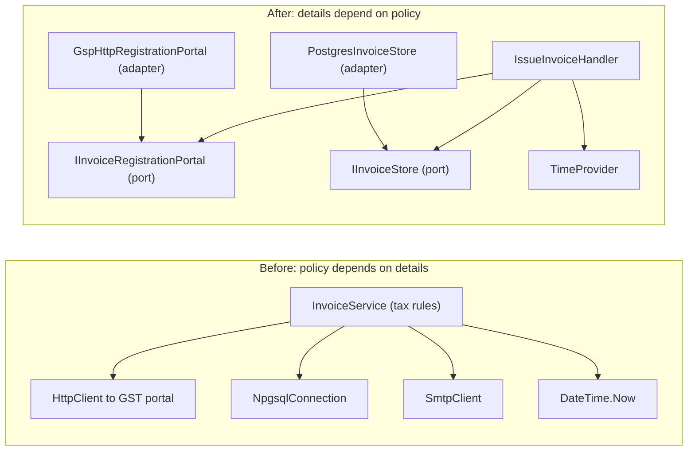
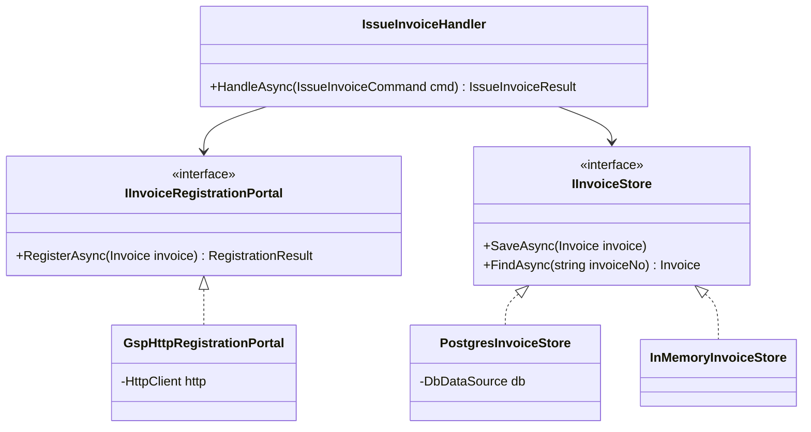
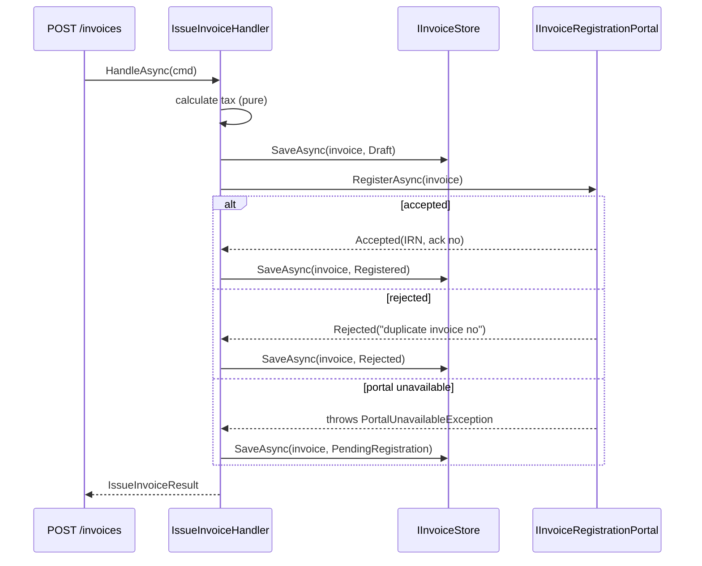
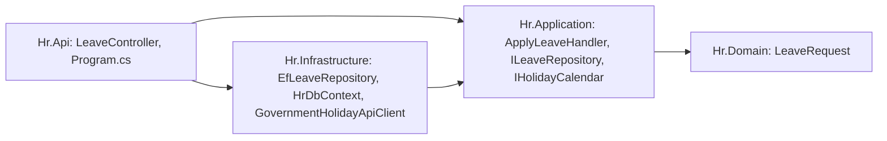

The Dependency Inversion Principle (DIP) is the "D" in SOLID, and the one with the biggest effect on how a whole application is structured. Clean Architecture, Onion Architecture and Hexagonal (ports and adapters) are all DIP applied at the scale of projects. This lesson starts with one tangled class and ends with a layout you can reuse in any ASP.NET Core service — plus the cases where adding interfaces makes code worse.

## Learning objectives

By the end of this lesson you will be able to:

1. State both rules of DIP and explain what is actually "inverted".
2. Tell apart three ideas that are often confused: dependency inversion (a design rule), dependency injection (a technique) and an IoC container (a tool).
3. Find hidden dependencies on infrastructure (`new HttpClient()`, `DateTime.Now`, static helpers) in business code.
4. Design interfaces that the business layer **owns**, written in business language, and implement them as adapters.
5. Wire it all in a composition root (`Program.cs`) and test the business rules with hand-written fakes.
6. Decide when depending directly on a concrete class is the better choice.

## Prerequisites

- [Interfaces and abstract classes](#/lesson/m01-interfaces-abstract).
- [Dependency injection](#/lesson/m03-dependency-injection): constructor injection and `IServiceCollection`.
- [Interface Segregation Principle](#/lesson/m04-isp): DIP's interfaces should be small and client-shaped.

## Explain it like I'm a beginner

Think about a wall socket in your house. Your laptop charger doesn't care whether the electricity comes from a coal plant, a solar farm on a Rajasthan hillside, or the building's diesel generator during a power cut. The socket is a **standard** that the house defines, and every power source has to fit it.

Now imagine the opposite: your laptop is wired directly into the coal plant. When the city switches to solar, you need a new laptop.

Most beginner code is wired like that second laptop. Picture a pharmacy chain's billing code. An `InvoiceService` (the important part: business rules about GST on medicines sold to hospitals) directly creates an HTTP client for a government portal, opens a database connection, reads the system clock and sends email. When the portal changes its API, the business rules have to be edited. When you want to test a tax rule, you need the real portal, a real database and the right date.

DIP says: **let the important code define the socket.** The invoice code says "I need *something that can register an invoice with the tax authority*" and declares that as an interface. The HTTP code then implements that interface. Now the HTTP code depends on the business code, not the other way round. That reversal of the arrow is the "inversion".

- The business rules are the **high-level policy**.
- The database, HTTP client, file system, email and clock are **low-level details**.
- The interface owned by the business code is called a **port**. The class that implements it with real technology is an **adapter**.

## First-principles explanation

### The two rules

Robert C. Martin's 1996 formulation:

1. **High-level modules should not depend on low-level modules. Both should depend on abstractions.**
2. **Abstractions should not depend on details. Details should depend on abstractions.**

"High-level" means *closer to the purpose of the system*: the rule that an inter-state invoice charges IGST instead of CGST + SGST. "Low-level" means *closer to the machine*: JSON over HTTPS, SQL, SMTP.

A precise one-line version you can say in an interview: **source-code dependencies should point towards policy; the policy declares the abstractions it needs, and the details implement them.** Three words in that sentence carry the weight:

- **Abstraction** means an interface or abstract class *shaped by the needs of its user*, not a mirror of whatever the detail happens to offer. `IInvoiceStore.SaveAsync(Invoice)` is an abstraction; `INpgsqlWrapper.ExecuteAsync(string sql)` is the detail wearing an interface.
- **Depend** means "names it in source code" (a `using`, a type in a signature, a project reference), not "calls it at runtime".
- **Owns** means the abstraction ships in the policy's package and changes only when the policy's needs change.

### What exactly is inverted?

In naive layered code, both the *call* and the *source-code dependency* go downward: `InvoiceService` → `GspClient` → `HttpClient`. With DIP, calls still go downward at runtime (the service still triggers the HTTP request), but the **source-code dependency points upward**: `GspHttpRegistrationPortal` (infrastructure) references `IInvoiceRegistrationPortal` (application). The flow of control and the direction of dependency now point in opposite directions. That's the inversion.

A second inversion is easy to miss: **ownership**. The interface lives *with the code that uses it*, in the application project, and is written in its language: `RegisterAsync(Invoice invoice)`, not `PostJsonAsync(string url, object body)`. If the interface lives in the infrastructure project, you've added an interface but haven't inverted anything. The business code still depends on the infrastructure package.

### DIP, DI and IoC — three different things

| Term | What it is | Example |
|---|---|---|
| Dependency **inversion** | A design principle about the direction of source dependencies | Application owns `IInvoiceStore`; infrastructure implements it |
| Dependency **injection** | A technique: give an object its dependencies from outside instead of creating them | `public IssueInvoiceHandler(IInvoiceStore store)` |
| IoC **container** | A tool that builds object graphs for you | `builder.Services.AddScoped<IInvoiceStore, PostgresInvoiceStore>()` |

You can do DI without DIP (inject a concrete `SqlInvoiceRepository` from the infrastructure project). You can do DIP without a container (wire everything by hand with `new` in `Main`). In ASP.NET Core you usually use all three together, which is why they blur.

A fourth term, **inversion of control (IoC)**, is the broadest of all: *the framework calls your code instead of your code calling the framework* (the "Hollywood principle": don't call us, we'll call you). ASP.NET Core calling your endpoint handler, xUnit calling your `[Fact]` and a `BackgroundService` loop are all IoC. Dependency injection is one form of IoC (the container, not your class, decides which object you get); DIP is a separate rule about which way source dependencies point.

### Classic examples interviewers use

**Button and lamp (from Martin's 1996 paper).** A `Button` class that calls `Lamp.TurnOn()` directly can only ever switch lamps. Invert it: `Button` owns an `ISwitchable` interface with `TurnOn()`/`TurnOff()`, and `Lamp`, `Fan` and `Geyser` implement it. The button (policy: "a press toggles the device") is now reusable, and the arrow from `Lamp` points up at `ISwitchable`. The important detail is *where `ISwitchable` lives*: next to `Button`, not next to `Lamp`.

**The copy program (same paper).** `Copy()` reads characters from the keyboard and writes them to a printer. When someone needs "copy to disk", the naive fix adds a flag and an `if`. The DIP fix: `Copy(IReader reader, IWriter writer)`. The copy rule never changes again; new devices are new implementations.

**Report generator and database.** `SalesReport` creates a `MySqlConnection` and runs SQL inline. Moving to PostgreSQL, or testing the report's totals, means editing or running the report against a real database. Invert it: `SalesReport` asks an `ISalesSource` (owned by the reporting code) for `IReadOnlyList<Sale> ForMonth(int year, int month)`, and a `PostgresSalesSource` implements it.

All three have the same shape as this lesson's invoicing example: a rule that should outlive its devices, an interface written in the rule's words, and devices that plug in from outside. If you want to see DIP working alongside the other four SOLID principles on one feature, see [SOLID in practice](#/lesson/m04-solid-in-practice).

### Why it exists — the problem

When business rules depend directly on details:

1. **Change spreads inward.** The tax portal revises its schema, and your tax-calculation class must be edited, retested and redeployed.
2. **Testing needs the world.** Testing "inter-state supply uses IGST" needs a database, a network and a date, so the test is slow, flaky or never written.
3. **Reuse is blocked.** The invoice rules can't run in a background job or CLI tool without dragging the HTTP and SQL code along.
4. **Decisions get made too early.** Business logic waits until someone picks the database and the provider.

### How it works internally

At compile time, a project reference is a one-way arrow. If `Pharmacy.Infrastructure` references `Pharmacy.Application`, then the application project cannot reference infrastructure back, or you'd have a cycle, which MSBuild rejects. That compile-time rule is what *enforces* DIP: the application project literally cannot see `HttpClient`-based adapters.

At runtime, something must create the adapter and hand it to the use case. That place is the **composition root**: `Program.cs` in ASP.NET Core. It's the one place allowed to know every concrete type. The container resolves `IssueInvoiceHandler`, sees it needs an `IInvoiceRegistrationPortal`, finds the registered `GspHttpRegistrationPortal`, builds it (with its typed `HttpClient`), and injects it.

### When it is useful

- The detail is **volatile** (external APIs, vendors, databases you might move) or **slow/non-deterministic** (network, disk, clock, randomness).
- You want to **unit-test business rules** without infrastructure.
- Several **hosts** (API, worker, CLI) share the same business logic.
- Teams work on business logic and integrations **in parallel**.

### When it is unnecessary (and when it is overkill)

- The dependency is **stable, pure and in-process**: `Math`, `string`, `List<T>`, `decimal`, a pure `GstCalculator` you wrote yourself. Wrapping these in interfaces adds indirection and nothing else.
- A **small CRUD app or a script** where the "business logic" is "save the form". Use the framework directly (EF Core `DbContext` in the endpoint) and keep it simple.
- The code is **at the edge already**: an adapter can depend on `HttpClient` directly. That's its job.
- **A prototype or a throwaway spike.** If the code will be deleted in two weeks, the extra projects and interfaces are cost with no payback. Add the port when the second implementation (or the first test) actually appears; extracting an interface from a concrete class is a two-minute refactoring in any IDE.

### Trade-offs it introduces

| You gain | You pay |
|---|---|
| Business rules testable in milliseconds | An interface + adapter per external dependency |
| Infrastructure swappable (provider, DB) | Navigation: "Go to implementation" instead of "Go to definition" |
| Clear compile-time boundaries between projects | More projects or folders to set up |
| Parallel work on rules and integrations | Risk of leaky or premature abstractions that fit no real second implementation |

## Visual explanation

### Dependency direction, before and after



On the left, every arrow leaves the business class and points at a technology. A change to any of the four boxes can break tax logic. On the right, the handler points only at ports, and the adapters point *at the same ports* from the outside. Notice the adapters' arrows: they point towards the business code. That's the inverted dependency. `TimeProvider` is a BCL abstraction (.NET 8+), so we depend on it directly instead of inventing our own `IClock`.

### Ports and adapters



The handler and both interfaces live in the application layer. The three implementations live in infrastructure. `InMemoryInvoiceStore` is a real second implementation used for local development and integration tests, which is a good sign the abstraction has the right shape.

### Issuing an invoice at runtime



The handler talks only to ports. The tax calculation is a pure step with no dependency at all. The three outcomes are expressed in business terms (accepted, rejected, unavailable), and the adapter translates HTTP status codes and timeouts into them. So the handler never sees a `503` or an `HttpRequestException`.

## Step-by-step example

The scenario: a pharmacy chain also runs a wholesale arm that supplies medicines in bulk to hospitals and clinics. These are business-to-business (B2B) sales, and because the chain's turnover is above the e-invoicing threshold (₹5 crore at the time of writing), every B2B invoice must be registered on a government Invoice Registration Portal (IRP), usually through a GST Suvidha Provider (GSP). The portal returns an Invoice Reference Number (IRN) that must be printed on the invoice. Intra-state invoices (a Bengaluru store supplying a Bengaluru hospital) charge CGST + SGST; inter-state ones (Haryana warehouse to a Mumbai hospital) charge IGST.

### Step 1 — list every dependency of the business class

Read the constructor *and* the method bodies. Hidden dependencies are the important ones:

| Dependency | Where | Kind |
|---|---|---|
| `new HttpClient()` to GSP | method body | volatile, slow |
| `new NpgsqlConnection(...)` | method body | volatile, slow |
| `DateTime.Now` | method body | non-deterministic |
| `new SmtpClient()` | method body | slow, side effect |
| tax-rate arithmetic | inline | stable, pure — **keep concrete** |

### Step 2 — write the interfaces from the caller's side

Ask "what does the invoice workflow need?", not "what does the GSP API offer?". The workflow needs to *register an invoice and get an IRN or a rejection reason*. So:

```csharp
public interface IInvoiceRegistrationPortal
{
    Task<RegistrationResult> RegisterAsync(Invoice invoice, CancellationToken ct);
}
```

No URLs, no JSON, no auth tokens. Those are adapter concerns. A test can implement this in three lines.

### Step 3 — move the details into adapters

The HTTP code moves into `GspHttpRegistrationPortal`, which maps `Invoice` to the portal's JSON schema and maps responses back. The SQL moves into `PostgresInvoiceStore`. Each adapter can now change on its own schedule.

### Step 4 — replace the clock

`DateTime.Now` becomes an injected `TimeProvider`. Invoice dates in India should be in IST, so the handler converts with `TimeZoneInfo`, and tests can pin "now" to 31 March 23:59 IST to check the financial-year boundary.

### Step 5 — wire it in the composition root

`Program.cs` registers each adapter against its port. It's the only file that knows both sides.

## Production-style C# implementation

Project layout (shown as folders; in a real solution these are three projects, and `Pharmacy.Infrastructure` references `Pharmacy.Application`, never the reverse):

```text
Pharmacy.Application/
  Invoices/Invoice.cs
  Invoices/Ports.cs
  Invoices/IssueInvoiceHandler.cs
Pharmacy.Infrastructure/
  Gsp/GspHttpRegistrationPortal.cs
  Persistence/PostgresInvoiceStore.cs
  Persistence/InMemoryInvoiceStore.cs
Pharmacy.Api/
  Program.cs
```

```csharp file=Pharmacy.Application/Invoices/Invoice.cs
namespace Pharmacy.Application.Invoices;

public enum InvoiceStatus { Draft, Registered, Rejected, PendingRegistration }

public sealed record InvoiceLine(string Description, string HsnCode, decimal TaxableValue, decimal GstRatePercent);

public sealed record TaxBreakup(decimal Taxable, decimal Cgst, decimal Sgst, decimal Igst)
{
    public decimal Total => Taxable + Cgst + Sgst + Igst;
}

public sealed record Invoice(
    string InvoiceNo,
    DateOnly InvoiceDate,
    string SupplierGstin,
    string BuyerGstin,
    IReadOnlyList<InvoiceLine> Lines,
    TaxBreakup Tax,
    InvoiceStatus Status = InvoiceStatus.Draft,
    string? Irn = null,
    string? StatusReason = null)
{
    /// <summary>The first two digits of a GSTIN are the state code.</summary>
    public bool IsInterState => SupplierGstin[..2] != BuyerGstin[..2];
}

/// <summary>Pure tax rules. No I/O, so it stays a concrete static class: there is nothing to invert.</summary>
public static class GstCalculator
{
    public static TaxBreakup Calculate(IReadOnlyList<InvoiceLine> lines, bool interState)
    {
        decimal taxable = 0, tax = 0;
        foreach (var l in lines)
        {
            taxable += l.TaxableValue;
            tax += Math.Round(l.TaxableValue * l.GstRatePercent / 100m, 2, MidpointRounding.AwayFromZero);
        }
        if (interState) return new TaxBreakup(taxable, 0, 0, tax);
        var half = Math.Round(tax / 2, 2, MidpointRounding.AwayFromZero);
        return new TaxBreakup(taxable, half, tax - half, 0);
    }
}
```

```csharp file=Pharmacy.Application/Invoices/Ports.cs
namespace Pharmacy.Application.Invoices;

// Ports: owned by the application, written in its language. Adapters in Infrastructure implement them.

public abstract record RegistrationResult
{
    public sealed record Accepted(string Irn, string AckNo) : RegistrationResult;
    public sealed record Rejected(string Reason) : RegistrationResult;
}

/// <summary>Thrown by adapters when the portal can't be reached. The use case decides what that means for the business.</summary>
public sealed class PortalUnavailableException(string message, Exception? inner = null) : Exception(message, inner);

public interface IInvoiceRegistrationPortal
{
    Task<RegistrationResult> RegisterAsync(Invoice invoice, CancellationToken ct);
}

public interface IInvoiceStore
{
    Task<Invoice?> FindAsync(string invoiceNo, CancellationToken ct);
    Task SaveAsync(Invoice invoice, CancellationToken ct);
}
```

```csharp file=Pharmacy.Application/Invoices/IssueInvoiceHandler.cs
using Microsoft.Extensions.Logging;

namespace Pharmacy.Application.Invoices;

public sealed record IssueInvoiceCommand(string InvoiceNo, string SupplierGstin, string BuyerGstin, IReadOnlyList<InvoiceLine> Lines);
public sealed record IssueInvoiceResult(string InvoiceNo, InvoiceStatus Status, string? Irn, decimal Total, string? Reason);

/// <summary>High-level policy. Depends only on ports it owns, plus TimeProvider from the BCL.</summary>
public sealed class IssueInvoiceHandler(
    IInvoiceStore store,
    IInvoiceRegistrationPortal portal,
    TimeProvider clock,
    ILogger<IssueInvoiceHandler> logger)
{
    private static readonly TimeZoneInfo Ist = TimeZoneInfo.FindSystemTimeZoneById("Asia/Kolkata");

    public async Task<IssueInvoiceResult> HandleAsync(IssueInvoiceCommand cmd, CancellationToken ct)
    {
        if (cmd.Lines.Count == 0) throw new ArgumentException("An invoice needs at least one line.", nameof(cmd));
        if (await store.FindAsync(cmd.InvoiceNo, ct) is { } existing)
            return ToResult(existing); // idempotent: re-sending the same number returns the stored outcome

        var today = DateOnly.FromDateTime(TimeZoneInfo.ConvertTime(clock.GetUtcNow(), Ist).DateTime);
        var interState = cmd.SupplierGstin[..2] != cmd.BuyerGstin[..2];
        var invoice = new Invoice(cmd.InvoiceNo, today, cmd.SupplierGstin, cmd.BuyerGstin, cmd.Lines,
                                  GstCalculator.Calculate(cmd.Lines, interState));
        await store.SaveAsync(invoice, ct);

        Invoice final;
        try
        {
            final = await portal.RegisterAsync(invoice, ct) switch
            {
                RegistrationResult.Accepted a => invoice with { Status = InvoiceStatus.Registered, Irn = a.Irn },
                RegistrationResult.Rejected r => invoice with { Status = InvoiceStatus.Rejected, StatusReason = r.Reason },
                _ => throw new InvalidOperationException("Unknown registration result."),
            };
        }
        catch (PortalUnavailableException ex)
        {
            logger.LogWarning(ex, "IRP unavailable for {InvoiceNo}; will retry later", invoice.InvoiceNo);
            final = invoice with { Status = InvoiceStatus.PendingRegistration, StatusReason = "Portal unavailable" };
        }

        await store.SaveAsync(final, ct);
        return ToResult(final);
    }

    private static IssueInvoiceResult ToResult(Invoice i) => new(i.InvoiceNo, i.Status, i.Irn, i.Tax.Total, i.StatusReason);
}
```

```csharp file=Pharmacy.Infrastructure/Gsp/GspHttpRegistrationPortal.cs
using System.Net;
using System.Net.Http.Json;
using Pharmacy.Application.Invoices;

namespace Pharmacy.Infrastructure.Gsp;

/// <summary>Adapter: translates the application's port into the provider's HTTP API, and HTTP failures into business outcomes.</summary>
public sealed class GspHttpRegistrationPortal(HttpClient http) : IInvoiceRegistrationPortal
{
    private sealed record GspResponse(bool Success, string? Irn, string? AckNo, string? ErrorMessage);

    public async Task<RegistrationResult> RegisterAsync(Invoice invoice, CancellationToken ct)
    {
        var payload = new
        {
            DocDtls = new { No = invoice.InvoiceNo, Dt = invoice.InvoiceDate.ToString("dd/MM/yyyy") },
            SellerDtls = new { Gstin = invoice.SupplierGstin },
            BuyerDtls = new { Gstin = invoice.BuyerGstin },
            ValDtls = new { AssVal = invoice.Tax.Taxable, CgstVal = invoice.Tax.Cgst, SgstVal = invoice.Tax.Sgst, IgstVal = invoice.Tax.Igst, TotInvVal = invoice.Tax.Total },
        };

        HttpResponseMessage response;
        try
        {
            response = await http.PostAsJsonAsync("einvoice/v1/generate", payload, ct);
        }
        catch (HttpRequestException ex) { throw new PortalUnavailableException("GSP unreachable", ex); }
        catch (TaskCanceledException ex) when (!ct.IsCancellationRequested) { throw new PortalUnavailableException("GSP timed out", ex); }

        using (response)
        {
            if (response.StatusCode is HttpStatusCode.ServiceUnavailable or HttpStatusCode.BadGateway or HttpStatusCode.GatewayTimeout)
                throw new PortalUnavailableException($"GSP returned {(int)response.StatusCode}");

            var body = await response.Content.ReadFromJsonAsync<GspResponse>(ct);
            return body is { Success: true, Irn: not null }
                ? new RegistrationResult.Accepted(body.Irn, body.AckNo ?? "")
                : new RegistrationResult.Rejected(body?.ErrorMessage ?? $"HTTP {(int)response.StatusCode}");
        }
    }
}
```

```csharp file=Pharmacy.Infrastructure/Persistence/PostgresInvoiceStore.cs
using System.Data.Common;
using System.Text.Json;
using Pharmacy.Application.Invoices;

namespace Pharmacy.Infrastructure.Persistence;

/// <summary>Adapter over ADO.NET's DbDataSource. In production the DbDataSource is an NpgsqlDataSource.
/// Table: invoices(invoice_no text primary key, status text, irn text null, body jsonb).</summary>
public sealed class PostgresInvoiceStore(DbDataSource db) : IInvoiceStore
{
    public async Task<Invoice?> FindAsync(string invoiceNo, CancellationToken ct)
    {
        await using var cmd = db.CreateCommand("SELECT body FROM invoices WHERE invoice_no = $1");
        var p = cmd.CreateParameter(); p.Value = invoiceNo; cmd.Parameters.Add(p);
        var json = await cmd.ExecuteScalarAsync(ct) as string;
        return json is null ? null : JsonSerializer.Deserialize<Invoice>(json);
    }

    public async Task SaveAsync(Invoice invoice, CancellationToken ct)
    {
        await using var cmd = db.CreateCommand("""
            INSERT INTO invoices (invoice_no, status, irn, body) VALUES ($1, $2, $3, $4::jsonb)
            ON CONFLICT (invoice_no) DO UPDATE SET status = EXCLUDED.status, irn = EXCLUDED.irn, body = EXCLUDED.body
            """);
        foreach (var value in new object?[] { invoice.InvoiceNo, invoice.Status.ToString(), invoice.Irn, JsonSerializer.Serialize(invoice) })
        {
            var p = cmd.CreateParameter(); p.Value = value ?? DBNull.Value; cmd.Parameters.Add(p);
        }
        await cmd.ExecuteNonQueryAsync(ct);
    }
}
```

```csharp file=Pharmacy.Infrastructure/Persistence/InMemoryInvoiceStore.cs
using System.Collections.Concurrent;
using Pharmacy.Application.Invoices;

namespace Pharmacy.Infrastructure.Persistence;

/// <summary>Second real implementation of the port: local development and integration tests.</summary>
public sealed class InMemoryInvoiceStore : IInvoiceStore
{
    private readonly ConcurrentDictionary<string, Invoice> _invoices = new(StringComparer.OrdinalIgnoreCase);
    public Task<Invoice?> FindAsync(string invoiceNo, CancellationToken ct) => Task.FromResult(_invoices.GetValueOrDefault(invoiceNo));
    public Task SaveAsync(Invoice invoice, CancellationToken ct) { _invoices[invoice.InvoiceNo] = invoice; return Task.CompletedTask; }
}
```

```csharp file=Program.cs
using Pharmacy.Application.Invoices;
using Pharmacy.Infrastructure.Gsp;
using Pharmacy.Infrastructure.Persistence;

var builder = WebApplication.CreateBuilder(args);

// Composition root: the only place that knows both ports and adapters.
builder.Services.AddSingleton(TimeProvider.System);
builder.Services.AddHttpClient<IInvoiceRegistrationPortal, GspHttpRegistrationPortal>(c =>
{
    c.BaseAddress = new Uri(builder.Configuration["Gsp:BaseUrl"] ?? "https://gsp.example.test/");
    c.Timeout = TimeSpan.FromSeconds(15);
});

// Production: builder.Services.AddNpgsqlDataSource(connectionString); then
// builder.Services.AddScoped<IInvoiceStore, PostgresInvoiceStore>();
builder.Services.AddSingleton<IInvoiceStore, InMemoryInvoiceStore>();
builder.Services.AddScoped<IssueInvoiceHandler>();

var app = builder.Build();

app.MapPost("/invoices", async (IssueInvoiceCommand cmd, IssueInvoiceHandler handler, CancellationToken ct) =>
{
    var result = await handler.HandleAsync(cmd, ct);
    return result.Status switch
    {
        InvoiceStatus.Registered => Results.Ok(result),
        InvoiceStatus.PendingRegistration => Results.Accepted($"/invoices/{result.InvoiceNo}", result),
        _ => Results.UnprocessableEntity(result),
    };
});

app.Run();
```

Points worth noticing:

- **The adapter translates failures.** HTTP 503, timeouts and connection errors become `PortalUnavailableException`, a type the application owns, so the handler reasons about "portal down, retry later", not HTTP.
- **`GstCalculator` is concrete and static.** It's pure and deterministic; inverting it would add an interface with no second implementation.
- **`TimeProvider` is used as-is.** It's already an abstraction from the BCL. Defining your own `IClock` is no longer needed on .NET 8+.
- **`PostgresInvoiceStore` depends on `DbDataSource`**, an ADO.NET abstraction. In production, `AddNpgsqlDataSource` registers an `NpgsqlDataSource`, which *is* a `DbDataSource`. Even the adapter depends on an abstraction where one already exists.
- **Resilience belongs to the adapter's wiring, not the policy.** In production add `.AddStandardResilienceHandler()` (package `Microsoft.Extensions.Http.Resilience`) to the typed client for timeouts, retries with jitter and a circuit breaker. Retrying registration is safe because the IRP rejects a second registration of the same invoice number for the same GSTIN and financial year, which the adapter can map back to the existing IRN.
- **"Pending" needs an owner.** A `PendingRegistration` invoice must not be forgotten: a `BackgroundService` (or a scheduled job) re-submits pending invoices through the same port, and a metric or alert on "pending older than 1 hour" tells operations the portal has been down too long. Hospitals cannot book an invoice without an IRN, so this is a business problem, not just a technical one.

## Bad design vs good design

### The bad version

```csharp
public class InvoiceService
{
    public async Task<string> IssueAsync(string invoiceNo, string supplierGstin, string buyerGstin, List<InvoiceLine> lines)
    {
        var date = DateTime.Now;                                   // machine time zone, untestable
        decimal tax = lines.Sum(l => l.TaxableValue * l.GstRatePercent / 100);
        bool inter = supplierGstin[..2] != buyerGstin[..2];

        using var http = new HttpClient();                          // socket exhaustion under load
        http.DefaultRequestHeaders.Add("auth-token", ConfigurationManager.AppSettings["GspToken"]);
        var resp = await http.PostAsJsonAsync("https://gsp.example.test/einvoice/v1/generate", new { /* ... */ });
        var body = await resp.Content.ReadFromJsonAsync<JsonElement>();
        var irn = body.GetProperty("Irn").GetString();             // throws on rejection

        using var conn = new NpgsqlConnection("Host=prod-db;Username=billing;Password=...");
        await conn.OpenAsync();
        // INSERT ... with string-concatenated values

        new SmtpClient("smtp.office.example").Send("billing@...", "accounts@hospital...", "Invoice " + invoiceNo, "IRN " + irn);
        return irn!;
    }
}
```

### What is wrong, in detail

1. **Policy is welded to details.** Tax rules, portal protocol, SQL and email sit in one method. The portal's schema change, a database move or a new email provider all edit the class that holds the tax logic.
2. **Untestable rules.** To test "inter-state uses IGST", a test needs network access to the GSP sandbox, a PostgreSQL server and an SMTP server. In practice, nobody writes that test, so a rounding bug (this code doesn't round per line) ships.
3. **Hidden dependencies.** The constructor is empty, so the class *looks* dependency-free. Its real dependencies are buried in the method body, including a static `ConfigurationManager` and a hard-coded connection string.
4. **Failure semantics are accidental.** A portal rejection throws a `KeyNotFoundException` from `GetProperty`. A timeout throws `TaskCanceledException`. Neither is a business decision. Meanwhile, the database insert may already have happened, or not, depending on which line failed.
5. **`new HttpClient()` per call** can exhaust sockets under load. That's a separate bug, but it's typical of code that creates its own dependencies.
6. **Time zone bug.** `DateTime.Now` on a server running in UTC gives the wrong invoice date between 00:00 and 05:30 IST — on 1 April, that's the wrong financial year.

### The good version

The implementation above: the handler owns the ports, the adapters translate technology into business outcomes, and `Program.cs` wires them. Each problem in the list maps to a fix: ports (1, 3), fakes (2), translated failures (4), `IHttpClientFactory` (5), `TimeProvider` with explicit IST (6).

### When applying DIP blindly is harmful

:::callout type=mistake title="An interface for every class"
`IGstCalculator`, `IInvoiceMapper`, `IStringFormatter`, each with exactly one implementation, all registered in DI. None of them touch I/O, so none of them needed inverting. You now have twice the files, "Go to definition" lands on an interface, and tests mock pure functions instead of calling them. Invert at **boundaries with volatile or slow things**, not everywhere.
:::

Other common ways DIP goes wrong:

- **Interfaces in the wrong project.** `IInvoiceRepository` sitting in `Pharmacy.Infrastructure` next to its implementation. The application must still reference infrastructure, so nothing is inverted.
- **Leaky ports.** `IInvoiceStore.Query()` returning `IQueryable<InvoiceEntity>`, or `IPortal.Send(HttpRequestMessage)`. The port exposes the technology it was meant to hide, and every caller now writes EF or HTTP code.
- **Mock-heavy tests that mirror the implementation.** "Verify `SaveAsync` was called exactly twice" breaks on every refactor. Prefer stateful fakes and assert on outcomes.
- **Wrapping a framework you're committed to.** A generic `IRepository<T>` over `DbContext` "in case we change ORM" costs features (`Include`, projections) and buys nothing if you never switch.

:::callout type=tradeoff title="Abstractions should have a reason"
A good test for a new interface: can you name a **second implementation** you actually need — a fake for tests, an in-memory version for local runs, or a second provider? If the only answer is "a mock", ask whether the dependency is slow or non-deterministic. If it's neither, depend on the concrete class.
:::

## Practical playground

`ReportScheduler` decides whether a pharmacy store should send its monthly expiry report (the list of medicines that expire in the next 90 days). It reads `DateTime.Now` and writes to the console directly, so you can't test "sends on the 1st, skips on the 2nd". Invert both dependencies: inject `TimeProvider` and an `IReportSender` port owned by the scheduler. Then run `Main` with a fixed clock set to the 1st of a month.

:::playground type=csharp title="Invert the clock and the sender"
```csharp file=Program.cs
using System;

public sealed class ReportScheduler
{
    // TODO 1: depend on TimeProvider instead of DateTime.Now.
    // TODO 2: depend on an IReportSender port instead of Console.
    public bool RunIfDue(string storeCode)
    {
        if (DateTime.Now.Day != 1) return false;
        Console.WriteLine($"Sending expiry report for store {storeCode}");
        return true;
    }
}

public sealed class FixedClock(DateTimeOffset now) : TimeProvider
{
    public override DateTimeOffset GetUtcNow() => now;
}

public static class Program
{
    public static void Main()
    {
        var scheduler = new ReportScheduler();
        Console.WriteLine($"Sent: {scheduler.RunIfDue("BLR-KOR-07")}");
        // After refactoring:
        // var scheduler = new ReportScheduler(new FixedClock(new DateTimeOffset(2026, 11, 1, 4, 0, 0, TimeSpan.Zero)), new ConsoleSender());
    }
}
```
:::

## Exercises

:::exercise id=m04-dip-ex1 difficulty=beginner kind=code title="Inject the clock into the near-expiry checker"
The pharmacy chain's policy: a medicine batch must be pulled from the shelf (and returned to the distributor for credit) once it is **90 days or less from its expiry date**. `NearExpiryChecker` reads `DateTime.UtcNow` directly, so nobody can test "91 days left" versus "90 days left" without waiting for the calendar.

Refactor it to take a `TimeProvider` through its **only** constructor and implement `MustPull`.
::requirements
- The class has exactly one constructor: `NearExpiryChecker(TimeProvider clock)`.
- `MustPull(DateOnly expiryDate)` is true when today (UTC date) is on or after `expiryDate − 90 days`.
::acceptance
- Expiry 2026-04-10, today 2026-01-09 (91 days left) → false.
- Expiry 2026-04-10, today 2026-01-10 (90 days left) → true.
- Expiry 2026-04-10, today 2027-06-01 (already expired) → true.
- No use of `DateTime.Now` or `DateTime.UtcNow`.
::hint
The clock is a dependency. Where do dependencies come from in DI-friendly code?
::hint
`TimeProvider` is an abstract class in .NET 8+. `TimeProvider.System` is the real one.
::hint
`DateOnly.FromDateTime(clock.GetUtcNow().UtcDateTime)` gives today.
::hint
```csharp
public bool MustPull(DateOnly expiry) => Today() >= expiry.AddDays(-PullWindowDays);
```
::starter
```csharp file=NearExpiryChecker.cs
using System;

public sealed class NearExpiryChecker
{
    public const int PullWindowDays = 90;

    public NearExpiryChecker() { }

    public bool MustPull(DateOnly expiryDate) => throw new NotImplementedException("Use DateTime.UtcNow? No — inject a clock.");
}
```
::tests
```csharp file=NearExpiryCheckerTests.cs
using System;
using System.Linq;
using Xunit;

public class NearExpiryCheckerTests
{
    private sealed class FixedClock(DateTimeOffset now) : TimeProvider
    {
        public override DateTimeOffset GetUtcNow() => now;
    }

    private static readonly DateOnly Expiry = new(2026, 4, 10);

    private static NearExpiryChecker At(int y, int m, int d) =>
        (NearExpiryChecker)Activator.CreateInstance(typeof(NearExpiryChecker),
            new FixedClock(new DateTimeOffset(y, m, d, 10, 0, 0, TimeSpan.Zero)))!;

    [Fact]
    public void Single_constructor_takes_TimeProvider() =>
        Assert.Equal(typeof(TimeProvider), typeof(NearExpiryChecker).GetConstructors().Single().GetParameters().Single().ParameterType);

    [Fact]
    public void Ninety_one_days_left_stays_on_shelf() =>
        Assert.False(At(2026, 1, 9).MustPull(Expiry));

    [Fact]
    public void Ninety_days_left_must_be_pulled() =>
        Assert.True(At(2026, 1, 10).MustPull(Expiry));

    [Fact]
    public void Expired_batch_must_be_pulled() =>
        Assert.True(At(2027, 6, 1).MustPull(Expiry));
}
```
::solution
```csharp file=NearExpiryChecker.cs
using System;

public sealed class NearExpiryChecker
{
    public const int PullWindowDays = 90;
    private readonly TimeProvider _clock;

    public NearExpiryChecker(TimeProvider clock) => _clock = clock;

    public bool MustPull(DateOnly expiryDate)
    {
        var today = DateOnly.FromDateTime(_clock.GetUtcNow().UtcDateTime);
        return today >= expiryDate.AddDays(-PullWindowDays);
    }
}
```

Register `TimeProvider.System` as a singleton in `Program.cs`. In tests, a three-line `FixedClock` replaces it. Microsoft also publishes `FakeTimeProvider` (package `Microsoft.Extensions.TimeProvider.Testing`) if you want time that can be advanced.
::mistakes
- Keeping the parameterless constructor "for convenience". It hides the real dependency and lets production code silently use the machine clock.
- Using local time on a UTC server, which can be off by a day.
- Inventing an `IClock` interface when `TimeProvider` already exists.
:::

:::exercise id=m04-dip-ex2 difficulty=beginner kind=written title="Who owns the interface?"
Vaccines and insulin must be stored between 2 °C and 8 °C. The pharmacy chain fits every store's medicine fridge with a temperature sensor. A cold-chain monitoring system reads the sensors, flags readings outside 2–8 °C, stores alerts in PostgreSQL and sends an SMS to the store's on-duty pharmacist through a third-party SMS gateway.

1. List the high-level policy and the low-level details.
2. Name the ports you'd create, with one method each, written in business language.
3. Say which project each port and each adapter lives in.
::acceptance
- Policy and details correctly separated.
- Port names and methods use domain words (alert, pharmacist, reading), not technology words (HTTP, SQL, SMS API).
- Ports live with the policy; adapters live with infrastructure.
::hint
Policy is whatever a store pharmacist or a quality auditor would recognise as "the rules".
::hint
Ask what the policy *needs*: "notify the pharmacist", not "POST to the SMS API".
::hint
Should the port be `ISmsGateway` or `IPharmacistNotifier`? Which one survives a switch to WhatsApp or a push notification?
::solution
**Policy:** "a reading outside 2–8 °C for 3 consecutive samples (one per minute) raises an alert; alerts are stored for the audit trail and the on-duty pharmacist is notified; repeat alerts for the same fridge within 30 minutes are suppressed; if the excursion lasts more than 60 minutes, the stock is quarantined pending review."

**Details:** the sensor protocol (MQTT), PostgreSQL, the SMS gateway, the system clock.

**Ports (in `ColdChain.Application`):**
- `ITemperatureReadingSource` — `IAsyncEnumerable<TemperatureReading> ReadAsync(ct)`
- `IAlertStore` — `Task SaveAsync(Alert alert)`, `Task<Alert?> LastForFridgeAsync(string fridgeId)`
- `IPharmacistNotifier` — `Task NotifyAsync(Alert alert, PharmacistOnDuty pharmacist)`
- `TimeProvider` from the BCL for the 30- and 60-minute windows.

**Adapters (in `ColdChain.Infrastructure`):** `MqttTemperatureReadingSource`, `PostgresAlertStore`, `SmsPharmacistNotifier`. `IPharmacistNotifier` instead of `ISmsGateway` means a later switch to WhatsApp adds an adapter and changes nothing in the policy.
::mistakes
- Naming the port after the vendor (`ITwilioClient`).
- Putting `IAlertStore` in the infrastructure project.
- Inverting the threshold check, which is pure and should stay concrete.
:::

:::exercise id=m04-dip-ex3 difficulty=intermediate kind=code title="A use case that talks only to ports"
Some of the chain's stores are franchises. Every week, head office settles with each franchise owner: it adds up the store's sales, keeps a 5 % brand commission, and pays out the rest. Implement `FranchiseSettlementHandler.SettleAsync`. It depends on two ports: `ISalesLedger` (gets the week's sale lines for a store) and `ISettlementArchive` (stores completed settlements).

Rules:
1. Gross sales = Σ(quantity × unit price) over the sale lines, rounded to 2 decimals (half away from zero, as accounts teams expect).
2. Commission = 5 % of gross sales, rounded the same way. Net payout = gross − commission.
3. If there are no sale lines, return `null` and archive nothing.
4. Archive the settlement exactly once and return it.
::acceptance
- 4,000 strips × ₹150 + 1,500 insulin pens × ₹1,200 → gross ₹24,00,000, commission ₹1,20,000, net payout ₹22,80,000.
- No sale lines → `null`, archive untouched.
- The handler references no concrete infrastructure type.
::hint
Write the test fakes first: a sales ledger that returns a fixed list, and an archive that records what it was given.
::hint
The calculation is pure. Do it in the handler or a static helper; it doesn't need an interface.
::hint
`var gross = Math.Round(lines.Sum(l => l.Quantity * l.UnitPrice), 2, MidpointRounding.AwayFromZero);` — the default `Math.Round` uses banker's rounding (to even), so ₹16.665 would become ₹16.66 instead of ₹16.67.
::hint
Check for empty before calling the archive, then `await archive.SaveAsync(settlement, ct)` once.
::starter
```csharp file=FranchiseSettlementHandler.cs
using System;
using System.Collections.Generic;
using System.Linq;
using System.Threading;
using System.Threading.Tasks;

public sealed record SaleLine(string Item, decimal Quantity, decimal UnitPrice);
public sealed record Settlement(string StoreCode, int WeekNo, decimal GrossSales, decimal Commission, decimal NetPayout);

public interface ISalesLedger
{
    Task<IReadOnlyList<SaleLine>> GetSalesAsync(string storeCode, int weekNo, CancellationToken ct);
}

public interface ISettlementArchive
{
    Task SaveAsync(Settlement settlement, CancellationToken ct);
}

public sealed class FranchiseSettlementHandler(ISalesLedger ledger, ISettlementArchive archive)
{
    public const decimal CommissionPercent = 5m;

    public Task<Settlement?> SettleAsync(string storeCode, int weekNo, CancellationToken ct) =>
        throw new NotImplementedException();
}
```
::tests
```csharp file=FranchiseSettlementHandlerTests.cs
using System.Collections.Generic;
using System.Threading;
using System.Threading.Tasks;
using Xunit;

public class FranchiseSettlementHandlerTests
{
    private sealed class FakeLedger(params SaleLine[] lines) : ISalesLedger
    {
        public Task<IReadOnlyList<SaleLine>> GetSalesAsync(string s, int w, CancellationToken ct) =>
            Task.FromResult<IReadOnlyList<SaleLine>>(lines);
    }

    private sealed class RecordingArchive : ISettlementArchive
    {
        public List<Settlement> Saved { get; } = new();
        public Task SaveAsync(Settlement settlement, CancellationToken ct) { Saved.Add(settlement); return Task.CompletedTask; }
    }

    [Fact]
    public async Task Calculates_gross_commission_and_net()
    {
        var archive = new RecordingArchive();
        var handler = new FranchiseSettlementHandler(
            new FakeLedger(new SaleLine("Antibiotic strip", 4_000m, 150m), new SaleLine("Insulin pen", 1_500m, 1_200m)), archive);

        var settlement = await handler.SettleAsync("PUN-AUN-12", 42, CancellationToken.None);

        Assert.NotNull(settlement);
        Assert.Equal(2_400_000m, settlement!.GrossSales);
        Assert.Equal(120_000m, settlement.Commission);
        Assert.Equal(2_280_000m, settlement.NetPayout);
        Assert.Single(archive.Saved);
    }

    [Fact]
    public async Task No_sales_returns_null_and_archives_nothing()
    {
        var archive = new RecordingArchive();
        var settlement = await new FranchiseSettlementHandler(new FakeLedger(), archive).SettleAsync("S1", 1, CancellationToken.None);
        Assert.Null(settlement);
        Assert.Empty(archive.Saved);
    }

    [Fact]
    public async Task Rounds_half_away_from_zero()
    {
        var archive = new RecordingArchive();
        var settlement = await new FranchiseSettlementHandler(new FakeLedger(new SaleLine("Cough syrup 100 ml", 3m, 111.10m)), archive)
            .SettleAsync("S1", 2, CancellationToken.None);
        Assert.Equal(333.30m, settlement!.GrossSales);
        Assert.Equal(16.67m, settlement.Commission);   // 16.665 rounds up, not to even
        Assert.Equal(316.63m, settlement.NetPayout);
    }
}
```
::solution
```csharp file=FranchiseSettlementHandler.cs
using System;
using System.Collections.Generic;
using System.Linq;
using System.Threading;
using System.Threading.Tasks;

public sealed record SaleLine(string Item, decimal Quantity, decimal UnitPrice);
public sealed record Settlement(string StoreCode, int WeekNo, decimal GrossSales, decimal Commission, decimal NetPayout);

public interface ISalesLedger
{
    Task<IReadOnlyList<SaleLine>> GetSalesAsync(string storeCode, int weekNo, CancellationToken ct);
}

public interface ISettlementArchive
{
    Task SaveAsync(Settlement settlement, CancellationToken ct);
}

public sealed class FranchiseSettlementHandler(ISalesLedger ledger, ISettlementArchive archive)
{
    public const decimal CommissionPercent = 5m;

    public async Task<Settlement?> SettleAsync(string storeCode, int weekNo, CancellationToken ct)
    {
        var lines = await ledger.GetSalesAsync(storeCode, weekNo, ct);
        if (lines.Count == 0) return null;

        var gross = Math.Round(lines.Sum(l => l.Quantity * l.UnitPrice), 2, MidpointRounding.AwayFromZero);
        var commission = Math.Round(gross * CommissionPercent / 100m, 2, MidpointRounding.AwayFromZero);
        var settlement = new Settlement(storeCode, weekNo, gross, commission, gross - commission);

        await archive.SaveAsync(settlement, ct);
        return settlement;
    }
}
```

The handler knows nothing about where sales come from (the store's point-of-sale database, a nightly CSV upload) or where settlements go. Both ports are owned here, and the fakes in the tests are a few lines each. In production, the archive write should also be idempotent per `(StoreCode, WeekNo)` (a unique key), so a re-run of the weekly job cannot pay a franchise twice.
::mistakes
- Using `double` for money.
- Computing net from an unrounded commission, so gross ≠ commission + net by a paisa.
- Creating an `ICommissionCalculator` interface for a one-line pure formula.
:::

:::exercise id=m04-dip-ex4 difficulty=intermediate kind=design title="Draw the project references"
You're splitting a single ASP.NET Core project into `Hr.Domain`, `Hr.Application`, `Hr.Infrastructure` and `Hr.Api` for a leave-management system. Place these types and draw the project references:

`LeaveRequest` (entity with rules), `ILeaveRepository`, `EfLeaveRepository`, `HrDbContext`, `ApplyLeaveHandler`, `IHolidayCalendar`, `GovernmentHolidayApiClient`, `LeaveController`, `Program.cs`.
::acceptance
- References point inward: Api → Infrastructure → Application → Domain.
- Every interface sits in the project that *uses* it.
- No reference from Application or Domain to Infrastructure.
::hint
Where does `ApplyLeaveHandler` live, and which interfaces does it need?
::hint
`HrDbContext` is EF Core — infrastructure. Does anything in Application need to see it?
::hint
Api references Infrastructure only so `Program.cs` can register adapters.
::solution


Every arrow points towards the domain. `ILeaveRepository` and `IHolidayCalendar` live in Application because `ApplyLeaveHandler` uses them (Domain also works, never Infrastructure). Api references Infrastructure only for the composition root. An architecture test over `Assembly.GetReferencedAssemblies()` can fail the build if Application ever references Infrastructure.
::mistakes
- Putting `ILeaveRepository` next to `EfLeaveRepository`.
- Letting `ApplyLeaveHandler` take `HrDbContext` "just for one query".
:::

:::exercise id=m04-dip-ex5 difficulty=advanced kind=code title="A caching, fault-tolerant adapter behind a port"
The wholesale billing service validates each hospital's GSTIN through the port `IGstinVerifier`. The real adapter calls a slow external API that sometimes fails. Implement `CachingGstinVerifier`, a decorator that implements the same port:

1. Cache each result (active or inactive) for the configured TTL, using the injected `TimeProvider`.
2. After the TTL, call the inner verifier again.
3. If the inner verifier throws `HttpRequestException` and a cached (even expired) result exists, return the stale result.
4. If it throws and nothing is cached, return `GstinStatus.Unknown`.
::acceptance
- Two calls within the TTL hit the inner verifier once.
- A call after the TTL hits it again.
- On failure with a stale entry, the stale status is returned.
- On failure with no entry, `Unknown` is returned and nothing throws.
::hint
The decorator *is* an `IGstinVerifier` and *has* an `IGstinVerifier`.
::hint
Store `(GstinStatus Status, DateTimeOffset FetchedAt)` in a dictionary keyed by GSTIN (case-insensitive).
::hint
Fresh = `clock.GetUtcNow() - entry.FetchedAt < ttl`. Return early if fresh; otherwise try the inner call.
::hint
```csharp
try { var s = await inner.VerifyAsync(gstin, ct); _cache[gstin] = (s, now); return s; }
catch (HttpRequestException) { return _cache.TryGetValue(gstin, out var old) ? old.Status : GstinStatus.Unknown; }
```
::hint
Use `ConcurrentDictionary` so the decorator is safe as a singleton.
::starter
```csharp file=CachingGstinVerifier.cs
using System;
using System.Collections.Concurrent;
using System.Net.Http;
using System.Threading;
using System.Threading.Tasks;

public enum GstinStatus { Active, Inactive, Unknown }

public interface IGstinVerifier
{
    Task<GstinStatus> VerifyAsync(string gstin, CancellationToken ct);
}

public sealed class CachingGstinVerifier(IGstinVerifier inner, TimeProvider clock, TimeSpan ttl) : IGstinVerifier
{
    public Task<GstinStatus> VerifyAsync(string gstin, CancellationToken ct) => throw new NotImplementedException();
}
```
::tests
```csharp file=CachingGstinVerifierTests.cs
using System;
using System.Net.Http;
using System.Threading;
using System.Threading.Tasks;
using Xunit;

public class CachingGstinVerifierTests
{
    private sealed class ManualClock : TimeProvider
    {
        public DateTimeOffset Now { get; set; } = new(2026, 4, 1, 6, 0, 0, TimeSpan.Zero);
        public override DateTimeOffset GetUtcNow() => Now;
    }

    private sealed class FakeVerifier : IGstinVerifier
    {
        public int Calls { get; private set; }
        public bool Fail { get; set; }
        public GstinStatus Next { get; set; } = GstinStatus.Active;
        public Task<GstinStatus> VerifyAsync(string gstin, CancellationToken ct)
        {
            Calls++;
            if (Fail) throw new HttpRequestException("portal down");
            return Task.FromResult(Next);
        }
    }

    private const string Gstin = "27AAPFU0939F1ZV";

    [Fact]
    public async Task Second_call_within_ttl_uses_cache()
    {
        var inner = new FakeVerifier(); var clock = new ManualClock();
        var sut = new CachingGstinVerifier(inner, clock, TimeSpan.FromHours(24));
        await sut.VerifyAsync(Gstin, CancellationToken.None);
        clock.Now = clock.Now.AddHours(23);
        Assert.Equal(GstinStatus.Active, await sut.VerifyAsync(Gstin, CancellationToken.None));
        Assert.Equal(1, inner.Calls);
    }

    [Fact]
    public async Task Call_after_ttl_refreshes()
    {
        var inner = new FakeVerifier(); var clock = new ManualClock();
        var sut = new CachingGstinVerifier(inner, clock, TimeSpan.FromHours(24));
        await sut.VerifyAsync(Gstin, CancellationToken.None);
        clock.Now = clock.Now.AddHours(25);
        inner.Next = GstinStatus.Inactive;
        Assert.Equal(GstinStatus.Inactive, await sut.VerifyAsync(Gstin, CancellationToken.None));
        Assert.Equal(2, inner.Calls);
    }

    [Fact]
    public async Task Failure_with_stale_entry_returns_stale()
    {
        var inner = new FakeVerifier(); var clock = new ManualClock();
        var sut = new CachingGstinVerifier(inner, clock, TimeSpan.FromHours(24));
        await sut.VerifyAsync(Gstin, CancellationToken.None);
        clock.Now = clock.Now.AddDays(3);
        inner.Fail = true;
        Assert.Equal(GstinStatus.Active, await sut.VerifyAsync(Gstin, CancellationToken.None));
    }

    [Fact]
    public async Task Failure_without_entry_returns_unknown()
    {
        var inner = new FakeVerifier { Fail = true };
        var sut = new CachingGstinVerifier(inner, new ManualClock(), TimeSpan.FromHours(24));
        Assert.Equal(GstinStatus.Unknown, await sut.VerifyAsync(Gstin, CancellationToken.None));
    }

    [Fact]
    public async Task Cache_key_ignores_case()
    {
        var inner = new FakeVerifier();
        var sut = new CachingGstinVerifier(inner, new ManualClock(), TimeSpan.FromHours(24));
        await sut.VerifyAsync(Gstin, CancellationToken.None);
        await sut.VerifyAsync(Gstin.ToLowerInvariant(), CancellationToken.None);
        Assert.Equal(1, inner.Calls);
    }
}
```
::solution
```csharp file=CachingGstinVerifier.cs
using System;
using System.Collections.Concurrent;
using System.Net.Http;
using System.Threading;
using System.Threading.Tasks;

public enum GstinStatus { Active, Inactive, Unknown }

public interface IGstinVerifier
{
    Task<GstinStatus> VerifyAsync(string gstin, CancellationToken ct);
}

public sealed class CachingGstinVerifier(IGstinVerifier inner, TimeProvider clock, TimeSpan ttl) : IGstinVerifier
{
    private readonly ConcurrentDictionary<string, (GstinStatus Status, DateTimeOffset FetchedAt)> _cache =
        new(StringComparer.OrdinalIgnoreCase);

    public async Task<GstinStatus> VerifyAsync(string gstin, CancellationToken ct)
    {
        var now = clock.GetUtcNow();
        var hasEntry = _cache.TryGetValue(gstin, out var entry);
        if (hasEntry && now - entry.FetchedAt < ttl) return entry.Status;

        try
        {
            var status = await inner.VerifyAsync(gstin, ct);
            _cache[gstin] = (status, now);
            return status;
        }
        catch (HttpRequestException)
        {
            return hasEntry ? entry.Status : GstinStatus.Unknown;
        }
    }
}
```

The decorator honours the port's contract, so the application can't tell it apart from the plain adapter. Register it in the composition root: `services.AddSingleton<IGstinVerifier>(sp => new CachingGstinVerifier(sp.GetRequiredService<HttpGstinVerifier>(), sp.GetRequiredService<TimeProvider>(), TimeSpan.FromHours(24)));`
::alternatives
`HybridCache` (.NET 9+) or `IMemoryCache` give eviction, size limits and stampede protection. A hand-rolled dictionary grows without limit; that's acceptable for a bounded set of business partners, not for arbitrary user input. Resilience libraries can add retries, but keep the *business* fallback ("unknown, ask a human") in your code.
::mistakes
- Catching `Exception`, which also swallows `OperationCanceledException` when the request is cancelled.
- Caching `Unknown`, which pins a temporary outage for 24 hours.
- Putting the cache inside the use case instead of behind the port.
:::

## Automated testing

DIP pays off most in tests. Three layers:

**1. Use-case tests with stateful fakes.** No network, no database, milliseconds per test:

```csharp
public class IssueInvoiceHandlerTests
{
    private sealed class FakePortal(Func<Invoice, RegistrationResult> respond) : IInvoiceRegistrationPortal
    {
        public int Calls { get; private set; }
        public Task<RegistrationResult> RegisterAsync(Invoice invoice, CancellationToken ct) { Calls++; return Task.FromResult(respond(invoice)); }
    }

    private sealed class DownPortal : IInvoiceRegistrationPortal
    {
        public Task<RegistrationResult> RegisterAsync(Invoice invoice, CancellationToken ct) => throw new PortalUnavailableException("down");
    }

    private sealed class FixedClock(DateTimeOffset now) : TimeProvider { public override DateTimeOffset GetUtcNow() => now; }

    private static readonly IssueInvoiceCommand InterState = new("INV-2026-0042", "06AAACR1234A1Z5", "27AAACM9876B1Z2",
        new[] { new InvoiceLine("Medicines (bulk supply), Oct 2026", "3004", 10_00_000m, 5m) });

    private static IssueInvoiceHandler Create(IInvoiceRegistrationPortal portal, IInvoiceStore store, DateTimeOffset now) =>
        new(store, portal, new FixedClock(now), NullLogger<IssueInvoiceHandler>.Instance);

    [Fact]
    public async Task Inter_state_invoice_charges_igst_and_is_registered()
    {
        var store = new InMemoryInvoiceStore();
        var result = await Create(new FakePortal(_ => new RegistrationResult.Accepted("IRN123", "ACK1")), store, DateTimeOffset.UtcNow)
            .HandleAsync(InterState, CancellationToken.None);

        Assert.Equal(InvoiceStatus.Registered, result.Status);
        Assert.Equal(10_50_000m, result.Total);
        Assert.Equal(50_000m, (await store.FindAsync("INV-2026-0042", CancellationToken.None))!.Tax.Igst);
    }

    [Fact]
    public async Task Portal_down_leaves_invoice_pending_instead_of_failing()
    {
        var result = await Create(new DownPortal(), new InMemoryInvoiceStore(), DateTimeOffset.UtcNow).HandleAsync(InterState, CancellationToken.None);
        Assert.Equal(InvoiceStatus.PendingRegistration, result.Status);
    }

    [Fact]
    public async Task Invoice_date_uses_ist_not_utc()
    {
        var store = new InMemoryInvoiceStore();
        // 31 March 2026 20:00 UTC is 1 April 2026 01:30 IST: new financial year.
        await Create(new FakePortal(_ => new RegistrationResult.Accepted("IRN", "ACK")), store, new DateTimeOffset(2026, 3, 31, 20, 0, 0, TimeSpan.Zero))
            .HandleAsync(InterState, CancellationToken.None);
        Assert.Equal(new DateOnly(2026, 4, 1), (await store.FindAsync("INV-2026-0042", CancellationToken.None))!.InvoiceDate);
    }

    [Fact]
    public async Task Resubmitting_same_number_does_not_call_portal_again()
    {
        var portal = new FakePortal(_ => new RegistrationResult.Accepted("IRN", "ACK"));
        var handler = Create(portal, new InMemoryInvoiceStore(), DateTimeOffset.UtcNow);
        await handler.HandleAsync(InterState, CancellationToken.None);
        await handler.HandleAsync(InterState, CancellationToken.None);
        Assert.Equal(1, portal.Calls);
    }
}
```

**2. Pure-logic tests with no fakes at all.** `GstCalculator.Calculate` is static and pure, so tests call it directly with `[Theory]` rows: intra-state ₹1,000 of medicines at 5 % → CGST ₹25 + SGST ₹25; odd paise split (₹0.01 tax → CGST ₹0.01, SGST ₹0.00).

**3. Adapter tests against the real thing.** Test `GspHttpRegistrationPortal` with a stub `HttpMessageHandler` returning canned 200/400/503 responses, and test `PostgresInvoiceStore` against a real PostgreSQL 17 in a container (Testcontainers is a common choice). These are slower and fewer. Their job is to prove each adapter honours the port's contract — the same contract the fakes promise. A shared "contract test" base class, run against both `InMemoryInvoiceStore` and `PostgresInvoiceStore`, keeps the fake honest.

## Real-world application

- **ASP.NET Core is built on it.** Your code depends on `ILogger<T>`, `IOptions<T>`, `IDistributedCache` and `IHttpClientFactory`. The framework owns these abstractions, and providers (Serilog, Redis, Azure) implement them. Swapping Redis for SQL Server distributed cache is a registration change.
- **`TimeProvider` (.NET 8)** standardised the clock abstraction that every team used to hand-roll as `IClock`.
- **Clean / Onion / Hexagonal architecture** are DIP at project scale: domain and application at the centre, infrastructure at the edge, references pointing inward. See [Hexagonal architecture](#/lesson/m02-hexagonal) and [Clean and Onion](#/lesson/m02-clean-onion).
- **Government integrations** (e-invoicing, e-way bills, GSTIN lookup, drug-licence verification) change schemas and endpoints on their own timelines. Keeping them behind ports means a schema revision is an adapter release, not a change to billing rules.

## Interview questions

:::interview
::q beginner
What does the Dependency Inversion Principle say?
::a
High-level modules (business rules) shouldn't depend on low-level modules (databases, HTTP, file system); both should depend on abstractions. And abstractions shouldn't depend on details; details should depend on abstractions. In practice: the business layer defines interfaces such as `IInvoiceStore`, and infrastructure classes implement them, so source-code dependencies point from infrastructure towards the business code.
::q beginner
What's the difference between dependency inversion and dependency injection?
::a
Inversion is a design principle about the *direction* of dependencies and *who owns* abstractions. Injection is a technique for *supplying* dependencies from outside, usually through the constructor. You can inject a concrete class (DI without DIP), or wire inverted dependencies by hand without a container (DIP without a DI container). ASP.NET Core typically uses both, with the container doing the wiring in `Program.cs`.
::q intermediate
Your `IOrderRepository` interface lives in the Infrastructure project next to its EF Core implementation. Is that DIP?
::a
No. The application still references the infrastructure project to see the interface, so the dependency arrow hasn't flipped. DIP needs the abstraction to be owned by the client: move `IOrderRepository` into Application (or Domain), let Infrastructure reference Application, and implement it there. Also check its shape: if it exposes `IQueryable<OrderEntity>` or EF types, it's leaking the detail it should hide.
::q intermediate
Which dependencies would you *not* put behind an interface?
::a
Stable, pure, in-process code: BCL types (`string`, `List<T>`, `Math`), value objects, and your own pure calculators like a GST calculator. They're fast and deterministic, so tests can use them directly. An interface there adds files and indirection without enabling anything. Also edges that are already abstractions (`TimeProvider`, `ILogger<T>`, `DbDataSource`). Invert where the dependency is volatile, slow, non-deterministic or owned by someone else.
::q intermediate
Walk me through the button-and-lamp example. Where does the interface live, and why does that matter?
::a
A `Button` that calls `Lamp.TurnOn()` directly can only switch lamps, and every change to `Lamp` can break `Button`. Applying DIP, `Button` declares the interface it needs, `ISwitchable { TurnOn(); TurnOff(); }`, and `Lamp`, `Fan` or a smart plug implement it. The interface must live **with the button** (the policy: "a press toggles a device"). If it lived in the lamp's package, the button would still depend on the lamp package and nothing would be inverted; you'd only have added an interface. The same reasoning places `IInvoiceStore` in the application project, not next to `PostgresInvoiceStore`.
::q advanced
How do you stop a port from becoming a leaky abstraction over a specific vendor?
::a
Design it from the use case, in domain language, *before* reading the vendor API: `RegisterAsync(Invoice)` returning `Accepted`/`Rejected`, not `PostAsync(GspRequest)` returning `HttpResponseMessage`. Translate errors in the adapter, keep vendor types out of signatures, and check the port against a second implementation (a fake, a sandbox, a competitor's API). Contract tests run against every implementation keep them aligned. Some leakage (latency, eventual consistency) is unavoidable; document it as part of the contract.
::q advanced
A team insists on wrapping EF Core's `DbContext` in `IRepository<T>` "for DIP". When do you agree and when do you push back?
::a
Push back for apps committed to EF Core and PostgreSQL: `DbContext` already is a unit of work and repository, a generic wrapper hides `Include`, projections and `AsNoTracking`, and the realistic test is a real PostgreSQL in a container anyway. Agree to *specific*, use-case-shaped ports (`IInvoiceStore.FindOpenForBuyerAsync`) when the domain is rich, persistence must be swappable, or the application must stay free of EF for other hosts.
:::

## Summary and revision

**Key takeaways**

- DIP: business rules own the interfaces (ports); infrastructure implements them (adapters). Source dependencies point inward, towards the policy.
- What's inverted: the direction of the *source* dependency relative to the *runtime* call, and the *ownership* of the interface.
- DIP ≠ DI ≠ IoC container: a principle, a technique, a tool.
- Write ports in business language. Adapters translate technology, including failures, into business outcomes.
- Keep pure, stable code concrete. Invert volatile, slow and non-deterministic dependencies: network, database, clock, randomness, third-party services.
- Use existing abstractions (`TimeProvider`, `ILogger<T>`, `DbDataSource`) before inventing your own.
- Test use cases with stateful fakes, adapters against real infrastructure, and use contract tests to keep both honest.
- Skip it for prototypes, small CRUD apps and pure code; add the port when a second implementation or the first test needs it.
- To see DIP combined with SRP, OCP, LSP and ISP on one feature, continue with [SOLID in practice](#/lesson/m04-solid-in-practice).

**Terminology**: high-level policy, low-level detail, port, adapter, composition root, leaky abstraction, contract test.

:::flashcards
Q: State the two rules of DIP.
A: (1) High-level modules should not depend on low-level modules; both depend on abstractions. (2) Abstractions should not depend on details; details depend on abstractions.
Q: What exactly is "inverted" in DIP?
A: The source-code dependency points against the runtime call direction (infrastructure references the application), and the interface is owned by the client.
Q: DIP vs DI vs IoC container?
A: DIP is a design principle; DI is the technique of supplying dependencies from outside; a container is a tool that wires them.
Q: Where should IInvoiceStore live?
A: In the application (or domain) project that uses it, not next to its implementation in infrastructure.
Q: What is a composition root?
A: The single place (Program.cs) that knows concrete types and wires adapters to ports.
Q: Name a dependency you should not invert.
A: Pure, stable, in-process code such as Math, List<T> or your own GstCalculator.
Q: Why use TimeProvider instead of DateTime.Now?
A: It's an injectable BCL abstraction (.NET 8+), so tests can fix or advance time, and time-zone logic becomes explicit.
Q: What is inversion of control (IoC), and how does it differ from DIP?
A: IoC: the framework calls your code ("don't call us, we'll call you"); DI is one form of it. DIP is a separate rule: source dependencies point towards policy, which owns the abstractions.
Q: What is a leaky abstraction in a port?
A: A port whose signature exposes the technology it should hide, e.g. IQueryable or HttpResponseMessage.
:::

## Knowledge check

:::quiz pass=70
::q single
`ShipmentService` (application layer) takes `ICourierClient`, which is declared in `Logistics.Infrastructure` next to `BlueDartCourierClient`. What's the main problem?
- [ ] Nothing — an interface is used, so DIP is satisfied.
- [x] The application still depends on the infrastructure project, because the abstraction is owned by the wrong side.
- [ ] Interfaces should never have only one implementation.
- [ ] The service should use a static courier helper.
> DIP is about ownership and direction. Move the interface into the application project and let infrastructure reference it.
::q single
Which port signature best follows DIP for e-invoice registration?
- [ ] `Task<HttpResponseMessage> PostAsync(string url, object body)`
- [ ] `Task<JsonElement> CallGspAsync(GspRequest req)`
- [x] `Task<RegistrationResult> RegisterAsync(Invoice invoice, CancellationToken ct)`
- [ ] `void Register(string json)`
> The port speaks the application's language. URLs, JSON and HTTP types are adapter details.
::q multi
Which of these are good candidates for inversion behind a port? (Select all that apply.)
- [x] A third-party SMS gateway
- [x] The system clock
- [ ] A pure function that calculates GST from line items
- [x] A PostgreSQL table holding alerts
- [ ] `List<T>`
> Invert volatile, slow and non-deterministic dependencies. Pure, stable, in-process code stays concrete.
::q single
A server runs in UTC. `InvoiceService` uses `DateTime.Now` for invoice dates. An invoice is raised at 01:00 IST on 1 April. What goes wrong, and what fixes it?
- [ ] Nothing; `DateTime.Now` is always local to India.
- [x] The date is recorded as 31 March (previous financial year); inject `TimeProvider` and convert to IST explicitly.
- [ ] The invoice gets a random date; use `DateTime.UtcNow`.
- [ ] It throws; wrap it in try/catch.
> 01:00 IST is 19:30 UTC the previous day. An injected clock makes this testable, and explicit IST conversion makes it correct.
::q single
Where should `new GspHttpRegistrationPortal(...)` (or its DI registration) appear?
- [ ] Inside `IssueInvoiceHandler`'s constructor.
- [ ] In every controller that issues invoices.
- [x] Only in the composition root (`Program.cs`).
- [ ] In the `Invoice` entity.
> The composition root is the one place that knows concrete adapters. Everywhere else depends on ports.
::q single
The GSP adapter receives HTTP 503. What should the use case see?
- [ ] An `HttpRequestException` it must catch.
- [ ] The raw `HttpResponseMessage`.
- [x] A domain-level outcome or exception, such as `PortalUnavailableException`, defined by the application.
- [ ] Nothing; the adapter should silently return success.
> Adapters translate technology failures into business terms so the use case never handles HTTP details.
::q single
A teammate adds `IGstCalculator` with one implementation and mocks it in every handler test. What's the best feedback?
- [ ] Good — every class should have an interface.
- [x] It's pure and deterministic, so keep it concrete and test handlers with the real calculator.
- [ ] Replace it with a static method on the controller.
- [ ] Move it to the infrastructure project.
> Mocking pure logic makes tests weaker (they no longer check the real numbers) and adds an abstraction with no second implementation.
:::

## Completion criteria

You have finished this lesson when you can:

- [ ] Score at least 70 % on the knowledge check.
- [ ] Complete exercises 1 and 3, with `dotnet test` passing.
- [ ] Complete exercise 5 or draw the project references for exercise 4 from memory.
- [ ] Explain the difference between DIP, DI and an IoC container in under a minute.
- [ ] Point to one dependency in your own codebase that should be inverted, and one that shouldn't.
