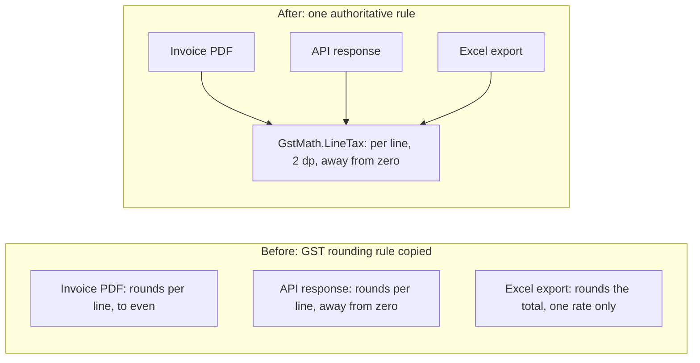
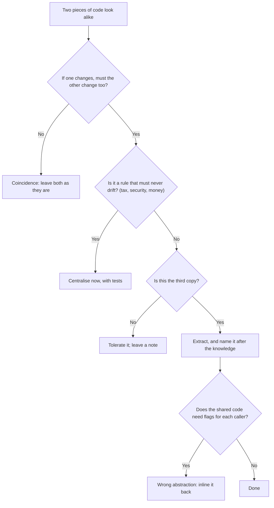
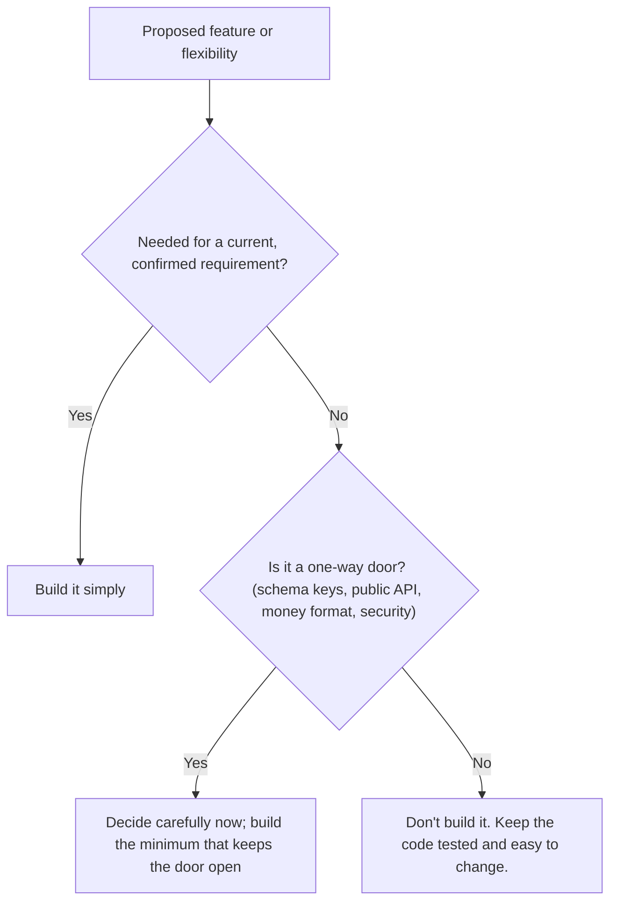

DRY, KISS and YAGNI are three short rules that every code reviewer quotes. They are also the three rules most often quoted *wrongly*. "DRY" gets used to merge two pieces of code that happen to look alike. "KISS" gets used to reject any design with more than one class. "YAGNI" gets used to skip tests. This lesson explains what each rule really protects, shows each one on a realistic fee and invoicing portal for a coaching institute, and shows the point where following it starts to hurt.

## Learning objectives

By the end of this lesson you will be able to:

1. Explain DRY as "one place for each piece of knowledge", and tell knowledge duplication from code that only looks similar.
2. Use the rule of three to decide *when* to remove duplication.
3. Recognise accidental complexity and simplify it (KISS), without removing the complexity the problem really has.
4. Apply YAGNI using the four costs of building a feature too early.
5. Name what YAGNI does **not** cover: tests, refactoring, security basics, and decisions that are expensive to reverse.
6. Spot and undo "the wrong abstraction": shared code bent by flags until nobody understands it.

## Prerequisites

- [Classes, objects, fields, properties and methods](#/lesson/m01-classes-objects).
- [Single Responsibility Principle](#/lesson/m04-srp) helps, because DRY and SRP both ask "who owns this rule?".

## Explain it like I'm a beginner

**DRY — Don't Repeat Yourself.** A coaching institute writes the fee for its JEE course on the reception noticeboard, in accounts' Excel sheet and in the counsellor's notebook. The fee changes; accounts updates Excel; nobody updates the noticeboard; new students are quoted the old fee for two months. **One fact had three homes.** DRY says every fact gets one home that everyone else refers to.

**KISS — Keep It Simple (the original adds "Stupid").** A bicycle and a delivery van can both carry a parcel to the next street. For one parcel, the bicycle wins; the van pays off at 500 parcels a day. In code, the "van" is a configurable rules engine, a plugin system or five layers of interfaces.

**YAGNI — You Aren't Gonna Need It.** A family in Lucknow builds a two-bedroom house with a rooftop water tank sized for six floors, "in case we add floors later". They sell after ten years; the floors never came. YAGNI says: don't build for a future you're guessing at; build for today and keep the design easy to change.

The catch: some parts of a house, like its **foundations**, can't be changed later without demolishing it. So some decisions *do* deserve thought up front. We'll come back to that.

## First-principles explanation

### DRY: one home per piece of knowledge

The original definition from *The Pragmatic Programmer* is: **"Every piece of knowledge must have a single, unambiguous, authoritative representation within a system."** Notice the word *knowledge*, not *code*.

- **Knowledge duplication** — the same business rule, fact or decision appears in two places. "GST is rounded per line, half away from zero" in the PDF generator and in the CSV export. If the rule changes, both must change. If they drift, users see two totals for one invoice. This is what DRY forbids.
- **Coincidental similarity** — two pieces of code look the same but represent different knowledge. "Maximum 10 items per page" and "minimum batch size of 10 students" are both `10`. They will change for different reasons, at different times, by different people. Merging them into one `const int Ten = 10` creates coupling between unrelated decisions.

The test is simple: **"If one of these changes, must the other change too?"** If yes, it's duplicated knowledge — merge it. If no, it's coincidence — leave it alone.

DRY also applies beyond code: a database `CHECK (quantity > 0)` and a C# validator saying the same are one piece of knowledge. Keeping both for defence in depth is fine, as long as a test links them.

### When to remove duplication: the rule of three

Extracting too early means guessing an abstraction's shape from one or two examples. The **rule of three** (credited to Don Roberts in Fowler's *Refactoring*): write it once, tolerate a second copy, refactor on the third, when you can see what actually varies. The exception is knowledge that must never drift, such as a tax rule or a security check: centralise it immediately.

### KISS: remove accidental complexity, keep essential complexity

Fred Brooks separated two kinds of complexity:

- **Essential complexity** comes from the problem: GST has CGST, SGST and IGST, inter-state supplies are taxed differently, and printed books are exempt while coaching fees carry 18 %. Code must express that.
- **Accidental complexity** is what *we* add: a rules engine for three rules, a factory for a class created in one place, reflection where a `switch` would do.

KISS targets only the accidental kind. Kent Beck's design rules define "simple" in priority order: **passes the tests**, **reveals intention**, **no duplication**, **fewest elements**. "Fewest elements" comes last, so a slightly longer method that reads clearly beats a one-line LINQ puzzle.

### YAGNI: the four costs of building too early

YAGNI comes from Extreme Programming. Martin Fowler lists four costs of a "presumptive feature" (one you think you'll need):

1. **Cost of build** — the hours spent, which everyone sees.
2. **Cost of delay** — useful features that shipped later because of it.
3. **Cost of carry** — every future change must work around it.
4. **Cost of repair** — when the need arrives, it's usually different from the guess, so you rework it anyway.

If the feature is never needed, you paid costs 1–3 for nothing. If it is, you often pay cost 4. Waiting is usually cheaper — **as long as the code stays easy to change**.

### What YAGNI does not cover

YAGNI is about **features and capabilities**, not about practices that make code easy to change. It is *not* an excuse to skip:

- **Tests and refactoring** — they make "add it later" cheap.
- **Security basics** — parameterised SQL, password hashing, authorisation checks.
- **Observability** — logs and metrics you'll need on the first bad day.
- **Hard-to-reverse decisions** — public API shape and versioning, primary key types, tenant columns, how money is stored (`numeric(18,2)`, never `float`). These are the foundations: changing them later is a migration, not a refactor.

The "one-way door vs two-way door" framing helps: walk quickly through doors you can reopen, slow down for the ones you can't.

### How the three rules pull against each other

| Rule | Pushes you to… | Taken too far, becomes… |
|---|---|---|
| DRY | Extract shared code | "The wrong abstraction": one function with six boolean flags serving four callers |
| KISS | Fewer moving parts | Copy-paste everywhere, a 900-line method "because classes are complex" |
| YAGNI | Build only what's needed now | No tests, no seams, hard-coded values that block the obvious next step |

They balance each other. DRY says "extract"; KISS and YAGNI say "only if it makes things simpler today". Good judgement lives in that tension.

### The wrong abstraction

Sandi Metz put it memorably: **"duplication is far cheaper than the wrong abstraction."** Two similar pieces of code get extracted into a shared method. A new requirement is *almost* the same, so someone adds a parameter, then another. Eighteen months later, it has six flags, every caller passes a different combination, and nobody dares change it.

The fix is counter-intuitive: **inline it back** into each caller, delete the branches each caller doesn't use, and see what remains. Often what's left is two small, clear functions.

## Visual explanation

### One rule, three homes — and one home



On the left, three features each carry their own copy of "how to compute GST". They were written by different people in different months, and they now disagree by a paisa or two on some invoices. An auditor reconciling the PDF against the Excel export finds a ₹0.01 mismatch, and the finance team spends a day on it. On the right, all three ask one function. A change to the rounding rule is now one edit and one set of tests.

### Should I remove this duplication?



This is the decision you make in code review. The first question separates knowledge from coincidence. The second fast-tracks rules where drift is costly. The rule of three handles everything else. The final check catches extractions that have gone bad over time: if callers need flags to get their own behaviour, the shared code no longer represents one piece of knowledge.

### A YAGNI decision at a glance



The middle branch is the important one. YAGNI doesn't mean "never think ahead". It means "think ahead about decisions that are expensive to reverse, and don't pre-build the rest".

## Step-by-step example

The system: the fee portal of a coaching institute with branches in Pune, Nagpur and Nashik. It invoices students, and companies that sponsor their employees' courses, for coaching fees, mock-test series and printed study material. Invoices are shown as PDFs, served through an API to the accounting system, and exported to Excel for auditors.

### Step 1 — find the duplicated knowledge

A parent reports that invoice INV-2026-0311 shows ₹295.27 on the PDF but ₹295.28 in the API. Searching for `GstRatePercent` finds three calculations:

| Place | Rounding | Handles mixed rates? |
|---|---|---|
| PDF view model | per line, `Math.Round` default (to even) | yes |
| API mapper | per line, away from zero | yes |
| CSV export | on the total | no — uses the first line's rate |

Three homes for one rule, and three different rules. Finance confirms the correct one: **per line, 2 decimals, half away from zero**.

### Step 2 — give the knowledge one home

Create `GstMath` with `LineTax` and `Totals`. Name it after the knowledge ("how GST is computed"), not after a caller ("PdfHelper").

### Step 3 — point every caller at it, and pin it with tests

Replace each inline calculation with a call to `GstMath`. Test the edge cases that caused the bug: ₹0.25 at 18 % (tax ₹0.045, which rounds differently under the two modes) and mixed 5 %/18 % invoices.

### Step 4 — leave coincidences alone

The CSV exporter's `MaxRowsPerSheet = 10000` and the API's `MaxPageSize = 10000` are the same number but different knowledge. They stay separate.

### Step 5 — simplify the penalty "engine" (KISS)

The late fee on overdue instalments is a configurable rules engine that parses string expressions at runtime, for one rule changed once in three years. Six classes become one 10-line method with tests.

### Step 6 — say no to the speculative feature (YAGNI)

A ticket asks for multi-currency "because we might enrol students from Dubai". No such student, no date, an estimated 3 weeks to build, and a cost of carry on every money change. Decision: don't build. The one-way door — how money is *stored* — is already safe: `numeric(18,2)` in INR, so a `currency char(3) default 'INR'` column can be added later as a cheap migration.

## Production-style C# implementation

```text
Academy.Api/
  Program.cs
  Tax/GstMath.cs
  Contacts/IndianMobileNumber.cs
  Invoices/InvoiceViews.cs
  Fees/LateFee.cs
```

```csharp file=Tax/GstMath.cs
namespace Academy.Tax;

public sealed record InvoiceLine(string Item, decimal TaxableValue, decimal GstRatePercent);

public sealed record GstTotals(decimal Taxable, decimal Cgst, decimal Sgst, decimal Igst)
{
    public decimal Tax => Cgst + Sgst + Igst;
    public decimal Total => Taxable + Tax;
}

/// <summary>The single authoritative home of "how GST is computed on our invoices".
/// Agreed with finance: tax is rounded per line, to 2 decimals, half away from zero.</summary>
public static class GstMath
{
    public static decimal LineTax(InvoiceLine line)
    {
        if (line.TaxableValue < 0) throw new ArgumentOutOfRangeException(nameof(line), "Taxable value cannot be negative.");
        return Math.Round(line.TaxableValue * line.GstRatePercent / 100m, 2, MidpointRounding.AwayFromZero);
    }

    public static GstTotals Totals(IEnumerable<InvoiceLine> lines, bool interState)
    {
        decimal taxable = 0, tax = 0;
        foreach (var line in lines)
        {
            taxable += line.TaxableValue;
            tax += LineTax(line);
        }
        if (interState) return new GstTotals(taxable, 0, 0, tax);

        var cgst = Math.Round(tax / 2, 2, MidpointRounding.AwayFromZero);
        return new GstTotals(taxable, cgst, tax - cgst, 0);
    }
}
```

```csharp file=Contacts/IndianMobileNumber.cs
using System.Diagnostics.CodeAnalysis;

namespace Academy.Contacts;

/// <summary>One home for "what a valid Indian mobile number is". Student registration, parent contacts
/// and SMS alerts all use this type, so the rule can't drift between them.</summary>
public readonly record struct IndianMobileNumber
{
    public string Digits { get; }
    private IndianMobileNumber(string digits) => Digits = digits;

    public static bool TryParse(string? input, [NotNullWhen(true)] out IndianMobileNumber? number)
    {
        number = null;
        if (string.IsNullOrWhiteSpace(input)) return false;

        var digits = new string(input.Where(char.IsDigit).ToArray());
        if (digits.Length == 12 && digits.StartsWith("91")) digits = digits[2..];
        else if (digits.Length == 11 && digits.StartsWith('0')) digits = digits[1..];

        if (digits.Length != 10 || digits[0] < '6') return false;
        number = new IndianMobileNumber(digits);
        return true;
    }

    public string ToE164() => "+91" + Digits;
    public override string ToString() => $"{Digits[..5]} {Digits[5..]}";
}
```

```csharp file=Invoices/InvoiceViews.cs
using System.Globalization;
using Academy.Tax;

namespace Academy.Invoices;

/// <summary>Students rarely have a GSTIN, so inter-state is decided by the place of supply (the buyer's state code),
/// not by comparing two GSTINs.</summary>
public sealed record Invoice(string InvoiceNo, string SupplierGstin, string PlaceOfSupplyStateCode, IReadOnlyList<InvoiceLine> Lines)
{
    public bool IsInterState => SupplierGstin[..2] != PlaceOfSupplyStateCode;
    public GstTotals Totals() => GstMath.Totals(Lines, IsInterState);
}

// Three different *presentations*. They are allowed to differ, because they change for different reasons
// (PDF layout, API contract, auditors' Excel format). The *calculation* they share lives in GstMath.

public sealed record PdfInvoiceModel(string InvoiceNo, IReadOnlyList<(string Item, decimal Taxable, decimal Tax)> Rows, GstTotals Totals)
{
    public static PdfInvoiceModel From(Invoice invoice) =>
        new(invoice.InvoiceNo,
            invoice.Lines.Select(l => (l.Item, l.TaxableValue, GstMath.LineTax(l))).ToList(),
            invoice.Totals());
}

public sealed record InvoiceApiResponse(string InvoiceNo, decimal Taxable, decimal Cgst, decimal Sgst, decimal Igst, decimal Total)
{
    public static InvoiceApiResponse From(Invoice invoice)
    {
        var t = invoice.Totals();
        return new(invoice.InvoiceNo, t.Taxable, t.Cgst, t.Sgst, t.Igst, t.Total);
    }
}

public static class InvoiceCsv
{
    public const int MaxRowsPerSheet = 10_000; // an Excel usability choice — not the same knowledge as any API limit

    public static string Header => "invoice_no,taxable,tax,total";

    public static string Row(Invoice invoice)
    {
        var t = invoice.Totals();
        return string.Create(CultureInfo.InvariantCulture, $"{invoice.InvoiceNo},{t.Taxable:0.00},{t.Tax:0.00},{t.Total:0.00}");
    }
}
```

```csharp file=Fees/LateFee.cs
namespace Academy.Fees;

/// <summary>KISS: the whole rule, readable in one screen. It replaced a six-class "configurable rules engine"
/// that parsed string expressions at runtime to evaluate this one rule.</summary>
public static class LateFee
{
    public const int GraceDays = 2;
    public const decimal PercentPerDay = 0.5m;
    public const decimal MaxPercent = 10m;

    public static decimal Calculate(decimal instalmentAmount, int daysLate)
    {
        ArgumentOutOfRangeException.ThrowIfNegative(instalmentAmount);
        ArgumentOutOfRangeException.ThrowIfNegative(daysLate);

        var chargeableDays = Math.Max(0, daysLate - GraceDays);
        var percent = Math.Min(chargeableDays * PercentPerDay, MaxPercent);
        return Math.Round(instalmentAmount * percent / 100m, 2, MidpointRounding.AwayFromZero);
    }
}
```

```csharp file=Program.cs
using Academy.Contacts;
using Academy.Fees;
using Academy.Invoices;
using Academy.Tax;

var builder = WebApplication.CreateBuilder(args);
var app = builder.Build();

app.MapPost("/invoices/preview", (Invoice invoice) => Results.Ok(InvoiceApiResponse.From(invoice)));

app.MapPost("/invoices/export", (Invoice[] invoices) =>
    Results.Text(string.Join('\n', invoices.Take(InvoiceCsv.MaxRowsPerSheet).Select(InvoiceCsv.Row).Prepend(InvoiceCsv.Header)), "text/csv"));

app.MapGet("/fees/late-fee", (decimal instalmentAmount, int daysLate) =>
    instalmentAmount < 0 || daysLate < 0
        ? Results.BadRequest("Amount and days late cannot be negative.")
        : Results.Ok(new { instalmentAmount, daysLate, lateFee = LateFee.Calculate(instalmentAmount, daysLate) }));

app.MapPost("/students/validate-mobile", (string mobile) =>
    IndianMobileNumber.TryParse(mobile, out var number)
        ? Results.Ok(new { normalised = number.Value.ToE164() })
        : Results.ValidationProblem(new Dictionary<string, string[]> { ["mobile"] = ["Enter a 10-digit Indian mobile number."] }));

app.Run();
```

What to notice:

- **DRY on knowledge, not on presentation.** The PDF, API and CSV types look a bit alike, but they are three *contracts* with different owners. Only the calculation is shared.
- **A value object is DRY for validation.** `IndianMobileNumber` makes "valid mobile" impossible to re-implement slightly differently in another form, because every API takes the type, not a `string`.
- **KISS in the late fee.** Three constants and four lines. If the rule ever needs to vary per branch or per course, *then* turn it into data or a strategy ([Strategy](#/lesson/m06-strategy)).
- **No speculative flexibility.** No currency field, no plugin loader, no interface for `GstMath` (it's pure; see [DIP](#/lesson/m04-dip) for when to invert).

## Bad design vs good design

### DRY violated — knowledge copied

```csharp
// PdfInvoiceBuilder.cs
var tax = lines.Sum(l => Math.Round(l.TaxableValue * l.GstRatePercent / 100m, 2));          // to-even
// InvoiceApiMapper.cs
var tax = lines.Sum(l => Math.Round(l.TaxableValue * l.GstRatePercent / 100, 2, MidpointRounding.AwayFromZero));
// AuditExport.cs
var tax = Math.Round(lines.Sum(l => l.TaxableValue) * lines[0].GstRatePercent / 100m, 2);   // one rate only!
```

Three people, three months, three rules, each passing its own tests. Together: ₹0.01 mismatches, and wrong tax on mixed-rate invoices in the export.

### DRY overdone — the wrong abstraction

```csharp
public static string BuildMessage(Student s, decimal amount, bool isSms, bool includeGstin, bool html,
                                  bool shortForm, bool hindi, bool includePortalLink)
{
    var s = html ? "<p>" : "";
    if (!shortForm) s += hindi ? "नमस्ते " : "Dear ";
    // ... 80 more lines of ifs; every caller passes a different combination
}
```

It started as one shared "payment received" message. Each channel added a flag: 2⁶ = 64 combinations, 5 used, most untested, and an SMS fix can break email. Inlining it back produces two 6-line functions (exercise 5).

### KISS violated — accidental complexity

```csharp
public interface IPenaltyRule { decimal Evaluate(PenaltyContext ctx); }
public sealed class ExpressionPenaltyRule(IExpressionParser parser, IRuleRepository rules) : IPenaltyRule { /* ... */ }
public sealed class PenaltyRuleEngine(IEnumerable<IPenaltyRule> rules, IPenaltyAggregator aggregator) { /* ... */ }
// rules table: "max(0, days - 2) * 0.005 * value" stored as a string, parsed at runtime
```

Six types, a parser and a table for one formula that changed once in three years. Parser bugs become production incidents, and the rule can't be found by searching the code. Compare `LateFee` above.

### YAGNI violated — presumptive features

A fee portal for 40 staff users built with multi-tenancy, multi-currency, export plugins and GraphQL "for flexibility". Six months on: one tenant, one currency, one format, one client using three REST endpoints — and every change still touches tenant filters and currency conversion.

### When applying these rules blindly is harmful

:::callout type=mistake title="DRY across service boundaries"
Two microservices share a `Common.Models` NuGet package "to avoid duplicating DTOs". Now every change to one service's contract forces a coordinated release of both. Services *should* own their own contracts, even if that means near-identical classes in each. Duplicating a DTO is cheap; coupling deployments is expensive.
:::

- **DRY in tests.** Tests should read as stories: arrange, act, assert, with the important values visible. Extracting every setup line into shared helpers makes failures hard to understand. Many teams prefer "DAMP" tests (Descriptive And Meaningful Phrases) with some repetition.
- **KISS as an excuse.** "Simple" doesn't mean "fewest classes". A 900-line controller action is not simple; it's just not split up.
- **YAGNI as an excuse.** Skipping tests, input validation, or a sensible primary key because "we don't need it yet" makes the future change *more* expensive, which is the opposite of what YAGNI assumes.

:::callout type=tradeoff title="These rules are heuristics, not laws"
Each rule is a default that saves you from a common mistake. When two of them disagree, ask the underlying question: **"Which option makes the next likely change cheapest and safest?"** That question resolves most arguments.
:::

## Practical playground

Student registration and the SMS module both validate mobile numbers — differently. One accepts `+91`, the other doesn't. Run the program and see the disagreement. Then move the knowledge into one `IndianMobileNumber.TryParse` and make both modules call it. Both lines should then print `True`.

:::playground type=csharp title="One home for mobile-number validation"
```csharp file=Program.cs
using System;
using System.Linq;

public static class StudentRegistration
{
    public static bool IsValidMobile(string input) =>
        input.Length == 10 && input.All(char.IsDigit) && input[0] >= '6';
}

public static class SmsAlerts
{
    public static bool IsValidMobile(string input)
    {
        var digits = new string(input.Where(char.IsDigit).ToArray());
        if (digits.StartsWith("91") && digits.Length == 12) digits = digits[2..];
        return digits.Length == 10 && digits[0] >= '6';
    }
}

// TODO: create IndianMobileNumber.TryParse and make both classes use it.

public static class Program
{
    public static void Main()
    {
        const string input = "+91 98100 12345";
        Console.WriteLine($"Student registration accepts it: {StudentRegistration.IsValidMobile(input)}");
        Console.WriteLine($"SMS alerts accept it:            {SmsAlerts.IsValidMobile(input)}");
    }
}
```
:::

## Exercises

:::exercise id=m04-dry-kiss-yagni-ex1 difficulty=beginner kind=code title="One home for the GST rule"
The PDF model and the CSV export each compute GST their own way, and they disagree. Finance has confirmed the rule: **tax is rounded per line, to 2 decimals, half away from zero**. Implement `GstMath` and make both callers use it.
::requirements
- `GstMath.LineTax(line)` applies the rule to one line.
- `GstMath.TotalTax(lines)` sums `LineTax` over all lines.
- `PdfInvoiceModel.From` and `CsvInvoiceRow.From` must both use `GstMath` and contain no tax arithmetic of their own.
- CSV numbers use `.` as the decimal separator and 2 decimals.
::acceptance
- Lines ₹99.99, ₹149.99 and ₹0.25, all at 18 %: tax ₹45.05, total ₹295.28 in both outputs.
- A mixed invoice (printed question bank at 0 % — printed books are GST-exempt — plus a crash course at 18 %) gives the same tax in both outputs.
- The CSV row for the first case is `INV-1,250.23,45.05,295.28`.
::hint
Run the tests first and compare the two wrong answers. Why are they different from each other?
::hint
One caller uses banker's rounding (the default), the other rounds the total and assumes one rate.
::hint
`Math.Round(value, 2, MidpointRounding.AwayFromZero)` per line, then sum.
::hint
In the CSV, use `string.Create(CultureInfo.InvariantCulture, $"...{tax:0.00}...")` so a server with a different culture doesn't print commas.
::starter
```csharp file=GstMath.cs
using System;
using System.Collections.Generic;
using System.Globalization;
using System.Linq;

public sealed record InvoiceLine(string Item, decimal TaxableValue, decimal GstRatePercent);

public static class GstMath
{
    /// <summary>Rule agreed with finance: per line, 2 decimals, half away from zero.</summary>
    public static decimal LineTax(InvoiceLine line) => throw new NotImplementedException();
    public static decimal TotalTax(IEnumerable<InvoiceLine> lines) => throw new NotImplementedException();
}

public sealed record PdfInvoiceModel(decimal Taxable, decimal Tax, decimal Total)
{
    public static PdfInvoiceModel From(IReadOnlyList<InvoiceLine> lines)
    {
        var taxable = lines.Sum(l => l.TaxableValue);
        var tax = lines.Sum(l => Math.Round(l.TaxableValue * l.GstRatePercent / 100m, 2));
        return new PdfInvoiceModel(taxable, tax, taxable + tax);
    }
}

public sealed record CsvInvoiceRow(string Line)
{
    public static CsvInvoiceRow From(string invoiceNo, IReadOnlyList<InvoiceLine> lines)
    {
        var taxable = lines.Sum(l => l.TaxableValue);
        var tax = Math.Round(taxable * lines[0].GstRatePercent / 100m, 2);
        return new CsvInvoiceRow(string.Create(CultureInfo.InvariantCulture, $"{invoiceNo},{taxable:0.00},{tax:0.00},{taxable + tax:0.00}"));
    }
}
```
::tests
```csharp file=GstMathTests.cs
using Xunit;

public class GstMathTests
{
    private static readonly InvoiceLine[] Tricky =
    {
        new InvoiceLine("Doubt-clearing session", 99.99m, 18m),
        new InvoiceLine("Mock-test series", 149.99m, 18m),
        new InvoiceLine("Payment gateway fee", 0.25m, 18m),
    };

    private static readonly InvoiceLine[] Mixed =
    {
        new InvoiceLine("Printed question bank", 1_000.10m, 0m),
        new InvoiceLine("Crash course", 2_345.55m, 18m),
    };

    [Fact] public void Line_tax_rounds_half_away_from_zero() => Assert.Equal(0.05m, GstMath.LineTax(Tricky[2]));

    [Fact] public void Pdf_uses_the_rule() => Assert.Equal(45.05m, PdfInvoiceModel.From(Tricky).Tax);

    [Fact] public void Pdf_total() => Assert.Equal(295.28m, PdfInvoiceModel.From(Tricky).Total);

    [Fact] public void Csv_uses_the_rule() => Assert.Equal("INV-1,250.23,45.05,295.28", CsvInvoiceRow.From("INV-1", Tricky).Line);

    [Fact]
    public void Mixed_rates_agree_between_outputs()
    {
        var pdf = PdfInvoiceModel.From(Mixed);
        Assert.Equal(GstMath.TotalTax(Mixed), pdf.Tax);
        Assert.Contains(string.Create(System.Globalization.CultureInfo.InvariantCulture, $",{pdf.Tax:0.00},"), CsvInvoiceRow.From("INV-2", Mixed).Line);
    }
}
```
::solution
```csharp file=GstMath.cs
using System;
using System.Collections.Generic;
using System.Globalization;
using System.Linq;

public sealed record InvoiceLine(string Item, decimal TaxableValue, decimal GstRatePercent);

public static class GstMath
{
    /// <summary>Rule agreed with finance: per line, 2 decimals, half away from zero.</summary>
    public static decimal LineTax(InvoiceLine line) =>
        Math.Round(line.TaxableValue * line.GstRatePercent / 100m, 2, MidpointRounding.AwayFromZero);

    public static decimal TotalTax(IEnumerable<InvoiceLine> lines) => lines.Sum(LineTax);
}

public sealed record PdfInvoiceModel(decimal Taxable, decimal Tax, decimal Total)
{
    public static PdfInvoiceModel From(IReadOnlyList<InvoiceLine> lines)
    {
        var taxable = lines.Sum(l => l.TaxableValue);
        var tax = GstMath.TotalTax(lines);
        return new PdfInvoiceModel(taxable, tax, taxable + tax);
    }
}

public sealed record CsvInvoiceRow(string Line)
{
    public static CsvInvoiceRow From(string invoiceNo, IReadOnlyList<InvoiceLine> lines)
    {
        var taxable = lines.Sum(l => l.TaxableValue);
        var tax = GstMath.TotalTax(lines);
        return new CsvInvoiceRow(string.Create(CultureInfo.InvariantCulture, $"{invoiceNo},{taxable:0.00},{tax:0.00},{taxable + tax:0.00}"));
    }
}
```

The two output types stay separate presentations; only the rule moved. The CSV's second bug (using the first line's rate for everything) disappeared as a side effect: on the mixed invoice it charged 0 % on the whole amount because the exempt book came first.
::mistakes
- Merging `PdfInvoiceModel` and `CsvInvoiceRow` into one class. They change for different reasons.
- Leaving default `Math.Round`, which is banker's rounding: ₹0.045 becomes ₹0.04.
- Formatting with the current culture, which prints `45,05` on some servers.
:::

:::exercise id=m04-dry-kiss-yagni-ex2 difficulty=beginner kind=written title="Knowledge or coincidence?"
For each pair, say whether it's duplicated **knowledge** (merge it) or **coincidence** (leave it), and give a one-line reason.

1. `if (gstin.Length != 15)` in corporate-client onboarding and in invoice import.
2. `MaxStudentsPerBatch = 20` and `MaxLineItemsPerInvoice = 20`.
3. The SQL `CHECK (quantity > 0)` on `invoice_lines` and the C# validator `RuleFor(x => x.Quantity).GreaterThan(0)`.
4. Two test methods that each build an invoice with three lines.
5. A `StudentDto` in the Enrolment service and an almost identical `StudentDto` in the Invoicing service.
6. The 18 % GST rate on coaching fees and the 18 % yearly interest on the institute's fee-EMI plan.
::acceptance
- Each item classified with a reason based on "would they change together?".
- At least one item where you keep both copies on purpose, and say what links them.
::hint
Ask: if the government changed the GSTIN format tomorrow, which places must change?
::hint
Some duplication is deliberate: defence in depth, or independent service contracts.
::hint
Test code has different goals from production code. Readability can beat DRY there.
::solution
1. **Knowledge.** The GSTIN format is one fact. Use a `Gstin` value object everywhere.
2. **Coincidence.** A classroom limit and an invoicing limit; they'll change for different reasons.
3. **Same knowledge, kept twice on purpose.** The database constraint protects data from any writer; the validator gives friendly messages. Keep both, and add an integration test that inserts `quantity = 0` and expects a constraint violation, so the link is visible.
4. **Coincidence, mostly.** Tests should be readable on their own. A small builder (`AnInvoice().WithLines(3)`) is fine if it keeps the important values visible.
5. **Coincidence (by design).** Each service owns its contract. Sharing one DTO package would couple their releases.
6. **Coincidence.** A finance product's interest rate and a tax rate are unrelated, even though both are 18 today.
::mistakes
- Treating every repeated literal as a DRY violation.
- Sharing DTOs between services to "stay DRY".
:::

:::exercise id=m04-dry-kiss-yagni-ex3 difficulty=intermediate kind=code title="Replace the penalty engine with a simple method"
A previous developer built a "configurable late-fee rules engine": six classes, a string-expression parser and a database table. There is one rule, and it hasn't changed in three years:

> A fee instalment gets **2 grace days** after its due date. After that, the late fee is **0.5 % of the instalment per day**, capped at **10 %** of the instalment. Round to 2 decimals, half away from zero. Negative inputs are invalid.

Implement `LateFee.Calculate` as plain C#.
::acceptance
- ₹2,00,000 instalment (a year's JEE coaching fee paid at once), 2 days late → ₹0.
- 3 days late → ₹1,000.
- 12 days late → ₹10,000.
- 40 days late → capped at ₹20,000.
- Negative `daysLate` or `instalmentAmount` throws `ArgumentOutOfRangeException`.
::hint
Write the rule as three steps in English first: chargeable days, percent, amount.
::hint
`Math.Max(0, daysLate - GraceDays)` gives chargeable days.
::hint
`Math.Min(chargeableDays * 0.5m, 10m)` gives the capped percent.
::hint
`ArgumentOutOfRangeException.ThrowIfNegative(daysLate);` (.NET 8+) is a one-line guard.
::starter
```csharp file=LateFee.cs
using System;

public static class LateFee
{
    public const int GraceDays = 2;
    public const decimal PercentPerDay = 0.5m;
    public const decimal MaxPercent = 10m;

    public static decimal Calculate(decimal instalmentAmount, int daysLate) => throw new NotImplementedException();
}
```
::tests
```csharp file=LateFeeTests.cs
using System;
using Xunit;

public class LateFeeTests
{
    [Theory]
    [InlineData(0, 0)]
    [InlineData(2, 0)]
    [InlineData(3, 1000)]
    [InlineData(12, 10000)]
    [InlineData(22, 20000)]
    [InlineData(40, 20000)]
    public void Calculates_late_fee_on_two_lakh_instalment(int daysLate, int expected) =>
        Assert.Equal((decimal)expected, LateFee.Calculate(200_000m, daysLate));

    [Fact]
    public void Rounds_half_away_from_zero() => Assert.Equal(0.01m, LateFee.Calculate(1m, 3));

    [Fact]
    public void Negative_days_are_invalid() =>
        Assert.Throws<ArgumentOutOfRangeException>(() => LateFee.Calculate(1000m, -1));

    [Fact]
    public void Negative_amount_is_invalid() =>
        Assert.Throws<ArgumentOutOfRangeException>(() => LateFee.Calculate(-1m, 5));
}
```
::solution
```csharp file=LateFee.cs
using System;

public static class LateFee
{
    public const int GraceDays = 2;
    public const decimal PercentPerDay = 0.5m;
    public const decimal MaxPercent = 10m;

    public static decimal Calculate(decimal instalmentAmount, int daysLate)
    {
        ArgumentOutOfRangeException.ThrowIfNegative(instalmentAmount);
        ArgumentOutOfRangeException.ThrowIfNegative(daysLate);

        var chargeableDays = Math.Max(0, daysLate - GraceDays);
        var percent = Math.Min(chargeableDays * PercentPerDay, MaxPercent);
        return Math.Round(instalmentAmount * percent / 100m, 2, MidpointRounding.AwayFromZero);
    }
}
```

Nine lines replace six classes, a parser and a table. If branches ever need different late-fee rules, turn the three constants into a `LateFeeTerms` record loaded per branch — a small, safe step from here. Keep the arithmetic in `decimal` and the dates out of it: the caller computes `daysLate` from the due date in the institute's time zone (IST), so a payment at 11:30 pm is not a day late on a UTC server.
::mistakes
- Using `double` for money, so sums such as 0.1 + 0.2 give 0.30000000000000004 and late fees drift by a paisa once they are added up across thousands of instalments.
- Applying the grace days after the cap, or capping chargeable days instead of percent.
- "Keeping the engine just in case": you pay its cost of carry on every change.
:::

:::exercise id=m04-dry-kiss-yagni-ex4 difficulty=intermediate kind=written title="A YAGNI review"
The roadmap for the fee portal (40 staff users, one institute, three branches, INR only) has these proposals for next sprint. For each, decide **build now**, **defer**, or **decide now but build minimally**, using the four costs (build, delay, carry, repair) and the one-way-door test.

1. Multi-currency pricing "in case we enrol students from the Gulf".
2. Audit log of who approved each fee waiver (the auditors asked for it last month).
3. A plugin system for export formats (currently only Excel).
4. Primary keys: switch new tables from `int` to `bigint` or UUID before launch.
5. Role-based authorisation (counsellor, branch manager, accounts).
6. A GraphQL API alongside REST "for flexibility".
::acceptance
- Each item has a decision and a reason that names at least one of the four costs.
- At least one item is recognised as a one-way door.
- Security and audit items aren't dismissed as YAGNI.
::hint
Which items have a confirmed, current need?
::hint
Which ones would be expensive to change after there's production data and external callers?
::hint
For the deferred items, what small thing today keeps the door open cheaply?
::solution
1. **Defer.** No overseas student, no date, high cost of carry. Amounts in `numeric(18,2)` INR keep the door open.
2. **Build now.** A confirmed audit requirement, and missing history can't be recreated later.
3. **Defer.** One format; extract an interface when the second arrives.
4. **Decide now (one-way door).** Changing key types after go-live migrates every foreign key. `bigint` identity is a safe PostgreSQL default; UUIDs if the mobile app creates records offline — preferably time-ordered UUIDv7 generated in the app (`Guid.CreateVersion7()` in .NET 9+), because random v4 keys (`gen_random_uuid()`) scatter inserts across the B-tree index.
5. **Build now.** Three real roles exist today; security basics aren't speculative.
6. **Defer.** A second API style doubles the surface to secure, test and version.
::mistakes
- Labelling the audit log YAGNI because "nobody uses it yet".
- Deferring key types because "we can change it later".
:::

:::exercise id=m04-dry-kiss-yagni-ex5 difficulty=advanced kind=code title="Undo the wrong abstraction"
`NotificationBuilder.Build` started as shared code for SMS and email "payment received" messages. It now has five boolean flags. Inline it back into two small, separate functions and delete the builder.

**SMS** (`PaymentReceivedSms.Create`): plain text, at most 160 characters:
`Payment of Rs 125000.00 received against INST-07. - BrightPath Academy`
If the reference is longer than 20 characters, use its first 20.

**Email** (`PaymentReceivedEmail.Subject` / `Body`):
- Subject: `Payment received: INST-07`
- Body: `<p>Dear Shah &amp; Sons,</p><p>We have received your payment of Rs 125000.00 against INST-07.</p>` — the customer name and reference are HTML-encoded.
::acceptance
- Exact SMS and email texts as above for the sample input.
- SMS for a 60-character reference is ≤ 160 characters and contains only the first 20 reference characters.
- Customer names with `&` or `<` are encoded in the email body.
- `NotificationBuilder` no longer exists in the solution.
::hint
Look at which flags the SMS caller passes and which the email caller passes. Do they share anything except the amount format?
::hint
Inline: copy the builder's body into each new function, replace each flag with the constant that caller always passes, and delete the dead branches.
::hint
`System.Net.WebUtility.HtmlEncode` encodes `&` as `&amp;`.
::hint
Format the amount with `amount.ToString("0.00", CultureInfo.InvariantCulture)` in both. That one-line shared fact can stay duplicated, or live in a tiny `Rupees.Format` helper. Two copies of a one-liner are fine.
::starter
```csharp file=Notifications.cs
using System;
using System.Globalization;
using System.Net;

public static class NotificationBuilder
{
    // Shared by SMS and email. Every caller passes a different combination of flags.
    public static string Build(string customer, decimal amount, string reference,
                               bool isSms, bool html, bool greeting, bool truncateRef, bool signature)
    {
        var r = truncateRef && reference.Length > 20 ? reference[..20] : reference;
        var amt = amount.ToString("0.00", CultureInfo.InvariantCulture);
        var s = "";
        if (greeting) s += html ? $"<p>Dear {WebUtility.HtmlEncode(customer)},</p>" : $"Dear {customer}, ";
        if (html) s += "<p>";
        s += isSms ? $"Payment of Rs {amt} received against {r}." : $"We have received your payment of Rs {amt} against {(html ? WebUtility.HtmlEncode(r) : r)}.";
        if (html) s += "</p>";
        if (signature && isSms) s += " - BrightPath Academy";
        return s;
    }
}

public static class PaymentReceivedSms
{
    public static string Create(string customer, decimal amount, string reference) => throw new NotImplementedException();
}

public static class PaymentReceivedEmail
{
    public static string Subject(string reference) => throw new NotImplementedException();
    public static string Body(string customer, decimal amount, string reference) => throw new NotImplementedException();
}
```
::tests
```csharp file=NotificationTests.cs
using System;
using Xunit;

public class NotificationTests
{
    [Fact]
    public void Sms_text() =>
        Assert.Equal("Payment of Rs 125000.00 received against INST-07. - BrightPath Academy",
            PaymentReceivedSms.Create("Shah & Sons", 125_000m, "INST-07"));

    [Fact]
    public void Sms_truncates_long_reference_and_fits_160()
    {
        var reference = new string('X', 60);
        var sms = PaymentReceivedSms.Create("Shah & Sons", 125_000m, reference);
        Assert.True(sms.Length <= 160);
        Assert.Contains(new string('X', 20) + ".", sms);
        Assert.DoesNotContain(new string('X', 21), sms);
    }

    [Fact]
    public void Email_subject() => Assert.Equal("Payment received: INST-07", PaymentReceivedEmail.Subject("INST-07"));

    [Fact]
    public void Email_body_encodes_html() =>
        Assert.Equal("<p>Dear Shah &amp; Sons,</p><p>We have received your payment of Rs 125000.00 against INST-07.</p>",
            PaymentReceivedEmail.Body("Shah & Sons", 125_000m, "INST-07"));

    [Fact]
    public void Email_body_encodes_reference() =>
        Assert.Contains("against &lt;INST-08&gt;.", PaymentReceivedEmail.Body("A", 1m, "<INST-08>"));

    [Fact]
    public void Builder_is_gone() => Assert.Null(Type.GetType("NotificationBuilder"));
}
```
::solution
Inline the builder into each caller, replace the flags with each caller's constants, and delete what's left.

```csharp file=Notifications.cs
using System;
using System.Globalization;
using System.Net;

public static class PaymentReceivedSms
{
    private const int MaxReferenceLength = 20;

    public static string Create(string customer, decimal amount, string reference)
    {
        var shortRef = reference.Length > MaxReferenceLength ? reference[..MaxReferenceLength] : reference;
        return $"Payment of Rs {amount.ToString("0.00", CultureInfo.InvariantCulture)} received against {shortRef}. - BrightPath Academy";
    }
}

public static class PaymentReceivedEmail
{
    public static string Subject(string reference) => $"Payment received: {reference}";

    public static string Body(string customer, decimal amount, string reference) =>
        $"<p>Dear {WebUtility.HtmlEncode(customer)},</p>" +
        $"<p>We have received your payment of Rs {amount.ToString("0.00", CultureInfo.InvariantCulture)} against {WebUtility.HtmlEncode(reference)}.</p>";
}
```

What disappeared: five flags, 32 combinations, and the coupling that made an SMS fix risky for email. What's duplicated: one amount-format expression, a fair price. If a third channel arrives, you'll have three examples to judge whether a real shared abstraction exists.
::alternatives
Keep a tiny shared `Rupees.Format(decimal)` helper if the amount format is a business rule (e.g. it must match the invoice). Share *knowledge*, not template structure.
::mistakes
- Refactoring the builder into a "cleaner" builder with an options object. The flags are still there, just renamed.
- Forgetting to encode the reference in HTML, which is an injection risk if references come from user input.
:::

## Automated testing

Each rule has a testing angle.

**DRY: pin the single source of truth.** Test the rule directly, with the edge cases that caused trouble. Then add one *agreement* test per presentation that checks it uses the rule:

```csharp
public class GstMathTests
{
    [Theory]   // InlineData can't hold decimals, so pass strings and parse
    [InlineData("0.25", "18", "0.05")]       // 0.045 rounds away from zero
    [InlineData("99.99", "18", "18.00")]
    [InlineData("12.25", "18", "2.21")]      // 2.205: banker's rounding would give 2.20
    public void Line_tax_rule(string taxable, string rate, string expected) =>
        Assert.Equal(decimal.Parse(expected, CultureInfo.InvariantCulture),
            GstMath.LineTax(new InvoiceLine("x", decimal.Parse(taxable, CultureInfo.InvariantCulture), decimal.Parse(rate, CultureInfo.InvariantCulture))));

    [Fact]
    public void Intra_state_splits_odd_paise_deterministically()
    {
        var t = GstMath.Totals(new[] { new InvoiceLine("x", 0.25m, 18m) }, interState: false);
        Assert.Equal(0.03m, t.Cgst);   // 0.05 / 2 = 0.025, away from zero
        Assert.Equal(0.02m, t.Sgst);   // remainder, so CGST + SGST always equals the tax
    }

    [Fact]
    public void Api_and_csv_agree_with_the_rule()
    {
        var invoice = new Invoice("INV-9", "27AAACB1234A1Z5", "27",
            new[] { new InvoiceLine("Crash course", 99.99m, 18m), new InvoiceLine("Gateway fee", 0.25m, 18m) });
        var api = InvoiceApiResponse.From(invoice);
        Assert.Equal(GstMath.Totals(invoice.Lines, false).Total, api.Total);
        Assert.EndsWith(api.Total.ToString(",0.00", CultureInfo.InvariantCulture), InvoiceCsv.Row(invoice));
    }
}
```

**KISS: let tests describe the rule.** The late-fee tests are a table of business examples (`[InlineData(3, 1000)]`). If the tests for a "simple" piece of code need ten mocks, the code isn't simple.

**YAGNI: tests are what make waiting safe.** The argument "we can add multi-currency later" is only true if a refactor can be done confidently. A fast unit suite plus a few integration tests are what make that true. That's why tests are never YAGNI.

**Value objects make invalid states untestable.** `IndianMobileNumber.TryParse` gets a `[Theory]` with `"9810012345"`, `"+91 98100 12345"`, `"098100 12345"` (valid) and `"5810012345"`, `"98100"`, `""` (invalid). Every module that takes the type inherits these tests for free.

## Real-world application

- **Tax and pricing rules** are the classic DRY case. Invoices, quotes, reports and exports must agree to the paisa, so the calculation lives in one module and every presentation calls it.
- **Validation as value objects**: GSTIN, PAN, IFSC codes, pincodes and mobile numbers are pieces of knowledge with one home each. Every API takes the type, not a raw string.
- **Configuration**: a connection string or a feature flag defined once in configuration and read through the options pattern, not copied into five `appsettings` files.
- **Microservices deliberately duplicate** DTOs and some reference data to keep services independently deployable. That's a conscious trade of DRY for autonomy.
- **Start-up MVPs** lean hard on YAGNI and KISS: one deployable, one database, no queues, until load or the team size says otherwise. See [Identifying overengineering and underengineering](#/lesson/m04-over-under-engineering).

## Interview questions

:::interview
::q beginner
What does DRY mean, and is it about code or about knowledge?
::a
"Every piece of knowledge must have a single, unambiguous, authoritative representation." It's about knowledge: business rules, facts and decisions. Two identical-looking blocks of code that represent different decisions (a page size and a minimum batch size both being 10) aren't a DRY violation. Two different-looking blocks that encode the same rule (GST rounding in the PDF and in the export) are.
::q beginner
Give an example of YAGNI.
::a
Building multi-currency support into a coaching institute's fee portal that only ever bills in INR, "in case we enrol overseas students later". It costs build time, delays useful features, and every future change to money logic must handle currencies nobody uses. YAGNI says build it when there's a real requirement, keeping the code tested and easy to change so adding it later is cheap.
::q intermediate
What is "the wrong abstraction", and how do you fix it?
::a
Shared code that has been bent to serve callers whose needs have diverged, typically through boolean flags or mode parameters. Each change risks breaking callers that use a different combination. Fix it by inlining the shared code back into each caller, removing branches each caller doesn't use, and then looking for the *real* common knowledge (often much smaller). Duplication is cheaper than an abstraction that doesn't fit.
::q intermediate
What does YAGNI *not* apply to?
::a
Practices that make change cheap: tests, refactoring, clean code. Security and compliance basics: input validation, authorisation, password hashing, audit trails when required. Observability. And hard-to-reverse decisions: primary key types, public API shape and versioning, how money and time zones are stored, tenant isolation. Those are "one-way doors" worth deciding carefully up front, even if you build the minimum.
::q advanced
Two microservices have nearly identical `StudentDto` classes. A teammate wants a shared NuGet package. What do you say?
::a
Usually no. Each DTO is its own service's *contract* and changes when that service's consumers need it to. A shared package couples their releases: a field added for Enrolment forces Invoicing to upgrade and redeploy. Share only genuinely organisation-wide, slow-changing knowledge (a versioned `Gstin` value-object library, or clients generated from the producer's OpenAPI spec), and let consumers upgrade on their own schedule.
::q advanced
How do you argue KISS against a senior engineer who wants a rules engine for discount and late-fee rules?
::a
Make the costs concrete: count the rules and their change rate (say, 3 rules changed twice in two years). Estimate the engine's carry cost: parser bugs, a second "language" to test, rules no longer searchable, security review if non-developers author expressions. Compare with plain code plus tests deployed in minutes. Agree a trigger to revisit ("non-developers must change rules weekly"), and offer a middle step: only the *numbers* live in configuration, the *logic* stays in code.
:::

## Summary and revision

**Key takeaways**

- **DRY** is about knowledge. Ask "if one changes, must the other?" Merge duplicated knowledge; leave coincidences alone.
- Use the **rule of three** for ordinary code; centralise must-not-drift rules (tax, money, security) immediately.
- **KISS** removes accidental complexity, not essential complexity. Simple = passes tests, reveals intent, no duplicated knowledge, fewest elements — in that order.
- **YAGNI** avoids presumptive features because of four costs: build, delay, carry and repair.
- YAGNI doesn't cover tests, refactoring, security, observability or **one-way-door** decisions.
- **Duplication is cheaper than the wrong abstraction.** Shared code with mode flags should be inlined back.
- The tie-breaker for all three: which option makes the next likely change cheapest and safest?

**Terminology**: knowledge duplication, coincidental duplication, rule of three, essential vs accidental complexity, presumptive feature, cost of carry, one-way door, wrong abstraction, DAMP tests.

:::flashcards
Q: What is DRY really about?
A: Knowledge — every business rule or fact should have one authoritative home. Not identical-looking code.
Q: How do you tell knowledge duplication from coincidence?
A: Ask: if one changes, must the other change too? Yes = knowledge (merge). No = coincidence (leave).
Q: What is the rule of three?
A: Write it once, tolerate a second copy, refactor on the third — unless the rule must never drift.
Q: Essential vs accidental complexity?
A: Essential comes from the problem (GST has CGST/SGST/IGST). Accidental is what we add (a rules engine for one rule). KISS targets only the accidental.
Q: Fowler's four costs of a presumptive feature?
A: Cost of build, cost of delay, cost of carry, cost of repair.
Q: Name three things YAGNI does not apply to.
A: Tests/refactoring, security basics, and one-way-door decisions such as key types or public API shape.
Q: What is "the wrong abstraction"?
A: Shared code bent by flags to serve diverging callers. Fix by inlining it back and re-extracting only real shared knowledge.
Q: Why might microservices deliberately duplicate DTOs?
A: Each service owns its contract; sharing a DTO package couples their releases.
:::

## Knowledge check

:::quiz pass=70
::q single
`MaxPageSize = 50` in the API and `MaxAttachmentsPerAssignment = 50` in homework submissions. A reviewer asks you to merge them into one constant. What's the best answer?
- [ ] Merge them — DRY forbids repeated values.
- [x] Keep them separate — they're different decisions that will change for different reasons.
- [ ] Move both into the database.
- [ ] Replace both with the literal 50.
> Same value, different knowledge. Merging couples unrelated decisions.
::q single
The PDF and the Excel export compute GST with different rounding, and a parent finds a ₹0.01 mismatch. What's the right fix?
- [ ] Round the Excel export the same way by copying the PDF code into it.
- [x] Move the rounding rule into one function that both call, and test its edge cases.
- [ ] Merge the PDF and Excel classes into one.
- [ ] Ask the parent to ignore paise.
> The rule is one piece of knowledge, so it needs one home. The presentations stay separate.
::q single
A shared `BuildMessage` method has six boolean parameters, and every caller passes a different combination. What's the usual fix?
- [ ] Add a seventh flag for the new channel.
- [ ] Replace the flags with an options object.
- [x] Inline it back into each caller, remove unused branches, and re-extract only genuinely shared knowledge.
- [ ] Make it a generic method.
> That's the wrong abstraction. An options object just renames the flags.
::q multi
Which of these are reasonable to decide carefully up front, even under YAGNI? (Select all that apply.)
- [x] The type of primary keys for tables that will hold millions of rows
- [x] How money is stored (numeric vs floating point)
- [ ] Support for a second currency nobody has asked for
- [x] Authorisation rules for three roles that exist today
> One-way doors and current security needs deserve thought now. Speculative features don't.
::q single
Which is an example of accidental complexity?
- [ ] Inter-state invoices use IGST while intra-state use CGST and SGST.
- [x] A string-expression parser and rules table used to evaluate a single late-fee formula.
- [ ] Printed books are GST-exempt while coaching fees carry 18 %.
- [ ] A second child from the same family gets a 10 % sibling discount.
> The others are real business rules — essential complexity. The parser was added by developers.
::q single
"We don't need unit tests yet — YAGNI." What's wrong with this argument?
- [ ] Nothing, YAGNI applies to everything.
- [x] YAGNI assumes code is cheap to change later; tests are what make that true, so they're not a presumptive feature.
- [ ] Tests are only needed for microservices.
- [ ] Tests should always be written after release.
> Without tests, deferring features gets expensive. Tests are part of keeping the cost of change low.
:::

## Completion criteria

You have finished this lesson when you can:

- [ ] Score at least 70 % on the knowledge check.
- [ ] Complete exercises 1 and 3, with `dotnet test` passing.
- [ ] Complete exercise 5 and explain why the duplicated line that remains is acceptable.
- [ ] Classify one duplication in your own codebase as knowledge or coincidence, and name one one-way-door decision in a current project.
