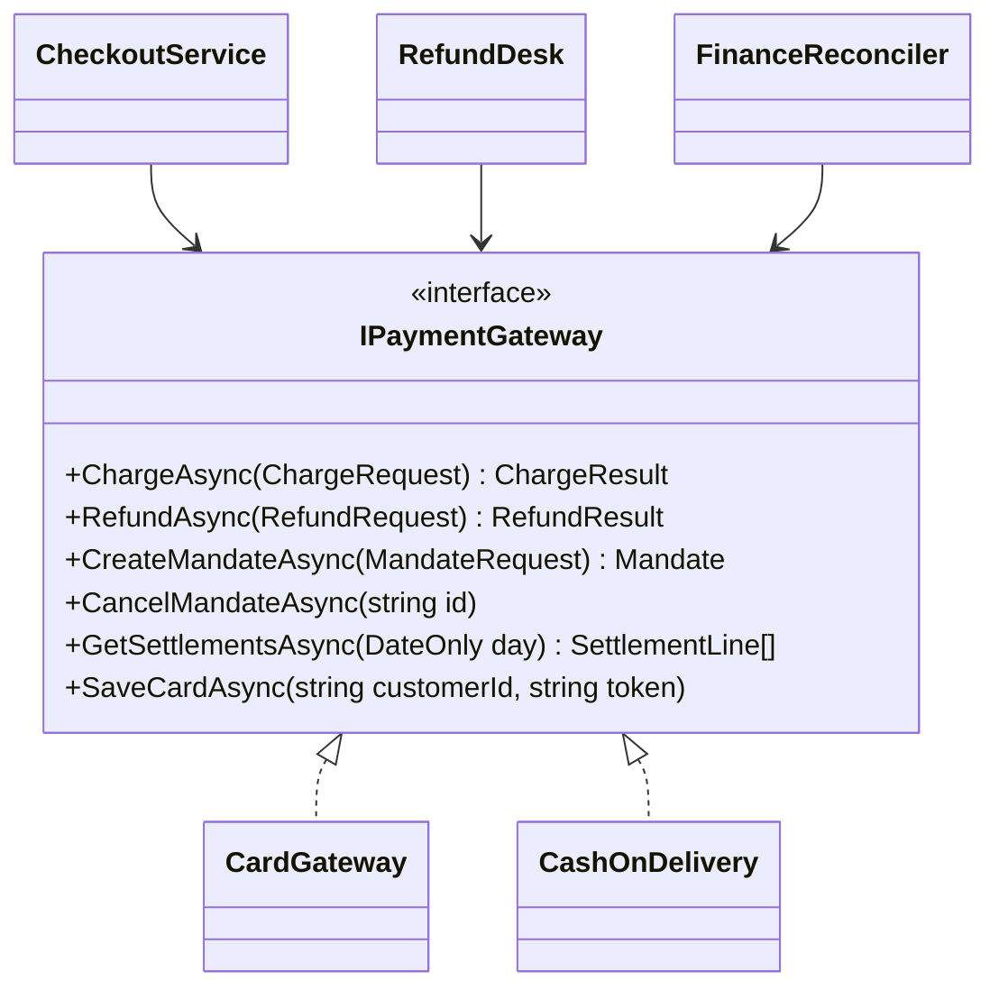
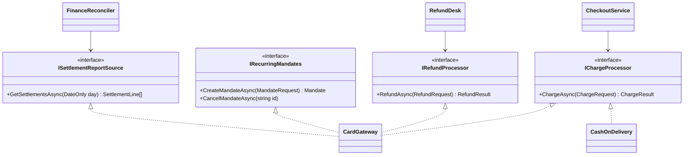
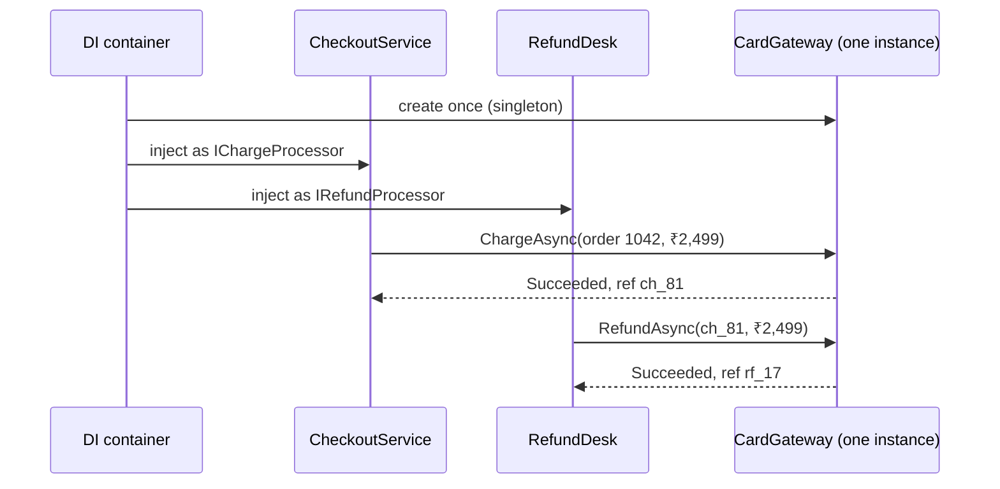
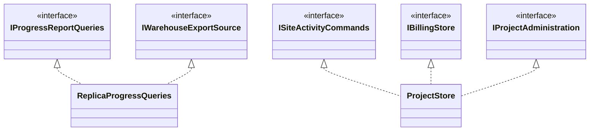

The Interface Segregation Principle (ISP) is the "I" in SOLID. Robert C. Martin wrote it in one sentence: **"Clients should not be forced to depend upon interfaces that they do not use."** It sounds obvious. In practice, most codebases still grow one or two huge interfaces that everybody implements and nobody fully needs. This lesson shows how that happens, what it costs, how to fix it in C#, and when splitting interfaces turns into a problem of its own.

## Learning objectives

By the end of this lesson you will be able to:

1. Explain ISP in plain words and say who the "client" of an interface is.
2. Spot the symptoms of a fat interface: `NotSupportedException` stubs, fakes with 15 empty methods, and changes that ripple into unrelated classes.
3. Split a fat interface into role interfaces based on how clients actually use it.
4. Register one class under several role interfaces in ASP.NET Core dependency injection so every client gets the same instance.
5. Unit-test clients with tiny hand-written fakes.
6. Recognise over-segregation ("interface soup") and decide when one cohesive interface is the better design.
7. Relate ISP to the Liskov Substitution Principle and the Dependency Inversion Principle.

## Prerequisites

- [Interfaces and abstract classes](#/lesson/m01-interfaces-abstract): you should be able to declare and implement an interface.
- [Single Responsibility Principle](#/lesson/m04-srp): ISP is SRP applied to interfaces, seen from the caller's side.
- [Liskov Substitution Principle](#/lesson/m04-lsp): many ISP violations show up first as LSP violations (methods that throw "not supported").

## Explain it like I'm a beginner

Picture a restaurant in Pune with one 120-dish menu and one rule: **every cook must be able to make every dish.** The dessert chef must also know Hakka noodles, and when the noodle recipe changes, the dessert chef is retrained. A juice stall that wants to join has to promise it can cook thalis. It can't, so it writes "not available" next to 115 dishes.

That second situation is what a fat interface does to code. An interface is a promise (a contract). Every class that implements it must promise *everything* on it. Every class that uses it is tied to *everything* on it, even the parts it never calls.

The fix is to have several small menus: a drinks menu, a dessert menu, a main-course menu. A cook signs up for the menus they can actually serve. A customer picks up only the menu they need. In code, those small menus are called **role interfaces**: each one describes one role a class can play for one kind of client.

- The code that *calls* an interface is its **client**.
- A big interface with many unrelated methods is a **fat interface** (sometimes called a "header interface", because it just copies every public method of a class).
- A small interface shaped around what one client needs is a **role interface**.

## First-principles explanation

### What the principle actually says

ISP is about **dependencies, seen from the caller**. The question is not "is this interface big?" but "does each client depend only on what it uses?". A 12-method interface is fine if every client uses all 12 methods. A 3-method interface violates ISP if half its clients only ever call one of them and the other two change often.

### Why it exists — the problem

When a client depends on members it doesn't use, three costs appear.

1. **Forced implementation.** Every implementer must provide every member. When some can't, they throw `NotSupportedException` or return fake values. Callers then can't trust the interface, which is a Liskov violation: substituting one implementation for another can blow up at runtime.
2. **Forced change.** When a member changes (a new parameter, a new return type), every implementer and every test fake must change, including the ones whose clients never call that member. In a compiled language this also means more projects rebuild and redeploy than necessary.
3. **Hidden coupling and unclear intent.** A constructor that takes `IPaymentGateway` tells you nothing about what the class does with it. A constructor that takes `IRefundProcessor` tells you exactly.

Martin's original example came from a printer system where one huge `Job` class served print, staple and fax tasks, so a change for one task forced all of them to rebuild.

### How it works internally

There's no runtime machinery here. ISP is about the *compile-time* dependency graph.

- In C#, when class `A` mentions interface `I` in a constructor or field, `A`'s assembly references `I`'s assembly. Any change to `I`'s *signature* can break `A`'s build, even if `A` never calls the changed member.
- A class can implement many interfaces at once: `public sealed class CardGateway : IChargeProcessor, IRefundProcessor`. So splitting an interface costs nothing at runtime. The same object can be handed to different clients under different "views".
- Interfaces can inherit from other interfaces, so you can still offer a combined interface (`IFullPaymentProvider : IChargeProcessor, IRefundProcessor`) for the rare client that needs everything.

### What happens without it

You get "god interfaces": `IUserService` with 40 members, or `IRepository<T>` with `BulkInsert` and `ExecuteRaw`, implemented by read-only lookups that throw on half of them. Every new requirement adds a member, and nobody can write a fake without a mocking library.

### When it is useful

- Different clients use **clearly different subsets** of an interface (checkout charges, finance reconciles, support refunds).
- Some implementations **cannot** support some members (cash on delivery can't refund online).
- Members **change at different rates** or for different stakeholders (a regulator changes settlement reporting yearly; checkout changes weekly).
- You want **cheap test doubles**. A one-method fake is three lines.

### When it is unnecessary

- The interface is small and **cohesive**: every client uses every member (`IClock` with `Now`, `IUnitOfWork` with `SaveChangesAsync`).
- There is **one client and one implementation** inside one module, and both change together.
- The members only make sense **together**. Splitting `BeginTransaction` / `Commit` / `Rollback` into three interfaces helps nobody.

### Trade-offs it introduces

| You gain | You pay |
|---|---|
| Clients state exactly what they need | More types to name and find |
| Implementers only promise what they can do | DI registrations for the extra interfaces |
| Tiny fakes, focused tests | Risk of "interface soup" if split by method instead of by role |
| Changes ripple to fewer classes | Clients needing several roles take several parameters (or a combined interface) |

## Visual explanation

### Before: one fat interface



How to read it: three clients point at one six-method interface, and both providers must implement all six. `CashOnDelivery` can honestly implement only `ChargeAsync`, so the other five throw. `CheckoutService` only charges, yet a change to `GetSettlementsAsync` touches it, its tests and its fakes.

### After: role interfaces



Now each client points at exactly one small interface. `CardGateway` still does everything, because it implements four roles. `CashOnDelivery` implements only the role it can actually fulfil, so there are no throwing stubs. Notice that `CreateMandateAsync` and `CancelMandateAsync` stay *together*: a client that creates mandates also needs to cancel them. We split by **role**, not by method.

### Runtime: one object, several views



This shows the part beginners often miss: splitting interfaces doesn't mean splitting the object. The container creates one `CardGateway` and hands the *same instance* to both clients, each seeing it through a different interface. Its connection pool, configuration and logging are shared. Only the compile-time view is narrowed.

## Step-by-step example

We'll refactor a payment layer for an online store that sells construction safety gear (helmets, harnesses, reflective jackets) to contractors across India.

### Step 1 — list the clients and what they call

Before splitting anything, build a **usage matrix**. Search the codebase for every call to the interface and record which client calls which member.

| Member | Checkout | Refund desk | Subscriptions | Finance | Admin UI |
|---|---|---|---|---|---|
| `ChargeAsync` | ✔ | | | | |
| `RefundAsync` | | ✔ | | | |
| `CreateMandateAsync` | | | ✔ | | |
| `CancelMandateAsync` | | | ✔ | | ✔ |
| `GetSettlementsAsync` | | | | ✔ | |
| `SaveCardAsync` | ✔ | | | | |

This matrix *is* the design. Columns that share ticks are candidates for the same role interface. Here, checkout uses charging and card saving together. The mandate pair goes together. The others stand alone.

### Step 2 — check what implementers can do

| Member | CardGateway | UpiProvider | CashOnDelivery |
|---|---|---|---|
| Charge | ✔ | ✔ | ✔ (records "collect cash") |
| Refund | ✔ | ✔ | ✘ (manual, by the courier) |
| Mandates | ✔ (card standing instruction) | ✔ (UPI AutoPay) | ✘ |
| Settlements | ✔ | ✔ | ✘ (cash reconciled by courier report) |
| Save card | ✔ | ✘ | ✘ |

Every ✘ in this table is currently a `throw new NotSupportedException()`. That's 8 throwing methods out of 15 (estimated from this small example). Each one is a runtime trap for a caller.

### Step 3 — name the roles

Roles should be named for what the *client* wants, not what the *provider* is: `IChargeProcessor`, `IRefundProcessor`, `IRecurringMandates`, `ISettlementReportSource`, `ICardVault`. A useful test: can you finish the sentence "Checkout needs something that can ___"? If the blank reads naturally ("charge a customer"), the name is right.

### Step 4 — move clients one at a time

Make the old fat interface inherit the new roles, so nothing breaks on day one:

```csharp
[Obsolete("Depend on the role interfaces instead.")]
public interface IPaymentGateway : IChargeProcessor, IRefundProcessor, IRecurringMandates, ISettlementReportSource, ICardVault { }
```

Then change one client at a time to take the narrow interface. Each change is a small, safe pull request. When no client uses `IPaymentGateway`, delete it and remove the throwing stubs from `CashOnDelivery`. This "expand, migrate, contract" sequence works for interfaces the same way it works for database columns.

### Step 5 — let types answer capability questions

"Can this provider refund?" becomes a type question: let DI give the refund desk only providers that implement `IRefundProcessor`, or use `provider is IRefundProcessor r` at the edge. No `SupportsRefunds` flag to keep in sync by hand.

## Production-style C# implementation

Project structure:

```text
Shop.Api/
  Program.cs
  Payments/
    PaymentModels.cs
    PaymentRoles.cs
    Providers/CardGateway.cs
    Providers/CashOnDeliveryProvider.cs
    CheckoutPaymentService.cs
    RefundDesk.cs
    SettlementReconciler.cs
    PaymentRegistration.cs
```

```csharp file=Payments/PaymentModels.cs
namespace Shop.Payments;

public sealed record Money(decimal Amount, string Currency = "INR")
{
    public static Money Inr(decimal amount) =>
        amount < 0 ? throw new ArgumentOutOfRangeException(nameof(amount)) : new Money(amount);
}

public sealed record ChargeRequest(string OrderId, string CustomerId, Money Amount, string IdempotencyKey);
public sealed record ChargeResult(bool Succeeded, string? ProviderReference, string? FailureReason);

public sealed record RefundRequest(string ProviderReference, Money Amount, string Reason);
public sealed record RefundResult(bool Succeeded, string? RefundReference, string? FailureReason);

public sealed record MandateRequest(string CustomerId, Money MaxAmount, string Frequency);
public sealed record Mandate(string MandateId, string CustomerId, Money MaxAmount);

public sealed record SettlementLine(string ProviderReference, Money Gross, Money Fee, DateOnly SettledOn);

public enum RefundOutcome { Refunded, Failed, NotSupportedByProvider, UnknownProvider }
```

```csharp file=Payments/PaymentRoles.cs
namespace Shop.Payments;

/// <summary>Shared identity for every provider role. Kept tiny on purpose.</summary>
public interface IPaymentProvider
{
    string ProviderCode { get; }
}

/// <summary>Used by checkout. Every provider can play this role.</summary>
public interface IChargeProcessor : IPaymentProvider
{
    Task<ChargeResult> ChargeAsync(ChargeRequest request, CancellationToken ct);
}

/// <summary>Used by the refund desk. Only providers that can refund online implement it.</summary>
public interface IRefundProcessor : IPaymentProvider
{
    Task<RefundResult> RefundAsync(RefundRequest request, CancellationToken ct);
}

/// <summary>Create and cancel live together: a client that does one always needs the other.</summary>
public interface IRecurringMandates : IPaymentProvider
{
    Task<Mandate> CreateMandateAsync(MandateRequest request, CancellationToken ct);
    Task CancelMandateAsync(string mandateId, CancellationToken ct);
}

/// <summary>Used by finance for daily reconciliation.</summary>
public interface ISettlementReportSource : IPaymentProvider
{
    Task<IReadOnlyList<SettlementLine>> GetSettlementsAsync(DateOnly day, CancellationToken ct);
}
```

```csharp file=Payments/Providers/CardGateway.cs
using System.Net.Http.Json;
using Microsoft.Extensions.Logging;

namespace Shop.Payments.Providers;

/// <summary>A card/UPI gateway reached over HTTPS. It can play every role, so it implements every role interface.</summary>
public sealed class CardGateway(HttpClient http, ILogger<CardGateway> logger)
    : IChargeProcessor, IRefundProcessor, IRecurringMandates, ISettlementReportSource
{
    public string ProviderCode => "card";

    private sealed record GatewayResponse(string Status, string? Id, string? Error);

    public async Task<ChargeResult> ChargeAsync(ChargeRequest request, CancellationToken ct)
    {
        using var msg = new HttpRequestMessage(HttpMethod.Post, "v1/charges")
        {
            Content = JsonContent.Create(new { request.OrderId, request.CustomerId, amount = request.Amount.Amount, currency = request.Amount.Currency })
        };
        msg.Headers.Add("Idempotency-Key", request.IdempotencyKey);
        using var response = await http.SendAsync(msg, ct);
        var body = await response.Content.ReadFromJsonAsync<GatewayResponse>(ct);
        var ok = response.IsSuccessStatusCode && body?.Status == "captured";
        logger.LogInformation("Charge for order {OrderId}: {Status}", request.OrderId, body?.Status ?? "no body");
        return new ChargeResult(ok, body?.Id, ok ? null : body?.Error ?? $"HTTP {(int)response.StatusCode}");
    }

    public async Task<RefundResult> RefundAsync(RefundRequest request, CancellationToken ct)
    {
        using var response = await http.PostAsJsonAsync($"v1/charges/{request.ProviderReference}/refunds",
            new { amount = request.Amount.Amount, reason = request.Reason }, ct);
        var body = await response.Content.ReadFromJsonAsync<GatewayResponse>(ct);
        var ok = response.IsSuccessStatusCode && body?.Status == "refunded";
        return new RefundResult(ok, body?.Id, ok ? null : body?.Error ?? $"HTTP {(int)response.StatusCode}");
    }

    public async Task<Mandate> CreateMandateAsync(MandateRequest request, CancellationToken ct)
    {
        using var response = await http.PostAsJsonAsync("v1/mandates",
            new { request.CustomerId, maxAmount = request.MaxAmount.Amount, request.Frequency }, ct);
        response.EnsureSuccessStatusCode();
        var body = await response.Content.ReadFromJsonAsync<GatewayResponse>(ct)
                   ?? throw new InvalidOperationException("Empty mandate response.");
        return new Mandate(body.Id ?? throw new InvalidOperationException("Mandate id missing."), request.CustomerId, request.MaxAmount);
    }

    public async Task CancelMandateAsync(string mandateId, CancellationToken ct)
    {
        using var response = await http.DeleteAsync($"v1/mandates/{mandateId}", ct);
        response.EnsureSuccessStatusCode();
    }

    public async Task<IReadOnlyList<SettlementLine>> GetSettlementsAsync(DateOnly day, CancellationToken ct)
    {
        var lines = await http.GetFromJsonAsync<List<SettlementLine>>($"v1/settlements?date={day:yyyy-MM-dd}", ct);
        return lines ?? [];
    }
}
```

```csharp file=Payments/Providers/CashOnDeliveryProvider.cs
namespace Shop.Payments.Providers;

/// <summary>Cash on delivery can only "charge" (record that cash is to be collected).
/// It does not pretend to support refunds, mandates or settlements.</summary>
public sealed class CashOnDeliveryProvider(TimeProvider clock) : IChargeProcessor
{
    public const decimal MaxCodAmount = 50_000m;
    public string ProviderCode => "cod";

    public Task<ChargeResult> ChargeAsync(ChargeRequest request, CancellationToken ct)
    {
        if (request.Amount.Amount > MaxCodAmount)
            return Task.FromResult(new ChargeResult(false, null, $"COD is limited to ₹{MaxCodAmount:N0}."));

        var reference = $"cod_{request.OrderId}_{clock.GetUtcNow():yyyyMMddHHmmss}";
        return Task.FromResult(new ChargeResult(true, reference, null));
    }
}
```

```csharp file=Payments/CheckoutPaymentService.cs
namespace Shop.Payments;

/// <summary>Checkout only charges. It depends on nothing else.</summary>
public sealed class CheckoutPaymentService(IEnumerable<IChargeProcessor> processors)
{
    private readonly Dictionary<string, IChargeProcessor> _byCode =
        processors.ToDictionary(p => p.ProviderCode, StringComparer.OrdinalIgnoreCase);

    public IReadOnlyCollection<string> AvailableMethods => _byCode.Keys;

    public Task<ChargeResult> PayAsync(string method, ChargeRequest request, CancellationToken ct) =>
        _byCode.TryGetValue(method, out var processor)
            ? processor.ChargeAsync(request, ct)
            : Task.FromResult(new ChargeResult(false, null, $"Unknown payment method '{method}'."));
}
```

```csharp file=Payments/RefundDesk.cs
using Microsoft.Extensions.Logging;

namespace Shop.Payments;

/// <summary>The refund desk sees only providers that can refund. It never meets cash on delivery.</summary>
public sealed class RefundDesk(IEnumerable<IRefundProcessor> processors, IEnumerable<IChargeProcessor> allProviders, ILogger<RefundDesk> logger)
{
    private readonly Dictionary<string, IRefundProcessor> _refunders =
        processors.ToDictionary(p => p.ProviderCode, StringComparer.OrdinalIgnoreCase);
    private readonly HashSet<string> _known =
        allProviders.Select(p => p.ProviderCode).ToHashSet(StringComparer.OrdinalIgnoreCase);

    public async Task<RefundOutcome> RefundAsync(string providerCode, RefundRequest request, CancellationToken ct)
    {
        if (!_known.Contains(providerCode)) return RefundOutcome.UnknownProvider;
        if (!_refunders.TryGetValue(providerCode, out var refunder))
        {
            logger.LogInformation("Provider {Provider} has no online refunds; routing {Ref} to manual process", providerCode, request.ProviderReference);
            return RefundOutcome.NotSupportedByProvider;
        }

        var result = await refunder.RefundAsync(request, ct);
        return result.Succeeded ? RefundOutcome.Refunded : RefundOutcome.Failed;
    }
}
```

```csharp file=Payments/SettlementReconciler.cs
namespace Shop.Payments;

public sealed record ReconciliationSummary(DateOnly Day, int Lines, decimal Gross, decimal Fees, decimal Net);

/// <summary>Finance reads settlements from every provider that publishes them.</summary>
public sealed class SettlementReconciler(IEnumerable<ISettlementReportSource> sources)
{
    public async Task<ReconciliationSummary> SummariseAsync(DateOnly day, CancellationToken ct)
    {
        var all = new List<SettlementLine>();
        foreach (var source in sources)
            all.AddRange(await source.GetSettlementsAsync(day, ct));

        var gross = all.Sum(l => l.Gross.Amount);
        var fees = all.Sum(l => l.Fee.Amount);
        return new ReconciliationSummary(day, all.Count, gross, fees, gross - fees);
    }
}
```

```csharp file=Payments/PaymentRegistration.cs
using Microsoft.Extensions.DependencyInjection;
using Shop.Payments.Providers;

namespace Shop.Payments;

public static class PaymentRegistration
{
    /// <summary>Registers each provider once and exposes it under every role it plays.
    /// Forwarding registrations (sp => sp.GetRequiredService) make all roles share one instance.</summary>
    public static IServiceCollection AddPayments(this IServiceCollection services, Uri gatewayBaseAddress)
    {
        services.AddSingleton(TimeProvider.System);

        services.AddHttpClient<CardGateway>(c => c.BaseAddress = gatewayBaseAddress);
        services.AddTransient<IChargeProcessor>(sp => sp.GetRequiredService<CardGateway>());
        services.AddTransient<IRefundProcessor>(sp => sp.GetRequiredService<CardGateway>());
        services.AddTransient<IRecurringMandates>(sp => sp.GetRequiredService<CardGateway>());
        services.AddTransient<ISettlementReportSource>(sp => sp.GetRequiredService<CardGateway>());

        services.AddSingleton<CashOnDeliveryProvider>();
        services.AddSingleton<IChargeProcessor>(sp => sp.GetRequiredService<CashOnDeliveryProvider>());

        services.AddTransient<CheckoutPaymentService>();
        services.AddTransient<RefundDesk>();
        services.AddTransient<SettlementReconciler>();
        return services;
    }
}
```

```csharp file=Program.cs
using Shop.Payments;

var builder = WebApplication.CreateBuilder(args);
builder.Services.AddPayments(new Uri(builder.Configuration["Payments:GatewayUrl"] ?? "https://gateway.example.test/"));

var app = builder.Build();

app.MapPost("/orders/{orderId}/pay/{method}", async (string orderId, string method, decimal amount, string customerId,
    CheckoutPaymentService checkout, CancellationToken ct) =>
{
    var result = await checkout.PayAsync(method, new ChargeRequest(orderId, customerId, Money.Inr(amount), $"order-{orderId}"), ct);
    return result.Succeeded ? Results.Ok(result) : Results.Problem(result.FailureReason, statusCode: StatusCodes.Status402PaymentRequired);
});

app.MapPost("/refunds/{provider}/{reference}", async (string provider, string reference, decimal amount, RefundDesk desk, CancellationToken ct) =>
{
    var outcome = await desk.RefundAsync(provider, new RefundRequest(reference, Money.Inr(amount), "customer request"), ct);
    return outcome switch
    {
        RefundOutcome.Refunded => Results.Ok(outcome),
        RefundOutcome.NotSupportedByProvider => Results.Accepted(value: "Queued for manual refund"),
        RefundOutcome.UnknownProvider => Results.NotFound(),
        _ => Results.Problem("Refund failed", statusCode: StatusCodes.Status502BadGateway),
    };
});

app.MapGet("/finance/settlements/{day}", async (DateOnly day, SettlementReconciler reconciler, CancellationToken ct) =>
    Results.Ok(await reconciler.SummariseAsync(day, ct)));

app.Run();
```

**Why the forwarding lambdas?** `AddTransient<IChargeProcessor, CardGateway>()` plus `AddTransient<IRefundProcessor, CardGateway>()` would build a separate `CardGateway` per interface. For a class with state (a token cache, a rate-limit counter) that's a bug: two "views" see different data. Registering the concrete type once and forwarding each interface keeps one source of truth. `CardGateway` is a typed `HttpClient` client, which the factory registers as transient, so the forwards are transient too; a singleton forward would capture one `HttpClient` forever and miss DNS changes.

**Why `IPaymentProvider` as a base?** Every client routes by `ProviderCode`, so that one property sits on a tiny shared base. Every client uses it, so it isn't fat.

## Bad design vs good design

### The bad version

```csharp
public interface IPaymentGateway
{
    string ProviderCode { get; }
    Task<ChargeResult> ChargeAsync(ChargeRequest request, CancellationToken ct);
    Task<RefundResult> RefundAsync(RefundRequest request, CancellationToken ct);
    Task<Mandate> CreateMandateAsync(MandateRequest request, CancellationToken ct);
    Task CancelMandateAsync(string mandateId, CancellationToken ct);
    Task<IReadOnlyList<SettlementLine>> GetSettlementsAsync(DateOnly day, CancellationToken ct);
    Task SaveCardAsync(string customerId, string token, CancellationToken ct);
    bool SupportsRefunds { get; }
    bool SupportsMandates { get; }
}

public sealed class CashOnDeliveryGateway : IPaymentGateway
{
    public string ProviderCode => "cod";
    public bool SupportsRefunds => false;
    public bool SupportsMandates => false;
    public Task<ChargeResult> ChargeAsync(ChargeRequest r, CancellationToken ct) => /* real logic */ throw null!;
    public Task<RefundResult> RefundAsync(RefundRequest r, CancellationToken ct) => throw new NotSupportedException();
    public Task<Mandate> CreateMandateAsync(MandateRequest r, CancellationToken ct) => throw new NotSupportedException();
    public Task CancelMandateAsync(string id, CancellationToken ct) => throw new NotSupportedException();
    public Task<IReadOnlyList<SettlementLine>> GetSettlementsAsync(DateOnly d, CancellationToken ct) =>
        Task.FromResult<IReadOnlyList<SettlementLine>>(Array.Empty<SettlementLine>()); // silently "no settlements"
    public Task SaveCardAsync(string c, string t, CancellationToken ct) => Task.CompletedTask; // silently does nothing
}

public sealed class CheckoutService(IPaymentGateway gateway) { /* only ever calls ChargeAsync */ }
```

### What is wrong, in detail

1. **Lies in the contract.** The interface promises six operations; `CashOnDeliveryGateway` honestly supports one. Three members throw, and two quietly do nothing. The silent ones are worse than the throwing ones: finance gets "zero settlements" for COD and believes it, and `SaveCardAsync` reports success for a card that was never stored.
2. **Flags that must match behaviour by hand.** `SupportsRefunds` and `RefundAsync` are two separate facts that a developer must keep consistent. Nothing stops someone setting `SupportsRefunds => true` while `RefundAsync` still throws. With role interfaces, "implements `IRefundProcessor`" *is* the capability, and the compiler enforces it.
3. **Ripple on change.** Suppose RBI-driven tokenisation rules change `SaveCardAsync` to need a consent reference: `SaveCardAsync(string customerId, string token, string consentId, CancellationToken ct)`. Every provider changes (3 classes), every fake in every test project changes (in a real codebase, often 10–20 hand-written fakes, an estimate based on one fake per test class), and `CheckoutService`, `RefundDesk` and `FinanceReconciler` all recompile, even though only checkout uses cards.
4. **Expensive tests.** A fake for `CheckoutService` must implement nine members to exercise one. A mocking library hides that cost; it doesn't remove it.
5. **Unclear intent.** `CheckoutService(IPaymentGateway gateway)` could do anything with money. `CheckoutPaymentService(IEnumerable<IChargeProcessor>)` can only charge.

### The good version

The production implementation above: one role interface per client, providers implement only what they can do, and one instance serves all roles through forwarding registrations.

### Is it always worth it?

No. If your shop has **one** payment provider that supports everything and **one** service that uses it, a single `IPaymentGateway` is simpler and honest. ISP starts paying when you have multiple clients with different needs *or* multiple implementations with different abilities. In this example, the trigger was cash on delivery: the first implementation that couldn't honour the whole contract.

### When applying ISP blindly is harmful

:::callout type=mistake title="Interface soup"
Splitting into one-method interfaces — `IChargeCreator`, `IChargeIdempotencyKeyProvider`, `IChargeLogger` — scatters one concept over many files and grows constructors to eight parameters. Split by **client role**, keep always-together members together, and stop when each interface reads like a sentence.
:::

Other harmful applications we see:

- **Splitting cohesive protocols.** `IUnitOfWork` with `BeginAsync`, `CommitAsync`, `RollbackAsync` must stay whole. A client that can begin but not roll back is a bug factory.
- **An interface per class "for ISP".** A header interface (`IOrderService` copying every public method of `OrderService`) is the opposite of ISP. It's shaped by the implementation, not the client.
- **Breaking public contracts for purity.** If other teams or NuGet consumers use your interface, splitting it is a breaking change. Use the "fat interface inherits the roles" bridge and deprecate slowly.

:::callout type=tradeoff title="Capability flags are not always wrong"
.NET's `Stream` has `CanSeek`/`CanWrite`, and its methods throw `NotSupportedException` when a capability is missing. That's reasonable because streams are wrapped at runtime (a `GZipStream` around a `NetworkStream`), so capabilities are only known at runtime. Role interfaces fit when capabilities are fixed per type; for truly dynamic ones, a documented flag is pragmatic.
:::

## Practical playground

The program below has a fat interface and a cash-on-delivery provider that throws. Run it and watch it fail. Then split the interface so that `RefundRunner` only receives providers that can refund, and run it again. It should print one refund and one "manual" line, with no exception.

:::playground type=csharp title="Split the fat payment interface"
```csharp file=Program.cs
using System;
using System.Collections.Generic;

public interface IPaymentGateway
{
    string Code { get; }
    string Charge(decimal amount);
    string Refund(string reference, decimal amount);
}

public sealed class CardGateway : IPaymentGateway
{
    public string Code => "card";
    public string Charge(decimal amount) => $"ch_{amount}";
    public string Refund(string reference, decimal amount) => $"rf_{reference}";
}

public sealed class CashOnDelivery : IPaymentGateway
{
    public string Code => "cod";
    public string Charge(decimal amount) => $"cod_{amount}";
    public string Refund(string reference, decimal amount) => throw new NotSupportedException("COD refunds are manual");
}

public static class RefundRunner
{
    // TODO: depend on a role interface (IRefundProcessor) instead of IPaymentGateway.
    public static void RefundAll(IEnumerable<IPaymentGateway> providers)
    {
        foreach (var p in providers)
        {
            try { Console.WriteLine($"{p.Code}: {p.Refund("ch_2499", 2499m)}"); }
            catch (NotSupportedException ex) { Console.WriteLine($"{p.Code}: CRASH -> {ex.Message}"); }
        }
    }
}

public static class Program
{
    public static void Main()
    {
        IPaymentGateway[] providers = { new CardGateway(), new CashOnDelivery() };
        RefundRunner.RefundAll(providers);
    }
}
```
:::

## Exercises

:::exercise id=m04-isp-ex1 difficulty=beginner kind=code title="Give the drawing viewer a read-only interface"
A construction-project portal stores drawings (PDF/DWG files) for each site. `DrawingViewer` only reads drawings, but it depends on the full `IProjectDocumentStore`, which also uploads and deletes. A new read-only cache for site tablets implements only `IDocumentReader`, and it can't be passed to the viewer.

Change `DrawingViewer` so it depends only on `IDocumentReader`, and implement `TitleBlock`.
::requirements
- `DrawingViewer` has one constructor taking `IDocumentReader`.
- `TitleBlock(string documentId)` returns `"<Title> (rev <Revision>)"`, for example `"GA Drawing Pier P12 (rev C)"`.
- If the document doesn't exist, throw `KeyNotFoundException`.
- Don't change `IDocumentReader` or `IProjectDocumentStore`.
::acceptance
- A fake that implements only `IDocumentReader` can be passed to `DrawingViewer`.
- `TitleBlock` formats title and revision correctly.
- A missing document throws `KeyNotFoundException`.
::hint
Look at which members of `IProjectDocumentStore` the viewer actually calls.
::hint
The viewer only calls `Find`. `Find` already lives on `IDocumentReader`, which `IProjectDocumentStore` inherits.
::hint
Change the constructor parameter type. Because `IProjectDocumentStore` inherits `IDocumentReader`, existing callers that pass a full store still compile.
::hint
```csharp
public sealed class DrawingViewer(IDocumentReader reader)
{
    public string TitleBlock(string id) => reader.Find(id) is { } d ? $"{d.Title} (rev {d.Revision})" : throw new KeyNotFoundException(id);
}
```
::starter
```csharp file=DrawingViewer.cs
using System;
using System.Collections.Generic;

public sealed record ProjectDocument(string Id, string Title, string Revision, byte[] Content);

public interface IDocumentReader
{
    ProjectDocument? Find(string documentId);
    IReadOnlyList<ProjectDocument> ListBySite(string siteCode);
}

public interface IProjectDocumentStore : IDocumentReader
{
    void Upload(string siteCode, ProjectDocument document);
    void Delete(string documentId);
}

public sealed class DrawingViewer
{
    private readonly IProjectDocumentStore _store;
    public DrawingViewer(IProjectDocumentStore store) => _store = store;

    public string TitleBlock(string documentId) => throw new NotImplementedException();
}
```
::tests
```csharp file=DrawingViewerTests.cs
using System;
using System.Collections.Generic;
using System.Linq;
using Xunit;

public class DrawingViewerTests
{
    private sealed class TabletCache : IDocumentReader
    {
        private readonly Dictionary<string, ProjectDocument> _docs = new()
        {
            ["D-12"] = new ProjectDocument("D-12", "GA Drawing Pier P12", "C", Array.Empty<byte>()),
        };
        public ProjectDocument? Find(string documentId) => _docs.GetValueOrDefault(documentId);
        public IReadOnlyList<ProjectDocument> ListBySite(string siteCode) => _docs.Values.ToList();
    }

    private static DrawingViewer CreateViewer(IDocumentReader reader) =>
        (DrawingViewer)Activator.CreateInstance(typeof(DrawingViewer), reader)!;

    [Fact]
    public void Constructor_takes_only_the_reader_role()
    {
        var parameter = typeof(DrawingViewer).GetConstructors().Single().GetParameters().Single();
        Assert.Equal(typeof(IDocumentReader), parameter.ParameterType);
    }

    [Fact]
    public void Formats_title_block() =>
        Assert.Equal("GA Drawing Pier P12 (rev C)", CreateViewer(new TabletCache()).TitleBlock("D-12"));

    [Fact]
    public void Missing_document_throws() =>
        Assert.Throws<KeyNotFoundException>(() => CreateViewer(new TabletCache()).TitleBlock("NOPE"));
}
```
::solution
The viewer only needs `Find`, so it should depend on the role that offers `Find` and nothing more.

```csharp file=DrawingViewer.cs
using System;
using System.Collections.Generic;

public sealed record ProjectDocument(string Id, string Title, string Revision, byte[] Content);

public interface IDocumentReader
{
    ProjectDocument? Find(string documentId);
    IReadOnlyList<ProjectDocument> ListBySite(string siteCode);
}

public interface IProjectDocumentStore : IDocumentReader
{
    void Upload(string siteCode, ProjectDocument document);
    void Delete(string documentId);
}

public sealed class DrawingViewer
{
    private readonly IDocumentReader _reader;
    public DrawingViewer(IDocumentReader reader) => _reader = reader;

    public string TitleBlock(string documentId)
    {
        var doc = _reader.Find(documentId) ?? throw new KeyNotFoundException($"Document '{documentId}' not found.");
        return $"{doc.Title} (rev {doc.Revision})";
    }
}
```

Existing code that passes a full `IProjectDocumentStore` still compiles, because the store *is* a reader. The tablet cache now fits too. That's ISP's promise: narrowing a dependency widens the set of things that can satisfy it.
::mistakes
- Adding a second constructor that takes `IDocumentReader` and keeping the old one. Now there are two ways to build the viewer, and the fat dependency is still there.
- Making the tablet cache implement `IProjectDocumentStore` with throwing `Upload`/`Delete`. That's the exact problem ISP removes.
- Returning `null` or an empty string for a missing document, which hides data errors from the user.
:::

:::exercise id=m04-isp-ex2 difficulty=beginner kind=written title="Build a usage matrix for IUserService"
A school-fees platform has this interface, used by four clients:

```csharp
public interface IUserService
{
    User? GetById(Guid id);
    User? GetByMobile(string mobile);
    void Register(RegisterRequest r);
    void ChangePassword(Guid id, string oldPw, string newPw);
    void SendOtp(string mobile);
    bool VerifyOtp(string mobile, string code);
    IReadOnlyList<User> Search(string text, int page);
    void Deactivate(Guid id, string reason);
    byte[] ExportCsv(DateOnly from, DateOnly to);
}
```

Clients: **LoginController** (GetByMobile, SendOtp, VerifyOtp), **ProfileController** (GetById, ChangePassword), **AdminController** (Search, Deactivate, GetById), **ReportsJob** (ExportCsv).

Draw the usage matrix and propose role interfaces with names. Say which members, if any, should be shared, and why.
::acceptance
- A matrix with members as rows and clients as columns.
- 3–5 role interfaces, named from the client's point of view.
- A decision about `GetById`, which two clients use.
- A note on where `Register` goes, since no listed client uses it.
::hint
Group the ticks. Members always used together belong together.
::hint
`SendOtp` and `VerifyOtp` are a protocol. They must stay in one interface.
::hint
For the shared `GetById`, you can either repeat it on two interfaces or make a tiny `IUserLookup` both inherit or both depend on. Which is easier to read?
::hint
A member that no listed client uses is a finding in itself. Search for its callers before deciding, or it may be dead code.
::solution
| Member | Login | Profile | Admin | Reports |
|---|---|---|---|---|
| GetById | | ✔ | ✔ | |
| GetByMobile | ✔ | | | |
| Register | | | | |
| ChangePassword | | ✔ | | |
| SendOtp / VerifyOtp | ✔ | | | |
| Search / Deactivate | | | ✔ | |
| ExportCsv | | | | ✔ |

Proposed roles:

- `IOtpLogin` — `GetByMobile`, `SendOtp`, `VerifyOtp` (Login).
- `IUserLookup` — `GetById` (shared by Profile and Admin).
- `IPasswordChanger` — `ChangePassword` (Profile).
- `IUserAdministration : IUserLookup` — `Search`, `Deactivate` (Admin).
- `IUserExport` — `ExportCsv` (Reports). Exports change for finance's reasons, not login's.

`Register` has no listed client: find its callers (perhaps a forgotten `SignupController`) or delete it. One `UserService` class can implement all the roles at first.
::mistakes
- Splitting `SendOtp` and `VerifyOtp` into separate interfaces.
- Naming roles after the implementation (`IUserServicePart1`).
- Creating nine one-method interfaces.
:::

:::exercise id=m04-isp-ex3 difficulty=intermediate kind=code title="One instance, many roles in DI"
`FuelCardProvider` (fuel cards for a construction fleet) implements `IFuelPurchaseAuthoriser` and `IFuelStatementSource`. It keeps an in-memory count of authorisations, so both roles **must** see the same instance. Implement `FleetRegistration.AddFuelCards` so that:

1. `FuelCardProvider` is registered as a singleton.
2. Both interfaces resolve to that same instance.
3. `IEnumerable<IFuelPurchaseAuthoriser>` contains exactly one entry.
::acceptance
- Resolving the two interfaces returns the same object (`Assert.Same`).
- A purchase authorised through one role appears in the statement read through the other.
- Calling `AddFuelCards` registers exactly one `IFuelPurchaseAuthoriser`.
::hint
`AddSingleton<IA, Impl>()` and `AddSingleton<IB, Impl>()` create two different singletons, one per service type.
::hint
Register the concrete class once, then register each interface with a factory lambda.
::hint
`services.AddSingleton<IFuelStatementSource>(sp => sp.GetRequiredService<FuelCardProvider>());`
::hint
Write the test first: build a `ServiceCollection`, call your method, `BuildServiceProvider()`, resolve both interfaces and compare with `Assert.Same`.
::starter
```csharp file=FleetRegistration.cs
using System;
using System.Collections.Generic;
using Microsoft.Extensions.DependencyInjection;

public sealed record FuelPurchase(string VehicleNo, decimal Litres, decimal AmountInr);

public interface IFuelPurchaseAuthoriser
{
    bool Authorise(FuelPurchase purchase);
}

public interface IFuelStatementSource
{
    IReadOnlyList<FuelPurchase> Statement();
}

public sealed class FuelCardProvider : IFuelPurchaseAuthoriser, IFuelStatementSource
{
    private readonly List<FuelPurchase> _authorised = new();
    private readonly object _gate = new();
    public const decimal MaxLitresPerFill = 400m;

    public bool Authorise(FuelPurchase purchase)
    {
        if (purchase.Litres <= 0 || purchase.Litres > MaxLitresPerFill) return false;
        lock (_gate) _authorised.Add(purchase);
        return true;
    }

    public IReadOnlyList<FuelPurchase> Statement()
    {
        lock (_gate) return _authorised.ToArray();
    }
}

public static class FleetRegistration
{
    public static IServiceCollection AddFuelCards(this IServiceCollection services) =>
        throw new NotImplementedException();
}
```
::tests
```csharp file=FleetRegistrationTests.cs
using System.Linq;
using Microsoft.Extensions.DependencyInjection;
using Xunit;

public class FleetRegistrationTests
{
    private static ServiceProvider Build() => new ServiceCollection().AddFuelCards().BuildServiceProvider();

    [Fact]
    public void Both_roles_share_one_instance()
    {
        using var sp = Build();
        Assert.Same(sp.GetRequiredService<IFuelPurchaseAuthoriser>(), sp.GetRequiredService<IFuelStatementSource>());
    }

    [Fact]
    public void Purchase_through_one_role_is_visible_through_the_other()
    {
        using var sp = Build();
        Assert.True(sp.GetRequiredService<IFuelPurchaseAuthoriser>().Authorise(new FuelPurchase("HR26-AB-1234", 120m, 11_400m)));
        Assert.Single(sp.GetRequiredService<IFuelStatementSource>().Statement());
    }

    [Fact]
    public void Exactly_one_authoriser_registered()
    {
        using var sp = Build();
        Assert.Single(sp.GetServices<IFuelPurchaseAuthoriser>());
    }

    [Fact]
    public void Concrete_type_is_a_singleton()
    {
        using var sp = Build();
        Assert.Same(sp.GetRequiredService<FuelCardProvider>(), sp.GetRequiredService<FuelCardProvider>());
    }
}
```
::solution
Register the concrete type once, then forward each role to it.

```csharp file=FleetRegistration.cs
using System;
using System.Collections.Generic;
using Microsoft.Extensions.DependencyInjection;

public sealed record FuelPurchase(string VehicleNo, decimal Litres, decimal AmountInr);

public interface IFuelPurchaseAuthoriser
{
    bool Authorise(FuelPurchase purchase);
}

public interface IFuelStatementSource
{
    IReadOnlyList<FuelPurchase> Statement();
}

public sealed class FuelCardProvider : IFuelPurchaseAuthoriser, IFuelStatementSource
{
    private readonly List<FuelPurchase> _authorised = new();
    private readonly object _gate = new();
    public const decimal MaxLitresPerFill = 400m;

    public bool Authorise(FuelPurchase purchase)
    {
        if (purchase.Litres <= 0 || purchase.Litres > MaxLitresPerFill) return false;
        lock (_gate) _authorised.Add(purchase);
        return true;
    }

    public IReadOnlyList<FuelPurchase> Statement()
    {
        lock (_gate) return _authorised.ToArray();
    }
}

public static class FleetRegistration
{
    public static IServiceCollection AddFuelCards(this IServiceCollection services)
    {
        services.AddSingleton<FuelCardProvider>();
        services.AddSingleton<IFuelPurchaseAuthoriser>(sp => sp.GetRequiredService<FuelCardProvider>());
        services.AddSingleton<IFuelStatementSource>(sp => sp.GetRequiredService<FuelCardProvider>());
        return services;
    }
}
```

The container caches singletons **per registration**. Two `AddSingleton<IX, FuelCardProvider>()` lines are two registrations, so two objects. Forwarding points both interfaces at the one concrete registration.
::mistakes
- `AddSingleton<IFuelPurchaseAuthoriser, FuelCardProvider>()` twice — two instances, and the statement is always empty.
- Forwarding a **singleton** interface to a **scoped** concrete type. That's a captive dependency, and scope validation will throw in Development.
:::

:::exercise id=m04-isp-ex4 difficulty=intermediate kind=code title="Replace a capability flag with a role interface"
A site-equipment telemetry system talks to devices from several vendors. Some devices can be remotely immobilised (for theft), others can't. The old code used `bool CanImmobilise` plus a method that threw. You now have role interfaces. Implement `SecurityDesk.ImmobiliseAll` so that it:

- immobilises every device that implements `IRemoteImmobiliser`,
- reports every other device as `"<id>: manual"` — no exceptions, no flags,
- returns results in input order.
::acceptance
- An excavator tracker (`IRemoteImmobiliser`) returns `"EX-07: immobilised"`.
- A basic GPS tag returns `"TAG-3: manual"`.
- The method never throws for unsupported devices.
- `IRemoteImmobiliser` has no `CanImmobilise` flag.
::hint
The type system already knows which devices can do it.
::hint
Use a type pattern: `device is IRemoteImmobiliser r`.
::hint
Loop over devices, branch on the pattern, collect strings into a list.
::hint
```csharp
foreach (var d in devices)
    results.Add(d is IRemoteImmobiliser r ? ... : $"{d.DeviceId}: manual");
```
::starter
```csharp file=SecurityDesk.cs
using System;
using System.Collections.Generic;

public interface ITelemetryDevice
{
    string DeviceId { get; }
    (double Lat, double Lon) LastPosition();
}

public interface IRemoteImmobiliser : ITelemetryDevice
{
    bool Immobilise(string reason);
}

public sealed class ExcavatorTracker(string id) : IRemoteImmobiliser
{
    public bool Immobilised { get; private set; }
    public string DeviceId => id;
    public (double Lat, double Lon) LastPosition() => (28.4595, 77.0266);
    public bool Immobilise(string reason) { Immobilised = true; return true; }
}

public sealed class GpsTag(string id) : ITelemetryDevice
{
    public string DeviceId => id;
    public (double Lat, double Lon) LastPosition() => (19.0760, 72.8777);
}

public static class SecurityDesk
{
    public static IReadOnlyList<string> ImmobiliseAll(IEnumerable<ITelemetryDevice> devices, string reason) =>
        throw new NotImplementedException();
}
```
::tests
```csharp file=SecurityDeskTests.cs
using Xunit;

public class SecurityDeskTests
{
    [Fact]
    public void Immobilises_capable_devices_and_reports_others_as_manual()
    {
        var ex = new ExcavatorTracker("EX-07");
        var tag = new GpsTag("TAG-3");
        ITelemetryDevice[] devices = { ex, tag };

        var results = SecurityDesk.ImmobiliseAll(devices, "reported stolen");

        Assert.Equal(new[] { "EX-07: immobilised", "TAG-3: manual" }, results);
        Assert.True(ex.Immobilised);
    }

    [Fact]
    public void Empty_input_gives_empty_result() =>
        Assert.Empty(SecurityDesk.ImmobiliseAll(new ITelemetryDevice[0], "test"));

    [Fact]
    public void Interface_has_no_capability_flag() =>
        Assert.Null(typeof(IRemoteImmobiliser).GetProperty("CanImmobilise"));
}
```
::solution
```csharp file=SecurityDesk.cs
using System;
using System.Collections.Generic;

public interface ITelemetryDevice
{
    string DeviceId { get; }
    (double Lat, double Lon) LastPosition();
}

public interface IRemoteImmobiliser : ITelemetryDevice
{
    bool Immobilise(string reason);
}

public sealed class ExcavatorTracker(string id) : IRemoteImmobiliser
{
    public bool Immobilised { get; private set; }
    public string DeviceId => id;
    public (double Lat, double Lon) LastPosition() => (28.4595, 77.0266);
    public bool Immobilise(string reason) { Immobilised = true; return true; }
}

public sealed class GpsTag(string id) : ITelemetryDevice
{
    public string DeviceId => id;
    public (double Lat, double Lon) LastPosition() => (19.0760, 72.8777);
}

public static class SecurityDesk
{
    public static IReadOnlyList<string> ImmobiliseAll(IEnumerable<ITelemetryDevice> devices, string reason)
    {
        var results = new List<string>();
        foreach (var device in devices)
        {
            if (device is IRemoteImmobiliser immobiliser)
                results.Add(immobiliser.Immobilise(reason)
                    ? $"{device.DeviceId}: immobilised"
                    : $"{device.DeviceId}: failed");
            else
                results.Add($"{device.DeviceId}: manual");
        }
        return results;
    }
}
```

The capability is now a fact the compiler checks.
::alternatives
If the desk *only* handles immobilisers, inject `IEnumerable<IRemoteImmobiliser>` and skip the type check. Many `is IX` checks across the code suggest the narrower injection is wanted.
::mistakes
- Catching `NotSupportedException` as control flow.
- Adding `CanImmobilise` "just in case" — two facts to keep in sync.
:::

:::exercise id=m04-isp-ex5 difficulty=advanced kind=design title="Segregate a 28-method project repository"
An infrastructure project-management platform has `IProjectRepository` with 28 methods. Five clients use it: the **monthly progress report (MPR) generator**, the **site mobile app API**, **contractor billing**, the **admin console** and a **nightly data-warehouse export**. Profiling shows the MPR generator's queries are slow and the team wants to move its reads to a read replica.

Design the replacement: role interfaces, which class implements which, how DI wires them, and how you migrate without a big-bang change. Say explicitly where you would *not* split.
::acceptance
- Interfaces grouped by client role, with read and write sides separated where it helps.
- A plan that lets MPR reads go to a replica without touching billing.
- A migration path (expand → migrate → contract) with small steps.
- At least two places where you deliberately keep members together, with reasons.
::hint
Start with the usage matrix. The replica requirement is a strong hint about read/write separation.
::hint
Reads for reporting rarely need the same shape as writes. Consider query interfaces that return read models (DTOs) instead of entities.
::hint
Different implementations can now sit behind different roles: `ReplicaProjectQueries` for reporting, `ProjectStore` (primary) for writes.
::hint
Bridge step: `IProjectRepository : IProjectQueries, IProjectCommands, ...` so all old callers compile while you move them one by one.
::hint
Keep together: methods that form one transaction, such as `SubmitBill` + `AttachMeasurementSheet`, and methods every client uses, such as `GetProjectHeader`.
::solution
**Roles (by client):**

- `IProgressReportQueries` (MPR): `GetPhysicalProgress(projectId, month)`, `GetFinancialProgress(projectId, month)`, `GetMilestones(projectId)`. Returns read models. Implemented by `ReplicaProgressQueries`, which uses a connection string pointing at the replica.
- `ISiteActivityCommands` (mobile app): `RecordDailyProgress`, `UploadSitePhoto`, `RaiseHindrance`. Implemented by `ProjectStore` on the primary.
- `IBillingStore` (billing): `GetBillableItems`, `SubmitBill`, `AttachMeasurementSheet`. Kept together because they happen in one transaction. Primary.
- `IProjectAdministration` (admin): `CreateProject`, `AssignEngineer`, `Archive`. Primary.
- `IWarehouseExportSource` (export): `StreamChangesSince(DateTimeOffset)`. Replica, ideally later replaced by change data capture.
- `IProjectHeaderLookup`: `GetHeader(projectId)` — shared by everyone, kept as one tiny interface rather than copied five times.

**Wiring:** `ProjectStore` implements the four primary roles and is registered once (scoped, because it holds a database connection) with forwarding registrations. `ReplicaProgressQueries` is a separate class registered against `IProgressReportQueries` and `IWarehouseExportSource`.



The diagram shows two implementations behind five roles: the primary store behind the write-heavy roles, and the replica-backed class behind the read-only reporting roles.

**Migration:** (1) Add the roles and make `IProjectRepository` inherit them all. (2) Move MPR to `IProgressReportQueries` in one PR. (3) Swap its registration to `ReplicaProgressQueries` behind a feature flag and compare one month's reports. (4) Move the other clients one at a time. (5) Delete `IProjectRepository`.

**Not split:** the billing trio (one transaction, one client) and the header lookup (used by all, stable). The mobile app's reads stay on the primary because replica lag would hide a user's just-written progress.
::mistakes
- Splitting by entity (`IProjectReader`, `IBillReader`) instead of by client role.
- Moving everything to the replica, so a user's write isn't visible on their next screen.
- A big-bang rename across all five clients in one release.
:::

## Automated testing

ISP makes tests cheaper. Here is the payoff, test by test.

**1. Clients get tiny fakes.** `RefundDesk` needs one refund processor. The fake is a few lines, with no mocking library:

```csharp
public class RefundDeskTests
{
    private sealed class FakeRefunds(bool succeed) : IRefundProcessor
    {
        public string ProviderCode => "card";
        public List<RefundRequest> Calls { get; } = new();
        public Task<RefundResult> RefundAsync(RefundRequest r, CancellationToken ct)
        {
            Calls.Add(r);
            return Task.FromResult(new RefundResult(succeed, succeed ? "rf_1" : null, succeed ? null : "declined"));
        }
    }

    private sealed class FakeCharge(string code) : IChargeProcessor
    {
        public string ProviderCode => code;
        public Task<ChargeResult> ChargeAsync(ChargeRequest r, CancellationToken ct) => throw new InvalidOperationException("not used");
    }

    private static readonly RefundRequest Request = new("ch_81", Money.Inr(2_499m), "damaged helmet");

    [Fact]
    public async Task Refunds_through_provider_that_supports_it()
    {
        var refunds = new FakeRefunds(succeed: true);
        var desk = new RefundDesk(new[] { refunds }, new IChargeProcessor[] { new FakeCharge("card") }, NullLogger<RefundDesk>.Instance);

        Assert.Equal(RefundOutcome.Refunded, await desk.RefundAsync("card", Request, CancellationToken.None));
        Assert.Single(refunds.Calls);
    }

    [Fact]
    public async Task Cash_on_delivery_is_routed_to_manual_process_without_exceptions()
    {
        var desk = new RefundDesk(Array.Empty<IRefundProcessor>(), new IChargeProcessor[] { new FakeCharge("cod") }, NullLogger<RefundDesk>.Instance);
        Assert.Equal(RefundOutcome.NotSupportedByProvider, await desk.RefundAsync("cod", Request, CancellationToken.None));
    }

    [Fact]
    public async Task Unknown_provider_is_reported()
    {
        var desk = new RefundDesk(Array.Empty<IRefundProcessor>(), Array.Empty<IChargeProcessor>(), NullLogger<RefundDesk>.Instance);
        Assert.Equal(RefundOutcome.UnknownProvider, await desk.RefundAsync("paypal", Request, CancellationToken.None));
    }
}
```

Compare that with the fat-interface version, where each fake implements nine members and seven of them are `throw new NotImplementedException()`.

**2. Implementations are tested against the role they claim.** `CashOnDeliveryProvider` only needs `ChargeAsync` tests: the ₹50,000 cap (exactly ₹50,000 passes, ₹50,000.01 fails) and the reference format with a fixed `TimeProvider`.

**3. A wiring test protects the forwarding.** This one catches the "two instances" bug from exercise 3 and the "forgot to register a role" bug:

```csharp
[Fact]
public void Card_gateway_plays_all_roles_from_one_registration()
{
    using var sp = new ServiceCollection().AddLogging().AddPayments(new Uri("https://test/")).BuildServiceProvider();
    Assert.Contains(sp.GetServices<IChargeProcessor>(), p => p.ProviderCode == "cod");
    Assert.Contains(sp.GetServices<IRefundProcessor>(), p => p.ProviderCode == "card");
    Assert.DoesNotContain(sp.GetServices<IRefundProcessor>(), p => p.ProviderCode == "cod");
}
```

**4. A review rule.** A `NotSupportedException` in an interface implementation needs a comment explaining why a role interface isn't possible.

## Real-world application

- **.NET collections.** `List<T>` implements `IEnumerable<T>`, `IReadOnlyList<T>` and `IList<T>`. A method that only iterates should accept `IEnumerable<T>`; one that indexes should accept `IReadOnlyList<T>`. Arrays show the old problem: `int[]` implements `IList<int>`, and calling `Add` on it throws `NotSupportedException`.
- **ASP.NET Core options.** `IOptions<T>` (read once), `IOptionsSnapshot<T>` (per request) and `IOptionsMonitor<T>` (change notifications) are separate interfaces for separate client needs, rather than one options interface with every feature.
- **Hosting.** `IHostedService` has just `StartAsync`/`StopAsync`. Extra lifecycle hooks live on a separate `IHostedLifecycleService` (.NET 8+), so existing hosted services didn't have to change.
- **Payments.** A system like a multi-provider payment router usually separates charging, refunds, mandates (such as UPI AutoPay) and settlements, because providers differ in what they support.
- **Repositories and CQRS.** Splitting query interfaces from command interfaces lets reporting reads go to replicas or a different store. That's ISP applied to data access, and the first step towards [CQRS](#/lesson/m08-cqrs-fundamentals).

## Interview questions

:::interview
::q beginner
State the Interface Segregation Principle and give an everyday example of a violation.
::a
"Clients should not be forced to depend on methods they don't use." A typical violation: a payment interface with charge, refund, mandate and settlement methods, where cash on delivery must implement all of them and throws `NotSupportedException` for most. Checkout, which only charges, still has to change whenever settlement methods change. The fix is role interfaces such as `IChargeProcessor` and `IRefundProcessor`, each shaped around one client's needs.
::q beginner
Does ISP mean every interface should have one method?
::a
No. ISP is about matching interfaces to clients, not minimising method count. If a client always uses five members together, they belong in one interface. `IUnitOfWork` with begin, commit and rollback must stay whole. Splitting by method creates "interface soup": many tiny types, long constructors and scattered concepts.
::q intermediate
How do ISP and LSP relate?
::a
A fat interface forces implementers to stub members with exceptions, which breaks LSP: code written against the interface can't safely use every implementation. ISP removes the cause, because an implementation that can't honour a role simply doesn't implement it. "Throws not supported" is often the first visible symptom of an ISP problem.
::q intermediate
One class implements three role interfaces. How do you register it in ASP.NET Core so all three resolve to the same instance?
::a
Register the concrete type once with the right lifetime (`AddSingleton<CardGateway>()`), then register each interface with a forwarding factory: `AddSingleton<IChargeProcessor>(sp => sp.GetRequiredService<CardGateway>())`. Registering `AddSingleton<IX, CardGateway>()` for each interface creates separate instances per registration, which breaks shared state. Forward lifetimes must not be longer than the concrete type's, or you create a captive dependency.
::q advanced
You maintain a public NuGet package with a fat interface used by 40 external teams. How do you apply ISP without breaking them?
::a
Expand–migrate–contract. (1) Add role interfaces and make the fat interface inherit them, so everything still compiles. (2) Change your own APIs to accept the narrow roles; consumers can still pass the fat type. (3) Mark the fat interface `[Obsolete]` with a migration note. (4) Remove it in the next major version. Default interface methods help add members without breaking implementers, but they don't fix fatness. And measure first: if most consumers use the whole interface, the split may not be worth a breaking change.
::q advanced
When would you deliberately keep a fat-looking interface, or use capability flags instead of role interfaces?
::a
Keep one interface when all clients use most members, the members form a protocol, or it is stable and splitting only causes churn. Use capability flags when capabilities are only known at runtime: `Stream.CanSeek` depends on what a wrapped stream wraps. Document and test which members throw when a flag is false.
:::

## Summary and revision

**Key takeaways**

- ISP: shape interfaces around **clients**. Each client depends only on what it uses.
- Symptoms of a fat interface: `NotSupportedException` stubs, silent no-op methods, capability flags, huge fakes, changes rippling into unrelated classes.
- Build a **usage matrix** (members × clients) first. It shows the role interfaces.
- Split by **role**, not by method. Keep protocols and always-together members in one interface.
- One class can implement many roles. In DI, register it once and **forward** each interface to it.
- Migrate with **expand → migrate → contract**: the old fat interface inherits the new roles until nobody uses it.
- Over-segregation ("interface soup") is a real cost. Stop when each interface reads like one sentence about one client's need.

**Terminology**: client, fat interface, header interface, role interface, capability flag, forwarding registration, expand–migrate–contract.

:::flashcards
Q: State ISP in one sentence.
A: Clients should not be forced to depend on members they do not use.
Q: Who is the "client" in ISP?
A: The code that calls the interface, not the class that implements it.
Q: What is a role interface?
A: A small interface shaped around what one kind of client needs, named after that need (IRefundProcessor).
Q: What is a header interface, and why is it a smell?
A: An interface that copies every public member of one class. It is shaped by the implementation, not the clients, so it is usually fat.
Q: Name three symptoms of an ISP violation.
A: NotSupportedException stubs; silent no-op implementations; fakes with many unused members; changes forcing edits in unrelated clients.
Q: How do you make three interfaces resolve to one instance in .NET DI?
A: Register the concrete type once, then AddX<IRole>(sp => sp.GetRequiredService<Concrete>()) for each role.
Q: What is "interface soup"?
A: Over-segregation into many one-method interfaces, which scatters one concept and bloats constructors.
:::

## Knowledge check

:::quiz pass=70
::q single
`ReportsJob` takes `IUserService` (14 members) but only calls `ExportCsv`. A teammate changes the signature of `ChangePassword`. What does ISP say about this situation?
- [ ] Nothing — the job doesn't call `ChangePassword`, so it's unaffected.
- [x] The job is coupled to a member it doesn't use; it must recompile and its fakes may need edits, so it should depend on a narrow export interface.
- [ ] The job should implement `ChangePassword` itself.
- [ ] The interface should get a `SupportsPasswordChange` flag.
> Even unused members are part of the compile-time dependency. Fakes for `IUserService` must change too. A narrow `IUserExport` removes the coupling.
::q single
Which is the clearest sign that an implementation is suffering from a fat interface?
- [ ] It has a constructor with three parameters.
- [x] Several of its interface methods throw `NotSupportedException` or silently do nothing.
- [ ] It is registered as a singleton.
- [ ] It implements two interfaces.
> Stubs that throw or do nothing mean the class is promising things it can't do. Implementing several interfaces is normal and often the result of applying ISP.
::q single
You register `AddSingleton<IChargeProcessor, CardGateway>()` and `AddSingleton<IRefundProcessor, CardGateway>()`. `CardGateway` caches an access token in a field. What happens?
- [ ] One instance is shared, so the cache is shared.
- [x] Two separate instances are created, each fetching and caching its own token.
- [ ] The container throws at startup.
- [ ] Only the first registration is used.
> Singletons are per registration. Register the concrete type once and forward both interfaces to it.
::q single
A teammate splits `IUnitOfWork` (Begin, Commit, Rollback) into three one-method interfaces "to follow ISP". What is the best response?
- [ ] Approve — smaller is always better.
- [x] Push back — the members form one protocol that every client uses together, so splitting adds types without reducing coupling.
- [ ] Ask them to split it further, one interface per parameter.
- [ ] Replace it with a static class.
> ISP is about matching clients, not method count. Members always used together belong together.
::q multi
Which are good reasons to segregate an interface? (Select all that apply.)
- [x] Different clients use clearly different subsets of its members.
- [x] Some implementations cannot honestly support some members.
- [ ] It has more than three methods.
- [x] Some members change frequently for one stakeholder while other clients need stability.
> Size alone is not a reason. Who uses what, who can implement what, and who changes what are the real drivers.
::q single
Your public library's fat interface is used by many external teams. What's the safest first step towards ISP?
- [ ] Delete the fat interface and publish the role interfaces.
- [x] Add role interfaces and make the fat interface inherit them, so existing code keeps compiling.
- [ ] Add default interface methods for every member.
- [ ] Ask every team to migrate within a week.
> Expand–migrate–contract avoids a breaking change. Remove the fat interface in a later major version.
:::

## Completion criteria

You have finished this lesson when you can:

- [ ] Score at least 70 % on the knowledge check.
- [ ] Complete exercises 1 and 3, with `dotnet test` passing in the downloaded projects.
- [ ] Complete exercise 2 or 5 and compare your usage matrix with the model solution.
- [ ] Explain the difference between splitting by role and by method, and name one case where you'd keep a larger interface.
