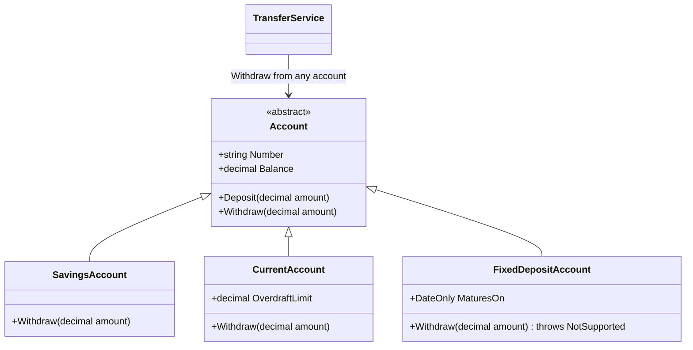
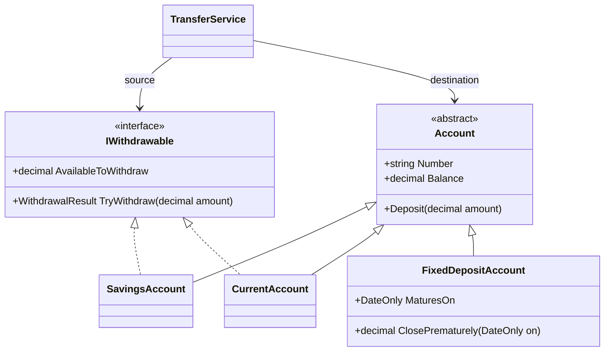
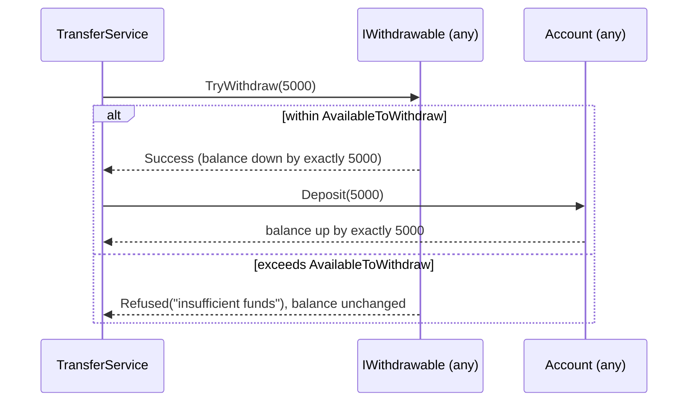
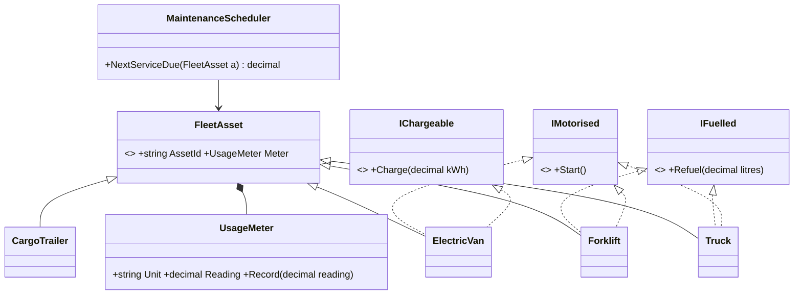

The Liskov Substitution Principle (LSP) is the "L" in SOLID. It is the principle that makes polymorphism safe. The [Open/Closed Principle](#/lesson/m04-ocp) says "plug new implementations into a stable core". LSP says what a new implementation must do so that plugging it in doesn't break the core.

## Learning objectives

By the end of this lesson you will be able to:

1. State LSP in plain terms and in its formal "contract" form (preconditions, postconditions, invariants, history).
2. Spot the common symptoms of a violation: `NotSupportedException` in an override, `is`/`as` type checks in callers, and tests that pass for one subtype and fail for another.
3. Explain why "is-a" in the real world doesn't guarantee "is substitutable for" in code (square and rectangle, fixed deposit and account).
4. Fix violations by splitting capabilities into separate interfaces, or by making the base contract honest.
5. Write **contract tests**: one test suite that every implementation of an interface must pass.
6. Recognise that decorators and adapters must also be substitutable.

## Prerequisites

- [Encapsulation, abstraction, inheritance and polymorphism](#/lesson/m01-oop-pillars): you need `virtual`/`override` and interface implementation.
- [Interfaces and abstract classes](#/lesson/m01-interfaces-abstract).
- [Open/Closed Principle](#/lesson/m04-ocp): LSP is what makes OCP's plug-ins safe.

## Explain it like I'm a beginner

You hire a driver through an agency. The agency promises: "Any driver we send can drive a standard car, follows traffic rules, and gets you there." On Monday they send Ravi. On Tuesday they send Priya. You don't care who comes, because every driver keeps the agency's promise.

Now on Wednesday they send someone who says, "I only drive automatics, and only before 6 p.m." He *is* a driver. But he breaks the agency's promise. You only find out at 7 p.m. with a manual car. Now you have to ask every driver, "What kind are you?" before trusting them.

In code, the agency's promise is the **base type's contract** (what an interface or base class guarantees). Each driver is a **subtype**. LSP says: **every subtype must keep every promise of the base type.** If it does, callers can take any subtype without checking which one they got. If it doesn't, callers start writing `if (driver is AutomaticOnlyDriver)` everywhere, and the point of polymorphism is lost.

Note what's allowed. A driver who *also* drives trucks is fine: they do more than promised. A driver who accepts bookings until midnight is fine: they're less fussy than promised. Doing more, or accepting more, never breaks a caller. Doing less, or demanding more, does.

## First-principles explanation

### What it is

Barbara Liskov introduced the idea in 1987, and Liskov and Wing formalised it in 1994. In plain words: **if code works correctly with objects of type T, it must keep working correctly when given objects of any subtype S of T.**

"Subtype" here means any class that inherits from a base class *or* implements an interface. The principle is about **behaviour**, not just method signatures. The C# compiler checks signatures. Nobody checks behaviour except you and your tests.

### The contract rules

Think of a method's contract as three things: what the caller must provide, what the method promises back, and what stays true about the object.

| Rule | Plain English | Allowed in a subtype | Violation example |
|---|---|---|---|
| **Preconditions** cannot be strengthened | Don't demand more from the caller | Accept *more* inputs | Base accepts any amount > 0; subtype rejects amounts > ₹50,000 |
| **Postconditions** cannot be weakened | Don't promise less | Promise *more* | Base promises "balance drops by exactly the amount"; subtype also deducts a hidden fee |
| **Invariants** must be preserved | Keep the always-true facts true | Add *extra* invariants | Base guarantees `Balance >= -OverdraftLimit`; subtype lets it go further negative |
| **History constraint** | Don't allow state changes the base forbids | — | Base type is immutable; subtype adds a setter |
| **Exceptions** | Don't throw new kinds the caller isn't prepared for | Throw subtypes of documented exceptions | Base never throws on `Withdraw`; subtype throws `NotSupportedException` |

There are also signature rules: parameter types may be more general (contravariance) and return types more specific (covariance). C# enforces most of these at compile time. Since C# 9, an override may return a more derived type (covariant returns), and generic interfaces can be marked `in`/`out` ([see Microsoft Learn](https://learn.microsoft.com/dotnet/standard/generics/covariance-and-contravariance)).

### Why "is-a" isn't enough

The classic puzzle: in maths, a square *is a* rectangle. So `Square : Rectangle` seems natural:

```csharp
public class Rectangle
{
    public virtual int Width { get; set; }
    public virtual int Height { get; set; }
    public int Area => Width * Height;
}

public class Square : Rectangle
{
    public override int Width { set { base.Width = value; base.Height = value; } }
    public override int Height { set { base.Width = value; base.Height = value; } }
}

// Caller written against Rectangle:
void Stretch(Rectangle r) { r.Width = 5; r.Height = 4; Debug.Assert(r.Area == 20); }   // fails for Square: 16
```

`Rectangle`'s implicit contract says "setting Height doesn't change Width". `Square` breaks it. The real-world relationship "is a" is about *what things are*. LSP is about *what objects promise to do*. A mutable square can't promise what a mutable rectangle promises. (An *immutable* square and rectangle are fine. Without setters, there is no promise to break. Immutability removes a whole class of LSP problems.)

Which rule does `Square` break? The **postcondition** of the `Height` setter ("afterwards Height is the new value and Width is unchanged") is weakened. You can also see it as an **invariant** clash: `Square` adds the invariant `Width == Height`, and the only way to keep it is to break the base type's promise. Adding invariants is allowed only when the base type's operations can't break them.

The other classic interview example is the bird and the penguin: `class Bird { virtual void Fly() }` and `class Penguin : Bird` whose `Fly()` throws. The fix is the same as in this lesson's bank example: flying is a *capability* (`IFlyingBird`), not something every bird promises.

### The history rule in one example

The history constraint (from Liskov and Wing's paper) is the least known rule: a subtype must not allow state changes that the base type's methods could never make. Suppose `FixedRateLoan` promises "the interest rate is set at disbursement and never changes", and the EMI calculator caches the monthly instalment on that basis. A subclass `PromoLoan : FixedRateLoan` adds a `ResetRate(decimal)` method. No *existing* method was overridden, every signature matches, and yet a caller holding a `FixedRateLoan` can now observe its rate changing. The cached EMI is wrong. Adding new methods is normally fine; adding new methods that mutate state the base type promised was frozen is not.

### How it shows up in real code

You rarely see squares at work. You see these:

1. **`throw new NotSupportedException()` in an override.** The subtype can't do something the base promises.
2. **Type checks in callers.** `if (account is FixedDepositAccount) ...`. The caller has learned it can't trust the base type.
3. **Empty overrides.** `public override void Save() { }` — silently doing nothing is a weakened postcondition.
4. **Tests that only pass for some implementations.** The in-memory repository passes, the PostgreSQL one fails, because they disagree about ordering or case sensitivity.
5. **Decorators that change behaviour.** A caching or retry wrapper that returns stale data or repeats side effects.

### What happens without it

Each violation forces every caller to know about the special subtype. Callers fill up with type checks. Adding a new subtype then means finding and editing all those checks, which is exactly what [OCP](#/lesson/m04-ocp) wanted to avoid. LSP violations are how OCP designs quietly decay.

### When to be pragmatic

- **Documented optional features.** The .NET base class library sometimes chooses "optional members plus a capability flag". `ICollection<T>.IsReadOnly` tells you whether `Add` will throw. `Stream.CanSeek` tells you whether `Seek`, `Position` and `Length` will work; for a `NetworkStream` or a decompression stream they throw `NotSupportedException`. This is LSP-compliant *if* the contract says so and callers check the flag. A correct caller looks like this: `if (!stream.CanSeek) { var copy = new MemoryStream(); await stream.CopyToAsync(copy, ct); copy.Position = 0; stream = copy; }`. It is a trade-off: it keeps the type hierarchy small, at the cost of runtime checks that callers can forget.
- **Internal code with one caller.** If a base class has two subclasses and one caller you control, a perfect hierarchy can cost more than it saves. Be honest about the contract in a comment, and fix it when a third subtype appears.
- **No substitution, no problem.** LSP is about code that receives a base type and doesn't know the concrete type. A sealed class, or a subclass only ever used through its own concrete type, has no caller to surprise. Don't redesign a hierarchy nobody substitutes; just stop new callers from depending on the base type.

### Trade-offs of fixing violations

| Fix | You gain | You pay |
|---|---|---|
| Split into capability interfaces (`IWithdrawable`) | Compile-time safety: you can't call what isn't supported | More interfaces; callers must ask for the right one |
| Make the base contract honest (`TryWithdraw` returns a result) | One type; refusal is part of the promise | Every caller must handle refusal, even for types that never refuse |
| Capability flag (`CanWithdraw`) | Small hierarchy, matches some BCL patterns | Runtime checks; easy to forget |
| Composition instead of inheritance | No inherited promises to break | More delegation code |

## Visual explanation

### The violating hierarchy



`TransferService` was written against `Account`, so it calls `Withdraw` on whatever it is given. `CurrentAccount` is fine: allowing an overdraft *weakens* the precondition (it accepts more), which LSP allows. `FixedDepositAccount` throws: a fixed deposit can't be withdrawn from before maturity. It *is an* account in banking terms, but it can't keep `Account`'s promise. Every caller now needs to know about fixed deposits.

### The substitutable design



`Account` now promises only what *every* account can do: hold a balance and accept deposits. Withdrawal is a separate capability. `TransferService` asks for an `IWithdrawable` source, so the compiler stops anyone from passing a fixed deposit. The fixed deposit gets its own operation with its own rules (premature closure with a penalty). This is also [Interface Segregation](#/lesson/m04-isp) at work.

### What a caller can rely on



The diagram *is* the contract: the two outcomes every `IWithdrawable` may produce. A savings account refuses below its minimum balance, a current account refuses beyond its overdraft limit. Neither throws, and neither changes the balance on refusal. `TransferService` handles both outcomes without knowing which kind of account it has.

## Step-by-step example

Scenario: a cooperative bank's core system. The amounts and rules (₹1,000 minimum balance, 1 % premature-closure penalty) are illustrative examples.

### Step 1 — the original hierarchy

```csharp
// BAD: FixedDepositAccount can't keep Account's promise.
public abstract class Account
{
    public decimal Balance { get; protected set; }
    public virtual void Deposit(decimal amount) => Balance += amount;
    public abstract void Withdraw(decimal amount);   // implicit promise: works if funds allow
}

public class SavingsAccount : Account
{
    public override void Withdraw(decimal amount)
    {
        if (Balance - amount < 1_000m) throw new InvalidOperationException("Minimum balance");
        Balance -= amount;
    }
}

public class FixedDepositAccount : Account
{
    public override void Withdraw(decimal amount) =>
        throw new NotSupportedException("Fixed deposits cannot be withdrawn before maturity");
}
```

### Step 2 — watch a caller break

```csharp
public void PayEmi(Account from, Account loan, decimal emi)
{
    from.Withdraw(emi);      // throws NotSupportedException for an FD
    loan.Deposit(emi);
}
```

A customer links their FD as the EMI (monthly loan instalment) source in the app. The nightly job crashes on that customer. A developer "fixes" it:

```csharp
if (from is FixedDepositAccount) { /* skip and log */ } else from.Withdraw(emi);
```

The type check is the symptom. Next month, a `RecurringDepositAccount` arrives with the same problem, and every caller needs another check.

### Step 3 — name the contract

Write down what callers rely on when they call `Withdraw`:

- Precondition: `amount > 0`.
- Outcome: either the withdrawal succeeds and the balance drops by *exactly* `amount`, or it is refused and the balance is unchanged.
- Refusal is reported as a value, not an unexpected exception.
- Invariant: the balance never drops below the account's floor (minimum balance or overdraft limit).

### Step 4 — check each subtype against it

- `SavingsAccount`: keeps the promise, refusing below ₹1,000. But it *throws* to refuse, so the base must either document that exception or switch to a result.
- `CurrentAccount` with a ₹50,000 overdraft: accepts *more* withdrawals than the base implies. A weaker precondition is fine.
- `FixedDepositAccount`: can never succeed before maturity. It doesn't fit the shape. Forcing it in with "always refuse" is technically honest, but it would put an account in every withdrawal picker that can never be used.

### Step 5 — split the capability

Move withdrawal into `IWithdrawable`. Change it to `TryWithdraw` returning a `WithdrawalResult`, because refusal is a normal business outcome, not a bug. Give the FD its own operation, `ClosePrematurely`.

### Step 6 — enforce it with contract tests

Write one abstract test class describing the contract, and inherit it once per implementation. Any new withdrawable account must pass the same tests. The full version is in *Automated testing*.

## Production-style C# implementation

```text
Bank.Api/
  Program.cs
  Banking/
    Accounts.cs            Account base, IWithdrawable, results
    SavingsAccount.cs
    CurrentAccount.cs
    FixedDepositAccount.cs
    AccountStore.cs
    TransferService.cs
```

```csharp file=Banking/Accounts.cs
namespace Bank.Banking;

public sealed record WithdrawalResult(bool Succeeded, string? RefusalReason)
{
    public static readonly WithdrawalResult Success = new(true, null);
    public static WithdrawalResult Refused(string reason) => new(false, reason);
}

/// <summary>
/// Contract for every account:
/// - Deposit(amount): amount must be &gt; 0; afterwards Balance has increased by exactly amount.
/// - Balance never changes except through the operations a subtype documents.
/// </summary>
public abstract class Account(string number, decimal openingBalance)
{
    public string Number { get; } = number;
    public decimal Balance { get; protected set; } = openingBalance;

    public void Deposit(decimal amount)
    {
        ArgumentOutOfRangeException.ThrowIfNegativeOrZero(amount);
        Balance += amount;
    }
}

/// <summary>
/// Contract for accounts that allow withdrawals:
/// - Precondition: amount &gt; 0 (otherwise ArgumentOutOfRangeException; this is a programming error).
/// - If amount &lt;= AvailableToWithdraw: succeeds, and Balance decreases by exactly amount.
/// - Otherwise: returns a refusal with a reason, and Balance is unchanged. Never throws for business refusals.
/// </summary>
public interface IWithdrawable
{
    string Number { get; }
    decimal AvailableToWithdraw { get; }
    WithdrawalResult TryWithdraw(decimal amount);
}

/// <summary>Shared implementation of the withdrawal contract. Subtypes only define their floor.</summary>
public abstract class WithdrawableAccount(string number, decimal openingBalance) : Account(number, openingBalance), IWithdrawable
{
    /// <summary>The lowest balance this account may reach. Invariant: Balance &gt;= Floor.</summary>
    protected abstract decimal Floor { get; }

    public decimal AvailableToWithdraw => Math.Max(0m, Balance - Floor);

    public WithdrawalResult TryWithdraw(decimal amount)
    {
        ArgumentOutOfRangeException.ThrowIfNegativeOrZero(amount);
        if (amount > AvailableToWithdraw)
            return WithdrawalResult.Refused($"Only {AvailableToWithdraw:0.00} available in {Number}.");
        Balance -= amount;
        return WithdrawalResult.Success;
    }
}
```

```csharp file=Banking/SavingsAccount.cs
namespace Bank.Banking;

public sealed class SavingsAccount(string number, decimal openingBalance, decimal minimumBalance = 1_000m)
    : WithdrawableAccount(number, openingBalance)
{
    protected override decimal Floor => minimumBalance;
}
```

```csharp file=Banking/CurrentAccount.cs
namespace Bank.Banking;

/// <summary>An overdraft lets the balance go negative. This weakens the precondition (accepts more), which LSP allows.</summary>
public sealed class CurrentAccount(string number, decimal openingBalance, decimal overdraftLimit)
    : WithdrawableAccount(number, openingBalance)
{
    public decimal OverdraftLimit { get; } = overdraftLimit >= 0 ? overdraftLimit : throw new ArgumentOutOfRangeException(nameof(overdraftLimit));
    protected override decimal Floor => -OverdraftLimit;
}
```

```csharp file=Banking/FixedDepositAccount.cs
namespace Bank.Banking;

/// <summary>Not IWithdrawable: money leaves only by closing the deposit, under its own rules.</summary>
public sealed class FixedDepositAccount(string number, decimal principal, DateOnly maturesOn, decimal prematurePenaltyPercent = 1m)
    : Account(number, principal)
{
    public DateOnly MaturesOn { get; } = maturesOn;
    public bool IsClosed { get; private set; }

    /// <summary>Closes the deposit and returns the payout. Before maturity, a penalty applies.</summary>
    public decimal Close(DateOnly on)
    {
        if (IsClosed) throw new InvalidOperationException($"{Number} is already closed.");
        var penalty = on < MaturesOn ? Math.Round(Balance * prematurePenaltyPercent / 100m, 2) : 0m;
        var payout = Balance - penalty;
        Balance = 0m;
        IsClosed = true;
        return payout;
    }
}
```

```csharp file=Banking/AccountStore.cs
using System.Collections.Concurrent;

namespace Bank.Banking;

public interface IAccountStore
{
    Account? Find(string number);
}

public sealed class InMemoryAccountStore : IAccountStore
{
    private readonly ConcurrentDictionary<string, Account> _accounts = new(StringComparer.OrdinalIgnoreCase);

    public InMemoryAccountStore Add(Account account)
    {
        _accounts[account.Number] = account;
        return this;
    }

    public Account? Find(string number) => _accounts.TryGetValue(number, out var a) ? a : null;
}
```

```csharp file=Banking/TransferService.cs
using Microsoft.Extensions.Logging;

namespace Bank.Banking;

public sealed record TransferOutcome(bool Succeeded, string? Error);

/// <summary>Works with any IWithdrawable and any Account. It contains no type checks on concrete account types.</summary>
public sealed class TransferService(IAccountStore store, ILogger<TransferService> logger)
{
    private readonly Lock _gate = new();   // single-process demo; a database transaction does this job in production

    public TransferOutcome Transfer(string fromNumber, string toNumber, decimal amount)
    {
        if (amount <= 0) return new(false, "Amount must be positive.");
        if (string.Equals(fromNumber, toNumber, StringComparison.OrdinalIgnoreCase)) return new(false, "Source and destination are the same.");

        // The only "type" question: does the source have the withdrawal capability? That is a contract, not a concrete class.
        if (store.Find(fromNumber) is not IWithdrawable source) return new(false, $"{fromNumber} does not allow withdrawals.");
        if (store.Find(toNumber) is not { } destination) return new(false, $"{toNumber} not found.");

        lock (_gate)
        {
            var result = source.TryWithdraw(amount);
            if (!result.Succeeded) return new(false, result.RefusalReason);
            destination.Deposit(amount);
        }
        logger.LogInformation("Transferred {Amount} from {From} to {To}", amount, fromNumber, toNumber);
        return new(true, null);
    }
}
```

```csharp file=Program.cs
using Bank.Banking;

var builder = WebApplication.CreateBuilder(args);

builder.Services.AddSingleton<IAccountStore>(new InMemoryAccountStore()
    .Add(new SavingsAccount("SB-1001", 25_000m))
    .Add(new CurrentAccount("CA-2001", 5_000m, overdraftLimit: 50_000m))
    .Add(new FixedDepositAccount("FD-3001", 200_000m, new DateOnly(2027, 4, 1))));
builder.Services.AddSingleton<TransferService>();

var app = builder.Build();

app.MapPost("/transfers", (TransferRequest req, TransferService transfers) =>
{
    var outcome = transfers.Transfer(req.From, req.To, req.Amount);
    return outcome.Succeeded ? Results.Ok() : Results.Problem(outcome.Error, statusCode: StatusCodes.Status422UnprocessableEntity);
});

app.Run();

public sealed record TransferRequest(string From, string To, decimal Amount);
```

Design notes:

- **The contract is written down.** XML comments on `Account` and `IWithdrawable` say exactly what every implementation promises. Without a written contract, nobody can say whether a subtype violates it.
- **`WithdrawableAccount` holds the contract logic once.** Subtypes only supply `Floor`. That makes it hard for a new subtype to break the "balance unchanged on refusal" rule by accident. The base class is a [Template Method](#/lesson/m06-template-method) with one hook.
- **Programming errors still throw.** A zero or negative amount is a caller bug, so it throws `ArgumentOutOfRangeException`. Business refusals (insufficient funds) are results. The contract says which is which.
- **One capability check remains** in `TransferService`: `is not IWithdrawable`. Checking for a *capability interface* is acceptable and stable. Checking for a *concrete class* (`is FixedDepositAccount`) is the smell.
- **`System.Threading.Lock`** (.NET 9+) guards the demo. In production, the transfer is a database transaction with row locks ([see Locking](#/lesson/m09-locking)).

## Bad design vs good design

**Bad**: `FixedDepositAccount : Account` with `Withdraw` throwing `NotSupportedException`. Every caller either crashes or adds an `is FixedDepositAccount` check.

**Good**: withdrawal is a capability (`IWithdrawable`). The compiler prevents passing a fixed deposit to code that withdraws.

### More violations you'll meet at work

**Strengthened precondition:**

```csharp
public class BulkUploadStore : IDocumentStore
{
    public Task SaveAsync(string name, Stream content, CancellationToken ct)
    {
        if (content.Length > 10 * 1024 * 1024) throw new ArgumentException("Max 10 MB");   // base type allowed any size
        ...
    }
}
```

Callers that previously saved 50 MB scanned loan agreements now fail. Either make the limit part of the base contract (with a `MaxSize` property every caller can read), or don't pretend this is the same kind of store.

**Weakened postcondition:**

```csharp
public class FastSearchRepository : ITransactionRepository
{
    // Base contract: returns ALL matching transactions. This returns the first 100 "for performance".
    public IReadOnlyList<Transaction> Search(string text) => _index.Search(text).Take(100).ToList();
}
```

A report that totals a customer's matching UPI payments for a tax statement is now silently wrong. Paging is a fine idea, but it must be visible in the contract (`Search(text, page, size)` returning a total).

**Broken invariant in a decorator:**

```csharp
public class CachedExchangeRates(IExchangeRates inner) : IExchangeRates
{
    // Base contract: "rate is at most 15 minutes old". This cache keeps rates for a day.
}
```

Decorators and proxies are subtypes too. A wrapper that changes freshness, ordering or idempotency is an LSP violation even if every method signature matches.

### When simplistic LSP hurts

:::callout type=mistake title="Splitting every hierarchy into tiny capability interfaces"
After learning LSP, some teams give every class five `ICan...` interfaces. If every caller needs all of them anyway, you've added names without adding safety. Split a capability out only when some real implementations can't support it and some real callers don't need it.
:::

:::callout type=tradeoff title="Throwing NotSupportedException is sometimes the right call"
The .NET BCL's `ReadOnlyCollection<T>` implements `IList<T>` and throws on `Add`. Arrays do the same. This was a deliberate trade-off: one widely used interface instead of a separate read-only hierarchy (which came later as `IReadOnlyList<T>`). It is acceptable because `IsReadOnly` is part of the documented contract. If you take this route, document it, provide the capability flag, and test that callers respect it.
:::

A good rule: **prefer making invalid substitutions impossible to compile. If that costs too much, make the contract honest and checkable at runtime. Never leave it implicit.**

## Practical playground

The playground runs the same caller against a rectangle and a square, and then against three accounts. Watch which substitutions break. Then try making `Rectangle` and `Square` immutable records with a `WithWidth` method and see the problem disappear.

:::playground type=csharp title="Watch a substitution break"
```csharp file=Program.cs
using System;
using System.Collections.Generic;

public class Rectangle
{
    public virtual int Width { get; set; }
    public virtual int Height { get; set; }
    public int Area => Width * Height;
}

public class Square : Rectangle
{
    public override int Width { get => base.Width; set { base.Width = value; base.Height = value; } }
    public override int Height { get => base.Height; set { base.Width = value; base.Height = value; } }
}

public interface IWithdrawable { string Name { get; } decimal Balance { get; } bool TryWithdraw(decimal amount); }

public sealed class Savings(decimal balance) : IWithdrawable
{
    public string Name => "Savings";
    public decimal Balance { get; private set; } = balance;
    public bool TryWithdraw(decimal amount) { if (Balance - amount < 1_000m) return false; Balance -= amount; return true; }
}

public sealed class Current(decimal balance, decimal overdraft) : IWithdrawable
{
    public string Name => "Current";
    public decimal Balance { get; private set; } = balance;
    public bool TryWithdraw(decimal amount) { if (Balance - amount < -overdraft) return false; Balance -= amount; return true; }
}

// TODO: add a "PromoWallet" that silently deducts a 2 % fee on every withdrawal.
// Which line in Main shows it breaking the contract?

public static class Program
{
    static void Stretch(Rectangle r)
    {
        r.Width = 5;
        r.Height = 4;
        Console.WriteLine($"{r.GetType().Name,-10} expected area 20, got {r.Area}");
    }

    public static void Main()
    {
        Stretch(new Rectangle());
        Stretch(new Square());

        var accounts = new List<IWithdrawable> { new Savings(5_000m), new Current(5_000m, 20_000m) };
        foreach (var a in accounts)
        {
            var before = a.Balance;
            var ok = a.TryWithdraw(4_500m);
            var contractKept = ok ? a.Balance == before - 4_500m : a.Balance == before;
            Console.WriteLine($"{a.Name,-10} ok={ok,-5} balance={a.Balance,9} contract kept={contractKept}");
        }
    }
}
```
:::

## Exercises

:::exercise id=m04-lsp-ex1 difficulty=beginner kind=written title="Which subtypes break the promise?"
The base type is `IShippingCarrier` with this documented contract: *`Quote(parcel)` accepts any parcel up to 30 kg and returns a positive price in rupees. `Book(parcel)` returns a tracking number and never returns null.*

For each implementation, say whether it violates LSP and which rule it breaks.

1. `ExpressCarrier` accepts parcels up to 50 kg.
2. `LocalCourier` throws `ArgumentException` for parcels over 5 kg.
3. `PartnerCarrier.Book` returns `null` when the partner's API is down.
4. `DiscountCarrier.Quote` returns 0 for parcels under 500 g ("free shipping").
5. `TrackedCarrier.Book` also sends an SMS to the customer.
::acceptance
- All five are classified, each with the contract rule involved (precondition, postcondition, invariant, exception).
- The answer recognises that accepting more input, or doing extra work, is allowed.
- For at least two violations, a fix is proposed.
::hint
For each one, ask: could a caller written against the base type be surprised?
::hint
Accepting *more* than the base requires is fine. Accepting *less* is a strengthened precondition.
::hint
"Positive price" and "never null" are postconditions. Returning 0 or null weakens them.
::hint
Extra side effects don't break the contract unless the base promises there are none, but think about whether callers might be surprised.
::solution
| # | Violates? | Rule |
|---|---|---|
| 1 | No | Weaker precondition (accepts more). |
| 2 | Yes | Strengthened precondition: rejects 5–30 kg parcels the base accepts. |
| 3 | Yes | Weakened postcondition: "never null". Callers will hit `NullReferenceException`. |
| 4 | Yes | Weakened postcondition: "positive price". A caller that divides by price, or treats 0 as "no quote", breaks. |
| 5 | No (by contract) | Extra behaviour is allowed. But if the base contract says "no customer notifications" or callers also send SMS, customers get two messages. Document it. |

Fixes: for 2, add `MaxWeightKg` (or `CanCarry(parcel)`) to the contract so callers can filter carriers before quoting. For 3, either throw a documented `CarrierUnavailableException` or return a `BookingResult` with a failure case. For 4, change the contract to "non-negative price" if free shipping is a real business case. That's a deliberate contract change, reviewed with all callers.
::mistakes
- Marking 1 as a violation because it's "different". Different is fine; surprising is not.
- Fixing 2 with `if (carrier is LocalCourier)` in callers.
:::

:::exercise id=m04-lsp-ex2 difficulty=beginner kind=code title="Stop the archive store from lying"
`ArchiveStore` implements `IDocumentStore` but throws `NotSupportedException` on `Save`, because archived bank statements (older than the retention cut-off) are read-only by regulation. The statement viewer in the customer app only reads. Split the interface so the archive store can't be passed where writing is needed, and make `DocumentViewer` depend only on reading.
::requirements
- `IDocumentReader` has `bool Exists(string path)` and `string Read(string path)`.
- `IDocumentStore : IDocumentReader` adds `void Save(string path, string content)`.
- `ArchiveStore` implements only `IDocumentReader`.
- `InMemoryDocumentStore` implements `IDocumentStore`.
- `DocumentViewer` takes an `IDocumentReader` and returns `"(missing)"` for absent paths.
::acceptance
- `ArchiveStore` has no `Save` method at all.
- `DocumentViewer` works with both stores.
- `Read` on a missing path throws `FileNotFoundException` in both stores (same contract).
::hint
The fix is in the types, not in a new `if`.
::hint
The starter already declares the interfaces. Implement the classes.
::hint
`ArchiveStore` can take a dictionary of documents in its constructor, since nobody can add to it later.
::hint
```csharp
public string Read(string path) =>
    _docs.TryGetValue(path, out var c) ? c : throw new FileNotFoundException(path);
```
::starter
```csharp file=Documents.cs
using System;
using System.Collections.Generic;
using System.IO;

public interface IDocumentReader
{
    bool Exists(string path);
    /// <summary>Throws FileNotFoundException if the path does not exist.</summary>
    string Read(string path);
}

public interface IDocumentStore : IDocumentReader
{
    void Save(string path, string content);
}

public sealed class InMemoryDocumentStore : IDocumentStore
{
    public bool Exists(string path) => throw new NotImplementedException();
    public string Read(string path) => throw new NotImplementedException();
    public void Save(string path, string content) => throw new NotImplementedException();
}

/// <summary>Read-only archive of old account statements.</summary>
public sealed class ArchiveStore : IDocumentReader
{
    public ArchiveStore(IReadOnlyDictionary<string, string> documents) => throw new NotImplementedException();
    public bool Exists(string path) => throw new NotImplementedException();
    public string Read(string path) => throw new NotImplementedException();
}

public sealed class DocumentViewer(IDocumentReader reader)
{
    public string Show(string path) => throw new NotImplementedException();
}
```
::tests
```csharp file=DocumentTests.cs
using System.Collections.Generic;
using System.IO;
using Xunit;

public class DocumentTests
{
    private static ArchiveStore Archive() => new(new Dictionary<string, string> { ["SB-1001/2019-03.txt"] = "Statement for March 2019" });

    [Fact] public void Archive_is_not_writable() => Assert.False(typeof(IDocumentStore).IsAssignableFrom(typeof(ArchiveStore)));
    [Fact] public void Viewer_reads_archive() => Assert.Equal("Statement for March 2019", new DocumentViewer(Archive()).Show("SB-1001/2019-03.txt"));
    [Fact] public void Viewer_handles_missing() => Assert.Equal("(missing)", new DocumentViewer(Archive()).Show("nope.txt"));

    [Fact]
    public void Viewer_reads_live_store()
    {
        var store = new InMemoryDocumentStore();
        store.Save("a.txt", "hello");
        Assert.Equal("hello", new DocumentViewer(store).Show("a.txt"));
    }

    [Fact] public void Missing_read_throws_in_archive() => Assert.Throws<FileNotFoundException>(() => Archive().Read("x"));
    [Fact] public void Missing_read_throws_in_store() => Assert.Throws<FileNotFoundException>(() => new InMemoryDocumentStore().Read("x"));
}
```
::solution
The archive simply doesn't claim the write capability, so there's nothing to throw.

```csharp file=Documents.cs
using System;
using System.Collections.Generic;
using System.IO;

public interface IDocumentReader
{
    bool Exists(string path);
    string Read(string path);
}

public interface IDocumentStore : IDocumentReader
{
    void Save(string path, string content);
}

public sealed class InMemoryDocumentStore : IDocumentStore
{
    private readonly Dictionary<string, string> _docs = new(StringComparer.Ordinal);
    public bool Exists(string path) => _docs.ContainsKey(path);
    public string Read(string path) => _docs.TryGetValue(path, out var c) ? c : throw new FileNotFoundException(path);
    public void Save(string path, string content) => _docs[path] = content;
}

public sealed class ArchiveStore : IDocumentReader
{
    private readonly Dictionary<string, string> _docs;
    public ArchiveStore(IReadOnlyDictionary<string, string> documents) => _docs = new Dictionary<string, string>(documents, StringComparer.Ordinal);
    public bool Exists(string path) => _docs.ContainsKey(path);
    public string Read(string path) => _docs.TryGetValue(path, out var c) ? c : throw new FileNotFoundException(path);
}

public sealed class DocumentViewer(IDocumentReader reader)
{
    public string Show(string path) => reader.Exists(path) ? reader.Read(path) : "(missing)";
}
```

The archive copies the dictionary it is given, so a caller can't modify the "read-only" archive later through the original reference. That keeps the history constraint.
::mistakes
- Keeping `Save` on the archive and making it a silent no-op. That's still a weakened postcondition, and harder to notice than an exception.
- Different case-sensitivity in the two stores. A test that passes against one and fails against the other is a sign of an LSP gap.
:::

:::exercise id=m04-lsp-ex3 difficulty=intermediate kind=code title="Contract tests for exchange-rate providers"
Your invoicing system converts foreign-currency bills to rupees through `IExchangeRateProvider`. There are two implementations: a fixed table (for tests and offline mode) and a caching decorator around any provider. Implement both so they pass **the same** abstract contract test suite.
::requirements
Contract:
- `GetRate(from, to)` returns a rate > 0.
- `GetRate(x, x)` is exactly 1 for any known currency.
- Codes are case-insensitive.
- An unknown currency throws `UnknownCurrencyException` (and nothing else).
- `GetRate(b, a)` equals `1 / GetRate(a, b)` within 0.000001.

`FixedRateProvider` takes a dictionary of "rupees per unit" (e.g. USD → 83.2, EUR → 90.1; INR is implicitly 1). `CachingRateProvider` wraps any `IExchangeRateProvider` and calls the inner provider at most once per (from, to) pair.
::acceptance
- Both implementations pass every test in `RateProviderContract`.
- The caching provider calls the inner provider once for repeated requests.
- The caching provider doesn't cache failures (an unknown currency still throws every time).
::hint
For `FixedRateProvider`, convert through rupees: rate(from → to) = rupeesPer[from] / rupeesPer[to].
::hint
Store keys upper-cased. Remember that INR = 1 even if the dictionary doesn't contain it.
::hint
For the cache, use `Dictionary<(string, string), decimal>` and upper-case the key before looking it up.
::hint
Don't catch exceptions in the cache. If the inner call throws, nothing is stored, and the next call tries again.
::starter
```csharp file=Rates.cs
using System;
using System.Collections.Generic;

public sealed class UnknownCurrencyException(string code) : Exception($"Unknown currency '{code}'.");

public interface IExchangeRateProvider
{
    /// <summary>Units of <paramref name="to"/> per one unit of <paramref name="from"/>. See the contract tests.</summary>
    decimal GetRate(string from, string to);
}

public sealed class FixedRateProvider : IExchangeRateProvider
{
    public FixedRateProvider(IReadOnlyDictionary<string, decimal> rupeesPerUnit) => throw new NotImplementedException();
    public decimal GetRate(string from, string to) => throw new NotImplementedException();
}

public sealed class CachingRateProvider(IExchangeRateProvider inner) : IExchangeRateProvider
{
    public decimal GetRate(string from, string to) => throw new NotImplementedException();
}
```
::tests
```csharp file=RateContractTests.cs
using System;
using System.Collections.Generic;
using Xunit;

/// <summary>Every IExchangeRateProvider must pass these. Inherit once per implementation.</summary>
public abstract class RateProviderContract
{
    protected static readonly Dictionary<string, decimal> Table = new() { ["USD"] = 83.2m, ["EUR"] = 90.1m, ["AED"] = 22.65m };
    protected abstract IExchangeRateProvider Create();

    [Fact] public void Rate_is_positive() => Assert.True(Create().GetRate("USD", "EUR") > 0);
    [Fact] public void Same_currency_is_one() => Assert.Equal(1m, Create().GetRate("EUR", "EUR"));
    [Fact] public void Inr_is_known() => Assert.Equal(83.2m, Create().GetRate("USD", "INR"));
    [Fact] public void Case_insensitive() => Assert.Equal(Create().GetRate("USD", "INR"), Create().GetRate("usd", "inr"));
    [Fact] public void Unknown_currency_throws_documented_exception() => Assert.Throws<UnknownCurrencyException>(() => Create().GetRate("XYZ", "INR"));

    [Fact]
    public void Inverse_is_consistent()
    {
        var p = Create();
        Assert.True(Math.Abs(p.GetRate("USD", "AED") * p.GetRate("AED", "USD") - 1m) < 0.000001m);
    }
}

public class FixedRateProviderContract : RateProviderContract
{
    protected override IExchangeRateProvider Create() => new FixedRateProvider(Table);
}

public class CachingRateProviderContract : RateProviderContract
{
    protected override IExchangeRateProvider Create() => new CachingRateProvider(new FixedRateProvider(Table));
}

public class CachingBehaviourTests
{
    private sealed class CountingProvider(IExchangeRateProvider inner) : IExchangeRateProvider
    {
        public int Calls;
        public decimal GetRate(string from, string to) { Calls++; return inner.GetRate(from, to); }
    }

    [Fact]
    public void Inner_called_once_per_pair()
    {
        var counting = new CountingProvider(new FixedRateProvider(new Dictionary<string, decimal> { ["USD"] = 83.2m }));
        var cache = new CachingRateProvider(counting);
        cache.GetRate("USD", "INR");
        cache.GetRate("usd", "INR");
        cache.GetRate("USD", "INR");
        Assert.Equal(1, counting.Calls);
    }

    [Fact]
    public void Failures_are_not_cached()
    {
        var counting = new CountingProvider(new FixedRateProvider(new Dictionary<string, decimal>()));
        var cache = new CachingRateProvider(counting);
        Assert.Throws<UnknownCurrencyException>(() => cache.GetRate("XYZ", "INR"));
        Assert.Throws<UnknownCurrencyException>(() => cache.GetRate("XYZ", "INR"));
        Assert.Equal(2, counting.Calls);
    }
}
```
::solution
```csharp file=Rates.cs
using System;
using System.Collections.Generic;

public sealed class UnknownCurrencyException(string code) : Exception($"Unknown currency '{code}'.");

public interface IExchangeRateProvider
{
    decimal GetRate(string from, string to);
}

public sealed class FixedRateProvider : IExchangeRateProvider
{
    private readonly Dictionary<string, decimal> _rupeesPerUnit = new(StringComparer.OrdinalIgnoreCase) { ["INR"] = 1m };

    public FixedRateProvider(IReadOnlyDictionary<string, decimal> rupeesPerUnit)
    {
        foreach (var (code, rate) in rupeesPerUnit)
        {
            if (rate <= 0) throw new ArgumentOutOfRangeException(nameof(rupeesPerUnit), $"Rate for {code} must be positive.");
            _rupeesPerUnit[code] = rate;
        }
    }

    public decimal GetRate(string from, string to)
    {
        if (!_rupeesPerUnit.TryGetValue(from, out var f)) throw new UnknownCurrencyException(from);
        if (!_rupeesPerUnit.TryGetValue(to, out var t)) throw new UnknownCurrencyException(to);
        return string.Equals(from, to, StringComparison.OrdinalIgnoreCase) ? 1m : f / t;
    }
}

public sealed class CachingRateProvider(IExchangeRateProvider inner) : IExchangeRateProvider
{
    private readonly Dictionary<(string, string), decimal> _cache = new();
    private readonly object _gate = new();

    public decimal GetRate(string from, string to)
    {
        var key = (from.ToUpperInvariant(), to.ToUpperInvariant());
        lock (_gate)
        {
            if (_cache.TryGetValue(key, out var cached)) return cached;
        }
        var rate = inner.GetRate(key.Item1, key.Item2);   // throws are not cached
        lock (_gate) { _cache[key] = rate; }
        return rate;
    }
}
```

The contract tests are written once and inherited. When someone adds a `LiveRbiReferenceRateProvider` next year, they add one three-line test class, and it is held to exactly the same promises.
::alternatives
In production the caching provider should also expire entries (rates change), using `IMemoryCache` or `HybridCache` with a time-to-live. Expiry must be part of the contract ("rates may be up to N minutes old"), or the cache weakens the freshness postcondition.
::mistakes
- Caching with the caller's original casing, so "USD" and "usd" are cached separately (still correct, but the call-count test fails).
- Catching the inner exception and returning 0 "to be safe". That breaks "rate > 0" for every caller.
- Computing `GetRate(x, x)` as `f / f`, which is 1 for decimals but can produce rounding noise if you later switch to `double`.
:::

:::exercise id=m04-lsp-ex4 difficulty=intermediate kind=design title="Fix the fleet hierarchy"
A parcel-delivery company's fleet app has `abstract class Vehicle { Refuel(litres); StartEngine(); RecordOdometer(km); }`. Subclasses: `Truck`, `Forklift` (works inside the warehouse and tracks engine hours, not kilometres), `ElectricVan` (no fuel), and `CargoTrailer` (towed behind a truck, no engine at all). Several subclasses throw `NotSupportedException`. Redesign the types so that no override throws, and so the maintenance scheduler (which plans service by usage) works for all of them.
::acceptance
- No subtype throws `NotSupportedException` for a base-type method.
- Usage is modelled so the scheduler can treat kilometres and engine hours uniformly.
- Capabilities (fuelling, charging, engine) are separate and optional.
- The design is shown as a class diagram with a short justification.
::hint
What does *every* asset have in common? Start the base type there.
::hint
"Usage" can be an abstraction: a meter with a unit (km or hours) and a reading.
::hint
Capabilities: `IFuelled`, `IChargeable`, `IMotorised`. A cargo trailer implements none of them.
::solution


- `FleetAsset` promises only what every asset has: an ID and a usage meter. The meter's unit is `km` for trucks, vans and trailers (a trailer's comes from a hub odometer on its axle, not an engine) and `hours` for forklifts.
- The scheduler compares `Meter.Reading` against a service interval stored per asset type, in the same unit. It never asks "what kind of vehicle is this?"
- Fuelling, charging and starting are capabilities. The fuel-log screen takes `IFuelled`. The charging-session screen takes `IChargeable`. Tyre and brake checks for the trailer are driven by its meter like everything else.
- `RecordOdometer(km)` is gone. It assumed every asset counts kilometres, a precondition half the fleet couldn't meet.
::mistakes
- Adding `bool HasEngine` and `bool UsesFuel` flags to `Vehicle` and checking them everywhere. It's the same problem with booleans instead of exceptions.
- Making `Forklift.RecordOdometer` convert hours to "equivalent km". That invents a meaningless number to satisfy a bad contract.
:::

:::exercise id=m04-lsp-ex5 difficulty=advanced kind=code title="A retry decorator that keeps the idempotency promise"
`IPaymentGateway.Capture(request)` has this contract: *calling it twice with the same `IdempotencyKey` charges the customer at most once and returns the same result.* A teammate wrote a retry decorator that creates a fresh request (with a new key) on each attempt "to avoid stale data". When the first attempt actually succeeded but the response timed out, the customer was charged twice. Implement `RetryingPaymentGateway` correctly.
::requirements
- Retry on `GatewayTimeoutException` only, up to `maxAttempts` total attempts.
- Every attempt must reuse the caller's request object, so the idempotency key is the same.
- Any other exception propagates immediately without retry.
- After the last failed attempt, rethrow the last `GatewayTimeoutException`.
- `maxAttempts` < 1 throws `ArgumentOutOfRangeException` in the constructor.
::acceptance
- With a fake that times out twice then succeeds, the result is success after 3 calls, all with the same key.
- With a fake that "charged but timed out" on attempt 1, the customer is charged exactly once.
- A `CardDeclinedException` is not retried.
- The decorator passes for every caller that relies on the base contract, which is what makes it substitutable.
::hint
A decorator is a subtype. Which postcondition of the base did the teammate's version weaken?
::hint
Pass the *same* `CaptureRequest` instance (or at least the same key) to every attempt.
::hint
Use `catch (GatewayTimeoutException ex) when (attempt < maxAttempts)` so the last timeout escapes naturally.
::hint
```csharp
for (var attempt = 1; ; attempt++)
{
    try { return inner.Capture(request); }
    catch (GatewayTimeoutException) when (attempt < _maxAttempts) { /* try again with the same request */ }
}
```
::starter
```csharp file=Payments.cs
using System;

public sealed record CaptureRequest(string IdempotencyKey, string OrderId, decimal Amount);
public sealed record CaptureResult(string PaymentId, decimal Amount);

public sealed class GatewayTimeoutException() : Exception("Gateway timed out.");
public sealed class CardDeclinedException() : Exception("Card declined.");

/// <summary>Contract: same IdempotencyKey => charged at most once, same result returned.</summary>
public interface IPaymentGateway
{
    CaptureResult Capture(CaptureRequest request);
}

public sealed class RetryingPaymentGateway : IPaymentGateway
{
    public RetryingPaymentGateway(IPaymentGateway inner, int maxAttempts) => throw new NotImplementedException();
    public CaptureResult Capture(CaptureRequest request) => throw new NotImplementedException();
}
```
::tests
```csharp file=PaymentTests.cs
using System;
using System.Collections.Generic;
using Xunit;

public class RetryingPaymentGatewayTests
{
    /// <summary>Behaves like a real idempotent gateway, with scripted failures.</summary>
    private sealed class FakeGateway(params string[] script) : IPaymentGateway
    {
        public readonly List<string> KeysSeen = new();
        public readonly Dictionary<string, CaptureResult> Charged = new();
        private int _call;

        public CaptureResult Capture(CaptureRequest r)
        {
            KeysSeen.Add(r.IdempotencyKey);
            var step = _call < script.Length ? script[_call] : "ok";
            _call++;
            if (step == "declined") throw new CardDeclinedException();
            if (step == "timeout") throw new GatewayTimeoutException();
            if (!Charged.TryGetValue(r.IdempotencyKey, out var result))
            {
                result = new CaptureResult($"pay_{Charged.Count + 1}", r.Amount);
                Charged[r.IdempotencyKey] = result;
            }
            if (step == "charged-then-timeout") throw new GatewayTimeoutException();
            return result;
        }
    }

    private static readonly CaptureRequest Req = new("key-123", "ORD-9", 1_499m);

    [Fact]
    public void Retries_timeouts_with_same_key()
    {
        var fake = new FakeGateway("timeout", "timeout", "ok");
        var result = new RetryingPaymentGateway(fake, 3).Capture(Req);
        Assert.Equal(1_499m, result.Amount);
        Assert.Equal(3, fake.KeysSeen.Count);
        Assert.All(fake.KeysSeen, k => Assert.Equal("key-123", k));
    }

    [Fact]
    public void Charged_then_timeout_charges_once()
    {
        var fake = new FakeGateway("charged-then-timeout", "ok");
        var result = new RetryingPaymentGateway(fake, 3).Capture(Req);
        Assert.Single(fake.Charged);
        Assert.Equal("pay_1", result.PaymentId);
    }

    [Fact]
    public void Declines_are_not_retried()
    {
        var fake = new FakeGateway("declined", "ok");
        Assert.Throws<CardDeclinedException>(() => new RetryingPaymentGateway(fake, 3).Capture(Req));
        Assert.Single(fake.KeysSeen);
    }

    [Fact]
    public void Gives_up_after_max_attempts()
    {
        var fake = new FakeGateway("timeout", "timeout", "timeout", "ok");
        Assert.Throws<GatewayTimeoutException>(() => new RetryingPaymentGateway(fake, 3).Capture(Req));
        Assert.Equal(3, fake.KeysSeen.Count);
    }

    [Fact]
    public void Max_attempts_must_be_positive() =>
        Assert.Throws<ArgumentOutOfRangeException>(() => new RetryingPaymentGateway(new FakeGateway(), 0));
}
```
::solution
The decorator keeps the base contract by reusing the caller's request, and therefore its idempotency key, on every attempt.

```csharp file=Payments.cs
using System;

public sealed record CaptureRequest(string IdempotencyKey, string OrderId, decimal Amount);
public sealed record CaptureResult(string PaymentId, decimal Amount);

public sealed class GatewayTimeoutException() : Exception("Gateway timed out.");
public sealed class CardDeclinedException() : Exception("Card declined.");

public interface IPaymentGateway
{
    CaptureResult Capture(CaptureRequest request);
}

public sealed class RetryingPaymentGateway : IPaymentGateway
{
    private readonly IPaymentGateway _inner;
    private readonly int _maxAttempts;

    public RetryingPaymentGateway(IPaymentGateway inner, int maxAttempts)
    {
        ArgumentNullException.ThrowIfNull(inner);
        ArgumentOutOfRangeException.ThrowIfLessThan(maxAttempts, 1);
        _inner = inner;
        _maxAttempts = maxAttempts;
    }

    public CaptureResult Capture(CaptureRequest request)
    {
        ArgumentNullException.ThrowIfNull(request);
        for (var attempt = 1; ; attempt++)
        {
            try
            {
                return _inner.Capture(request);   // same request, same idempotency key, every time
            }
            catch (GatewayTimeoutException) when (attempt < _maxAttempts)
            {
                // A timeout means "unknown outcome", not "failed". Retrying with the same key is safe
                // only because the gateway's contract de-duplicates by key.
            }
        }
    }
}
```

In production, add a delay with jitter between attempts (inject `TimeProvider` so tests don't sleep) and pass a `CancellationToken`. The LSP lesson is the key: a decorator is substitutable only if it keeps *all* of the base type's promises, including ones that aren't visible in the method signature, such as idempotency.
::mistakes
- Generating `Guid.NewGuid()` per attempt. Each attempt then looks like a new payment.
- Retrying `CardDeclinedException`. Retrying a business refusal three times can trigger a bank's fraud checks.
- Catching `Exception` and retrying everything, including bugs like `ArgumentNullException`.
:::

## Automated testing

The most useful LSP tool is the **contract test**: an abstract test class that describes the base type's promises, inherited once per implementation. xUnit runs every inherited `[Fact]` against each concrete test class.

```csharp
public abstract class WithdrawableContract
{
    /// <summary>Create an account whose AvailableToWithdraw is at least 10,000.</summary>
    protected abstract IWithdrawable CreateWithAtLeast10k();

    [Fact]
    public void Successful_withdrawal_reduces_balance_by_exactly_the_amount()
    {
        var a = CreateWithAtLeast10k();
        var before = ((Account)a).Balance;
        Assert.True(a.TryWithdraw(2_500m).Succeeded);
        Assert.Equal(before - 2_500m, ((Account)a).Balance);
    }

    [Fact]
    public void Refusal_leaves_balance_unchanged()
    {
        var a = CreateWithAtLeast10k();
        var before = ((Account)a).Balance;
        var result = a.TryWithdraw(a.AvailableToWithdraw + 0.01m);
        Assert.False(result.Succeeded);
        Assert.NotNull(result.RefusalReason);
        Assert.Equal(before, ((Account)a).Balance);
    }

    [Fact]
    public void Can_withdraw_exactly_what_is_available()
    {
        var a = CreateWithAtLeast10k();
        Assert.True(a.TryWithdraw(a.AvailableToWithdraw).Succeeded);
        Assert.Equal(0m, a.AvailableToWithdraw);
    }

    [Fact]
    public void Non_positive_amount_is_a_programming_error() =>
        Assert.Throws<ArgumentOutOfRangeException>(() => CreateWithAtLeast10k().TryWithdraw(0m));
}

public class SavingsAccountContract : WithdrawableContract
{
    protected override IWithdrawable CreateWithAtLeast10k() => new SavingsAccount("SB-T", 20_000m);
}

public class CurrentAccountContract : WithdrawableContract
{
    protected override IWithdrawable CreateWithAtLeast10k() => new CurrentAccount("CA-T", 0m, overdraftLimit: 15_000m);
}
```

What this buys you:

- A new implementation is checked against every promise by adding one three-line class.
- When a contract test fails for only one implementation, you've found an LSP violation, not a flaky test.
- The test class *is* the executable contract. It reads like the XML comment on the interface, and it can't drift from the code.

Other tests:

- **Type-level tests** for capability splits: `Assert.False(typeof(IWithdrawable).IsAssignableFrom(typeof(FixedDepositAccount)))` stops anyone from "helpfully" adding the interface back.
- **The caller with every subtype.** Run `TransferService` tests with a savings source, a current source with overdraft, and an FD source (expect a clear refusal, not an exception).
- **Repository contract tests.** Run the same suite against the in-memory fake and the real PostgreSQL repository (in an integration test). This catches differences in ordering, case sensitivity and null handling, which are the classic reasons why tests pass with fakes and fail in production.

## Real-world application

- **.NET streams.** `Stream` exposes `CanRead`, `CanWrite` and `CanSeek`. A `NetworkStream` can't seek, and says so. Callers check the flags. This is the "honest contract with capability flags" option, and code that ignores the flags breaks.
- **Read-only collections.** `IReadOnlyList<T>` (added in .NET 4.5) gives a substitutable read-only abstraction. Prefer it in new APIs over returning `IList<T>` that throws on `Add`.
- **Array covariance.** `object[] items = new string[3]; items[0] = 42;` compiles and throws `ArrayTypeMismatchException` at runtime. It's a famous LSP hole in the type system, kept for compatibility. Generic variance (`IEnumerable<out T>`) was designed to be safe: you can only treat `IEnumerable<string>` as `IEnumerable<object>` because you can't add to it.
- **Repository fakes.** Teams often use in-memory fakes in unit tests. If the fake orders results differently, or ignores case where PostgreSQL doesn't, tests pass and production fails. Contract tests against both close that gap.
- **Payment and messaging decorators** (retry, caching, circuit breakers) must preserve idempotency, ordering and freshness promises, or they introduce bugs that only appear under failure.

## Interview questions

:::interview
::q beginner
What is the Liskov Substitution Principle?
::a
If code works with a base type, it must keep working when given any subtype, without knowing which one it got. A subtype must keep all the base type's promises: it can't demand more from callers, deliver less, or break the base type's always-true rules. If it can't, it shouldn't be a subtype of that type.
::q beginner
What are typical signs of an LSP violation in C# code?
::a
An override that throws `NotSupportedException` or does nothing; callers using `is`/`as` to check for a specific concrete type; subtypes that reject inputs the base accepts; tests that pass for one implementation and fail for another; and decorators that change behaviour such as freshness or idempotency.
::q intermediate
Why is Square-extends-Rectangle a violation, given that a square is a rectangle in maths?
::a
Because the code type promises behaviour, not just classification. A mutable `Rectangle` implicitly promises that setting `Height` leaves `Width` unchanged. `Square` must change both to stay square, so any caller relying on independent dimensions breaks (setting 5×4 gives area 16, not 20). Making both types immutable removes the problem, since there are no setters whose promises can be broken. Real-world "is-a" is a hint, not a proof of substitutability.
::q intermediate
Is `ReadOnlyCollection<T>` implementing `IList<T>` an LSP violation?
::a
It depends on how you read the contract. `ICollection<T>` documents `IsReadOnly` and says `Add` throws `NotSupportedException` when it is true, so the behaviour is technically within the contract. In practice, much code ignores `IsReadOnly`, so it behaves like a violation for those callers. That's why .NET later added `IReadOnlyList<T>`, which can't express `Add` at all. The lesson: capability flags work only if callers check them. Prefer types that make unsupported operations impossible to call.
::q advanced
How do you enforce LSP in a large codebase with many implementations of an interface?
::a
Write the contract down (XML docs on the interface: preconditions, postconditions, exceptions, invariants). Turn it into contract tests: an abstract xUnit test class inherited once per implementation, including fakes and decorators, and run the same suite against real infrastructure in integration tests. Add type-level tests for capability splits. Review new implementations against the contract, and reject `NotSupportedException` overrides unless the contract declares the capability as optional. Prefer composition and small capability interfaces so subtypes aren't forced to inherit promises they can't keep.
::q advanced
How does LSP apply to decorators like caching or retry wrappers?
::a
A decorator implements the same interface, so it is a subtype and must keep every promise, including non-functional ones in the contract. A cache that serves day-old data weakens a freshness postcondition. A retry wrapper that generates a new idempotency key per attempt breaks "charged at most once". A wrapper that swallows exceptions and returns defaults weakens "returns a valid value or throws". Either the decorator keeps the promises, or the contract is changed openly (for example, "rates may be up to 15 minutes old"), and every caller is checked against the new contract.
:::

## Summary and revision

**Key takeaways**

- LSP: any subtype must work wherever its base type is expected, with no type checks needed by callers.
- The contract rules: don't strengthen preconditions, don't weaken postconditions, keep invariants, don't permit state changes the base forbids, don't throw surprise exceptions.
- Accepting more and doing more is fine. Demanding more and delivering less is not.
- Real-world "is-a" doesn't guarantee substitutability (square/rectangle, fixed deposit/account).
- Fixes: split capabilities into interfaces, make the base contract honest (results or flags), or use composition.
- Decorators are subtypes too and must keep invisible promises like idempotency and freshness.
- Contract tests make the contract executable for every implementation.
- See LSP working with the other four principles on one real feature in [SOLID in practice](#/lesson/m04-solid-in-practice).

**Terminology**: subtype, contract, precondition, postcondition, invariant, history constraint, covariance, contravariance, capability interface, contract test.

:::flashcards
Q: LSP in one sentence?
A: Objects of a subtype must be usable wherever the base type is expected, without breaking correct callers.
Q: Can a subtype accept a wider range of inputs than its base?
A: Yes. Weakening a precondition is allowed; strengthening it is a violation.
Q: Can a subtype promise less than its base?
A: No. Weakening a postcondition (e.g. "may return null" when the base says never null) is a violation.
Q: Why does Square : Rectangle violate LSP?
A: Setting Square's height also changes its width, breaking Rectangle's implicit promise that dimensions are independent.
Q: What is the history constraint?
A: A subtype must not allow state changes the base type's methods could never make, e.g. adding a setter to a type whose contract says it is immutable.
Q: What does a type check like `if (x is FixedDepositAccount)` in a caller usually indicate?
A: That the caller can't trust the base type's contract — an LSP violation.
Q: What is a contract test?
A: An abstract test class describing the base type's promises, inherited once per implementation so all are held to the same contract.
Q: How does .NET's Stream handle optional capabilities?
A: With capability flags (CanRead, CanWrite, CanSeek) that are part of the documented contract and must be checked.
Q: How can a retry decorator violate LSP?
A: By using a new idempotency key on each attempt, so a "charged at most once" promise is broken.
:::

## Knowledge check

:::quiz pass=70
::q single
The base `INotifier.Send(message)` accepts messages up to 2,000 characters. `SmsNotifier.Send` throws for messages over 160 characters. What is this?
- [ ] Fine — SMS has limits.
- [x] A strengthened precondition, which violates LSP.
- [ ] A weakened postcondition.
- [ ] An Open/Closed violation only.
> The subtype demands more from callers than the base type does. Fix it by adding a `MaxLength` to the contract, or by having SMS truncate with a link — if the contract allows that.
::q single
`PremiumAccount.Withdraw` allows withdrawals up to ₹1,00,000 more than the base class does, using an overdraft. Does this violate LSP?
- [ ] Yes, it behaves differently.
- [x] No, accepting more inputs weakens the precondition, which is allowed.
- [ ] Yes, overdrafts always violate LSP.
- [ ] Only if it is a sealed class.
> Callers that were correct for the base type remain correct. Different isn't the test; surprising is.
::q multi
Which are likely LSP violations? (Select all that apply.)
- [x] An override that silently does nothing when the base promises to save data.
- [x] A cache decorator returning day-old prices when the contract promises at most 15 minutes old.
- [ ] A subtype that also logs each call.
- [x] A repository fake that ignores case while the real one is case-sensitive.
> Extra logging doesn't break any promise. The other three deliver less than the contract or behave differently in ways callers rely on.
::q single
Which fix gives compile-time protection against withdrawing from a fixed deposit?
- [ ] `if (account is FixedDepositAccount) return;` in every caller.
- [ ] Override `Withdraw` to return without doing anything.
- [x] Move withdrawal to an `IWithdrawable` interface that `FixedDepositAccount` doesn't implement.
- [ ] Catch `NotSupportedException` in the transfer service.
> When the capability is a separate interface, code that withdraws asks for `IWithdrawable`, and the compiler won't accept a fixed deposit.
::q single
Tests pass with an in-memory repository but fail against PostgreSQL because the fake returns rows in insertion order and the real one doesn't guarantee order without `ORDER BY`. What is the best long-term fix?
- [ ] Use only the in-memory repository.
- [x] Define ordering in the contract and run one contract test suite against both implementations.
- [ ] Sort results in every caller.
- [ ] Remove the tests that fail.
> The two implementations disagree about an unwritten promise. Write it down and test both against it.
::q single
What makes this C# code throw at runtime: `object[] a = new string[2]; a[0] = 5;`?
- [ ] Boxing of the integer.
- [x] Array covariance: the runtime checks element type and throws `ArrayTypeMismatchException`.
- [ ] Nullable reference types.
- [ ] The array is too small.
> Arrays are covariant for historical reasons, which breaks substitutability for writes. Generic interfaces use `in`/`out` to allow only safe variance.
::q single
When is throwing `NotSupportedException` from an interface member acceptable?
- [ ] Never.
- [ ] Whenever the subtype can't implement the member.
- [x] When the contract documents the operation as optional and provides a capability flag that callers check.
- [ ] When the class is internal.
> This is the `Stream.CanSeek` / `ICollection<T>.IsReadOnly` approach. It's a deliberate trade-off, and it only works if callers respect the flag.
:::

## Completion criteria

You have finished this lesson when you can:

- [ ] Score at least 70 % on the knowledge check.
- [ ] Complete exercises 2 and 3 with `dotnet test` passing, including the inherited contract tests.
- [ ] Complete exercise 5 and explain which hidden postcondition the original decorator broke.
- [ ] Explain the five contract rules with one example each, from memory.
- [ ] Find one `NotSupportedException` or concrete-type check in a codebase you know, and propose a fix.
