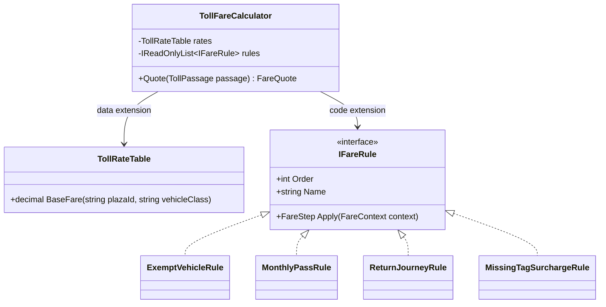
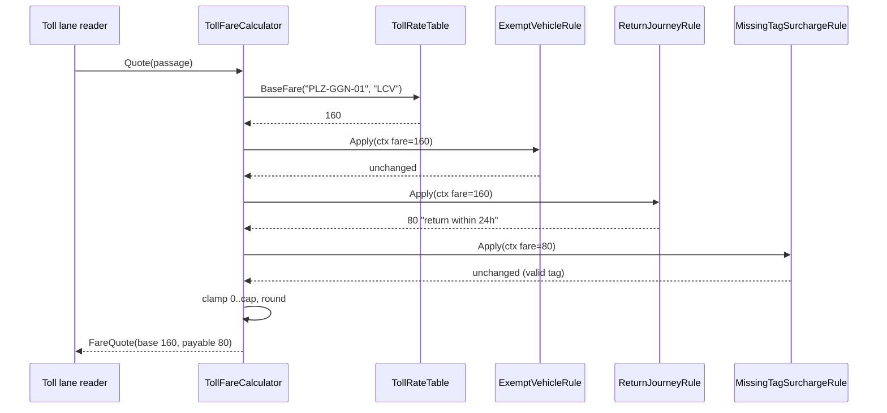
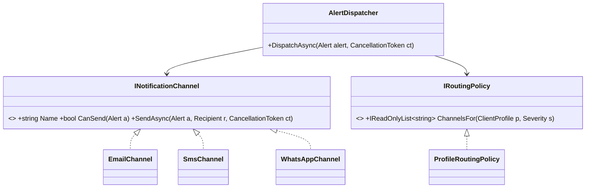

The Open/Closed Principle (OCP) is the "O" in SOLID. It promises something every team wants: add features without breaking old ones. Used well, it is why ASP.NET Core lets you add middleware, auth schemes and formatters without editing the framework. Used badly, it produces plug-in systems for things that never change.

## Learning objectives

By the end of this lesson you will be able to:

1. State OCP and explain what "open" and "closed" each refer to.
2. Recognise the code smell OCP fixes: a central `switch` or `if` chain that every new feature edits.
3. Choose between the two extension mechanisms: **new data** (configuration, rows) and **new code** (a class behind an interface).
4. Build a toll-fare calculator in ASP.NET Core whose rates are data and whose fare rules are plug-in classes.
5. Keep invariants (rules that must always hold) in the closed core, not in each extension.
6. Decide which changes to be closed against ("strategic closure"), and avoid speculative extension points.

## Prerequisites

- [Single Responsibility Principle](#/lesson/m04-srp): OCP works on classes that already have one job.
- [Interfaces and abstract classes](#/lesson/m01-interfaces-abstract): extension points are usually interfaces.
- [Dependency injection](#/lesson/m03-dependency-injection): we plug extensions in through the container.

## Explain it like I'm a beginner

Think of a power strip with six sockets. When you buy a new lamp, you plug it in. You don't open the power strip with a screwdriver and solder in a wire. The power strip is **closed**: nobody edits its insides. It is also **open**: anything with the right plug can be added.

Now imagine a house where every new appliance means an electrician opening the wall. Each visit risks cutting a wire that powers the fridge. That is code where every new feature means editing a working method.

The Open/Closed Principle says: **for the kinds of change you expect, build a socket.** New behaviour plugs in. Old, tested code stays untouched.

Two warnings come with the analogy. First, a socket only helps if the new thing fits its shape. A power strip doesn't help you add a water pipe. You must guess *which kinds* of change will come. Second, sockets cost money. You don't install twelve sockets in a store room nobody uses.

## First-principles explanation

### What it is

Bertrand Meyer wrote in 1988 that software entities should be **open for extension but closed for modification**. Meyer meant inheritance: leave a published class alone and extend it with a subclass. Robert C. Martin later reframed it around abstractions: code depends on an interface, and new behaviour arrives as a new implementation of that interface.

- **Open**: you can add new behaviour.
- **Closed**: you add it without editing the source of existing, tested modules.

### Why it exists — the problem

Look at any long-lived business system and you'll find a hotspot: one method that every feature edits. Pricing, tax, approval routing, notification channels, report formats. Each edit carries three costs:

1. **Regression risk.** The method holds rules that already work. Edit number 15 can break rule 6.
2. **Re-testing and re-deploying.** A change to a shared core forces you to re-test everything it serves.
3. **Contention.** Every team that adds a feature queues up to edit the same file.

OCP moves the varying part out of the hotspot. The hotspot becomes a small, stable core that calls extensions through an interface.

### How it works

There are two practical mechanisms. Choose by asking *what kind of thing is changing*.

| Change type | Mechanism | Example |
|---|---|---|
| New **values** of a known kind | Data: configuration, a database table | A new toll plaza, a new rate, a new vehicle class |
| New **behaviour** | Code: a new class implementing an interface, registered in DI | A new kind of discount, a new exemption rule |

Data is cheaper: no deployment, no new class. Code is more powerful: it can do anything. A common mistake is to use code where data would do (a class per tax rate) or data where code is needed (a JSON "rules language" nobody can debug).

The C# toolbox for code-based extension:

- **Interfaces + DI**: register many `IFareRule` implementations; inject `IEnumerable<IFareRule>`.
- **Strategy**: pick one behaviour ([see Strategy](#/lesson/m06-strategy)).
- **Decorator**: wrap behaviour to add more ([see Decorator](#/lesson/m06-decorator)).
- **Chain of Responsibility / pipeline**: run several steps in order ([see Chain of Responsibility](#/lesson/m06-chain-of-responsibility)).
- **Delegates and events**: `Func<T>` or `event` as tiny extension points.

### Closed against *what*? Strategic closure

No code is closed against every change. A fare calculator that accepts new rules as plug-ins is still *open to modification* if the government changes the concept of a "journey". Martin calls this **strategic closure**: you choose the axes of change you expect, close against those, and accept that other changes will need edits.

How do you choose? Look at history and the roadmap, not your imagination. If the last 12 months brought 7 new fare rules and 0 new payment channels, close against new fare rules. A useful rule of thumb is "the first change is free, the second is a hint, the third is a pattern": write the simple version, and when the same kind of change arrives again, introduce the extension point.

### What happens without it

The hotspot grows. A 40-line method becomes 400 lines with flags like `isFestival`, `isLocalResident`, `skipPenalty`. Each new flag doubles the number of paths to test. Eventually nobody dares to change it, and new rules get bolted on outside it, which creates duplicate logic.

### When it is useful

- One kind of change has happened repeatedly, and will continue (new rules, new formats, new providers).
- Different teams own different variants.
- The core is risky to change: it handles money, safety or compliance.
- You ship a library or framework, and users can't edit your source.

### When it is unnecessary or harmful

- The change has happened once. An extension point now is a guess.
- There is one implementation and no test needs a fake. The interface is pure ceremony.
- The "extension" needs to change the core's contract anyway. Then every extension point must change too, and you've paid for flexibility you can't use.
- Configuration becomes a programming language. If marketing writes nested JSON conditions, you have built an "inner platform": a worse programming language without a debugger or tests.

### Trade-offs it introduces

| You gain | You pay |
|---|---|
| New rules without touching tested code | Indirection: behaviour is spread across classes, found via DI |
| Smaller, isolated tests for each rule | Rule **interactions** (order, conflicts) become the hard part |
| Parallel work by different teams | A contract that must stay stable; changing it breaks every extension |
| Data-driven changes without redeploying | Data needs validation, versioning and audit like code does |

## Visual explanation

### Class diagram



The calculator is the **closed core**. It has two extension points. `TollRateTable` is extended with **data**: a new plaza or vehicle class is a configuration row. `IFareRule` is extended with **code**: a new kind of adjustment is a new class plus one DI line. The four rules know nothing about each other. The core decides order, stops when a rule says so, and enforces the invariants: never negative, never more than a cap.

### Sequence diagram



The core looks up the base fare from data, then passes a context through each rule in order. Each rule returns a new fare and a reason, or "unchanged". A rule can also say *stop*: an exempt vehicle returns 0 and stop, so later rules can't add a surcharge to an ambulance. The last step, clamping and rounding, belongs to the core because it must hold no matter which rules are installed.

## Step-by-step example

Scenario: software for a toll plaza on a national highway. A vehicle passes; the lane reads its tag and class; the system computes the fare. The rates and multipliers below are **illustrative examples**, not real notified rates.

### Step 1 — the naive version

```csharp
// BAD: every new rule or rate edits this method.
public decimal Fare(string vehicleClass, bool validTag, bool hasMonthlyPass, bool returnWithin24h, bool isAmbulance)
{
    if (isAmbulance) return 0;
    if (hasMonthlyPass) return 0;
    decimal fare = vehicleClass switch
    {
        "CAR" => 95m,
        "LCV" => 160m,
        "BUS" => 325m,
        "MAV" => 510m,
        _ => throw new ArgumentException(vehicleClass)
    };
    if (returnWithin24h) fare *= 0.5m;
    if (!validTag) fare *= 2m;
    return Math.Round(fare);
}
```

Fine for one plaza. Now the requests arrive:

1. "Add 40 more plazas, each with its own rates." The `switch` can't hold that.
2. "Add a 7-axle class at ₹680." Edit the `switch`, redeploy every lane.
3. "Exempt vehicles of a listed category, looked up in a registry." Add a parameter, edit every caller.
4. "Change the missing-tag multiplier from 2× to a configurable value." Edit again.

Each request edits the same method, and its parameter list keeps growing.

### Step 2 — separate data from behaviour

Requests 1, 2 and 4 are *values*. Move them to configuration: a rate table keyed by plaza and vehicle class, and options for multipliers. Now they need no code change at all.

### Step 3 — find the shape of the behaviour

Requests 3 (exemption), the monthly pass, the return discount and the tag surcharge are *behaviours*. What do they share? Each looks at the passage and the fare so far, and either leaves the fare alone, changes it, or ends the calculation. That becomes the interface:

```csharp
public interface IFareRule
{
    int Order { get; }
    string Name { get; }
    FareStep Apply(FareContext context);
}
```

### Step 4 — move invariants into the core

"The fare is never negative" and "never more than 3× the base fare" must hold for *any* combination of rules. If each rule enforced them, one forgotten check would break the guarantee. The core enforces them once, after the rules run.

### Step 5 — prove it's closed

Add the exemption rule from request 3 as a new class with one DI registration. `git diff` should show zero changed lines in `TollFareCalculator`. That diff is the practical test of OCP.

## Production-style C# implementation

```text
Toll.Api/
  Program.cs
  appsettings.json            "Tolling": { "Rates": [...], "SurchargeMultiplier": 2.0, ... }
  Tolling/
    FareModels.cs
    TollRateTable.cs          data extension point
    IFareRule.cs              code extension point
    TollFareCalculator.cs     closed core
    Lookups.cs                registries the rules depend on
    Rules/ExemptVehicleRule.cs
    Rules/MonthlyPassRule.cs
    Rules/ReturnJourneyRule.cs
    Rules/MissingTagSurchargeRule.cs
```

```csharp file=Tolling/FareModels.cs
namespace Toll.Tolling;

public sealed record TollPassage(
    string PlazaId,
    string VehicleClass,
    string RegistrationNumber,
    bool HasValidTag,
    DateTimeOffset At);

/// <summary>What a rule sees: the passage, the base fare from the rate table, and the fare so far.</summary>
public sealed record FareContext(TollPassage Passage, decimal BaseFare, decimal CurrentFare);

/// <summary>A rule's answer. Use the factory methods; they make intent obvious at the call site.</summary>
public sealed record FareStep(decimal Fare, string? Reason, bool Stop)
{
    public static FareStep Unchanged(FareContext c) => new(c.CurrentFare, null, false);
    public static FareStep Adjust(decimal fare, string reason) => new(fare, reason, false);
    public static FareStep Final(decimal fare, string reason) => new(fare, reason, true);
}

public sealed record FareQuote(decimal BaseFare, decimal Payable, IReadOnlyList<string> Adjustments);

public sealed class UnknownTariffException(string plazaId, string vehicleClass)
    : Exception($"No tariff for vehicle class '{vehicleClass}' at plaza '{plazaId}'.");
```

```csharp file=Tolling/TollRateTable.cs
namespace Toll.Tolling;

public sealed class TollRateRow
{
    public string PlazaId { get; set; } = "";
    public string VehicleClass { get; set; } = "";
    public decimal Fare { get; set; }
}

public sealed class TollingOptions
{
    public List<TollRateRow> Rates { get; set; } = new();
    public decimal SurchargeMultiplier { get; set; } = 2m;
    public decimal ReturnJourneyFactor { get; set; } = 0.5m;
    public TimeSpan ReturnWindow { get; set; } = TimeSpan.FromHours(24);
    public decimal MaxMultipleOfBase { get; set; } = 3m;
}

/// <summary>Data extension point: a new plaza or vehicle class is a configuration row, not code.</summary>
public sealed class TollRateTable
{
    private readonly Dictionary<(string, string), decimal> _fares;

    public TollRateTable(IEnumerable<TollRateRow> rows)
    {
        _fares = new Dictionary<(string, string), decimal>();
        foreach (var r in rows)
        {
            if (r.Fare < 0) throw new ArgumentException($"Negative fare for {r.PlazaId}/{r.VehicleClass}.");
            var key = (r.PlazaId.ToUpperInvariant(), r.VehicleClass.ToUpperInvariant());
            if (!_fares.TryAdd(key, r.Fare)) throw new ArgumentException($"Duplicate tariff row for {r.PlazaId}/{r.VehicleClass}.");
        }
    }

    public decimal BaseFare(string plazaId, string vehicleClass) =>
        _fares.TryGetValue((plazaId.ToUpperInvariant(), vehicleClass.ToUpperInvariant()), out var fare)
            ? fare
            : throw new UnknownTariffException(plazaId, vehicleClass);
}
```

```csharp file=Tolling/IFareRule.cs
namespace Toll.Tolling;

/// <summary>Code extension point. Implementations must be stateless and must not know about other rules.</summary>
public interface IFareRule
{
    /// <summary>Lower runs first. Leave gaps (0, 10, 20) so new rules can slot in between.</summary>
    int Order { get; }
    string Name { get; }
    FareStep Apply(FareContext context);
}
```

```csharp file=Tolling/TollFareCalculator.cs
using Microsoft.Extensions.Logging;
using Microsoft.Extensions.Options;

namespace Toll.Tolling;

/// <summary>The closed core. Adding a rule or a tariff must never require editing this class.</summary>
public sealed class TollFareCalculator
{
    private readonly TollRateTable _rates;
    private readonly IReadOnlyList<IFareRule> _rules;
    private readonly decimal _maxMultiple;
    private readonly ILogger<TollFareCalculator> _logger;

    public TollFareCalculator(TollRateTable rates, IEnumerable<IFareRule> rules,
        IOptions<TollingOptions> options, ILogger<TollFareCalculator> logger)
    {
        _rates = rates;
        // Deterministic order: by Order, then by Name, so two rules with equal Order never swap between runs.
        _rules = rules.OrderBy(r => r.Order).ThenBy(r => r.Name, StringComparer.Ordinal).ToList();
        _maxMultiple = options.Value.MaxMultipleOfBase;
        _logger = logger;
    }

    public FareQuote Quote(TollPassage passage)
    {
        ArgumentNullException.ThrowIfNull(passage);
        var baseFare = _rates.BaseFare(passage.PlazaId, passage.VehicleClass);
        var fare = baseFare;
        var reasons = new List<string>();

        foreach (var rule in _rules)
        {
            var step = rule.Apply(new FareContext(passage, baseFare, fare));
            if (step.Reason is not null) reasons.Add($"{rule.Name}: {step.Reason}");
            fare = step.Fare;
            if (step.Stop) break;
        }

        // Invariants live here, once, whatever rules are installed.
        var cap = baseFare * _maxMultiple;
        if (fare < 0 || fare > cap)
        {
            _logger.LogWarning("Fare {Fare} outside 0..{Cap} for {Plaza}/{Class}; clamped", fare, cap, passage.PlazaId, passage.VehicleClass);
            fare = Math.Clamp(fare, 0m, cap);
        }
        return new FareQuote(baseFare, Math.Round(fare, 0, MidpointRounding.AwayFromZero), reasons);
    }
}
```

```csharp file=Tolling/Lookups.cs
namespace Toll.Tolling;

public interface IExemptionRegistry { bool IsExempt(string registrationNumber); }
public interface IPassRegistry { bool HasActivePass(string registrationNumber, string plazaId, DateOnly on); }
public interface ITripHistory { DateTimeOffset? LastPassage(string registrationNumber, string plazaId); }

/// <summary>In-memory stand-ins. Production versions query PostgreSQL or a central tag registry.</summary>
public sealed class InMemoryLookups : IExemptionRegistry, IPassRegistry, ITripHistory
{
    public HashSet<string> Exempt { get; } = new(StringComparer.OrdinalIgnoreCase);
    public HashSet<(string Reg, string Plaza)> Passes { get; } = new();
    public Dictionary<(string Reg, string Plaza), DateTimeOffset> Trips { get; } = new();

    public bool IsExempt(string registrationNumber) => Exempt.Contains(registrationNumber);
    public bool HasActivePass(string registrationNumber, string plazaId, DateOnly on) => Passes.Contains((registrationNumber, plazaId));
    public DateTimeOffset? LastPassage(string registrationNumber, string plazaId) =>
        Trips.TryGetValue((registrationNumber, plazaId), out var t) ? t : null;
}
```

```csharp file=Tolling/Rules/ExemptVehicleRule.cs
namespace Toll.Tolling.Rules;

public sealed class ExemptVehicleRule(IExemptionRegistry registry) : IFareRule
{
    public int Order => 0;
    public string Name => "Exempt";
    public FareStep Apply(FareContext c) =>
        registry.IsExempt(c.Passage.RegistrationNumber) ? FareStep.Final(0m, "exempt category") : FareStep.Unchanged(c);
}
```

```csharp file=Tolling/Rules/MonthlyPassRule.cs
namespace Toll.Tolling.Rules;

public sealed class MonthlyPassRule(IPassRegistry passes) : IFareRule
{
    public int Order => 10;
    public string Name => "MonthlyPass";
    public FareStep Apply(FareContext c) =>
        passes.HasActivePass(c.Passage.RegistrationNumber, c.Passage.PlazaId, DateOnly.FromDateTime(c.Passage.At.UtcDateTime))
            ? FareStep.Final(0m, "active monthly pass")
            : FareStep.Unchanged(c);
}
```

```csharp file=Tolling/Rules/ReturnJourneyRule.cs
using Microsoft.Extensions.Options;

namespace Toll.Tolling.Rules;

public sealed class ReturnJourneyRule(ITripHistory history, IOptions<TollingOptions> options) : IFareRule
{
    private readonly TollingOptions _o = options.Value;
    public int Order => 20;
    public string Name => "ReturnJourney";

    public FareStep Apply(FareContext c)
    {
        var last = history.LastPassage(c.Passage.RegistrationNumber, c.Passage.PlazaId);
        var isReturn = last is not null && c.Passage.At - last.Value <= _o.ReturnWindow && c.Passage.At > last.Value;
        return isReturn
            ? FareStep.Adjust(c.CurrentFare * _o.ReturnJourneyFactor, $"return within {_o.ReturnWindow.TotalHours:0}h")
            : FareStep.Unchanged(c);
    }
}
```

```csharp file=Tolling/Rules/MissingTagSurchargeRule.cs
using Microsoft.Extensions.Options;

namespace Toll.Tolling.Rules;

public sealed class MissingTagSurchargeRule(IOptions<TollingOptions> options) : IFareRule
{
    private readonly decimal _multiplier = options.Value.SurchargeMultiplier;
    public int Order => 30;
    public string Name => "MissingTag";
    public FareStep Apply(FareContext c) =>
        c.Passage.HasValidTag ? FareStep.Unchanged(c) : FareStep.Adjust(c.CurrentFare * _multiplier, $"no valid tag (x{_multiplier})");
}
```

```csharp file=Program.cs
using Microsoft.Extensions.Options;
using Toll.Tolling;
using Toll.Tolling.Rules;

var builder = WebApplication.CreateBuilder(args);

builder.Services.Configure<TollingOptions>(builder.Configuration.GetSection("Tolling"));
builder.Services.AddSingleton(sp => new TollRateTable(sp.GetRequiredService<IOptions<TollingOptions>>().Value.Rates));

var lookups = new InMemoryLookups();
builder.Services.AddSingleton<IExemptionRegistry>(lookups);
builder.Services.AddSingleton<IPassRegistry>(lookups);
builder.Services.AddSingleton<ITripHistory>(lookups);

// Extension point: one line per rule. Adding a rule never edits TollFareCalculator.
builder.Services.AddSingleton<IFareRule, ExemptVehicleRule>();
builder.Services.AddSingleton<IFareRule, MonthlyPassRule>();
builder.Services.AddSingleton<IFareRule, ReturnJourneyRule>();
builder.Services.AddSingleton<IFareRule, MissingTagSurchargeRule>();
builder.Services.AddSingleton<TollFareCalculator>();

var app = builder.Build();

app.MapPost("/fares/quote", (TollPassage passage, TollFareCalculator calculator) =>
{
    try { return Results.Ok(calculator.Quote(passage)); }
    catch (UnknownTariffException ex) { return Results.Problem(ex.Message, statusCode: StatusCodes.Status422UnprocessableEntity); }
});

app.Run();
```

Notes on the design:

- **Order gaps.** Orders are 0, 10, 20, 30 so a new rule can be placed at 15 without renumbering. Ties are broken by name, so order is deterministic.
- **`Final` vs `Adjust`.** Exemptions and passes end the pipeline. Without a stop signal, the surcharge rule would happily double an ambulance's ₹0 fare to ₹0 today, and break the day someone changes the surcharge to "add ₹100".
- **Rate rows are validated at startup.** Negative or duplicate rows fail fast when the app starts, not at 2 a.m. on a lane. Data extensions need checks just like code does.
- **What the core is *not* closed against.** If the authority introduces distance-based tolling, the concept of "a fare per plaza" changes. That's a modification, and no amount of plug-ins would have avoided it. Strategic closure means admitting this.

## Bad design vs good design

**Bad**: the Step 1 method. It has a 5-boolean parameter list, so callers must compute every condition even when it doesn't matter. Testing it fully needs 2⁴ × 4 combinations. Adding a rule edits the method *and* every caller.

**Good**: the calculator above. Each rule is tested alone with a three-line fake registry. The core is tested once with fake rules. New rules, plazas and vehicle classes don't touch the core.

### The trap in the other direction

Here is OCP applied with more enthusiasm than evidence:

```csharp
// Speculative: an extension point for every noun.
public interface IFareRoundingStrategy { decimal Round(decimal fare); }
public interface IFareCurrencyProvider { string Currency { get; } }
public interface IFareQuoteFactory { FareQuote Create(decimal baseFare, decimal payable, IReadOnlyList<string> notes); }
public interface IRuleOrderingPolicy { IEnumerable<IFareRule> Order(IEnumerable<IFareRule> rules); }
```

Each one has a single implementation, no test that fakes it, and no request that would ever use a second one. Toll fares in this system are always rupees, rounded to whole rupees. These interfaces make the code harder to read today in exchange for flexibility nobody asked for. That is the **speculative generality** smell ([see Code smells](#/lesson/m04-code-smells)).

:::callout type=mistake title="The inner-platform trap"
"Let's make rules data too!" leads to JSON like `{"if": {"and": [{"eq": ["class","LCV"]}, ...]}, "then": {"multiply": 0.5}}`. You now maintain an interpreter, with no compiler, no debugger, no unit tests and no code review for the "programs" written in it. Keep *values* in data and *logic* in code, unless non-developers genuinely must author new kinds of logic and you are ready to build tooling for them.
:::

### How to decide: a quick checklist

1. Has this **kind** of change happened at least twice? If not, write the simple version.
2. Is it a new *value* (use data) or a new *behaviour* (use code)?
3. Can you write the extension interface so that the next three realistic variants fit without changing it? If not, you don't understand the variation yet.
4. Which invariants must hold whatever extensions are installed? Put them in the core.
5. Who owns the extensions? If it's the same person who owns the core, and changes are rare, editing a `switch` is acceptable.

## Practical playground

The playground has a small fare pipeline with two rules. Add a `NightDiscountRule` that takes 10 % off between 23:00 and 05:00, at order 25. Run it and check that the `FarePipeline` class didn't change.

:::playground type=csharp title="Plug a new rule into a closed core"
```csharp file=Program.cs
using System;
using System.Collections.Generic;
using System.Linq;

public sealed record Passage(string VehicleClass, bool HasValidTag, DateTime At);
public sealed record Ctx(Passage Passage, decimal BaseFare, decimal Fare);

public interface IFareRule
{
    int Order { get; }
    string Name { get; }
    (decimal Fare, bool Stop) Apply(Ctx c);
}

public sealed class MissingTagRule : IFareRule
{
    public int Order => 30;
    public string Name => "MissingTag";
    public (decimal Fare, bool Stop) Apply(Ctx c) => (c.Passage.HasValidTag ? c.Fare : c.Fare * 2m, false);
}

public sealed class ExemptRule(HashSet<string> exemptClasses) : IFareRule
{
    public int Order => 0;
    public string Name => "Exempt";
    public (decimal Fare, bool Stop) Apply(Ctx c) => exemptClasses.Contains(c.Passage.VehicleClass) ? (0m, true) : (c.Fare, false);
}

// TODO: add NightDiscountRule (Order 25): 10 % off when At.Hour >= 23 or At.Hour < 5.

/// <summary>Closed core: do not edit this class to add rules.</summary>
public sealed class FarePipeline(Dictionary<string, decimal> rates, IEnumerable<IFareRule> rules)
{
    private readonly List<IFareRule> _rules = rules.OrderBy(r => r.Order).ThenBy(r => r.Name).ToList();

    public decimal Quote(Passage p)
    {
        var baseFare = rates[p.VehicleClass];
        var fare = baseFare;
        foreach (var r in _rules)
        {
            var (next, stop) = r.Apply(new Ctx(p, baseFare, fare));
            Console.WriteLine($"  {r.Name,-12} {fare,7} -> {next,7}");
            fare = next;
            if (stop) break;
        }
        return Math.Round(Math.Clamp(fare, 0m, baseFare * 3m), 0);
    }
}

public static class Program
{
    public static void Main()
    {
        var rates = new Dictionary<string, decimal> { ["CAR"] = 95m, ["LCV"] = 160m, ["AMBULANCE"] = 95m };
        var pipeline = new FarePipeline(rates, new IFareRule[] { new MissingTagRule(), new ExemptRule(new HashSet<string> { "AMBULANCE" }) });

        Console.WriteLine("LCV, no tag, 23:30:");
        Console.WriteLine($"  payable {pipeline.Quote(new Passage("LCV", false, new DateTime(2026, 3, 1, 23, 30, 0)))}");
        Console.WriteLine("Ambulance, no tag:");
        Console.WriteLine($"  payable {pipeline.Quote(new Passage("AMBULANCE", false, new DateTime(2026, 3, 1, 10, 0, 0)))}");
    }
}
```
:::

## Exercises

:::exercise id=m04-ocp-ex1 difficulty=beginner kind=code title="Add a rule without touching the core"
The authority announces that vehicles carrying a listed category of passes (for example, defence or emergency vehicles) are exempt. Implement `ExemptVehicleRule` so that the existing `FareEngine` (which you must not change) charges them ₹0, and no later rule can add a surcharge.
::requirements
- Use the injected `IExemptionRegistry`.
- Exempt vehicles: fare 0, pipeline stops.
- Everyone else: fare unchanged, pipeline continues.
::acceptance
- An exempt vehicle without a valid tag pays 0 (the surcharge rule must not run).
- A normal LCV with a valid tag pays the base fare of 160.
- `FareEngine` has zero changed lines.
::hint
The engine already sorts rules by `Order` and stops when a step has `Stop = true`.
::hint
Which order value makes your rule run before the surcharge rule (order 30)?
::hint
Return `new FareStep(0m, true)` for exempt vehicles and `new FareStep(c.CurrentFare, false)` otherwise.
::hint
```csharp
public int Order => 0;
public FareStep Apply(FareContext c) =>
    registry.IsExempt(c.Registration) ? new FareStep(0m, true) : new FareStep(c.CurrentFare, false);
```
::starter
```csharp file=Fares.cs
using System;
using System.Collections.Generic;
using System.Linq;

public sealed record FareContext(string Registration, string VehicleClass, bool HasValidTag, decimal BaseFare, decimal CurrentFare);
public sealed record FareStep(decimal Fare, bool Stop);

public interface IFareRule { int Order { get; } FareStep Apply(FareContext c); }
public interface IExemptionRegistry { bool IsExempt(string registration); }

public sealed class MissingTagSurchargeRule : IFareRule
{
    public int Order => 30;
    public FareStep Apply(FareContext c) => new(c.HasValidTag ? c.CurrentFare : c.CurrentFare * 2m, false);
}

/// <summary>Closed core. Do not modify.</summary>
public sealed class FareEngine(IReadOnlyDictionary<string, decimal> rates, IEnumerable<IFareRule> rules)
{
    private readonly List<IFareRule> _rules = rules.OrderBy(r => r.Order).ToList();

    public decimal Quote(string registration, string vehicleClass, bool hasValidTag)
    {
        var baseFare = rates[vehicleClass];
        var fare = baseFare;
        foreach (var rule in _rules)
        {
            var step = rule.Apply(new FareContext(registration, vehicleClass, hasValidTag, baseFare, fare));
            fare = step.Fare;
            if (step.Stop) break;
        }
        return fare;
    }
}

public sealed class ExemptVehicleRule(IExemptionRegistry registry) : IFareRule
{
    public int Order => throw new NotImplementedException();
    public FareStep Apply(FareContext c) => throw new NotImplementedException();
}
```
::tests
```csharp file=FareTests.cs
using System.Collections.Generic;
using Xunit;

public class ExemptVehicleRuleTests
{
    private sealed class FakeRegistry(params string[] exempt) : IExemptionRegistry
    {
        public bool IsExempt(string registration) => System.Array.IndexOf(exempt, registration) >= 0;
    }

    private static readonly Dictionary<string, decimal> Rates = new() { ["LCV"] = 160m, ["CAR"] = 95m };

    private static FareEngine Engine(params string[] exempt) =>
        new(Rates, new IFareRule[] { new MissingTagSurchargeRule(), new ExemptVehicleRule(new FakeRegistry(exempt)) });

    [Fact] public void Exempt_vehicle_pays_zero_even_without_tag() => Assert.Equal(0m, Engine("HR26AB1234").Quote("HR26AB1234", "LCV", hasValidTag: false));
    [Fact] public void Normal_vehicle_pays_base() => Assert.Equal(160m, Engine("HR26AB1234").Quote("DL01CD5678", "LCV", hasValidTag: true));
    [Fact] public void Normal_vehicle_without_tag_still_surcharged() => Assert.Equal(190m, Engine().Quote("DL01CD5678", "CAR", hasValidTag: false));
    [Fact] public void Exempt_rule_runs_first() => Assert.True(new ExemptVehicleRule(new FakeRegistry()).Order < new MissingTagSurchargeRule().Order);
}
```
::solution
The rule runs first and stops the pipeline for exempt vehicles.

```csharp file=Fares.cs
using System;
using System.Collections.Generic;
using System.Linq;

public sealed record FareContext(string Registration, string VehicleClass, bool HasValidTag, decimal BaseFare, decimal CurrentFare);
public sealed record FareStep(decimal Fare, bool Stop);

public interface IFareRule { int Order { get; } FareStep Apply(FareContext c); }
public interface IExemptionRegistry { bool IsExempt(string registration); }

public sealed class MissingTagSurchargeRule : IFareRule
{
    public int Order => 30;
    public FareStep Apply(FareContext c) => new(c.HasValidTag ? c.CurrentFare : c.CurrentFare * 2m, false);
}

public sealed class FareEngine(IReadOnlyDictionary<string, decimal> rates, IEnumerable<IFareRule> rules)
{
    private readonly List<IFareRule> _rules = rules.OrderBy(r => r.Order).ToList();

    public decimal Quote(string registration, string vehicleClass, bool hasValidTag)
    {
        var baseFare = rates[vehicleClass];
        var fare = baseFare;
        foreach (var rule in _rules)
        {
            var step = rule.Apply(new FareContext(registration, vehicleClass, hasValidTag, baseFare, fare));
            fare = step.Fare;
            if (step.Stop) break;
        }
        return fare;
    }
}

public sealed class ExemptVehicleRule(IExemptionRegistry registry) : IFareRule
{
    public int Order => 0;
    public FareStep Apply(FareContext c) =>
        registry.IsExempt(c.Registration) ? new FareStep(0m, true) : new FareStep(c.CurrentFare, false);
}
```

The only other change in a real app is one DI line: `services.AddSingleton<IFareRule, ExemptVehicleRule>();`.
::mistakes
- Returning `Stop = false` with fare 0. It works today only because 0 × 2 = 0; it breaks when the surcharge becomes "+₹100".
- Giving the rule `Order = 30`, the same as the surcharge. Ties make order depend on registration order, which is fragile.
- Editing `FareEngine` to add `if (exempt) return 0`. That's exactly what OCP avoids.
:::

:::exercise id=m04-ocp-ex2 difficulty=beginner kind=written title="Closed against what?"
A reporting module has this method:

```csharp
public byte[] Export(Report r, string format)
{
    var columns = new[] { "Project", "Chainage", "Progress %", "Updated" };
    return format switch
    {
        "csv"  => CsvWriter.Write(columns, r.Rows),
        "xlsx" => ExcelWriter.Write(columns, r.Rows),
        "pdf"  => PdfWriter.Write(columns, r.Rows, landscape: true),
        _ => throw new NotSupportedException(format)
    };
}
```

For each change below, say whether the method is *closed* against it (no edit needed) or not. Then say which one or two you would open up, and how (data or code).

1. A client wants a JSON export. 2. A client wants an extra "Contractor" column. 3. A bug in `CsvWriter` escaping. 4. Different clients want different column sets. 5. PDFs should be portrait for one client.
::acceptance
- Each of the five changes is classified correctly.
- At least one change is solved with data and at least one with code.
- The answer explains why not every change should be opened up.
::hint
"Closed" means: can this change be made without editing `Export`?
::hint
Column sets are values. Export formats are behaviours.
::hint
A bug fix inside `CsvWriter` doesn't touch `Export` at all. That's already closed.
::hint
Look at your history: which of these changes happens monthly, and which happened once?
::solution
| Change | Closed? | Why |
|---|---|---|
| 1. JSON export | No | New `switch` case. |
| 2. Extra column | No | The column list is hard-coded. |
| 3. CSV escaping bug | Yes | Fixed inside `CsvWriter`; `Export` untouched. |
| 4. Per-client columns | No | Same reason as 2, and worse. |
| 5. Portrait PDF for one client | No | `landscape: true` is a literal. |

Open up two axes:

- **Columns and layout options as data**: a per-client `ExportProfile { Columns, Landscape }` row in configuration. This covers 2, 4 and 5 with no code change.
- **Formats as code**: `IReportExporter { string Format; byte[] Write(ExportProfile p, IEnumerable<Row> rows); }` registered in DI, chosen by `Format`. This covers 1.

Don't open up things that haven't varied. For example, don't create an `IDateFormatter` "in case a client wants different dates" until one does.
::mistakes
- Classifying 3 as "not closed". OCP is about the client code, not the internals of a dependency.
- Writing a class per column set. Column sets are values, so they belong in data.
:::

:::exercise id=m04-ocp-ex3 difficulty=intermediate kind=code title="Make vehicle classes data, not code"
The fare code uses an `enum VehicleClass { Car, Lcv, Bus, Mav }` and a `switch` for rates. Every new class (like a 7-axle vehicle) requires a code change and a deployment to every lane. Implement `RateTable` so tariffs are loaded from configuration lines and a new class is just a new line.
::requirements
- `RateTable.Parse(IEnumerable<string> lines)` reads lines like `PLZ-GGN-01,LCV,160`. Ignore blank lines and lines starting with `#`.
- Codes are case-insensitive; surrounding spaces are trimmed.
- Throw `FormatException` for a malformed line (wrong number of fields, non-numeric or negative fare), mentioning the line number.
- Throw `FormatException` for a duplicate plaza + class.
- `Fare(plaza, vehicleClass)` throws `UnknownTariffException` for a missing combination.
::acceptance
- Adding `PLZ-GGN-01,MAV7,680` makes `Fare("plz-ggn-01", "mav7")` return 680 with no code change.
- Malformed and duplicate lines fail at parse time, not at lookup time.
- Fares are parsed with the invariant culture (so `160.50` works on any server locale).
::hint
Use a `Dictionary<(string, string), decimal>` with upper-cased keys.
::hint
`decimal.TryParse(text, NumberStyles.Number, CultureInfo.InvariantCulture, out var fare)`.
::hint
Count lines yourself (starting at 1) so the error message can say "line 4".
::hint
```csharp
var parts = line.Split(',');
if (parts.Length != 3) throw new FormatException($"Line {n}: expected plaza,class,fare");
var key = (parts[0].Trim().ToUpperInvariant(), parts[1].Trim().ToUpperInvariant());
```
::starter
```csharp file=RateTable.cs
using System;
using System.Collections.Generic;
using System.Globalization;

public sealed class UnknownTariffException(string plaza, string vehicleClass)
    : Exception($"No tariff for {vehicleClass} at {plaza}.");

public sealed class RateTable
{
    private RateTable() { }

    public static RateTable Parse(IEnumerable<string> lines) => throw new NotImplementedException();

    public decimal Fare(string plaza, string vehicleClass) => throw new NotImplementedException();

    public int Count => throw new NotImplementedException();
}
```
::tests
```csharp file=RateTableTests.cs
using System;
using Xunit;

public class RateTableTests
{
    private static readonly string[] Config =
    {
        "# plaza,class,fare",
        "PLZ-GGN-01,CAR,95",
        " PLZ-GGN-01 , LCV , 160.50 ",
        "",
        "PLZ-JPR-02,CAR,110",
    };

    [Fact] public void Reads_valid_lines() => Assert.Equal(3, RateTable.Parse(Config).Count);
    [Fact] public void Lookup_is_case_insensitive_and_trimmed() => Assert.Equal(160.50m, RateTable.Parse(Config).Fare("plz-ggn-01", "lcv"));

    [Fact]
    public void New_class_is_just_data()
    {
        var table = RateTable.Parse(new[] { "PLZ-GGN-01,MAV7,680" });
        Assert.Equal(680m, table.Fare("PLZ-GGN-01", "MAV7"));
    }

    [Fact] public void Unknown_combination_throws() => Assert.Throws<UnknownTariffException>(() => RateTable.Parse(Config).Fare("PLZ-JPR-02", "LCV"));

    [Fact]
    public void Malformed_line_reports_line_number()
    {
        var ex = Assert.Throws<FormatException>(() => RateTable.Parse(new[] { "A,CAR,95", "B,CAR" }));
        Assert.Contains("2", ex.Message);
    }

    [Fact] public void Negative_fare_rejected() => Assert.Throws<FormatException>(() => RateTable.Parse(new[] { "A,CAR,-5" }));
    [Fact] public void Non_numeric_fare_rejected() => Assert.Throws<FormatException>(() => RateTable.Parse(new[] { "A,CAR,abc" }));
    [Fact] public void Duplicate_rejected() => Assert.Throws<FormatException>(() => RateTable.Parse(new[] { "A,CAR,95", "a,car,100" }));
}
```
::solution
Parse once, validate everything up front, and store fares by an upper-cased key.

```csharp file=RateTable.cs
using System;
using System.Collections.Generic;
using System.Globalization;

public sealed class UnknownTariffException(string plaza, string vehicleClass)
    : Exception($"No tariff for {vehicleClass} at {plaza}.");

public sealed class RateTable
{
    private readonly Dictionary<(string, string), decimal> _fares = new();

    private RateTable() { }

    public static RateTable Parse(IEnumerable<string> lines)
    {
        var table = new RateTable();
        var n = 0;
        foreach (var raw in lines)
        {
            n++;
            var line = raw.Trim();
            if (line.Length == 0 || line.StartsWith('#')) continue;

            var parts = line.Split(',');
            if (parts.Length != 3) throw new FormatException($"Line {n}: expected 'plaza,class,fare' but got '{raw}'.");
            if (!decimal.TryParse(parts[2].Trim(), NumberStyles.Number, CultureInfo.InvariantCulture, out var fare) || fare < 0)
                throw new FormatException($"Line {n}: fare must be a non-negative number.");

            var key = (parts[0].Trim().ToUpperInvariant(), parts[1].Trim().ToUpperInvariant());
            if (!table._fares.TryAdd(key, fare)) throw new FormatException($"Line {n}: duplicate tariff for {key.Item1}/{key.Item2}.");
        }
        return table;
    }

    public decimal Fare(string plaza, string vehicleClass) =>
        _fares.TryGetValue((plaza.Trim().ToUpperInvariant(), vehicleClass.Trim().ToUpperInvariant()), out var f)
            ? f
            : throw new UnknownTariffException(plaza, vehicleClass);

    public int Count => _fares.Count;
}
```

The `enum` is gone. Vehicle classes are now values, so the code is closed against new classes. The price: a typo in configuration ("LVC") is caught only when a vehicle of that class passes, so add a startup check against the list of classes the lane hardware can report.
::alternatives
Keep a small enum for the *behavioural* categories the code really branches on (for example, "commercial vs private" for a pass rule), and use data for the *tariff* classes. Mixing the two concepts is what made the original enum painful.
::mistakes
- `decimal.Parse` without a culture: on a server set to a culture that uses commas for decimals, `160.50` fails to parse.
- Silently keeping the last duplicate. Two conflicting tariffs are a data error to surface, not to hide.
:::

:::exercise id=m04-ocp-ex4 difficulty=intermediate kind=design title="Design an extension point for notification channels"
A project-monitoring platform sends alerts (milestone delayed, cost overrun) by email today. Over the next year the roadmap lists SMS, WhatsApp Business and Microsoft Teams. Some clients want several channels; some alerts are "critical" and must go to every channel the client has. Design the extension point.
::acceptance
- An interface for channels, with a capability or filter so a channel can decline messages it can't send (for example, SMS can't carry attachments).
- A selection policy (which channels for which client and severity) that lives outside the channels.
- Adding WhatsApp is one new class plus configuration, with no edits to existing channels or the dispatcher.
- One failure mode is addressed (a channel being down).
::hint
Separate *how to send* (channel) from *who gets what* (routing policy).
::hint
Client channel preferences are data. Channel implementations are code.
::hint
`INotificationChannel { string Name; bool CanSend(Alert a); Task SendAsync(Alert a, Recipient r, CancellationToken ct); }`
::hint
The dispatcher: for each channel named in the client's profile, if `CanSend`, send; record failures and continue with the next channel; retry later via a queue.
::solution


- **Channels (code)**: one class per technology, registered in DI and indexed by `Name`. `CanSend` lets SMS decline alerts that need an attachment.
- **Routing (data + one policy class)**: each client profile stores channels per severity, for example `{ "Critical": ["email","sms","teams"], "Info": ["email"] }`. `ProfileRoutingPolicy` reads it. Critical alerts could also have a rule "all configured channels".
- **Dispatcher (closed core)**: resolves the names, skips unknown names with a warning, calls each channel independently, and on failure writes the alert to an outbox table for retry ([see the outbox lesson](#/lesson/m12-outbox)). One channel's outage never blocks the others.

Adding WhatsApp: `WhatsAppChannel` + `services.AddSingleton<INotificationChannel, WhatsAppChannel>()` + adding `"whatsapp"` to client profiles.
::mistakes
- Putting routing logic inside each channel (`if (client.WantsSms)`), which couples every channel to client configuration.
- A `switch (channelName)` in the dispatcher, which reopens the core every time.
:::

:::exercise id=m04-ocp-ex5 difficulty=advanced kind=code title="Protect invariants in the closed core"
As more teams add fare rules, two bugs have reached production: a promotional rule produced a negative fare, and two rules with the same `Order` ran in different orders on different servers. Implement `SafeFarePipeline` so that *any* set of rules gives deterministic, valid results.
::requirements
- Order rules by `Order`, then by `Name` (ordinal), regardless of the order they were registered.
- Stop when a step has `Stop = true`.
- After the rules: clamp the fare to `[0, base × maxMultiple]` and round to whole rupees (away from zero).
- Record a `Violation` entry with the rule name whenever a single rule's output was negative or above the cap, and continue the pipeline with the clamped value.
- Two rules with the same `Name` is a configuration error: throw `InvalidOperationException` in the constructor.
::acceptance
- Rules registered as [B(order 10), A(order 10)] run as A then B.
- A rule returning -50 is recorded as a violation, and the next rule receives 0.
- The final fare never exceeds base × maxMultiple.
- Duplicate names fail at construction.
::hint
These rules are *invariants*. Where must an invariant live so that no extension can bypass it?
::hint
Clamp after each rule (so the next rule sees a valid value) and record the violation at that point.
::hint
`rules.OrderBy(r => r.Order).ThenBy(r => r.Name, StringComparer.Ordinal)`.
::hint
For duplicates: `rules.GroupBy(r => r.Name).FirstOrDefault(g => g.Count() > 1)`.
::hint
```csharp
var clamped = Math.Clamp(step.Fare, 0m, cap);
if (clamped != step.Fare) violations.Add(rule.Name);
fare = clamped;
```
::starter
```csharp file=SafeFarePipeline.cs
using System;
using System.Collections.Generic;
using System.Linq;

public sealed record FareStep(decimal Fare, bool Stop);
public interface IFareRule { int Order { get; } string Name { get; } FareStep Apply(decimal baseFare, decimal currentFare); }
public sealed record FareResult(decimal Payable, IReadOnlyList<string> RulesRun, IReadOnlyList<string> Violations);

public sealed class SafeFarePipeline
{
    public SafeFarePipeline(IEnumerable<IFareRule> rules, decimal maxMultiple) => throw new NotImplementedException();

    public FareResult Quote(decimal baseFare) => throw new NotImplementedException();
}
```
::tests
```csharp file=SafeFarePipelineTests.cs
using System;
using System.Collections.Generic;
using Xunit;

public class SafeFarePipelineTests
{
    private sealed class Rule(string name, int order, Func<decimal, decimal, decimal> f, bool stop = false) : IFareRule
    {
        public int Order => order;
        public string Name => name;
        public FareStep Apply(decimal b, decimal c) => new(f(b, c), stop);
    }

    [Fact]
    public void Ties_are_broken_by_name()
    {
        var p = new SafeFarePipeline(new IFareRule[] { new Rule("B", 10, (b, c) => c + 1), new Rule("A", 10, (b, c) => c * 2) }, 3m);
        var r = p.Quote(100m);
        Assert.Equal(new[] { "A", "B" }, r.RulesRun);
        Assert.Equal(201m, r.Payable);
    }

    [Fact]
    public void Negative_output_is_clamped_and_recorded()
    {
        var seen = -1m;
        var p = new SafeFarePipeline(new IFareRule[]
        {
            new Rule("Promo", 10, (b, c) => c - 150),
            new Rule("Spy", 20, (b, c) => { seen = c; return c; }),
        }, 3m);
        var r = p.Quote(100m);
        Assert.Equal(0m, seen);
        Assert.Equal(0m, r.Payable);
        Assert.Equal(new[] { "Promo" }, r.Violations);
    }

    [Fact]
    public void Cap_is_enforced()
    {
        var r = new SafeFarePipeline(new IFareRule[] { new Rule("Big", 10, (b, c) => c * 10) }, 3m).Quote(95m);
        Assert.Equal(285m, r.Payable);
        Assert.Single(r.Violations);
    }

    [Fact]
    public void Stop_ends_the_pipeline()
    {
        var r = new SafeFarePipeline(new IFareRule[] { new Rule("Exempt", 0, (b, c) => 0m, stop: true), new Rule("Surcharge", 30, (b, c) => c + 100) }, 3m).Quote(160m);
        Assert.Equal(0m, r.Payable);
        Assert.Equal(new[] { "Exempt" }, r.RulesRun);
    }

    [Fact] public void Rounds_to_whole_rupees() => Assert.Equal(81m, new SafeFarePipeline(new IFareRule[] { new Rule("Half", 10, (b, c) => c / 2) }, 3m).Quote(161m).Payable);

    [Fact]
    public void Duplicate_names_rejected() =>
        Assert.Throws<InvalidOperationException>(() => new SafeFarePipeline(new IFareRule[] { new Rule("X", 1, (b, c) => c), new Rule("X", 2, (b, c) => c) }, 3m));
}
```
::solution
The invariants go in the core, applied after every rule, so no extension can bypass them.

```csharp file=SafeFarePipeline.cs
using System;
using System.Collections.Generic;
using System.Linq;

public sealed record FareStep(decimal Fare, bool Stop);
public interface IFareRule { int Order { get; } string Name { get; } FareStep Apply(decimal baseFare, decimal currentFare); }
public sealed record FareResult(decimal Payable, IReadOnlyList<string> RulesRun, IReadOnlyList<string> Violations);

public sealed class SafeFarePipeline
{
    private readonly IReadOnlyList<IFareRule> _rules;
    private readonly decimal _maxMultiple;

    public SafeFarePipeline(IEnumerable<IFareRule> rules, decimal maxMultiple)
    {
        var list = rules.ToList();
        var dup = list.GroupBy(r => r.Name, StringComparer.Ordinal).FirstOrDefault(g => g.Count() > 1);
        if (dup is not null) throw new InvalidOperationException($"Two fare rules are named '{dup.Key}'.");
        ArgumentOutOfRangeException.ThrowIfNegativeOrZero(maxMultiple);

        _rules = list.OrderBy(r => r.Order).ThenBy(r => r.Name, StringComparer.Ordinal).ToList();
        _maxMultiple = maxMultiple;
    }

    public FareResult Quote(decimal baseFare)
    {
        var cap = baseFare * _maxMultiple;
        var fare = baseFare;
        var run = new List<string>();
        var violations = new List<string>();

        foreach (var rule in _rules)
        {
            var step = rule.Apply(baseFare, fare);
            run.Add(rule.Name);
            var clamped = Math.Clamp(step.Fare, 0m, cap);
            if (clamped != step.Fare) violations.Add(rule.Name);
            fare = clamped;
            if (step.Stop) break;
        }
        return new FareResult(Math.Round(fare, 0, MidpointRounding.AwayFromZero), run, violations);
    }
}
```

In production, also emit a metric or alert per violation: a rule producing invalid fares is a bug to fix, not just to hide.
::alternatives
Instead of clamping silently, a strict mode could reject the quote and fall back to the base fare. Which is better is a business decision: for tolls, charging the base fare is usually safer than charging 0.
::mistakes
- Clamping only at the end: the next rule would compute on a negative value, so "-150 then ×2" gives -300, clamped to 0, hiding which rule misbehaved.
- Sorting with `OrderBy(r => r.Order)` alone. LINQ's sort is stable, so ties keep *registration* order, which can differ between deployments.
:::

## Automated testing

OCP gives you a natural testing split.

**Each extension alone.** A rule is a pure function of its context plus a small lookup, so a hand-written fake is enough:

```csharp
public class ReturnJourneyRuleTests
{
    private sealed class FakeHistory(DateTimeOffset? last) : ITripHistory
    {
        public DateTimeOffset? LastPassage(string reg, string plaza) => last;
    }

    private static readonly DateTimeOffset Now = new(2026, 3, 1, 18, 0, 0, TimeSpan.FromHours(5.5));
    private static FareContext Ctx() => new(new TollPassage("PLZ-GGN-01", "LCV", "HR26AB1234", true, Now), 160m, 160m);
    private static IOptions<TollingOptions> Opts() => Options.Create(new TollingOptions());

    [Fact]
    public void Halves_fare_within_24_hours() =>
        Assert.Equal(80m, new ReturnJourneyRule(new FakeHistory(Now.AddHours(-6)), Opts()).Apply(Ctx()).Fare);

    [Fact]
    public void Full_fare_after_window() =>
        Assert.Equal(160m, new ReturnJourneyRule(new FakeHistory(Now.AddHours(-30)), Opts()).Apply(Ctx()).Fare);
}
```

**The core with fake rules.** Test ordering, stopping and invariants without real business rules, as in exercise 5.

**A contract test for all extensions.** Resolve every registered `IFareRule` from the real `ServiceCollection` and check shared promises: names are unique, orders are distinct or deliberately equal, and for a neutral passage (valid tag, no pass, no history) every rule returns "unchanged". New rules are then checked automatically when someone adds them.

**A wiring test.** Assert that the expected rule names are registered, which catches the "forgot the DI line" bug that otherwise only shows up as "the new rule silently never runs".

**Data tests.** Load the real `appsettings.json` tariff section and build the `TollRateTable`. Duplicate or negative rows then fail in CI rather than on a lane.

## Real-world application

- **ASP.NET Core middleware and DI.** You add authentication, rate limiting or custom middleware with `app.Use...` and service registrations. You never edit the framework. That is OCP for a framework whose users can't modify its source.
- **Authentication schemes.** `AddAuthentication().AddJwtBearer().AddCookie()` plugs handlers into a closed authentication core.
- **`IOptions<T>` and configuration.** The data-extension half of OCP: change behaviour by changing values, with validation at startup (`ValidateOnStart`).
- **Logging providers, health checks, output formatters, model binders** — all are extension points chosen because they are the axes along which users really vary.
- **Tax and tariff engines** usually keep rates as versioned data with effective dates, and rule *kinds* as code. Rates change with notifications; new rule kinds are rare.
- **Infrastructure-project platforms** often compute contractor penalties (delay damages, quality deductions) as plug-in rules over a core that enforces caps defined in the contract.

## Interview questions

:::interview
::q beginner
What does the Open/Closed Principle mean?
::a
Software modules should be open for extension and closed for modification: you add new behaviour by adding code (or data), not by editing code that already works. In practice the stable core depends on an abstraction, and new variants implement it. The goal is to avoid regressions and contention in hotspots that keep changing.
::q beginner
Give an example of OCP in ASP.NET Core.
::a
The middleware pipeline: you add behaviour with `app.UseMiddleware<T>()` or `app.Use(...)` without modifying Kestrel or the framework. Other examples are adding an authentication scheme, a health check (`AddHealthChecks().AddCheck<T>()`), or a logging provider. Each is an interface the framework calls, and you supply implementations.
::q intermediate
Is it possible for code to be closed against all changes?
::a
No. You choose which kinds of change to close against, which Martin calls strategic closure. Choose based on evidence: changes that have already happened more than once, or that are on the roadmap. Changes outside those axes, such as a change to the core concept, will still require modification. Trying to close against everything leads to speculative interfaces and an unreadable codebase.
::q intermediate
When should an extension be data, and when should it be code?
::a
New *values* of a known kind (rates, thresholds, plaza lists, column sets) should be data: configuration or database rows, validated at load time. New *behaviour* (a new kind of rule with its own logic or dependencies) should be code: a class behind an interface, registered in DI and unit-tested. Putting logic in data creates an inner-platform problem; putting values in code forces deployments for routine changes.
::q advanced
Several teams add rules to your pricing pipeline. What can go wrong, and how do you design against it?
::a
Rule interactions are the risk: order dependence (ties sorted differently across servers), rules that should stop others (exemptions), rules that break invariants (negative or excessive prices), duplicate registrations, and rules silently not registered. Design: deterministic ordering (order plus name), an explicit stop signal, invariants enforced in the core after each rule, unique names checked at startup, a contract test run against every registered rule, wiring tests, and an explanation trail in the result so support staff can see which rule did what. Add metrics for invariant violations.
::q advanced
How does OCP relate to versioning a public API or library?
::a
For a library, users cannot edit your code, so OCP is essential: you publish extension points (interfaces, virtual methods, options, events) and keep them stable. Changing an extension interface breaks every implementer, so prefer adding new optional interfaces, default interface methods (with care), or new options over changing existing signatures. For a web API, the equivalent is additive change: new fields and endpoints are extensions, while removing or changing meaning requires a new version. In both cases, the contract is the closed part.
:::

## Summary and revision

**Key takeaways**

- OCP: add behaviour by adding code or data, not by editing working code.
- Two mechanisms: **data** for new values (rates, classes, thresholds), **code** for new behaviours (rules behind an interface).
- The closed core owns ordering, stopping and **invariants**; extensions own one rule each.
- Strategic closure: close only against changes you have evidence for. The third similar change is a good trigger.
- Over-application gives speculative interfaces and inner platforms. Under-application gives an ever-growing `switch`.
- Test each extension alone, the core with fakes, and every registered extension against a shared contract.

**Terminology**: extension point, closed core, strategic closure, invariant, speculative generality, inner-platform effect, contract test.

:::flashcards
Q: OCP in one sentence?
A: Modules should be open for extension but closed for modification: new behaviour arrives as new code or data, not edits to working code.
Q: Who first stated OCP, and how did he mean it to be achieved?
A: Bertrand Meyer (1988), through inheritance; Robert Martin later reframed it around abstractions and polymorphism.
Q: What is strategic closure?
A: Choosing which kinds of change to close against, based on evidence, because no code is closed against everything.
Q: Data or code for a new toll plaza's rates?
A: Data. New values of a known kind belong in configuration or a table.
Q: Where should "the fare is never negative" be enforced?
A: In the closed core, after each extension runs, so no extension can bypass it.
Q: What is the inner-platform effect?
A: Building a configurable "language" in data that becomes a worse programming language with no tools, tests or debugger.
Q: Why break ties by name when ordering rules?
A: So ordering is deterministic and doesn't depend on DI registration order, which can differ between deployments.
Q: Simple test that a change honoured OCP?
A: The diff shows new files and registrations only, and zero changed lines in the core class.
:::

## Knowledge check

:::quiz pass=70
::q single
Over the last year your shipping module gained 6 new carriers, each needing an edit to a `switch`. Packaging rules haven't changed once. What should you make extensible?
- [x] Carriers, behind an interface registered in DI.
- [ ] Both carriers and packaging rules, to be safe.
- [ ] Packaging rules only.
- [ ] Neither; switches are always fine.
> Strategic closure: open the axis with a history of change. Packaging rules have no history, so an extension point there is speculative.
::q single
Marketing wants to change a discount from 10 % to 12 % every few weeks. What is the best OCP-friendly approach?
- [ ] A new strategy class for each percentage.
- [x] Make the percentage a validated configuration value.
- [ ] A JSON rules language marketing can edit.
- [ ] Edit the constant and redeploy each time.
> A new value of a known kind is data. A class per value is ceremony, and a rules language is an inner platform.
::q single
Two fare rules both have `Order = 20`. On one server A runs first, on another B runs first. What is the fix?
- [ ] Ask teams to never use the same order.
- [x] Make the core order by `Order` and then by a unique `Name`.
- [ ] Register rules alphabetically in Program.cs.
- [ ] Make each rule check whether the other has run.
> Determinism should be guaranteed by the core, not by convention. Rules must not know about each other.
::q multi
Which belong in the closed core rather than in each extension? (Select all that apply.)
- [x] The rule that the price is never negative.
- [x] The order in which extensions run.
- [ ] The calculation for a specific festival discount.
- [x] Stopping the pipeline when an extension says so.
> Invariants and orchestration belong to the core. Each specific calculation belongs to its extension.
::q single
A colleague adds `IFareCurrencyProvider` with one implementation returning "INR". The system only operates in India and no request mentions currencies. What is this?
- [ ] Good OCP practice.
- [x] Speculative generality: an extension point without evidence of change.
- [ ] A Liskov violation.
- [ ] Required by SRP.
> Extension points have a cost. Add one when the variation is real.
::q single
Which change is the fare calculator in this lesson NOT closed against?
- [ ] A new vehicle class.
- [ ] A new exemption rule.
- [ ] A different surcharge multiplier.
- [x] Switching to distance-based tolling, where fares depend on entry and exit points.
> New classes are data, new rules are code extensions, and multipliers are options. Distance-based tolling changes the core concept, so it requires modification.
::q single
What is the most practical evidence that a pull request followed OCP?
- [ ] It adds an interface.
- [x] It adds new classes and registrations, with no changed lines in the core.
- [ ] It uses inheritance.
- [ ] It has more files than before.
> OCP is about not editing working code. The diff shows that directly.
:::

## Completion criteria

You have finished this lesson when you can:

- [ ] Score at least 70 % on the knowledge check.
- [ ] Complete exercises 1 and 3 with `dotnet test` passing.
- [ ] Complete exercise 5, or explain in writing why invariants belong in the core.
- [ ] Point to one hotspot in a codebase you know, and say whether it needs an extension point (and whether data or code).
- [ ] Explain strategic closure with an example of a change the toll calculator is *not* closed against.
