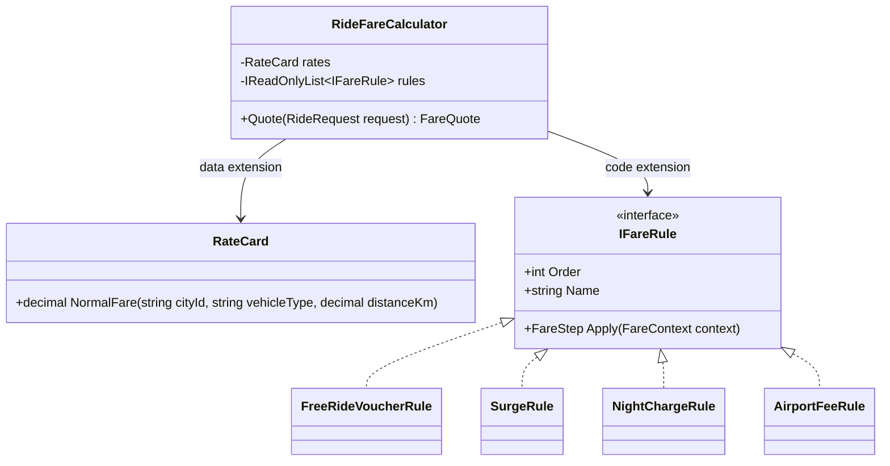
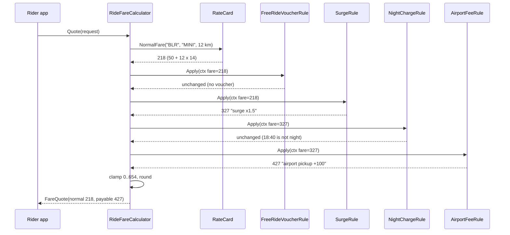
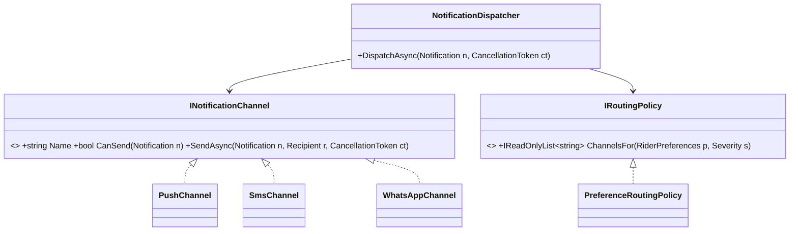

The Open/Closed Principle (OCP) is the "O" in SOLID. It promises something every team wants: add features without breaking old ones. Used well, it is why ASP.NET Core lets you add middleware, auth schemes and formatters without editing the framework. Used badly, it produces plug-in systems for things that never change.

## Learning objectives

By the end of this lesson you will be able to:

1. State OCP and explain what "open" and "closed" each refer to.
2. Recognise the code smell OCP fixes: a central `switch` or `if` chain that every new feature edits.
3. Choose between the two extension mechanisms: **new data** (configuration, rows) and **new code** (a class behind an interface).
4. Build a ride-hailing fare calculator in ASP.NET Core whose rate cards are data and whose fare rules (surge, night charge, airport fee, free-ride vouchers) are plug-in classes.
5. Keep invariants (rules that must always hold) in the closed core, not in each extension.
6. Decide which changes to be closed against ("strategic closure"), and avoid speculative extension points.

## Prerequisites

- [Single Responsibility Principle](#/lesson/m04-srp): OCP works on classes that already have one job.
- [Interfaces and abstract classes](#/lesson/m01-interfaces-abstract): extension points are usually interfaces.
- [Dependency injection](#/lesson/m03-dependency-injection): we plug extensions in through the container.

## Explain it like I'm a beginner

Think of a power strip with six sockets. When you buy a new lamp, you plug it in. You don't open the power strip with a screwdriver and solder in a wire. The power strip is **closed**: nobody edits its insides. It is also **open**: anything with the right plug can be added.

Now imagine a house where every new appliance means an electrician opening the wall. Each visit risks cutting a wire that powers the fridge. That is code where every new feature means editing a working method.

The Open/Closed Principle says: **for the kinds of change you expect, build a socket.** New behaviour plugs in. Old, tested code stays untouched.

Two warnings come with the analogy. First, a socket only helps if the new thing fits its shape. A power strip doesn't help you add a water pipe. You must guess *which kinds* of change will come. Second, sockets cost money. You don't install twelve sockets in a store room nobody uses.

A software example you have used: a ride-hailing app. The fare for a trip starts from the city's rate card (a base fare plus a rate per kilometre). Then the business keeps adding things: surge pricing when demand is high, a night charge, an airport pickup fee, free-ride vouchers from a referral campaign. If every one of those means editing one big `CalculateFare` method, the Diwali-week surge change can break the airport fee. OCP turns each of those into a plug.

## First-principles explanation

### What it is

Bertrand Meyer wrote in 1988 that software entities should be **open for extension but closed for modification**. Meyer meant inheritance: leave a published class alone and extend it with a subclass. Robert C. Martin later reframed it around abstractions: code depends on an interface, and new behaviour arrives as a new implementation of that interface.

- **Open**: you can add new behaviour.
- **Closed**: you add it without editing the source of existing, tested modules.

A precise working definition: *a module is closed against a kind of change if that change can be made by adding new code or new data, with zero edits to the module's source.* "Closed" is always relative to a kind of change, never absolute.

### Why it exists — the problem

Look at any long-lived business system and you'll find a hotspot: one method that every feature edits. Pricing, tax, approval routing, notification channels, report formats. Each edit carries three costs:

1. **Regression risk.** The method holds rules that already work. Edit number 15 can break rule 6.
2. **Re-testing and re-deploying.** A change to a shared core forces you to re-test everything it serves.
3. **Contention.** Every team that adds a feature queues up to edit the same file.

OCP moves the varying part out of the hotspot. The hotspot becomes a small, stable core that calls extensions through an interface.

### How it works

There are two practical mechanisms. Choose by asking *what kind of thing is changing*.

| Change type | Mechanism | Example |
|---|---|---|
| New **values** of a known kind | Data: configuration, a database table | A new city, a new vehicle type (bike taxi), a new per-km rate, a different night-charge percentage |
| New **behaviour** | Code: a new class implementing an interface, registered in DI | A new kind of rule: free-ride vouchers, a women-safety ride discount, a toll pass-through |

Data is cheaper: no deployment, no new class. Code is more powerful: it can do anything. A common mistake is to use code where data would do (a class per city) or data where code is needed (a JSON "rules language" nobody can debug).

The C# toolbox for code-based extension:

- **Interfaces + DI**: register many `IFareRule` implementations; inject `IEnumerable<IFareRule>`.
- **Keyed services** (.NET 8+): `AddKeyedSingleton<IPaymentGateway, UpiGateway>("upi")` when the caller picks *one* implementation by key.
- **Strategy**: pick one behaviour ([see Strategy](#/lesson/m06-strategy)).
- **Decorator**: wrap behaviour to add more ([see Decorator](#/lesson/m06-decorator)).
- **Chain of Responsibility / pipeline**: run several steps in order ([see Chain of Responsibility](#/lesson/m06-chain-of-responsibility)).
- **Delegates and events**: `Func<T>` or `event` as tiny extension points.

### Closed against *what*? Strategic closure

No code is closed against every change. A fare calculator that accepts new rules as plug-ins is still *open to modification* if the business changes the concept of a fare itself, for example by letting riders and drivers bid on a price instead of computing one. Martin calls this **strategic closure**: you choose the axes of change you expect, close against those, and accept that other changes will need edits.

How do you choose? Look at history and the roadmap, not your imagination. If the last 12 months brought 7 new fare rules and 0 new payment channels, close against new fare rules. A useful rule of thumb is "the first change is free, the second is a hint, the third is a pattern": write the simple version, and when the same kind of change arrives again, introduce the extension point.

### What happens without it

The hotspot grows. A 40-line method becomes 400 lines with flags like `isFestival`, `isAirportPickup`, `skipSurge`. Each new flag doubles the number of paths to test. Eventually nobody dares to change it, and new rules get bolted on outside it, which creates duplicate logic.

### When it is useful

- One kind of change has happened repeatedly, and will continue (new rules, new formats, new providers).
- Different teams own different variants (the growth team owns vouchers, the marketplace team owns surge).
- The core is risky to change: it handles money, safety or compliance.
- You ship a library or framework, and users can't edit your source.

### When it is unnecessary or harmful (overkill)

- The change has happened once. An extension point now is a guess.
- There is one implementation and no test needs a fake. The interface is pure ceremony.
- The "extension" needs to change the core's contract anyway. Then every extension point must change too, and you've paid for flexibility you can't use.
- Configuration becomes a programming language. If marketing writes nested JSON conditions, you have built an "inner platform": a worse programming language without a debugger or tests.
- The code is small and owned by one person. A 15-line `switch` over three payment types that changes once a year is easier to read than three classes, an interface and a registry. Editing it is fine.

### Trade-offs it introduces

| You gain | You pay |
|---|---|
| New rules without touching tested code | Indirection: behaviour is spread across classes, found via DI |
| Smaller, isolated tests for each rule | Rule **interactions** (order, conflicts) become the hard part |
| Parallel work by different teams | A contract that must stay stable; changing it breaks every extension |
| Data-driven changes without redeploying | Data needs validation, versioning and audit like code does |

OCP is one of five principles that work together. To see it applied alongside SRP, LSP, ISP and DIP on one real feature, including where to stop, read [SOLID in practice](#/lesson/m04-solid-in-practice).

## Visual explanation

### Class diagram



The calculator is the **closed core**. It has two extension points. `RateCard` is extended with **data**: a new city or vehicle type is a configuration row. `IFareRule` is extended with **code**: a new kind of adjustment is a new class plus one DI line. The four rules know nothing about each other. The core decides order, stops when a rule says so, and enforces the invariants: never negative, never more than a cap.

### Sequence diagram



The core looks up the normal fare from data (₹50 base + 12 km × ₹14 = ₹218), then passes a context through each rule in order. Each rule returns a new fare and a reason, or "unchanged". Surge multiplies (₹218 × 1.5 = ₹327); the airport fee is a flat ₹100 added *after* the multipliers, so it is never surged. A rule can also say *stop*: a free-ride voucher returns 0 and stop, so the airport rule can't add ₹100 to a free ride. The last step, clamping to 0..₹654 (3 × the normal fare) and rounding, belongs to the core because it must hold no matter which rules are installed.

## Step-by-step example

Scenario: the pricing service of a ride-hailing app in Indian cities. A rider enters pickup and drop; the app shows an upfront fare before they tap *Book*. The rates, surge levels and fees below are **illustrative examples**, not any real company's prices. Real apps also charge per minute, pass through road tolls and add GST; we leave those out to keep the example small.

### Step 1 — the naive version

```csharp
// BAD: every new rule, city or rate edits this method.
public decimal Fare(string vehicleType, decimal km, bool hasFreeRideVoucher, decimal surge, bool isNight, bool airportPickup)
{
    if (hasFreeRideVoucher) return 0;
    var (baseFare, perKm) = vehicleType switch
    {
        "AUTO"  => (30m, 12m),
        "MINI"  => (50m, 14m),
        "SEDAN" => (70m, 18m),
        "SUV"   => (90m, 24m),
        _ => throw new ArgumentException(vehicleType)
    };
    decimal fare = baseFare + perKm * km;
    fare *= surge;
    if (isNight) fare *= 1.25m;
    if (airportPickup) fare += 100m;
    return Math.Round(fare);
}
```

Fine for one city. Now the requests arrive:

1. "Launch in 40 more cities, each with its own rate card." The `switch` can't hold that.
2. "Add bike taxis at ₹7/km." Edit the `switch`, redeploy the pricing service.
3. "Give free rides to riders who hold a referral voucher, looked up in the wallet service." Add a parameter, edit every caller.
4. "Make the night charge configurable per city: 25 % here, 20 % there." Edit again.

Each request edits the same method, and its parameter list keeps growing.

### Step 2 — separate data from behaviour

Requests 1, 2 and 4 are *values*. Move them to configuration: a rate card keyed by city and vehicle type, and options for percentages and fees. Now they need no code change at all.

### Step 3 — find the shape of the behaviour

Request 3 (vouchers), surge, the night charge and the airport fee are *behaviours*. What do they share? Each looks at the ride request and the fare so far, and either leaves the fare alone, changes it, or ends the calculation. That becomes the interface:

```csharp
public interface IFareRule
{
    int Order { get; }
    string Name { get; }
    FareStep Apply(FareContext context);
}
```

### Step 4 — move invariants into the core

"The fare is never negative" and "never more than 3× the normal fare" must hold for *any* combination of rules. Some regulators cap how far surge may push a fare; the multiple here is illustrative and lives in configuration. If each rule enforced the cap, one forgotten check would break the guarantee. The core enforces it once, after the rules run.

### Step 5 — prove it's closed

Add the voucher rule from request 3 as a new class with one DI registration. `git diff` should show zero changed lines in `RideFareCalculator`. That diff is the practical test of OCP.

## Production-style C# implementation

```text
Rides.Api/
  Program.cs
  appsettings.json            "Pricing": { "Rates": [...], "NightMultiplier": 1.25, "AirportFee": 100, ... }
  Pricing/
    FareModels.cs
    RateCard.cs               data extension point
    IFareRule.cs              code extension point
    RideFareCalculator.cs     closed core
    Lookups.cs                services the rules depend on
    Rules/FreeRideVoucherRule.cs
    Rules/SurgeRule.cs
    Rules/NightChargeRule.cs
    Rules/AirportFeeRule.cs
```

```csharp file=Pricing/FareModels.cs
namespace Rides.Pricing;

/// <summary>A fare request. RequestedAt carries the city's local offset (for example +05:30), so .Hour is local time.</summary>
public sealed record RideRequest(
    string CityId,
    string VehicleType,
    string RiderId,
    string PickupZoneId,
    decimal DistanceKm,
    DateTimeOffset RequestedAt);

/// <summary>What a rule sees: the request, the normal fare from the rate card, and the fare so far.</summary>
public sealed record FareContext(RideRequest Request, decimal NormalFare, decimal CurrentFare);

/// <summary>A rule's answer. Use the factory methods; they make intent obvious at the call site.</summary>
public sealed record FareStep(decimal Fare, string? Reason, bool Stop)
{
    public static FareStep Unchanged(FareContext c) => new(c.CurrentFare, null, false);
    public static FareStep Adjust(decimal fare, string reason) => new(fare, reason, false);
    public static FareStep Final(decimal fare, string reason) => new(fare, reason, true);
}

public sealed record FareQuote(decimal NormalFare, decimal Payable, IReadOnlyList<string> Adjustments);

public sealed class UnknownRateException(string cityId, string vehicleType)
    : Exception($"No rate card for vehicle type '{vehicleType}' in city '{cityId}'.");
```

```csharp file=Pricing/RateCard.cs
namespace Rides.Pricing;

public sealed class RateRow
{
    public string CityId { get; set; } = "";
    public string VehicleType { get; set; } = "";
    public decimal BaseFare { get; set; }
    public decimal PerKm { get; set; }
}

public sealed class PricingOptions
{
    public List<RateRow> Rates { get; set; } = new();
    public decimal NightMultiplier { get; set; } = 1.25m;
    public int NightStartHour { get; set; } = 23;
    public int NightEndHour { get; set; } = 5;
    public decimal AirportFee { get; set; } = 100m;
    public decimal MaxMultipleOfNormal { get; set; } = 3m;
}

/// <summary>Data extension point: a new city or vehicle type is a configuration row, not code.</summary>
public sealed class RateCard
{
    private readonly Dictionary<(string, string), RateRow> _rows;

    public RateCard(IEnumerable<RateRow> rows)
    {
        _rows = new Dictionary<(string, string), RateRow>();
        foreach (var r in rows)
        {
            if (r.BaseFare < 0 || r.PerKm < 0) throw new ArgumentException($"Negative rate for {r.CityId}/{r.VehicleType}.");
            var key = (r.CityId.ToUpperInvariant(), r.VehicleType.ToUpperInvariant());
            if (!_rows.TryAdd(key, r)) throw new ArgumentException($"Duplicate rate row for {r.CityId}/{r.VehicleType}.");
        }
    }

    public decimal NormalFare(string cityId, string vehicleType, decimal distanceKm)
    {
        ArgumentOutOfRangeException.ThrowIfNegative(distanceKm);
        return _rows.TryGetValue((cityId.ToUpperInvariant(), vehicleType.ToUpperInvariant()), out var row)
            ? row.BaseFare + row.PerKm * distanceKm
            : throw new UnknownRateException(cityId, vehicleType);
    }
}
```

```csharp file=Pricing/IFareRule.cs
namespace Rides.Pricing;

/// <summary>Code extension point. Implementations must be stateless and must not know about other rules.</summary>
public interface IFareRule
{
    /// <summary>Lower runs first. Leave gaps (0, 10, 20) so new rules can slot in between.</summary>
    int Order { get; }
    string Name { get; }
    FareStep Apply(FareContext context);
}
```

```csharp file=Pricing/RideFareCalculator.cs
using Microsoft.Extensions.Logging;
using Microsoft.Extensions.Options;

namespace Rides.Pricing;

/// <summary>The closed core. Adding a rule, a city or a vehicle type must never require editing this class.</summary>
public sealed class RideFareCalculator
{
    private readonly RateCard _rates;
    private readonly IReadOnlyList<IFareRule> _rules;
    private readonly decimal _maxMultiple;
    private readonly ILogger<RideFareCalculator> _logger;

    public RideFareCalculator(RateCard rates, IEnumerable<IFareRule> rules,
        IOptions<PricingOptions> options, ILogger<RideFareCalculator> logger)
    {
        _rates = rates;
        // Deterministic order: by Order, then by Name, so two rules with equal Order never swap between runs.
        _rules = rules.OrderBy(r => r.Order).ThenBy(r => r.Name, StringComparer.Ordinal).ToList();
        _maxMultiple = options.Value.MaxMultipleOfNormal;
        _logger = logger;
    }

    public FareQuote Quote(RideRequest request)
    {
        ArgumentNullException.ThrowIfNull(request);
        var normal = _rates.NormalFare(request.CityId, request.VehicleType, request.DistanceKm);
        var fare = normal;
        var reasons = new List<string>();

        foreach (var rule in _rules)
        {
            var step = rule.Apply(new FareContext(request, normal, fare));
            if (step.Reason is not null) reasons.Add($"{rule.Name}: {step.Reason}");
            fare = step.Fare;
            if (step.Stop) break;
        }

        // Invariants live here, once, whatever rules are installed.
        var cap = normal * _maxMultiple;
        if (fare < 0 || fare > cap)
        {
            _logger.LogWarning("Fare {Fare} outside 0..{Cap} for {City}/{Vehicle}; clamped", fare, cap, request.CityId, request.VehicleType);
            fare = Math.Clamp(fare, 0m, cap);
        }
        return new FareQuote(normal, Math.Round(fare, 0, MidpointRounding.AwayFromZero), reasons);
    }
}
```

```csharp file=Pricing/Lookups.cs
namespace Rides.Pricing;

public interface IVoucherWallet { bool HasFreeRideVoucher(string riderId); }
public interface ISurgeProvider { decimal MultiplierFor(string pickupZoneId, DateTimeOffset at); }
public interface IZoneDirectory { bool IsAirport(string pickupZoneId); }

/// <summary>In-memory stand-ins. Production versions call the wallet service, the demand model and a zones table in PostgreSQL.</summary>
public sealed class InMemoryLookups : IVoucherWallet, ISurgeProvider, IZoneDirectory
{
    public HashSet<string> RidersWithVoucher { get; } = new(StringComparer.OrdinalIgnoreCase);
    public Dictionary<string, decimal> SurgeByZone { get; } = new(StringComparer.OrdinalIgnoreCase);
    public HashSet<string> AirportZones { get; } = new(StringComparer.OrdinalIgnoreCase);

    public bool HasFreeRideVoucher(string riderId) => RidersWithVoucher.Contains(riderId);
    public decimal MultiplierFor(string pickupZoneId, DateTimeOffset at) =>
        SurgeByZone.TryGetValue(pickupZoneId, out var m) ? m : 1m;
    public bool IsAirport(string pickupZoneId) => AirportZones.Contains(pickupZoneId);
}
```

```csharp file=Pricing/Rules/FreeRideVoucherRule.cs
namespace Rides.Pricing.Rules;

public sealed class FreeRideVoucherRule(IVoucherWallet wallet) : IFareRule
{
    public int Order => 0;
    public string Name => "FreeRideVoucher";
    public FareStep Apply(FareContext c) =>
        wallet.HasFreeRideVoucher(c.Request.RiderId) ? FareStep.Final(0m, "free-ride voucher") : FareStep.Unchanged(c);
}
```

```csharp file=Pricing/Rules/SurgeRule.cs
namespace Rides.Pricing.Rules;

public sealed class SurgeRule(ISurgeProvider surge) : IFareRule
{
    public int Order => 10;
    public string Name => "Surge";

    public FareStep Apply(FareContext c)
    {
        var m = surge.MultiplierFor(c.Request.PickupZoneId, c.Request.RequestedAt);
        // A multiplier below 1 from a buggy demand model must not become an accidental discount.
        return m > 1m ? FareStep.Adjust(c.CurrentFare * m, $"surge x{m}") : FareStep.Unchanged(c);
    }
}
```

```csharp file=Pricing/Rules/NightChargeRule.cs
using Microsoft.Extensions.Options;

namespace Rides.Pricing.Rules;

public sealed class NightChargeRule(IOptions<PricingOptions> options) : IFareRule
{
    private readonly PricingOptions _o = options.Value;
    public int Order => 20;
    public string Name => "NightCharge";

    public FareStep Apply(FareContext c)
    {
        var hour = c.Request.RequestedAt.Hour; // local hour, because RequestedAt carries the city's offset
        var isNight = hour >= _o.NightStartHour || hour < _o.NightEndHour;
        return isNight
            ? FareStep.Adjust(c.CurrentFare * _o.NightMultiplier, $"night charge x{_o.NightMultiplier}")
            : FareStep.Unchanged(c);
    }
}
```

```csharp file=Pricing/Rules/AirportFeeRule.cs
using Microsoft.Extensions.Options;

namespace Rides.Pricing.Rules;

public sealed class AirportFeeRule(IZoneDirectory zones, IOptions<PricingOptions> options) : IFareRule
{
    private readonly decimal _fee = options.Value.AirportFee;
    public int Order => 30; // after the multipliers, so the flat fee is never surged
    public string Name => "AirportFee";
    public FareStep Apply(FareContext c) =>
        zones.IsAirport(c.Request.PickupZoneId) ? FareStep.Adjust(c.CurrentFare + _fee, $"airport pickup +{_fee}") : FareStep.Unchanged(c);
}
```

```csharp file=Program.cs
using Microsoft.Extensions.Options;
using Rides.Pricing;
using Rides.Pricing.Rules;

var builder = WebApplication.CreateBuilder(args);

builder.Services.AddOptions<PricingOptions>()
    .Bind(builder.Configuration.GetSection("Pricing"))
    .Validate(o => o.MaxMultipleOfNormal >= 1m && o.NightMultiplier >= 1m && o.AirportFee >= 0m, "Invalid pricing options")
    .ValidateOnStart();
builder.Services.AddSingleton(sp => new RateCard(sp.GetRequiredService<IOptions<PricingOptions>>().Value.Rates));

var lookups = new InMemoryLookups();
builder.Services.AddSingleton<IVoucherWallet>(lookups);
builder.Services.AddSingleton<ISurgeProvider>(lookups);
builder.Services.AddSingleton<IZoneDirectory>(lookups);

// Extension point: one line per rule. Adding a rule never edits RideFareCalculator.
builder.Services.AddSingleton<IFareRule, FreeRideVoucherRule>();
builder.Services.AddSingleton<IFareRule, SurgeRule>();
builder.Services.AddSingleton<IFareRule, NightChargeRule>();
builder.Services.AddSingleton<IFareRule, AirportFeeRule>();
builder.Services.AddSingleton<RideFareCalculator>();

var app = builder.Build();

app.MapPost("/fares/quote", (RideRequest request, RideFareCalculator calculator) =>
{
    try { return Results.Ok(calculator.Quote(request)); }
    catch (UnknownRateException ex) { return Results.Problem(ex.Message, statusCode: StatusCodes.Status422UnprocessableEntity); }
});

app.Run();
```

Notes on the design:

- **Order gaps.** Orders are 0, 10, 20, 30 so a new rule can be placed at 15 without renumbering. Ties are broken by name, so order is deterministic. Order also carries meaning: multipliers (surge, night) run before flat fees (airport), so a ₹100 fee is not surged into ₹150.
- **`Final` vs `Adjust`.** Vouchers end the pipeline. Without a stop signal, the airport rule would happily add ₹100 to a ride that should be free.
- **Rate rows and options are validated at startup.** Negative or duplicate rows, or a night multiplier of 0.25 typed instead of 1.25, fail when the app starts, not when a rider in a newly launched city taps *Book*. Data extensions need checks just like code does.
- **Quote once, charge that.** The rider accepts an upfront fare. In production, store the `FareQuote` with an id and a short expiry, and charge that stored quote at the end of the trip. Otherwise a rules deploy between booking and drop-off changes the price the rider agreed to. The `Adjustments` list doubles as the explanation support staff need when a rider asks "why was I charged ₹427?".
- **What the core is *not* closed against.** If the business switches to a bidding model, where the rider offers a price and drivers accept or counter, the concept of "a computed fare" changes. That's a modification, and no amount of plug-ins would have avoided it. Strategic closure means admitting this.

## Bad design vs good design

**Bad**: the Step 1 method. It has six parameters, so callers must compute every condition even when it doesn't matter. Testing it fully needs 2³ flag combinations × 4 vehicle types × every surge level. Adding a rule edits the method *and* every caller.

**Good**: the calculator above. Each rule is tested alone with a three-line fake. The core is tested once with fake rules. New rules, cities and vehicle types don't touch the core.

### The classic interview example: shapes and area

Interviewers often show this:

```csharp
// Violates OCP: every new shape edits this method.
public double TotalArea(IEnumerable<object> shapes)
{
    double total = 0;
    foreach (var s in shapes)
    {
        if (s is Circle c) total += Math.PI * c.Radius * c.Radius;
        else if (s is Rect r) total += r.Width * r.Height;
        // Triangle? Edit here. Hexagon? Edit here.
    }
    return total;
}
```

The textbook fix is polymorphism: `interface IShape { double Area(); }`, each shape computes its own area, and `TotalArea` becomes `shapes.Sum(s => s.Area())`, closed against new shapes.

The senior follow-up, which earns extra marks: this fix closes the code against new **types** but opens it against new **operations**. Adding `Perimeter()` or `RenderSvg()` now edits every shape class. A `switch` has the opposite property: new operations are easy, new types are hard. This is known as the *expression problem*. So the right design depends on which axis actually changes. For fare rules, new rule *types* arrive monthly and the operation (`Apply`) is stable, so the interface wins. For a fixed set of shapes with a growing list of operations, C# pattern matching over a closed set of records can be the better answer.

### The trap in the other direction

Here is OCP applied with more enthusiasm than evidence:

```csharp
// Speculative: an extension point for every noun.
public interface IFareRoundingStrategy { decimal Round(decimal fare); }
public interface IFareCurrencyProvider { string Currency { get; } }
public interface IFareQuoteFactory { FareQuote Create(decimal normalFare, decimal payable, IReadOnlyList<string> notes); }
public interface IRuleOrderingPolicy { IEnumerable<IFareRule> Order(IEnumerable<IFareRule> rules); }
```

Each one has a single implementation, no test that fakes it, and no request that would ever use a second one. Fares in this system are always rupees, rounded to whole rupees. These interfaces make the code harder to read today in exchange for flexibility nobody asked for. That is the **speculative generality** smell ([see Code smells](#/lesson/m04-code-smells)).

:::callout type=mistake title="The inner-platform trap"
"Let's make rules data too!" leads to JSON like `{"if": {"and": [{"eq": ["vehicle","MINI"]}, ...]}, "then": {"multiply": 1.5}}`. You now maintain an interpreter, with no compiler, no debugger, no unit tests and no code review for the "programs" written in it. Keep *values* in data and *logic* in code, unless non-developers genuinely must author new kinds of logic and you are ready to build tooling for them.
:::

### How to decide: a quick checklist

1. Has this **kind** of change happened at least twice? If not, write the simple version.
2. Is it a new *value* (use data) or a new *behaviour* (use code)?
3. Can you write the extension interface so that the next three realistic variants fit without changing it? If not, you don't understand the variation yet.
4. Which invariants must hold whatever extensions are installed? Put them in the core.
5. Who owns the extensions? If it's the same person who owns the core, and changes are rare, editing a `switch` is acceptable.

## Practical playground

The playground has a small fare pipeline with two rules. Add a `NightChargeRule` that adds 25 % between 23:00 and 05:00, at order 20, so it runs before the flat airport fee. Run it and check that the `FarePipeline` class didn't change. The first trip should go from ₹386 (₹286 + ₹100 fee) to ₹458 (₹286 × 1.25 = ₹357.50, plus ₹100 = ₹457.50, rounded).

:::playground type=csharp title="Plug a new rule into a closed core"
```csharp file=Program.cs
using System;
using System.Collections.Generic;
using System.Linq;

public sealed record Trip(string RiderId, string VehicleType, bool AirportPickup, DateTime At);
public sealed record Ctx(Trip Trip, decimal NormalFare, decimal Fare);

public interface IFareRule
{
    int Order { get; }
    string Name { get; }
    (decimal Fare, bool Stop) Apply(Ctx c);
}

public sealed class AirportFeeRule : IFareRule
{
    public int Order => 30;
    public string Name => "AirportFee";
    public (decimal Fare, bool Stop) Apply(Ctx c) => (c.Trip.AirportPickup ? c.Fare + 100m : c.Fare, false);
}

public sealed class FreeRideRule(HashSet<string> ridersWithVoucher) : IFareRule
{
    public int Order => 0;
    public string Name => "FreeRide";
    public (decimal Fare, bool Stop) Apply(Ctx c) => ridersWithVoucher.Contains(c.Trip.RiderId) ? (0m, true) : (c.Fare, false);
}

// TODO: add NightChargeRule (Order 20): +25 % when At.Hour >= 23 or At.Hour < 5.

/// <summary>Closed core: do not edit this class to add rules.</summary>
public sealed class FarePipeline(Dictionary<string, decimal> normalFares, IEnumerable<IFareRule> rules)
{
    private readonly List<IFareRule> _rules = rules.OrderBy(r => r.Order).ThenBy(r => r.Name, StringComparer.Ordinal).ToList();

    public decimal Quote(Trip t)
    {
        var normal = normalFares[t.VehicleType];
        var fare = normal;
        foreach (var r in _rules)
        {
            var (next, stop) = r.Apply(new Ctx(t, normal, fare));
            Console.WriteLine($"  {r.Name,-12} {fare,7} -> {next,7}");
            fare = next;
            if (stop) break;
        }
        return Math.Round(Math.Clamp(fare, 0m, normal * 3m), 0, MidpointRounding.AwayFromZero);
    }
}

public static class Program
{
    public static void Main()
    {
        // Normal fare for a 12 km trip: AUTO 30 + 12 x 12 = 174, MINI 50 + 12 x 14 = 218, SEDAN 70 + 12 x 18 = 286.
        var fares = new Dictionary<string, decimal> { ["AUTO"] = 174m, ["MINI"] = 218m, ["SEDAN"] = 286m };
        var pipeline = new FarePipeline(fares, new IFareRule[] { new AirportFeeRule(), new FreeRideRule(new HashSet<string> { "rider-42" }) });

        Console.WriteLine("SEDAN from the airport, 23:30:");
        Console.WriteLine($"  payable {pipeline.Quote(new Trip("rider-7", "SEDAN", true, new DateTime(2026, 3, 1, 23, 30, 0)))}");
        Console.WriteLine("Rider with a free-ride voucher, from the airport:");
        Console.WriteLine($"  payable {pipeline.Quote(new Trip("rider-42", "MINI", true, new DateTime(2026, 3, 1, 10, 0, 0)))}");
    }
}
```
:::

## Exercises

:::exercise id=m04-ocp-ex1 difficulty=beginner kind=code title="Add a rule without touching the core"
The growth team launches a referral campaign: riders who hold a free-ride voucher ride for free. Implement `FreeRideVoucherRule` so that the existing `FareEngine` (which you must not change) charges them ₹0, and no later rule (such as the ₹100 airport fee) can add anything.
::requirements
- Use the injected `IVoucherWallet`.
- Riders with a voucher: fare 0, pipeline stops.
- Everyone else: fare unchanged, pipeline continues.
::acceptance
- A voucher holder picked up at the airport pays 0 (the airport fee rule must not run).
- A normal MINI ride (normal fare ₹218) not from the airport pays 218.
- A normal AUTO ride (normal fare ₹120) from the airport pays 220.
- `FareEngine` has zero changed lines.
::hint
The engine already sorts rules by `Order` and stops when a step has `Stop = true`.
::hint
Which order value makes your rule run before the airport fee rule (order 30)?
::hint
Return `new FareStep(0m, true)` for voucher holders and `new FareStep(c.CurrentFare, false)` otherwise.
::hint
```csharp
public int Order => 0;
public FareStep Apply(FareContext c) =>
    wallet.HasFreeRideVoucher(c.RiderId) ? new FareStep(0m, true) : new FareStep(c.CurrentFare, false);
```
::starter
```csharp file=Fares.cs
using System;
using System.Collections.Generic;
using System.Linq;

public sealed record FareContext(string RiderId, string VehicleType, bool AirportPickup, decimal NormalFare, decimal CurrentFare);
public sealed record FareStep(decimal Fare, bool Stop);

public interface IFareRule { int Order { get; } FareStep Apply(FareContext c); }
public interface IVoucherWallet { bool HasFreeRideVoucher(string riderId); }

public sealed class AirportFeeRule : IFareRule
{
    public int Order => 30;
    public FareStep Apply(FareContext c) => new(c.AirportPickup ? c.CurrentFare + 100m : c.CurrentFare, false);
}

/// <summary>Closed core. Do not modify.</summary>
public sealed class FareEngine(IReadOnlyDictionary<string, decimal> normalFares, IEnumerable<IFareRule> rules)
{
    private readonly List<IFareRule> _rules = rules.OrderBy(r => r.Order).ToList();

    public decimal Quote(string riderId, string vehicleType, bool airportPickup)
    {
        var normal = normalFares[vehicleType];
        var fare = normal;
        foreach (var rule in _rules)
        {
            var step = rule.Apply(new FareContext(riderId, vehicleType, airportPickup, normal, fare));
            fare = step.Fare;
            if (step.Stop) break;
        }
        return fare;
    }
}

public sealed class FreeRideVoucherRule(IVoucherWallet wallet) : IFareRule
{
    public int Order => throw new NotImplementedException();
    public FareStep Apply(FareContext c) => throw new NotImplementedException();
}
```
::tests
```csharp file=FareTests.cs
using System.Collections.Generic;
using Xunit;

public class FreeRideVoucherRuleTests
{
    private sealed class FakeWallet(params string[] holders) : IVoucherWallet
    {
        public bool HasFreeRideVoucher(string riderId) => System.Array.IndexOf(holders, riderId) >= 0;
    }

    private static readonly Dictionary<string, decimal> NormalFares = new() { ["MINI"] = 218m, ["AUTO"] = 120m };

    private static FareEngine Engine(params string[] holders) =>
        new(NormalFares, new IFareRule[] { new AirportFeeRule(), new FreeRideVoucherRule(new FakeWallet(holders)) });

    [Fact] public void Voucher_holder_pays_zero_even_from_airport() => Assert.Equal(0m, Engine("rider-42").Quote("rider-42", "MINI", airportPickup: true));
    [Fact] public void Normal_rider_pays_normal_fare() => Assert.Equal(218m, Engine("rider-42").Quote("rider-7", "MINI", airportPickup: false));
    [Fact] public void Normal_rider_from_airport_still_pays_fee() => Assert.Equal(220m, Engine().Quote("rider-7", "AUTO", airportPickup: true));
    [Fact] public void Voucher_rule_runs_first() => Assert.True(new FreeRideVoucherRule(new FakeWallet()).Order < new AirportFeeRule().Order);
}
```
::solution
The rule runs first and stops the pipeline for voucher holders.

```csharp file=Fares.cs
using System;
using System.Collections.Generic;
using System.Linq;

public sealed record FareContext(string RiderId, string VehicleType, bool AirportPickup, decimal NormalFare, decimal CurrentFare);
public sealed record FareStep(decimal Fare, bool Stop);

public interface IFareRule { int Order { get; } FareStep Apply(FareContext c); }
public interface IVoucherWallet { bool HasFreeRideVoucher(string riderId); }

public sealed class AirportFeeRule : IFareRule
{
    public int Order => 30;
    public FareStep Apply(FareContext c) => new(c.AirportPickup ? c.CurrentFare + 100m : c.CurrentFare, false);
}

public sealed class FareEngine(IReadOnlyDictionary<string, decimal> normalFares, IEnumerable<IFareRule> rules)
{
    private readonly List<IFareRule> _rules = rules.OrderBy(r => r.Order).ToList();

    public decimal Quote(string riderId, string vehicleType, bool airportPickup)
    {
        var normal = normalFares[vehicleType];
        var fare = normal;
        foreach (var rule in _rules)
        {
            var step = rule.Apply(new FareContext(riderId, vehicleType, airportPickup, normal, fare));
            fare = step.Fare;
            if (step.Stop) break;
        }
        return fare;
    }
}

public sealed class FreeRideVoucherRule(IVoucherWallet wallet) : IFareRule
{
    public int Order => 0;
    public FareStep Apply(FareContext c) =>
        wallet.HasFreeRideVoucher(c.RiderId) ? new FareStep(0m, true) : new FareStep(c.CurrentFare, false);
}
```

The only other change in a real app is one DI line: `services.AddSingleton<IFareRule, FreeRideVoucherRule>();`.
::mistakes
- Returning `Stop = false` with fare 0. The airport rule then turns a "free" ride into a ₹100 ride, and the rider who was promised a free trip files a complaint.
- Giving the rule `Order = 30`, the same as the airport fee. Ties make order depend on registration order, which is fragile.
- Editing `FareEngine` to add `if (hasVoucher) return 0`. That's exactly what OCP avoids.
:::

:::exercise id=m04-ocp-ex2 difficulty=beginner kind=written title="Closed against what?"
A ride-hailing company sends monthly trip reports to its corporate clients (companies whose employees ride on a company account). The reporting module has this method:

```csharp
public byte[] Export(Report r, string format)
{
    var columns = new[] { "Trip ID", "Employee", "Distance km", "Fare" };
    return format switch
    {
        "csv"  => CsvWriter.Write(columns, r.Rows),
        "xlsx" => ExcelWriter.Write(columns, r.Rows),
        "pdf"  => PdfWriter.Write(columns, r.Rows, landscape: true),
        _ => throw new NotSupportedException(format)
    };
}
```

For each change below, say whether the method is *closed* against it (no edit needed) or not. Then say which one or two you would open up, and how (data or code).

1. A client wants a JSON export. 2. A client wants an extra "Cost centre" column. 3. A bug in `CsvWriter` escaping. 4. Different clients want different column sets. 5. PDFs should be portrait for one client.
::acceptance
- Each of the five changes is classified correctly.
- At least one change is solved with data and at least one with code.
- The answer explains why not every change should be opened up.
::hint
"Closed" means: can this change be made without editing `Export`?
::hint
Column sets are values. Export formats are behaviours.
::hint
A bug fix inside `CsvWriter` doesn't touch `Export` at all. That's already closed.
::hint
Look at your history: which of these changes happens monthly, and which happened once?
::solution
| Change | Closed? | Why |
|---|---|---|
| 1. JSON export | No | New `switch` case. |
| 2. Extra column | No | The column list is hard-coded. |
| 3. CSV escaping bug | Yes | Fixed inside `CsvWriter`; `Export` untouched. |
| 4. Per-client columns | No | Same reason as 2, and worse. |
| 5. Portrait PDF for one client | No | `landscape: true` is a literal. |

Open up two axes:

- **Columns and layout options as data**: a per-client `ExportProfile { Columns, Landscape }` row in configuration. This covers 2, 4 and 5 with no code change.
- **Formats as code**: `IReportExporter { string Format; byte[] Write(ExportProfile p, IEnumerable<Row> rows); }` registered in DI, chosen by `Format` (a dictionary built from `IEnumerable<IReportExporter>`, or keyed services). This covers 1.

Don't open up things that haven't varied. For example, don't create an `IDateFormatter` "in case a client wants different dates" until one does.
::mistakes
- Classifying 3 as "not closed". OCP is about the client code, not the internals of a dependency.
- Writing a class per column set. Column sets are values, so they belong in data.
:::

:::exercise id=m04-ocp-ex3 difficulty=intermediate kind=code title="Make vehicle classes data, not code"
The fare code uses an `enum VehicleType { Auto, Mini, Sedan, Suv }` and a `switch` for per-km rates. Every new vehicle type (bike taxi, electric SUV) requires a code change and a deployment. Implement `RateTable` so per-km rates are loaded from configuration lines and a new vehicle type is just a new line.
::requirements
- `RateTable.Parse(IEnumerable<string> lines)` reads lines like `BLR,MINI,14`  (city, vehicle type, rate per km). Ignore blank lines and lines starting with `#`.
- Codes are case-insensitive; surrounding spaces are trimmed.
- Throw `FormatException` for a malformed line (wrong number of fields, non-numeric or negative rate), mentioning the line number.
- Throw `FormatException` for a duplicate city + vehicle type.
- `PerKm(city, vehicleType)` throws `UnknownRateException` for a missing combination.
::acceptance
- Adding `BLR,EV-SUV,22` makes `PerKm("blr", "ev-suv")` return 22 with no code change.
- Malformed and duplicate lines fail at parse time, not at lookup time.
- Rates are parsed with the invariant culture (so `14.50` works on any server locale).
::hint
Use a `Dictionary<(string, string), decimal>` with upper-cased keys.
::hint
`decimal.TryParse(text, NumberStyles.Number, CultureInfo.InvariantCulture, out var rate)`.
::hint
Count lines yourself (starting at 1) so the error message can say "line 4".
::hint
```csharp
var parts = line.Split(',');
if (parts.Length != 3) throw new FormatException($"Line {n}: expected city,vehicle,perKm");
var key = (parts[0].Trim().ToUpperInvariant(), parts[1].Trim().ToUpperInvariant());
```
::starter
```csharp file=RateTable.cs
using System;
using System.Collections.Generic;
using System.Globalization;

public sealed class UnknownRateException(string city, string vehicleType)
    : Exception($"No rate for {vehicleType} in {city}.");

public sealed class RateTable
{
    private RateTable() { }

    public static RateTable Parse(IEnumerable<string> lines) => throw new NotImplementedException();

    public decimal PerKm(string city, string vehicleType) => throw new NotImplementedException();

    public int Count => throw new NotImplementedException();
}
```
::tests
```csharp file=RateTableTests.cs
using System;
using Xunit;

public class RateTableTests
{
    private static readonly string[] Config =
    {
        "# city,vehicle,perKm",
        "BLR,AUTO,12",
        " BLR , MINI , 14.50 ",
        "",
        "HYD,AUTO,13",
    };

    [Fact] public void Reads_valid_lines() => Assert.Equal(3, RateTable.Parse(Config).Count);
    [Fact] public void Lookup_is_case_insensitive_and_trimmed() => Assert.Equal(14.50m, RateTable.Parse(Config).PerKm("blr", "mini"));

    [Fact]
    public void New_vehicle_type_is_just_data()
    {
        var table = RateTable.Parse(new[] { "BLR,EV-SUV,22" });
        Assert.Equal(22m, table.PerKm("BLR", "EV-SUV"));
    }

    [Fact] public void Unknown_combination_throws() => Assert.Throws<UnknownRateException>(() => RateTable.Parse(Config).PerKm("HYD", "MINI"));

    [Fact]
    public void Malformed_line_reports_line_number()
    {
        var ex = Assert.Throws<FormatException>(() => RateTable.Parse(new[] { "A,AUTO,12", "B,AUTO" }));
        Assert.Contains("2", ex.Message);
    }

    [Fact] public void Negative_rate_rejected() => Assert.Throws<FormatException>(() => RateTable.Parse(new[] { "A,AUTO,-5" }));
    [Fact] public void Non_numeric_rate_rejected() => Assert.Throws<FormatException>(() => RateTable.Parse(new[] { "A,AUTO,abc" }));
    [Fact] public void Duplicate_rejected() => Assert.Throws<FormatException>(() => RateTable.Parse(new[] { "A,AUTO,12", "a,auto,13" }));
}
```
::solution
Parse once, validate everything up front, and store rates by an upper-cased key.

```csharp file=RateTable.cs
using System;
using System.Collections.Generic;
using System.Globalization;

public sealed class UnknownRateException(string city, string vehicleType)
    : Exception($"No rate for {vehicleType} in {city}.");

public sealed class RateTable
{
    private readonly Dictionary<(string, string), decimal> _rates = new();

    private RateTable() { }

    public static RateTable Parse(IEnumerable<string> lines)
    {
        var table = new RateTable();
        var n = 0;
        foreach (var raw in lines)
        {
            n++;
            var line = raw.Trim();
            if (line.Length == 0 || line.StartsWith('#')) continue;

            var parts = line.Split(',');
            if (parts.Length != 3) throw new FormatException($"Line {n}: expected 'city,vehicle,perKm' but got '{raw}'.");
            if (!decimal.TryParse(parts[2].Trim(), NumberStyles.Number, CultureInfo.InvariantCulture, out var rate) || rate < 0)
                throw new FormatException($"Line {n}: rate must be a non-negative number.");

            var key = (parts[0].Trim().ToUpperInvariant(), parts[1].Trim().ToUpperInvariant());
            if (!table._rates.TryAdd(key, rate)) throw new FormatException($"Line {n}: duplicate rate for {key.Item1}/{key.Item2}.");
        }
        return table;
    }

    public decimal PerKm(string city, string vehicleType) =>
        _rates.TryGetValue((city.Trim().ToUpperInvariant(), vehicleType.Trim().ToUpperInvariant()), out var r)
            ? r
            : throw new UnknownRateException(city, vehicleType);

    public int Count => _rates.Count;
}
```

The `enum` is gone. Vehicle types are now values, so the code is closed against new types. The price: a typo in configuration ("MNI") is caught only when a rider asks for that type, so add a startup check against the list of vehicle types the driver app can actually offer.
::alternatives
Keep a small enum for the *behavioural* categories the code really branches on (for example, "two-wheeler vs four-wheeler", which decides whether a helmet reminder is sent), and use data for the *pricing* types. Mixing the two concepts is what made the original enum painful.
::mistakes
- `decimal.Parse` without a culture: on a server set to a culture that uses commas for decimals, `14.50` fails to parse.
- Silently keeping the last duplicate. Two conflicting rates are a data error to surface, not to hide.
:::

:::exercise id=m04-ocp-ex4 difficulty=intermediate kind=design title="Design an extension point for notification channels"
A ride-hailing app sends trip notifications (driver arriving, trip receipt, safety alert) by push notification today. Over the next year the roadmap lists SMS, WhatsApp and email receipts. Some riders want several channels; safety alerts are "critical" and must go to every channel the rider (and their emergency contact) has. Design the extension point.
::acceptance
- An interface for channels, with a capability or filter so a channel can decline messages it can't send (for example, SMS can't carry a PDF receipt).
- A selection policy (which channels for which rider and severity) that lives outside the channels.
- Adding WhatsApp is one new class plus configuration, with no edits to existing channels or the dispatcher.
- One failure mode is addressed (a channel being down).
::hint
Separate *how to send* (channel) from *who gets what* (routing policy).
::hint
Rider channel preferences are data. Channel implementations are code.
::hint
`INotificationChannel { string Name; bool CanSend(Notification n); Task SendAsync(Notification n, Recipient r, CancellationToken ct); }`
::hint
The dispatcher: for each channel named in the rider's preferences, if `CanSend`, send; record failures and continue with the next channel; retry later via a queue.
::solution


- **Channels (code)**: one class per technology, registered in DI and indexed by `Name` (or registered as keyed services). `CanSend` lets SMS decline a receipt that needs a PDF attachment.
- **Routing (data + one policy class)**: each rider's preferences store channels per severity, for example `{ "Critical": ["push","sms","whatsapp"], "Info": ["push"] }`. `PreferenceRoutingPolicy` reads it. Critical safety alerts could also have a rule "all configured channels, plus the emergency contact by SMS".
- **Dispatcher (closed core)**: resolves the names, skips unknown names with a warning, calls each channel independently with a timeout, and on failure writes the notification to an outbox table for retry ([see the outbox lesson](#/lesson/m12-outbox)). One channel's outage never blocks the others. Each send carries an idempotency key, so a retry doesn't send the rider the same receipt twice.

Adding WhatsApp: `WhatsAppChannel` + `services.AddSingleton<INotificationChannel, WhatsAppChannel>()` + adding `"whatsapp"` to rider preferences.
::mistakes
- Putting routing logic inside each channel (`if (rider.WantsSms)`), which couples every channel to rider preferences.
- A `switch (channelName)` in the dispatcher, which reopens the core every time.
:::

:::exercise id=m04-ocp-ex5 difficulty=advanced kind=code title="Protect invariants in the closed core"
As more teams add fare rules, two bugs have reached production: a promo-coupon rule produced a negative fare (₹150 off a ₹100 ride), and two rules with the same `Order` ran in different orders on different servers. Implement `SafeFarePipeline` so that *any* set of rules gives deterministic, valid results.
::requirements
- Order rules by `Order`, then by `Name` (ordinal), regardless of the order they were registered.
- Stop when a step has `Stop = true`.
- After the rules: clamp the fare to `[0, normal × maxMultiple]` and round to whole rupees (away from zero).
- Record a `Violation` entry with the rule name whenever a single rule's output was negative or above the cap, and continue the pipeline with the clamped value.
- Two rules with the same `Name` is a configuration error: throw `InvalidOperationException` in the constructor.
::acceptance
- Rules registered as [B(order 10), A(order 10)] run as A then B.
- A rule returning -50 is recorded as a violation, and the next rule receives 0.
- The final fare never exceeds normal fare × maxMultiple.
- Duplicate names fail at construction.
::hint
These rules are *invariants*. Where must an invariant live so that no extension can bypass it?
::hint
Clamp after each rule (so the next rule sees a valid value) and record the violation at that point.
::hint
`rules.OrderBy(r => r.Order).ThenBy(r => r.Name, StringComparer.Ordinal)`.
::hint
For duplicates: `rules.GroupBy(r => r.Name).FirstOrDefault(g => g.Count() > 1)`.
::hint
```csharp
var clamped = Math.Clamp(step.Fare, 0m, cap);
if (clamped != step.Fare) violations.Add(rule.Name);
fare = clamped;
```
::starter
```csharp file=SafeFarePipeline.cs
using System;
using System.Collections.Generic;
using System.Linq;

public sealed record FareStep(decimal Fare, bool Stop);
public interface IFareRule { int Order { get; } string Name { get; } FareStep Apply(decimal normalFare, decimal currentFare); }
public sealed record FareResult(decimal Payable, IReadOnlyList<string> RulesRun, IReadOnlyList<string> Violations);

public sealed class SafeFarePipeline
{
    public SafeFarePipeline(IEnumerable<IFareRule> rules, decimal maxMultiple) => throw new NotImplementedException();

    public FareResult Quote(decimal normalFare) => throw new NotImplementedException();
}
```
::tests
```csharp file=SafeFarePipelineTests.cs
using System;
using System.Collections.Generic;
using Xunit;

public class SafeFarePipelineTests
{
    private sealed class Rule(string name, int order, Func<decimal, decimal, decimal> f, bool stop = false) : IFareRule
    {
        public int Order => order;
        public string Name => name;
        public FareStep Apply(decimal n, decimal c) => new(f(n, c), stop);
    }

    [Fact]
    public void Ties_are_broken_by_name()
    {
        var p = new SafeFarePipeline(new IFareRule[] { new Rule("B", 10, (n, c) => c + 1), new Rule("A", 10, (n, c) => c * 2) }, 3m);
        var r = p.Quote(100m);
        Assert.Equal(new[] { "A", "B" }, r.RulesRun);
        Assert.Equal(201m, r.Payable);
    }

    [Fact]
    public void Negative_output_is_clamped_and_recorded()
    {
        var seen = -1m;
        var p = new SafeFarePipeline(new IFareRule[]
        {
            new Rule("Promo", 10, (n, c) => c - 150),
            new Rule("Spy", 20, (n, c) => { seen = c; return c; }),
        }, 3m);
        var r = p.Quote(100m);
        Assert.Equal(0m, seen);
        Assert.Equal(0m, r.Payable);
        Assert.Equal(new[] { "Promo" }, r.Violations);
    }

    [Fact]
    public void Cap_is_enforced()
    {
        var r = new SafeFarePipeline(new IFareRule[] { new Rule("Surge", 10, (n, c) => c * 10) }, 3m).Quote(218m);
        Assert.Equal(654m, r.Payable);
        Assert.Single(r.Violations);
    }

    [Fact]
    public void Stop_ends_the_pipeline()
    {
        var r = new SafeFarePipeline(new IFareRule[] { new Rule("FreeRide", 0, (n, c) => 0m, stop: true), new Rule("AirportFee", 30, (n, c) => c + 100) }, 3m).Quote(218m);
        Assert.Equal(0m, r.Payable);
        Assert.Equal(new[] { "FreeRide" }, r.RulesRun);
    }

    [Fact] public void Rounds_to_whole_rupees() => Assert.Equal(273m, new SafeFarePipeline(new IFareRule[] { new Rule("Night", 10, (n, c) => c * 1.25m) }, 3m).Quote(218m).Payable);

    [Fact]
    public void Duplicate_names_rejected() =>
        Assert.Throws<InvalidOperationException>(() => new SafeFarePipeline(new IFareRule[] { new Rule("X", 1, (n, c) => c), new Rule("X", 2, (n, c) => c) }, 3m));
}
```
::solution
The invariants go in the core, applied after every rule, so no extension can bypass them.

```csharp file=SafeFarePipeline.cs
using System;
using System.Collections.Generic;
using System.Linq;

public sealed record FareStep(decimal Fare, bool Stop);
public interface IFareRule { int Order { get; } string Name { get; } FareStep Apply(decimal normalFare, decimal currentFare); }
public sealed record FareResult(decimal Payable, IReadOnlyList<string> RulesRun, IReadOnlyList<string> Violations);

public sealed class SafeFarePipeline
{
    private readonly IReadOnlyList<IFareRule> _rules;
    private readonly decimal _maxMultiple;

    public SafeFarePipeline(IEnumerable<IFareRule> rules, decimal maxMultiple)
    {
        var list = rules.ToList();
        var dup = list.GroupBy(r => r.Name, StringComparer.Ordinal).FirstOrDefault(g => g.Count() > 1);
        if (dup is not null) throw new InvalidOperationException($"Two fare rules are named '{dup.Key}'.");
        ArgumentOutOfRangeException.ThrowIfNegativeOrZero(maxMultiple);

        _rules = list.OrderBy(r => r.Order).ThenBy(r => r.Name, StringComparer.Ordinal).ToList();
        _maxMultiple = maxMultiple;
    }

    public FareResult Quote(decimal normalFare)
    {
        var cap = normalFare * _maxMultiple;
        var fare = normalFare;
        var run = new List<string>();
        var violations = new List<string>();

        foreach (var rule in _rules)
        {
            var step = rule.Apply(normalFare, fare);
            run.Add(rule.Name);
            var clamped = Math.Clamp(step.Fare, 0m, cap);
            if (clamped != step.Fare) violations.Add(rule.Name);
            fare = clamped;
            if (step.Stop) break;
        }
        return new FareResult(Math.Round(fare, 0, MidpointRounding.AwayFromZero), run, violations);
    }
}
```

₹218 × 1.25 = ₹272.50, which rounds away from zero to ₹273. In production, also emit a metric or alert per violation: a rule producing invalid fares is a bug to fix, not just to hide.
::alternatives
Instead of clamping silently, a strict mode could reject the quote and fall back to the normal fare (no surge, no fees). Which is better is a business decision: for rides, charging the normal fare is usually safer than charging 0 or showing an error at the *Book* button.
::mistakes
- Clamping only at the end: the next rule would compute on a negative value, so "-150 then ×2" gives -300, clamped to 0, hiding which rule misbehaved.
- Sorting with `OrderBy(r => r.Order)` alone. LINQ's sort is stable, so ties keep *registration* order, which can differ between deployments.
:::

## Automated testing

OCP gives you a natural testing split.

**Each extension alone.** A rule is a pure function of its context plus a small lookup or options, so a hand-written fake is enough:

```csharp
public class NightChargeRuleTests
{
    private static readonly TimeSpan Ist = TimeSpan.FromHours(5.5);
    private static IOptions<PricingOptions> Opts() => Options.Create(new PricingOptions());

    private static FareContext Ctx(int hour, int minute) =>
        new(new RideRequest("BLR", "MINI", "rider-7", "BLR-KORAMANGALA", 12m, new DateTimeOffset(2026, 3, 1, hour, minute, 0, Ist)), 218m, 218m);

    [Fact]
    public void Adds_25_percent_at_night() =>
        Assert.Equal(272.50m, new NightChargeRule(Opts()).Apply(Ctx(23, 30)).Fare);

    [Fact]
    public void Unchanged_in_the_evening() =>
        Assert.Equal(218m, new NightChargeRule(Opts()).Apply(Ctx(18, 40)).Fare);

    [Fact]
    public void Window_ends_at_five() =>
        Assert.Equal(218m, new NightChargeRule(Opts()).Apply(Ctx(5, 0)).Fare);
}
```

The boundary test (05:00 exactly) is where off-by-one bugs live. Note that the rule reads the hour from `RequestedAt`, which carries the city's offset; if your API received UTC, 23:30 IST would arrive as 18:00 UTC and the rule would silently never fire.

**The core with fake rules.** Test ordering, stopping and invariants without real business rules, as in exercise 5.

**A contract test for all extensions.** Resolve every registered `IFareRule` from the real `ServiceCollection` and check shared promises: names are unique, orders are distinct or deliberately equal, and for a neutral request (no voucher, no surge, daytime, non-airport zone) every rule returns "unchanged". New rules are then checked automatically when someone adds them.

**A wiring test.** Assert that the expected rule names are registered, which catches the "forgot the DI line" bug that otherwise only shows up as "the new rule silently never runs".

**Data tests.** Load the real `appsettings.json` pricing section and build the `RateCard`. Duplicate or negative rows then fail in CI rather than when a rider books.

## Real-world application

- **ASP.NET Core middleware and DI.** You add authentication, rate limiting or custom middleware with `app.Use...` and service registrations. You never edit the framework. That is OCP for a framework whose users can't modify its source.
- **Authentication schemes.** `AddAuthentication().AddJwtBearer().AddCookie()` plugs handlers into a closed authentication core.
- **`IOptions<T>` and configuration.** The data-extension half of OCP: change behaviour by changing values, with validation at startup (`ValidateOnStart`).
- **Logging providers, health checks, output formatters, model binders** — all are extension points chosen because they are the axes along which users really vary.
- **Tax engines** usually keep rates as versioned data with effective dates (GST rate changes are notified, not coded), and rule *kinds* as code. Rates change often; new rule kinds are rare.
- **E-commerce promotions.** Coupon *types* (flat off, percentage off, buy-one-get-one) are code behind an interface; coupon *values* and validity dates are rows. The core caps the total discount and stops two "exclusive" coupons stacking.

## Interview questions

:::interview
::q beginner
What does the Open/Closed Principle mean?
::a
Software modules should be open for extension and closed for modification: you add new behaviour by adding code (or data), not by editing code that already works. In practice the stable core depends on an abstraction, and new variants implement it. The goal is to avoid regressions and contention in hotspots that keep changing.
::q beginner
Give an example of OCP in ASP.NET Core.
::a
The middleware pipeline: you add behaviour with `app.UseMiddleware<T>()` or `app.Use(...)` without modifying Kestrel or the framework. Other examples are adding an authentication scheme, a health check (`AddHealthChecks().AddCheck<T>()`), or a logging provider. Each is an interface the framework calls, and you supply implementations.
::q intermediate
An interviewer shows an `AreaCalculator` with `if (shape is Circle) ... else if (shape is Rectangle) ...`. How do you apply OCP, and what is the catch?
::a
Introduce `IShape { double Area(); }` and let each shape compute its own area; the calculator sums `Area()` and never changes when a triangle is added. The catch is the expression problem: the code is now closed against new *shapes* but open against new *operations*, because adding `Perimeter()` edits every shape. A `switch` has the opposite trade-off. Choose based on which axis really changes; for a fixed set of shapes with many operations, pattern matching over sealed records can be better.
::q intermediate
Is it possible for code to be closed against all changes?
::a
No. You choose which kinds of change to close against, which Martin calls strategic closure. Choose based on evidence: changes that have already happened more than once, or that are on the roadmap. Changes outside those axes, such as a change to the core concept, will still require modification. Trying to close against everything leads to speculative interfaces and an unreadable codebase.
::q intermediate
When should an extension be data, and when should it be code?
::a
New *values* of a known kind (rates, thresholds, city lists, column sets) should be data: configuration or database rows, validated at load time. New *behaviour* (a new kind of rule with its own logic or dependencies) should be code: a class behind an interface, registered in DI and unit-tested. Putting logic in data creates an inner-platform problem; putting values in code forces deployments for routine changes.
::q advanced
Several teams add rules to your pricing pipeline. What can go wrong, and how do you design against it?
::a
Rule interactions are the risk: order dependence (ties sorted differently across servers, or a flat fee being multiplied by surge), rules that should stop others (free rides), rules that break invariants (negative or excessive prices), duplicate registrations, and rules silently not registered. Design: deterministic ordering (order plus name), an explicit stop signal, invariants enforced in the core after each rule, unique names checked at startup, a contract test run against every registered rule, wiring tests, and an explanation trail in the result so support staff can see which rule did what. Add metrics for invariant violations, and store the accepted quote so a rules deploy doesn't change a price the customer already agreed to.
::q advanced
How does OCP relate to versioning a public API or library?
::a
For a library, users cannot edit your code, so OCP is essential: you publish extension points (interfaces, virtual methods, options, events) and keep them stable. Changing an extension interface breaks every implementer, so prefer adding new optional interfaces, default interface methods (with care), or new options over changing existing signatures. For a web API, the equivalent is additive change: new fields and endpoints are extensions, while removing or changing meaning requires a new version. In both cases, the contract is the closed part.
:::

## Summary and revision

**Key takeaways**

- OCP: add behaviour by adding code or data, not by editing working code.
- Two mechanisms: **data** for new values (cities, rates, vehicle types, percentages), **code** for new behaviours (rules behind an interface).
- The closed core owns ordering, stopping and **invariants**; extensions own one rule each.
- Strategic closure: close only against changes you have evidence for. The third similar change is a good trigger.
- Polymorphism closes code against new types but opens it against new operations (the expression problem). Pick the axis that really changes.
- Over-application gives speculative interfaces and inner platforms. Under-application gives an ever-growing `switch`.
- Test each extension alone, the core with fakes, and every registered extension against a shared contract.
- See all five SOLID principles applied to one feature in [SOLID in practice](#/lesson/m04-solid-in-practice).

**Terminology**: extension point, closed core, strategic closure, invariant, expression problem, speculative generality, inner-platform effect, contract test.

:::flashcards
Q: OCP in one sentence?
A: Modules should be open for extension but closed for modification: new behaviour arrives as new code or data, not edits to working code.
Q: Who first stated OCP, and how did he mean it to be achieved?
A: Bertrand Meyer (1988), through inheritance; Robert Martin later reframed it around abstractions and polymorphism.
Q: What is strategic closure?
A: Choosing which kinds of change to close against, based on evidence, because no code is closed against everything.
Q: Data or code for launching rides in a new city?
A: Data. A new city's rate card is a new value of a known kind, so it belongs in configuration or a table.
Q: Where should "the fare is never negative" be enforced?
A: In the closed core, after each extension runs, so no extension can bypass it.
Q: What is the inner-platform effect?
A: Building a configurable "language" in data that becomes a worse programming language with no tools, tests or debugger.
Q: Why break ties by name when ordering rules?
A: So ordering is deterministic and doesn't depend on DI registration order, which can differ between deployments.
Q: Simple test that a change honoured OCP?
A: The diff shows new files and registrations only, and zero changed lines in the core class.
Q: What is the expression problem?
A: Polymorphism makes adding new types easy but new operations hard; a switch makes new operations easy but new types hard. You can't close against both at once.
:::

## Knowledge check

:::quiz pass=70
::q single
Over the last year your parcel-delivery module gained 6 new courier partners, each needing an edit to a `switch`. Packaging rules haven't changed once. What should you make extensible?
- [x] Courier partners, behind an interface registered in DI.
- [ ] Both courier partners and packaging rules, to be safe.
- [ ] Packaging rules only.
- [ ] Neither; switches are always fine.
> Strategic closure: open the axis with a history of change. Packaging rules have no history, so an extension point there is speculative.
::q single
Marketing wants to change the night charge from 25 % to 20 % every few weeks. What is the best OCP-friendly approach?
- [ ] A new rule class for each percentage.
- [x] Make the percentage a validated configuration value.
- [ ] A JSON rules language marketing can edit.
- [ ] Edit the constant and redeploy each time.
> A new value of a known kind is data. A class per value is ceremony, and a rules language is an inner platform.
::q single
Two fare rules both have `Order = 20`. On one server A runs first, on another B runs first. What is the fix?
- [ ] Ask teams to never use the same order.
- [x] Make the core order by `Order` and then by a unique `Name`.
- [ ] Register rules alphabetically in Program.cs.
- [ ] Make each rule check whether the other has run.
> Determinism should be guaranteed by the core, not by convention. Rules must not know about each other.
::q multi
Which belong in the closed core rather than in each extension? (Select all that apply.)
- [x] The rule that the fare is never negative.
- [x] The order in which extensions run.
- [ ] The calculation for a specific festival-season surge.
- [x] Stopping the pipeline when an extension says so.
> Invariants and orchestration belong to the core. Each specific calculation belongs to its extension.
::q single
A colleague adds `IFareCurrencyProvider` with one implementation returning "INR". The app only operates in India and no request mentions other currencies. What is this?
- [ ] Good OCP practice.
- [x] Speculative generality: an extension point without evidence of change.
- [ ] A Liskov violation.
- [ ] Required by SRP.
> Extension points have a cost. Add one when the variation is real.
::q single
Which change is the fare calculator in this lesson NOT closed against?
- [ ] Launching bike taxis in Hyderabad.
- [ ] A new "women-safety ride" discount rule.
- [ ] Changing the airport fee from ₹100 to ₹120.
- [x] Switching to a bidding model, where riders offer a price and drivers accept or counter.
> New vehicle types are data, new rules are code extensions, and fees are options. Bidding replaces the idea of a computed fare, so it requires modification.
::q single
The airport fee rule (flat +₹100) is accidentally given `Order = 5`, before surge (order 10). A 1.5× surge trip from the airport with a normal fare of ₹218 now costs what, and what does it show?
- [ ] ₹427; order doesn't matter.
- [x] ₹477, because the fee was surged too; rule order is part of the design and belongs to the core's contract.
- [ ] ₹327; the fee is dropped.
- [ ] ₹654; the cap applies.
> (218 + 100) × 1.5 = 477 instead of 218 × 1.5 + 100 = 427. Rule interactions, especially order, are the hard part of a plug-in pipeline.
::q single
What is the most practical evidence that a pull request followed OCP?
- [ ] It adds an interface.
- [x] It adds new classes and registrations, with no changed lines in the core.
- [ ] It uses inheritance.
- [ ] It has more files than before.
> OCP is about not editing working code. The diff shows that directly.
:::

## Completion criteria

You have finished this lesson when you can:

- [ ] Score at least 70 % on the knowledge check.
- [ ] Complete exercises 1 and 3 with `dotnet test` passing.
- [ ] Complete exercise 5, or explain in writing why invariants belong in the core.
- [ ] Point to one hotspot in a codebase you know, and say whether it needs an extension point (and whether data or code).
- [ ] Explain strategic closure with an example of a change the ride fare calculator is *not* closed against.
