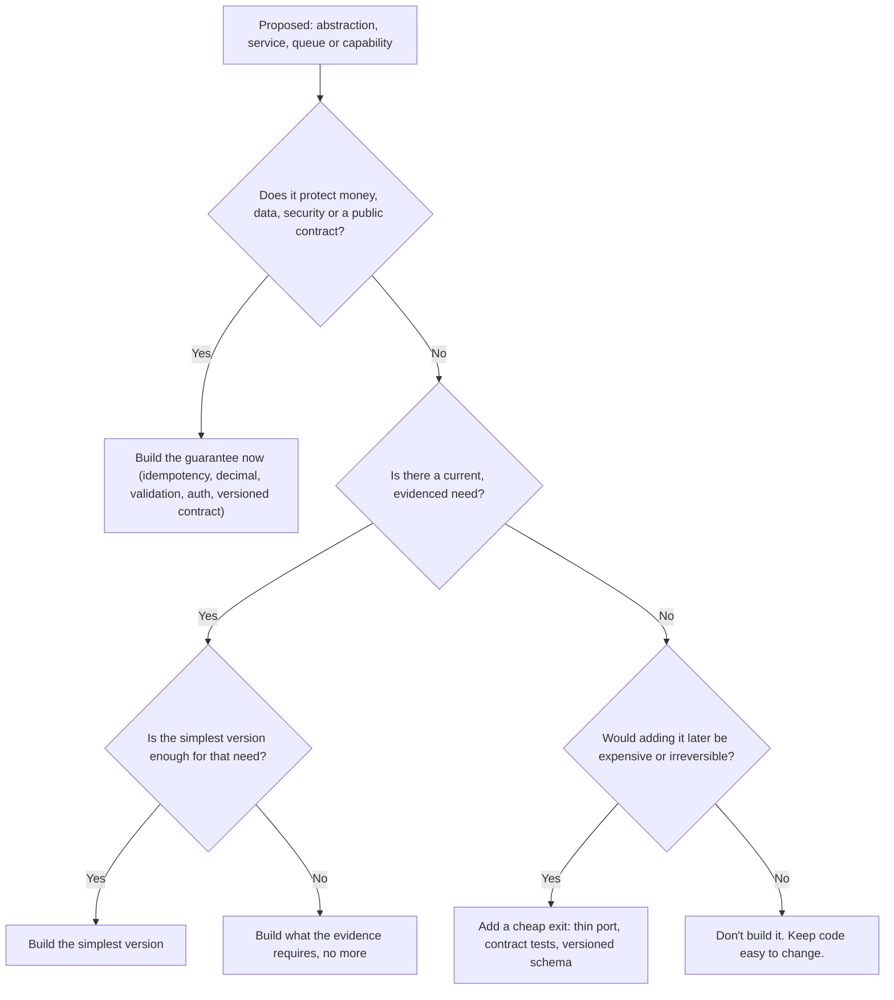
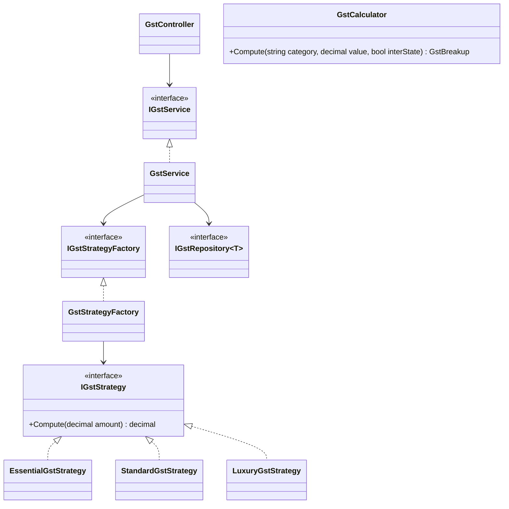

Every pattern and principle in this course can be overdone. Every shortcut can be taken too far. The skill that separates senior engineers isn't knowing more patterns; it's knowing **how much design a problem deserves**. This lesson gives you concrete signals and heuristics for that judgement, using examples from billing, payments and SMS integrations.

## Learning objectives

By the end of this lesson you will be able to:

1. Recognise the common signs of **overengineering** (speculative generality, needless indirection, premature distribution) and of **underengineering** (missing validation, idempotency, timeouts, data integrity).
2. Explain the costs of a speculative feature: cost of building, cost of delay, cost of carrying, and cost of repair.
3. Apply the **rule of three** before extracting abstractions, and know its exceptions.
4. Classify decisions as **reversible** (two-way doors) or **irreversible** (one-way doors) and invest effort accordingly.
5. Use a short decision checklist to choose "how much design" for a feature, based on evidence rather than imagination.
6. Refactor an overengineered design down to a simpler one, and harden an underengineered one, without swinging to the other extreme.

## Prerequisites

- [DRY, KISS and YAGNI](#/lesson/m04-dry-kiss-yagni): this lesson turns those slogans into decision tools.
- [Open/Closed Principle](#/lesson/m04-ocp): most overengineering is OCP applied where nothing ever varies.
- [Code smells and technical debt](#/lesson/m04-code-smells): speculative generality is a smell; so is a missing abstraction.
- [Architecture Decision Records](#/lesson/m02-adr): useful for recording one-way-door decisions.

## Explain it like I'm a beginner

Imagine a family of four asking you to build them a house.

**Overengineered:** you build 20 bedrooms "in case they have more children", a helipad "in case they get a helicopter", and wiring for a factory. It costs five times as much, takes three years, and every room needs cleaning. The family wanted a house in a year.

**Underengineered:** you build quickly and cheaply, but with no foundation, no fire exit, and electrical wiring that isn't earthed. It looks fine on day one. In the first monsoon, the walls crack.

**Right-sized:** you build for four people, with a **foundation strong enough for a second floor later**. Why the foundation? Because adding a stronger foundation under an existing house is almost impossible, while adding a floor on a good foundation is routine. You don't build the second floor, though; they may never need it.

That's the whole lesson in one picture:

- Things that are **cheap to change later** (number of rooms, paint, furniture): keep them simple now, add when needed. In software: class structure, internal interfaces, folder layout, which library sits behind an interface.
- Things that are **very expensive to change later** (foundation, fire safety, earthing): get them right on day one. In software: how money is stored, data integrity, security, public API and event contracts, idempotency of payments.

Overengineering is building the helipad. Underengineering is skipping the foundation. Both feel productive while you're doing them.

## First-principles explanation

### Complexity is a cost, paid every day

Every abstraction (interface, base class, factory, layer, service, message queue) has an ongoing cost:

- **Reading cost.** To understand "what happens when an invoice is saved", a developer follows every indirection. Seven layers means seven files open.
- **Change cost.** A new field must be threaded through each layer: DTO, command, handler, domain model, repository interface, repository, mapping profile.
- **Onboarding cost.** New team members must learn the custom framework before they can be productive.
- **Operational cost** (for distributed designs): more deployments, more dashboards, more ways to fail.

An abstraction pays for itself only when it **removes more cost than it adds**: by isolating something that really changes, enabling tests at a boundary, or letting teams work independently.

### The four costs of a speculative feature

Fowler's YAGNI article lists what you pay when you build something "because we'll need it":

1. **Cost of build**: the time spent building it now.
2. **Cost of delay**: the valuable features you didn't ship because you were building this one.
3. **Cost of carry**: the extra complexity everyone works around, every day, until it's used (if ever).
4. **Cost of repair**: when the need finally comes, it's usually *different* from what you guessed, so you rework it anyway.

The fourth cost is the killer. Predictions about future requirements are often wrong in the details, which means you pay for the speculative version **and** the real one.

### YAGNI doesn't mean "no design"

YAGNI applies to **features and capabilities you think you'll need later**. It doesn't apply to the things that make code easy to change: clear names, small functions, tests, separating I/O from logic. Fowler's point is that YAGNI only works if the code stays easy to change. Speculative flexibility is unnecessary *because* well-factored code can be extended when the need arrives.

This is also the **design stamina hypothesis**: skipping design work makes you faster at first, but past a point (often weeks, not years), the lack of design makes every change slower. Good internal quality is what lets you avoid speculative design.

### The rule of three

> The first time, just do it. The second time, wince at the duplication but do it anyway. The third time, refactor.

Why three? With one example you can't tell what's essential and what's incidental. With two, you might guess. With three, the real pattern (what varies, what stays the same) is usually visible, and your abstraction fits reality instead of a guess.

Exceptions:

- **Duplicated knowledge** should be removed immediately, even at two copies. If the GST rate is hard-coded in two places, a rate change will be missed in one of them. DRY is about knowledge, not about similar-looking code.
- **Similar-looking code that changes for different reasons** should *not* be merged, even at five copies. Two validation methods that both check "length ≤ 100" for different business reasons will diverge; merging them couples unrelated features.

### Reversible and irreversible decisions

Some decisions are **two-way doors**: if you're wrong, you walk back through. Others are **one-way doors**: once through, going back is expensive or impossible. (The terms were popularised in a 2015 Amazon shareholder letter; the idea is older.)

| Usually reversible (keep simple, decide fast) | Usually irreversible (slow down, design carefully) |
|---|---|
| Internal class and folder structure | Public API contracts that external clients use |
| Which library sits behind your own interface | Event and message schemas consumed by other teams |
| In-process vs separate class for a rule | How money is represented (`decimal`, minor units, currency) |
| Caching strategy for read-only data | Primary key and identifier formats |
| Logging format details | Data deletion and retention (deleted data can't come back) |
| UI layout | Security model: authentication, tenant isolation |
| A feature flag's default | Anything sent to a regulator, bank or tax portal |

Two important points:

1. **Many decisions can be made reversible cheaply.** Putting an SMS vendor behind a thin `ISmsSender` port with contract tests costs a day and turns "we're locked into vendor A" into a two-way door. That's *not* overengineering; it's buying an exit.
2. **Irreversibility is about consequences, not code size.** A one-line decision ("store amounts as `double`") can be a one-way door, because once millions of rows are stored with rounding errors, you can't recover the true values.

### Signs of overengineering

- **Speculative generality**: interfaces with one implementation and no test that needs a substitute; abstract base classes with one subclass; "plugin" systems with one plugin; generic `Repository<T>` wrapping EF Core's `DbSet<T>` (which is already a repository).
- **Configuration for things that never change**: a rules engine for three rules that changed once in two years.
- **Premature distribution**: microservices for a team of 4, each service with its own database, so a simple feature needs 3 deployments and an eventual-consistency story.
- **Layers without logic**: a controller calls a service that calls a manager that calls a repository, and the middle two just pass parameters through.
- **Indirection through a mediator for everything**: every call becomes `Send(new GetInvoiceQuery(id))`, so "go to definition" no longer works and the call graph is invisible.
- **Scale theatre**: designing for 1 million requests per second when the realistic peak is 50.

### Signs of underengineering

These are the places where "keep it simple" is used as an excuse:

- **Money in `double`**, or amounts without currency.
- **No idempotency** on operations that move money or create records from retried requests (payment callbacks, form double-submits).
- **No timeouts** on external calls, so one slow vendor freezes your thread pool.
- **No validation at the boundary**, trusting client input for prices or quantities.
- **No transactions** around multi-step writes that must succeed or fail together.
- **Secrets in source code**, no audit trail for sensitive actions, no tenant filter on queries.
- **No migrations or backups**: the schema exists only in production.
- **Swallowed exceptions** and no logs with correlation IDs, so failures are invisible.

Notice that every item is about **correctness, safety or data**, not about structure. Underengineering is mostly about missing *guarantees*; overengineering is mostly about extra *structure*.

### A decision checklist

Before adding an abstraction, a service, a queue or a framework, answer these honestly:

1. **Evidence**: is there a real, current requirement, or a guess about the future? "Product has 2 more providers signed for Q3" is evidence. "We might support other countries someday" is a guess.
2. **Cost of adding later**: if we wait, how expensive is the change? If it's a refactoring of our own code, it's cheap. If it's a data migration of 50 million rows or a breaking change for 30 API clients, it's expensive.
3. **Reversibility**: if we do it now and it's wrong, can we undo it cheaply?
4. **Blast radius**: if we under-build, what's the worst case? A slightly awkward refactoring later, or a duplicate ₹2 lakh payout?
5. **Numbers**: what are the real scale figures? Requests per second, data volume, team size, number of variants.
6. **Team**: can the people who'll maintain it understand it? A clever design that only one person understands is a liability.

A compact rule: **be lazy about structure, paranoid about guarantees.**

### Cost of change over time

Good structure keeps the cost of each change roughly flat over a project's life. Missing structure makes cost rise steeply; excessive structure raises the baseline cost of every change from day one. You're aiming for the lowest *total* cost across the changes you'll actually make, which is why evidence about likely changes matters so much.

## Visual explanation

### Should I add this now?



Start at the top. The first question filters out the "foundation" items: guarantees around money, data, security and contracts are built now, regardless of YAGNI. For everything else, you need evidence of a current need, and then the simplest version that meets it. With no evidence, the only reason to act now is that waiting would be expensive or irreversible, and even then, the answer is usually a *cheap exit* (a thin interface, a contract test), not the full speculative feature.

### Same feature, two designs



The top-left cluster is a real-world style of overengineering: a controller, a service interface with one implementation, a factory interface with one implementation, three strategy classes that each multiply by a different constant, and a generic repository for rates that never change at runtime. That's ten types for what is, today, a lookup table and one multiplication. `GstCalculator` on its own (bottom right) does the same job with a dictionary of rates and one method. If rates start changing monthly or per-state rules appear, *then* move rates to configuration or a table, and *then* consider strategies, with three real variants to guide the design.

## Step-by-step example

### Scenario: contractor payouts

A platform releases payments to subcontractors on infrastructure projects once their bills are approved. Today there's one bank integration, around 400 payouts a day, and a team of five developers.

### Step 1 — the overengineered proposal

A design document proposes:

- A `Payouts` microservice, a `Ledger` microservice and a `Notifications` microservice, communicating via a message broker.
- A `IPaymentProviderPlugin` system with dynamic assembly loading "so we can add providers without deploying".
- Event sourcing for payouts "for auditability".
- A generic `IRepository<T>` and `IUnitOfWork` over EF Core.
- CQRS with separate read and write databases.

Run the checklist. Evidence: one bank, 400 payouts a day (well under one per minute on average). Team: five people. Cost of adding later: a second provider behind an interface is a one-week change. Reversibility: splitting a well-modularised monolith into services later is feasible; merging three services with three databases back together is painful. Verdict: most of this is a helipad.

### Step 2 — the underengineered alternative

A developer writes the "simple" version in an afternoon:

```csharp
app.MapPost("/payouts", async (PayoutDto dto, AppDb db, HttpClient http) =>
{
    var res = await http.PostAsJsonAsync("https://bank.example/transfer", new { dto.Account, amount = (double)dto.Amount });
    db.Payouts.Add(new Payout { BillId = dto.BillId, Amount = dto.Amount, Status = res.IsSuccessStatusCode ? "Done" : "Failed" });
    await db.SaveChangesAsync();
    return Results.Ok();
});
```

Run the checklist on *guarantees*. The amount is sent as `double`. There's no check that the amount matches the approved bill. A client retry after a timeout sends the money twice. `HttpClient` has the default 100-second timeout. If the bank call succeeds and `SaveChangesAsync` fails, money has moved with no record. This isn't simple; it's missing its foundation.

### Step 3 — the right-sized design

- **One deployable** (a modular monolith), with a `Payouts` module.
- **One interface where there's a real boundary**: `IBankGateway`, because the bank is external, needs a fake in tests, and a second provider is plausible. No plugin loader.
- **Guarantees built in from day one**: an idempotency key per request (unique in the database), `decimal` amounts with currency, validation against the approved bill amount, a timeout on the bank call, and an explicit "outcome unknown" state for timeouts that a reconciliation job resolves, instead of blindly retrying a money transfer.
- **No generic repository**, no mediator, no event sourcing. An audit table records state changes; that covers the auditability requirement.

### Step 4 — write down the one-way doors

Record an ADR for the decisions that are hard to reverse: "Amounts are stored as `numeric(18,2)` in INR with an explicit currency column", "Payout requests require an `Idempotency-Key` header; keys are unique for 30 days", "Bank calls that time out move to `Unknown` and are never auto-retried". Everything else is left to normal refactoring.

## Production-style C# implementation

```text
Platform.Api/
  Program.cs
  Payouts/
    PayoutModels.cs
    IBankGateway.cs
    PayoutService.cs
    InMemoryPayoutStore.cs
    SandboxBankGateway.cs
```

```csharp file=Payouts/PayoutModels.cs
namespace Platform.Payouts;

public enum PayoutStatus { Requested, Sent, Failed, Unknown }

/// <summary>Money is decimal plus an explicit currency: a one-way-door decision made deliberately.</summary>
public sealed record Money(decimal Amount, string Currency)
{
    public static Money Inr(decimal amount) => new(Math.Round(amount, 2, MidpointRounding.AwayFromZero), "INR");
}

public sealed record PayoutRequest(Guid BillId, string BeneficiaryAccount, string Ifsc, decimal Amount);

public sealed record Payout(
    Guid Id, string IdempotencyKey, Guid BillId, string BeneficiaryAccount, string Ifsc,
    Money Amount, PayoutStatus Status, string? BankReference, DateTimeOffset CreatedAt, DateTimeOffset UpdatedAt);

public sealed record ApprovedBill(Guid BillId, Money ApprovedAmount, decimal AlreadyPaid);

public sealed class PayoutRejectedException(string reason) : Exception(reason);
```

```csharp file=Payouts/IBankGateway.cs
namespace Platform.Payouts;

public enum TransferOutcome { Accepted, Rejected }

public sealed record TransferResult(TransferOutcome Outcome, string? BankReference, string? Error);

/// <summary>The one interface in this module, because the bank is a real external boundary:
/// tests need a substitute, and a second provider is plausible. No plugin system.</summary>
public interface IBankGateway
{
    Task<TransferResult> TransferAsync(string idempotencyKey, string account, string ifsc, Money amount, CancellationToken ct);
}

public interface IPayoutStore
{
    Task<Payout?> FindByKeyAsync(string idempotencyKey, CancellationToken ct);
    /// <summary>Returns false if the key already exists (unique constraint in the real database).</summary>
    Task<bool> TryInsertAsync(Payout payout, CancellationToken ct);
    Task UpdateAsync(Payout payout, CancellationToken ct);
    Task<ApprovedBill?> FindApprovedBillAsync(Guid billId, CancellationToken ct);
}
```

```csharp file=Payouts/PayoutService.cs
using Microsoft.Extensions.Logging;

namespace Platform.Payouts;

/// <summary>Plain service, no mediator, no generic repository. The complexity budget is spent on guarantees:
/// idempotency, validation against the approved bill, a bounded bank call, and an explicit Unknown state.</summary>
public sealed class PayoutService(IPayoutStore store, IBankGateway bank, TimeProvider clock, ILogger<PayoutService> logger)
{
    public static readonly TimeSpan BankTimeout = TimeSpan.FromSeconds(15);

    public async Task<Payout> RequestAsync(string idempotencyKey, PayoutRequest request, CancellationToken ct)
    {
        ArgumentException.ThrowIfNullOrWhiteSpace(idempotencyKey);
        ArgumentNullException.ThrowIfNull(request);

        // 1. Idempotency: a retried request returns the original payout, whatever state it's in.
        var existing = await store.FindByKeyAsync(idempotencyKey, ct);
        if (existing is not null) return existing;

        // 2. Validate against the source of truth, never against the client's numbers alone.
        var bill = await store.FindApprovedBillAsync(request.BillId, ct)
                   ?? throw new PayoutRejectedException($"Bill {request.BillId} is not approved.");
        var amount = Money.Inr(request.Amount);
        if (amount.Amount <= 0) throw new PayoutRejectedException("Amount must be positive.");
        if (amount.Amount > bill.ApprovedAmount.Amount - bill.AlreadyPaid)
            throw new PayoutRejectedException($"Amount exceeds the unpaid approved balance of {bill.ApprovedAmount.Amount - bill.AlreadyPaid:0.00}.");

        var now = clock.GetUtcNow();
        var payout = new Payout(Guid.NewGuid(), idempotencyKey, request.BillId, request.BeneficiaryAccount, request.Ifsc,
                                amount, PayoutStatus.Requested, null, now, now);

        // 3. Record intent before moving money. A concurrent duplicate loses the insert race.
        if (!await store.TryInsertAsync(payout, ct))
            return (await store.FindByKeyAsync(idempotencyKey, ct))!;

        // 4. Bounded call; a timeout means "we don't know", which is not the same as "failed".
        using var timeout = CancellationTokenSource.CreateLinkedTokenSource(ct);
        timeout.CancelAfter(BankTimeout);
        try
        {
            var result = await bank.TransferAsync(idempotencyKey, request.BeneficiaryAccount, request.Ifsc, amount, timeout.Token);
            payout = payout with
            {
                Status = result.Outcome == TransferOutcome.Accepted ? PayoutStatus.Sent : PayoutStatus.Failed,
                BankReference = result.BankReference,
                UpdatedAt = clock.GetUtcNow(),
            };
        }
        catch (OperationCanceledException) when (!ct.IsCancellationRequested)
        {
            logger.LogWarning("Bank call timed out for payout {PayoutId}; marking Unknown for reconciliation", payout.Id);
            payout = payout with { Status = PayoutStatus.Unknown, UpdatedAt = clock.GetUtcNow() };
        }
        catch (HttpRequestException ex)
        {
            logger.LogWarning(ex, "Bank call failed in transit for payout {PayoutId}; marking Unknown", payout.Id);
            payout = payout with { Status = PayoutStatus.Unknown, UpdatedAt = clock.GetUtcNow() };
        }

        await store.UpdateAsync(payout, CancellationToken.None);   // don't lose the outcome if the client disconnects
        return payout;
    }
}
```

```csharp file=Payouts/InMemoryPayoutStore.cs
using System.Collections.Concurrent;

namespace Platform.Payouts;

public sealed class InMemoryPayoutStore : IPayoutStore
{
    private readonly ConcurrentDictionary<string, Payout> _byKey = new();
    private readonly ConcurrentDictionary<Guid, ApprovedBill> _bills = new();

    public void SeedBill(ApprovedBill bill) => _bills[bill.BillId] = bill;

    public Task<Payout?> FindByKeyAsync(string idempotencyKey, CancellationToken ct) =>
        Task.FromResult(_byKey.GetValueOrDefault(idempotencyKey));

    public Task<bool> TryInsertAsync(Payout payout, CancellationToken ct) =>
        Task.FromResult(_byKey.TryAdd(payout.IdempotencyKey, payout));

    public Task UpdateAsync(Payout payout, CancellationToken ct)
    {
        _byKey[payout.IdempotencyKey] = payout;
        if (payout.Status == PayoutStatus.Sent && _bills.TryGetValue(payout.BillId, out var bill))
            _bills[payout.BillId] = bill with { AlreadyPaid = bill.AlreadyPaid + payout.Amount.Amount };
        return Task.CompletedTask;
    }

    public Task<ApprovedBill?> FindApprovedBillAsync(Guid billId, CancellationToken ct) =>
        Task.FromResult(_bills.GetValueOrDefault(billId));
}
```

```csharp file=Payouts/SandboxBankGateway.cs
namespace Platform.Payouts;

/// <summary>Stands in for the bank's sandbox. The real adapter is a typed HttpClient behind the same interface.</summary>
public sealed class SandboxBankGateway : IBankGateway
{
    public async Task<TransferResult> TransferAsync(string idempotencyKey, string account, string ifsc, Money amount, CancellationToken ct)
    {
        await Task.Delay(TimeSpan.FromMilliseconds(50), ct);
        if (ifsc.Length != 11) return new TransferResult(TransferOutcome.Rejected, null, "Invalid IFSC");
        return new TransferResult(TransferOutcome.Accepted, "SBX" + idempotencyKey.GetHashCode().ToString("X8"), null);
    }
}
```

```csharp file=Program.cs
using Platform.Payouts;

var builder = WebApplication.CreateBuilder(args);

builder.Services.AddSingleton(TimeProvider.System);
builder.Services.AddSingleton<InMemoryPayoutStore>();
builder.Services.AddSingleton<IPayoutStore>(sp => sp.GetRequiredService<InMemoryPayoutStore>());
builder.Services.AddSingleton<IBankGateway, SandboxBankGateway>();
builder.Services.AddScoped<PayoutService>();

var app = builder.Build();

app.MapPost("/payouts", async (HttpRequest http, PayoutRequest body, PayoutService payouts, CancellationToken ct) =>
{
    var key = http.Headers["Idempotency-Key"].ToString();
    if (string.IsNullOrWhiteSpace(key))
        return Results.Problem("Idempotency-Key header is required.", statusCode: StatusCodes.Status400BadRequest);
    try
    {
        var payout = await payouts.RequestAsync(key, body, ct);
        return payout.Status == PayoutStatus.Unknown ? Results.Accepted($"/payouts/{payout.Id}", payout) : Results.Ok(payout);
    }
    catch (PayoutRejectedException ex)
    {
        return Results.Problem(ex.Message, statusCode: StatusCodes.Status422UnprocessableEntity);
    }
});

app.Run();
```

What's deliberately **absent**: a mediator, a generic repository, a plugin loader, separate services, event sourcing, a strategy factory for one bank. What's deliberately **present**: idempotency, decimal money with currency, validation against the approved bill, a timeout, and an honest `Unknown` state. That's the "lazy about structure, paranoid about guarantees" rule in code.

## Bad design vs good design

### Overengineering in the wild

```csharp
public interface IEntity<TKey> { TKey Id { get; } }
public interface IRepository<T, TKey> where T : IEntity<TKey> { Task<T?> GetAsync(TKey id); Task AddAsync(T e); /* 14 more */ }
public interface IUnitOfWork { Task CommitAsync(); }
public abstract class ServiceBase<TEntity, TDto, TKey> { /* mapping, validation, logging hooks */ }
public sealed class SiteService : ServiceBase<Site, SiteDto, int> { }
```

Five abstractions for a CRUD screen with 3 fields. EF Core's `DbContext` is already a unit of work and `DbSet<T>` is already a repository, so this wraps a repository in a repository. Every query that doesn't fit `GetAsync(id)` leaks around the abstraction, which then grows 14 more methods.

**Simpler**: use `DbContext` directly in a small, feature-focused service or endpoint handler. Introduce a repository *per aggregate* when real domain logic needs a persistence-ignorant boundary (see [Repository and Unit of Work](#/lesson/m06-repository-uow)).

### Underengineering in the wild

```csharp
public decimal LateFee(Invoice i) => i.Amount * 0.02m * (DateTime.Now - i.DueDate).Days;   // per day, uncapped
```

Hidden clock, no cap, no grace period, negative fees for early payments. "Simple", but wrong for 3 inputs out of 5.

**Better**: still small, but correct.

```csharp
public static decimal LateFee(decimal amount, DateOnly due, DateOnly today, decimal dailyRate = 0.0005m, decimal cap = 0.10m)
{
    var daysLate = Math.Max(0, today.DayNumber - due.DayNumber);
    return Math.Round(amount * Math.Min(daysLate * dailyRate, cap), 2, MidpointRounding.AwayFromZero);
}
```

Same size, no new abstractions, all the guarantees.

:::callout type=tradeoff title="Right-sizing is not the midpoint"
The goal isn't "medium complexity everywhere". It's **near-zero speculative structure** combined with **full strength on guarantees**. A payout service can be one class and still be more robust than a ten-project "enterprise" design that forgot idempotency.
:::

:::callout type=warning title="Watch for pendulum swings"
Teams burnt by a 7-layer architecture often swing to "no structure at all", and vice versa. Use evidence (change frequency, defect locations, lead time) rather than the last project's pain to decide.
:::

## Practical playground

The same feature, a late-fee calculator, written twice. Run it: both produce identical results. Then count the types and imagine adding a new rule to each.

:::playground type=csharp title="Two designs, same output"
```csharp file=Program.cs
using System;
using System.Collections.Generic;

// ---------- Version A: "enterprise" ----------
public interface IFeePolicy { decimal Compute(decimal amount, int daysLate); }
public interface IFeePolicyFactory { IFeePolicy Create(string customerType); }
public abstract class FeePolicyBase : IFeePolicy
{
    protected abstract decimal DailyRate { get; }
    protected virtual decimal Cap => 0.10m;
    public decimal Compute(decimal amount, int daysLate) =>
        Math.Round(amount * Math.Min(Math.Max(0, daysLate) * DailyRate, Cap), 2, MidpointRounding.AwayFromZero);
}
public sealed class RetailFeePolicy : FeePolicyBase { protected override decimal DailyRate => 0.0005m; }
public sealed class GovernmentFeePolicy : FeePolicyBase { protected override decimal DailyRate => 0.0002m; }
public sealed class FeePolicyFactory : IFeePolicyFactory
{
    public IFeePolicy Create(string customerType) => customerType switch
    {
        "retail" => new RetailFeePolicy(),
        "government" => new GovernmentFeePolicy(),
        _ => throw new ArgumentException(customerType),
    };
}
public sealed class LateFeeService(IFeePolicyFactory factory)
{
    public decimal Compute(string customerType, decimal amount, int daysLate) => factory.Create(customerType).Compute(amount, daysLate);
}

// ---------- Version B: right-sized ----------
public static class LateFees
{
    private static readonly Dictionary<string, decimal> DailyRates = new() { ["retail"] = 0.0005m, ["government"] = 0.0002m };
    private const decimal Cap = 0.10m;

    public static decimal Compute(string customerType, decimal amount, int daysLate)
    {
        if (!DailyRates.TryGetValue(customerType, out var rate)) throw new ArgumentException(customerType);
        return Math.Round(amount * Math.Min(Math.Max(0, daysLate) * rate, Cap), 2, MidpointRounding.AwayFromZero);
    }
}

public static class Program
{
    public static void Main()
    {
        var a = new LateFeeService(new FeePolicyFactory());
        var cases = new (string Type, decimal Amount, int Days)[] { ("retail", 250_000m, 12), ("government", 1_800_000m, 45), ("retail", 90_000m, 400), ("retail", 50_000m, -3) };
        foreach (var c in cases)
        {
            var feeA = a.Compute(c.Type, c.Amount, c.Days);
            var feeB = LateFees.Compute(c.Type, c.Amount, c.Days);
            Console.WriteLine($"{c.Type,-10} {c.Amount,12:N0} {c.Days,4} days -> A {feeA,10:N2}  B {feeB,10:N2}  {(feeA == feeB ? "same" : "DIFFERENT")}");
        }
        Console.WriteLine("Version A: 6 types. Version B: 1 type.");
    }
}
```
:::

Things to try:

1. Add a third customer type, "msme", with a daily rate of 0.0003. Count the edits in each version.
2. Now add a rule that **only government** customers get a 15-day grace period. Which version absorbs it more naturally? (Honest answer: B with one `if`, until there are several such rules; then A's per-type classes start to earn their keep.)
3. Delete the cap from Version B and run the 400-day case. That's underengineering: one missing guarantee, a fee of more than 18 % of the invoice.

## Exercises

:::exercise id=m04-over-under-engineering-ex1 difficulty=beginner kind=code title="Collapse an overengineered GST calculator"
A teammate built GST calculation with `IGstService`, `IGstStrategyFactory`, three strategy classes and a generic repository, for three fixed rates. Replace it with a single `GstCalculator.Compute` method.
::requirements
- Example rates for this exercise: `essential` 5 %, `standard` 18 %, `luxury` 28 %. Category matching ignores case.
- **Intra-state** supply: tax is split equally into CGST and SGST. **Inter-state**: all of it is IGST.
- Round each component to 2 decimals, half away from zero. `Total` = sum of the components.
- Unknown category → `ArgumentException`. Negative taxable value → `ArgumentOutOfRangeException`.
::acceptance
- `standard`, ₹10,000, intra-state → CGST 900, SGST 900, IGST 0, total 1,800.
- `luxury`, ₹10,000, inter-state → IGST 2,800.
- `Essential`, ₹333.33, intra-state → CGST 8.33, SGST 8.33, total 16.66.
- `unknown` → `ArgumentException`.
::hint
What actually varies between the three strategy classes? If it's just a number, a class per number is overkill.
::hint
A `Dictionary<string, decimal>` with `StringComparer.OrdinalIgnoreCase` replaces the factory and the strategies.
::hint
For intra-state, compute half the rate for each of CGST and SGST and round each, rather than rounding the total and halving it.
::hint
```csharp
var tax = taxableValue * rate;
return interState
    ? new GstBreakup(0m, 0m, R(tax), R(tax))
    : new GstBreakup(R(tax / 2), R(tax / 2), 0m, R(tax / 2) * 2);
```
::starter
```csharp file=GstCalculator.cs
using System;
using System.Collections.Generic;

public sealed record GstBreakup(decimal Cgst, decimal Sgst, decimal Igst, decimal Total);

public static class GstCalculator
{
    public static GstBreakup Compute(string category, decimal taxableValue, bool interState)
    {
        throw new NotImplementedException();
    }
}
```
::tests
```csharp file=GstCalculatorTests.cs
using System;
using Xunit;

public class GstCalculatorTests
{
    [Fact]
    public void Standard_intra_state_splits_cgst_sgst() =>
        Assert.Equal(new GstBreakup(900m, 900m, 0m, 1800m), GstCalculator.Compute("standard", 10_000m, interState: false));

    [Fact]
    public void Luxury_inter_state_is_igst() =>
        Assert.Equal(new GstBreakup(0m, 0m, 2800m, 2800m), GstCalculator.Compute("luxury", 10_000m, interState: true));

    [Fact]
    public void Rounds_each_component_and_ignores_case() =>
        Assert.Equal(new GstBreakup(8.33m, 8.33m, 0m, 16.66m), GstCalculator.Compute("Essential", 333.33m, interState: false));

    [Fact]
    public void Unknown_category_rejected() =>
        Assert.Throws<ArgumentException>(() => GstCalculator.Compute("unknown", 100m, false));

    [Fact]
    public void Negative_value_rejected() =>
        Assert.Throws<ArgumentOutOfRangeException>(() => GstCalculator.Compute("standard", -1m, false));

    [Fact]
    public void Zero_value_is_zero_tax() =>
        Assert.Equal(new GstBreakup(0m, 0m, 0m, 0m), GstCalculator.Compute("standard", 0m, true));
}
```
::solution
The only thing that varied between the strategy classes was a rate, which is data. A dictionary holds data; a method applies it. Ten types become one.

```csharp file=GstCalculator.cs
using System;
using System.Collections.Generic;

public sealed record GstBreakup(decimal Cgst, decimal Sgst, decimal Igst, decimal Total);

public static class GstCalculator
{
    private static readonly Dictionary<string, decimal> Rates = new(StringComparer.OrdinalIgnoreCase)
    {
        ["essential"] = 0.05m,
        ["standard"] = 0.18m,
        ["luxury"] = 0.28m,
    };

    public static GstBreakup Compute(string category, decimal taxableValue, bool interState)
    {
        ArgumentException.ThrowIfNullOrWhiteSpace(category);
        ArgumentOutOfRangeException.ThrowIfNegative(taxableValue);
        if (!Rates.TryGetValue(category, out var rate))
            throw new ArgumentException($"Unknown GST category '{category}'.", nameof(category));

        var tax = taxableValue * rate;
        if (interState)
        {
            var igst = R(tax);
            return new GstBreakup(0m, 0m, igst, igst);
        }
        var half = R(tax / 2);
        return new GstBreakup(half, half, 0m, half * 2);
    }

    private static decimal R(decimal v) => Math.Round(v, 2, MidpointRounding.AwayFromZero);
}
```

When would you move back towards more structure? If rates change at runtime (load them from configuration or a table, still no strategies), or if categories get genuinely different *rules* (cess on top for some items, reverse charge for others). Then you'd have real variants to design around.
::mistakes
- Keeping the factory "in case rules get complex". That's the cost of carry, paid every day for a future that may never come.
- Computing the total, rounding it, then halving it. ₹333.33 at 5 % is 16.6665; rounding the total gives 16.67, halves of 8.335 each, which don't round consistently. Round each printed component.
- Using `double`. Tax amounts must be exact decimals.
:::

:::exercise id=m04-over-under-engineering-ex2 difficulty=beginner kind=written title="Over, under, or right-sized?"
For each situation, say whether the design is **overengineered**, **underengineered** or **right-sized**, and give a one-sentence reason and a fix where needed.

1. A 3-developer startup splits its MVP into 9 microservices on Kubernetes with a service mesh. Peak traffic is 20 requests per second.
2. A UPI payment callback endpoint marks orders as paid, with no check for duplicate callback IDs.
3. A team adds an `ISmsSender` interface with one implementation and contract tests, because their SMS vendor's contract expires next year and pricing is under negotiation.
4. A reporting module has `IReportGeneratorFactoryProvider` that returns `IReportGeneratorFactory` that returns `IReportGenerator`. There is one report.
5. An internal admin tool stores user passwords in plain text "because it's only internal".
6. A team writes the same CSV export three times for three different screens, then extracts a shared `CsvWriter` on the third.
::acceptance
- Each item is classified with a reason tied to evidence (team size, traffic, contracts, risk).
- Items 2 and 5 are identified as underengineering of *guarantees*, not structure.
- Item 3 is recognised as buying reversibility cheaply, not overengineering.
- Item 6 is linked to the rule of three.
::hint
Separate structural questions (how many layers, services, interfaces) from guarantee questions (money, security, data integrity).
::hint
For each structural item, ask: what's the evidence for the variation or scale this design supports?
::hint
For item 3, which decision is the interface protecting, and is it a one-way door?
::solution
1. **Overengineered.** 20 rps and 3 developers don't justify 9 deployables; every feature now spans services and needs distributed debugging. Fix: a modular monolith with clear module boundaries, which can be split later if a module's scaling or team needs differ.
2. **Underengineered.** Payment gateways can deliver callbacks more than once; without deduplication, retries cause double processing (for example, duplicate fulfilment or loyalty credits). Fix: store processed callback IDs with a unique constraint and return success for duplicates without re-applying.
3. **Right-sized.** Vendor lock-in is a costly-to-reverse decision with concrete evidence (contract expiry, negotiation). One thin interface plus contract tests is a cheap exit.
4. **Overengineered.** Three levels of indirection for one implementation; reading the code is harder and nothing varies. Fix: one `SalesReport` class. Add abstraction when a second and third report show what really varies.
5. **Underengineered.** Internal tools get breached too, and people reuse passwords. Fix: use the platform's identity system (ASP.NET Core Identity uses a salted, iterated hash via `PasswordHasher<T>`), or SSO.
6. **Right-sized.** That's the rule of three in action: duplication was tolerated twice, and the third copy revealed what's common.
::mistakes
- Calling item 3 overengineering because "it only has one implementation". The test isn't the number of implementations; it's the cost of the decision it protects.
- Calling item 5 "simple and fine for internal use". Security shortcuts are one-way doors once data leaks.
:::

:::exercise id=m04-over-under-engineering-ex3 difficulty=intermediate kind=code title="Fix underengineering: an idempotent payment webhook"
A payment provider sends webhooks for `payment.captured` and `payment.refunded`. The current handler applies every event it receives. Implement `PaymentWebhookHandler.Handle` so it is safe against duplicates, mismatched amounts and out-of-order events, without adding any framework.
::requirements
- An event whose `EventId` was already handled returns `Duplicate` and changes nothing.
- `payment.captured`: the order must exist, be `Pending`, and the amount must equal the order amount exactly. Then mark it `Paid` and return `Applied`.
- `payment.refunded`: the order must be `Paid` and the amount must be positive and not more than the paid amount minus earlier refunds. Record the refund; if fully refunded, mark the order `Refunded`. Return `Applied`.
- Anything else (unknown order, unknown type, wrong state, wrong amount) returns `Rejected` and changes nothing. A rejected event is **also** remembered, so a redelivery returns `Duplicate`.
::acceptance
- Delivering the same capture twice: `Applied`, then `Duplicate`; the order is paid once.
- A capture of ₹999 for a ₹1,000 order is `Rejected`.
- A refund that arrives before the capture is `Rejected`.
- Two partial refunds of ₹400 and ₹600 on a ₹1,000 order: both `Applied`, final status `Refunded`. A third refund of ₹1 is `Rejected`.
::hint
The ledger already gives you `TryRecordEvent(eventId)`. When should you call it: before or after deciding the outcome?
::hint
Decide the outcome first using only reads, then record the event id, then apply changes only if the outcome is `Applied`.
::hint
Use a `switch` on `Type`. Each branch validates, then returns either `Rejected` or an action to apply.
::hint
```csharp
if (ledger.HasSeen(e.EventId)) return WebhookOutcome.Duplicate;
var outcome = e.Type switch { "payment.captured" => TryCapture(e), "payment.refunded" => TryRefund(e), _ => WebhookOutcome.Rejected };
ledger.RecordEvent(e.EventId);
return outcome;
```
::starter
```csharp file=PaymentWebhookHandler.cs
using System;
using System.Collections.Generic;

public enum OrderStatus { Pending, Paid, Refunded }
public enum WebhookOutcome { Applied, Duplicate, Rejected }

public sealed record WebhookEvent(string EventId, string Type, string OrderId, decimal Amount);

public sealed class Order(string id, decimal amount)
{
    public string Id { get; } = id;
    public decimal Amount { get; } = amount;
    public OrderStatus Status { get; set; } = OrderStatus.Pending;
    public decimal Refunded { get; set; }
}

/// <summary>In-memory stand-in for the database. In production, HasSeen/RecordEvent is a table
/// with a unique constraint on event_id, written in the same transaction as the order change.</summary>
public sealed class PaymentLedger
{
    private readonly Dictionary<string, Order> _orders = new();
    private readonly HashSet<string> _events = new();
    public void Add(Order order) => _orders[order.Id] = order;
    public Order? Find(string id) => _orders.GetValueOrDefault(id);
    public bool HasSeen(string eventId) => _events.Contains(eventId);
    public void RecordEvent(string eventId) => _events.Add(eventId);
}

public sealed class PaymentWebhookHandler(PaymentLedger ledger)
{
    public WebhookOutcome Handle(WebhookEvent e)
    {
        throw new NotImplementedException();
    }
}
```
::tests
```csharp file=PaymentWebhookHandlerTests.cs
using Xunit;

public class PaymentWebhookHandlerTests
{
    private static (PaymentWebhookHandler H, Order O) Setup(decimal amount = 1000m)
    {
        var ledger = new PaymentLedger();
        var order = new Order("ORD-1", amount);
        ledger.Add(order);
        return (new PaymentWebhookHandler(ledger), order);
    }

    [Fact]
    public void Duplicate_capture_applied_once()
    {
        var (h, o) = Setup();
        var e = new WebhookEvent("evt_1", "payment.captured", "ORD-1", 1000m);
        Assert.Equal(WebhookOutcome.Applied, h.Handle(e));
        Assert.Equal(WebhookOutcome.Duplicate, h.Handle(e));
        Assert.Equal(OrderStatus.Paid, o.Status);
    }

    [Fact]
    public void Wrong_amount_rejected()
    {
        var (h, o) = Setup();
        Assert.Equal(WebhookOutcome.Rejected, h.Handle(new WebhookEvent("evt_1", "payment.captured", "ORD-1", 999m)));
        Assert.Equal(OrderStatus.Pending, o.Status);
    }

    [Fact]
    public void Refund_before_capture_rejected()
    {
        var (h, o) = Setup();
        Assert.Equal(WebhookOutcome.Rejected, h.Handle(new WebhookEvent("evt_r", "payment.refunded", "ORD-1", 100m)));
        Assert.Equal(0m, o.Refunded);
    }

    [Fact]
    public void Partial_refunds_then_full()
    {
        var (h, o) = Setup();
        h.Handle(new WebhookEvent("evt_c", "payment.captured", "ORD-1", 1000m));
        Assert.Equal(WebhookOutcome.Applied, h.Handle(new WebhookEvent("evt_r1", "payment.refunded", "ORD-1", 400m)));
        Assert.Equal(OrderStatus.Paid, o.Status);
        Assert.Equal(WebhookOutcome.Applied, h.Handle(new WebhookEvent("evt_r2", "payment.refunded", "ORD-1", 600m)));
        Assert.Equal(OrderStatus.Refunded, o.Status);
        Assert.Equal(WebhookOutcome.Rejected, h.Handle(new WebhookEvent("evt_r3", "payment.refunded", "ORD-1", 1m)));
    }

    [Fact]
    public void Over_refund_rejected()
    {
        var (h, o) = Setup();
        h.Handle(new WebhookEvent("evt_c", "payment.captured", "ORD-1", 1000m));
        Assert.Equal(WebhookOutcome.Rejected, h.Handle(new WebhookEvent("evt_r", "payment.refunded", "ORD-1", 1000.01m)));
        Assert.Equal(0m, o.Refunded);
    }

    [Fact]
    public void Unknown_order_and_type_rejected_and_remembered()
    {
        var (h, _) = Setup();
        var e = new WebhookEvent("evt_x", "payment.captured", "ORD-404", 10m);
        Assert.Equal(WebhookOutcome.Rejected, h.Handle(e));
        Assert.Equal(WebhookOutcome.Duplicate, h.Handle(e));
        Assert.Equal(WebhookOutcome.Rejected, h.Handle(new WebhookEvent("evt_y", "payment.disputed", "ORD-1", 10m)));
    }
}
```
::solution
No framework, no new layers, just the guarantees that a "simple" handler was missing: deduplication, exact amount checks and state checks. This is the kind of complexity that's always worth it, because the failure mode is money moving wrongly.

```csharp file=PaymentWebhookHandler.cs
using System;
using System.Collections.Generic;

public enum OrderStatus { Pending, Paid, Refunded }
public enum WebhookOutcome { Applied, Duplicate, Rejected }

public sealed record WebhookEvent(string EventId, string Type, string OrderId, decimal Amount);

public sealed class Order(string id, decimal amount)
{
    public string Id { get; } = id;
    public decimal Amount { get; } = amount;
    public OrderStatus Status { get; set; } = OrderStatus.Pending;
    public decimal Refunded { get; set; }
}

public sealed class PaymentLedger
{
    private readonly Dictionary<string, Order> _orders = new();
    private readonly HashSet<string> _events = new();
    public void Add(Order order) => _orders[order.Id] = order;
    public Order? Find(string id) => _orders.GetValueOrDefault(id);
    public bool HasSeen(string eventId) => _events.Contains(eventId);
    public void RecordEvent(string eventId) => _events.Add(eventId);
}

public sealed class PaymentWebhookHandler(PaymentLedger ledger)
{
    public WebhookOutcome Handle(WebhookEvent e)
    {
        ArgumentNullException.ThrowIfNull(e);
        if (ledger.HasSeen(e.EventId)) return WebhookOutcome.Duplicate;

        var order = ledger.Find(e.OrderId);
        Action? apply = (e.Type, order) switch
        {
            ("payment.captured", { Status: OrderStatus.Pending } o) when e.Amount == o.Amount =>
                () => o.Status = OrderStatus.Paid,
            ("payment.refunded", { Status: OrderStatus.Paid } o) when e.Amount > 0 && e.Amount <= o.Amount - o.Refunded =>
                () =>
                {
                    o.Refunded += e.Amount;
                    if (o.Refunded == o.Amount) o.Status = OrderStatus.Refunded;
                },
            _ => null,
        };

        // In production: record the event and apply the change in ONE database transaction.
        ledger.RecordEvent(e.EventId);
        if (apply is null) return WebhookOutcome.Rejected;
        apply();
        return WebhookOutcome.Applied;
    }
}
```
::alternatives
Some teams don't remember rejected events, so a provider can fix data and redeliver. That's valid if the provider uses a *new* event id for corrected events; check their documentation. If providers deliver out of order often, store early refunds as "pending" and apply them after the capture instead of rejecting.
::mistakes
- Comparing amounts with a tolerance (`Math.Abs(a - b) < 1`). Payment amounts must match exactly.
- Recording the event id *before* validating, in a separate transaction from the order change. A crash in between loses the event forever.
- Building a generic "event processing framework" with handler registration for two event types. That's overengineering the fix.
:::

:::exercise id=m04-over-under-engineering-ex4 difficulty=intermediate kind=written title="One-way doors for a new product"
Your team is starting a platform that lets city municipalities track road-repair complaints from citizens (photos, location, status), with an API for other government apps. Classify each decision as a **one-way door** or a **two-way door**, and say how much effort it deserves now.

1. Whether to use Clean Architecture folders or vertical slices.
2. The public API's URL and JSON shape for `GET /complaints/{id}`.
3. Complaint IDs: database integers vs a public, non-guessable identifier.
4. Which logging library to use.
5. Where citizens' phone numbers and photos are stored, and for how long.
6. Whether to use a message broker for status-change notifications from day one.
7. Multi-tenancy model: one database per municipality vs a shared database with a tenant column.
8. The CSS framework for the admin dashboard.
::acceptance
- Items 2, 3, 5 and 7 are identified as one-way (or expensive-to-reverse) doors with concrete reasons.
- Items 1, 4 and 8 are identified as two-way doors with a "decide quickly" recommendation.
- Item 6 is discussed in terms of current evidence (volume, consumers) and an option to add later.
- At least two one-way doors include a cheap way to make them more reversible (for example, API versioning).
::hint
Ask: if we're wrong in a year, who else is affected? Only our code, or external clients, citizens, or stored data?
::hint
Data that has left your system (published IDs, API responses consumed by others) and data you've stored for years are the usual one-way doors.
::hint
For the broker, compare "add a broker later behind an `INotificationPublisher` interface" with "run a broker from day one" in cost and risk.
::solution
1. **Two-way.** Folder structure is internal; it can be refactored. Pick one in an hour and move on.
2. **One-way (once published).** Other government apps will integrate against it. Spend real time on resource naming and field names, version it (`/v1/`), and keep responses additive.
3. **One-way.** Public IDs end up in SMS links, printouts and other systems. Sequential integers leak volumes and are guessable. Use an internal key plus a public identifier (for example, a UUID v7 or a short random code) from day one.
4. **Two-way.** Use `ILogger<T>` everywhere and the logging provider becomes a configuration choice.
5. **One-way.** Personal data rules (consent, retention, deletion) are hard to retrofit and mistakes can't be undone once data leaks. Design storage, access control, retention periods and deletion paths now.
6. **Mostly two-way, if you prepare a seam.** Without evidence of high volume or several consumers, start with in-process notifications behind an `INotificationPublisher` interface (or an outbox table), and add a broker when a second consumer or a throughput need appears. See [Transactional outbox](#/lesson/m12-outbox).
7. **One-way.** Moving tenants between databases, or merging them, is a large data migration. Decide based on expected tenant count, isolation requirements and per-tenant customisation. A shared database with a tenant column and row-level security is a common default; choose deliberately and record an ADR.
8. **Two-way.** It's the admin UI; pick what the team knows.
::mistakes
- Spending a week on folder structure (two-way) and an hour on tenant isolation (one-way).
- Treating "uses a message broker" as inherently more professional. It adds operations and failure modes; it's justified by evidence.
:::

:::exercise id=m04-over-under-engineering-ex5 difficulty=advanced kind=code title="Make vendor lock-in reversible with a thin port and contract tests"
Your SMS vendor contract is up for renewal. Make switching vendors a two-way door: implement two adapters behind one `ISmsSender` port, plus the shared logic both need. The tests include a **contract test suite** that runs identically against both adapters.
::requirements
- `PhoneNumber.NormalizeIndian(raw)` returns `+91XXXXXXXXXX`. Accept spaces, dashes, a leading `0`, `91` or `+91`. The 10-digit number must start with 6–9. Anything else → `ArgumentException`.
- `SmsSegments.Count(text)`: if every character is ASCII, 160 characters fit in 1 segment and longer messages use 153 per segment; otherwise (for example, Hindi text) 70 fit in 1 and longer messages use 67 per segment. Empty text → `ArgumentException`.
- `AlphaSmsSender` uses `AlphaSmsApi.Send(string msisdn, string text)`: the number **without** `+` (e.g. `919812345678`); the reply is `"OK:<id>"` or `"ERR:<reason>"`.
- `BetaSmsSender` uses `BetaSmsClient.Submit(BetaRequest)`: the number **with** `+`; the reply is a `BetaResponse(bool Accepted, string? MessageId, string? Error)`.
- Both return `SmsResult(bool Sent, string? ProviderMessageId, string? Error, int Segments)`. Invalid phone numbers throw `ArgumentException` **before** calling the vendor.
::acceptance
- `"098123 45678"`, `"+91-98123-45678"` and `"9812345678"` all normalise to `+919812345678`. `"5812345678"` and `"98123"` are rejected.
- 160 ASCII chars → 1 segment; 161 → 2; 306 → 2; 307 → 3. 70 Hindi chars → 1; 71 → 2.
- The same contract tests pass for both adapters: success maps the id; vendor errors map to `Sent = false` with the error text; the vendor sees the right number format.
::hint
The port (`ISmsSender`) should speak *your* language (`SmsMessage`, `SmsResult`), not either vendor's. Each adapter translates.
::hint
Put normalisation and segment counting in shared static helpers. They're pure, so the adapters stay thin.
::hint
Strip everything except digits, then remove a leading `91` (if 12 digits) or `0` (if 11 digits). You should be left with exactly 10 digits starting with 6–9.
::hint
Segments: `n <= single ? 1 : (n + multi - 1) / multi`, where (single, multi) is (160, 153) for ASCII and (70, 67) otherwise. Check ASCII with `text.All(c => c <= 127)`.
::hint
```csharp
var reply = api.Send(phone.TrimStart('+'), message.Text);
return reply.StartsWith("OK:")
    ? new SmsResult(true, reply[3..], null, segments)
    : new SmsResult(false, null, reply.StartsWith("ERR:") ? reply[4..] : reply, segments);
```
::starter
```csharp file=SmsPort.cs
using System;
using System.Collections.Generic;
using System.Linq;

public sealed record SmsMessage(string To, string Text);
public sealed record SmsResult(bool Sent, string? ProviderMessageId, string? Error, int Segments);

public interface ISmsSender
{
    SmsResult Send(SmsMessage message);
}

public static class PhoneNumber
{
    public static string NormalizeIndian(string raw) => throw new NotImplementedException();
}

public static class SmsSegments
{
    public static int Count(string text) => throw new NotImplementedException();
}

// ---- Vendor SDKs (given; you can't change these) ----
public class AlphaSmsApi
{
    public virtual string Send(string msisdn, string text) => "OK:" + Guid.NewGuid().ToString("N")[..10];
}

public sealed record BetaRequest(string Destination, string Body);
public sealed record BetaResponse(bool Accepted, string? MessageId, string? Error);

public class BetaSmsClient
{
    public virtual BetaResponse Submit(BetaRequest request) => new(true, "b-" + Guid.NewGuid().ToString("N")[..8], null);
}
// -----------------------------------------------------

public sealed class AlphaSmsSender(AlphaSmsApi api) : ISmsSender
{
    public SmsResult Send(SmsMessage message) => throw new NotImplementedException();
}

public sealed class BetaSmsSender(BetaSmsClient client) : ISmsSender
{
    public SmsResult Send(SmsMessage message) => throw new NotImplementedException();
}
```
::tests
```csharp file=SmsPortTests.cs
using System;
using System.Collections.Generic;
using System.Linq;
using Xunit;

public class PhoneAndSegmentTests
{
    [Theory]
    [InlineData("098123 45678")]
    [InlineData("+91-98123-45678")]
    [InlineData("9812345678")]
    [InlineData("91 9812345678")]
    public void Normalises(string raw) => Assert.Equal("+919812345678", PhoneNumber.NormalizeIndian(raw));

    [Theory]
    [InlineData("5812345678")]
    [InlineData("98123")]
    [InlineData("+1 415 555 0100")]
    public void Rejects(string raw) => Assert.Throws<ArgumentException>(() => PhoneNumber.NormalizeIndian(raw));

    [Theory]
    [InlineData(160, 1)]
    [InlineData(161, 2)]
    [InlineData(306, 2)]
    [InlineData(307, 3)]
    public void Ascii_segments(int length, int expected) => Assert.Equal(expected, SmsSegments.Count(new string('a', length)));

    [Theory]
    [InlineData(70, 1)]
    [InlineData(71, 2)]
    [InlineData(134, 2)]
    [InlineData(135, 3)]
    public void Unicode_segments(int length, int expected) => Assert.Equal(expected, SmsSegments.Count(new string('न', length)));

    [Fact] public void Empty_text_rejected() => Assert.Throws<ArgumentException>(() => SmsSegments.Count(""));
}

// ---------- Contract tests: the same expectations for every adapter ----------
public abstract class SmsSenderContract
{
    protected abstract ISmsSender Create(bool vendorSucceeds, List<string> numbersSeenByVendor);
    protected abstract string ExpectedVendorNumber { get; }

    [Fact]
    public void Success_maps_provider_id_and_segments()
    {
        var seen = new List<string>();
        var result = Create(true, seen).Send(new SmsMessage("098123 45678", "Your complaint RC-2041 is resolved."));
        Assert.True(result.Sent);
        Assert.Equal("id-123", result.ProviderMessageId);
        Assert.Null(result.Error);
        Assert.Equal(1, result.Segments);
        Assert.Equal(ExpectedVendorNumber, Assert.Single(seen));
    }

    [Fact]
    public void Vendor_error_maps_to_not_sent()
    {
        var result = Create(false, new List<string>()).Send(new SmsMessage("9812345678", "Hello"));
        Assert.False(result.Sent);
        Assert.Null(result.ProviderMessageId);
        Assert.Equal("DND number", result.Error);
    }

    [Fact]
    public void Invalid_number_never_reaches_vendor()
    {
        var seen = new List<string>();
        Assert.Throws<ArgumentException>(() => Create(true, seen).Send(new SmsMessage("12345", "Hello")));
        Assert.Empty(seen);
    }
}

public sealed class AlphaContractTests : SmsSenderContract
{
    private sealed class FakeAlpha(bool ok, List<string> seen) : AlphaSmsApi
    {
        public override string Send(string msisdn, string text) { seen.Add(msisdn); return ok ? "OK:id-123" : "ERR:DND number"; }
    }
    protected override ISmsSender Create(bool ok, List<string> seen) => new AlphaSmsSender(new FakeAlpha(ok, seen));
    protected override string ExpectedVendorNumber => "919812345678";
}

public sealed class BetaContractTests : SmsSenderContract
{
    private sealed class FakeBeta(bool ok, List<string> seen) : BetaSmsClient
    {
        public override BetaResponse Submit(BetaRequest r) { seen.Add(r.Destination); return ok ? new BetaResponse(true, "id-123", null) : new BetaResponse(false, null, "DND number"); }
    }
    protected override ISmsSender Create(bool ok, List<string> seen) => new BetaSmsSender(new FakeBeta(ok, seen));
    protected override string ExpectedVendorNumber => "+919812345678";
}
```
::solution
The port speaks the domain's language, the shared rules are pure helpers, and each adapter is a few lines of translation. The contract suite is what makes the switch genuinely reversible: a third vendor's adapter is "done" when it passes the same tests.

```csharp file=SmsPort.cs
using System;
using System.Collections.Generic;
using System.Linq;

public sealed record SmsMessage(string To, string Text);
public sealed record SmsResult(bool Sent, string? ProviderMessageId, string? Error, int Segments);

public interface ISmsSender
{
    SmsResult Send(SmsMessage message);
}

public static class PhoneNumber
{
    public static string NormalizeIndian(string raw)
    {
        ArgumentException.ThrowIfNullOrWhiteSpace(raw);
        var digits = new string(raw.Where(char.IsAsciiDigit).ToArray());
        if (digits.Length == 12 && digits.StartsWith("91")) digits = digits[2..];
        else if (digits.Length == 11 && digits.StartsWith('0')) digits = digits[1..];

        if (digits.Length != 10 || digits[0] < '6')
            throw new ArgumentException($"'{raw}' is not a valid Indian mobile number.", nameof(raw));
        return "+91" + digits;
    }
}

public static class SmsSegments
{
    public static int Count(string text)
    {
        ArgumentException.ThrowIfNullOrEmpty(text);
        var ascii = text.All(c => c <= 127);
        var (single, multi) = ascii ? (160, 153) : (70, 67);
        return text.Length <= single ? 1 : (text.Length + multi - 1) / multi;
    }
}

public class AlphaSmsApi
{
    public virtual string Send(string msisdn, string text) => "OK:" + Guid.NewGuid().ToString("N")[..10];
}

public sealed record BetaRequest(string Destination, string Body);
public sealed record BetaResponse(bool Accepted, string? MessageId, string? Error);

public class BetaSmsClient
{
    public virtual BetaResponse Submit(BetaRequest request) => new(true, "b-" + Guid.NewGuid().ToString("N")[..8], null);
}

public sealed class AlphaSmsSender(AlphaSmsApi api) : ISmsSender
{
    public SmsResult Send(SmsMessage message)
    {
        var phone = PhoneNumber.NormalizeIndian(message.To);
        var segments = SmsSegments.Count(message.Text);
        var reply = api.Send(phone.TrimStart('+'), message.Text);
        return reply.StartsWith("OK:", StringComparison.Ordinal)
            ? new SmsResult(true, reply[3..], null, segments)
            : new SmsResult(false, null, reply.StartsWith("ERR:", StringComparison.Ordinal) ? reply[4..] : reply, segments);
    }
}

public sealed class BetaSmsSender(BetaSmsClient client) : ISmsSender
{
    public SmsResult Send(SmsMessage message)
    {
        var phone = PhoneNumber.NormalizeIndian(message.To);
        var segments = SmsSegments.Count(message.Text);
        var response = client.Submit(new BetaRequest(phone, message.Text));
        return response.Accepted
            ? new SmsResult(true, response.MessageId, null, segments)
            : new SmsResult(false, null, response.Error ?? "Rejected", segments);
    }
}
```

Choosing the vendor is now a one-line DI registration, or a config switch: `services.AddSingleton<ISmsSender>(sp => config["Sms:Vendor"] == "beta" ? new BetaSmsSender(...) : new AlphaSmsSender(...));`.
::alternatives
You could add a failover sender that tries Alpha then Beta. Only do it if there's evidence (vendor outages hurting the business); otherwise it's speculative, and it brings its own problems such as duplicate messages when the first vendor timed out but actually sent.
::mistakes
- Leaking a vendor concept into the port (`ISmsSender.Send(string msisdn, ...)` in Alpha's format), so switching still means changing every caller.
- Building a dynamic plugin loader for vendors. Two adapters and a DI switch are enough.
- Testing each adapter with different ad-hoc tests, so nothing guarantees they behave the same. The shared contract suite is the point.
::extensions
Add DLT template ids (required for commercial SMS in India) to `SmsMessage`, and map them in each adapter. Does the contract suite need a new test?
:::

## Automated testing

Testing is also where over- and underengineering show up.

**Overengineered test suites** mock every layer (`IGstService`, `IGstStrategyFactory`, `IGstStrategy`) and verify calls between them. They break on every refactoring and prove little. When you collapse an overengineered design, many of these tests can be deleted and replaced with a handful of table-driven tests on the real behaviour (exercise 1).

**Underengineered test suites** test the happy path only. The bugs that matter live in duplicates, retries, timeouts, boundaries and concurrency. For the payout service, the tests worth having are:

```csharp
[Fact]
public async Task Retried_request_returns_original_payout_and_moves_money_once()
{
    var store = new InMemoryPayoutStore();
    var billId = Guid.NewGuid();
    store.SeedBill(new ApprovedBill(billId, Money.Inr(250_000m), 0m));
    var bank = new CountingBank();
    var svc = new PayoutService(store, bank, TimeProvider.System, NullLogger<PayoutService>.Instance);
    var req = new PayoutRequest(billId, "50100012345678", "HDFC0001234", 100_000m);

    var first = await svc.RequestAsync("key-1", req, CancellationToken.None);
    var second = await svc.RequestAsync("key-1", req, CancellationToken.None);

    Assert.Equal(first.Id, second.Id);
    Assert.Equal(1, bank.Calls);
}

[Fact]
public async Task Bank_timeout_is_unknown_not_failed()
{
    // A bank fake that waits longer than BankTimeout. Use a fake TimeProvider-driven delay, or a
    // shorter configurable timeout, so the test doesn't actually wait 15 seconds.
}
```

**Contract tests** (exercise 5) are the right-sized way to test ports: one abstract test class, one small subclass per adapter. They make the reversibility you paid for verifiable.

**Architecture tests** can guard against both extremes. A simple reflection test can fail the build when an interface in your own assembly has exactly one implementation *and* isn't used in any test double. Treat it as a prompt for review rather than an absolute rule.

## Real-world application

- **Startups and MVPs** commonly suffer from premature microservices and Kubernetes. Many well-known products started as monoliths and split only parts that needed independent scaling or ownership. A modular monolith keeps that option open cheaply.
- **Payments and fintech** are where underengineering is most expensive: idempotency, exact decimal arithmetic, reconciliation of "unknown" outcomes and audit trails are standard practice, not gold-plating.
- **Government and infrastructure platforms** often have strict data, audit and integration requirements (APIs consumed by other departments, retention rules), which are one-way doors. Internal structure can stay simple; contracts and data handling can't.
- **Vendor integrations** (SMS, maps, e-sign, payment gateways) are where a thin port plus contract tests pays off, because commercial terms change more often than code.
- **Enterprise "frameworks"** built in-house (custom base services, generic repositories, layered abstractions) are a common source of carry cost. Teams often get faster by deleting layers that only pass parameters through.

## Interview questions

:::interview
::q beginner
What is overengineering? Give two examples.
::a
Building more structure or capability than current, evidenced needs require, so the code is harder to read and change without a matching benefit. Examples: an interface, factory and three strategy classes for three fixed tax rates that could be a dictionary lookup; splitting a small team's product into many microservices when traffic and team size don't justify independent deployment. The cost isn't just the initial build; it's the daily cost of carrying the complexity and the rework when the imagined future turns out different.
::q beginner
What is underengineering? How is it different from "keeping things simple"?
::a
Underengineering is leaving out guarantees the system needs to be correct and safe: validation at the boundary, idempotency for retried operations, timeouts on external calls, exact money types, transactions, security controls, logging. Keeping things simple means avoiding *unnecessary structure*; it never means skipping *necessary guarantees*. A one-class payout service with idempotency and decimal money is simple; a "simple" endpoint that can pay twice is underengineered.
::q intermediate
Explain the rule of three and when you'd break it.
::a
Tolerate duplication until the third occurrence, then extract an abstraction, because by then you can see what really varies and what stays the same. Break it in both directions: remove duplicated *knowledge* immediately, even at two copies (a GST rate or a business rule hard-coded twice will drift); and *don't* merge code that looks similar but changes for different reasons, even at many copies, because merging couples unrelated features.
::q intermediate
What are one-way and two-way door decisions in software? Give examples of each.
::a
Two-way doors are cheap to reverse: internal class structure, folder layout, a library behind your own interface, a cache policy. Make them quickly and adjust later. One-way doors are expensive or impossible to reverse: published API contracts and event schemas used by others, public identifier formats, money representation, data retention and deletion, tenant isolation model, anything sent to regulators or banks. Spend design effort on these, record them in ADRs, and where possible make them more reversible cheaply (versioned APIs, a thin port over a vendor, additive schema changes).
::q advanced
A design review proposes event sourcing, CQRS and three microservices for a new contractor-payout feature: one bank, about 400 payouts a day, five developers. How do you respond?
::a
I'd ask for the evidence behind each choice. At 400 payouts a day (well under one a minute on average) and five developers, three services add deployment, monitoring and distributed-consistency costs with little benefit; a modular monolith with a clear Payouts module keeps the option to split later. Event sourcing is a one-way door with a high learning and operational cost; the stated need, auditability, is met by an append-only audit table of state changes. CQRS with separate stores isn't justified by the read load. I'd redirect the effort to the guarantees that matter: idempotency keys with a unique constraint, decimal money with currency, validation against the approved bill, timeouts and an explicit "unknown" state with reconciliation for bank calls, and a thin `IBankGateway` port with contract tests so a second bank is cheap. I'd record the decisions and the conditions that would make us revisit them (for example, a second bank, 50,000 payouts a day, or a separate payouts team).
::q advanced
How do you prevent a codebase from drifting into overengineering or underengineering over time?
::a
Make the trade-off visible and evidence-based. Use ADRs for one-way-door decisions, including the conditions under which you'd revisit them. In code review, ask "what's the evidence for this abstraction?" and "what happens on retry, timeout, or duplicate?" with equal weight. Track signals: lead time for changes, defect locations (bugs clustering where guarantees are missing), and modules where every change touches many files (structure overhead). Keep internal quality high (tests, clear names, small functions) so that YAGNI is safe: if code is easy to change, you don't need speculative flexibility. Periodically delete layers and abstractions that have one implementation and no testing purpose, and add the missing guarantees when incidents expose them.
:::

## Summary and revision

**Key takeaways**

- Complexity is a daily cost: reading, changing, onboarding and operating. Abstractions must earn it back.
- Speculative features cost **build + delay + carry + repair**. Repair is the killer, because guesses are wrong in the details.
- YAGNI applies to speculative capabilities, not to internal quality. Easy-to-change code is what makes YAGNI safe.
- **Rule of three** for extracting abstractions; remove duplicated *knowledge* immediately; don't merge code that changes for different reasons.
- Classify decisions as **two-way doors** (decide fast) or **one-way doors** (design carefully, record an ADR). Buy cheap exits where you can.
- **Lazy about structure, paranoid about guarantees**: money, data integrity, idempotency, timeouts, security and public contracts are never "extra".
- Decide with evidence: real requirements, scale numbers, team size, cost of adding later, blast radius.

**Terminology**: overengineering, underengineering, speculative generality, YAGNI, cost of carry, cost of repair, design stamina hypothesis, rule of three, one-way door, two-way door, contract test, modular monolith.

:::flashcards
Q: The four costs of a speculative feature?
A: Cost of build, cost of delay, cost of carry (daily complexity), cost of repair (rework when the real need differs).
Q: What does "lazy about structure, paranoid about guarantees" mean?
A: Avoid speculative layers and abstractions, but always build correctness guarantees: money types, idempotency, validation, timeouts, security, contracts.
Q: Rule of three?
A: First time do it, second time tolerate duplication, third time refactor — once the real pattern is visible.
Q: When should you remove duplication at two copies?
A: When it's duplicated knowledge (a rate, a business rule) that must change together.
Q: Give three one-way-door decisions.
A: Published API/event contracts, public identifier formats, money representation (also data retention, tenant isolation).
Q: How do you make a vendor choice more reversible?
A: A thin port in your own domain language, small adapters per vendor, and a shared contract test suite.
Q: Name three signs of overengineering.
A: Interfaces/factories with one implementation and no test need; layers that only pass parameters; premature microservices or plugin systems.
Q: Name three signs of underengineering.
A: Money in double; no idempotency on retried operations; no timeouts on external calls (also missing validation, transactions, secrets in code).
:::

## Knowledge check

:::quiz pass=70
::q single
A team of four expects about 30 requests per second at peak. Someone proposes splitting the app into 8 microservices "to be ready for scale". What's the best response?
- [ ] Agree; microservices are the modern standard.
- [x] Start with a modular monolith with clear boundaries, and split a module when evidence (scaling, team ownership) justifies it.
- [ ] Build one big class to keep it simple.
- [ ] Use 16 microservices to be safe.
> Distribution has high carry costs. A well-modularised monolith keeps the split option open cheaply.
::q single
Which of these is underengineering rather than simplicity?
- [ ] Using `DbContext` directly instead of a generic repository.
- [ ] One class instead of a strategy hierarchy for three fixed rates.
- [x] A payment callback handler that doesn't check for duplicate event IDs.
- [ ] Postponing a message broker until a second consumer exists.
> Missing idempotency on money-moving operations is a missing guarantee. The other options remove unnecessary structure.
::q multi
Which decisions are usually one-way doors? (Select all that apply.)
- [x] The JSON shape of a public API used by other organisations.
- [ ] The folder structure of your solution.
- [x] Storing money as `double` in a table that will hold years of transactions.
- [x] Exposing sequential database IDs in printed receipts and SMS links.
> Contracts others depend on, stored data and published identifiers are expensive to change. Folder structure is easily refactored.
::q single
You've written nearly identical CSV export code for the second time. According to the rule of three, what should you usually do?
- [ ] Build a generic export framework now.
- [x] Accept the duplication for now; extract when a third case shows what really varies.
- [ ] Delete one of the exports.
- [ ] Copy it into a shared static class immediately, regardless of differences.
> Two examples often aren't enough to see the right abstraction. The exception is duplicated knowledge, which should be unified immediately.
::q single
Your SMS vendor's contract ends in 9 months and pricing is being renegotiated. Is adding an `ISmsSender` port with one implementation and contract tests overengineering?
- [ ] Yes, because there's only one implementation.
- [x] No; it cheaply turns a costly vendor lock-in into a reversible decision, based on concrete evidence.
- [ ] Yes, unless you also build a plugin loader.
- [ ] No, and you should also implement five more vendors now.
> The test isn't the number of implementations but the cost of the decision the abstraction protects, and whether there's evidence it will matter.
::q single
A bank transfer call times out after 15 seconds. What's the right-sized handling?
- [ ] Immediately retry the transfer until it succeeds.
- [ ] Mark the payout as failed and let the user resubmit.
- [x] Mark the outcome as unknown and reconcile with the bank (using the idempotency key) before any retry.
- [ ] Ignore it; timeouts are rare.
> A timeout means "we don't know". Retrying blindly can pay twice; marking failed can lead to a duplicate resubmission. Reconciliation is the guarantee that matters.
::q single
Which statement best captures YAGNI correctly?
- [ ] Never design anything in advance.
- [ ] Skip tests until they're needed.
- [x] Don't build speculative capabilities; keep the code easy to change so you can add them when needed.
- [ ] Always build the simplest code, even if it loses data on retries.
> YAGNI depends on good internal quality. It's about capabilities, not about skipping design or guarantees.
:::

## Completion criteria

You have finished this lesson when you can:

- [ ] Score at least 70 % on the knowledge check.
- [ ] Complete exercises 1 and 3 with `dotnet test` passing.
- [ ] Complete exercise 5 and explain why its abstraction is not overengineering.
- [ ] List three one-way-door decisions in a system you work on, and say what would make each one more reversible.
- [ ] Review one abstraction in your own codebase with the decision checklist, and decide whether to keep, simplify or strengthen it.
