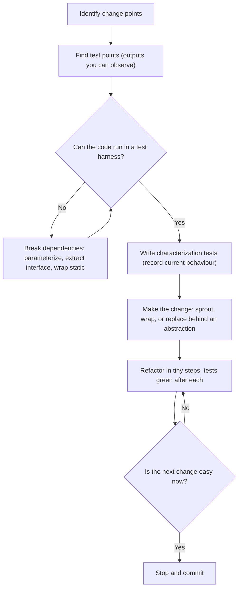
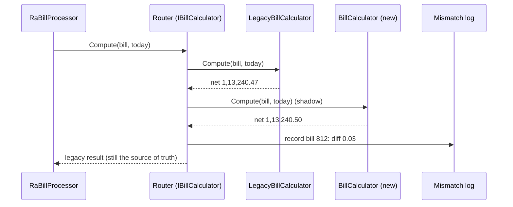
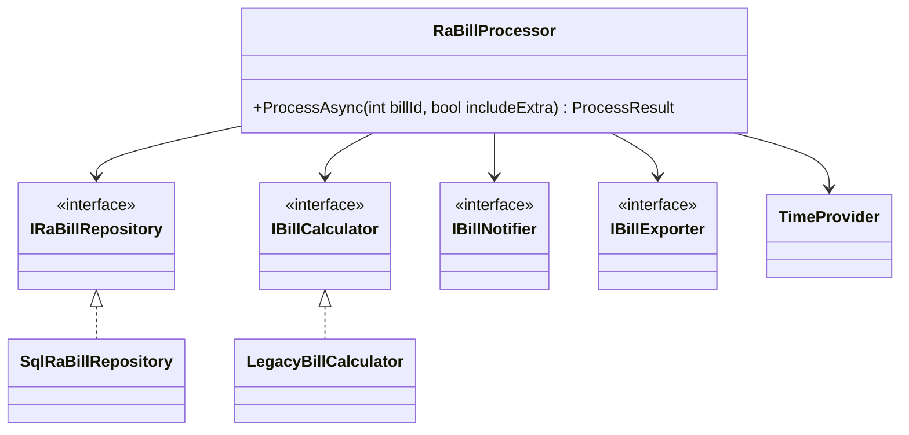

Most professional work isn't writing new code. It's changing code that someone else wrote years ago, that has no tests, that nobody fully understands, and that the business depends on every day. This lesson is a toolkit for that job. We'll work on a realistic, ugly C# class that processes contractor bills on a road project, and we'll change it safely: first pin its behaviour, then open it up, then replace it piece by piece while it keeps running.

## Learning objectives

By the end of this lesson you will be able to:

1. Use a working definition of legacy code ("code without tests") and explain why it changes how you refactor.
2. Write **characterization tests** that record what code actually does today, including its bugs.
3. Find and create **seams**: places where you can change behaviour without editing the code at that spot.
4. Break hard dependencies (static database helpers, `DateTime.Now`, SMTP, the file system) with small, low-risk moves.
5. Add new behaviour with **sprout method/class** and **wrap method/class** without touching untested code more than necessary.
6. Replace old logic gradually with a **code-level strangler** (branch by abstraction), including shadow comparison.
7. Follow a safe refactoring rhythm: tiny steps, compile, test, commit, and know when to stop.

## Prerequisites

- [Code smells and technical debt](#/lesson/m04-code-smells): you should recognise long methods, primitive obsession and hidden dependencies.
- [Single Responsibility Principle](#/lesson/m04-srp): we'll split a class with at least six reasons to change.
- [Unit testing and debugging fundamentals](#/lesson/m01-testing-debugging): arrange-act-assert, xUnit basics.
- [Dependency injection versus service locator](#/lesson/m04-di-vs-service-locator): static helpers are a form of hidden dependency.

## Explain it like I'm a beginner

Imagine you're asked to renovate the kitchen in an old house. Nobody has the wiring diagram. Some switches control lights in other rooms. One socket, for reasons nobody remembers, is connected to the water pump.

You wouldn't start knocking down walls. You'd first **walk around and note what each switch does today**, even the weird ones: "switch 3 turns on the bathroom light *and* the pump". That's a record of current behaviour. Michael Feathers calls tests that do this **characterization tests**: they don't check what the code *should* do, they record what it *does*.

Then you'd **find places where you can safely cut in**: a junction box where you can attach a new wire without opening the wall. In code, that's a **seam**.

When you need a new socket, you **run a fresh, properly labelled wire next to the old ones** instead of splicing into the mess. That's **sprouting** new code beside old code.

And if the old wiring is truly rotten, you **build a new circuit in parallel**, move rooms over one at a time, and switch off the old circuit when the last room is moved. Nobody ever lives without electricity. That's the **strangler fig** approach, named after a vine that slowly grows around a tree until it replaces it.

The core attitude: **don't change behaviour and structure at the same time, and never make a change you can't check.**

## First-principles explanation

### What "legacy code" means here

Feathers' working definition is blunt: *legacy code is code without tests.* Age doesn't matter. Code written last month with no tests is legacy, because every change to it is a guess. This matters because normal refactoring assumes a safety net: change structure, run tests, see green. Without tests, you have to build the net before you can refactor, and building the net often requires small changes to the code first. That's the **legacy code dilemma**: to change code safely you need tests; to put tests in place you often need to change code.

The way out is to make the first changes **extremely small and mechanical**, the kind you can verify by reading, or that your IDE performs for you, and use them only to open the code up for testing.

### The legacy change algorithm

A dependable routine, adapted from Feathers:

1. **Identify change points.** Where exactly must the code change for the new requirement?
2. **Find test points.** Where can you observe the effect of the code at those points? A return value, a database row, a file written.
3. **Break dependencies.** Open seams so the code can run in a test harness without a real database, clock, SMTP server or file system.
4. **Write characterization tests.** Pin down current behaviour at the test points.
5. **Make the change and refactor**, in small steps, with tests green after each one.

### Characterization tests

A characterization test is written in three moves:

1. Call the code with some input, and assert something you know is wrong (for example `Assert.Equal(0m, net)`).
2. Run it. The failure message tells you the real output: "Expected 0, Actual 1,13,240.50".
3. Paste the actual value into the assertion. The test now documents current behaviour.

You're not judging the behaviour yet. If the code has a bug that customers rely on (it happens: a report that always rounds up, which a finance team has reconciled against for five years), changing it is a *business* decision. Characterization tests make those decisions visible instead of accidental.

For calculation-heavy code, a powerful variant is the **golden master** (or approval test): run thousands of generated inputs through the old code, save the outputs, and compare the new code's outputs against them. It's crude but very effective at catching unexpected differences.

### Seams

A **seam** is a place where you can alter behaviour without editing in that place. Each seam has an *enabling point*, where you choose which behaviour you get. In C#, the useful kinds are:

| Seam | How it looks in C# | Enabling point |
|---|---|---|
| **Object seam** (most common) | A call through an interface or virtual method | The constructor argument, or a test subclass |
| **Parameter seam** | A value passed in instead of fetched (`DateOnly today` instead of `DateTime.Now`) | The caller |
| **Delegate seam** | A `Func<DateTime>` or `Action<string>` field | The constructor or a property |
| **Link/config seam** | A different assembly or DI registration | `Program.cs`, test host configuration |

Static calls (`SqlHelper.ExecuteDataTable`, `DateTime.Now`, `File.WriteAllText`) have **no seam**. You can't substitute them in a test. Most dependency-breaking work converts static calls into object or parameter seams.

### Dependency-breaking techniques that are safe without tests

These moves are small enough to do *before* you have tests, carefully, ideally with your IDE's automated refactorings:

- **Parameterize method**: replace `DateTime.Now` inside a method with a parameter `DateTime now`. Callers pass `DateTime.Now` for now.
- **Extract interface**: create `IBillRepository` matching the methods of an existing class; make the class implement it.
- **Parameterize constructor**: add a constructor that accepts the dependency; keep the old parameterless constructor calling the new one with the real implementation. Existing callers don't change.
- **Extract and override call**: move a problem call (`SendMail(...)`) into a `protected virtual` method; in tests, subclass and override it.
- **Wrap static**: put a thin instance wrapper (`SqlBillGateway`) around a static helper and call the wrapper instead.
- **Extract pure function**: move a block of arithmetic into a static method that takes inputs and returns outputs, touching nothing else.

Each move preserves behaviour if you do it mechanically: don't "improve" anything while you're in there.

### Adding features: sprout and wrap

When the new requirement is "also do X", resist editing the 300-line method. Two techniques keep new code tested and old code untouched:

- **Sprout method / sprout class**: write the new logic as a new, fully tested method or class, then add **one line** to the legacy code that calls it. The legacy method changes by one line; everything new has tests.
- **Wrap method / wrap class**: when the new behaviour happens *before or after* existing behaviour (logging, auditing, notifications), rename the old method and create a new method with the old name that calls it plus the new work. Wrap class is the same idea as a decorator: a new class implementing the same interface that delegates to the old one.

Sprout is for "new logic inside the flow"; wrap is for "new things around the flow".

### The strangler at code level: branch by abstraction

When the old logic needs replacing, not just extending, a **big-bang rewrite** is the usual failure mode: months of parallel work, a frozen old system, and a launch day when every difference is discovered at once. The alternative:

1. **Put an abstraction in front of the old code** (`IBillCalculator`), with the old code as the first implementation (`LegacyBillCalculator`). All callers go through the abstraction.
2. **Build the new implementation** behind the same abstraction.
3. **Route** between them: per contract, per tenant, by percentage, or in **shadow mode** (run both, return the old answer, log differences).
4. **Move traffic over** gradually as differences are explained and fixed.
5. **Delete the old implementation** and, if it no longer earns its keep, the router.

Fowler calls this **branch by abstraction** when it's done inside one codebase; at the system level, where an HTTP proxy routes between an old and a new service, it's the **strangler fig** pattern. The thinking is identical.

### Safe refactoring steps

- **One kind of change at a time.** Either you change structure (refactoring) or behaviour (feature/bug fix). Never both in one commit.
- **Tiny steps.** Rename, extract, move, inline. Compile and run tests after each. If a step breaks something, undo it rather than debugging forward.
- **Prefer automated refactorings.** IDE rename and extract-method are far less error-prone than hand edits.
- **Preserve signatures** when you have no tests: copy parameter lists exactly when extracting, to avoid accidental conversions (`int` to `double`).
- **Commit often**, with messages like "refactor: extract LD calculation (no behaviour change)". Reviewers can check refactoring commits quickly.
- **Scratch refactoring.** To *understand* a scary method, refactor it aggressively on a throwaway branch, learn what it does, then delete the branch and do it properly.
- **Know when to stop.** You refactor to make the next change easy, not to make the code beautiful. Stop when the change at hand is easy and the code you touched is tested.

### When not to refactor

- The code is stable, nobody needs to change it, and it works. Leave it alone; risk without reward.
- The system is being retired within months. Spend the effort on the replacement.
- You can't get any test point at all and the change is tiny. Make the change carefully, get a second reviewer, and add monitoring.

## Visual explanation

### The legacy change algorithm



Read it top to bottom. The loop between "can it run in a harness?" and "break dependencies" is where most of the work happens on truly legacy code: you keep opening seams until a test can call the code. Only then do you write characterization tests. Notice the exit at the bottom: refactoring stops when the next change is easy, not when the code is perfect.

### Shadow comparison during a strangler migration



The processor calls the abstraction and doesn't know a migration is happening. In shadow mode the router asks both implementations, returns the **legacy** answer (so customers see no change), and logs any difference. The team reviews the mismatch log daily. Here the 3-paise difference comes from rounding each line instead of only the total. Once differences are understood and accepted, contracts move to the new calculator one by one.

## Step-by-step example

### The legacy class

This is the kind of class you meet on real projects. It processes a **running account bill** (RA bill): a periodic bill a road contractor submits for work measured so far. Read it slowly and count the problems before reading the list below.

```csharp
public class RaBillProcessor
{
    public static string LastError;

    public bool Process(int billId, bool sendMail = true, int mode = 0)
    {
        try
        {
            var dt = SqlHelper.ExecuteDataTable("select * from ra_bill where id=" + billId);
            if (dt.Rows.Count == 0) { LastError = "not found"; return false; }
            var row = dt.Rows[0];
            if ((int)row["status"] == 3 || (int)row["status"] == 4) { LastError = "already processed"; return false; }

            double gross = 0;
            var items = SqlHelper.ExecuteDataTable("select * from measurement where bill_id=" + billId);
            foreach (DataRow it in items.Rows)
            {
                if (it["item_code"].ToString().StartsWith("EXTRA") && mode != 2) continue; // extra items need approval
                gross += Convert.ToDouble(it["qty"]) * Convert.ToDouble(it["rate"]);
            }

            // LD: 0.5% per week late, max 10%
            DateTime due = (DateTime)row["milestone_due"];
            double ld = 0;
            if (DateTime.Now > due)
            {
                int weeks = (int)((DateTime.Now - due).TotalDays / 7);
                ld = gross * Math.Min(weeks * 0.005, 0.10);
            }
            double retention = gross * 0.05; if (retention > 500000) retention = 500000;
            double tds = (gross - ld) * 0.02;
            double advRec = Math.Min(gross * 0.10, Convert.ToDouble(row["advance_outstanding"]));
            double gst = (gross - ld) * 0.18;
            double net = Math.Round(gross - ld - retention - tds - advRec + gst, 2);

            SqlHelper.ExecuteNonQuery("update ra_bill set net=" + net + ", status=3, processed_on='" + DateTime.Now.ToString("yyyy-MM-dd") + "' where id=" + billId);
            SqlHelper.ExecuteNonQuery("update contract set advance_outstanding=advance_outstanding-" + advRec + " where id=" + row["contract_id"]);
            File.WriteAllText(@"C:\RaBills\" + billId + ".txt", "NET:" + net);
            if (sendMail) new SmtpClient("10.0.0.5").Send("billing@contractor.example", row["engineer_email"].ToString(), "RA bill " + billId, "Net payable: " + net);
            return true;
        }
        catch (Exception ex) { LastError = ex.Message; return false; }
    }
}
```

The rates (5 % retention, 2 % TDS, 18 % GST, 0.5 %/week liquidated damages) are illustrative; real contracts and tax rules vary. What's wrong:

- **Six reasons to change in one method**: data access, measurement rules, contract penalties, tax, file export, email.
- **No seams**: `SqlHelper`, `DateTime.Now`, `File` and `SmtpClient` are all static or `new`ed inline.
- **SQL built by string concatenation**. With `int billId` it isn't injectable *today*, but the pattern spreads.
- **`double` for money**, so `0.1 + 0.2 != 0.3` and rounding at midpoints is unreliable.
- **`int mode` with a magic value 2** that really means "include extra items".
- **Errors swallowed into a static `LastError`**, which is shared across all threads and requests.
- **No transaction**: if the second `update` fails, the bill is processed but the advance is never recovered.
- `DateTime.Now` is read **three times**, so a bill processed at 23:59:59.9 can use two different dates.

A new requirement arrives: *deduct a 1 % labour welfare cess from the gross amount.* Let's make that change safely.

### Step 1 — identify the change point and test points

The change point is the line that computes `net`. The test points are the `net` value written to the database and the file. Neither can be observed in a test today, because the method talks straight to SQL Server and `C:\`.

### Step 2 — extract a pure function (no behaviour change)

Select the arithmetic block (from `double gross = 0` to the `Math.Round`) and use the IDE's **Extract Method**. Make the inputs explicit parameters and return all the components. Keep `double`. Keep the formula character-for-character. This is the riskiest step, so do it mechanically and review the diff line by line.

```csharp
internal static (double Gross, double Ld, double Retention, double Tds, double AdvRec, double Gst, double Net)
    ComputeLegacy(IEnumerable<(string Code, double Qty, double Rate)> items, bool includeExtra,
                  DateTime dueDate, DateTime now, double advanceOutstanding)
{
    // ... the exact same lines, with DateTime.Now replaced by the `now` parameter
}
```

`Process` now calls `ComputeLegacy(..., DateTime.Now, ...)`. We've created a **parameter seam** for time and made the arithmetic callable from a test without a database.

### Step 3 — characterization tests

Write tests for `ComputeLegacy` using the three-move technique. Cover: on-time bill, 3 weeks late, 30 weeks late (cap at 10 %), retention cap (gross above ₹1 crore), advance fully recovered, extra items excluded and included. Each test asserts the value the code *actually* produced. One of them will surprise you; for example, TDS is computed on `gross - ld` but retention on `gross`. That might be a bug or a contract term. Write it down and ask the commercial team; don't "fix" it inside a refactoring.

### Step 4 — sprout the new rule

Write `LabourCess.Compute(decimal gross)` as a new, tested function (exercise 1). Then add **one line** to the legacy calculation: `net -= (double)LabourCess.Compute((decimal)gross);`. Update the characterization tests whose `net` changed by exactly 1 % of gross; every other assertion stays the same, which proves nothing else moved.

### Step 5 — open the remaining seams

Use **wrap static** for `SqlHelper` (an `IRaBillRepository` whose first implementation just calls `SqlHelper`), and **extract interface** for mail (`IBillNotifier`). Add a constructor that takes them; keep a parameterless constructor that passes the real ones, so the 14 existing callers compile unchanged. This is **parameterize constructor**.

### Step 6 — strangle the calculation

Now introduce `IBillCalculator`. The first implementation wraps the extracted legacy function. A new `decimal`-based calculator is built next to it and run in **shadow mode** for a month. That's the production code below.

## Production-style C# implementation

The end state after a few weeks of incremental work. The legacy arithmetic still exists, behind the same interface as the new calculator, and a router decides per contract which one is used.

```text
RaBilling.Api/
  Program.cs
  RaBilling/
    BillModels.cs
    IBillCalculator.cs
    LegacyBillCalculator.cs      extracted legacy arithmetic, behaviour preserved
    BillCalculator.cs            new decimal implementation
    BillCalculatorRouter.cs      branch by abstraction, per-contract rollout
    RaBillProcessor.cs           thin orchestrator with seams
    InMemoryAdapters.cs
```

```csharp file=RaBilling/BillModels.cs
namespace RaBilling;

public enum BillStatus { Draft = 1, Submitted = 2, Processed = 3, Paid = 4 }

public sealed record MeasurementItem(string ItemCode, decimal Quantity, decimal Rate)
{
    public bool IsExtraItem => ItemCode.StartsWith("EXTRA", StringComparison.OrdinalIgnoreCase);
}

public sealed record RaBill(
    int Id, int ContractId, string EngineerEmail, IReadOnlyList<MeasurementItem> Items,
    DateOnly MilestoneDue, decimal AdvanceOutstanding, BillStatus Status);

public sealed record BillComputation(
    decimal Gross, decimal LiquidatedDamages, decimal Retention, decimal Tds,
    decimal AdvanceRecovery, decimal Gst, decimal LabourCess, decimal Net);

public enum ProcessOutcome { Processed, NotFound, AlreadyProcessed }

public sealed record ProcessResult(ProcessOutcome Outcome, BillComputation? Computation = null);
```

```csharp file=RaBilling/IBillCalculator.cs
namespace RaBilling;

/// <summary>The abstraction both the legacy and the new calculation sit behind.
/// It takes "today" as a parameter: a parameter seam instead of DateTime.Now.</summary>
public interface IBillCalculator
{
    BillComputation Compute(RaBill bill, DateOnly today, bool includeExtraItems);
}

/// <summary>Sprouted rule (new, tested on its own), shared by both calculators.</summary>
public static class LabourCess
{
    public const decimal Rate = 0.01m;
    public static decimal Compute(decimal gross) =>
        gross <= 0 ? 0m : Math.Round(gross * Rate, 2, MidpointRounding.AwayFromZero);
}
```

```csharp file=RaBilling/LegacyBillCalculator.cs
namespace RaBilling;

/// <summary>The arithmetic extracted verbatim from the old RaBillProcessor.Process.
/// It deliberately keeps double maths and rounds only the final net, because
/// characterization tests pinned that behaviour. Do not "fix" it here.</summary>
public sealed class LegacyBillCalculator : IBillCalculator
{
    public BillComputation Compute(RaBill bill, DateOnly today, bool includeExtraItems)
    {
        double gross = 0;
        foreach (var it in bill.Items)
        {
            if (it.IsExtraItem && !includeExtraItems) continue;
            gross += (double)it.Quantity * (double)it.Rate;
        }

        double ld = 0;
        var daysLate = today.DayNumber - bill.MilestoneDue.DayNumber;
        if (daysLate > 0)
        {
            int weeks = daysLate / 7;
            ld = gross * Math.Min(weeks * 0.005, 0.10);
        }
        double retention = gross * 0.05; if (retention > 500000) retention = 500000;
        double tds = (gross - ld) * 0.02;
        double advRec = Math.Min(gross * 0.10, (double)bill.AdvanceOutstanding);
        double gst = (gross - ld) * 0.18;
        double cess = (double)LabourCess.Compute((decimal)gross);              // the one sprouted line
        double net = Math.Round(gross - ld - retention - tds - advRec + gst - cess, 2);

        return new BillComputation((decimal)gross, (decimal)ld, (decimal)retention, (decimal)tds,
                                   (decimal)advRec, (decimal)gst, (decimal)cess, (decimal)net);
    }
}
```

```csharp file=RaBilling/BillCalculator.cs
namespace RaBilling;

/// <summary>New calculator: decimal money, every printed line rounded half away from zero,
/// net = sum of the rounded lines so the printed bill always adds up.</summary>
public sealed class BillCalculator : IBillCalculator
{
    private const decimal RetentionRate = 0.05m, RetentionCap = 500_000m;
    private const decimal TdsRate = 0.02m, GstRate = 0.18m, AdvanceRecoveryRate = 0.10m;
    private const decimal LdPerWeek = 0.005m, LdCap = 0.10m;

    public BillComputation Compute(RaBill bill, DateOnly today, bool includeExtraItems)
    {
        ArgumentNullException.ThrowIfNull(bill);

        var gross = R(bill.Items.Where(i => includeExtraItems || !i.IsExtraItem).Sum(i => i.Quantity * i.Rate));
        var weeksLate = Math.Max(0, today.DayNumber - bill.MilestoneDue.DayNumber) / 7;
        var ld = R(gross * Math.Min(weeksLate * LdPerWeek, LdCap));
        var retention = Math.Min(R(gross * RetentionRate), RetentionCap);
        var tds = R((gross - ld) * TdsRate);
        var advance = Math.Min(R(gross * AdvanceRecoveryRate), bill.AdvanceOutstanding);
        var gst = R((gross - ld) * GstRate);
        var cess = LabourCess.Compute(gross);
        var net = gross - ld - retention - tds - advance + gst - cess;

        return new BillComputation(gross, ld, retention, tds, advance, gst, cess, net);
    }

    private static decimal R(decimal v) => Math.Round(v, 2, MidpointRounding.AwayFromZero);
}
```

```csharp file=RaBilling/BillCalculatorRouter.cs
using Microsoft.Extensions.Logging;
using Microsoft.Extensions.Options;

namespace RaBilling;

public sealed class BillingMigrationOptions
{
    /// <summary>Contracts that have been moved to the new calculator.</summary>
    public HashSet<int> ModernContractIds { get; set; } = [];
    /// <summary>For every other contract, also run the new calculator and log differences.</summary>
    public bool ShadowCompare { get; set; } = true;
    public decimal Tolerance { get; set; } = 0.05m;
}

/// <summary>Branch by abstraction: callers depend on IBillCalculator and never know which
/// implementation answered. IOptionsMonitor lets ops move a contract without a redeploy.</summary>
public sealed class BillCalculatorRouter(
    LegacyBillCalculator legacy,
    BillCalculator modern,
    IOptionsMonitor<BillingMigrationOptions> options,
    ILogger<BillCalculatorRouter> logger) : IBillCalculator
{
    public BillComputation Compute(RaBill bill, DateOnly today, bool includeExtraItems)
    {
        var o = options.CurrentValue;
        if (o.ModernContractIds.Contains(bill.ContractId))
            return modern.Compute(bill, today, includeExtraItems);

        var result = legacy.Compute(bill, today, includeExtraItems);
        if (!o.ShadowCompare) return result;

        try
        {
            var candidate = modern.Compute(bill, today, includeExtraItems);
            var diff = Math.Abs(candidate.Net - result.Net);
            if (diff > o.Tolerance)
                logger.LogWarning("Bill {BillId} (contract {ContractId}): legacy net {Legacy}, new net {Modern}, diff {Diff}",
                    bill.Id, bill.ContractId, result.Net, candidate.Net, diff);
        }
        catch (Exception ex)
        {
            // The shadow must never break production billing.
            logger.LogError(ex, "Shadow calculation failed for bill {BillId}", bill.Id);
        }
        return result;
    }
}
```

```csharp file=RaBilling/RaBillProcessor.cs
using Microsoft.Extensions.Logging;

namespace RaBilling;

public interface IRaBillRepository
{
    Task<RaBill?> FindAsync(int billId, CancellationToken ct);
    /// <summary>Marks the bill processed and reduces the contract's advance, in ONE transaction.</summary>
    Task SaveProcessedAsync(RaBill bill, BillComputation computation, DateOnly processedOn, CancellationToken ct);
}

public interface IBillNotifier
{
    Task BillProcessedAsync(RaBill bill, BillComputation computation, CancellationToken ct);
}

/// <summary>What is left of the old 60-line method: orchestration only.
/// Every collaborator is a seam, and "today" is read exactly once.</summary>
public sealed class RaBillProcessor(
    IRaBillRepository bills, IBillCalculator calculator, IBillNotifier notifier,
    TimeProvider clock, ILogger<RaBillProcessor> logger)
{
    public async Task<ProcessResult> ProcessAsync(int billId, bool includeExtraItems, CancellationToken ct)
    {
        var bill = await bills.FindAsync(billId, ct);
        if (bill is null) return new ProcessResult(ProcessOutcome.NotFound);
        if (bill.Status is BillStatus.Processed or BillStatus.Paid) return new ProcessResult(ProcessOutcome.AlreadyProcessed);

        var today = DateOnly.FromDateTime(clock.GetLocalNow().DateTime);
        var computation = calculator.Compute(bill, today, includeExtraItems);
        await bills.SaveProcessedAsync(bill, computation, today, ct);

        try
        {
            await notifier.BillProcessedAsync(bill, computation, ct);
        }
        catch (Exception ex) when (ex is not OperationCanceledException)
        {
            logger.LogWarning(ex, "Bill {BillId} processed but notification failed", billId);
        }
        return new ProcessResult(ProcessOutcome.Processed, computation);
    }
}
```

```csharp file=RaBilling/InMemoryAdapters.cs
using System.Collections.Concurrent;
using Microsoft.Extensions.Logging;

namespace RaBilling;

public sealed class InMemoryRaBillRepository : IRaBillRepository
{
    private readonly ConcurrentDictionary<int, RaBill> _bills = new();
    private readonly ConcurrentDictionary<int, BillComputation> _results = new();

    public void Seed(RaBill bill) => _bills[bill.Id] = bill;
    public BillComputation? ResultFor(int billId) => _results.GetValueOrDefault(billId);

    public Task<RaBill?> FindAsync(int billId, CancellationToken ct) => Task.FromResult(_bills.GetValueOrDefault(billId));

    public Task SaveProcessedAsync(RaBill bill, BillComputation computation, DateOnly processedOn, CancellationToken ct)
    {
        _bills[bill.Id] = bill with { Status = BillStatus.Processed };
        _results[bill.Id] = computation;
        return Task.CompletedTask;
    }
}

public sealed class LoggingBillNotifier(ILogger<LoggingBillNotifier> logger) : IBillNotifier
{
    public Task BillProcessedAsync(RaBill bill, BillComputation c, CancellationToken ct)
    {
        logger.LogInformation("Mail to {Engineer}: RA bill {BillId} net payable {Net}", bill.EngineerEmail, bill.Id, c.Net);
        return Task.CompletedTask;
    }
}
```

```csharp file=Program.cs
using RaBilling;

var builder = WebApplication.CreateBuilder(args);

builder.Services.Configure<BillingMigrationOptions>(builder.Configuration.GetSection("Billing:Migration"));
builder.Services.AddSingleton(TimeProvider.System);
builder.Services.AddSingleton<LegacyBillCalculator>();
builder.Services.AddSingleton<BillCalculator>();
builder.Services.AddSingleton<IBillCalculator, BillCalculatorRouter>();
builder.Services.AddSingleton<InMemoryRaBillRepository>();
builder.Services.AddSingleton<IRaBillRepository>(sp => sp.GetRequiredService<InMemoryRaBillRepository>());
builder.Services.AddSingleton<IBillNotifier, LoggingBillNotifier>();
builder.Services.AddScoped<RaBillProcessor>();

var app = builder.Build();

app.MapPost("/ra-bills/{id:int}/process", async (int id, bool? includeExtra, RaBillProcessor processor, CancellationToken ct) =>
{
    var result = await processor.ProcessAsync(id, includeExtra ?? false, ct);
    return result.Outcome switch
    {
        ProcessOutcome.Processed => Results.Ok(result.Computation),
        ProcessOutcome.NotFound => Results.NotFound(),
        _ => Results.Conflict(new { error = "Bill already processed" }),
    };
});

app.Run();
```

Things worth noticing:

- **`LegacyBillCalculator` is still ugly on purpose.** It's the characterized behaviour, behind an interface. Cleaning it up would mean re-proving it; the plan is to delete it, not polish it.
- **The router is temporary.** Put a removal date in the backlog when you add it. Routers that outlive their migration become their own legacy.
- **`SaveProcessedAsync` names the transaction boundary.** The old code had two independent `UPDATE`s; the new contract makes "both or neither" part of the interface.
- **`includeExtraItems` replaced `int mode`.** That rename was a separate, behaviour-preserving commit.

## Bad design vs good design

**Bad: the big-bang rewrite.** "Let's rewrite billing properly in a new service. It'll take three months." Six months later, the old code has had 40 bug fixes the new one doesn't know about, the business has been told "no changes until the rewrite ships", and on launch day the first bill differs from the old one by ₹12,000 with nobody able to say which one is right.

**Bad: refactor and change behaviour together.** One commit that extracts the calculation, switches `double` to `decimal`, *and* adds the cess. When a bill comes out 3 paise different, you can't tell which of the three changes caused it.

**Bad: "fixing" characterized bugs silently.** You notice TDS is computed on `gross - ld` and "correct" it to `gross` while extracting. The vendor's reconciliation team, who have matched against the old figure for years, now disagree with every bill.

**Good:**

- Each commit is either a refactoring (no behaviour change, tests unchanged) or a behaviour change (tests change in exactly the expected way).
- New rules are **sprouted** as tested units, with a one-line call from legacy code.
- Replacement happens **behind an abstraction**, routed gradually, with shadow comparison and a written list of accepted differences.
- Questionable behaviour is pinned by a characterization test with a comment linking to the decision ("TDS on gross minus LD: confirmed with commercial team, 2026-09-14").

:::callout type=tradeoff title="When a rewrite is the right call"
Incremental strangling has overhead: two implementations, a router, comparison tooling. It's worth it when the old code is in production and the business can't stop. A rewrite can be better when the old code is small (a few hundred lines), its behaviour is fully specified elsewhere (a published tax formula), or the platform is dead (code you can't even compile any more). Even then, keep the old outputs as a golden master to compare against.
:::

:::callout type=warning title="Characterization tests are a safety net, not a specification"
They lock in current behaviour, including bugs. After the refactoring, replace or rename the ones that encode accidental behaviour, so future readers don't mistake "what it did in 2019" for "what the business wants".
:::

## Practical playground

The program below contains the extracted legacy calculation (still `double`) and a new `decimal` version. `Main` runs a small golden master over 2,000 generated bills and prints any differences. Run it, then try the variations listed after it.

:::playground type=csharp title="Golden master: legacy vs new"
```csharp file=Program.cs
using System;
using System.Collections.Generic;
using System.Linq;

public static class LegacyRetention
{
    // Extracted verbatim from the old code: double maths, default (banker's) rounding.
    public static double Compute(double gross)
    {
        if (gross <= 0) return 0;
        double r = gross * 0.05;
        if (r > 500000) r = 500000;
        return Math.Round(r, 2);
    }
}

public static class NewRetention
{
    public static decimal Compute(decimal gross)
    {
        if (gross <= 0) return 0m;
        var r = Math.Min(gross * 0.05m, 500_000m);
        return Math.Round(r, 2, MidpointRounding.AwayFromZero);
    }
}

public static class Program
{
    public static void Main()
    {
        var inputs = Enumerable.Range(0, 2000).Select(i => i * 10.10m).ToList();
        var mismatches = new List<(decimal Gross, decimal Legacy, decimal New)>();
        foreach (var g in inputs)
        {
            var legacy = (decimal)LegacyRetention.Compute((double)g);
            var modern = NewRetention.Compute(g);
            if (legacy != modern) mismatches.Add((g, legacy, modern));
        }

        Console.WriteLine($"Compared {inputs.Count} inputs, {mismatches.Count} differ.");
        foreach (var m in mismatches.Take(10))
            Console.WriteLine($"  gross {m.Gross,10:0.00}: legacy {m.Legacy,8:0.00}  new {m.New,8:0.00}  diff {m.New - m.Legacy:+0.00;-0.00}");
        Console.WriteLine($"Largest difference: {(mismatches.Count == 0 ? 0 : mismatches.Max(m => Math.Abs(m.New - m.Legacy))):0.00}");
    }
}
```
:::

Try these:

1. Change `MidpointRounding.AwayFromZero` to `MidpointRounding.ToEven` in `NewRetention`. The number of differences changes, but not to zero. Why? (Hint: `0.505` can't be stored exactly as a `double`, so the legacy code sometimes rounds a "midpoint" that is really slightly above or below it.)
2. Introduce a deliberate bug in `NewRetention` (cap at `50_000m`). Watch the golden master catch it immediately with large differences.
3. Change the inputs to `i * 1000m`. With no midpoints, both versions agree on everything. A golden master is only as good as the inputs you feed it, so include awkward values.

## Exercises

:::exercise id=m04-refactoring-legacy-ex1 difficulty=beginner kind=code title="Sprout a labour-cess rule"
The legacy `LegacyBillMath.NetPayable` deducts retention (5 %) and TDS (2 %). A new rule says: also deduct a labour welfare cess of 1 % of gross. Use **sprout method**: write the cess as a new, tested `LabourCess.Compute`, then add exactly one call to it in `NetPayable`.
::requirements
- `LabourCess.Compute(decimal gross)` returns 1 % of gross, rounded to 2 decimals with `MidpointRounding.AwayFromZero`.
- Zero or negative gross → 0.
- `NetPayable` = gross − retention − TDS − cess. Don't change how retention or TDS are calculated.
::acceptance
- `LabourCess.Compute(100000m)` = 1000.00, `Compute(1234567.89m)` = 12345.68, `Compute(0.50m)` = 0.01, `Compute(-5m)` = 0.
- `NetPayable(100000m)` = 92000.00.
- The existing retention and TDS behaviour is unchanged.
::hint
The point of sprouting is that the new code is written and tested *on its own*, outside the legacy method.
::hint
`LabourCess.Compute` is a pure static function: decimal in, decimal out, no state.
::hint
0.50 × 1 % = 0.005, which is a midpoint. Which `MidpointRounding` gives 0.01?
::hint
```csharp
public static decimal Compute(decimal gross) =>
    gross <= 0 ? 0m : Math.Round(gross * 0.01m, 2, MidpointRounding.AwayFromZero);
```
Then in `NetPayable`, subtract `LabourCess.Compute(gross)`: one new line.
::starter
```csharp file=LabourCess.cs
using System;

// Legacy code: no tests, many callers. Change it as little as possible.
public static class LegacyBillMath
{
    public static decimal NetPayable(decimal gross)
    {
        decimal retention = gross * 0.05m;
        decimal tds = gross * 0.02m;
        decimal net = gross - retention - tds;
        return Math.Round(net, 2);
    }
}

// Sprouted code: new, small and fully tested.
public static class LabourCess
{
    public static decimal Compute(decimal gross)
    {
        throw new NotImplementedException();
    }
}
```
::tests
```csharp file=LabourCessTests.cs
using Xunit;

public class LabourCessTests
{
    [Theory]
    [InlineData(100000, 1000)]
    [InlineData(1234567.89, 12345.68)]
    [InlineData(0.50, 0.01)]
    [InlineData(0, 0)]
    [InlineData(-5, 0)]
    public void Computes_one_percent(decimal gross, decimal expected) => Assert.Equal(expected, LabourCess.Compute(gross));

    [Fact] public void Net_payable_includes_cess() => Assert.Equal(92000.00m, LegacyBillMath.NetPayable(100000m));

    [Fact] public void Net_payable_keeps_existing_rounding() => Assert.Equal(1162.27m, LegacyBillMath.NetPayable(1263.33m));
}
```
::solution
The new rule lives in its own tested function; the legacy method changes by a single line, so the risk to the other 14 callers is tiny and easy to review.

```csharp file=LabourCess.cs
using System;

public static class LegacyBillMath
{
    public static decimal NetPayable(decimal gross)
    {
        decimal retention = gross * 0.05m;
        decimal tds = gross * 0.02m;
        decimal net = gross - retention - tds - LabourCess.Compute(gross);   // sprouted call
        return Math.Round(net, 2);
    }
}

public static class LabourCess
{
    public const decimal Rate = 0.01m;

    public static decimal Compute(decimal gross) =>
        gross <= 0 ? 0m : Math.Round(gross * Rate, 2, MidpointRounding.AwayFromZero);
}
```

Check the last test by hand: retention 63.1665, TDS 25.2666, cess 12.63 (already rounded by the sprout), so net = 1263.33 − 101.0631 = 1162.2669, which the legacy `Math.Round` turns into 1162.27. Notice that the legacy rounding of the *total* is untouched; only one subtraction was added.
::mistakes
- Rewriting `NetPayable` "properly" while adding the cess. Now a reviewer can't tell whether retention changed.
- Putting the cess calculation inline in the legacy method, where it can only be tested through `NetPayable`.
- Using default `Math.Round` (banker's rounding) in the sprout: 0.005 would round to 0.00.
::extensions
Turn `LabourCess` into a class implementing `IDeduction`, and make `NetPayable` loop over a list of deductions. When is that worth doing, and when is it overengineering?
:::

:::exercise id=m04-refactoring-legacy-ex2 difficulty=beginner kind=code title="Wrap class: add an audit trail around bill approval"
Auditors want a log line every time a bill approval succeeds or fails. The legacy `LegacyBillApprover` works and must not be edited. Implement `AuditedBillApprover`, which wraps it (wrap class, also known as a decorator).
::requirements
- Implements `IBillApprover` and delegates to the inner approver.
- On success write: `{time} APPROVED bill={id} by={approver}`.
- On failure write: `{time} FAILED bill={id} by={approver} reason={exception message}`, then rethrow the **same** exception.
- `{time}` is the injected clock's UTC time formatted as `yyyy-MM-ddTHH:mm:ssZ`, e.g. `2026-10-18T10:00:00Z`.
- A blank approver name throws `ArgumentException` before anything is called or logged.
::acceptance
- A successful approval produces exactly one audit entry with the right text.
- Approving the same bill twice produces one APPROVED and one FAILED entry, and the second call throws `InvalidOperationException`.
- Blank approver → `ArgumentException`, no audit entries, inner approver not called.
::hint
Wrap class means a new class with the same interface that holds the old one. Nothing in `LegacyBillApprover` changes.
::hint
Use `try { inner.Approve(...); audit.Write(success) } catch (Exception ex) { audit.Write(failure); throw; }`. Why `throw;` and not `throw ex;`?
::hint
Format time with `clock.GetUtcNow().UtcDateTime.ToString("yyyy-MM-ddTHH:mm:ssZ", CultureInfo.InvariantCulture)`.
::hint
```csharp
ArgumentException.ThrowIfNullOrWhiteSpace(approver);
var stamp = Stamp();
try { inner.Approve(billId, approver); audit.Write($"{stamp} APPROVED bill={billId} by={approver}"); }
catch (Exception ex) { audit.Write($"{stamp} FAILED bill={billId} by={approver} reason={ex.Message}"); throw; }
```
::starter
```csharp file=AuditedBillApprover.cs
using System;
using System.Collections.Generic;
using System.Globalization;

public interface IBillApprover
{
    void Approve(int billId, string approver);
}

// Legacy: works, has no tests, do not edit.
public sealed class LegacyBillApprover : IBillApprover
{
    private readonly HashSet<int> _approved = new();
    public void Approve(int billId, string approver)
    {
        if (!_approved.Add(billId)) throw new InvalidOperationException($"Bill {billId} is already approved.");
    }
}

public interface IAuditLog
{
    void Write(string entry);
}

public sealed class AuditedBillApprover : IBillApprover
{
    public AuditedBillApprover(IBillApprover inner, IAuditLog audit, TimeProvider clock)
    {
        throw new NotImplementedException();
    }

    public void Approve(int billId, string approver)
    {
        throw new NotImplementedException();
    }
}
```
::tests
```csharp file=AuditedBillApproverTests.cs
using System;
using System.Collections.Generic;
using Xunit;

public class AuditedBillApproverTests
{
    private sealed class FixedClock(DateTimeOffset now) : TimeProvider { public override DateTimeOffset GetUtcNow() => now; }
    private sealed class ListAudit : IAuditLog { public List<string> Entries { get; } = new(); public void Write(string e) => Entries.Add(e); }
    private sealed class CountingApprover : IBillApprover { public int Calls; public void Approve(int id, string by) => Calls++; }

    private static readonly DateTimeOffset T = new(2026, 10, 18, 15, 30, 0, TimeSpan.FromHours(5.5));   // 10:00 UTC

    [Fact]
    public void Success_is_audited()
    {
        var audit = new ListAudit();
        new AuditedBillApprover(new LegacyBillApprover(), audit, new FixedClock(T)).Approve(42, "asha");
        Assert.Equal(new[] { "2026-10-18T10:00:00Z APPROVED bill=42 by=asha" }, audit.Entries.ToArray());
    }

    [Fact]
    public void Failure_is_audited_and_rethrown()
    {
        var audit = new ListAudit();
        var sut = new AuditedBillApprover(new LegacyBillApprover(), audit, new FixedClock(T));
        sut.Approve(7, "ravi");
        var ex = Assert.Throws<InvalidOperationException>(() => sut.Approve(7, "ravi"));
        Assert.Equal("Bill 7 is already approved.", ex.Message);
        Assert.Equal(2, audit.Entries.Count);
        Assert.Equal("2026-10-18T10:00:00Z FAILED bill=7 by=ravi reason=Bill 7 is already approved.", audit.Entries[1]);
    }

    [Fact]
    public void Blank_approver_rejected_before_anything_happens()
    {
        var audit = new ListAudit();
        var inner = new CountingApprover();
        Assert.Throws<ArgumentException>(() => new AuditedBillApprover(inner, audit, new FixedClock(T)).Approve(1, "  "));
        Assert.Equal(0, inner.Calls);
        Assert.Empty(audit.Entries);
    }
}
```
::solution
The new behaviour (auditing) happens *around* the old behaviour, so wrapping is the right tool: the legacy class is untouched, and the wrapper is small enough to test completely.

```csharp file=AuditedBillApprover.cs
using System;
using System.Collections.Generic;
using System.Globalization;

public interface IBillApprover
{
    void Approve(int billId, string approver);
}

public sealed class LegacyBillApprover : IBillApprover
{
    private readonly HashSet<int> _approved = new();
    public void Approve(int billId, string approver)
    {
        if (!_approved.Add(billId)) throw new InvalidOperationException($"Bill {billId} is already approved.");
    }
}

public interface IAuditLog
{
    void Write(string entry);
}

public sealed class AuditedBillApprover : IBillApprover
{
    private readonly IBillApprover _inner;
    private readonly IAuditLog _audit;
    private readonly TimeProvider _clock;

    public AuditedBillApprover(IBillApprover inner, IAuditLog audit, TimeProvider clock)
    {
        _inner = inner ?? throw new ArgumentNullException(nameof(inner));
        _audit = audit ?? throw new ArgumentNullException(nameof(audit));
        _clock = clock ?? throw new ArgumentNullException(nameof(clock));
    }

    public void Approve(int billId, string approver)
    {
        ArgumentException.ThrowIfNullOrWhiteSpace(approver);
        var stamp = _clock.GetUtcNow().UtcDateTime.ToString("yyyy-MM-ddTHH:mm:ssZ", CultureInfo.InvariantCulture);
        try
        {
            _inner.Approve(billId, approver);
            _audit.Write($"{stamp} APPROVED bill={billId} by={approver}");
        }
        catch (Exception ex)
        {
            _audit.Write($"{stamp} FAILED bill={billId} by={approver} reason={ex.Message}");
            throw;
        }
    }
}
```

In `Program.cs`, the wrapper replaces the old registration: `services.AddSingleton<LegacyBillApprover>(); services.AddSingleton<IBillApprover>(sp => new AuditedBillApprover(sp.GetRequiredService<LegacyBillApprover>(), ...));`. Callers that depend on `IBillApprover` get auditing without changing.
::mistakes
- `throw ex;` instead of `throw;`, which resets the stack trace and makes production errors much harder to diagnose.
- Formatting the local time (`GetLocalNow`), so audit entries depend on the server's time zone.
- Writing the success entry *before* calling the inner approver; a failure then leaves a false "APPROVED" line in the audit log.
::extensions
If writing the audit log itself fails, should the approval fail? Discuss with the auditors' requirements in mind, then implement your answer with a test.
:::

:::exercise id=m04-refactoring-legacy-ex3 difficulty=intermediate kind=code title="Golden master: compare legacy and new retention"
You're replacing `LegacyRetention.Compute(double)` with a `decimal` version. Finance has decided the new version must use `MidpointRounding.AwayFromZero` (the legacy code used `double` and default rounding). Build a reusable golden-master comparer and the new calculator, and prove that every difference is a rounding difference of exactly one paisa.
::requirements
- `RetentionCalculator.Compute(decimal gross)`: 5 % of gross, capped at ₹5,00,000, rounded to 2 decimals away from zero; zero or negative gross → 0.
- `GoldenMaster.Compare(inputs, legacy, modern)` runs both functions on every input and returns a `Mismatch(Input, Legacy, Modern, Difference)` for each input where they differ, in input order. `Difference = Modern − Legacy`.
- `Compare` must call each function exactly once per input.
::acceptance
- `Compute(50.50m)` = 2.53, `Compute(10.10m)` = 0.51, `Compute(12345.67m)` = 617.28, `Compute(20000000m)` = 500000.
- `Compare` with identical functions returns an empty list.
- Over 2,000 generated inputs, every mismatch against the legacy code has an absolute difference of exactly 0.01.
::hint
Separate the *harness* (`GoldenMaster`) from the *subject* (`RetentionCalculator`). The harness knows nothing about retention.
::hint
`Compare` takes two `Func<decimal, decimal>` delegates. The legacy one is wrapped by the caller: `g => (decimal)LegacyRetention.Compute((double)g)`.
::hint
Call each function once, store the results in locals, then compare. Don't call them again to build the `Mismatch`.
::hint
```csharp
foreach (var input in inputs)
{
    var l = legacy(input); var m = modern(input);
    if (l != m) result.Add(new Mismatch(input, l, m, m - l));
}
```
::starter
```csharp file=GoldenMaster.cs
using System;
using System.Collections.Generic;

public static class LegacyRetention
{
    // Extracted verbatim from production. Do not change.
    public static double Compute(double gross)
    {
        if (gross <= 0) return 0;
        double r = gross * 0.05;
        if (r > 500000) r = 500000;
        return Math.Round(r, 2);
    }
}

public static class RetentionCalculator
{
    public static decimal Compute(decimal gross)
    {
        throw new NotImplementedException();
    }
}

public sealed record Mismatch(decimal Input, decimal Legacy, decimal Modern, decimal Difference);

public static class GoldenMaster
{
    public static IReadOnlyList<Mismatch> Compare(IEnumerable<decimal> inputs, Func<decimal, decimal> legacy, Func<decimal, decimal> modern)
    {
        throw new NotImplementedException();
    }
}
```
::tests
```csharp file=GoldenMasterTests.cs
using System;
using System.Collections.Generic;
using System.Linq;
using Xunit;

public class GoldenMasterTests
{
    [Theory]
    [InlineData(50.50, 2.53)]
    [InlineData(10.10, 0.51)]
    [InlineData(12345.67, 617.28)]
    [InlineData(20000000, 500000)]
    [InlineData(0, 0)]
    [InlineData(-10, 0)]
    public void New_retention_rules(decimal gross, decimal expected) => Assert.Equal(expected, RetentionCalculator.Compute(gross));

    [Fact]
    public void Identical_functions_have_no_mismatches() =>
        Assert.Empty(GoldenMaster.Compare(new[] { 1m, 2m, 3m }, x => x * 2, x => x * 2));

    [Fact]
    public void Reports_mismatches_in_input_order()
    {
        var result = GoldenMaster.Compare(new[] { 5m, 1m, 3m }, x => x, x => x == 1m || x == 5m ? x + 0.5m : x);
        Assert.Equal(new[] { 5m, 1m }, result.Select(r => r.Input).ToArray());
        Assert.Equal(new Mismatch(5m, 5m, 5.5m, 0.5m), result[0]);
    }

    [Fact]
    public void Calls_each_function_once_per_input()
    {
        int l = 0, m = 0;
        GoldenMaster.Compare(new[] { 1m, 2m, 3m, 4m }, x => { l++; return x; }, x => { m++; return x + 1; });
        Assert.Equal(4, l);
        Assert.Equal(4, m);
    }

    [Fact]
    public void Against_legacy_every_difference_is_one_paisa()
    {
        var inputs = Enumerable.Range(0, 2000).Select(i => i * 10.10m).ToList();
        var mismatches = GoldenMaster.Compare(inputs, g => (decimal)LegacyRetention.Compute((double)g), RetentionCalculator.Compute);
        Assert.All(mismatches, mm => Assert.Equal(0.01m, Math.Abs(mm.Difference)));
    }
}
```
::solution
The harness is generic and reusable for every calculation you migrate. The last test is the important one: it doesn't demand zero differences (finance *chose* a different rounding rule), it demands that every difference is explained — here, exactly one paisa at a midpoint.

```csharp file=GoldenMaster.cs
using System;
using System.Collections.Generic;

public static class LegacyRetention
{
    public static double Compute(double gross)
    {
        if (gross <= 0) return 0;
        double r = gross * 0.05;
        if (r > 500000) r = 500000;
        return Math.Round(r, 2);
    }
}

public static class RetentionCalculator
{
    private const decimal Rate = 0.05m;
    private const decimal Cap = 500_000m;

    public static decimal Compute(decimal gross)
    {
        if (gross <= 0) return 0m;
        return Math.Min(Math.Round(gross * Rate, 2, MidpointRounding.AwayFromZero), Cap);
    }
}

public sealed record Mismatch(decimal Input, decimal Legacy, decimal Modern, decimal Difference);

public static class GoldenMaster
{
    public static IReadOnlyList<Mismatch> Compare(IEnumerable<decimal> inputs, Func<decimal, decimal> legacy, Func<decimal, decimal> modern)
    {
        ArgumentNullException.ThrowIfNull(inputs);
        var result = new List<Mismatch>();
        foreach (var input in inputs)
        {
            var l = legacy(input);
            var m = modern(input);
            if (l != m) result.Add(new Mismatch(input, l, m, m - l));
        }
        return result;
    }
}
```
::alternatives
Approval-testing libraries (such as Verify or ApprovalTests) store the golden output in a file and show a diff tool when it changes. They're great for large outputs like generated PDFs or JSON. For numeric calculations, an in-code comparer like this one is often clearer.
::mistakes
- Requiring zero mismatches, then "fixing" the new code to reproduce double-rounding quirks that finance explicitly asked to remove.
- Using only round inputs (₹1,000, ₹2,000). They contain no midpoints, so the comparison looks perfect and proves little.
- Comparing with a tolerance like `< 1m`, which would hide a real logic error such as a wrong cap.
:::

:::exercise id=m04-refactoring-legacy-ex4 difficulty=intermediate kind=design title="Plan the dependency-breaking for RaBillProcessor"
Using the legacy `RaBillProcessor.Process` from the step-by-step example, write a refactoring plan **before** touching code. Produce a class diagram of the target design and an ordered list of commits.
::acceptance
- Every hard dependency (SQL, clock, file system, SMTP, static `LastError`) is listed with the seam you'll create and the technique (parameterize method, extract interface, wrap static, parameterize constructor, extract and override).
- Commits are ordered so that characterization tests exist before any behaviour change.
- Each commit is labelled "refactor (no behaviour change)" or "behaviour change", and none is both.
- The diagram shows `RaBillProcessor` depending only on abstractions plus `TimeProvider`.
- The plan says what happens to the 14 existing callers of `Process` (they must keep compiling).
::hint
Start with the change that gives you a test point fastest. Which block of the method has no I/O at all once the clock is a parameter?
::hint
Parameterize constructor lets you add seams without touching callers: keep the old parameterless constructor and chain it to the new one.
::hint
`LastError` is shared static state. It's a behaviour change to remove it, because callers read it. Plan a replacement (a result type) and migrate callers in separate commits.
::hint
A good first five commits: (1) extract `ComputeLegacy` with a `now` parameter; (2) characterization tests for it; (3) wrap `SqlHelper` behind `IRaBillRepository`; (4) extract `IBillNotifier`; (5) parameterize constructor with both.
::solution
**Dependencies and seams**

| Dependency | Seam | Technique |
|---|---|---|
| `DateTime.Now` (3 reads) | `today` parameter, later `TimeProvider` | Parameterize method, then inject `TimeProvider` |
| `SqlHelper` queries/updates | `IRaBillRepository` | Wrap static + extract interface |
| `SmtpClient` | `IBillNotifier` | Extract interface (or extract and override as a stop-gap) |
| `File.WriteAllText` | `IBillExporter` | Extract interface |
| Arithmetic | `IBillCalculator` / `LegacyBillCalculator` | Extract method → extract class |
| `static LastError` | `ProcessResult` return value | Behaviour change, migrated per caller |

**Target design**



**Commit plan**

1. *refactor*: extract `ComputeLegacy(items, includeExtra, due, now, advance)`; `Process` passes `DateTime.Now`. Read the diff line by line.
2. *test only*: characterization tests for `ComputeLegacy` (on time, 3 and 30 weeks late, retention cap, advance fully recovered, extra items on/off).
3. *refactor*: rename `int mode` to `bool includeExtraItems` (callers passing `2` pass `true`). IDE-assisted.
4. *refactor*: `SqlRaBillRepository` wraps the existing `SqlHelper` calls unchanged; extract `IRaBillRepository`.
5. *refactor*: extract `IBillNotifier` (SMTP) and `IBillExporter` (file).
6. *refactor*: parameterize constructor; parameterless constructor passes the real implementations, so the 14 callers still compile.
7. *refactor*: read the clock once into `today`, pass it everywhere. Characterization tests stay green.
8. *behaviour change*: wrap the two updates in one transaction inside the repository. New test with a fake that fails the second write.
9. *behaviour change*: sprout labour cess. Characterization tests for `net` change by exactly 1 % of gross.
10. *behaviour change*, one per caller group: return `ProcessResult` and stop writing `LastError`; delete it when unused.
11. *refactor*: introduce `IBillCalculator` + router; start shadow comparison with the new decimal calculator.
::mistakes
- Starting with "convert double to decimal". That's a behaviour change, and you have no tests yet.
- Deleting the parameterless constructor in the same commit as adding the new one, which breaks every caller at once.
- Planning to remove `LastError` as a "refactor". Callers read it, so removing it changes behaviour.
:::

:::exercise id=m04-refactoring-legacy-ex5 difficulty=advanced kind=code title="Strangler router with shadow mode"
Implement `StranglerBillCalculator`, which sits behind `IBillCalculator` and routes between a legacy and a modern implementation according to a mode read **on every call**, so ops can switch modes without a restart.
::requirements
- `MigrationMode.Legacy`: return the legacy result. Don't call modern.
- `MigrationMode.Shadow`: return the legacy result. Also call modern; if `|modern − legacy| > tolerance`, record a mismatch with both values and `Error = null`. If modern throws, record a mismatch with `Modern = null` and `Error = exception message`, and still return the legacy result. If legacy throws, let the exception propagate.
- `MigrationMode.Modern`: return the modern result. Don't call legacy. Exceptions propagate.
- The tolerance is a constructor argument and must not be negative (`ArgumentOutOfRangeException`).
::acceptance
- Legacy mode never calls modern; modern mode never calls legacy.
- Shadow mode with a 0.02 difference and tolerance 0.05 records nothing; with 0.10 it records one mismatch.
- A throwing modern calculator in shadow mode never affects the returned value.
- Changing the mode between two calls changes behaviour immediately.
::hint
The router is itself an `IBillCalculator`. Callers can't tell it from the legacy implementation.
::hint
The mode is a `Func<MigrationMode>`. Call it once at the start of each `ComputeNet`, not in the constructor.
::hint
In shadow mode, compute legacy first (outside any `try`), then put only the modern call inside `try/catch`.
::hint
```csharp
var mode = _mode();
if (mode == MigrationMode.Modern) return _modern.ComputeNet(input);
var legacy = _legacy.ComputeNet(input);
if (mode == MigrationMode.Legacy) return legacy;
try { var m = _modern.ComputeNet(input); if (Math.Abs(m - legacy) > _tolerance) _sink.Record(new BillMismatch(input.BillId, legacy, m, null)); }
catch (Exception ex) { _sink.Record(new BillMismatch(input.BillId, legacy, null, ex.Message)); }
return legacy;
```
::starter
```csharp file=StranglerBillCalculator.cs
using System;
using System.Collections.Generic;

public enum MigrationMode { Legacy, Shadow, Modern }

public sealed record BillInput(int BillId, decimal Gross, decimal AdvanceOutstanding);

public interface IBillCalculator
{
    decimal ComputeNet(BillInput input);
}

public sealed record BillMismatch(int BillId, decimal Legacy, decimal? Modern, string? Error);

public interface IMismatchSink
{
    void Record(BillMismatch mismatch);
}

public sealed class StranglerBillCalculator : IBillCalculator
{
    public StranglerBillCalculator(IBillCalculator legacy, IBillCalculator modern, IMismatchSink sink,
                                   Func<MigrationMode> mode, decimal tolerance)
    {
        throw new NotImplementedException();
    }

    public decimal ComputeNet(BillInput input)
    {
        throw new NotImplementedException();
    }
}
```
::tests
```csharp file=StranglerBillCalculatorTests.cs
using System;
using System.Collections.Generic;
using Xunit;

public class StranglerBillCalculatorTests
{
    private sealed class FixedCalc(decimal result) : IBillCalculator
    {
        public int Calls;
        public decimal ComputeNet(BillInput input) { Calls++; return result; }
    }
    private sealed class ThrowingCalc : IBillCalculator
    {
        public decimal ComputeNet(BillInput input) => throw new InvalidOperationException("rate table missing");
    }
    private sealed class ListSink : IMismatchSink
    {
        public List<BillMismatch> Items { get; } = new();
        public void Record(BillMismatch m) => Items.Add(m);
    }

    private static readonly BillInput Bill = new(812, 100000m, 0m);

    [Fact]
    public void Legacy_mode_never_calls_modern()
    {
        var legacy = new FixedCalc(90m); var modern = new FixedCalc(91m);
        var sut = new StranglerBillCalculator(legacy, modern, new ListSink(), () => MigrationMode.Legacy, 0.05m);
        Assert.Equal(90m, sut.ComputeNet(Bill));
        Assert.Equal(0, modern.Calls);
    }

    [Fact]
    public void Modern_mode_never_calls_legacy()
    {
        var legacy = new FixedCalc(90m); var modern = new FixedCalc(91m);
        var sut = new StranglerBillCalculator(legacy, modern, new ListSink(), () => MigrationMode.Modern, 0.05m);
        Assert.Equal(91m, sut.ComputeNet(Bill));
        Assert.Equal(0, legacy.Calls);
    }

    [Fact]
    public void Shadow_within_tolerance_records_nothing()
    {
        var sink = new ListSink();
        var sut = new StranglerBillCalculator(new FixedCalc(100.00m), new FixedCalc(100.02m), sink, () => MigrationMode.Shadow, 0.05m);
        Assert.Equal(100.00m, sut.ComputeNet(Bill));
        Assert.Empty(sink.Items);
    }

    [Fact]
    public void Shadow_outside_tolerance_records_mismatch_and_returns_legacy()
    {
        var sink = new ListSink();
        var sut = new StranglerBillCalculator(new FixedCalc(100.00m), new FixedCalc(100.10m), sink, () => MigrationMode.Shadow, 0.05m);
        Assert.Equal(100.00m, sut.ComputeNet(Bill));
        Assert.Equal(new BillMismatch(812, 100.00m, 100.10m, null), Assert.Single(sink.Items));
    }

    [Fact]
    public void Shadow_swallows_modern_failure()
    {
        var sink = new ListSink();
        var sut = new StranglerBillCalculator(new FixedCalc(55m), new ThrowingCalc(), sink, () => MigrationMode.Shadow, 0.05m);
        Assert.Equal(55m, sut.ComputeNet(Bill));
        Assert.Equal(new BillMismatch(812, 55m, null, "rate table missing"), Assert.Single(sink.Items));
    }

    [Fact]
    public void Shadow_propagates_legacy_failure()
    {
        var sut = new StranglerBillCalculator(new ThrowingCalc(), new FixedCalc(1m), new ListSink(), () => MigrationMode.Shadow, 0.05m);
        Assert.Throws<InvalidOperationException>(() => sut.ComputeNet(Bill));
    }

    [Fact]
    public void Mode_is_read_on_every_call()
    {
        var mode = MigrationMode.Legacy;
        var sut = new StranglerBillCalculator(new FixedCalc(1m), new FixedCalc(2m), new ListSink(), () => mode, 0m);
        Assert.Equal(1m, sut.ComputeNet(Bill));
        mode = MigrationMode.Modern;
        Assert.Equal(2m, sut.ComputeNet(Bill));
    }

    [Fact]
    public void Negative_tolerance_rejected() =>
        Assert.Throws<ArgumentOutOfRangeException>(() =>
            new StranglerBillCalculator(new FixedCalc(1m), new FixedCalc(1m), new ListSink(), () => MigrationMode.Legacy, -0.01m));
}
```
::solution
The router's job is to make the migration *boring and reversible*: flip a mode, watch the mismatch log, flip it back if something looks wrong. The key safety property is that in shadow mode, nothing the new code does can change the answer customers see.

```csharp file=StranglerBillCalculator.cs
using System;
using System.Collections.Generic;

public enum MigrationMode { Legacy, Shadow, Modern }

public sealed record BillInput(int BillId, decimal Gross, decimal AdvanceOutstanding);

public interface IBillCalculator
{
    decimal ComputeNet(BillInput input);
}

public sealed record BillMismatch(int BillId, decimal Legacy, decimal? Modern, string? Error);

public interface IMismatchSink
{
    void Record(BillMismatch mismatch);
}

public sealed class StranglerBillCalculator : IBillCalculator
{
    private readonly IBillCalculator _legacy;
    private readonly IBillCalculator _modern;
    private readonly IMismatchSink _sink;
    private readonly Func<MigrationMode> _mode;
    private readonly decimal _tolerance;

    public StranglerBillCalculator(IBillCalculator legacy, IBillCalculator modern, IMismatchSink sink,
                                   Func<MigrationMode> mode, decimal tolerance)
    {
        ArgumentOutOfRangeException.ThrowIfNegative(tolerance);
        _legacy = legacy ?? throw new ArgumentNullException(nameof(legacy));
        _modern = modern ?? throw new ArgumentNullException(nameof(modern));
        _sink = sink ?? throw new ArgumentNullException(nameof(sink));
        _mode = mode ?? throw new ArgumentNullException(nameof(mode));
        _tolerance = tolerance;
    }

    public decimal ComputeNet(BillInput input)
    {
        var mode = _mode();
        if (mode == MigrationMode.Modern) return _modern.ComputeNet(input);

        var legacy = _legacy.ComputeNet(input);
        if (mode == MigrationMode.Legacy) return legacy;

        try
        {
            var modern = _modern.ComputeNet(input);
            if (Math.Abs(modern - legacy) > _tolerance)
                _sink.Record(new BillMismatch(input.BillId, legacy, modern, null));
        }
        catch (Exception ex)
        {
            _sink.Record(new BillMismatch(input.BillId, legacy, null, ex.Message));
        }
        return legacy;
    }
}
```
::alternatives
- **Per-contract routing** (as in the lesson's `BillCalculatorRouter`) lets you move customers one at a time. Combine it with shadow mode for everyone not yet moved.
- **Percentage rollout** by hashing the bill id (`id % 100 < percent`) spreads risk evenly, but makes it harder to explain to a specific customer which calculation they got.
- In ASP.NET Core, read the mode from `IOptionsMonitor<T>.CurrentValue` instead of a `Func`; the `Func` keeps this exercise free of configuration plumbing.
::mistakes
- Running the shadow calculation *before* legacy, so a slow or throwing modern implementation delays or breaks production.
- Reading the mode once in the constructor; a singleton router then needs a restart to change mode.
- Shadowing code with side effects (sending emails, writing rows). Shadow only pure calculations, or point the shadow at fakes.
::extensions
Add sampling: in shadow mode, only run the modern calculator for a configurable percentage of calls, to limit extra CPU on the hot path.
:::

## Automated testing

Legacy refactoring uses four layers of tests, roughly in this order.

**1. Characterization tests** pin today's behaviour of extracted code. They often look odd, with exact paise values and comments explaining surprises:

```csharp
public class LegacyBillCalculatorCharacterizationTests
{
    private static RaBill Bill(decimal qty, decimal rate, DateOnly due, decimal advance = 0m) =>
        new(1, 10, "eng@example.com", new[] { new MeasurementItem("EW-01", qty, rate) }, due, advance, BillStatus.Submitted);

    [Fact]
    public void Three_weeks_late_bill()
    {
        var c = new LegacyBillCalculator().Compute(Bill(1200m, 850m, new DateOnly(2026, 9, 1), 50_000m), new DateOnly(2026, 9, 23), false);
        // Recorded from the legacy code on 2026-10-02. TDS is on (gross - LD) but retention on gross:
        // confirmed as a contract term with the commercial team, not a bug.
        Assert.Equal(1_020_000m, c.Gross);
        Assert.Equal(15_300m, c.LiquidatedDamages);
        Assert.Equal(50_000m, c.AdvanceRecovery);
    }
}
```

**2. Golden master tests** compare old and new across many generated inputs (exercise 3), with every accepted difference explained.

**3. Unit tests for sprouted and wrapped code** are ordinary, clean tests (exercises 1 and 2), because that code was written to be testable.

**4. Router tests** check that migration modes behave safely (exercise 5), especially that the shadow path can never change or break the production answer.

Tips:

- Keep characterization tests **close to the seam** you opened. Testing through HTTP or the database is slower and more fragile; use those only when no closer test point exists.
- When a characterization test encodes a bug that you've decided to fix, change the assertion **in the same commit as the fix**, with a message that references the decision.
- Run the golden master in CI on every commit while the migration is active; delete it with the legacy code.

## Real-world application

- **Payment and billing systems** are the classic case: money calculations with years of accumulated rules, where every paisa difference is a support ticket. Shadow comparison against the old calculator is standard practice before switching.
- **Government and infrastructure platforms** often run on older .NET Framework code (Web Forms, WCF, `DataTable`-heavy data access). Migrating them to ASP.NET Core usually starts with wrapping static data helpers behind repositories and extracting pure calculations, exactly as in this lesson.
- **Tax rule changes** (a GST rate change, a new cess) are natural sprout-method changes: a new, tested rule plus a one-line call, deployed before the effective date and switched on by date.
- **Monolith to services migrations** use the same strangler idea at the HTTP level: a gateway routes `/billing/*` to the new service for some tenants and to the monolith for others. The code-level version in this lesson is often the first step, because it lets you build the new logic inside the monolith before extracting it.
- **Static `DateTime.Now` removal** is one of the most common first refactorings in any older codebase. Parameterizing time unlocks tests for every date rule: penalties, expiries, SLAs, reminders.

## Interview questions

:::interview
::q beginner
What is a characterization test, and how is it different from a normal unit test?
::a
A characterization test records what code **currently** does, not what it should do. You call the code, observe the real output (often by first asserting a wrong value and reading the failure message), and lock that value into the assertion. A normal unit test encodes intended behaviour from a specification. Characterization tests are a safety net for refactoring legacy code: if a refactoring changes the output, a test fails. They can encode bugs, which is deliberate; fixing those bugs is a separate, explicit decision.
::q beginner
What's the difference between sprout method and wrap method?
::a
**Sprout method** puts new logic in a new, tested method and adds one call to it from inside the legacy code. Use it when the new behaviour is a step *within* the existing flow (an extra deduction). **Wrap method** (or wrap class) puts new behaviour *around* the existing call: rename or wrap the old method and call it from a new one that does extra work before or after (audit logging, notifications). Both keep edits to untested code to a minimum, and both mean all new code is tested.
::q intermediate
What is a seam? Give three examples in C#.
::a
A seam is a place where you can change behaviour without editing the code at that place; the *enabling point* is where you choose the behaviour. Examples: an **object seam**, where a call goes through an interface injected in the constructor, so a test passes a fake; a **parameter seam**, where a method takes `DateOnly today` instead of reading `DateTime.Now`; a **virtual method seam**, where `protected virtual void SendMail(...)` can be overridden by a test subclass (extract and override). Static calls and `new` inside methods have no seam, which is why breaking dependencies usually means turning them into one of these.
::q intermediate
You need to add a feature to a 2,000-line class with no tests and a deadline in two days. What do you do?
::a
Don't refactor the whole class. Identify the exact change point; if the new logic can be sprouted, write it as a new class with full tests and add a one-line call. If I need to observe the effect, find the nearest test point and open a minimal seam (parameterize method or extract-and-override), then write a few characterization tests around that spot only. Make the change, keep each commit either refactoring or behaviour change, get a careful review, and add logging or metrics around the change for production. Then put the bigger cleanup in the backlog with the knowledge I gained.
::q advanced
Explain branch by abstraction and how you'd use it to replace a pricing engine in a live system.
::a
Branch by abstraction replaces a component *on the main branch* without a long-lived feature branch. Steps: (1) introduce an interface in front of the old engine and route all callers through it, deploying with no behaviour change; (2) build the new engine behind the same interface, merged continuously but not used; (3) add a router that can run in shadow mode (old answer returned, new one computed and compared) and that can move traffic by tenant or percentage; (4) review mismatches, fix or formally accept each class of difference; (5) move traffic gradually, watching business metrics; (6) delete the old engine and the router. Key risks: shadowing code with side effects, extra latency on the hot path (sample or run async), and routers that never get removed. It's the code-level version of the strangler fig pattern.
::q advanced
A characterization test shows the legacy code rounds GST per invoice total, but the new spec says round per line. Customers have been invoiced the old way for five years. How do you handle it?
::a
It's a business decision, not a refactoring one. I'd quantify the impact with a golden master over historical invoices (how many differ, by how much, max difference), then take that to finance and compliance. Options: keep the old behaviour for existing contracts and use the new one for new contracts (route by contract start date); switch everyone on an effective date with customer communication; or keep the old behaviour if regulations allow and the new spec was simply wrong. Whatever is decided, the characterization test is updated in the same commit as the change, with a reference to the decision, and the migration uses shadow mode first to confirm the differences match the analysis.
:::

## Summary and revision

**Key takeaways**

- Legacy code is code without tests. Build the safety net first, with the smallest possible changes.
- Use the legacy change algorithm: change points, test points, break dependencies, characterize, change, refactor.
- Characterization tests and golden masters record what the code *does*. Changing that is a business decision.
- Seams let you substitute behaviour: object, parameter, delegate and configuration seams. Static calls have none.
- Add features with **sprout** (new logic inside the flow) and **wrap** (new behaviour around it).
- Replace logic gradually with **branch by abstraction**: interface, new implementation, router with shadow mode, gradual rollout, deletion.
- Never mix refactoring and behaviour change in one commit. Take tiny steps, prefer IDE refactorings, and stop when the next change is easy.

**Terminology**: legacy code, characterization test, golden master, seam, enabling point, parameterize method, parameterize constructor, extract and override, wrap static, sprout method, wrap class, branch by abstraction, strangler fig, shadow mode, scratch refactoring.

:::flashcards
Q: Feathers' working definition of legacy code?
A: Code without tests — regardless of age or language.
Q: What does a characterization test assert?
A: What the code currently does (including bugs), recorded by running it — not what it should do.
Q: Sprout method vs wrap method?
A: Sprout: new logic in a new tested method, called with one line from inside the legacy flow. Wrap: new behaviour before/after the existing call, by wrapping it.
Q: What is a seam?
A: A place where behaviour can be changed without editing that place; the enabling point is where you choose (constructor argument, parameter, subclass, DI registration).
Q: Why is parameterize constructor safe for existing callers?
A: You add a new constructor taking dependencies and keep the old one, which calls the new one with the real implementations, so callers compile unchanged.
Q: What happens in shadow mode?
A: Both old and new implementations run; the old result is returned; differences are logged. New code can't affect what users see.
Q: The golden rule for refactoring commits?
A: A commit is either a refactoring (no behaviour change) or a behaviour change — never both.
Q: When should you stop refactoring?
A: When the change you need is easy and the code you touched is tested — not when the code is beautiful.
:::

## Knowledge check

:::quiz pass=70
::q single
You must add a 1 % cess to a 300-line untested billing method. What's the safest first move?
- [ ] Rewrite the method with decimal maths and add the cess.
- [x] Write the cess as a new, tested function and add one call to it in the legacy method.
- [ ] Add the cess inline and test the whole method manually in production.
- [ ] Wait until the whole class has full test coverage.
> Sprout method keeps the edit to untested code to one line while all new logic is tested.
::q single
A characterization test reveals that TDS is computed on gross minus penalties, while the documentation says gross. What should you do during the refactoring?
- [ ] Fix it to match the documentation as part of the refactoring commit.
- [x] Keep the current behaviour pinned by the test, and raise it as a separate business decision.
- [ ] Delete the test because it encodes a bug.
- [ ] Change the documentation without asking anyone.
> Refactoring preserves behaviour. Whether the "bug" is a bug is for the business to decide, and fixing it is a separate, explicit change.
::q multi
Which are seams that let a test substitute behaviour? (Select all that apply.)
- [x] A constructor parameter of type `IBillNotifier`.
- [x] A method parameter `DateOnly today` replacing `DateTime.Now`.
- [ ] A call to `SqlHelper.ExecuteDataTable(...)` (static).
- [x] A `protected virtual` method a test subclass can override.
> Static calls have no enabling point, so tests can't substitute them. Turning them into one of the other forms is what dependency-breaking means.
::q single
In shadow mode, the new calculator throws an exception for 2 % of bills. What should customers experience?
- [x] Nothing different; the legacy result is returned and the failure is logged.
- [ ] A 500 error for those bills.
- [ ] The new calculator's partial result.
- [ ] A retry using the new calculator.
> Shadow mode's safety property: the new code can never change or break the production answer.
::q single
Which commit is a pure refactoring?
- [ ] Changing money from `double` to `decimal`.
- [ ] Removing the static `LastError` that callers read.
- [x] Extracting the arithmetic into a method that takes `now` as a parameter, with callers passing `DateTime.Now`.
- [ ] Wrapping two updates in a transaction.
> The others all change observable behaviour (rounding results, error reporting, failure atomicity), so each needs its own tests and commit.
::q single
A golden master over 2,000 inputs shows 168 differences, all exactly ₹0.01 at rounding midpoints. Finance has chosen the new rounding rule. What does this result tell you?
- [ ] The new code has a bug and must reproduce the legacy output.
- [x] The only differences are the expected rounding ones, which supports switching once the change is approved.
- [ ] The golden master is useless because it found differences.
- [ ] You should raise the tolerance to ₹1 to hide them.
> A golden master doesn't require zero differences; it requires every difference to be explained and accepted.
::q single
When is a full rewrite more reasonable than strangling?
- [ ] Whenever the code is ugly.
- [ ] When the team prefers new technology.
- [x] When the code is small, its behaviour is fully specified elsewhere, and you can still compare outputs against the old version.
- [ ] When there's a long deadline.
> Rewrites fail mainly because of unknown behaviour and long periods without feedback. Small, well-specified code with a golden master removes most of that risk.
:::

## Completion criteria

You have finished this lesson when you can:

- [ ] Score at least 70 % on the knowledge check.
- [ ] Complete exercises 1 and 2 with `dotnet test` passing.
- [ ] Complete exercise 3 or 5, and explain every difference your golden master or router reports.
- [ ] Take any static dependency in your own codebase (`DateTime.Now`, a static data helper) and name the technique you'd use to open a seam for it.
- [ ] Explain, in under two minutes, why refactoring and behaviour changes go in separate commits.
