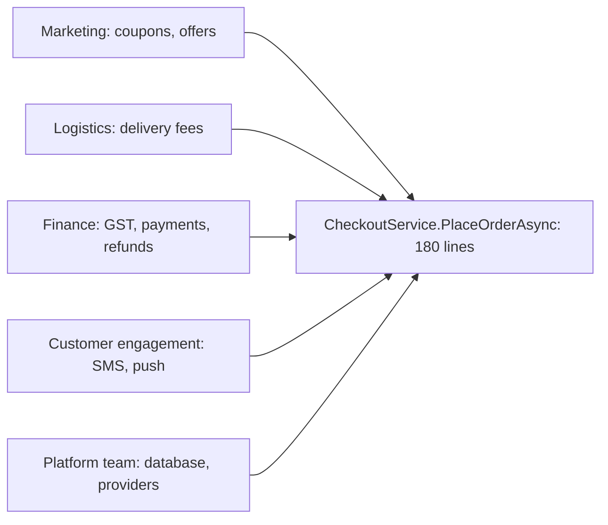
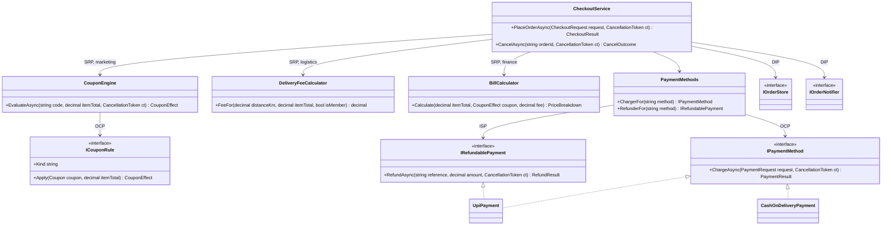

The five SOLID lessons each used their own small example. Real code doesn't arrive one principle at a time. A single service usually breaks several principles at once, and fixing them in the wrong order, or fixing all of them, is how teams end up with code that is harder to change than the mess they started with.

This lesson takes one realistic feature, the checkout of a food-delivery app, and refactors it in five steps. Each step names the principle, the **change request it makes cheap**, and what it costs. The last third of the lesson is the senior part: when to stop.

## Learning objectives

By the end of this lesson you will be able to:

1. Read a messy ASP.NET Core service and list its actors, its variation points and its infrastructure dependencies.
2. Apply SRP, OCP, LSP, ISP and DIP in a sensible order, each tied to a concrete change request.
3. Detect an LSP violation (a payment method that can't refund) with a contract test, and fix it by changing the abstraction rather than the caller.
4. Split a fat interface into role interfaces and register multi-role classes in DI.
5. Estimate the cost of each refactoring step and decide where to stop, using YAGNI and KISS.
6. Recognise over-engineering in a pull request and write a constructive review comment.

## Prerequisites

This lesson builds on, and doesn't repeat, the five principle lessons:

- [Single Responsibility](#/lesson/m04-srp): actors and reasons to change.
- [Open/Closed](#/lesson/m04-ocp): extension points for predictable change.
- [Liskov Substitution](#/lesson/m04-lsp): subtypes keep the base type's promises.
- [Interface Segregation](#/lesson/m04-isp): role interfaces and the usage matrix.
- [Dependency Inversion](#/lesson/m04-dip): business code owns its ports; infrastructure plugs in.

## Explain it like I'm a beginner

Think of a small restaurant kitchen where one cook does everything: takes the order, decides discounts, works out the delivery charge, takes payment and phones the customer. It works on a quiet day. Then the owner says "add a new festival offer", the delivery partner says "rates go up when it rains", and the bank says "we're switching card machines". Every change goes to the same overloaded cook, and every change risks burning someone's biryani.

Reorganising the kitchen happens in steps:

1. **Give each boss their own person** (SRP): offers, delivery charges and payments each get a desk.
2. **Make new offers a new card in a box**, not a rewrite of the menu (OCP).
3. **Check every payment counter keeps the same promise.** The cash counter can't send money back to a bank account. Don't pretend it can (LSP).
4. **Give each counter only the duties it can do** (ISP).
5. **Make the kitchen ask for "a phone line", not "this particular phone company"** (DIP).

And then stop. A kitchen with a separate desk for salt is not better organised.

## First-principles explanation

### What "SOLID in practice" means

SOLID is five tools for one goal: **making likely changes cheap and safe**. Each tool has a cost: more types, more files, more indirection. You apply a principle where a real, expected change justifies that cost, and nowhere else.

A practical order for refactoring existing code:

| Step | Principle | Question it answers | Typical change it makes cheap |
|---|---|---|---|
| 1 | SRP | Who asks for changes to this code? | One team's rule changes without touching another team's code |
| 2 | OCP | Which parts vary often, in the same shape? | New coupon kind or payment method as a new class |
| 3 | LSP | Do all implementations keep the abstraction's promises? | Callers never need `if (x is Cod)` checks |
| 4 | ISP | Does each client depend only on what it uses? | Adding a card-only feature doesn't touch UPI or cash |
| 5 | DIP | Does business code depend on infrastructure details? | Swapping the SMS provider or the database touches one adapter |

SRP comes first because the others need clear seams; LSP and ISP check the abstractions OCP created; DIP is easiest once you know which ports the business code needs.

### Why it exists

Without a plan, teams apply principles by slogan: "interfaces everywhere", "one method per class", "never edit a class". The result follows the letter of SOLID and costs more to change.

### When it is unnecessary

- The feature is a prototype or will be replaced in weeks.
- Nobody has asked for the variation you are preparing for, and nothing suggests they will.
- The "messy" class is 60 lines, has one actor and changes twice a year.

### Trade-offs

| You gain | You pay |
|---|---|
| Changes land in one small class | More files and types to navigate |
| Rules testable without databases or gateways | DI registrations that can be wrong at runtime |
| Fewer merge conflicts across teams | Indirection: "where does this actually run?" |
| New variants without editing tested code | Abstractions that may be wrong if built too early |

## Visual explanation

### Before: one service, many bosses



Five actors point at one method. A coupon change, a rain surcharge and an SMS migration all edit the same file, and each risks breaking the others.

### After: one feature, five principles



Each arrow label names the principle that created it. `CheckoutService` only knows the workflow. Coupon kinds and payment methods are the two OCP extension points, because marketing and finance add them regularly. `DeliveryFeeCalculator` is a concrete class with no interface: there is one fee policy, and pretending otherwise would be YAGNI. `CashOnDeliveryPayment` implements only `IPaymentMethod`, because it can't refund electronically (the LSP and ISP steps). Storage and notifications are ports owned by checkout (DIP).

## Step-by-step example

Our scenario: the checkout of a food-delivery app in Pune. A customer orders ₹480 of biryani and kebabs from a restaurant 5.2 km away, applies coupon `FEAST20` (20 % off up to ₹120 on orders above ₹299), and pays by UPI.

### Step 0 — the service as it exists

```csharp
// BAD: the real shape of many checkout services. Do not copy.
public class CheckoutService(IConfiguration config, ILogger<CheckoutService> log)
{
    public async Task<IResult> PlaceOrderAsync(CheckoutDto dto)
    {
        decimal total = dto.Items.Sum(i => i.Price * i.Qty);

        decimal discount = 0;                                   // marketing
        if (dto.Coupon == "FEAST20" && total >= 299) discount = Math.Min(total * 0.20m, 120);
        else if (dto.Coupon == "FLAT100" && total >= 499) discount = 100;
        else if (dto.Coupon == "HAPPYHOUR" && DateTime.Now.Hour is >= 15 and < 18) discount = total * 0.3m;
        else if (dto.Coupon == "FREEDEL") dto.FreeDelivery = true;

        decimal fee = dto.FreeDelivery ? 0 : 25 + Math.Max(0, Math.Ceiling(dto.DistanceKm - 3)) * 8;   // logistics
        decimal gst = Math.Round((total - discount) * 0.05m, 2);                                      // finance
        decimal payable = total - discount + gst + fee;

        string paymentRef;                                     // finance + platform
        switch (dto.PaymentMethod)
        {
            case "UPI":  paymentRef = await new UpiGatewayClient(config["Upi:Key"]).CollectAsync(payable); break;
            case "CARD": paymentRef = await new CardGatewayClient(config["Card:Key"]).ChargeAsync(dto.CardToken, payable); break;
            case "WALLET": paymentRef = await WalletDb.DebitAsync(dto.CustomerId, payable); break;
            case "COD":  paymentRef = "COD"; break;
            default: return Results.BadRequest("Unknown payment method");
        }

        using var db = new NpgsqlConnection(config.GetConnectionString("Orders"));   // platform
        await db.ExecuteAsync("insert into orders ...", new { dto.CustomerId, payable, paymentRef });
        await new SmsClient(config["Sms:Key"]).SendAsync(dto.Phone, $"Order placed! ₹{payable}");   // engagement
        log.LogInformation("Order placed");
        return Results.Ok(new { payable });
    }

    public async Task RefundAsync(string paymentMethod, string paymentRef, decimal amount)
    {
        if (paymentMethod == "COD") throw new NotSupportedException("COD can't be refunded");
        // ... another switch over the same payment methods
    }
}
```

It works, and it has shipped for a year. Now list the change requests in the backlog:

| # | Change request | Actor | Where it lands today |
|---|---|---|---|
| A | "Add a buy-one-get-one coupon kind for the cricket final" | Marketing | Coupon `if` chain |
| B | "Delivery costs ₹10 more per km during heavy rain" | Logistics | Fee line |
| C | "Add Pay Later as a payment method" | Finance | Both `switch` statements |
| D | "Move SMS to WhatsApp for customers who opt in" | Engagement | `new SmsClient` |
| E | "Happy hour is 15:00–18:00 IST, but servers run in UTC" | Marketing | `DateTime.Now` |
| F | "Unit-test the coupon rules without a database" | Developers | Impossible: everything is in one method |

Every row edits the same method. That table is the plan for the refactoring: each step below should make at least one row cheap.

### Step 1 — SRP: split by actor

Extract the code each actor owns, starting with the pure parts (no I/O):

- `CouponEngine` for marketing (coupons and their validity).
- `DeliveryFeeCalculator` for logistics.
- `BillCalculator` for finance (how discount, GST and fee add up).
- `CheckoutService` keeps only the workflow: validate, price, charge, save, notify.

**Made cheap**: request B now edits one small class, with its own tests, and can't break coupons. Request F becomes possible for pricing.
**Cost**: three new classes, three DI registrations. Low.

### Step 2 — OCP: open the two things that really vary

Look at the history. Marketing added six coupon kinds last year; finance added two payment methods. Logistics changed the fee formula once. So:

- Coupon **kinds** become `ICouponRule` implementations chosen by a `Kind` string. Coupon **values** (`FEAST20` = 20 %, cap ₹120, min ₹299) move to data, the coupon table. Most marketing requests now need no code at all.
- Payment methods become `IPaymentMethod` implementations chosen by `Method`.
- The delivery fee stays a concrete class with options. One policy, rarely changed: an extension point would be speculation.

**Made cheap**: request A is one new class plus one registration; request C is the same for payments. No tested class is edited.
**Cost**: two interfaces, a lookup by key, and one more thing to understand: "where is the code for kind `percent`?". Medium, justified by the change history.

### Step 3 — LSP: check the promises

The old code had a smell: `RefundAsync` threw for COD. After step 2, someone writes `CashOnDeliveryPayment : IPaymentMethod` with `RefundAsync` throwing `NotSupportedException`. The order-cancellation flow, written against `IPaymentMethod`, now crashes for cash orders, or grows `if (method is CashOnDeliveryPayment)`.

That's an LSP violation: a subtype that can't keep the base type's promise ("you can refund what you charged"). Write the promise down as a **contract test** that every payment method must pass: "charge ₹480, then refunding the reference returns success". UPI, card and wallet pass; COD can't.

There are two honest fixes:

1. **Weaken the promise for everyone**: `RefundAsync` may return `NotSupported`. Every caller must now handle it, including for UPI, where it never happens.
2. **Stop promising refunds in the base abstraction**: charging is universal; refunding is a separate capability that only some methods have.

Option 2 is better here, and it is exactly the ISP step. The charge contract also changes: `ChargeAsync` returns `Captured`, `CollectOnDelivery` or `Declined`, so callers never assume money moved. COD returns `CollectOnDelivery`, which is true.

**Made cheap**: every future method (Pay Later, gift cards) can be added without breaking cancellation.
**Cost**: one enum value and one decision in the cancellation flow. Low.

### Step 4 — ISP: split the fat interface

The payment interface had grown to `ChargeAsync`, `RefundAsync`, `SaveCardAsync`, `CreateAutoPayMandateAsync` and `GetSettlementsAsync`. Checkout used one; cancellation used one; the subscription team used one. Cash and wallet threw on three of the five. The [ISP lesson](#/lesson/m04-isp) builds the full usage matrix; here we keep only what checkout and cancellation need:

- `IPaymentMethod`: `ChargeAsync`. Implemented by all four.
- `IRefundablePayment`: `RefundAsync`. Implemented by UPI, card and wallet.
- Card saving and mandates move to their own interfaces, owned by the teams that use them.

**Made cheap**: a card-only feature ("save card for next time") adds a member to an interface that cash, UPI and wallet never see.
**Cost**: classes implement two interfaces, and DI needs a registration per role. Low to medium.

### Step 5 — DIP: business code owns the ports

`new NpgsqlConnection`, `new SmsClient`, `new UpiGatewayClient` and `DateTime.Now` sit inside business code. Replace each with a port that checkout owns, defined in checkout's terms:

- `IOrderStore`: save and find orders.
- `IOrderNotifier`: "an order was placed" (not "send an SMS").
- `IPaymentGatewayClient` and `IWalletLedger`: what the payment methods need.
- `TimeProvider`: the clock, so happy hour is testable and computed in IST.

Adapters for PostgreSQL, the SMS or WhatsApp provider and the gateway live in an infrastructure folder and are wired in `Program.cs`.

**Made cheap**: request D is a new `IOrderNotifier` adapter (or a composite that picks a channel by preference); request E is a test with a fake clock; request F is complete.
**Cost**: four ports, adapters, and a composition root to keep correct. Medium, and it's the step most often overdone.

### Replay the backlog

| Request | Before | After |
|---|---|---|
| A: BOGO coupon | Edit the `if` chain | New `ICouponRule` + registration |
| B: rain surcharge | Edit the checkout method | Edit `DeliveryFeeCalculator` (or its options) |
| C: Pay Later | Edit two `switch` statements | New `IPaymentMethod` (+ `IRefundablePayment`) |
| D: WhatsApp | Edit checkout | New notifier adapter |
| E: IST happy hour | Untestable | Rule uses `TimeProvider`; test with a fake clock |
| F: unit tests | Impossible | Pure classes and fakes |

Every row now touches one place. That is the evidence the refactoring worked, and the reason to stop here.

## Production-style C# implementation

```text
FoodApp/
  Program.cs
  Checkout/
    Models.cs                 request, order and price records
    Coupons.cs                CouponEngine + ICouponRule kinds   (marketing)
    DeliveryFee.cs            DeliveryFeeCalculator               (logistics)
    Billing.cs                BillCalculator                      (finance)
    Payments.cs               IPaymentMethod, IRefundablePayment, methods, registry
    Ports.cs                  IOrderStore, IOrderNotifier         (owned by checkout)
    CheckoutService.cs        the workflow
  Infrastructure/
    InMemoryAdapters.cs       stand-ins for PostgreSQL, gateway, wallet, notifications
```

```csharp file=Checkout/Models.cs
namespace FoodApp.Checkout;

public sealed record CartLine(string ItemId, string Name, decimal UnitPrice, int Quantity)
{
    public decimal Amount => UnitPrice * Quantity;
}

public sealed record CheckoutRequest(
    string CustomerId,
    string RestaurantId,
    IReadOnlyList<CartLine> Lines,
    decimal DistanceKm,
    bool IsMember,
    string? CouponCode,
    string PaymentMethod,
    string IdempotencyKey);

public sealed record PriceBreakdown(decimal ItemTotal, decimal Discount, decimal DeliveryFee, decimal Gst, decimal Payable);

public enum OrderStatus { PendingPayment, Placed, AwaitingCashOnDelivery, PaymentFailed, Cancelled }

public sealed record Order(
    string OrderId,
    string CustomerId,
    string RestaurantId,
    PriceBreakdown Price,
    string PaymentMethod,
    string? PaymentReference,
    OrderStatus Status,
    DateTimeOffset PlacedAt);

public sealed record CheckoutResult(bool Success, Order? Order, string? Error)
{
    public static CheckoutResult Ok(Order order) => new(true, order, null);
    public static CheckoutResult Fail(string error) => new(false, null, error);
}

public enum CancelOutcome { Refunded, NothingToRefund, ManualRefundNeeded, RefundFailed, AlreadyCancelled, NotFound }
```

```csharp file=Checkout/Coupons.cs
namespace FoodApp.Checkout.Coupons;

/// <summary>A row in the coupon table. Values are data; only the Kind maps to code.</summary>
public sealed record Coupon(string Code, string Kind, decimal Value, decimal MaxDiscount, decimal MinOrder,
    DateTimeOffset ValidFrom, DateTimeOffset ValidTo);

public sealed record CouponEffect(decimal ItemDiscount, bool FreeDelivery, string? Rejection = null)
{
    public static readonly CouponEffect None = new(0m, false);
    public static CouponEffect Rejected(string reason) => new(0m, false, reason);
}

/// <summary>Extension point owned by marketing: a new coupon kind is a new class.</summary>
public interface ICouponRule
{
    string Kind { get; }
    CouponEffect Apply(Coupon coupon, decimal itemTotal);
}

public sealed class FlatOffRule : ICouponRule
{
    public string Kind => "flat";
    public CouponEffect Apply(Coupon coupon, decimal itemTotal) => new(Math.Min(coupon.Value, itemTotal), false);
}

public sealed class PercentOffRule : ICouponRule
{
    public string Kind => "percent";
    public CouponEffect Apply(Coupon coupon, decimal itemTotal)
    {
        var discount = Math.Round(itemTotal * coupon.Value / 100m, 2, MidpointRounding.AwayFromZero);
        if (coupon.MaxDiscount > 0) discount = Math.Min(discount, coupon.MaxDiscount);
        return new(discount, false);
    }
}

public sealed class FreeDeliveryRule : ICouponRule
{
    public string Kind => "free-delivery";
    public CouponEffect Apply(Coupon coupon, decimal itemTotal) => new(0m, true);
}

public interface ICouponStore
{
    Task<Coupon?> FindAsync(string code, CancellationToken ct);
}

/// <summary>Checks rules common to every coupon (exists, valid now, minimum order), then delegates to the kind.</summary>
public sealed class CouponEngine(IEnumerable<ICouponRule> rules, ICouponStore store, TimeProvider clock)
{
    private readonly Dictionary<string, ICouponRule> _rules =
        rules.ToDictionary(r => r.Kind, StringComparer.OrdinalIgnoreCase);

    public async Task<CouponEffect> EvaluateAsync(string? code, decimal itemTotal, CancellationToken ct)
    {
        if (string.IsNullOrWhiteSpace(code)) return CouponEffect.None;
        var coupon = await store.FindAsync(code.Trim(), ct);
        if (coupon is null) return CouponEffect.Rejected("This coupon code doesn't exist.");

        var now = clock.GetUtcNow();
        if (now < coupon.ValidFrom || now >= coupon.ValidTo) return CouponEffect.Rejected($"{coupon.Code} isn't valid right now.");
        if (itemTotal < coupon.MinOrder)
            return CouponEffect.Rejected($"Add items worth ₹{coupon.MinOrder - itemTotal:0.##} more to use {coupon.Code}.");

        return _rules.TryGetValue(coupon.Kind, out var rule)
            ? rule.Apply(coupon, itemTotal)
            : CouponEffect.Rejected($"{coupon.Code} can't be used in this app version.");
    }
}
```

```csharp file=Checkout/DeliveryFee.cs
using Microsoft.Extensions.Options;

namespace FoodApp.Checkout.Delivery;

public sealed class DeliveryFeeOptions
{
    public decimal BaseFee { get; set; } = 25m;
    public decimal IncludedKm { get; set; } = 3m;
    public decimal PerExtraKm { get; set; } = 8m;
    public decimal MemberFreeAbove { get; set; } = 199m;
}

/// <summary>Owned by logistics. Deliberately concrete: one fee policy exists, so no interface yet (YAGNI).
/// Rates live in options, so a rate change is configuration, not code.</summary>
public sealed class DeliveryFeeCalculator(IOptions<DeliveryFeeOptions> options)
{
    public decimal FeeFor(decimal distanceKm, decimal itemTotalAfterDiscount, bool isMember)
    {
        ArgumentOutOfRangeException.ThrowIfNegative(distanceKm);
        var o = options.Value;
        if (isMember && itemTotalAfterDiscount >= o.MemberFreeAbove) return 0m;
        var extraKm = Math.Max(0m, Math.Ceiling(distanceKm - o.IncludedKm));
        return o.BaseFee + extraKm * o.PerExtraKm;
    }
}
```

```csharp file=Checkout/Billing.cs
using FoodApp.Checkout.Coupons;
using Microsoft.Extensions.Options;

namespace FoodApp.Checkout.Billing;

public sealed class BillingOptions
{
    /// <summary>GST on restaurant food (simplified: one rate, delivery fee shown separately).</summary>
    public decimal FoodGstPercent { get; set; } = 5m;
}

/// <summary>Owned by finance: how the bill adds up.</summary>
public sealed class BillCalculator(IOptions<BillingOptions> options)
{
    public PriceBreakdown Calculate(decimal itemTotal, CouponEffect coupon, decimal deliveryFee)
    {
        var discount = Math.Min(coupon.ItemDiscount, itemTotal);
        var taxable = itemTotal - discount;
        var gst = Math.Round(taxable * options.Value.FoodGstPercent / 100m, 2, MidpointRounding.AwayFromZero);
        var fee = coupon.FreeDelivery ? 0m : deliveryFee;
        return new PriceBreakdown(itemTotal, discount, fee, gst, taxable + gst + fee);
    }
}
```

```csharp file=Checkout/Payments.cs
namespace FoodApp.Checkout.Payments;

public enum PaymentStatus { Captured, CollectOnDelivery, Declined }

public sealed record PaymentRequest(string OrderId, string CustomerId, decimal Amount, string IdempotencyKey);
public sealed record PaymentResult(PaymentStatus Status, string? Reference, string? Reason = null);

public enum RefundStatus { Refunded, Failed }
public sealed record RefundResult(RefundStatus Status, string? Reason = null);

/// <summary>Every payment method keeps this promise: a decline is a result, not an exception, and
/// Captured means money moved, CollectOnDelivery means nothing has moved yet.</summary>
public interface IPaymentMethod
{
    string Method { get; }
    Task<PaymentResult> ChargeAsync(PaymentRequest request, CancellationToken ct);
}

/// <summary>Only methods that can return money electronically implement this role.</summary>
public interface IRefundablePayment
{
    string Method { get; }
    Task<RefundResult> RefundAsync(string paymentReference, decimal amount, CancellationToken ct);
}

/// <summary>Ports the payment methods need. Adapters live in Infrastructure.</summary>
public interface IPaymentGatewayClient
{
    Task<PaymentResult> ChargeAsync(string instrument, PaymentRequest request, CancellationToken ct);
    Task<RefundResult> RefundAsync(string paymentReference, decimal amount, CancellationToken ct);
}

public interface IWalletLedger
{
    Task<string?> TryDebitAsync(string customerId, decimal amount, string idempotencyKey, CancellationToken ct);
    Task<bool> CreditBackAsync(string debitReference, decimal amount, CancellationToken ct);
}

public sealed class UpiPayment(IPaymentGatewayClient gateway) : IPaymentMethod, IRefundablePayment
{
    public string Method => "upi";
    public Task<PaymentResult> ChargeAsync(PaymentRequest request, CancellationToken ct) => gateway.ChargeAsync("upi", request, ct);
    public Task<RefundResult> RefundAsync(string paymentReference, decimal amount, CancellationToken ct) =>
        gateway.RefundAsync(paymentReference, amount, ct);
}

public sealed class CardPayment(IPaymentGatewayClient gateway) : IPaymentMethod, IRefundablePayment
{
    public string Method => "card";
    public Task<PaymentResult> ChargeAsync(PaymentRequest request, CancellationToken ct) => gateway.ChargeAsync("card", request, ct);
    public Task<RefundResult> RefundAsync(string paymentReference, decimal amount, CancellationToken ct) =>
        gateway.RefundAsync(paymentReference, amount, ct);
}

public sealed class WalletPayment(IWalletLedger ledger) : IPaymentMethod, IRefundablePayment
{
    public string Method => "wallet";

    public async Task<PaymentResult> ChargeAsync(PaymentRequest request, CancellationToken ct)
    {
        var reference = await ledger.TryDebitAsync(request.CustomerId, request.Amount, request.IdempotencyKey, ct);
        return reference is null
            ? new PaymentResult(PaymentStatus.Declined, null, "Not enough wallet balance.")
            : new PaymentResult(PaymentStatus.Captured, reference);
    }

    public async Task<RefundResult> RefundAsync(string paymentReference, decimal amount, CancellationToken ct) =>
        await ledger.CreditBackAsync(paymentReference, amount, ct)
            ? new RefundResult(RefundStatus.Refunded)
            : new RefundResult(RefundStatus.Failed, "Unknown wallet debit.");
}

/// <summary>Charges nothing now and promises nothing it can't do: no IRefundablePayment.</summary>
public sealed class CashOnDeliveryPayment : IPaymentMethod
{
    public const decimal MaxOrderValue = 2_000m;
    public string Method => "cod";

    public Task<PaymentResult> ChargeAsync(PaymentRequest request, CancellationToken ct) =>
        Task.FromResult(request.Amount > MaxOrderValue
            ? new PaymentResult(PaymentStatus.Declined, null, "Cash on delivery is available for orders up to ₹2,000.")
            : new PaymentResult(PaymentStatus.CollectOnDelivery, null));
}

/// <summary>Finds the role a caller needs. Checkout asks for a charger; cancellation asks for a refunder.</summary>
public sealed class PaymentMethods(IEnumerable<IPaymentMethod> chargers, IEnumerable<IRefundablePayment> refunders)
{
    private readonly Dictionary<string, IPaymentMethod> _chargers =
        chargers.ToDictionary(c => c.Method, StringComparer.OrdinalIgnoreCase);
    private readonly Dictionary<string, IRefundablePayment> _refunders =
        refunders.ToDictionary(r => r.Method, StringComparer.OrdinalIgnoreCase);

    public IPaymentMethod? ChargerFor(string method) => _chargers.GetValueOrDefault(method);
    public IRefundablePayment? RefunderFor(string method) => _refunders.GetValueOrDefault(method);
    public IReadOnlyCollection<string> Available => _chargers.Keys;
}
```

```csharp file=Checkout/Ports.cs
namespace FoodApp.Checkout;

/// <summary>Owned by checkout, written in checkout's words. PostgreSQL is one adapter.</summary>
public interface IOrderStore
{
    Task<Order?> FindByIdempotencyKeyAsync(string customerId, string idempotencyKey, CancellationToken ct);
    Task SaveNewAsync(Order order, string idempotencyKey, CancellationToken ct);
    Task UpdateAsync(Order order, CancellationToken ct);
    Task<Order?> FindAsync(string orderId, CancellationToken ct);
}

/// <summary>"Tell the customer", not "send an SMS". Channels are an adapter concern.</summary>
public interface IOrderNotifier
{
    Task OrderPlacedAsync(Order order, CancellationToken ct);
    Task OrderCancelledAsync(Order order, CancellationToken ct);
}
```

```csharp file=Checkout/CheckoutService.cs
using FoodApp.Checkout.Billing;
using FoodApp.Checkout.Coupons;
using FoodApp.Checkout.Delivery;
using FoodApp.Checkout.Payments;

namespace FoodApp.Checkout;

/// <summary>The workflow only: validate, price, record, charge, confirm, notify. No arithmetic, no SQL, no SMS.</summary>
public sealed class CheckoutService(
    CouponEngine coupons,
    DeliveryFeeCalculator delivery,
    BillCalculator bill,
    PaymentMethods payments,
    IOrderStore orders,
    IOrderNotifier notifier,
    TimeProvider clock)
{
    public async Task<CheckoutResult> PlaceOrderAsync(CheckoutRequest request, CancellationToken ct)
    {
        if (request.Lines.Count == 0) return CheckoutResult.Fail("Your cart is empty.");
        if (request.Lines.Any(l => l.Quantity <= 0 || l.UnitPrice < 0)) return CheckoutResult.Fail("Check the quantities in your cart.");

        // A double tap on "Place order" must not create two orders or two charges.
        var existing = await orders.FindByIdempotencyKeyAsync(request.CustomerId, request.IdempotencyKey, ct);
        if (existing is not null) return CheckoutResult.Ok(existing);

        var charger = payments.ChargerFor(request.PaymentMethod);
        if (charger is null) return CheckoutResult.Fail($"'{request.PaymentMethod}' isn't available.");

        var itemTotal = request.Lines.Sum(l => l.Amount);
        var coupon = await coupons.EvaluateAsync(request.CouponCode, itemTotal, ct);
        if (coupon.Rejection is not null) return CheckoutResult.Fail(coupon.Rejection);

        var fee = delivery.FeeFor(request.DistanceKm, itemTotal - coupon.ItemDiscount, request.IsMember);
        var price = bill.Calculate(itemTotal, coupon, fee);

        // Record the order before charging: a charge without an order is the worst outcome.
        var order = new Order("ord_" + Guid.NewGuid().ToString("N")[..12], request.CustomerId, request.RestaurantId,
            price, charger.Method, null, OrderStatus.PendingPayment, clock.GetUtcNow());
        await orders.SaveNewAsync(order, request.IdempotencyKey, ct);

        var payment = await charger.ChargeAsync(
            new PaymentRequest(order.OrderId, request.CustomerId, price.Payable, request.IdempotencyKey), ct);

        if (payment.Status == PaymentStatus.Declined)
        {
            await orders.UpdateAsync(order with { Status = OrderStatus.PaymentFailed }, ct);
            return CheckoutResult.Fail(payment.Reason ?? "Payment was declined.");
        }

        order = order with
        {
            PaymentReference = payment.Reference,
            Status = payment.Status == PaymentStatus.CollectOnDelivery ? OrderStatus.AwaitingCashOnDelivery : OrderStatus.Placed,
        };
        await orders.UpdateAsync(order, ct);
        await notifier.OrderPlacedAsync(order, ct);   // production: an outbox row in the same transaction
        return CheckoutResult.Ok(order);
    }

    public async Task<CancelOutcome> CancelAsync(string orderId, CancellationToken ct)
    {
        var order = await orders.FindAsync(orderId, ct);
        if (order is null) return CancelOutcome.NotFound;
        if (order.Status == OrderStatus.Cancelled) return CancelOutcome.AlreadyCancelled;

        var outcome = CancelOutcome.NothingToRefund;   // pending, failed or cash orders: no money moved
        if (order.Status == OrderStatus.Placed)
        {
            var refunder = payments.RefunderFor(order.PaymentMethod);
            if (refunder is null) outcome = CancelOutcome.ManualRefundNeeded;
            else
            {
                var refund = await refunder.RefundAsync(order.PaymentReference!, order.Price.Payable, ct);
                if (refund.Status == RefundStatus.Failed) return CancelOutcome.RefundFailed;   // order stays Placed; retry later
                outcome = CancelOutcome.Refunded;
            }
        }

        var cancelled = order with { Status = OrderStatus.Cancelled };
        await orders.UpdateAsync(cancelled, ct);
        await notifier.OrderCancelledAsync(cancelled, ct);
        return outcome;
    }
}
```

```csharp file=Infrastructure/InMemoryAdapters.cs
using System.Collections.Concurrent;
using FoodApp.Checkout;
using FoodApp.Checkout.Coupons;
using FoodApp.Checkout.Payments;
using Microsoft.Extensions.Logging;

namespace FoodApp.Infrastructure;

/// <summary>Stand-in for a PostgreSQL adapter with UNIQUE (customer_id, idempotency_key).</summary>
public sealed class InMemoryOrderStore : IOrderStore
{
    private readonly ConcurrentDictionary<string, Order> _orders = new();
    private readonly ConcurrentDictionary<(string, string), string> _keys = new();

    public Task<Order?> FindByIdempotencyKeyAsync(string customerId, string idempotencyKey, CancellationToken ct) =>
        Task.FromResult(_keys.TryGetValue((customerId, idempotencyKey), out var id) ? _orders.GetValueOrDefault(id) : null);

    public Task SaveNewAsync(Order order, string idempotencyKey, CancellationToken ct)
    {
        if (!_keys.TryAdd((order.CustomerId, idempotencyKey), order.OrderId))
            throw new InvalidOperationException("Duplicate idempotency key.");
        _orders[order.OrderId] = order;
        return Task.CompletedTask;
    }

    public Task UpdateAsync(Order order, CancellationToken ct) { _orders[order.OrderId] = order; return Task.CompletedTask; }

    public Task<Order?> FindAsync(string orderId, CancellationToken ct) => Task.FromResult(_orders.GetValueOrDefault(orderId));
}

public sealed class InMemoryCouponStore : ICouponStore
{
    private readonly ConcurrentDictionary<string, Coupon> _coupons = new(StringComparer.OrdinalIgnoreCase);
    public InMemoryCouponStore Add(Coupon coupon) { _coupons[coupon.Code] = coupon; return this; }
    public Task<Coupon?> FindAsync(string code, CancellationToken ct) => Task.FromResult(_coupons.GetValueOrDefault(code));
}

/// <summary>Stand-in for the UPI/card gateway adapter (HTTP + signature checks in production).</summary>
public sealed class FakePaymentGatewayClient : IPaymentGatewayClient
{
    private readonly ConcurrentDictionary<string, decimal> _captured = new();

    public Task<PaymentResult> ChargeAsync(string instrument, PaymentRequest request, CancellationToken ct)
    {
        var reference = $"{instrument}_{request.IdempotencyKey}";   // the gateway dedupes on our key
        _captured.TryAdd(reference, request.Amount);
        return Task.FromResult(new PaymentResult(PaymentStatus.Captured, reference));
    }

    public Task<RefundResult> RefundAsync(string paymentReference, decimal amount, CancellationToken ct) =>
        Task.FromResult(_captured.TryRemove(paymentReference, out var paid) && amount <= paid
            ? new RefundResult(RefundStatus.Refunded)
            : new RefundResult(RefundStatus.Failed, "Nothing to refund for this reference."));
}

public sealed class InMemoryWalletLedger : IWalletLedger
{
    private readonly object _sync = new();
    private readonly Dictionary<string, decimal> _balances = new();
    private readonly Dictionary<string, (string Customer, decimal Amount)> _debits = new();

    public InMemoryWalletLedger TopUp(string customerId, decimal amount)
    {
        lock (_sync) _balances[customerId] = _balances.GetValueOrDefault(customerId) + amount;
        return this;
    }

    public Task<string?> TryDebitAsync(string customerId, decimal amount, string idempotencyKey, CancellationToken ct)
    {
        lock (_sync)
        {
            var reference = "wal_" + idempotencyKey;
            if (_debits.ContainsKey(reference)) return Task.FromResult<string?>(reference);
            if (_balances.GetValueOrDefault(customerId) < amount) return Task.FromResult<string?>(null);
            _balances[customerId] -= amount;
            _debits[reference] = (customerId, amount);
            return Task.FromResult<string?>(reference);
        }
    }

    public Task<bool> CreditBackAsync(string debitReference, decimal amount, CancellationToken ct)
    {
        lock (_sync)
        {
            if (!_debits.Remove(debitReference, out var debit)) return Task.FromResult(false);
            _balances[debit.Customer] += Math.Min(amount, debit.Amount);
            return Task.FromResult(true);
        }
    }
}

/// <summary>Placeholder notifier. Real adapters: SMS, push, WhatsApp, chosen by customer preference.</summary>
public sealed class LoggingOrderNotifier(ILogger<LoggingOrderNotifier> log) : IOrderNotifier
{
    public Task OrderPlacedAsync(Order order, CancellationToken ct)
    {
        log.LogInformation("Order {OrderId} placed: ₹{Payable} via {Method}", order.OrderId, order.Price.Payable, order.PaymentMethod);
        return Task.CompletedTask;
    }

    public Task OrderCancelledAsync(Order order, CancellationToken ct)
    {
        log.LogInformation("Order {OrderId} cancelled", order.OrderId);
        return Task.CompletedTask;
    }
}
```

```csharp file=Program.cs
using FoodApp.Checkout;
using FoodApp.Checkout.Billing;
using FoodApp.Checkout.Coupons;
using FoodApp.Checkout.Delivery;
using FoodApp.Checkout.Payments;
using FoodApp.Infrastructure;

var builder = WebApplication.CreateBuilder(args);
var s = builder.Services;

s.AddSingleton(TimeProvider.System);
s.Configure<DeliveryFeeOptions>(builder.Configuration.GetSection("DeliveryFee"));
s.Configure<BillingOptions>(builder.Configuration.GetSection("Billing"));

// Marketing's extension point: one line per coupon kind.
s.AddSingleton<ICouponRule, FlatOffRule>();
s.AddSingleton<ICouponRule, PercentOffRule>();
s.AddSingleton<ICouponRule, FreeDeliveryRule>();
s.AddSingleton<ICouponStore>(new InMemoryCouponStore()
    .Add(new Coupon("FEAST20", "percent", 20m, 120m, 299m, DateTimeOffset.MinValue, DateTimeOffset.MaxValue))
    .Add(new Coupon("FLAT100", "flat", 100m, 0m, 499m, DateTimeOffset.MinValue, DateTimeOffset.MaxValue)));
s.AddSingleton<CouponEngine>();
s.AddSingleton<DeliveryFeeCalculator>();
s.AddSingleton<BillCalculator>();

// Finance's extension point. A class with two roles is registered once and exposed under each role.
s.AddSingleton<IPaymentGatewayClient, FakePaymentGatewayClient>();        // production: HTTP adapter
s.AddSingleton<IWalletLedger>(new InMemoryWalletLedger().TopUp("cust-42", 1_000m));
s.AddSingleton<UpiPayment>();
s.AddSingleton<CardPayment>();
s.AddSingleton<WalletPayment>();
s.AddSingleton<IPaymentMethod>(sp => sp.GetRequiredService<UpiPayment>());
s.AddSingleton<IPaymentMethod>(sp => sp.GetRequiredService<CardPayment>());
s.AddSingleton<IPaymentMethod>(sp => sp.GetRequiredService<WalletPayment>());
s.AddSingleton<IPaymentMethod, CashOnDeliveryPayment>();
s.AddSingleton<IRefundablePayment>(sp => sp.GetRequiredService<UpiPayment>());
s.AddSingleton<IRefundablePayment>(sp => sp.GetRequiredService<CardPayment>());
s.AddSingleton<IRefundablePayment>(sp => sp.GetRequiredService<WalletPayment>());
s.AddSingleton<PaymentMethods>();

// Infrastructure adapters behind checkout-owned ports.
s.AddSingleton<IOrderStore, InMemoryOrderStore>();                        // production: PostgreSQL
s.AddSingleton<IOrderNotifier, LoggingOrderNotifier>();                   // production: SMS / push / WhatsApp
s.AddScoped<CheckoutService>();

var app = builder.Build();

app.MapPost("/checkout", async (CheckoutRequest request, CheckoutService checkout, CancellationToken ct) =>
{
    var result = await checkout.PlaceOrderAsync(request, ct);
    return result.Success
        ? Results.Created($"/orders/{result.Order!.OrderId}", result.Order)
        : Results.Problem(result.Error, statusCode: StatusCodes.Status422UnprocessableEntity);
});

app.MapPost("/orders/{orderId}/cancel", async (string orderId, CheckoutService checkout, CancellationToken ct) =>
    await checkout.CancelAsync(orderId, ct) switch
    {
        CancelOutcome.NotFound => Results.NotFound(),
        CancelOutcome.RefundFailed => Results.Problem("Refund failed; we'll retry.", statusCode: StatusCodes.Status502BadGateway),
        var outcome => Results.Ok(new { outcome = outcome.ToString() }),
    });

app.Run();
```

Walk the Pune order through it: item total ₹480; `FEAST20` gives 20 % = ₹96 (under the ₹120 cap); GST is 5 % of ₹384 = ₹19.20; 5.2 km rounds up to 3 extra km, so the fee is ₹25 + 3 × ₹8 = ₹49 for a non-member; payable is ₹384 + ₹19.20 + ₹49 = **₹452.20**.

Three design notes. The order is saved as `PendingPayment` before charging, because "charged but no order" is the most expensive bug in checkout. The idempotency key is passed to the gateway and the wallet, so a retry can't charge twice. And `RefundFailed` leaves the order `Placed`, so a retry job can try again rather than hiding an unpaid refund behind a "cancelled" label.

## Bad design vs good design

**Bad** is Step 0: five actors, two `switch` statements over the same payment methods (a sign that OCP is missing: "shotgun surgery" when you add one), `new` for every infrastructure client (no DIP), `DateTime.Now` in a business rule, and a refund that throws for one subtype (LSP).

**Good** is not "the most abstract version". It's the version where each backlog row touches one place, and nothing exists that no row needs.

### When to stop: the cost of each step

| Step | Added | Worth it when | Skip or defer when |
|---|---|---|---|
| SRP split | 3–4 classes | Several actors change the code | One actor, small class |
| OCP for coupons | Interface + 1 class per kind | Marketing adds kinds every quarter | Two fixed coupons, no roadmap |
| OCP for delivery fee | Interface + strategies | A second fee model is actually planned (for example, per-city pricing next sprint) | One formula changed once a year: use options |
| LSP fix | Enum value, honest contract | Any subtype throws `NotSupportedException` | Never skip: LSP bugs are runtime crashes |
| ISP split | Role interfaces | Implementers throw on members, or clients use disjoint subsets | Every implementer supports every member |
| DIP ports | Port + adapter per dependency | Volatile infrastructure, or tests need fakes (database, gateway, clock, messaging) | Stable, pure libraries: `Math`, `decimal`, LINQ, a JSON serializer |

### How principles conflict with YAGNI and KISS

- **OCP vs YAGNI**: OCP says "prepare for extension"; YAGNI says "don't build what nobody asked for". The tie-breaker is evidence: the change history (`git log` on the file), the roadmap, and how often this kind of request has arrived. Coupons: six kinds last year, so open. Delivery fees: one change, so options are enough.
- **DIP vs KISS**: an interface over `TimeProvider`, over `ILogger`, or over your own pure `BillCalculator` adds a layer and buys nothing. `TimeProvider` and `ILogger<T>` are already abstractions. Pure calculators don't need fakes; test them directly.
- **SRP vs KISS**: splitting `BillCalculator` into `GstCalculator`, `DiscountApplier` and `TotalAssembler` scatters one finance rule across three files ([SRP lesson](#/lesson/m04-srp)).
- **ISP vs cohesion**: one interface per method is as bad as one fat interface. Split by client role, not by method count.

:::callout type=mistake title="The over-engineered checkout"
A team "completes" the refactoring with `ICheckoutService` (one implementation), `IDeliveryFeeStrategyFactory`, a generic `IRuleEngine<TContext, TResult>`, coupon rules loaded by reflection from a plugins folder, and `IBillCalculator`, `IDeliveryFeeCalculator` and `ICouponEngine` interfaces with one implementation each and no fakes in any test. Adding a coupon kind now means reading four files of framework before writing ten lines of rule. That's [speculative generality](#/lesson/m04-over-under-engineering), and it costs more per change than Step 0 did.
:::

### Spotting over-engineering in review

Ask these questions of every new abstraction in a pull request:

1. **Which backlog item or past change needed this?** No answer means YAGNI.
2. **How many implementations exist today, and does any test fake it?** One and no is a warning.
3. **How many files must I read to follow one rule?** More than three for one rule is a smell.
4. **Is the "framework" bigger than the rules it hosts?** A rule engine for three coupons is.
5. **Could configuration replace the code?** Rates, thresholds and caps usually should be data.
6. **Is it reversible?** Cheap-to-add-later abstractions should be added later. Contracts that leak to other teams (public APIs, message schemas) deserve more care up front.

## Practical playground

The playground is a small console version of the payment extension point. Run it, then add a `PayLaterPayment` that charges (status `Captured`, reference `"paylater_" + orderId`) and refunds. Register it in the list. Notice you don't edit `PaymentMethods` or `Checkout`: that's OCP. Then try making it *not* refundable and see that cancellation handles it without an `is` check: that's LSP plus ISP.

:::playground type=csharp title="Add Pay Later without editing checkout"
```csharp file=Program.cs
using System;
using System.Collections.Generic;
using System.Linq;

public enum PaymentStatus { Captured, CollectOnDelivery, Declined }
public sealed record PaymentResult(PaymentStatus Status, string? Reference);

public interface IPaymentMethod { string Method { get; } PaymentResult Charge(string orderId, decimal amount); }
public interface IRefundablePayment { string Method { get; } bool Refund(string reference, decimal amount); }

public sealed class UpiPayment : IPaymentMethod, IRefundablePayment
{
    public string Method => "upi";
    public PaymentResult Charge(string orderId, decimal amount) => new(PaymentStatus.Captured, "upi_" + orderId);
    public bool Refund(string reference, decimal amount) { Console.WriteLine($"  UPI refund {amount} to {reference}"); return true; }
}

public sealed class CashOnDeliveryPayment : IPaymentMethod
{
    public string Method => "cod";
    public PaymentResult Charge(string orderId, decimal amount) =>
        amount > 2_000m ? new(PaymentStatus.Declined, null) : new(PaymentStatus.CollectOnDelivery, null);
}

// TODO: add PayLaterPayment here.

public sealed class PaymentMethods(IEnumerable<IPaymentMethod> chargers, IEnumerable<IRefundablePayment> refunders)
{
    private readonly Dictionary<string, IPaymentMethod> _c = chargers.ToDictionary(x => x.Method);
    private readonly Dictionary<string, IRefundablePayment> _r = refunders.ToDictionary(x => x.Method);
    public IPaymentMethod? ChargerFor(string m) => _c.GetValueOrDefault(m);
    public IRefundablePayment? RefunderFor(string m) => _r.GetValueOrDefault(m);
}

public static class Program
{
    public static void Main()
    {
        var upi = new UpiPayment();
        var methods = new PaymentMethods(
            new IPaymentMethod[] { upi, new CashOnDeliveryPayment() },
            new IRefundablePayment[] { upi });

        foreach (var method in new[] { "upi", "cod" })
        {
            var charger = methods.ChargerFor(method)!;
            var result = charger.Charge("ord-1001", 452.20m);
            Console.WriteLine($"{method}: {result.Status}");

            // Cancellation: refund only what was captured, and only if the method can refund.
            if (result.Status != PaymentStatus.Captured) Console.WriteLine("  nothing to refund");
            else if (methods.RefunderFor(method) is { } refunder) refunder.Refund(result.Reference!, 452.20m);
            else Console.WriteLine("  manual refund needed");
        }
    }
}
```
:::

## Exercises

:::exercise id=m04-solid-in-practice-ex1 difficulty=beginner kind=code title="A new coupon kind without touching the engine"
Marketing wants percentage coupons such as `FEAST20`: 20 % off, capped at ₹120, on orders of at least ₹299. Implement `PercentOffRule.Discount` and `CouponEngine.DiscountFor`. The engine must work for coupon kinds it has never heard of, as long as a rule is registered: that's the OCP test.
::requirements
- `PercentOffRule`: `Value` percent of the item total, rounded to 2 decimals (away from zero), capped at `MaxDiscount` when it's greater than 0.
- `CouponEngine.DiscountFor`: returns 0 if the item total is below `MinOrder` or no rule matches the kind; finds rules by kind, ignoring case; never returns more than the item total.
- No `switch` or `if` on kind names inside the engine.
::acceptance
- All tests pass, including one that registers a rule defined only in the test file.
- 20 % of ₹450 is ₹90; 20 % of ₹800 is capped at ₹120.
::hint
The engine only needs a dictionary from kind to rule, built in the constructor (already done for you).
::hint
`DiscountFor` does the checks every coupon shares (minimum order, known kind), then asks the rule.
::hint
Clamp the rule's answer with `Math.Min(discount, itemTotal)` so a ₹150 flat coupon on a ₹100 order gives ₹100.
::hint
```csharp
var d = Math.Round(itemTotal * coupon.Value / 100m, 2, MidpointRounding.AwayFromZero);
return coupon.MaxDiscount > 0 ? Math.Min(d, coupon.MaxDiscount) : d;
```
::starter
```csharp file=Coupons.cs
using System;
using System.Collections.Generic;
using System.Linq;

public sealed record Coupon(string Code, string Kind, decimal Value, decimal MaxDiscount, decimal MinOrder);

public interface ICouponRule
{
    string Kind { get; }
    decimal Discount(Coupon coupon, decimal itemTotal);
}

public sealed class FlatOffRule : ICouponRule
{
    public string Kind => "flat";
    public decimal Discount(Coupon coupon, decimal itemTotal) => coupon.Value;
}

public sealed class PercentOffRule : ICouponRule
{
    public string Kind => "percent";
    public decimal Discount(Coupon coupon, decimal itemTotal) => throw new NotImplementedException();
}

public sealed class CouponEngine
{
    private readonly Dictionary<string, ICouponRule> _rules;

    public CouponEngine(IEnumerable<ICouponRule> rules) =>
        _rules = rules.ToDictionary(r => r.Kind, StringComparer.OrdinalIgnoreCase);

    public decimal DiscountFor(Coupon coupon, decimal itemTotal) => throw new NotImplementedException();
}
```
::tests
```csharp file=CouponTests.cs
using System;
using Xunit;

public sealed class FlatFiftyOnSweetsRule : ICouponRule
{
    public string Kind => "sweets50";
    public decimal Discount(Coupon coupon, decimal itemTotal) => 50m;
}

public class CouponTests
{
    private static CouponEngine Engine(params ICouponRule[] extra)
    {
        var rules = new System.Collections.Generic.List<ICouponRule> { new FlatOffRule(), new PercentOffRule() };
        rules.AddRange(extra);
        return new CouponEngine(rules);
    }

    private static readonly Coupon Feast20 = new("FEAST20", "percent", 20m, 120m, 299m);

    [Fact] public void Percent_under_cap() => Assert.Equal(90m, Engine().DiscountFor(Feast20, 450m));
    [Fact] public void Percent_capped() => Assert.Equal(120m, Engine().DiscountFor(Feast20, 800m));
    [Fact] public void No_cap_when_zero() => Assert.Equal(160m, Engine().DiscountFor(Feast20 with { MaxDiscount = 0m }, 800m));
    [Fact] public void Rounds_to_paise() => Assert.Equal(66.67m, Engine().DiscountFor(Feast20 with { MinOrder = 0m }, 333.33m));
    [Fact] public void Below_minimum_order_gives_zero() => Assert.Equal(0m, Engine().DiscountFor(Feast20, 298.99m));
    [Fact] public void Unknown_kind_gives_zero() => Assert.Equal(0m, Engine().DiscountFor(new Coupon("BOGO", "bogo", 1m, 0m, 0m), 500m));
    [Fact] public void Kind_lookup_ignores_case() => Assert.Equal(90m, Engine().DiscountFor(Feast20 with { Kind = "PERCENT" }, 450m));
    [Fact] public void Never_more_than_item_total() => Assert.Equal(100m, Engine().DiscountFor(new Coupon("FLAT150", "flat", 150m, 0m, 0m), 100m));

    [Fact]
    public void New_kind_needs_no_engine_change() =>
        Assert.Equal(50m, Engine(new FlatFiftyOnSweetsRule()).DiscountFor(new Coupon("LADDOO", "sweets50", 0m, 0m, 0m), 300m));
}
```
::solution
The engine does the checks common to every coupon and delegates the kind-specific part. A new kind is a new class plus one registration.

```csharp file=Coupons.cs
using System;
using System.Collections.Generic;
using System.Linq;

public sealed record Coupon(string Code, string Kind, decimal Value, decimal MaxDiscount, decimal MinOrder);

public interface ICouponRule
{
    string Kind { get; }
    decimal Discount(Coupon coupon, decimal itemTotal);
}

public sealed class FlatOffRule : ICouponRule
{
    public string Kind => "flat";
    public decimal Discount(Coupon coupon, decimal itemTotal) => coupon.Value;
}

public sealed class PercentOffRule : ICouponRule
{
    public string Kind => "percent";

    public decimal Discount(Coupon coupon, decimal itemTotal)
    {
        var discount = Math.Round(itemTotal * coupon.Value / 100m, 2, MidpointRounding.AwayFromZero);
        return coupon.MaxDiscount > 0 ? Math.Min(discount, coupon.MaxDiscount) : discount;
    }
}

public sealed class CouponEngine
{
    private readonly Dictionary<string, ICouponRule> _rules;

    public CouponEngine(IEnumerable<ICouponRule> rules) =>
        _rules = rules.ToDictionary(r => r.Kind, StringComparer.OrdinalIgnoreCase);

    public decimal DiscountFor(Coupon coupon, decimal itemTotal)
    {
        if (itemTotal < coupon.MinOrder) return 0m;
        if (!_rules.TryGetValue(coupon.Kind, out var rule)) return 0m;
        return Math.Min(rule.Discount(coupon, itemTotal), itemTotal);
    }
}
```

Notice that `FEAST20`, `20`, `120` and `299` appear only in data (the test's `Coupon`), never in rule code. Marketing can launch `FEAST25` tomorrow without a deployment.
::alternatives
- **A `switch` on kind inside the engine** is fine with two stable kinds (KISS). Move to rules when kinds are added regularly.
- **Decorators** for cross-cutting coupon conditions (first order only, weekends only) instead of putting those checks in every rule.
::mistakes
- Putting the minimum-order check inside each rule, so a new rule author forgets it.
- Hard-coding `FEAST20` values in `PercentOffRule`, which turns data changes into code changes.
- Using `double` for money.
::extensions
Add a `FirstOrderOnly` flag to `Coupon` and enforce it in the engine using a new `IOrderHistory` port. Which principle tells you where that port's interface should live?
:::

:::exercise id=m04-solid-in-practice-ex2 difficulty=beginner kind=written title="Map the backlog to principles"
A pharmacy-delivery app has a `PrescriptionOrderService` that: checks the prescription image is legible with an OCR service; calculates the price with a senior-citizen discount; picks a delivery slot; charges by UPI, card or "pay at pharmacy"; saves to PostgreSQL; and sends an SMS. The backlog has: (1) add Pay Later; (2) senior discount rises from 10 % to 12 %; (3) switch OCR provider; (4) "pay at pharmacy" orders can't be refunded online; (5) delivery slots should come from the courier partner's API. For each item, name the actor, the principle whose step would make it cheap, and what the change looks like after refactoring.
::acceptance
- Each of the five items has an actor, a principle and a concrete "after" change.
- Item 4 is identified as an LSP/ISP concern, not an OCP one.
- Item 2 is recognised as configuration, not a new class.
- The answer says which step it would do first, and why.
::hint
For each item ask: who asked for it, and how many classes would change today?
::hint
Item 2 is a value, not a behaviour. What's the cheapest home for a value?
::hint
Item 4 is about a promise a subtype can't keep.
::hint
Items 3 and 5 are both infrastructure behind business code.
::solution
| # | Actor | Principle | After the refactoring |
|---|---|---|---|
| 1 | Finance | OCP | New `PayLaterPayment : IPaymentMethod` (and `IRefundablePayment` if it supports refunds) plus one registration |
| 2 | Finance / pricing | SRP + configuration | Change `SeniorDiscountPercent` in options; the pricing class doesn't change |
| 3 | Platform team | DIP | New adapter behind an `IPrescriptionReader` port owned by the order module |
| 4 | Finance | LSP, fixed by ISP | "Pay at pharmacy" implements only the charge role; cancellation handles "nothing to refund" explicitly |
| 5 | Logistics | DIP (+ SRP) | An `IDeliverySlotSource` port with a courier-API adapter; slot rules stay in a logistics class |

Do SRP first: separating pricing, prescription checking, slots and payments creates the seams the other steps need. Item 4 is the riskiest bug today (a crash on cancellation), so its LSP fix comes right after.
::mistakes
- Answering "OCP" for item 2: a new strategy class for a changed percentage is over-engineering.
- Treating item 4 as "add a `bool CanRefund`": it moves the type check into every caller.
:::

:::exercise id=m04-solid-in-practice-ex3 difficulty=intermediate kind=code title="Make cash on delivery honest"
The old payment interface promised refunds, and cash on delivery threw `NotSupportedException`. The interface has now been split. Implement `CashOnDeliveryPayment.Charge` and `CancellationService.Cancel` so cancellation works for every method without type checks or exceptions.
::requirements
- `CashOnDeliveryPayment.Charge`: `Declined` (no reference) when the amount is above ₹2,000; otherwise `CollectOnDelivery` with no reference.
- `CancellationService.Cancel(order)`:
  - Status `CollectOnDelivery` or `Declined` → `NothingToRefund`, and no refund call.
  - Status `Captured` and a refunder exists for the method → call it; `true` → `Refunded`, `false` → `RefundFailed`.
  - Status `Captured` and no refunder → `ManualRefundNeeded`.
- No `is`, `as`, `GetType()` or method-name checks in `CancellationService`.
::acceptance
- All tests pass.
- `CashOnDeliveryPayment` doesn't implement `IRefundablePayment`.
::hint
The status of the payment, not the type of the payment method, tells you whether money moved.
::hint
Build a dictionary from method name to `IRefundablePayment` in the constructor, the same way `PaymentMethods` does in the lesson.
::hint
Check the status first; only for `Captured` look up a refunder.
::hint
```csharp
if (order.Status != PaymentStatus.Captured) return CancelOutcome.NothingToRefund;
if (!_refunders.TryGetValue(order.Method, out var refunder)) return CancelOutcome.ManualRefundNeeded;
return refunder.Refund(order.Reference!, order.Amount) ? CancelOutcome.Refunded : CancelOutcome.RefundFailed;
```
::starter
```csharp file=Payments.cs
using System;
using System.Collections.Generic;
using System.Linq;

public enum PaymentStatus { Captured, CollectOnDelivery, Declined }
public sealed record PaymentResult(PaymentStatus Status, string? Reference);

public interface IPaymentMethod
{
    string Method { get; }
    PaymentResult Charge(string orderId, decimal amount);
}

public interface IRefundablePayment
{
    string Method { get; }
    bool Refund(string reference, decimal amount);
}

public sealed class UpiPayment : IPaymentMethod, IRefundablePayment
{
    public List<(string Reference, decimal Amount)> Refunds { get; } = new();
    public bool FailRefunds { get; set; }
    public string Method => "upi";
    public PaymentResult Charge(string orderId, decimal amount) => new(PaymentStatus.Captured, "upi_" + orderId);
    public bool Refund(string reference, decimal amount)
    {
        if (FailRefunds) return false;
        Refunds.Add((reference, amount));
        return true;
    }
}

/// <summary>A gift card that can be charged but whose refunds are handled by the support team.</summary>
public sealed class GiftCardPayment : IPaymentMethod
{
    public string Method => "giftcard";
    public PaymentResult Charge(string orderId, decimal amount) => new(PaymentStatus.Captured, "gc_" + orderId);
}

public sealed class CashOnDeliveryPayment : IPaymentMethod
{
    public const decimal MaxOrderValue = 2_000m;
    public string Method => "cod";
    public PaymentResult Charge(string orderId, decimal amount) => throw new NotImplementedException();
}

public enum CancelOutcome { Refunded, NothingToRefund, RefundFailed, ManualRefundNeeded }

public sealed record PaidOrder(string OrderId, string Method, PaymentStatus Status, string? Reference, decimal Amount);

public sealed class CancellationService
{
    public CancellationService(IEnumerable<IRefundablePayment> refunders)
    {
    }

    public CancelOutcome Cancel(PaidOrder order) => throw new NotImplementedException();
}
```
::tests
```csharp file=PaymentsTests.cs
using System;
using Xunit;

public class PaymentsTests
{
    [Fact]
    public void Cod_collects_on_delivery_up_to_limit()
    {
        var r = new CashOnDeliveryPayment().Charge("ord-1", 452.20m);
        Assert.Equal(PaymentStatus.CollectOnDelivery, r.Status);
        Assert.Null(r.Reference);
    }

    [Fact]
    public void Cod_declines_large_orders() =>
        Assert.Equal(PaymentStatus.Declined, new CashOnDeliveryPayment().Charge("ord-2", 2_000.01m).Status);

    [Fact]
    public void Cod_at_exact_limit_is_allowed() =>
        Assert.Equal(PaymentStatus.CollectOnDelivery, new CashOnDeliveryPayment().Charge("ord-3", 2_000m).Status);

    [Fact]
    public void Cod_does_not_pretend_to_refund() =>
        Assert.False(typeof(IRefundablePayment).IsAssignableFrom(typeof(CashOnDeliveryPayment)));

    [Fact]
    public void Captured_upi_is_refunded()
    {
        var upi = new UpiPayment();
        var svc = new CancellationService(new IRefundablePayment[] { upi });
        var outcome = svc.Cancel(new PaidOrder("ord-4", "upi", PaymentStatus.Captured, "upi_ord-4", 452.20m));
        Assert.Equal(CancelOutcome.Refunded, outcome);
        Assert.Equal(("upi_ord-4", 452.20m), Assert.Single(upi.Refunds));
    }

    [Fact]
    public void Cash_order_has_nothing_to_refund()
    {
        var upi = new UpiPayment();
        var svc = new CancellationService(new IRefundablePayment[] { upi });
        Assert.Equal(CancelOutcome.NothingToRefund, svc.Cancel(new PaidOrder("ord-5", "cod", PaymentStatus.CollectOnDelivery, null, 300m)));
        Assert.Empty(upi.Refunds);
    }

    [Fact]
    public void Declined_upi_has_nothing_to_refund()
    {
        var upi = new UpiPayment();
        var svc = new CancellationService(new IRefundablePayment[] { upi });
        Assert.Equal(CancelOutcome.NothingToRefund, svc.Cancel(new PaidOrder("ord-6", "upi", PaymentStatus.Declined, null, 300m)));
        Assert.Empty(upi.Refunds);
    }

    [Fact]
    public void Failed_refund_is_reported() =>
        Assert.Equal(CancelOutcome.RefundFailed,
            new CancellationService(new IRefundablePayment[] { new UpiPayment { FailRefunds = true } })
                .Cancel(new PaidOrder("ord-7", "upi", PaymentStatus.Captured, "upi_ord-7", 99m)));

    [Fact]
    public void Captured_without_refunder_needs_manual_refund() =>
        Assert.Equal(CancelOutcome.ManualRefundNeeded,
            new CancellationService(new IRefundablePayment[] { new UpiPayment() })
                .Cancel(new PaidOrder("ord-8", "giftcard", PaymentStatus.Captured, "gc_ord-8", 250m)));

    [Fact]
    public void Method_lookup_ignores_case() =>
        Assert.Equal(CancelOutcome.Refunded,
            new CancellationService(new IRefundablePayment[] { new UpiPayment() })
                .Cancel(new PaidOrder("ord-9", "UPI", PaymentStatus.Captured, "upi_ord-9", 10m)));
}
```
::solution
The payment *status* says whether money moved; the *role* says whether the method can send it back. Neither needs a type check.

```csharp file=Payments.cs
using System;
using System.Collections.Generic;
using System.Linq;

public enum PaymentStatus { Captured, CollectOnDelivery, Declined }
public sealed record PaymentResult(PaymentStatus Status, string? Reference);

public interface IPaymentMethod
{
    string Method { get; }
    PaymentResult Charge(string orderId, decimal amount);
}

public interface IRefundablePayment
{
    string Method { get; }
    bool Refund(string reference, decimal amount);
}

public sealed class UpiPayment : IPaymentMethod, IRefundablePayment
{
    public List<(string Reference, decimal Amount)> Refunds { get; } = new();
    public bool FailRefunds { get; set; }
    public string Method => "upi";
    public PaymentResult Charge(string orderId, decimal amount) => new(PaymentStatus.Captured, "upi_" + orderId);
    public bool Refund(string reference, decimal amount)
    {
        if (FailRefunds) return false;
        Refunds.Add((reference, amount));
        return true;
    }
}

public sealed class GiftCardPayment : IPaymentMethod
{
    public string Method => "giftcard";
    public PaymentResult Charge(string orderId, decimal amount) => new(PaymentStatus.Captured, "gc_" + orderId);
}

public sealed class CashOnDeliveryPayment : IPaymentMethod
{
    public const decimal MaxOrderValue = 2_000m;
    public string Method => "cod";

    public PaymentResult Charge(string orderId, decimal amount) =>
        amount > MaxOrderValue
            ? new PaymentResult(PaymentStatus.Declined, null)
            : new PaymentResult(PaymentStatus.CollectOnDelivery, null);
}

public enum CancelOutcome { Refunded, NothingToRefund, RefundFailed, ManualRefundNeeded }

public sealed record PaidOrder(string OrderId, string Method, PaymentStatus Status, string? Reference, decimal Amount);

public sealed class CancellationService
{
    private readonly Dictionary<string, IRefundablePayment> _refunders;

    public CancellationService(IEnumerable<IRefundablePayment> refunders) =>
        _refunders = refunders.ToDictionary(r => r.Method, StringComparer.OrdinalIgnoreCase);

    public CancelOutcome Cancel(PaidOrder order)
    {
        if (order.Status != PaymentStatus.Captured) return CancelOutcome.NothingToRefund;
        if (!_refunders.TryGetValue(order.Method, out var refunder)) return CancelOutcome.ManualRefundNeeded;
        return refunder.Refund(order.Reference!, order.Amount) ? CancelOutcome.Refunded : CancelOutcome.RefundFailed;
    }
}
```

Is the COD limit an LSP problem (a stronger precondition)? No: the charge contract already allows `Declined` for any reason, and every caller handles it. The violation was a method that *threw* where the contract promised a result.
::alternatives
- **Weaken the base contract**: keep `Refund` on every method and return `NotSupported`. Acceptable when nearly all methods refund and callers already handle failures; otherwise it spreads a check everywhere.
- **Refund as wallet credit**: some apps "refund" cash orders as app credit. That's a business decision; model it as a separate `IRefundablePayment` for `cod` if the business wants it.
::mistakes
- `if (method is CashOnDeliveryPayment)` in cancellation: the LSP smell moved, not fixed.
- Keeping `Refund` on COD and returning `true` without doing anything, which lies to finance reports.
- Deciding by method name (`order.Method == "cod"`) instead of by payment status.
::extensions
Write a contract test helper `AssertKeepsChargeContract(IPaymentMethod m)` that every implementation must pass (never throws for any positive amount; `Captured` always has a reference; other statuses never do), and run it against all three methods.
:::

:::exercise id=m04-solid-in-practice-ex4 difficulty=intermediate kind=code title="Happy hour with an injected clock"
The old code checked `DateTime.Now.Hour is >= 15 and < 18`. Servers run in UTC, so happy hour started at 20:30 IST. Implement `HappyHourPolicy` with an injected `TimeProvider`: 30 % off, capped at ₹100, from 15:00 (inclusive) to 18:00 (exclusive) India time, Monday to Friday.
::requirements
- Convert `clock.GetUtcNow()` to India Standard Time with a fixed offset of +05:30 (India has no daylight saving).
- Day of week is decided in IST, not UTC.
- `DiscountFor(itemTotal)` returns 0 outside happy hour; inside, 30 % rounded to 2 decimals, at most ₹100.
- No `DateTime.Now`, `DateTime.UtcNow` or `DateTimeOffset.Now`.
::acceptance
- All tests pass with a fake clock.
- 15:00 IST is inside, 18:00 IST is outside, Saturday afternoon is outside.
::hint
`TimeProvider` is the dependency; the "now" it returns is UTC. What do you do before reading `Hour`?
::hint
`now.ToOffset(TimeSpan.FromHours(5.5))` gives the same instant as IST wall-clock time.
::hint
Use `TimeOfDay` and compare with `TimeSpan.FromHours(15)` and `TimeSpan.FromHours(18)`, so 17:59:59 is inside and 18:00:00 isn't.
::hint
```csharp
var ist = _clock.GetUtcNow().ToOffset(Ist);
var weekday = ist.DayOfWeek is not (DayOfWeek.Saturday or DayOfWeek.Sunday);
var t = ist.TimeOfDay;
return weekday && t >= Start && t < End;
```
::starter
```csharp file=HappyHour.cs
using System;

public sealed class HappyHourPolicy
{
    public static readonly TimeSpan Ist = TimeSpan.FromHours(5.5);
    public static readonly TimeSpan Start = TimeSpan.FromHours(15);
    public static readonly TimeSpan End = TimeSpan.FromHours(18);
    public const decimal Percent = 30m;
    public const decimal Cap = 100m;

    private readonly TimeProvider _clock;

    public HappyHourPolicy(TimeProvider clock) => _clock = clock;

    public bool IsActive() => throw new NotImplementedException();

    public decimal DiscountFor(decimal itemTotal) => throw new NotImplementedException();
}
```
::tests
```csharp file=HappyHourTests.cs
using System;
using Xunit;

public sealed class FixedClock(DateTimeOffset utcNow) : TimeProvider
{
    public override DateTimeOffset GetUtcNow() => utcNow;
}

public class HappyHourTests
{
    // 28 Oct 2026 is a Wednesday; 31 Oct 2026 is a Saturday.
    private static HappyHourPolicy At(int year, int month, int day, int hourUtc, int minuteUtc, int secondUtc = 0) =>
        new(new FixedClock(new DateTimeOffset(year, month, day, hourUtc, minuteUtc, secondUtc, TimeSpan.Zero)));

    [Fact] public void Starts_at_15_00_ist() => Assert.True(At(2026, 10, 28, 9, 30).IsActive());
    [Fact] public void Not_yet_at_14_59_59_ist() => Assert.False(At(2026, 10, 28, 9, 29, 59).IsActive());
    [Fact] public void Still_on_at_17_59_ist() => Assert.True(At(2026, 10, 28, 12, 29).IsActive());
    [Fact] public void Ends_at_18_00_ist() => Assert.False(At(2026, 10, 28, 12, 30).IsActive());
    [Fact] public void Utc_afternoon_is_ist_evening() => Assert.False(At(2026, 10, 28, 15, 0).IsActive());
    [Fact] public void Saturday_is_off() => Assert.False(At(2026, 10, 31, 10, 0).IsActive());
    [Fact] public void Friday_utc_morning_is_friday_ist_afternoon() => Assert.True(At(2026, 10, 30, 10, 0).IsActive());
    [Fact] public void Discount_thirty_percent() => Assert.Equal(75m, At(2026, 10, 28, 10, 0).DiscountFor(250m));
    [Fact] public void Discount_capped() => Assert.Equal(100m, At(2026, 10, 28, 10, 0).DiscountFor(500m));
    [Fact] public void Discount_rounds_to_paise() => Assert.Equal(31.67m, At(2026, 10, 28, 10, 0).DiscountFor(105.55m));
    [Fact] public void No_discount_outside_happy_hour() => Assert.Equal(0m, At(2026, 10, 28, 3, 0).DiscountFor(500m));
}
```
::solution
The clock is a dependency like any other. Injecting `TimeProvider` (DIP) is what makes "15:00 IST on a Wednesday" a one-line test instead of a wait.

```csharp file=HappyHour.cs
using System;

public sealed class HappyHourPolicy
{
    public static readonly TimeSpan Ist = TimeSpan.FromHours(5.5);
    public static readonly TimeSpan Start = TimeSpan.FromHours(15);
    public static readonly TimeSpan End = TimeSpan.FromHours(18);
    public const decimal Percent = 30m;
    public const decimal Cap = 100m;

    private readonly TimeProvider _clock;

    public HappyHourPolicy(TimeProvider clock) => _clock = clock;

    public bool IsActive()
    {
        var ist = _clock.GetUtcNow().ToOffset(Ist);
        var weekday = ist.DayOfWeek is not (DayOfWeek.Saturday or DayOfWeek.Sunday);
        var time = ist.TimeOfDay;
        return weekday && time >= Start && time < End;
    }

    public decimal DiscountFor(decimal itemTotal)
    {
        if (!IsActive()) return 0m;
        var discount = Math.Round(itemTotal * Percent / 100m, 2, MidpointRounding.AwayFromZero);
        return Math.Min(discount, Cap);
    }
}
```

Why not wrap `TimeProvider` in an `IClock` interface? `TimeProvider` already is the abstraction, in the base library, with a fake available for tests (`FakeTimeProvider` in `Microsoft.Extensions.TimeProvider.Testing`). Another layer would be DIP for its own sake.
::alternatives
- `TimeZoneInfo.FindSystemTimeZoneById("Asia/Kolkata")` works on .NET 6+ on all platforms and is the right choice for zones with daylight saving. For India, a fixed offset is simpler and has no lookup to fail.
- Make the window data (in the coupon table) rather than constants, if marketing changes it often.
::mistakes
- `DateTime.Now`: correct on a developer laptop in Pune, wrong on a UTC server.
- Reading `DayOfWeek` from the UTC time, so Friday 23:00 UTC (Saturday 04:30 IST) counts as Friday.
- `time <= End`, which gives an extra second of discount at exactly 18:00.
::extensions
Turn `HappyHourPolicy` into an `ICouponRule` of kind `happy-hour` for the lesson's `CouponEngine`. Where does the clock come from now?
:::

:::exercise id=m04-solid-in-practice-ex5 difficulty=advanced kind=written title="Review an over-engineered checkout PR"
A colleague's pull request titled "Apply SOLID to checkout" contains: `ICheckoutService` with one implementation; `IDeliveryFeeStrategy` with `StandardDeliveryFeeStrategy` (the only one) and an `IDeliveryFeeStrategyFactory`; a generic `IRuleEngine<TContext, TResult>` used by coupons; coupon rules discovered by reflection from any assembly in a `plugins` folder; `IBillCalculator`, `ICouponEngine` and `IClock` interfaces with one implementation each; and a `PaymentProcessorBase` abstract class that every payment method inherits, with `virtual RefundAsync` throwing `NotSupportedException` by default. The PR is 2,400 lines. Write the review comment (350–600 words): what to keep, what to remove, what is actively harmful, and a rule the team can use next time.
::acceptance
- Separates abstractions justified by real change (coupon kinds, payment methods) from speculative ones.
- Identifies `PaymentProcessorBase` with a throwing `RefundAsync` as an LSP regression, not just over-engineering.
- Explains why `IClock` duplicates `TimeProvider` and why `ICheckoutService` adds nothing without a second implementation or a fake.
- Addresses the risks of reflection-based plugin loading (startup failures, security, discoverability).
- Proposes a smaller, concrete path (for example, split the PR) and a reusable rule, with a constructive tone.
::hint
Sort each abstraction into three buckets: justified by evidence, harmless but unnecessary, harmful.
::hint
Which of these abstractions does any test fake? Which has a second implementation planned this quarter?
::hint
A base class whose default method throws is the same promise-breaking problem the lesson's Step 3 removed.
::hint
Reflection-based plugins solve "third parties add rules without our deployment". Is that a requirement?
::solution
A model review:

> Thanks for taking this on: checkout needed it, and the coupon and payment extension points are exactly right. Marketing added six coupon kinds last year and finance two payment methods, so `ICouponRule` and `IPaymentMethod` pay for themselves. Let's keep those.
>
> **Harmful, please change before merge.** `PaymentProcessorBase` with a virtual `RefundAsync` that throws by default brings back the bug we fixed: cash on delivery inherits a refund it can't perform, and cancellation crashes at runtime. Please replace the base class with the role interfaces (`IPaymentMethod`, `IRefundablePayment`) so only methods that can refund say they can. Shared code, if any, can go in a small helper the methods call (composition), not a base class.
>
> **Remove: speculative.** `IDeliveryFeeStrategy` plus a factory for one strategy, with no second fee model on the roadmap. The fee changed once in a year; options cover that. When per-city pricing is actually planned, extracting the interface takes an hour. The generic `IRuleEngine<TContext, TResult>` is a framework for three coupon kinds: readers must learn it before they can write a ten-line rule. `CouponEngine` with a dictionary does the job.
>
> **Remove: duplicates.** `IClock` repeats `TimeProvider`, which is already an abstraction with a test fake. `ICheckoutService`, `IBillCalculator` and `ICouponEngine` each have one implementation, and no test fakes them; the calculators are pure and are tested directly. Interfaces here add a file and a registration each and buy no isolation.
>
> **Reflection plugins.** Loading rules from any assembly in a folder is a security risk (any DLL dropped there runs in checkout), fails at startup in ways tests don't catch, and makes "which coupon code runs?" impossible to answer from the repository. We have no requirement for third parties to ship rules. Please register rules explicitly in `Program.cs`.
>
> **Suggested path.** Split the PR: (1) SRP extraction of calculators, (2) coupon and payment extension points with the role interfaces, (3) ports for storage, notifications and the gateway. Each is reviewable in one sitting, and we can measure whether the backlog items get cheaper.
>
> **Rule for next time.** Add an abstraction when you can point to (a) a second implementation that exists or is scheduled, (b) a test that fakes it, or (c) an infrastructure boundary. Otherwise use a concrete class, and extract the interface when the need arrives: it's a cheap, reversible change.

The tone matters: credit what's right, separate "harmful" from "unnecessary", and give a rule so the next PR is better.
::mistakes
- Rejecting the whole PR, including the abstractions that are justified.
- Missing the LSP regression because it's buried in "too many abstractions".
- "Interfaces are always good for testability" without checking whether any test uses them.
:::

## Automated testing

Each step created a seam; each seam gets the simplest test that fits.

**Pure calculators**: plain inputs and outputs, no fakes.

```csharp
[Fact]
public void Pune_order_adds_up()
{
    var fee = new DeliveryFeeCalculator(Options.Create(new DeliveryFeeOptions())).FeeFor(5.2m, 384m, isMember: false);
    var bill = new BillCalculator(Options.Create(new BillingOptions()))
        .Calculate(480m, new CouponEffect(96m, false), fee);
    Assert.Equal(49m, fee);
    Assert.Equal(19.20m, bill.Gst);
    Assert.Equal(452.20m, bill.Payable);
}
```

**A contract test for LSP**: one test body, run against every implementation. A new payment method that breaks the promise fails here before it reaches cancellation.

```csharp
public static IEnumerable<object[]> Methods() => new[]
{
    new object[] { new UpiPayment(new FakePaymentGatewayClient()) },
    new object[] { new CardPayment(new FakePaymentGatewayClient()) },
    new object[] { new CashOnDeliveryPayment() },
};

[Theory, MemberData(nameof(Methods))]
public async Task Charge_never_throws_and_reference_matches_status(IPaymentMethod method)
{
    var result = await method.ChargeAsync(new PaymentRequest("ord-1", "cust-1", 452.20m, "key-1"), CancellationToken.None);
    Assert.Equal(result.Status == PaymentStatus.Captured, result.Reference is not null);
}
```

**The orchestrator with fakes**: check workflow decisions, not arithmetic. A recording `IOrderNotifier` proves a declined payment sends nothing and leaves the order `PaymentFailed`; the in-memory order store proves a repeated idempotency key returns the first order and charges once.

**The clock**: a `TimeProvider` subclass that returns a fixed instant (or `FakeTimeProvider` from `Microsoft.Extensions.TimeProvider.Testing`) makes time rules deterministic.

If a test for one class needs more than two fakes, that class probably still mixes responsibilities. If no test ever fakes an interface, ask whether the interface is needed ([designing for testability](#/lesson/m04-testability)).

## Real-world application

- **Payment layers** in Indian apps mix UPI, cards, wallets, Pay Later and cash on delivery, each with different refund abilities; role interfaces per capability are the honest shape.
- **Promotions engines** keep coupon values in data and coupon kinds in code, because campaigns launch weekly but new mechanics rarely ([food delivery case study](#/lesson/m17-food-delivery)).
- **ASP.NET Core itself** provides ports (`TimeProvider`, `ILogger<T>`, `IOptions<T>`) and hosts extension points through `IEnumerable<T>` injection.
- **Legacy refactoring** follows the same order at scale: characterisation tests, SRP extraction, seams ([refactoring legacy code](#/lesson/m04-refactoring-legacy)).

## Interview questions

:::interview
::q beginner
In what order would you apply SOLID when refactoring a large service, and why?
::a
Start with SRP: find the actors and split the code each one owns, beginning with pure logic. That creates seams. Then OCP for the parts that change often in the same shape, such as coupon kinds or payment methods. Then check LSP on the abstractions you created, because a subtype that can't keep the contract will crash callers. ISP follows naturally when some implementations can't support every member. DIP for infrastructure (database, gateways, messaging, clock) can happen alongside SRP, but you know which ports you need once the business classes are clear. At every step, tie the change to a real change request.
::q beginner
What's an example of an LSP violation in a payments system, and how do you fix it?
::a
A cash-on-delivery class implements a payment interface that includes `Refund`, and throws `NotSupportedException` there. Code written against the interface, such as order cancellation, crashes for cash orders or grows type checks. Fix the abstraction, not the caller: move refunds into a separate role interface only refundable methods implement, and make the charge result say whether money was captured. Cancellation then decides by status and by whether a refunder exists.
::q intermediate
How do you decide whether something deserves an extension point?
::a
Evidence. Look at the change history of the code, the roadmap and how many variants exist. If new variants arrive regularly and share a shape (coupon kinds, payment methods), an interface with one class per variant pays off. If the thing changes rarely or only in values (a delivery rate, a GST percentage), use configuration. If there's one implementation and no plan for a second, use a concrete class; extracting an interface later is cheap and reversible.
::q intermediate
When is an interface not worth it?
::a
When it has one implementation, no test fakes it, and it doesn't sit on an infrastructure boundary. Pure calculators are tested directly. Abstractions the framework already provides (`TimeProvider`, `ILogger<T>`, `IOptions<T>`) don't need wrapping. Each extra interface costs a file, a DI registration and a navigation step, and it suggests flexibility that doesn't exist.
::q advanced
How do SOLID principles conflict with YAGNI and KISS, and how do you resolve the conflict in a team?
::a
OCP and DIP ask you to prepare for change; YAGNI says don't build for change nobody asked for; KISS says prefer the simplest thing. They conflict whenever the change is hypothetical. Resolve it with explicit, shared rules: add an abstraction for a second implementation that exists or is scheduled, for a test fake you actually use, or for an infrastructure boundary; otherwise stay concrete. Prefer reversible decisions: extracting an interface later is cheap, but public API and message contracts are not, so they deserve more care up front. In review, ask "which change needed this?" for every new abstraction.
::q advanced
You inherit a fully "SOLID" codebase where every class has an interface and a factory, and changes are slow. What do you do?
::a
Measure first: pick recent changes and count files touched and time taken. Then simplify where the abstraction buys nothing: inline single-implementation interfaces that no test fakes, delete factories that construct one type, replace generic rule engines hosting a few rules with plain classes, and turn speculative strategies into configuration. Keep interfaces at real boundaries and real extension points. Do it incrementally, with tests, starting where change is most frequent. The goal is the same as SOLID's: cheap, safe change. Removing an abstraction is as legitimate a refactoring as adding one.
:::

## Summary and revision

- SOLID is five tools for **cheap, safe change**. Apply each where a real change request justifies its cost.
- A practical order: **SRP** (split by actor) → **OCP** (open what varies often) → **LSP** (check promises) → **ISP** (role interfaces) → **DIP** (ports for infrastructure).
- Tie every step to a backlog item and replay the backlog afterwards: each request should touch one place.
- Values belong in data or options; only **kinds of behaviour** need extension points.
- A method that throws `NotSupportedException` in an implementation is an LSP smell; fix the abstraction, often by splitting roles (ISP).
- Don't wrap abstractions the framework already provides (`TimeProvider`, `ILogger<T>`, `IOptions<T>`).
- **Stop** when the backlog is cheap. Over-engineering signs: single-implementation interfaces nobody fakes, factories for one type, generic engines for a few rules, reflection plugins without a requirement.

:::flashcards
Q: What is SOLID for, in one sentence?
A: Making likely changes cheap and safe; each principle is a tool to use where a real change justifies its cost.
Q: A practical order for applying SOLID to a messy service?
A: SRP, then OCP, then check LSP, then ISP, with DIP for infrastructure alongside or after.
Q: How do you prove a SOLID refactoring worked?
A: Replay the change requests: each one should now touch exactly one class or one configuration value.
Q: Coupon values versus coupon kinds?
A: Values (percent, cap, minimum order) are data; kinds (flat, percent, free delivery) are code behind an extension point.
Q: What signals an LSP violation in payments?
A: An implementation that throws NotSupportedException for a member of the shared interface, such as Refund on cash on delivery.
Q: How does ISP fix the cash-on-delivery refund problem?
A: Refund moves to its own role interface; cash on delivery implements only the charge role, and callers ask for the role they need.
Q: When is an interface not worth adding?
A: One implementation, no test fakes it, and no infrastructure boundary, or the framework already provides the abstraction.
Q: Five review questions for a new abstraction?
A: Which change needed it? How many implementations? Does a test fake it? How many files to follow one rule? Could configuration replace it?
:::

## Knowledge check

:::quiz pass=70
::q single
Logistics asks for a ₹10 per km rain surcharge. In the refactored checkout, what should change?
- [ ] `CheckoutService`, because it orchestrates delivery.
- [x] `DeliveryFeeCalculator` or its options; nothing else.
- [ ] A new `IDeliveryFeeStrategy` with a factory.
- [ ] `BillCalculator`, because the fee is part of the bill.
> SRP put the fee rule in one logistics-owned class. One policy with a new parameter doesn't justify a strategy interface.
::q single
Marketing launches `FEAST25` (25 % off, cap ₹150, min ₹399) using the existing percent kind. What is the cheapest correct change?
- [x] Add a row to the coupon table; no code change.
- [ ] Add a `Feast25Rule` class.
- [ ] Add a case to a `switch` in `CouponEngine`.
- [ ] Add a configuration flag to `PercentOffRule`.
> Values are data. A new class is only needed for a new kind of behaviour.
::q single
After adding `CashOnDeliveryPayment`, cancelling cash orders crashes with `NotSupportedException` from `RefundAsync`. What is the best fix?
- [ ] Catch `NotSupportedException` in cancellation.
- [ ] Add `if (method is CashOnDeliveryPayment)` before refunding.
- [x] Move refunds to a role interface that only refundable methods implement, and decide by payment status and available refunder.
- [ ] Make `RefundAsync` on COD return success without doing anything.
> The subtype broke the base type's promise. Fix the abstraction; catching or type-checking moves the problem to every caller, and fake success lies to finance.
::q multi
Which abstractions in a checkout PR are likely over-engineering? (Select all that apply.)
- [x] `IClock` wrapping `TimeProvider`.
- [ ] `IPaymentMethod` with UPI, card, wallet and COD implementations.
- [x] `ICheckoutService` with one implementation that no test fakes.
- [x] A factory that always returns the single `StandardDeliveryFeeStrategy`.
> `IPaymentMethod` has four real implementations and new ones arrive regularly. The others add files without adding choice or test isolation.
::q single
A teammate wants to put the GST percentage behind an `IGstStrategy` "in case it changes". What would you suggest?
- [ ] Agree; OCP requires it.
- [x] Make it a configuration value in `BillingOptions`; the formula doesn't vary, only the number.
- [ ] Hard-code it in `CheckoutService`.
- [ ] Use a generic rule engine.
> A changing value needs configuration, not polymorphism. A strategy would be justified if the calculation itself varied (for example, per state or per item category).
::q single
Happy hour started at 20:30 IST in production but tests passed on laptops in Pune. What is the root cause and fix?
- [ ] Production servers are slow; add caching.
- [x] The rule read `DateTime.Now` on UTC servers; inject `TimeProvider` and convert to IST explicitly.
- [ ] The coupon table was wrong; edit the row.
- [ ] The tests used the wrong culture; set `CultureInfo`.
> A hidden dependency on the machine clock and time zone. DIP makes the clock explicit and testable.
::q single
A test for `CheckoutService` needs fakes for the order store, notifier, gateway client, wallet ledger, coupon store and clock. What does that suggest?
- [ ] The service has too many responsibilities and must be split further.
- [x] It's acceptable for the orchestrator, which coordinates many ports; the pure calculators should still be testable alone.
- [ ] Use a real database instead of fakes.
- [ ] Remove the interfaces.
> An orchestrator's job is to coordinate ports, so several fakes are expected there. The warning sign is many fakes for a class that should hold one rule.
::q single
When should you stop refactoring toward SOLID?
- [ ] When every class has an interface.
- [ ] When no class has more than one method.
- [x] When each realistic change request touches one place and nothing exists that no request needs.
- [ ] When the code matches the class diagram in a textbook.
> The goal is cheap, safe change, not a checklist. Further abstraction past that point raises the cost of change.
:::

## Completion criteria

You have finished this lesson when you can:

- [ ] Score at least 70 % on the knowledge check.
- [ ] Pass the tests for exercises 1, 3 and 4 in the downloaded projects.
- [ ] Complete exercise 2 or 5 and compare your answer with the solution.
- [ ] Take a service from your own codebase, write its change-request table, and say which steps you would do and which you would skip.
- [ ] Explain in two minutes why cash on delivery is an LSP problem and how ISP fixes it.
