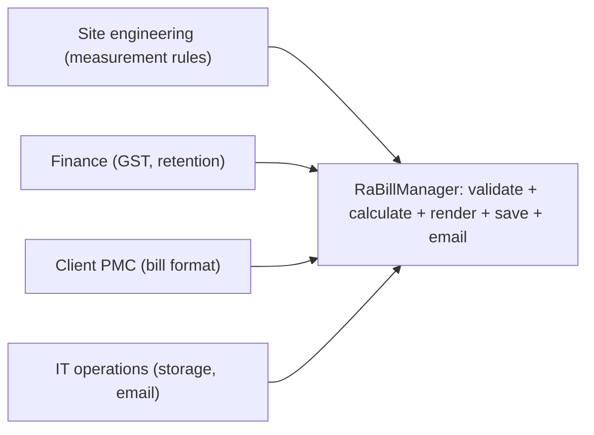
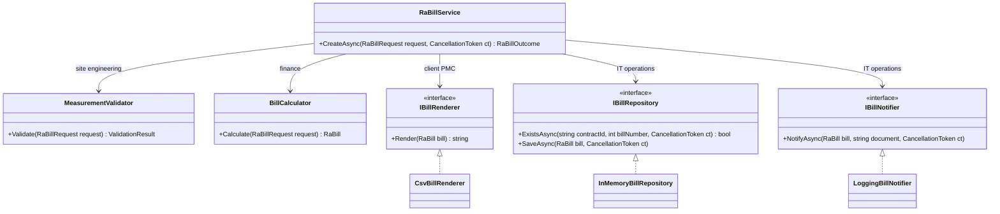
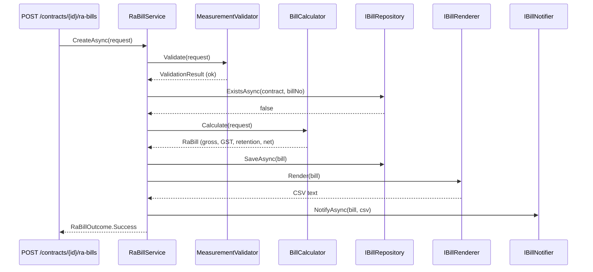
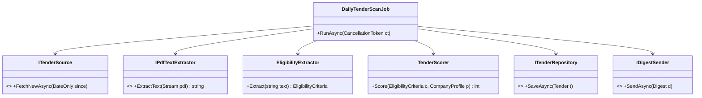

The Single Responsibility Principle (SRP) is the "S" in SOLID. It is the easiest principle to recite and the easiest to misapply. People hear "a class should do one thing" and end up with fifty one-method classes. The real idea is narrower and more useful: **keep together the code that changes for the same reason, and keep apart the code that changes for different reasons.**

## Learning objectives

By the end of this lesson you will be able to:

1. State SRP in its precise form: a module should be responsible to one, and only one, actor.
2. Find the actors (groups of people who ask for changes) behind a class, and list its reasons to change.
3. Refactor a "does everything" service into cohesive classes with an orchestrator, in ASP.NET Core.
4. Explain the hidden-coupling bug SRP prevents: two actors sharing one helper method.
5. Unit-test each extracted class on its own with hand-written fakes.
6. Recognise over-splitting ("ravioli code") and decide when one class is the better answer.

## Prerequisites

- [Classes, objects, fields, properties and methods](#/lesson/m01-classes-objects): you should be able to write a class with methods.
- [Controllers, services, repositories and domain models](#/lesson/m03-layers): SRP is the reason those layers exist.
- [Dependency injection](#/lesson/m03-dependency-injection): the refactored version wires its parts together through DI.

## Explain it like I'm a beginner

Think of a small restaurant where one person takes orders, cooks, handles the cash counter and also cleans. On a quiet Monday that works. But when the owner says "change the menu", the cook-cashier-cleaner has to change. When the accountant says "issue GST bills now", the same person changes again. When the health inspector says "new cleaning rules", again the same person. Three different bosses, one overloaded worker. Worse, while learning the new billing rules, the worker forgets to switch off the stove.

A well-run restaurant splits the work: a cook answers to the head chef, a cashier answers to the accountant, a cleaner answers to the manager. Each person changes their way of working only when *their* boss asks.

Code works the same way. A class is a worker. The people who can ask for changes to it are its bosses. The technical name for such a group of people is an **actor**. SRP says: **give each class one boss.**

Notice that this is *not* "each worker does one task". The cook does many tasks: chopping, frying, plating. That is fine because the same boss (the head chef) decides how all of them are done. One class can have ten methods and still follow SRP, as long as all ten change for the same reason.

## First-principles explanation

### What it is

Robert C. Martin first wrote SRP as "a class should have only one reason to change". Because "reason to change" was vague, he later restated it: **a module should be responsible to one, and only one, actor.** An actor is a group of stakeholders who want the system to change in the same way, for example the finance team, the site engineering team, or a client's reporting desk.

The principle is about **cohesion** (how strongly the parts of a module belong together) and **coupling** (how much one module depends on another). SRP raises cohesion inside a class and lowers accidental coupling between unrelated concerns.

### Why it exists — the problem

Software changes because people ask for changes. When code that serves two actors lives in one class, three costs appear:

1. **Accidental breakage.** A change requested by actor A edits the same file, and often the same private helper, that actor B relies on. B's feature breaks, and nobody on A's side thought to test it.
2. **Merge conflicts.** Two developers working on two unrelated requests both edit `BillingService.cs`. In a team of six, that file is touched by almost every pull request.
3. **Hard testing.** To test the GST calculation you must build a database connection, an email client and a PDF library, because they all live in the same constructor.

### How it works

There is no runtime mechanism. SRP is a way of *deciding where code goes*:

1. List the public behaviours of a class.
2. For each one, ask "who would ask me to change this?" Write down the actor.
3. Group the behaviours by actor. Each group becomes a class (or a set of classes in one folder).
4. If a workflow needs several groups, add a thin **orchestrator** (a coordinating class) that calls them in order. The orchestrator answers to the actor who owns the *workflow*, usually the product owner.

### What happens without it

You get a class that grows with every request: a "god class" ([see Anti-patterns](#/lesson/m06-anti-patterns)), often thousands of lines with a dozen constructor dependencies. The nastiest failure is the **shared helper bug**, shown later in this lesson: a change for one actor silently changes another actor's numbers.

### When it is useful

- A class has public methods that different departments or roles care about.
- The constructor needs dependencies from very different worlds (database, email, PDF, tax rules).
- The file appears in most pull requests, or in most bug reports.
- You can't test a business rule without a database or network.

### When it is unnecessary or harmful

- A small script or prototype that will live for two weeks. Splitting it costs more than it saves.
- Splitting by *verb* rather than by *actor*. `GstRateReader`, `GstMultiplier` and `GstRounder` all answer to finance and always change together. Splitting them only scatters one idea across three files.
- Splitting before you know the actors. If only one team will ever change the code, one class is fine.

### Trade-offs it introduces

| You gain | You pay |
|---|---|
| A change for one actor can't break another actor's feature | More types and files to navigate |
| Small, focused unit tests with no infrastructure | An orchestrator class that only coordinates |
| Fewer merge conflicts; clear ownership | You must name things well, or the split is confusing |
| Easier reuse of the pure parts (calculators, validators) | Over-splitting creates "ravioli code": lots of tiny pieces, hard to see the whole |

## Visual explanation

### Before: one class, four actors



Each box on the left is an actor: a group of people who can ask for a change. All four arrows land on one class. Any request from any of them means editing `RaBillManager`, and every edit risks the other three features. That one target box is the smell.

### After: one class per actor, plus an orchestrator



Read the labels on the arrows: each dependency is owned by a different actor. `RaBillService` itself only knows the *order* of steps, which belongs to the product owner. A GST change now edits `BillCalculator` only. A new client format adds a new `IBillRenderer`. Storage and email sit behind interfaces because they are infrastructure that operations may swap. Notice that the persistence and notification interfaces share an actor; that is allowed, but they are split because they are different technologies with different failure modes.

### Sequence: what happens when a bill is submitted



The orchestrator calls each part once, in a fixed order. If validation fails, it returns early and nothing is saved or emailed. Every arrow is a seam (a place where a test can plug in a fake), which is why the tests later in this lesson need no database.

## Step-by-step example

Our scenario: a construction-management platform for road projects. Every month a contractor submits a **running-account bill (RA bill)**: measured quantities of work done against items in the contract's bill of quantities (BOQ). The platform must check quantities, compute money, produce a document for the client's project management consultant (PMC), store it and email it.

### Step 1 — the naive class

```csharp
// BAD: one class, four actors. Do not copy.
public class RaBillManager
{
    private readonly string _connStr = "Host=db;Database=infra";

    public async Task<string> SubmitAsync(string contractId, int billNo, List<(string Code, decimal Qty, decimal Prev)> lines)
    {
        using var db = new NpgsqlConnection(_connStr);              // operations' concern
        await db.OpenAsync();
        decimal gross = 0;
        var csv = new StringBuilder("Code,Qty,Rate,Amount\n");     // PMC's concern
        foreach (var l in lines)
        {
            var item = await db.QuerySingleAsync<BoqRow>("select * from boq where code=@c", new { c = l.Code });
            if (l.Qty + l.Prev > item.ContractQty)                   // site engineering's concern
                throw new Exception("Quantity exceeds BOQ");
            var amt = Math.Round(l.Qty * item.Rate, 2);
            gross += amt;
            csv.AppendLine($"{l.Code},{l.Qty},{item.Rate},{amt}");
        }
        var gst = gross * 0.18m;                                     // finance's concern
        var retention = gross * 0.05m;
        var net = gross + gst - retention;
        csv.AppendLine($"Net,,,{net}");
        await db.ExecuteAsync("insert into ra_bills ...", new { contractId, billNo, net });
        new SmtpClient("smtp.internal").Send("bills@infra", "pmc@client", $"RA bill {billNo}", csv.ToString());
        return csv.ToString();
    }
}
```

It works. It is about 30 lines. Now look at the comments: four different actors own pieces of one method.

### Step 2 — list the reasons to change

| Request | Actor | Lines touched in `RaBillManager` |
|---|---|---|
| "GST on works contracts is now 12 % for this client" | Finance | `gst = gross * 0.18m` |
| "Allow 10 % over BOQ quantity if a variation order exists" | Site engineering | the `if` inside the loop |
| "PMC wants the description column and Indian number format" | Client PMC | the `csv` lines |
| "Move email to a queue; the SMTP server is being retired" | IT operations | `SmtpClient` line |

Four rows, four actors. That is four reasons to change, so SRP says four homes.

### Step 3 — extract the pure parts first

Start with code that has no I/O (input/output such as databases or network). The calculator and the validator are pure functions of their inputs, so they are the safest to extract and the easiest to test. Move the GST and retention arithmetic into `BillCalculator`, with the percentages coming from configuration. Move the quantity check into `MeasurementValidator`, and make it return a list of errors instead of throwing on the first one, because site engineers want to see every problem at once.

### Step 4 — put infrastructure behind interfaces

The database and email become `IBillRepository` and `IBillNotifier`. The CSV becomes `IBillRenderer`. These are interfaces because they have realistic alternatives (PostgreSQL vs in-memory for tests, email vs a queue, CSV vs PDF).

### Step 5 — a thin orchestrator

`RaBillService` calls the parts in order and makes the workflow decisions: stop if invalid, reject duplicates, save before notifying. It contains no arithmetic and no formatting. If you find yourself writing `* 0.18m` in the orchestrator, it is leaking a responsibility.

Finally, re-run the table from Step 2: each request should now touch exactly one class. That is the test of whether the split worked.

## Production-style C# implementation

```text
Infra.Api/
  Program.cs
  Billing/
    BillModels.cs           records shared by the parts
    BoqCatalog.cs           where BOQ items come from
    MeasurementValidator.cs site engineering's rules
    BillCalculator.cs       finance's rules (+ BillingRules options)
    CsvBillRenderer.cs      the client PMC's format
    BillRepository.cs       storage (in-memory here; PostgreSQL in real life)
    BillNotifier.cs         notification
    RaBillService.cs        the workflow
```

```csharp file=Billing/BillModels.cs
namespace Infra.Billing;

public sealed record BoqItem(string Code, string Description, string Unit, decimal ContractQuantity, decimal Rate);

/// <summary>One measured BOQ item in a bill. Quantities are in the BOQ item's unit.</summary>
public sealed record MeasurementLine(string BoqCode, decimal QuantityThisBill, decimal QuantityUpToPreviousBill);

public sealed record RaBillRequest(string ContractId, int BillNumber, IReadOnlyList<MeasurementLine> Lines);

public sealed record BillLine(string BoqCode, string Description, string Unit, decimal Quantity, decimal Rate, decimal Amount);

public sealed record BillTotals(decimal Gross, decimal Gst, decimal Retention, decimal NetPayable);

public sealed record RaBill(string ContractId, int BillNumber, IReadOnlyList<BillLine> Lines, BillTotals Totals);

public sealed record ValidationResult(IReadOnlyList<string> Errors)
{
    public bool IsValid => Errors.Count == 0;
}

public sealed record RaBillOutcome(bool Success, RaBill? Bill, IReadOnlyList<string> Errors)
{
    public static RaBillOutcome Ok(RaBill bill) => new(true, bill, Array.Empty<string>());
    public static RaBillOutcome Fail(IReadOnlyList<string> errors) => new(false, null, errors);
}
```

```csharp file=Billing/BoqCatalog.cs
namespace Infra.Billing;

public interface IBoqCatalog
{
    BoqItem? Find(string contractId, string boqCode);
}

/// <summary>Stand-in for a table of contract BOQ items. Real systems load this from PostgreSQL.</summary>
public sealed class InMemoryBoqCatalog : IBoqCatalog
{
    private readonly Dictionary<(string, string), BoqItem> _items = new();

    public InMemoryBoqCatalog Add(string contractId, BoqItem item)
    {
        _items[(contractId, item.Code)] = item;
        return this;
    }

    public BoqItem? Find(string contractId, string boqCode) =>
        _items.TryGetValue((contractId, boqCode), out var item) ? item : null;
}
```

```csharp file=Billing/MeasurementValidator.cs
namespace Infra.Billing;

/// <summary>Owned by site engineering / quantity surveying. Changes when measurement rules change.</summary>
public sealed class MeasurementValidator(IBoqCatalog catalog)
{
    public ValidationResult Validate(RaBillRequest request)
    {
        ArgumentNullException.ThrowIfNull(request);
        var errors = new List<string>();
        if (request.Lines.Count == 0) errors.Add("A bill needs at least one measured item.");

        var seen = new HashSet<string>(StringComparer.OrdinalIgnoreCase);
        foreach (var line in request.Lines)
        {
            if (!seen.Add(line.BoqCode)) { errors.Add($"{line.BoqCode}: measured twice in one bill."); continue; }
            var item = catalog.Find(request.ContractId, line.BoqCode);
            if (item is null) { errors.Add($"{line.BoqCode}: not in the contract BOQ."); continue; }
            if (line.QuantityThisBill <= 0) errors.Add($"{line.BoqCode}: quantity must be positive.");
            if (line.QuantityUpToPreviousBill < 0) errors.Add($"{line.BoqCode}: previous quantity cannot be negative.");
            var cumulative = line.QuantityThisBill + line.QuantityUpToPreviousBill;
            if (cumulative > item.ContractQuantity)
                errors.Add($"{line.BoqCode}: cumulative {cumulative} {item.Unit} exceeds BOQ {item.ContractQuantity} {item.Unit}.");
        }
        return new ValidationResult(errors);
    }
}
```

```csharp file=Billing/BillCalculator.cs
using Microsoft.Extensions.Options;

namespace Infra.Billing;

/// <summary>Owned by finance. Percentages come from configuration, never from literals in code.</summary>
public sealed class BillingRules
{
    public decimal GstPercent { get; set; } = 18m;
    public decimal RetentionPercent { get; set; } = 5m;
}

public sealed class BillCalculator(IBoqCatalog catalog, IOptions<BillingRules> rules)
{
    private readonly BillingRules _rules = rules.Value;

    /// <summary>Assumes the request has already passed validation.</summary>
    public RaBill Calculate(RaBillRequest request)
    {
        var lines = new List<BillLine>(request.Lines.Count);
        foreach (var m in request.Lines)
        {
            var item = catalog.Find(request.ContractId, m.BoqCode)
                ?? throw new InvalidOperationException($"Unknown BOQ code {m.BoqCode}; validate before calculating.");
            lines.Add(new BillLine(item.Code, item.Description, item.Unit, m.QuantityThisBill, item.Rate,
                Money(m.QuantityThisBill * item.Rate)));
        }

        var gross = lines.Sum(l => l.Amount);
        var gst = Money(gross * _rules.GstPercent / 100m);
        var retention = Money(gross * _rules.RetentionPercent / 100m);   // retention is held on the work value, not on tax
        return new RaBill(request.ContractId, request.BillNumber, lines,
            new BillTotals(gross, gst, retention, gross + gst - retention));
    }

    private static decimal Money(decimal value) => Math.Round(value, 2, MidpointRounding.AwayFromZero);
}
```

```csharp file=Billing/CsvBillRenderer.cs
using System.Globalization;
using System.Text;

namespace Infra.Billing;

public interface IBillRenderer
{
    string ContentType { get; }
    string Render(RaBill bill);
}

/// <summary>Owned by the client's PMC desk. Changes when they change the format they want.</summary>
public sealed class CsvBillRenderer : IBillRenderer
{
    private static readonly CultureInfo Inv = CultureInfo.InvariantCulture;
    public string ContentType => "text/csv";

    public string Render(RaBill bill)
    {
        var sb = new StringBuilder();
        sb.AppendLine($"Contract,{Escape(bill.ContractId)},RA bill,{bill.BillNumber}");
        sb.AppendLine("BOQ code,Description,Unit,Quantity,Rate,Amount");
        foreach (var l in bill.Lines)
            sb.AppendLine(string.Join(',', Escape(l.BoqCode), Escape(l.Description), l.Unit,
                l.Quantity.ToString(Inv), l.Rate.ToString("0.00", Inv), l.Amount.ToString("0.00", Inv)));
        var t = bill.Totals;
        sb.AppendLine($"Gross,,,,,{t.Gross.ToString("0.00", Inv)}");
        sb.AppendLine($"GST,,,,,{t.Gst.ToString("0.00", Inv)}");
        sb.AppendLine($"Retention,,,,,-{t.Retention.ToString("0.00", Inv)}");
        sb.AppendLine($"Net payable,,,,,{t.NetPayable.ToString("0.00", Inv)}");
        return sb.ToString();
    }

    private static string Escape(string s) => s.Contains(',') || s.Contains('"') ? $"\"{s.Replace("\"", "\"\"")}\"" : s;
}
```

```csharp file=Billing/BillRepository.cs
using System.Collections.Concurrent;

namespace Infra.Billing;

public interface IBillRepository
{
    Task<bool> ExistsAsync(string contractId, int billNumber, CancellationToken ct);
    Task SaveAsync(RaBill bill, CancellationToken ct);
}

/// <summary>Swap for a PostgreSQL implementation with a unique index on (contract_id, bill_number).</summary>
public sealed class InMemoryBillRepository : IBillRepository
{
    private readonly ConcurrentDictionary<(string, int), RaBill> _bills = new();

    public Task<bool> ExistsAsync(string contractId, int billNumber, CancellationToken ct) =>
        Task.FromResult(_bills.ContainsKey((contractId, billNumber)));

    public Task SaveAsync(RaBill bill, CancellationToken ct)
    {
        if (!_bills.TryAdd((bill.ContractId, bill.BillNumber), bill))
            throw new InvalidOperationException($"RA bill {bill.BillNumber} already exists for {bill.ContractId}.");
        return Task.CompletedTask;
    }
}
```

```csharp file=Billing/BillNotifier.cs
using Microsoft.Extensions.Logging;

namespace Infra.Billing;

public interface IBillNotifier
{
    Task NotifyAsync(RaBill bill, string document, CancellationToken ct);
}

/// <summary>Placeholder. In production this would enqueue an email job (see the background services lesson).</summary>
public sealed class LoggingBillNotifier(ILogger<LoggingBillNotifier> logger) : IBillNotifier
{
    public Task NotifyAsync(RaBill bill, string document, CancellationToken ct)
    {
        logger.LogInformation("RA bill {BillNumber} for {ContractId} ready: net {Net}, {Bytes} bytes",
            bill.BillNumber, bill.ContractId, bill.Totals.NetPayable, document.Length);
        return Task.CompletedTask;
    }
}
```

```csharp file=Billing/RaBillService.cs
namespace Infra.Billing;

/// <summary>Owns the workflow order only: validate, de-duplicate, calculate, save, render, notify.</summary>
public sealed class RaBillService(
    MeasurementValidator validator,
    BillCalculator calculator,
    IBillRepository repository,
    IBillRenderer renderer,
    IBillNotifier notifier)
{
    public async Task<RaBillOutcome> CreateAsync(RaBillRequest request, CancellationToken ct)
    {
        var validation = validator.Validate(request);
        if (!validation.IsValid) return RaBillOutcome.Fail(validation.Errors);

        if (await repository.ExistsAsync(request.ContractId, request.BillNumber, ct))
            return RaBillOutcome.Fail(new[] { $"RA bill {request.BillNumber} already submitted." });

        var bill = calculator.Calculate(request);
        await repository.SaveAsync(bill, ct);            // save first: a lost email can be resent, a lost bill cannot
        var document = renderer.Render(bill);
        await notifier.NotifyAsync(bill, document, ct);
        return RaBillOutcome.Ok(bill);
    }
}
```

```csharp file=Program.cs
using Infra.Billing;

var builder = WebApplication.CreateBuilder(args);

builder.Services.Configure<BillingRules>(builder.Configuration.GetSection("Billing"));
builder.Services.AddSingleton<IBoqCatalog>(new InMemoryBoqCatalog()
    .Add("NH-48-PKG3", new BoqItem("2.01", "Earthwork in embankment", "cum", 12_000m, 245m))
    .Add("NH-48-PKG3", new BoqItem("5.03", "Dense bituminous macadam", "cum", 3_500m, 9_850m)));
builder.Services.AddSingleton<MeasurementValidator>();
builder.Services.AddSingleton<BillCalculator>();
builder.Services.AddSingleton<IBillRenderer, CsvBillRenderer>();
builder.Services.AddSingleton<IBillRepository, InMemoryBillRepository>();
builder.Services.AddSingleton<IBillNotifier, LoggingBillNotifier>();
builder.Services.AddScoped<RaBillService>();

var app = builder.Build();

app.MapPost("/contracts/{contractId}/ra-bills", async (string contractId, RaBillRequest body, RaBillService service, CancellationToken ct) =>
{
    var outcome = await service.CreateAsync(body with { ContractId = contractId }, ct);
    return outcome.Success
        ? Results.Created($"/contracts/{contractId}/ra-bills/{body.BillNumber}", outcome.Bill)
        : Results.ValidationProblem(new Dictionary<string, string[]> { ["lines"] = outcome.Errors.ToArray() });
});

app.Run();
```

Design notes: validation *returns* errors because bad measurements are expected input, while the calculator *throws* on an unknown code because that means a programmer skipped validation. `BillingRules` sits next to `BillCalculator` because finance owns both, so a GST change is a configuration change. "Save before notify" is a workflow decision, so it lives in the orchestrator.

## Bad design vs good design

**Bad**: `RaBillManager` from Step 1. Count what you need to unit-test one GST rule: a running PostgreSQL, a BOQ row, an SMTP server (or the test fails on `Send`), and then you parse a CSV string to find the GST number. A test that should take 1 ms needs a container and takes seconds.

**Good**: `BillCalculator` is tested with an in-memory catalog and a fixed `BillingRules`. No network, no database.

### The shared-helper trap

Here is the classic SRP failure, adapted from Martin's payroll example. Suppose the class also produced a progress report for the client:

```csharp
public class RaBillManager
{
    public decimal NetPayable(...) => Gross(lines) * 1.18m - Gross(lines) * 0.05m;   // finance
    public decimal ProgressPercent(...) => Gross(lines) / ContractValue * 100m;        // client's progress report

    private decimal Gross(IEnumerable<Line> lines) => lines.Sum(l => l.Qty * l.Rate);
}
```

The client asks: "progress should include price-escalation amounts". A developer adds escalation inside `Gross`, because that's where the money total lives. The progress report is now right. Every contractor's net payable is now wrong too. Two actors shared one helper, so a change for one silently changed the other.

The SRP fix isn't "never share code". It is: **when two actors need something that looks the same today, ask whether it will change for the same reason tomorrow.** "Value of work for payment" and "value of work for progress" happen to be equal today. They are two different business concepts, so give them two homes, even if that means a few duplicated lines. This is duplication of *code*, not duplication of *knowledge* ([see DRY, KISS and YAGNI](#/lesson/m04-dry-kiss-yagni)).

### When simplistic SRP hurts

:::callout type=mistake title="Splitting by verb instead of by actor"
A pull request turns the 25-line `BillCalculator` into `GrossAmountCalculator`, `GstAmountCalculator`, `RetentionAmountCalculator`, `MoneyRounder` and `BillTotalsAssembler`, each with its own interface and DI registration. All five answer to finance and always change together. The reader now opens five files to understand one formula, and the DI setup has five more lines that can be forgotten. That is the opposite of cohesion. Merge them back.
:::

Signs you have over-applied SRP:

- Most classes have one public method and are used by exactly one other class.
- Every class has an interface with exactly one implementation and no test that fakes it.
- Understanding one business rule needs more than three files.
- Names end in `-er` and describe a verb: `Rounder`, `Multiplier`, `Assembler`.

A useful guideline (not a law): **split when you can name two different actors, or when a part does I/O and another doesn't.** Otherwise, keep it together.

:::callout type=tradeoff title="Is the refactor worth it for a 30-line class?"
For a one-off import script, no. For a core money flow touched by four teams, yes: the first prevented production bug pays for the extra 150 lines.
:::

## Practical playground

The playground has the calculator and the CSV renderer as separate classes. Run it, then add a second renderer (`PlainTextBillRenderer`) that prints an aligned table. Notice that you don't touch `BillCalculator` at all: the PMC desk's change doesn't reach finance's code.

:::playground type=csharp title="Separate calculation from presentation"
```csharp file=Program.cs
using System;
using System.Collections.Generic;
using System.Globalization;
using System.Linq;
using System.Text;

public sealed record BillLine(string Code, string Description, decimal Quantity, decimal Rate)
{
    public decimal Amount => Math.Round(Quantity * Rate, 2);
}
public sealed record BillTotals(decimal Gross, decimal Gst, decimal Retention, decimal Net);

// Finance's class: arithmetic only.
public sealed class BillCalculator(decimal gstPercent, decimal retentionPercent)
{
    public BillTotals Totals(IReadOnlyList<BillLine> lines)
    {
        var gross = lines.Sum(l => l.Amount);
        var gst = Math.Round(gross * gstPercent / 100m, 2);
        var retention = Math.Round(gross * retentionPercent / 100m, 2);
        return new BillTotals(gross, gst, retention, gross + gst - retention);
    }
}

// The PMC's class: formatting only.
public interface IBillRenderer { string Render(IReadOnlyList<BillLine> lines, BillTotals totals); }

public sealed class CsvBillRenderer : IBillRenderer
{
    public string Render(IReadOnlyList<BillLine> lines, BillTotals t)
    {
        var inv = CultureInfo.InvariantCulture;
        var sb = new StringBuilder("Code,Description,Qty,Rate,Amount\n");
        foreach (var l in lines) sb.AppendLine($"{l.Code},{l.Description},{l.Quantity.ToString(inv)},{l.Rate.ToString(inv)},{l.Amount.ToString(inv)}");
        sb.AppendLine($"Net payable,,,,{t.Net.ToString(inv)}");
        return sb.ToString();
    }
}

// TODO: add PlainTextBillRenderer here and use it in Main.

public static class Program
{
    public static void Main()
    {
        var lines = new List<BillLine>
        {
            new("2.01", "Earthwork in embankment", 1_250m, 245m),
            new("5.03", "Dense bituminous macadam", 180m, 9_850m),
        };
        var totals = new BillCalculator(gstPercent: 18m, retentionPercent: 5m).Totals(lines);
        IBillRenderer renderer = new CsvBillRenderer();
        Console.WriteLine(renderer.Render(lines, totals));
        Console.WriteLine($"Gross {totals.Gross}, GST {totals.Gst}, retention {totals.Retention}");
    }
}
```
:::

## Exercises

:::exercise id=m04-srp-ex1 difficulty=beginner kind=code title="Extract the GST split"
An invoice formatter currently works out CGST, SGST and IGST inside its string-building code. The tax rule is finance's responsibility, and the layout is the customer's. Implement `GstSplitter.Split` so the formatter only formats.

Indian GST rule (simplified): for a sale inside one state (intra-state), the tax is split equally into CGST and SGST. For a sale between states (inter-state), the whole tax is IGST.
::requirements
- `Split(taxableValue, ratePercent, intraState)` returns a `GstBreakdown`.
- Round the total tax to 2 decimals (away from zero) first, then split it.
- CGST + SGST must always add up exactly to the total tax, even when the total has an odd number of paise.
- Negative taxable value or rate throws `ArgumentOutOfRangeException`.
::acceptance
- ₹10,000 at 18 % intra-state gives CGST 900, SGST 900, IGST 0.
- ₹10,000 at 18 % inter-state gives IGST 1800 and zero CGST/SGST.
- ₹100.05 at 18 % intra-state gives a total of 18.01, split 9.01 + 9.00 (or 9.00 + 9.01); the sum is exact.
- The existing `InvoiceFormatter` tests pass without changing the formatter.
::hint
The formatter already calls `GstSplitter`. You only need to fill in one method.
::hint
Compute the total tax once: `Math.Round(taxable * rate / 100m, 2, MidpointRounding.AwayFromZero)`.
::hint
For the intra-state case, don't round two halves separately. Round one half, then make the other half `total - firstHalf`.
::hint
```csharp
var cgst = Math.Round(total / 2m, 2, MidpointRounding.ToZero);
var sgst = total - cgst;
```
::starter
```csharp file=Gst.cs
using System;

public sealed record GstBreakdown(decimal Cgst, decimal Sgst, decimal Igst)
{
    public decimal Total => Cgst + Sgst + Igst;
}

/// <summary>Finance's rule: how GST is computed and split.</summary>
public static class GstSplitter
{
    public static GstBreakdown Split(decimal taxableValue, decimal ratePercent, bool intraState) =>
        throw new NotImplementedException();
}

/// <summary>The customer's layout. It must not contain tax arithmetic.</summary>
public static class InvoiceFormatter
{
    public static string TaxLines(decimal taxableValue, decimal ratePercent, bool intraState)
    {
        var g = GstSplitter.Split(taxableValue, ratePercent, intraState);
        return intraState
            ? $"CGST {ratePercent / 2}%: {g.Cgst:0.00}\nSGST {ratePercent / 2}%: {g.Sgst:0.00}"
            : $"IGST {ratePercent}%: {g.Igst:0.00}";
    }
}
```
::tests
```csharp file=GstTests.cs
using System;
using Xunit;

public class GstSplitterTests
{
    [Fact]
    public void Intra_state_splits_equally()
    {
        var g = GstSplitter.Split(10_000m, 18m, intraState: true);
        Assert.Equal(900m, g.Cgst);
        Assert.Equal(900m, g.Sgst);
        Assert.Equal(0m, g.Igst);
    }

    [Fact]
    public void Inter_state_is_all_igst()
    {
        var g = GstSplitter.Split(10_000m, 18m, intraState: false);
        Assert.Equal(1800m, g.Igst);
        Assert.Equal(0m, g.Cgst + g.Sgst);
    }

    [Fact]
    public void Odd_paise_still_add_up()
    {
        var g = GstSplitter.Split(100.05m, 18m, intraState: true);
        Assert.Equal(18.01m, g.Total);
        Assert.True(Math.Abs(g.Cgst - g.Sgst) == 0.01m);
    }

    [Fact]
    public void Negative_values_rejected() =>
        Assert.Throws<ArgumentOutOfRangeException>(() => GstSplitter.Split(-1m, 18m, true));

    [Fact]
    public void Formatter_uses_the_splitter() =>
        Assert.Equal("IGST 12%: 120.00", InvoiceFormatter.TaxLines(1000m, 12m, false));
}
```
::solution
Compute one rounded total, then split it so the halves can never drift apart.

```csharp file=Gst.cs
using System;

public sealed record GstBreakdown(decimal Cgst, decimal Sgst, decimal Igst)
{
    public decimal Total => Cgst + Sgst + Igst;
}

public static class GstSplitter
{
    public static GstBreakdown Split(decimal taxableValue, decimal ratePercent, bool intraState)
    {
        ArgumentOutOfRangeException.ThrowIfNegative(taxableValue);
        ArgumentOutOfRangeException.ThrowIfNegative(ratePercent);

        var total = Math.Round(taxableValue * ratePercent / 100m, 2, MidpointRounding.AwayFromZero);
        if (!intraState) return new GstBreakdown(0m, 0m, total);

        var cgst = Math.Round(total / 2m, 2, MidpointRounding.ToZero);
        return new GstBreakdown(cgst, total - cgst, 0m);
    }
}

public static class InvoiceFormatter
{
    public static string TaxLines(decimal taxableValue, decimal ratePercent, bool intraState)
    {
        var g = GstSplitter.Split(taxableValue, ratePercent, intraState);
        return intraState
            ? $"CGST {ratePercent / 2}%: {g.Cgst:0.00}\nSGST {ratePercent / 2}%: {g.Sgst:0.00}"
            : $"IGST {ratePercent}%: {g.Igst:0.00}";
    }
}
```

Now a change to GST rounding (finance's call) edits `GstSplitter` only. A change to the invoice layout (the customer's call) edits `InvoiceFormatter` only.
::mistakes
- Rounding CGST and SGST separately: 9.005 rounds to 9.01 twice, giving 18.02 tax on an 18.01 total.
- Using `double`: binary floating point can't represent 0.01 exactly. Money is always `decimal`.
- Putting the rate lookup ("which rate applies to this HSN code?") into the splitter as well. That's a third concern with its own source of truth.
::extensions
Add a `GstRateTable` that maps HSN/SAC codes to rates, and keep it separate from the splitter. Who owns each?
:::

:::exercise id=m04-srp-ex2 difficulty=beginner kind=written title="Name the actors"
Here is a class from an HR system:

```csharp
public class EmployeeService
{
    public decimal CalculateMonthlyPay(int employeeId) { ... }      // uses attendance + salary structure
    public string BuildAttendanceReport(int employeeId) { ... }     // for the site manager
    public void Save(Employee e) { ... }                            // raw SQL
    public void SendPayslipEmail(int employeeId) { ... }            // SMTP
    public bool CanApproveLeave(int managerId, int employeeId) { ... }
}
```

List each method's actor, say how many reasons to change the class has, and propose a split. Say which methods you would keep together, and why.
::acceptance
- Each method is mapped to an actor (not to a verb).
- At least four distinct actors are identified.
- The answer keeps together things that change for the same reason.
- The answer names an orchestrator, if one is needed.
::hint
Ask "who would phone me to change this method?" for each one.
::hint
Pay is owned by payroll/finance. The attendance report is owned by operations (site managers). Who owns leave approval rules?
::hint
`Save` and `SendPayslipEmail` are infrastructure. They might belong to the same actor (IT) but are different technologies.
::hint
A possible shape: `PayCalculator`, `AttendanceReportBuilder`, `LeaveApprovalPolicy`, `IEmployeeRepository`, `IPayslipSender`, and a `MonthEndPayrollJob` that orchestrates.
::solution
| Method | Actor |
|---|---|
| `CalculateMonthlyPay` | Payroll / finance |
| `BuildAttendanceReport` | Site operations managers |
| `Save` | IT / database administration |
| `SendPayslipEmail` | IT operations (delivery channel); payroll owns the *content* |
| `CanApproveLeave` | HR policy |

Five methods, at least four actors, so at least four reasons to change. Split into `PayCalculator` (pure), `AttendanceReportBuilder` (pure), `LeaveApprovalPolicy` (pure), `IEmployeeRepository` and `IPayslipSender` (infrastructure), and a `MonthEndPayrollJob` that loads employees, calculates pay, renders payslips and sends them.

One subtle point: if both `CalculateMonthlyPay` and `BuildAttendanceReport` count "working days" with a shared helper, decide deliberately whether payroll's and operations' definitions of a working day are the same concept. If they could diverge (for example, half-days count for pay but not for the report), give each its own method.
::mistakes
- Naming actors as verbs ("the calculator", "the saver"). Actors are people or roles.
- Creating one interface per method "to follow SRP". The goal is grouping by reason to change, not one method per class.
:::

:::exercise id=m04-srp-ex3 difficulty=intermediate kind=code title="Fix the shared-helper bug"
A labour-contractor module computes pay for daily-wage workers and an hours report for the site manager. Both used one private `RegularHours` helper capped at 8 hours a day. Now the site manager wants the report to show anything over **9** hours as overtime (the site runs 9-hour shifts). Payroll's rule must stay at **8**.

Implement `PayCalculator` and `HoursReporter` so each owns its own threshold, and a change to one can't affect the other.
::requirements
- `PayCalculator.DailyPay(hoursWorked, hourlyRate)`: regular hours up to 8 are paid at the rate, overtime at 2× (statutory double rate for overtime, simplified).
- `HoursReporter.Summarise(hoursWorked)` returns `(regular, overtime)` using a 9-hour threshold.
- Each threshold is a named constant inside its own class.
- Negative hours throw `ArgumentOutOfRangeException`.
::acceptance
- 10 hours at ₹100/hour gives pay of 800 + 400 = ₹1,200.
- 10 hours in the report gives (9, 1).
- 7 hours gives pay ₹700 and report (7, 0).
::hint
Resist writing one shared `Split(hours, threshold)` helper "to avoid duplication". Ask whether payroll and site operations change for the same reason.
::hint
Each class needs a constant: `PayrollRegularHoursPerDay = 8` and `ShiftLengthHours = 9`.
::hint
`regular = Math.Min(hours, threshold)` and `overtime = Math.Max(0, hours - threshold)`.
::hint
```csharp
public static decimal DailyPay(decimal hours, decimal rate)
{
    ArgumentOutOfRangeException.ThrowIfNegative(hours);
    var regular = Math.Min(hours, PayrollRegularHoursPerDay);
    var overtime = hours - regular;
    return regular * rate + overtime * rate * OvertimeMultiplier;
}
```
::starter
```csharp file=Labour.cs
using System;

/// <summary>Owned by payroll. Changes when wage rules change.</summary>
public static class PayCalculator
{
    public const decimal PayrollRegularHoursPerDay = 8m;
    public const decimal OvertimeMultiplier = 2m;

    public static decimal DailyPay(decimal hoursWorked, decimal hourlyRate) => throw new NotImplementedException();
}

/// <summary>Owned by site operations. Changes when shift patterns change.</summary>
public static class HoursReporter
{
    public const decimal ShiftLengthHours = 9m;

    public static (decimal Regular, decimal Overtime) Summarise(decimal hoursWorked) => throw new NotImplementedException();
}
```
::tests
```csharp file=LabourTests.cs
using System;
using Xunit;

public class LabourTests
{
    [Fact] public void Pay_uses_eight_hour_rule() => Assert.Equal(1200m, PayCalculator.DailyPay(10m, 100m));
    [Fact] public void Pay_without_overtime() => Assert.Equal(700m, PayCalculator.DailyPay(7m, 100m));

    [Fact]
    public void Report_uses_nine_hour_shift()
    {
        var (regular, overtime) = HoursReporter.Summarise(10m);
        Assert.Equal(9m, regular);
        Assert.Equal(1m, overtime);
    }

    [Fact]
    public void Report_short_day()
    {
        var (regular, overtime) = HoursReporter.Summarise(7m);
        Assert.Equal(7m, regular);
        Assert.Equal(0m, overtime);
    }

    [Fact] public void Thresholds_are_independent() => Assert.NotEqual(PayCalculator.PayrollRegularHoursPerDay, HoursReporter.ShiftLengthHours);
    [Fact] public void Negative_hours_rejected() => Assert.Throws<ArgumentOutOfRangeException>(() => PayCalculator.DailyPay(-1m, 100m));
    [Fact] public void Negative_hours_rejected_in_report() => Assert.Throws<ArgumentOutOfRangeException>(() => HoursReporter.Summarise(-1m));
}
```
::solution
Each actor gets its own class with its own constant. The two methods look alike. That is fine, because they encode two different business rules.

```csharp file=Labour.cs
using System;

public static class PayCalculator
{
    public const decimal PayrollRegularHoursPerDay = 8m;
    public const decimal OvertimeMultiplier = 2m;

    public static decimal DailyPay(decimal hoursWorked, decimal hourlyRate)
    {
        ArgumentOutOfRangeException.ThrowIfNegative(hoursWorked);
        ArgumentOutOfRangeException.ThrowIfNegative(hourlyRate);
        var regular = Math.Min(hoursWorked, PayrollRegularHoursPerDay);
        var overtime = hoursWorked - regular;
        return regular * hourlyRate + overtime * hourlyRate * OvertimeMultiplier;
    }
}

public static class HoursReporter
{
    public const decimal ShiftLengthHours = 9m;

    public static (decimal Regular, decimal Overtime) Summarise(decimal hoursWorked)
    {
        ArgumentOutOfRangeException.ThrowIfNegative(hoursWorked);
        var regular = Math.Min(hoursWorked, ShiftLengthHours);
        return (regular, hoursWorked - regular);
    }
}
```
::alternatives
If the split logic were long (say, night-shift and holiday rules), you could share a small *mechanism*, such as `HoursSplit.Split(hours, threshold)`, while each class still owns its *policy* (the threshold). Sharing mechanism is fine. Sharing policy between actors is the trap.
::mistakes
- A shared `const decimal RegularHours = 8` used by both classes. The next person to change it for the report breaks payroll.
- Adding a `bool forPayroll` parameter to one method. That's two responsibilities behind a flag.
:::

:::exercise id=m04-srp-ex4 difficulty=intermediate kind=design title="Split the tender document service"
A bid team's tool has a `TenderService` class that: downloads tender PDFs from government e-procurement portals; extracts text from each PDF; finds eligibility criteria (turnover, similar-work experience) with regular expressions; scores the tender 0–100 against the company's profile; saves everything to PostgreSQL; and emails the bid team a daily digest.

Draw a class diagram for an SRP-friendly design. For each class, write the actor it answers to.
::acceptance
- At least five classes or interfaces, each labelled with one actor.
- Infrastructure (portal download, PDF parsing, storage, email) is behind interfaces.
- Scoring is a pure class that can be tested without PDFs.
- One orchestrator (for example a scheduled job) coordinates the steps.
::hint
Separate the parts that do I/O from the parts that make decisions.
::hint
Who changes the scoring weights? Who changes the portal-scraping code when the portal's HTML changes? These are different people.
::hint
Interfaces: `ITenderSource`, `IPdfTextExtractor`, `ITenderRepository`, `IDigestSender`. Pure classes: `EligibilityExtractor`, `TenderScorer`. Orchestrator: `DailyTenderScanJob`.
::solution


| Class | Actor |
|---|---|
| `ITenderSource` (one implementation per portal) | Integration team; changes when a portal changes |
| `IPdfTextExtractor` | Platform team; changes when the PDF library changes |
| `EligibilityExtractor` | Bid analysts; changes when tender wording patterns change |
| `TenderScorer` | Bid head; changes when scoring weights change |
| `ITenderRepository` | Database owners |
| `IDigestSender` | IT operations (email vs Teams vs WhatsApp) |
| `DailyTenderScanJob` | Product owner of the workflow |

The scorer takes plain records, so a test can check "₹50 crore turnover requirement vs ₹40 crore company turnover scores below 50" without a single PDF.
::mistakes
- One class per portal *and* per step (`CpppDownloader`, `CpppParser`, `CpppScorer`): splitting along two axes at once multiplies classes without adding clarity.
- Letting the scorer read from the database. Then it isn't pure, and tests need data.
:::

:::exercise id=m04-srp-ex5 difficulty=advanced kind=written title="Review an over-split pull request"
A colleague's pull request "applies SRP" to the `BillCalculator` from this lesson. It replaces one 25-line class with: `IGrossCalculator`/`GrossCalculator`, `IGstCalculator`/`GstCalculator`, `IRetentionCalculator`/`RetentionCalculator`, `IMoneyRounder`/`MoneyRounder`, `IBillTotalsAssembler`/`BillTotalsAssembler`, plus five DI registrations and five test classes. Write the review comment you would leave. Say what to keep, what to merge, and give a rule the team can apply next time.
::acceptance
- The comment identifies the actor(s) behind the new classes.
- It distinguishes splitting by actor from splitting by verb.
- It considers testing: does any test need to fake one calculator while using the real others?
- It proposes a concrete outcome and a reusable rule.
- The tone is constructive.
::hint
Ask: will GST, retention and gross ever change for different people or on different schedules?
::hint
Interfaces are justified when there is more than one implementation or a test needs a fake. Is either true here?
::hint
There may be one legitimate split: something that could genuinely vary by contract or client.
::hint
Rule shape: "Split when you can name a second actor, a second implementation, or an I/O boundary."
::solution
A model review comment:

> Thanks for tackling this — the calculator is where most billing bugs come from. I'd suggest merging most of it back, though. Gross, GST, retention and rounding all answer to finance, change together, and are only used together. Five single-implementation interfaces don't give us a test seam either: no test fakes `GstCalculator` while using the real `RetentionCalculator`. We'd pay five files and five forgettable DI lines for no isolation.
>
> One part I'd keep separate: if retention terms really differ by contract, an `IRetentionPolicy` chosen per contract is a genuine variation point (that's [Open/Closed](#/lesson/m04-ocp) more than SRP).
>
> Rule for next time: split when you can name a second actor, a second implementation that exists today, or an I/O boundary. Otherwise keep it together and use private methods for readability.

Splitting along verbs lowers cohesion without lowering coupling, because the five classes still change together.
::mistakes
- Approving because "smaller classes are always better".
- Rejecting without explaining the actor test, so the same PR shape comes back next month.
:::

## Automated testing

Because each class answers to one actor and the infrastructure sits behind interfaces, each test needs only that class and a small fake.

**The calculator** — pure, so plain inputs and outputs:

```csharp
public class BillCalculatorTests
{
    private static readonly InMemoryBoqCatalog Catalog = new InMemoryBoqCatalog()
        .Add("C1", new BoqItem("2.01", "Earthwork", "cum", 10_000m, 245m));

    private static BillCalculator Calc(decimal gst = 18m, decimal retention = 5m) =>
        new(Catalog, Options.Create(new BillingRules { GstPercent = gst, RetentionPercent = retention }));

    [Fact]
    public void Computes_gross_gst_retention_and_net()
    {
        var bill = Calc().Calculate(new RaBillRequest("C1", 3, new[] { new MeasurementLine("2.01", 1_000m, 2_000m) }));
        Assert.Equal(245_000m, bill.Totals.Gross);
        Assert.Equal(44_100m, bill.Totals.Gst);
        Assert.Equal(12_250m, bill.Totals.Retention);
        Assert.Equal(276_850m, bill.Totals.NetPayable);
    }

    [Fact]
    public void Gst_rate_comes_from_configuration() =>
        Assert.Equal(29_400m, Calc(gst: 12m).Calculate(new RaBillRequest("C1", 1, new[] { new MeasurementLine("2.01", 1_000m, 0m) })).Totals.Gst);
}
```

**The validator** — check that it reports *every* problem, not just the first:

```csharp
[Fact]
public void Reports_all_errors_at_once()
{
    var v = new MeasurementValidator(Catalog);
    var result = v.Validate(new RaBillRequest("C1", 4, new[]
    {
        new MeasurementLine("2.01", 9_000m, 2_000m),   // cumulative 11,000 > 10,000
        new MeasurementLine("9.99", 10m, 0m),          // not in BOQ
    }));
    Assert.Equal(2, result.Errors.Count);
}
```

**The orchestrator** — use fakes to check the workflow decisions, not the arithmetic:

```csharp
private sealed class RecordingNotifier : IBillNotifier
{
    public int Calls;
    public Task NotifyAsync(RaBill bill, string document, CancellationToken ct) { Calls++; return Task.CompletedTask; }
}

[Fact]
public async Task Invalid_bill_is_not_saved_or_sent()
{
    var repo = new InMemoryBillRepository();
    var notifier = new RecordingNotifier();
    var svc = new RaBillService(new MeasurementValidator(Catalog), Calc(), repo, new CsvBillRenderer(), notifier);

    var outcome = await svc.CreateAsync(new RaBillRequest("C1", 1, Array.Empty<MeasurementLine>()), CancellationToken.None);

    Assert.False(outcome.Success);
    Assert.False(await repo.ExistsAsync("C1", 1, CancellationToken.None));
    Assert.Equal(0, notifier.Calls);
}
```

Edge cases worth a test: duplicate bill numbers, a line measured twice, cumulative quantity exactly equal to the BOQ (allowed), rounding at 0.005, and CSV escaping. If a test for one class needs more than two fakes, that class probably still has more than one responsibility.

## Real-world application

- **ASP.NET Core's own layering** follows SRP. Model binding turns HTTP into objects, validation checks them, your endpoint handles business flow, and output formatters turn results into JSON. Each part changes for a different reason, and you can replace any of them.
- **Billing and ERP systems** usually separate tax engines from invoice rendering. Tax rules change with regulation (GST rate notifications, e-invoicing schemas), while layouts change with customer requests.
- **Infrastructure project platforms** separate measurement validation (quantity surveyors), payment computation (finance), progress reporting (client and PMC) and document delivery (IT). These are four groups with four calendars of change.
- **SRP at larger scales.** The same idea, applied to components and services, becomes the Common Closure Principle (things that change together belong together) and bounded contexts in DDD ([see the lesson](#/lesson/m08-bounded-contexts)).

## Interview questions

:::interview
::q beginner
What does the Single Responsibility Principle say?
::a
A class (or module) should have one reason to change. More precisely, it should be responsible to one actor: one group of people who ask for changes. It doesn't mean "one method" or "one task". A class can have many methods if they all change for the same reason. The benefit is that a change requested by one group can't accidentally break features another group relies on, and each class is easier to test.
::q beginner
How can you tell if a class violates SRP?
::a
Signs: its methods are used by different departments or roles; its constructor takes dependencies from unrelated worlds (database, email, tax rules, PDF); it changes in most pull requests; you can't test a business rule without infrastructure; and its name is vague (`Manager`, `Helper`, `Processor`). The most reliable test is to list who would ask for each method to change. More than one answer means more than one responsibility.
::q intermediate
Explain the "shared helper" problem and how SRP addresses it.
::a
Two methods serving two actors call one private helper because the logic looks identical today. One actor requests a change to the helper; the other actor's results silently change too. SRP says to separate code by actor, so each actor's method gets its own home, even if that means similar-looking code. The distinction is between duplicated *code* (acceptable when the rules may diverge) and duplicated *knowledge* (one business rule written in two places, which DRY forbids).
::q intermediate
Can a class with 15 methods follow SRP? Can a class with 1 method break it?
::a
Yes to both. A `Money` value object with 15 methods (add, subtract, allocate, format) answers to one concept and one owner, so it is cohesive. A single `ProcessOrder()` method that validates, prices, saves and emails serves four actors and breaks SRP. Method count is not the measure; reasons to change are.
::q advanced
How do you stop SRP from turning a codebase into hundreds of tiny classes?
::a
Use the actor test, not the verb test: split only when you can name a second actor, a second implementation that exists now, or an I/O boundary you want to test around. Keep interfaces for real seams (more than one implementation, or a fake needed in tests). Organise by feature folders so related classes sit together. Review cohesion: if understanding one rule needs more than three files, or classes are used by exactly one other class and always change with it, merge them. SRP is a tool to reduce the cost of change. When splitting raises that cost, it is being misapplied.
::q advanced
How does SRP relate to microservices and bounded contexts?
::a
It is the same principle at a larger scale. Robert Martin's Common Closure Principle says that classes that change for the same reason should be in the same component. DDD bounded contexts group a model by the language and rules of one part of the business. Microservice boundaries drawn along these lines change independently. Boundaries drawn along technical layers (a "validation service", a "database service") create a distributed monolith, where every feature needs coordinated deployments across services. So the actor question, "who asks for this to change?", is also the first question for service boundaries.
:::

## Summary and revision

**Key takeaways**

- SRP: a module should be responsible to one actor. "One reason to change" means one group of people who ask for changes.
- Find actors by asking "who would ask me to change this?" for each method.
- Extract pure logic (calculators, validators) first; put I/O behind interfaces; add a thin orchestrator for the workflow.
- Beware the shared helper: similar-looking code serving two actors may need two homes.
- Over-splitting by verb lowers cohesion. Split only for a second actor, a second implementation or an I/O boundary.
- The check that a split worked: each realistic change request touches one class.

**Terminology**: actor, reason to change, cohesion, coupling, orchestrator, pure function, seam, ravioli code, Common Closure Principle.

:::flashcards
Q: SRP in its precise form?
A: A module should be responsible to one, and only one, actor (group of people who ask for changes).
Q: Does SRP mean "a class should do one thing"?
A: No. A class can do many things if they all change for the same reason. It's about reasons to change, not method count.
Q: What is the shared-helper bug?
A: Two actors' methods share a helper; a change for one actor silently changes the other actor's results.
Q: What should an orchestrator contain?
A: Only the workflow: order of steps and decisions like "stop if invalid". No arithmetic, formatting or SQL.
Q: Which parts should you extract first when splitting a large class?
A: Pure logic with no I/O (calculators, validators), because it's safest to move and easiest to test.
Q: Three signs of over-applied SRP?
A: One-method classes used by one caller; interfaces with one implementation and no fakes; one rule spread over many files.
Q: When is splitting justified?
A: When you can name a second actor, a second existing implementation, or an I/O boundary.
Q: How do you check that an SRP refactor worked?
A: Replay realistic change requests; each one should touch exactly one class.
:::

## Knowledge check

:::quiz pass=70
::q single
An `OrderService` has `CalculateTax()`, `RenderInvoicePdf()` and `SaveToDatabase()`. Finance changes tax rules quarterly, customers ask for invoice layout changes, and the DBA is migrating tables. How many reasons to change does it have?
- [ ] One — it is all about orders.
- [ ] Two — business logic and infrastructure.
- [x] Three — one per actor.
- [ ] It depends on the number of lines.
> Count actors: finance, customers, and the DBA. Three groups, three reasons to change.
::q single
Two methods for two departments share a private `Total()` helper. One department asks for `Total()` to include a surcharge. What is the SRP-aware response?
- [ ] Change `Total()`; both departments will benefit.
- [ ] Add a `bool includeSurcharge` parameter.
- [x] Check whether both departments mean the same concept; if not, give each its own calculation.
- [ ] Make `Total()` virtual.
> Similar-looking code that serves two actors may diverge. A flag parameter hides two responsibilities in one method.
::q single
Which class most likely *follows* SRP?
- [ ] `UtilityHelper` with string, date, email and SQL helpers.
- [x] `Money` with Add, Subtract, Allocate, Round and ToString.
- [ ] `ReportManager` that queries data, formats a PDF and uploads it to storage.
- [ ] `UserService` with Register, ResetPassword, CalculateLoyaltyPoints and ExportToCsv.
> `Money` has many methods but one concept and one reason to change. The others mix unrelated concerns.
::q multi
Which are signs that SRP has been over-applied? (Select all that apply.)
- [x] Most classes have one method and exactly one caller.
- [x] Every class has an interface with one implementation and no test fakes it.
- [ ] Infrastructure code is behind interfaces.
- [x] Understanding one formula requires opening five files.
> Interfaces around infrastructure are a legitimate seam. The other three are classic ravioli-code symptoms.
::q single
In the refactored RA bill design, where should the rule "save the bill before sending the email" live?
- [ ] In `BillCalculator`.
- [ ] In `IBillNotifier`.
- [x] In `RaBillService`, the orchestrator.
- [ ] In the controller/endpoint.
> It's a workflow-ordering decision, which is exactly what the orchestrator owns.
::q single
A unit test for one class needs fakes for a database, an email sender, a clock and a PDF library. What does this suggest?
- [ ] The test framework is wrong.
- [x] The class probably still has several responsibilities.
- [ ] You should use a real database instead.
- [ ] Nothing; this is normal.
> Many unrelated fakes usually means many unrelated concerns in one class.
::q single
You are writing a 50-line script to migrate data once and then delete it. Should you split it into SRP-compliant classes?
- [ ] Yes, always follow SOLID.
- [x] Probably not; there are no future change requests to protect against.
- [ ] Yes, but only with interfaces for everything.
- [ ] Only if it uses a database.
> SRP reduces the cost of future change. Throwaway code has no future changes, so the cost isn't repaid.
:::

## Completion criteria

You have finished this lesson when you can:

- [ ] Score at least 70 % on the knowledge check.
- [ ] Complete exercises 1 and 3, with `dotnet test` passing on your downloaded projects.
- [ ] Complete exercise 2 or 4 and compare your answer with the solution.
- [ ] Take a class from your own codebase, list its actors, and say whether it needs splitting.
- [ ] Explain in under two minutes why "one method per class" is not what SRP means.
