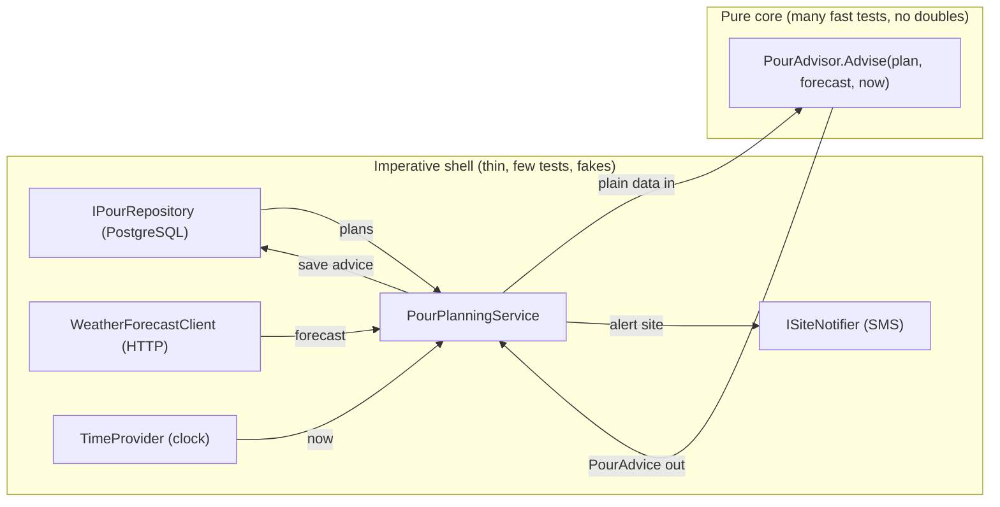
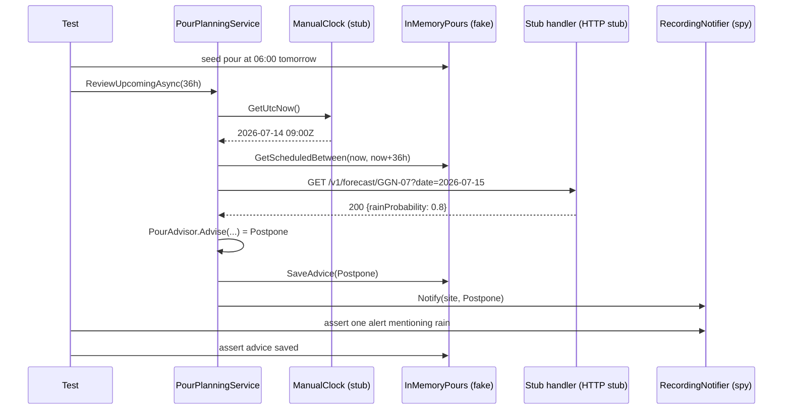

Testability isn't something you add with a mocking library after the code is written. It's a property of the design. Code that's hard to test is usually telling you something true: it mixes decisions with side effects, reads the clock or the network from deep inside, or hides what it depends on. This lesson shows how to design so that tests are short, fast and boring, using a construction-site example where weather decides whether a concrete pour goes ahead.

## Learning objectives

By the end of this lesson you will be able to:

1. Explain what makes code testable: control over inputs, observability of outputs, and isolation from slow or random things.
2. Split code into a **pure core** (decisions) and an **imperative shell** (I/O), and say why the core needs almost no test doubles.
3. Replace `DateTime.Now` with an injected `TimeProvider`, including timers and delays, and write a manual clock for tests.
4. Test code that calls HTTP APIs by faking the `HttpMessageHandler` behind a typed client or `IHttpClientFactory`.
5. Name the five kinds of test double (dummy, stub, spy, mock, fake) and choose the right one.
6. Recognise testability smells: hidden time, static I/O, `new` inside logic, and tests that need ten fakes.

## Prerequisites

- [Unit testing and debugging fundamentals](#/lesson/m01-testing-debugging): arrange-act-assert, xUnit facts and theories.
- [Dependency injection](#/lesson/m03-dependency-injection) and [Dependency Inversion Principle](#/lesson/m04-dip): seams are usually interfaces passed in through constructors.
- [Dependency injection versus service locator](#/lesson/m04-di-vs-service-locator): visible dependencies are the first step to testable code.

## Explain it like I'm a beginner

Think about how a car mechanic tests brakes. They don't drive the car down a mountain road in the rain to see if it stops. They put it on a **test rig**: rollers under the wheels, a machine that pretends to be the road, and a gauge that measures braking force. The brakes don't know they're on a rig.

That only works because the car was **designed** so the wheels can sit on rollers and the force can be measured. If the brakes could only be tested on a real mountain, nobody would test them often.

Code is the same:

- The **rig** is your test.
- **Pretend road** = a fake clock, a fake weather service, a fake database. These are **test doubles** (stand-ins, like a stunt double in a film).
- **Gauge** = something you can check afterwards: a return value, or a record of what was sent.
- **Designing for the rig** = writing the code so that time, network and storage can be swapped for stand-ins, and so the important decisions can be checked without any of them.

The biggest trick is the simplest: **keep the thinking separate from the doing.** If a function only *decides* ("given this forecast and this time, should we pour concrete?") and something else *does* (calls the weather API, saves to the database, sends the SMS), then the deciding part can be tested with plain values, and there's very little left to fake.

## First-principles explanation

### What testability actually means

Code is testable when a test can easily:

1. **Control** every input that affects the result, including the hidden ones: the current time, random numbers, configuration, network responses.
2. **Observe** every effect: return values, state changes, messages sent.
3. **Isolate** the code from things that are slow (a 300 ms API call), flaky (a network), shared (a database other tests use) or irreversible (an SMS to a real phone).

When any of the three is hard, tests become slow, flaky or missing. Note what's *not* on the list: "every class has an interface" or "100 % coverage". Those are means, sometimes useful, often overdone.

### Hidden inputs are the main enemy

Look at this line:

```csharp
if (DateTime.Now.Hour >= 18) return Decision.TooLate;
```

The method's result depends on an input (the time) that isn't in its signature. To test the "after 6 p.m." branch, you'd have to run the test after 6 p.m. Other common hidden inputs: `Guid.NewGuid()`, `Random.Shared`, `Environment.GetEnvironmentVariable`, static configuration, `File.Exists`, `HttpClient` created with `new` inside a method. Every one of them makes a test depend on the machine it runs on.

The fix is always the same idea: **turn the hidden input into an explicit one**, either as a method parameter (best for pure logic) or as an injected dependency (best for the shell).

### Pure core, imperative shell

A **pure function** returns the same output for the same inputs and has no side effects: no I/O, no clock, no mutation of shared state. Pure functions are the easiest code in the world to test. No doubles, no setup, no cleanup. Just "given these values, expect that value". You can run thousands of cases per second.

The architecture idea, often called **functional core, imperative shell**, is:

- Put **decisions** (business rules, calculations, state transitions) in a pure core that takes plain data in and returns plain data out, including "what should happen next" as data (a list of commands, a decision record).
- Put **effects** (read the database, call the API, read the clock, send the SMS) in a thin shell that gathers inputs, calls the core, and carries out the result.

The core gets many fast unit tests. The shell is so thin that a handful of tests with fakes, plus a few integration tests, cover it. This works in C# without any functional-programming framework: a `static` class with methods that take records and return records is a pure core.

Rough proportions from experience (an estimate, not a law): in a typical business feature, 60–80 % of the branching logic can live in the core. The shell mostly has one path plus error handling.

### Time: `TimeProvider`

.NET 8 added `System.TimeProvider`, an abstract class that represents "the clock". `TimeProvider.System` is the real one. It provides:

- `GetUtcNow()` and `GetLocalNow()` for the current time, and `LocalTimeZone`.
- `GetTimestamp()` and `GetElapsedTime(...)` for measuring durations.
- `CreateTimer(...)`, which returns an `ITimer`.

Several BCL APIs accept a `TimeProvider`, including `Task.Delay(TimeSpan, TimeProvider, CancellationToken)`, `CancellationTokenSource(TimeSpan, TimeProvider)` and `PeriodicTimer(TimeSpan, TimeProvider)`. So timeouts and schedules can be faked too, not just "now".

In tests, you can subclass `TimeProvider` yourself (override `GetUtcNow()`; that's enough for most code), or use `FakeTimeProvider` from the `Microsoft.Extensions.TimeProvider.Testing` package, which also fires timers when you call `Advance(...)`.

Use `TimeProvider` rather than inventing an `IClock` interface in new code. It's in the BCL, other libraries understand it, and it covers timers.

### HTTP: fake the handler, not `HttpClient`

`HttpClient` isn't an interface, and you shouldn't wrap it in one just for tests. Its design has a built-in seam: every request flows through an `HttpMessageHandler`. A test creates an `HttpClient` with a **stub handler** that returns canned `HttpResponseMessage`s and records the requests it saw:

```csharp
var handler = new StubHandler(req => new HttpResponseMessage(HttpStatusCode.OK) { Content = JsonContent.Create(new { rainProbability = 0.7 }) });
var client = new WeatherForecastClient(new HttpClient(handler) { BaseAddress = new Uri("https://weather.test/") });
```

In production, `IHttpClientFactory` (via `AddHttpClient<TClient, TImpl>()`) manages handler lifetimes, DNS refresh and resilience handlers. The **typed client** (`WeatherForecastClient(HttpClient http)`) receives a configured `HttpClient` in its constructor, which is exactly what makes the test above possible. If your code uses **named clients** (`factory.CreateClient("weather")`), a fake `IHttpClientFactory` that returns a stub-backed `HttpClient` works just as well.

What to test at this layer: the URL and query you send, how you map JSON to your model, and how you handle 404, 500, timeouts and malformed bodies. What *not* to test: that `HttpClient` works.

### The test double taxonomy

Gerard Meszaros named five kinds of stand-in. The words matter because they describe *what the test checks*.

| Double | What it does | Example in this lesson | Typical assertion |
|---|---|---|---|
| **Dummy** | Fills a parameter that the test path never uses | `NullLogger<T>.Instance` | none |
| **Stub** | Returns canned answers to calls | A forecast client that always returns 70 % rain | on the SUT's output |
| **Spy** | A stub that also records how it was called | An SMS sender that stores every message in a list | on the recorded calls, after the act |
| **Mock** | Pre-programmed with *expectations*; fails if calls don't match | A mocking-library object set up with `Verify(...)` | inside the double |
| **Fake** | A working, simplified implementation | An in-memory repository with a dictionary | on state, via the fake |

Rules of thumb:

- **Prefer stubs and fakes.** Tests that check *outputs and state* survive refactoring. Tests that check *which methods were called in what order* (mocks) break whenever the implementation changes, even when behaviour doesn't.
- **Use spies at the edges** where the call *is* the behaviour: "an SMS was sent with this text" is an outcome worth asserting.
- **Hand-rolled doubles are fine.** A 6-line private class in the test file is often clearer than mocking-library setup, and it fails at compile time when the interface changes.

### Seams, again

A seam is a place where you can swap behaviour without editing that code (see [Refactoring legacy code](#/lesson/m04-refactoring-legacy)). In new code, design seams in deliberately, at **boundaries you don't control**: time, network, storage, randomness, messaging. Don't add an interface between two of your own pure classes just to mock one of them. That makes tests know about internals and adds indirection for no benefit.

### When testability work isn't worth it

- **Trivial glue** (an endpoint that calls one method and maps the result) is better covered by one integration test than by unit tests with four fakes.
- **Exploratory spikes** that will be thrown away don't need seams.
- **Over-abstraction for tests**, such as `IFileSystem`, `IDateTimeWrapper`, `IGuidGenerator` and `IMath` in a 200-line app, costs more than it saves. Start with time and HTTP; add others when a real test needs them.

## Visual explanation

### Pure core, imperative shell



How to read it: everything with I/O sits in the shell on the left. The service gathers the inputs (plans from the database, a forecast over HTTP, the current time from the clock), hands them as plain values to the core, and acts on the answer. `PourAdvisor` never touches the network, the clock or the database, so a test can call it with any combination of rain, temperature and lead time in microseconds. The arrows show that data flows *into* and *out of* the core, never sideways from it.

### A shell test with doubles



The test controls every input: the clock returns a fixed instant, the fake repository holds one pour, and the stub handler returns 80 % rain. It then observes outcomes: the spy notifier recorded one alert and the fake repository holds the saved advice. Nothing touched a real network, database or phone, and the test would give the same result on any machine at any time.

## Step-by-step example

### Step 1 — the untestable version

```csharp
public class PourChecker
{
    public async Task CheckAsync()
    {
        using var db = new NpgsqlConnection(Config.ConnectionString);
        var pours = await db.QueryAsync<Pour>("select * from pours where starts_at < now() + interval '36 hours'");
        foreach (var p in pours)
        {
            var http = new HttpClient();
            var json = await http.GetStringAsync($"https://api.weather.example/v1/forecast/{p.SiteCode}");
            var rain = JsonDocument.Parse(json).RootElement.GetProperty("rainProbability").GetDouble();
            if (rain >= 0.6 && (p.StartsAt - DateTime.Now).TotalHours >= 12)
            {
                await db.ExecuteAsync("update pours set status='postponed' where id=@id", new { p.Id });
                SmsGateway.Send(p.EngineerPhone, $"Pour {p.Id} postponed: rain {rain:P0}");
            }
        }
    }
}
```

To test "postpone when rain is 60 % or more" you need a real PostgreSQL with data, a weather API that returns the value you want, a clock at the right time, and a phone. Also: `new HttpClient()` per iteration can exhaust sockets under load, and the rule mixes with all the I/O.

### Step 2 — pull the decision out as a pure function

Ask: what does the decision depend on? The plan's start time, the forecast, and "now". Make those parameters, and return a decision instead of doing anything:

```csharp
public static PourAdvice Advise(PourPlan plan, SiteForecast forecast, DateTimeOffset now)
```

This function has no I/O and no clock. Rain, heat, cold, and "too late to change" rules all live here.

### Step 3 — give each effect a seam

- Database → `IPourRepository`.
- Weather → a typed `WeatherForecastClient(HttpClient)` behind `IWeatherForecastClient`, registered with `AddHttpClient`.
- SMS → `ISiteNotifier`.
- Clock → `TimeProvider`.

### Step 4 — a thin shell

`PourPlanningService` reads "now" once, loads plans, fetches forecasts, calls `Advise`, saves and notifies. It has one main path and a little error handling.

### Step 5 — write tests at the right level

- Twenty or more fast tests for `PourAdvisor` (every rule, every boundary: 59 % and 60 % rain, 11 h 59 min and 12 h lead time).
- Four or five shell tests with doubles: postpone path, proceed path, forecast service down, notifier failure.
- A couple of HTTP client tests with a stub handler: correct URL, JSON mapping, 404 and 503 handling.
- One integration test with the real host (`WebApplicationFactory`) to check the wiring.

## Production-style C# implementation

```text
Site.Api/
  Program.cs
  Pours/
    PourModels.cs
    PourAdvisor.cs            pure core
    WeatherForecastClient.cs  typed HttpClient
    PourPlanningService.cs    imperative shell
    PourPlanningWorker.cs     schedule driven by TimeProvider
    InMemoryAdapters.cs
```

```csharp file=Pours/PourModels.cs
namespace Site.Pours;

public sealed record PourPlan(Guid Id, string SiteCode, string EngineerPhone, DateTimeOffset StartsAt, decimal VolumeCubicMetres);

public sealed record SiteForecast(double RainProbability, double MaxTempC, double MinTempC);

public enum PourDecision { Proceed, Postpone, TooLateToChange }

public sealed record PourAdvice(Guid PlanId, PourDecision Decision, IReadOnlyList<string> Reasons);
```

```csharp file=Pours/PourAdvisor.cs
using System.Globalization;

namespace Site.Pours;

/// <summary>Pure core: no clock, no I/O, no state. Same inputs, same answer.
/// The thresholds are example values for this lesson, not an engineering standard.</summary>
public static class PourAdvisor
{
    public const double RainThreshold = 0.60;
    public const double MaxSafeTempC = 40.0;
    public const double MinSafeTempC = 5.0;
    public static readonly TimeSpan DecisionCutoff = TimeSpan.FromHours(12);

    public static PourAdvice Advise(PourPlan plan, SiteForecast forecast, DateTimeOffset now)
    {
        ArgumentNullException.ThrowIfNull(plan);
        ArgumentNullException.ThrowIfNull(forecast);

        var reasons = new List<string>();
        if (forecast.RainProbability >= RainThreshold)
            reasons.Add(string.Create(CultureInfo.InvariantCulture, $"Rain probability {forecast.RainProbability:0%} (limit {RainThreshold:0%})"));
        if (forecast.MaxTempC > MaxSafeTempC)
            reasons.Add(string.Create(CultureInfo.InvariantCulture, $"Max temperature {forecast.MaxTempC:0.#} °C above {MaxSafeTempC} °C"));
        if (forecast.MinTempC < MinSafeTempC)
            reasons.Add(string.Create(CultureInfo.InvariantCulture, $"Min temperature {forecast.MinTempC:0.#} °C below {MinSafeTempC} °C"));

        if (reasons.Count == 0) return new PourAdvice(plan.Id, PourDecision.Proceed, reasons);

        // Ready-mix trucks are booked; inside the cut-off we flag the risk but can't cancel.
        var decision = plan.StartsAt - now < DecisionCutoff ? PourDecision.TooLateToChange : PourDecision.Postpone;
        return new PourAdvice(plan.Id, decision, reasons);
    }
}
```

```csharp file=Pours/WeatherForecastClient.cs
using System.Globalization;
using System.Net;
using System.Net.Http.Json;

namespace Site.Pours;

public interface IWeatherForecastClient
{
    Task<SiteForecast> GetForecastAsync(string siteCode, DateOnly date, CancellationToken ct);
}

public sealed class ForecastUnavailableException(string message, HttpStatusCode? status = null, Exception? inner = null)
    : Exception(message, inner)
{
    public HttpStatusCode? Status { get; } = status;
}

/// <summary>Typed client: IHttpClientFactory hands it a configured HttpClient,
/// and tests hand it one backed by a stub handler.</summary>
public sealed class WeatherForecastClient(HttpClient http) : IWeatherForecastClient
{
    private sealed record ForecastDto(double RainProbability, double MaxTempC, double MinTempC);

    public async Task<SiteForecast> GetForecastAsync(string siteCode, DateOnly date, CancellationToken ct)
    {
        ArgumentException.ThrowIfNullOrWhiteSpace(siteCode);
        var url = $"v1/forecast/{Uri.EscapeDataString(siteCode)}?date={date.ToString("yyyy-MM-dd", CultureInfo.InvariantCulture)}";

        HttpResponseMessage response;
        try
        {
            response = await http.GetAsync(url, ct);
        }
        catch (HttpRequestException ex)
        {
            throw new ForecastUnavailableException($"Weather service unreachable for {siteCode}", inner: ex);
        }
        catch (TaskCanceledException ex) when (!ct.IsCancellationRequested)
        {
            throw new ForecastUnavailableException($"Weather service timed out for {siteCode}", inner: ex);
        }

        using (response)
        {
            if (!response.IsSuccessStatusCode)
                throw new ForecastUnavailableException($"Weather service returned {(int)response.StatusCode} for {siteCode}", response.StatusCode);

            var dto = await response.Content.ReadFromJsonAsync<ForecastDto>(ct)
                      ?? throw new ForecastUnavailableException($"Empty forecast for {siteCode}");
            if (dto.RainProbability is < 0 or > 1)
                throw new ForecastUnavailableException($"Rain probability {dto.RainProbability} out of range for {siteCode}");
            return new SiteForecast(dto.RainProbability, dto.MaxTempC, dto.MinTempC);
        }
    }
}
```

```csharp file=Pours/PourPlanningService.cs
using Microsoft.Extensions.Logging;

namespace Site.Pours;

public interface IPourRepository
{
    Task<IReadOnlyList<PourPlan>> GetScheduledBetweenAsync(DateTimeOffset from, DateTimeOffset to, CancellationToken ct);
    Task SaveAdviceAsync(PourAdvice advice, CancellationToken ct);
}

public interface ISiteNotifier
{
    Task NotifyAsync(PourPlan plan, PourAdvice advice, CancellationToken ct);
}

/// <summary>Imperative shell: gather inputs, call the pure core, carry out the result.</summary>
public sealed class PourPlanningService(
    IPourRepository pours, IWeatherForecastClient weather, ISiteNotifier notifier,
    TimeProvider clock, ILogger<PourPlanningService> logger)
{
    public async Task<IReadOnlyList<PourAdvice>> ReviewUpcomingAsync(TimeSpan horizon, CancellationToken ct)
    {
        var now = clock.GetUtcNow();                       // read the clock once
        var plans = await pours.GetScheduledBetweenAsync(now, now + horizon, ct);
        var results = new List<PourAdvice>(plans.Count);

        foreach (var plan in plans)
        {
            SiteForecast forecast;
            try
            {
                forecast = await weather.GetForecastAsync(plan.SiteCode, DateOnly.FromDateTime(plan.StartsAt.UtcDateTime), ct);
            }
            catch (ForecastUnavailableException ex)
            {
                // No data, no decision: leave the plan as it is and let the next run try again.
                logger.LogWarning(ex, "No forecast for pour {PlanId} at {Site}", plan.Id, plan.SiteCode);
                continue;
            }

            var advice = PourAdvisor.Advise(plan, forecast, now);
            results.Add(advice);
            if (advice.Decision == PourDecision.Proceed) continue;

            await pours.SaveAdviceAsync(advice, ct);
            try
            {
                await notifier.NotifyAsync(plan, advice, ct);
            }
            catch (Exception ex) when (ex is not OperationCanceledException)
            {
                logger.LogError(ex, "Advice saved but site alert failed for pour {PlanId}", plan.Id);
            }
        }
        return results;
    }
}
```

```csharp file=Pours/PourPlanningWorker.cs
using Microsoft.Extensions.Logging;

namespace Site.Pours;

/// <summary>Runs the review every 6 hours. The delay uses TimeProvider too,
/// so a test with a fake time provider can advance through runs instantly.</summary>
public sealed class PourPlanningWorker(IServiceScopeFactory scopes, TimeProvider clock, ILogger<PourPlanningWorker> logger) : BackgroundService
{
    public static readonly TimeSpan Interval = TimeSpan.FromHours(6);
    public static readonly TimeSpan Horizon = TimeSpan.FromHours(36);

    protected override async Task ExecuteAsync(CancellationToken stoppingToken)
    {
        while (!stoppingToken.IsCancellationRequested)
        {
            try
            {
                await using var scope = scopes.CreateAsyncScope();
                var service = scope.ServiceProvider.GetRequiredService<PourPlanningService>();
                var advice = await service.ReviewUpcomingAsync(Horizon, stoppingToken);
                logger.LogInformation("Reviewed {Count} pours", advice.Count);
            }
            catch (Exception ex) when (ex is not OperationCanceledException)
            {
                logger.LogError(ex, "Pour review run failed");
            }
            await Task.Delay(Interval, clock, stoppingToken);
        }
    }
}
```

```csharp file=Pours/InMemoryAdapters.cs
using System.Collections.Concurrent;
using Microsoft.Extensions.Logging;

namespace Site.Pours;

public sealed class InMemoryPourRepository : IPourRepository
{
    private readonly ConcurrentDictionary<Guid, PourPlan> _plans = new();
    public ConcurrentDictionary<Guid, PourAdvice> Advice { get; } = new();

    public void Add(PourPlan plan) => _plans[plan.Id] = plan;

    public Task<IReadOnlyList<PourPlan>> GetScheduledBetweenAsync(DateTimeOffset from, DateTimeOffset to, CancellationToken ct) =>
        Task.FromResult<IReadOnlyList<PourPlan>>(_plans.Values.Where(p => p.StartsAt >= from && p.StartsAt <= to)
                                                              .OrderBy(p => p.StartsAt).ToList());

    public Task SaveAdviceAsync(PourAdvice advice, CancellationToken ct)
    {
        Advice[advice.PlanId] = advice;
        return Task.CompletedTask;
    }
}

public sealed class LoggingSiteNotifier(ILogger<LoggingSiteNotifier> logger) : ISiteNotifier
{
    public Task NotifyAsync(PourPlan plan, PourAdvice advice, CancellationToken ct)
    {
        logger.LogInformation("SMS to {Phone}: pour {PlanId} at {Site} -> {Decision}: {Reasons}",
            plan.EngineerPhone, plan.Id, plan.SiteCode, advice.Decision, string.Join("; ", advice.Reasons));
        return Task.CompletedTask;
    }
}
```

```csharp file=Program.cs
using Site.Pours;

var builder = WebApplication.CreateBuilder(args);

builder.Services.AddSingleton(TimeProvider.System);

// Typed client: IHttpClientFactory manages handler lifetimes and DNS refresh.
builder.Services.AddHttpClient<IWeatherForecastClient, WeatherForecastClient>(client =>
{
    client.BaseAddress = new Uri(builder.Configuration["Weather:BaseUrl"] ?? "https://weather.example/");
    client.Timeout = TimeSpan.FromSeconds(10);
});

builder.Services.AddSingleton<InMemoryPourRepository>();
builder.Services.AddSingleton<IPourRepository>(sp => sp.GetRequiredService<InMemoryPourRepository>());
builder.Services.AddSingleton<ISiteNotifier, LoggingSiteNotifier>();
builder.Services.AddScoped<PourPlanningService>();
builder.Services.AddHostedService<PourPlanningWorker>();

var app = builder.Build();

app.MapPost("/pours", (PourPlan plan, InMemoryPourRepository repo) =>
{
    repo.Add(plan);
    return Results.Created($"/pours/{plan.Id}", plan);
});

app.MapPost("/pours/review", async (PourPlanningService service, CancellationToken ct) =>
    Results.Ok(await service.ReviewUpcomingAsync(PourPlanningWorker.Horizon, ct)));

// The pure core is so cheap to call that it can back a "what if" endpoint directly.
app.MapPost("/pours/what-if", (PourPlan plan, SiteForecast forecast, TimeProvider clock) =>
    Results.Ok(PourAdvisor.Advise(plan, forecast, clock.GetUtcNow())));

app.Run();
```

Design notes:

- **`PourAdvisor` is static and pure.** There's no `IPourAdvisor` interface, because nobody needs to substitute it: tests call it directly, and the shell's tests use it as-is. Interfaces are for boundaries, not for every class.
- **The clock is read once per run** in the shell and passed to the core. Every plan in a run is judged against the same "now", which avoids subtle bugs near the cut-off.
- **The HTTP client converts transport errors to a domain exception** (`ForecastUnavailableException`). The shell catches one exception type, and its tests can trigger it with a stub that throws it.
- **`Task.Delay(Interval, clock, ct)`** means the worker's schedule is testable too.

## Bad design vs good design

**Bad: interfaces everywhere, mocks verifying internals.**

```csharp
var advisor = new Mock<IPourAdvisor>();
var rules = new Mock<IRainRule>();
advisor.Setup(a => a.Advise(It.IsAny<PourPlan>(), It.IsAny<SiteForecast>(), It.IsAny<DateTimeOffset>())).Returns(postpone);
// ... act ...
rules.Verify(r => r.Evaluate(It.IsAny<SiteForecast>()), Times.Once);
```

This test knows how `PourPlanningService` is wired internally. Merge two rule classes into one, with identical behaviour, and the test fails. It also tests the mock's setup more than the real rules: nothing here checks that 60 % rain postpones a pour.

**Bad: hidden time in "pure-looking" code.**

```csharp
public static bool IsLate(PourPlan p) => p.StartsAt - DateTimeOffset.UtcNow < TimeSpan.FromHours(12);
```

It's static and has no I/O, so it *looks* pure, but its answer changes every second.

**Bad: `new HttpClient()` inside the method.** Not substitutable in tests, and creating many short-lived clients can exhaust sockets under load. That's one reason `IHttpClientFactory` exists.

**Good:**

- Decisions in a pure core called directly from tests.
- Seams only at real boundaries: `TimeProvider`, typed `HttpClient`, repository, notifier.
- Shell tests use stubs, fakes and spies, and assert on **outcomes** (advice saved, alert sent), not on call sequences.

:::callout type=tip title="A test that needs ten doubles is a design review"
If arranging a test needs more than three or four doubles, the class under test probably has too many responsibilities, or decisions are buried inside the shell. Pull the logic into a pure function and the test shrinks to "values in, value out".
:::

:::callout type=mistake title="Faking what you don't own, too precisely"
A stub for an external API encodes *your belief* about how that API behaves. Keep a small number of contract or integration tests against the real API (or its sandbox) so those beliefs get checked. Stubs make tests fast; they don't make them true.
:::

## Practical playground

This playground has a pure function and a manual clock. Run it, then change the clock and the forecasts to explore the boundaries.

:::playground type=csharp title="Pure core with a manual clock"
```csharp file=Program.cs
using System;
using System.Collections.Generic;

public sealed record SiteForecast(double RainProbability, double MaxTempC, double MinTempC);
public enum PourDecision { Proceed, Postpone, TooLateToChange }

public static class PourAdvisor
{
    public static PourDecision Advise(DateTimeOffset startsAt, SiteForecast f, DateTimeOffset now)
    {
        var risky = f.RainProbability >= 0.60 || f.MaxTempC > 40 || f.MinTempC < 5;
        if (!risky) return PourDecision.Proceed;
        return startsAt - now < TimeSpan.FromHours(12) ? PourDecision.TooLateToChange : PourDecision.Postpone;
    }
}

public sealed class ManualClock(DateTimeOffset start) : TimeProvider
{
    private DateTimeOffset _now = start;
    public override DateTimeOffset GetUtcNow() => _now;
    public void Advance(TimeSpan by) => _now += by;
}

public static class Program
{
    public static void Main()
    {
        var clock = new ManualClock(new DateTimeOffset(2026, 7, 14, 9, 0, 0, TimeSpan.Zero));
        var pourAt = new DateTimeOffset(2026, 7, 15, 6, 0, 0, TimeSpan.Zero);   // 21 h ahead

        var forecasts = new List<SiteForecast>
        {
            new SiteForecast(0.20, 34, 26),
            new SiteForecast(0.59, 34, 26),
            new SiteForecast(0.60, 34, 26),
            new SiteForecast(0.10, 42, 30),
        };

        foreach (var f in forecasts)
            Console.WriteLine($"rain {f.RainProbability:0%}, max {f.MaxTempC} C -> {PourAdvisor.Advise(pourAt, f, clock.GetUtcNow())}");

        clock.Advance(TimeSpan.FromHours(10));   // now 19:00, only 11 h before the pour
        Console.WriteLine($"After 10 h: rain 80% -> {PourAdvisor.Advise(pourAt, new SiteForecast(0.8, 30, 24), clock.GetUtcNow())}");
    }
}
```
:::

Try these:

1. Advance the clock by exactly 9 hours instead of 10, so the lead time is exactly 12 hours. Which decision do you get, and is `<` or `<=` the right comparison for your business?
2. Add a rule: pours over 200 m³ need 24 hours' notice. Change the signature to take the volume. Notice you didn't need any fake to test it.
3. Replace `clock.GetUtcNow()` with `DateTimeOffset.UtcNow` and run the program twice a minute apart. The output may not change, but you've lost the ability to *choose* the moment.

## Exercises

:::exercise id=m04-testability-ex1 difficulty=beginner kind=code title="An OTP check that tests can control"
Implement `OtpValidator`, which checks a one-time password entered by a user. It must take its time from an injected `TimeProvider` so tests can check the expiry boundary exactly.
::requirements
- Valid when the entered code equals the expected code **and** no more than 5 minutes have passed since `issuedAt` (exactly 5:00 is still valid; 5:01 is not).
- An `issuedAt` more than 30 seconds in the future is invalid (clock skew guard).
- Null, empty or different-length entered codes are invalid. Don't throw.
- Leading or trailing spaces in the entered code are ignored.
::acceptance
- Correct code after 4 min 59 s → valid. After exactly 5 min → valid. After 5 min 1 s → invalid.
- Wrong code at 1 minute → invalid.
- `issuedAt` 2 minutes in the future → invalid; 10 seconds in the future → valid.
- `" 482913 "` matches `"482913"`.
::hint
List the inputs that affect the answer. One of them isn't a parameter yet.
::hint
Store the `TimeProvider` in a field; compute `age = clock.GetUtcNow() - issuedAt`.
::hint
Check, in order: entered code null/blank → false; `age < -30 s` → false; `age > 5 min` → false; then compare codes.
::hint
For the comparison, `CryptographicOperations.FixedTimeEquals` over the UTF-8 bytes avoids leaking timing information. A plain `==` is enough to pass the tests.
::hint
```csharp
var age = _clock.GetUtcNow() - issuedAt;
if (age < -MaxSkew || age > Lifetime) return false;
```
::starter
```csharp file=OtpValidator.cs
using System;
using System.Security.Cryptography;
using System.Text;

public sealed class OtpValidator
{
    public static readonly TimeSpan Lifetime = TimeSpan.FromMinutes(5);
    public static readonly TimeSpan MaxSkew = TimeSpan.FromSeconds(30);

    public OtpValidator(TimeProvider clock)
    {
        throw new NotImplementedException();
    }

    public bool IsValid(string expectedCode, string? enteredCode, DateTimeOffset issuedAt)
    {
        throw new NotImplementedException();
    }
}
```
::tests
```csharp file=OtpValidatorTests.cs
using System;
using Xunit;

public class OtpValidatorTests
{
    private sealed class ManualClock(DateTimeOffset start) : TimeProvider
    {
        private DateTimeOffset _now = start;
        public override DateTimeOffset GetUtcNow() => _now;
        public void Advance(TimeSpan by) => _now += by;
    }

    private static readonly DateTimeOffset Issued = new(2026, 10, 18, 9, 0, 0, TimeSpan.Zero);

    private static (OtpValidator Sut, ManualClock Clock) Make()
    {
        var clock = new ManualClock(Issued);
        return (new OtpValidator(clock), clock);
    }

    [Theory]
    [InlineData(299, true)]
    [InlineData(300, true)]
    [InlineData(301, false)]
    public void Expiry_boundary(int secondsLater, bool expected)
    {
        var (sut, clock) = Make();
        clock.Advance(TimeSpan.FromSeconds(secondsLater));
        Assert.Equal(expected, sut.IsValid("482913", "482913", Issued));
    }

    [Fact]
    public void Wrong_code_is_invalid()
    {
        var (sut, clock) = Make();
        clock.Advance(TimeSpan.FromMinutes(1));
        Assert.False(sut.IsValid("482913", "482914", Issued));
    }

    [Fact]
    public void Far_future_issue_time_is_invalid()
    {
        var (sut, _) = Make();
        Assert.False(sut.IsValid("482913", "482913", Issued.AddMinutes(2)));
    }

    [Fact]
    public void Small_skew_is_tolerated()
    {
        var (sut, _) = Make();
        Assert.True(sut.IsValid("482913", "482913", Issued.AddSeconds(10)));
    }

    [Theory]
    [InlineData("")]
    [InlineData("4829")]
    public void Empty_or_short_codes_are_invalid(string entered)
    {
        var (sut, _) = Make();
        Assert.False(sut.IsValid("482913", entered, Issued));
    }

    [Fact]
    public void Null_code_is_invalid()
    {
        var (sut, _) = Make();
        Assert.False(sut.IsValid("482913", null, Issued));
    }

    [Fact]
    public void Whitespace_is_trimmed()
    {
        var (sut, _) = Make();
        Assert.True(sut.IsValid("482913", " 482913 ", Issued));
    }
}
```
::solution
The only hidden input was time. Once it's injected, the boundary at exactly 5 minutes is a one-line test instead of a five-minute wait.

```csharp file=OtpValidator.cs
using System;
using System.Security.Cryptography;
using System.Text;

public sealed class OtpValidator
{
    public static readonly TimeSpan Lifetime = TimeSpan.FromMinutes(5);
    public static readonly TimeSpan MaxSkew = TimeSpan.FromSeconds(30);

    private readonly TimeProvider _clock;

    public OtpValidator(TimeProvider clock)
    {
        ArgumentNullException.ThrowIfNull(clock);
        _clock = clock;
    }

    public bool IsValid(string expectedCode, string? enteredCode, DateTimeOffset issuedAt)
    {
        ArgumentException.ThrowIfNullOrEmpty(expectedCode);
        if (string.IsNullOrWhiteSpace(enteredCode)) return false;

        var age = _clock.GetUtcNow() - issuedAt;
        if (age < -MaxSkew || age > Lifetime) return false;

        var expected = Encoding.UTF8.GetBytes(expectedCode);
        var entered = Encoding.UTF8.GetBytes(enteredCode.Trim());
        return expected.Length == entered.Length && CryptographicOperations.FixedTimeEquals(expected, entered);
    }
}
```
::mistakes
- Using `DateTimeOffset.UtcNow` "just here", which makes the boundary tests impossible.
- `age >= Lifetime` instead of `age > Lifetime`, rejecting a code at exactly 5:00 when the requirement says it's valid.
- Throwing on null input. User input is expected to be wrong sometimes; return false.
::extensions
Count failed attempts and lock the challenge after 3. Where does that state live, and how would you keep the validator itself pure?
:::

:::exercise id=m04-testability-ex2 difficulty=beginner kind=code title="Extract a pure dispatch-SLA policy"
An online store promises to dispatch orders within a number of hours. The current code reads `DateTime.Now` and the database inside one method. Write the decision as a **pure** function that takes everything it needs as parameters.
::requirements
- `DispatchSla.Evaluate(placedAt, dispatchedAt, now, slaHours)` returns a `SlaStatus`.
- Dispatched on or before the deadline → `Met`. Dispatched after it → `MetLate`.
- Not dispatched and now is after the deadline → `Breached`.
- Not dispatched, deadline not passed, and 2 hours or less remain → `AtRisk`. Otherwise `OnTrack`.
- `slaHours` must be positive (`ArgumentOutOfRangeException`).
::acceptance
- Placed 10:00, SLA 24 h, dispatched next day 09:59 → `Met`; at 10:00 exactly → `Met`; 10:01 → `MetLate`.
- Not dispatched, now = 08:00 next day → `AtRisk`; 07:59 → `OnTrack`; 10:01 → `Breached`.
- `slaHours = 0` throws.
::hint
A pure function can't call anything that changes between runs. Which parameter replaces the clock?
::hint
Compute `deadline = placedAt.AddHours(slaHours)` first. Every rule compares something with the deadline.
::hint
Handle the dispatched case first (`dispatchedAt is { } d`), then the not-dispatched cases from "worst" to "best".
::hint
```csharp
if (dispatchedAt is { } d) return d <= deadline ? SlaStatus.Met : SlaStatus.MetLate;
if (now > deadline) return SlaStatus.Breached;
return deadline - now <= AtRiskWindow ? SlaStatus.AtRisk : SlaStatus.OnTrack;
```
::starter
```csharp file=DispatchSla.cs
using System;

public enum SlaStatus { OnTrack, AtRisk, Breached, Met, MetLate }

public static class DispatchSla
{
    public static readonly TimeSpan AtRiskWindow = TimeSpan.FromHours(2);

    public static SlaStatus Evaluate(DateTimeOffset placedAt, DateTimeOffset? dispatchedAt, DateTimeOffset now, int slaHours)
    {
        throw new NotImplementedException();
    }
}
```
::tests
```csharp file=DispatchSlaTests.cs
using System;
using Xunit;

public class DispatchSlaTests
{
    private static readonly DateTimeOffset Placed = new(2026, 11, 3, 10, 0, 0, TimeSpan.FromHours(5.5));
    private static DateTimeOffset NextDay(int h, int m) => new(2026, 11, 4, h, m, 0, TimeSpan.FromHours(5.5));

    [Fact] public void Dispatched_before_deadline_is_met() => Assert.Equal(SlaStatus.Met, DispatchSla.Evaluate(Placed, NextDay(9, 59), NextDay(12, 0), 24));
    [Fact] public void Dispatched_exactly_at_deadline_is_met() => Assert.Equal(SlaStatus.Met, DispatchSla.Evaluate(Placed, NextDay(10, 0), NextDay(12, 0), 24));
    [Fact] public void Dispatched_after_deadline_is_late() => Assert.Equal(SlaStatus.MetLate, DispatchSla.Evaluate(Placed, NextDay(10, 1), NextDay(12, 0), 24));
    [Fact] public void Two_hours_left_is_at_risk() => Assert.Equal(SlaStatus.AtRisk, DispatchSla.Evaluate(Placed, null, NextDay(8, 0), 24));
    [Fact] public void More_than_two_hours_left_is_on_track() => Assert.Equal(SlaStatus.OnTrack, DispatchSla.Evaluate(Placed, null, NextDay(7, 59), 24));
    [Fact] public void Past_deadline_is_breached() => Assert.Equal(SlaStatus.Breached, DispatchSla.Evaluate(Placed, null, NextDay(10, 1), 24));
    [Fact] public void Non_positive_sla_rejected() => Assert.Throws<ArgumentOutOfRangeException>(() => DispatchSla.Evaluate(Placed, null, Placed, 0));
}
```
::solution
Every input is a parameter, so the function is deterministic: the tests read like a table of business examples, with no doubles at all.

```csharp file=DispatchSla.cs
using System;

public enum SlaStatus { OnTrack, AtRisk, Breached, Met, MetLate }

public static class DispatchSla
{
    public static readonly TimeSpan AtRiskWindow = TimeSpan.FromHours(2);

    public static SlaStatus Evaluate(DateTimeOffset placedAt, DateTimeOffset? dispatchedAt, DateTimeOffset now, int slaHours)
    {
        ArgumentOutOfRangeException.ThrowIfNegativeOrZero(slaHours);
        var deadline = placedAt.AddHours(slaHours);

        if (dispatchedAt is { } d) return d <= deadline ? SlaStatus.Met : SlaStatus.MetLate;
        if (now > deadline) return SlaStatus.Breached;
        return deadline - now <= AtRiskWindow ? SlaStatus.AtRisk : SlaStatus.OnTrack;
    }
}
```

The shell that uses it is now trivial: load orders, read `clock.GetUtcNow()` once, call `Evaluate` for each, and alert on `AtRisk` and `Breached`.
::mistakes
- Making `now` optional with a default of `DateTimeOffset.UtcNow`. That reintroduces the hidden input for every caller who forgets it.
- Comparing local and UTC times by hand. `DateTimeOffset` comparisons already account for the offset.
- Checking `AtRisk` before `Breached`, so an overdue order shows as at-risk (a negative remaining time is also "≤ 2 hours").
:::

:::exercise id=m04-testability-ex3 difficulty=intermediate kind=code title="Test a typed HTTP client with a stub handler"
Implement `WeatherClient.GetRainProbabilityAsync`, which calls a weather API. The tests give the client an `HttpClient` backed by a stub `HttpMessageHandler`, so no real network is used.
::requirements
- Send `GET forecast/{siteCode}?date=yyyy-MM-dd` relative to the client's `BaseAddress`. Escape the site code.
- On 200, read JSON `{ "site": "...", "rainProbability": 0.72 }` and return the probability.
- On 404, throw `SiteNotFoundException` (with the site code).
- On any other non-success status, throw `ForecastUnavailableException` with the status code.
- A probability outside 0–1 → `ForecastUnavailableException` (status `null`).
::acceptance
- The request URI is exactly `https://weather.test/forecast/GGN-07?date=2026-07-15` for site `GGN-07` and 15 July 2026.
- A 200 response with 0.72 returns 0.72.
- 404 → `SiteNotFoundException`; 503 → `ForecastUnavailableException` with `Status == 503`.
- A body with `rainProbability: 1.4` is rejected.
::hint
`HttpClient` takes an `HttpMessageHandler` in its constructor. That's the seam; you don't need an interface around `HttpClient`.
::hint
Use `GetAsync` (not `GetFromJsonAsync`) so you can inspect the status code before reading the body.
::hint
`ReadFromJsonAsync<T>` uses web defaults: camelCase JSON maps to PascalCase properties without attributes.
::hint
Format the date with `date.ToString("yyyy-MM-dd", CultureInfo.InvariantCulture)` and the path segment with `Uri.EscapeDataString(siteCode)`.
::hint
```csharp
using var response = await _http.GetAsync(url, ct);
if (response.StatusCode == HttpStatusCode.NotFound) throw new SiteNotFoundException(siteCode);
if (!response.IsSuccessStatusCode) throw new ForecastUnavailableException(..., response.StatusCode);
var dto = await response.Content.ReadFromJsonAsync<ForecastDto>(ct);
```
::starter
```csharp file=WeatherClient.cs
using System;
using System.Globalization;
using System.Net;
using System.Net.Http;
using System.Net.Http.Json;
using System.Threading;
using System.Threading.Tasks;

public sealed class SiteNotFoundException(string siteCode) : Exception($"Unknown site {siteCode}")
{
    public string SiteCode { get; } = siteCode;
}

public sealed class ForecastUnavailableException(string message, HttpStatusCode? status = null) : Exception(message)
{
    public HttpStatusCode? Status { get; } = status;
}

public sealed class WeatherClient
{
    public WeatherClient(HttpClient http)
    {
        throw new NotImplementedException();
    }

    public Task<double> GetRainProbabilityAsync(string siteCode, DateOnly date, CancellationToken ct)
    {
        throw new NotImplementedException();
    }
}
```
::tests
```csharp file=WeatherClientTests.cs
using System;
using System.Collections.Generic;
using System.Net;
using System.Net.Http;
using System.Text;
using System.Threading;
using System.Threading.Tasks;
using Xunit;

public sealed class StubHandler(Func<HttpRequestMessage, HttpResponseMessage> respond) : HttpMessageHandler
{
    public List<HttpRequestMessage> Requests { get; } = new();
    protected override Task<HttpResponseMessage> SendAsync(HttpRequestMessage request, CancellationToken ct)
    {
        Requests.Add(request);
        return Task.FromResult(respond(request));
    }
}

public class WeatherClientTests
{
    private static readonly DateOnly Date = new(2026, 7, 15);

    private static (WeatherClient Client, StubHandler Handler) Make(HttpStatusCode status, string body = "")
    {
        var handler = new StubHandler(_ => new HttpResponseMessage(status) { Content = new StringContent(body, Encoding.UTF8, "application/json") });
        return (new WeatherClient(new HttpClient(handler) { BaseAddress = new Uri("https://weather.test/") }), handler);
    }

    [Fact]
    public async Task Sends_expected_url_and_parses_probability()
    {
        var (client, handler) = Make(HttpStatusCode.OK, "{\"site\":\"GGN-07\",\"rainProbability\":0.72}");
        var p = await client.GetRainProbabilityAsync("GGN-07", Date, CancellationToken.None);
        Assert.Equal(0.72, p, 3);
        var req = Assert.Single(handler.Requests);
        Assert.Equal(HttpMethod.Get, req.Method);
        Assert.Equal("https://weather.test/forecast/GGN-07?date=2026-07-15", req.RequestUri!.ToString());
    }

    [Fact]
    public async Task Escapes_site_code()
    {
        var (client, handler) = Make(HttpStatusCode.OK, "{\"rainProbability\":0.1}");
        await client.GetRainProbabilityAsync("PNQ 2/B", Date, CancellationToken.None);
        Assert.Equal("/forecast/PNQ%202%2FB", handler.Requests[0].RequestUri!.AbsolutePath);
    }

    [Fact]
    public async Task Not_found_maps_to_domain_exception()
    {
        var (client, _) = Make(HttpStatusCode.NotFound);
        var ex = await Assert.ThrowsAsync<SiteNotFoundException>(() => client.GetRainProbabilityAsync("XX-00", Date, CancellationToken.None));
        Assert.Equal("XX-00", ex.SiteCode);
    }

    [Fact]
    public async Task Server_error_maps_to_unavailable_with_status()
    {
        var (client, _) = Make(HttpStatusCode.ServiceUnavailable);
        var ex = await Assert.ThrowsAsync<ForecastUnavailableException>(() => client.GetRainProbabilityAsync("GGN-07", Date, CancellationToken.None));
        Assert.Equal(HttpStatusCode.ServiceUnavailable, ex.Status);
    }

    [Fact]
    public async Task Out_of_range_probability_rejected()
    {
        var (client, _) = Make(HttpStatusCode.OK, "{\"rainProbability\":1.4}");
        var ex = await Assert.ThrowsAsync<ForecastUnavailableException>(() => client.GetRainProbabilityAsync("GGN-07", Date, CancellationToken.None));
        Assert.Null(ex.Status);
    }
}
```
::solution
The `HttpMessageHandler` is the seam, so the client needs no extra interface to be testable. The tests check the parts that are actually yours: the URL you build, how you map JSON, and how you translate HTTP failures into domain exceptions.

```csharp file=WeatherClient.cs
using System;
using System.Globalization;
using System.Net;
using System.Net.Http;
using System.Net.Http.Json;
using System.Threading;
using System.Threading.Tasks;

public sealed class SiteNotFoundException(string siteCode) : Exception($"Unknown site {siteCode}")
{
    public string SiteCode { get; } = siteCode;
}

public sealed class ForecastUnavailableException(string message, HttpStatusCode? status = null) : Exception(message)
{
    public HttpStatusCode? Status { get; } = status;
}

public sealed class WeatherClient
{
    private sealed record ForecastDto(string? Site, double RainProbability);

    private readonly HttpClient _http;

    public WeatherClient(HttpClient http)
    {
        ArgumentNullException.ThrowIfNull(http);
        _http = http;
    }

    public async Task<double> GetRainProbabilityAsync(string siteCode, DateOnly date, CancellationToken ct)
    {
        ArgumentException.ThrowIfNullOrWhiteSpace(siteCode);
        var url = $"forecast/{Uri.EscapeDataString(siteCode)}?date={date.ToString("yyyy-MM-dd", CultureInfo.InvariantCulture)}";

        using var response = await _http.GetAsync(url, ct);
        if (response.StatusCode == HttpStatusCode.NotFound) throw new SiteNotFoundException(siteCode);
        if (!response.IsSuccessStatusCode)
            throw new ForecastUnavailableException($"Weather API returned {(int)response.StatusCode}", response.StatusCode);

        var dto = await response.Content.ReadFromJsonAsync<ForecastDto>(ct)
                  ?? throw new ForecastUnavailableException("Empty forecast body");
        if (dto.RainProbability is < 0 or > 1)
            throw new ForecastUnavailableException($"Rain probability {dto.RainProbability} is out of range");
        return dto.RainProbability;
    }
}
```

Register it as a typed client in production: `builder.Services.AddHttpClient<WeatherClient>(c => c.BaseAddress = new Uri(config["Weather:BaseUrl"]!));`.
::alternatives
If your code uses **named clients** (`IHttpClientFactory.CreateClient("weather")`), write a fake factory: `sealed class StubFactory(HttpMessageHandler h) : IHttpClientFactory { public HttpClient CreateClient(string name) => new(h, disposeHandler: false) { BaseAddress = ... }; }`. For end-to-end checks of the real API's shape, add a few contract tests that run against the provider's sandbox on a schedule, not on every build.
::mistakes
- Leaving a trailing slash off `BaseAddress` (`https://weather.test`) or starting the relative URL with `/`. Either way, `HttpClient` drops path segments when combining. Keep the base with a trailing slash and the relative path without a leading one.
- Wrapping `HttpClient` in `IHttpClientWrapper` just for tests. The handler is already the seam.
- Using `GetFromJsonAsync`, which throws a generic `HttpRequestException` on 404, so you can't map it to `SiteNotFoundException`.
:::

:::exercise id=m04-testability-ex4 difficulty=intermediate kind=written title="Name the test doubles"
For each test fragment, name the kind of double (dummy, stub, spy, mock or fake) and say whether it's a good choice there. Suggest a better one where it isn't.

1. `new PourPlanningService(repo, weather, notifier, clock, NullLogger<PourPlanningService>.Instance)`: what is the logger?
2. `class AlwaysRainy : IWeatherForecastClient { public Task<SiteForecast> GetForecastAsync(...) => Task.FromResult(new SiteForecast(0.9, 30, 20)); }`
3. `class RecordingNotifier : ISiteNotifier { public List<(PourPlan, PourAdvice)> Sent { get; } = new(); ... }`, then `Assert.Single(notifier.Sent)`.
4. An `InMemoryPourRepository` backed by a dictionary, used in 30 tests.
5. A mocking-library double set up with `Verify(x => x.GetScheduledBetweenAsync(It.IsAny<DateTimeOffset>(), It.IsAny<DateTimeOffset>(), It.IsAny<CancellationToken>()), Times.Once)` in a test called `Review_postpones_rainy_pour`.
6. A `ManualClock : TimeProvider` with an `Advance` method.
::acceptance
- All six are classified correctly.
- Item 5 is identified as a mock that checks an implementation detail, with a better alternative.
- The answer explains the difference between a stub (feeds inputs) and a spy (records outputs).
- At least one item notes a risk of the chosen double (for example, fakes drifting from real behaviour).
::hint
Ask of each double: does the test *use* its return value (stub), *inspect* it afterwards (spy, fake), *never touch* it (dummy), or does the double itself *fail the test* when calls don't match (mock)?
::hint
A fake has real working behaviour, just simplified. A stub has canned answers with no logic.
::hint
For item 5, ask what the test name promises, and whether that `Verify` checks it.
::solution
1. **Dummy.** The logger only fills a parameter; the test never looks at it. Good choice.
2. **Stub.** It feeds a canned input (90 % rain) to the code under test. Good, and simple.
3. **Spy.** It records outgoing calls for assertion afterwards. Good, because "an alert was sent" is a real outcome of this feature. A stub feeds *inputs* to the code; a spy captures its *outputs*.
4. **Fake.** It has working, simplified behaviour (filtering by time range, storing advice). Good for many tests; the risk is that it drifts from the real PostgreSQL repository (for example, time-zone handling or ordering). Back it with a few integration tests against a real database, ideally the same test suite run against both (a contract test).
5. **Mock** checking an implementation detail. The test promises "postpones a rainy pour", but the assertion checks that a query method was called once. It would pass even if no advice was saved, and fail if a harmless refactoring added a second query. Better: use the fake repository and the spy notifier, and assert that advice with `Postpone` was saved and one alert was sent.
6. **Stub** (of time) with test-controlled state. Some people call a controllable clock a fake, since it has real behaviour (advancing). Either label is fine; the important part is that the test controls "now". `FakeTimeProvider` from `Microsoft.Extensions.TimeProvider.Testing` also fires timers on `Advance`.
::mistakes
- Calling every double a "mock". The names describe what the test checks, which helps reviewers spot brittle tests.
- Thinking fakes are always better than stubs. A fake has logic that can be wrong; for one canned answer, a stub is simpler.
:::

:::exercise id=m04-testability-ex5 difficulty=advanced kind=code title="Pure core, imperative shell: permit expiry reminders"
Site permits (road-cutting, blasting, tree-felling) expire, and holders must be reminded 30, 7 and 1 days before. Build a pure `ReminderPlanner` and a thin `ReminderJob` shell around it.
::requirements
**Pure core** — `ReminderPlanner.Plan(permits, today)`:
- `daysLeft = ExpiresOn − today` in days. Expired permits (`daysLeft < 0`) get nothing.
- The **due threshold** is the smallest of 30, 7 and 1 that is ≥ `daysLeft`. If none (more than 30 days left), nothing.
- If the due threshold is already in the permit's `SentThresholds`, nothing. Otherwise one `ReminderCommand(PermitId, Phone, Threshold, Message)`.
- Only the most urgent threshold is sent: a permit with 5 days left and nothing sent gets the 7-day reminder only.
- Message: `Permit {id} expires on {yyyy-MM-dd} ({daysLeft} days left).`
- Output order follows input order.

**Imperative shell** — `ReminderJob.RunAsync(ct)`:
- Today is the UTC date from the injected `TimeProvider`.
- Load permits from `IPermitStore`, plan, then for each command send the SMS and **then** mark the threshold as sent.
- If sending fails for one permit, don't mark it, and carry on with the others.
- Return the number of reminders sent.
::acceptance
- 40 days left → nothing. 30 → threshold 30. 5 with {30} sent → 7. 5 with {30, 7} sent → nothing. 0 → threshold 1. −1 → nothing.
- The shell marks a threshold as sent only after a successful SMS.
- One failing phone number doesn't stop the others, and is retried on the next run.
::hint
Write and test the planner first, with plain records. The shell is just: read time, load, plan, send, mark.
::hint
`today` is a `DateOnly`; `daysLeft = permit.ExpiresOn.DayNumber - today.DayNumber`.
::hint
`int[] Thresholds = { 1, 7, 30 }` sorted ascending; the due threshold is `Thresholds.FirstOrDefault(t => daysLeft <= t)` (0 if none).
::hint
In the shell, `var today = DateOnly.FromDateTime(clock.GetUtcNow().UtcDateTime);`. Wrap each send in `try/catch (Exception ex) when (ex is not OperationCanceledException)`.
::hint
```csharp
foreach (var cmd in ReminderPlanner.Plan(permits, today))
{
    try { await sms.SendAsync(cmd.Phone, cmd.Message, ct); await store.MarkSentAsync(cmd.PermitId, cmd.Threshold, ct); sent++; }
    catch (Exception ex) when (ex is not OperationCanceledException) { /* log and continue */ }
}
```
::starter
```csharp file=PermitReminders.cs
using System;
using System.Collections.Generic;
using System.Globalization;
using System.Linq;
using System.Threading;
using System.Threading.Tasks;

public sealed record Permit(string Id, string HolderPhone, DateOnly ExpiresOn, IReadOnlySet<int> SentThresholds);

public sealed record ReminderCommand(string PermitId, string Phone, int Threshold, string Message);

public static class ReminderPlanner
{
    public static readonly int[] Thresholds = { 1, 7, 30 };

    public static IReadOnlyList<ReminderCommand> Plan(IReadOnlyList<Permit> permits, DateOnly today)
    {
        throw new NotImplementedException();
    }
}

public interface IPermitStore
{
    Task<IReadOnlyList<Permit>> GetActiveAsync(CancellationToken ct);
    Task MarkSentAsync(string permitId, int threshold, CancellationToken ct);
}

public interface ISmsSender
{
    Task SendAsync(string phone, string message, CancellationToken ct);
}

public sealed class ReminderJob(IPermitStore store, ISmsSender sms, TimeProvider clock)
{
    public Task<int> RunAsync(CancellationToken ct)
    {
        throw new NotImplementedException();
    }
}
```
::tests
```csharp file=PermitRemindersTests.cs
using System;
using System.Collections.Generic;
using System.Linq;
using System.Threading;
using System.Threading.Tasks;
using Xunit;

public class ReminderPlannerTests
{
    private static readonly DateOnly Today = new(2026, 10, 18);
    private static Permit P(string id, int daysLeft, params int[] sent) =>
        new(id, "+9198" + id.PadLeft(8, '0'), Today.AddDays(daysLeft), new HashSet<int>(sent));

    private static int? Threshold(Permit p) => ReminderPlanner.Plan(new[] { p }, Today).SingleOrDefault()?.Threshold;

    [Fact] public void Far_away_gets_nothing() => Assert.Null(Threshold(P("1", 40)));
    [Fact] public void Exactly_thirty_days() => Assert.Equal(30, Threshold(P("1", 30)));
    [Fact] public void Five_days_after_thirty_sent_gets_seven() => Assert.Equal(7, Threshold(P("1", 5, 30)));
    [Fact] public void Five_days_with_nothing_sent_gets_only_seven() => Assert.Equal(7, Threshold(P("1", 5)));
    [Fact] public void Already_sent_gets_nothing() => Assert.Null(Threshold(P("1", 5, 30, 7)));
    [Fact] public void Expiring_today_gets_one_day_reminder() => Assert.Equal(1, Threshold(P("1", 0)));
    [Fact] public void Expired_gets_nothing() => Assert.Null(Threshold(P("1", -1)));

    [Fact]
    public void Message_and_order()
    {
        var cmds = ReminderPlanner.Plan(new[] { P("B-7", 7), P("A-1", 50), P("C-3", 1) }, Today);
        Assert.Equal(new[] { "B-7", "C-3" }, cmds.Select(c => c.PermitId).ToArray());
        Assert.Equal("Permit B-7 expires on 2026-10-25 (7 days left).", cmds[0].Message);
    }
}

public class ReminderJobTests
{
    private sealed class FixedClock(DateTimeOffset now) : TimeProvider { public override DateTimeOffset GetUtcNow() => now; }

    private sealed class FakeStore(List<Permit> permits) : IPermitStore
    {
        public List<(string, int)> Marked { get; } = new();
        public Task<IReadOnlyList<Permit>> GetActiveAsync(CancellationToken ct) => Task.FromResult<IReadOnlyList<Permit>>(permits);
        public Task MarkSentAsync(string id, int t, CancellationToken ct)
        {
            Marked.Add((id, t));
            var i = permits.FindIndex(p => p.Id == id);
            permits[i] = permits[i] with { SentThresholds = new HashSet<int>(permits[i].SentThresholds) { t } };
            return Task.CompletedTask;
        }
    }

    private sealed class SpySms(string? failFor = null) : ISmsSender
    {
        public string? FailFor { get; set; } = failFor;
        public List<(string Phone, string Message)> Sent { get; } = new();
        public Task SendAsync(string phone, string message, CancellationToken ct)
        {
            if (phone == FailFor) throw new InvalidOperationException("gateway rejected");
            Sent.Add((phone, message));
            return Task.CompletedTask;
        }
    }

    private static readonly DateTimeOffset Now = new(2026, 10, 18, 3, 0, 0, TimeSpan.Zero);
    private static Permit P(string id, string phone, int daysLeft) => new(id, phone, new DateOnly(2026, 10, 18).AddDays(daysLeft), new HashSet<int>());

    [Fact]
    public async Task Sends_then_marks()
    {
        var store = new FakeStore(new List<Permit> { P("A", "+911", 7), P("B", "+912", 90) });
        var sms = new SpySms();
        var sent = await new ReminderJob(store, sms, new FixedClock(Now)).RunAsync(CancellationToken.None);
        Assert.Equal(1, sent);
        Assert.Equal("+911", Assert.Single(sms.Sent).Phone);
        Assert.Equal(("A", 7), Assert.Single(store.Marked));
    }

    [Fact]
    public async Task Failure_is_not_marked_and_others_continue_then_retried()
    {
        var store = new FakeStore(new List<Permit> { P("A", "+911", 1), P("B", "+912", 30) });
        var sms = new SpySms(failFor: "+911");
        var job = new ReminderJob(store, sms, new FixedClock(Now));

        Assert.Equal(1, await job.RunAsync(CancellationToken.None));
        Assert.Equal(new[] { ("B", 30) }, store.Marked.ToArray());

        sms.FailFor = null;
        Assert.Equal(1, await job.RunAsync(CancellationToken.None));   // A retried, B not resent
        Assert.Equal(("A", 1), store.Marked[1]);
    }
}
```
::solution
All the rules (thresholds, "most urgent only", "already sent", message text) are in the pure planner and are tested with plain records. The shell has no business rules left; its two tests only check the ordering of effects (send, then mark) and failure isolation.

```csharp file=PermitReminders.cs
using System;
using System.Collections.Generic;
using System.Globalization;
using System.Linq;
using System.Threading;
using System.Threading.Tasks;

public sealed record Permit(string Id, string HolderPhone, DateOnly ExpiresOn, IReadOnlySet<int> SentThresholds);

public sealed record ReminderCommand(string PermitId, string Phone, int Threshold, string Message);

public static class ReminderPlanner
{
    public static readonly int[] Thresholds = { 1, 7, 30 };

    public static IReadOnlyList<ReminderCommand> Plan(IReadOnlyList<Permit> permits, DateOnly today)
    {
        ArgumentNullException.ThrowIfNull(permits);
        var commands = new List<ReminderCommand>();
        foreach (var p in permits)
        {
            var daysLeft = p.ExpiresOn.DayNumber - today.DayNumber;
            if (daysLeft < 0) continue;

            var due = Thresholds.FirstOrDefault(t => daysLeft <= t);
            if (due == 0 || p.SentThresholds.Contains(due)) continue;

            var message = string.Create(CultureInfo.InvariantCulture,
                $"Permit {p.Id} expires on {p.ExpiresOn:yyyy-MM-dd} ({daysLeft} days left).");
            commands.Add(new ReminderCommand(p.Id, p.HolderPhone, due, message));
        }
        return commands;
    }
}

public interface IPermitStore
{
    Task<IReadOnlyList<Permit>> GetActiveAsync(CancellationToken ct);
    Task MarkSentAsync(string permitId, int threshold, CancellationToken ct);
}

public interface ISmsSender
{
    Task SendAsync(string phone, string message, CancellationToken ct);
}

public sealed class ReminderJob(IPermitStore store, ISmsSender sms, TimeProvider clock)
{
    public async Task<int> RunAsync(CancellationToken ct)
    {
        var today = DateOnly.FromDateTime(clock.GetUtcNow().UtcDateTime);
        var permits = await store.GetActiveAsync(ct);
        var sent = 0;
        foreach (var cmd in ReminderPlanner.Plan(permits, today))
        {
            try
            {
                await sms.SendAsync(cmd.Phone, cmd.Message, ct);
                await store.MarkSentAsync(cmd.PermitId, cmd.Threshold, ct);
                sent++;
            }
            catch (Exception ex) when (ex is not OperationCanceledException)
            {
                // In production: log with the permit id. The next run retries, because nothing was marked.
                _ = ex;
            }
        }
        return sent;
    }
}
```
::alternatives
- If "SMS sent but marking failed" must never cause a duplicate, record the intent first (an outbox row with an idempotency key) and let a sender process it; see [Transactional outbox](#/lesson/m12-outbox). The planner doesn't change.
- Indian users usually think in IST. Using the UTC date can shift a reminder by a day for permits checked between 00:00 and 05:30 IST. Pass `today` computed in the business time zone (`TimeZoneInfo.ConvertTime(clock.GetUtcNow(), ist)`); the pure planner stays the same.
::mistakes
- Marking before sending: an SMS failure then silently loses the reminder.
- Sending the 30-day and 7-day reminders together when a permit is first loaded with 5 days left. Users get two confusing messages on the same day.
- Putting `DateTime.UtcNow` in the planner "because it's simpler", which forces every planner test to compute dates relative to the real clock.
::extensions
Add a quiet-hours rule (no SMS between 21:00 and 08:00 local time). Should it go in the core or the shell? Implement it so it's testable without waiting for the evening.
:::

## Automated testing

Here's how the pieces of the production code are tested, from cheapest to most expensive.

**1. Pure core: table-driven tests, no doubles.**

```csharp
public class PourAdvisorTests
{
    private static readonly DateTimeOffset Now = new(2026, 7, 14, 9, 0, 0, TimeSpan.Zero);
    private static PourPlan Plan(double hoursAhead) => new(Guid.NewGuid(), "GGN-07", "+919800000000", Now.AddHours(hoursAhead), 80m);

    [Theory]
    [InlineData(0.59, 35, 25, 24, PourDecision.Proceed)]
    [InlineData(0.60, 35, 25, 24, PourDecision.Postpone)]
    [InlineData(0.10, 41, 25, 24, PourDecision.Postpone)]
    [InlineData(0.10, 30, 4, 24, PourDecision.Postpone)]
    [InlineData(0.90, 30, 20, 11.9, PourDecision.TooLateToChange)]
    [InlineData(0.90, 30, 20, 12, PourDecision.Postpone)]
    public void Decides(double rain, double max, double min, double hoursAhead, PourDecision expected) =>
        Assert.Equal(expected, PourAdvisor.Advise(Plan(hoursAhead), new SiteForecast(rain, max, min), Now).Decision);
}
```

**2. HTTP client: stub handler** (exercise 3). Check URL building, JSON mapping and error translation.

**3. Shell: fakes, stubs and spies**, asserting outcomes:

```csharp
[Fact]
public async Task Rainy_pour_is_postponed_and_site_alerted()
{
    var clock = new ManualClock(Now);
    var repo = new InMemoryPourRepository();
    var plan = new PourPlan(Guid.NewGuid(), "GGN-07", "+919800000000", Now.AddHours(21), 120m);
    repo.Add(plan);
    var weather = new StubWeather(new SiteForecast(0.8, 31, 24));
    var notifier = new RecordingNotifier();

    var svc = new PourPlanningService(repo, weather, notifier, clock, NullLogger<PourPlanningService>.Instance);
    await svc.ReviewUpcomingAsync(TimeSpan.FromHours(36), CancellationToken.None);

    Assert.Equal(PourDecision.Postpone, repo.Advice[plan.Id].Decision);
    Assert.Contains("Rain", Assert.Single(notifier.Sent).Advice.Reasons[0]);
}
```

**4. Timers and schedules.** With `FakeTimeProvider` (package `Microsoft.Extensions.TimeProvider.Testing`), `Advance(TimeSpan.FromHours(6))` completes the worker's `Task.Delay(Interval, clock, ct)` immediately, so you can assert that a second run happened without waiting six hours.

**5. Integration tests.** Use `WebApplicationFactory<Program>` and replace only the outermost dependencies (`ConfigureTestServices` to swap the weather client's primary handler, or the clock). Keep these few; they prove wiring, not rules.

Edge cases to cover: the 12-hour cut-off on both sides, exactly 60 % rain, a forecast service timeout (should skip, not crash), a notifier failure after advice is saved, and two plans in one run judged against the same "now".

## Real-world application

- **Payments and fintech**: settlement cut-offs, OTP expiry, card-token lifetimes and EMI due dates are all time rules. Teams that inject time can test "what happens at 23:59:59 on the last day of the month" in milliseconds.
- **Construction and infrastructure**: weather-dependent activities (concreting, bituminous paving, crane lifts in high wind) follow rules like the pour advisor. Keeping the rule pure means site engineers' "what-if" questions can be answered by the same code that drives alerts.
- **Integrations with external APIs** (GST e-invoicing portals, weather services, SMS gateways, map APIs) are tested through stub handlers for fast feedback, plus scheduled contract tests against sandboxes.
- **ASP.NET Core itself** is designed for this: `TimeProvider` support in caching and rate limiting, `IHttpClientFactory` with replaceable primary handlers, and `WebApplicationFactory` for in-memory hosting.
- **Event-driven systems**: consumers that decide "what to do with this event" as a pure function, and a shell that reads and acknowledges messages, are far easier to test for duplicates and out-of-order delivery.

## Interview questions

:::interview
::q beginner
What makes code hard to unit test? Give three examples.
::a
Hidden inputs and uncontrolled effects. Examples: reading `DateTime.Now` inside logic (results depend on when the test runs); creating dependencies with `new` inside methods, such as `new HttpClient()` or `new SqlConnection()` (no way to substitute them); calling static I/O such as `File.ReadAllText` or a static SMS gateway; and mixing business decisions with database and network calls in one method, so testing one rule needs the whole environment. The fix is to make inputs explicit (parameters or injected dependencies) and separate decisions from effects.
::q beginner
What's the difference between a stub and a mock?
::a
A **stub** returns canned answers so the code under test can run; the test asserts on the code's output or state. A **mock** is pre-programmed with expectations about how it will be called and verifies those calls itself. Stub-based tests check *what* happened; mock-based tests check *how* it happened, which makes them more sensitive to refactoring. Prefer stubs and fakes, and use spies or mocks only when the interaction itself is the behaviour, such as "an SMS was sent".
::q intermediate
How do you test code that depends on the current time in .NET 8 and later?
::a
Inject `TimeProvider` (register `TimeProvider.System` in DI) and call `GetUtcNow()` instead of `DateTime.UtcNow`. For delays and timers, use the overloads that take a `TimeProvider`, such as `Task.Delay(TimeSpan, TimeProvider, CancellationToken)` or `new PeriodicTimer(interval, timeProvider)`. In tests, either subclass `TimeProvider` and override `GetUtcNow()`, or use `FakeTimeProvider` from `Microsoft.Extensions.TimeProvider.Testing`, which also lets you `Advance` time and fires timers. For pure logic, go one step further and pass `now` as a parameter, so no clock is needed at all.
::q intermediate
How do you unit test a class that uses `HttpClient`?
::a
Don't wrap `HttpClient` in an interface. Use its built-in seam: construct an `HttpClient` with a stub `HttpMessageHandler` that returns canned `HttpResponseMessage`s and records requests. If the class is a typed client, pass that `HttpClient` to its constructor; if it uses named clients, pass a fake `IHttpClientFactory`. Test URL and query construction, JSON mapping, and how 404, 5xx, timeouts and malformed bodies are translated into domain results. Complement this with a few contract or integration tests against the real API's sandbox.
::q advanced
Explain "functional core, imperative shell" and its trade-offs in a C# web application.
::a
The core is pure: business decisions as functions over immutable data (records), returning results or commands, with no I/O, clock or randomness. The shell does I/O: loads data, reads the clock, calls the core, and executes the returned commands. Benefits: most logic is tested with fast, deterministic table tests and no doubles; the shell is thin, so few doubles are needed; behaviour is easier to reason about and reuse (the same core can back an API, a batch job and a what-if tool). Trade-offs: you must load all needed data before calling the core, which can be awkward when decisions need data conditionally (sometimes the core returns "need more data" or you split it into steps); it can feel unnatural to teams used to rich service classes; and very I/O-heavy features (mostly orchestration) have little core to extract. It fits well with ASP.NET Core minimal APIs, background workers and message handlers.
::q advanced
A team's test suite uses a mocking library heavily, takes 40 minutes, and breaks on most refactorings. How would you improve it?
::a
First measure: where's the time going (real databases? `Thread.Sleep`? huge setups?) and which tests break on refactoring (usually ones that `Verify` internal calls). Then: move decision logic into pure functions and replace interaction-heavy tests with table-driven tests on those functions; replace mocks of your own internal classes with the real classes, mocking only boundaries; replace sleeps with `TimeProvider`/`FakeTimeProvider`; use in-memory fakes for repositories in unit tests and a small number of integration tests against a real PostgreSQL (for example in containers) for the persistence layer; and parallelise test classes that don't share state. Track build time and flaky-test rate as metrics so the improvements stick.
:::

## Summary and revision

**Key takeaways**

- Testable code lets a test **control** inputs, **observe** outputs and **isolate** slow or random things.
- Hidden inputs (clock, randomness, static I/O, `new` inside logic) are the main enemy. Make them parameters or injected dependencies.
- **Functional core, imperative shell**: decisions as pure functions over plain data; I/O in a thin shell. The core needs no doubles.
- Use **`TimeProvider`** for time, delays and timers. Pass `now` directly into pure functions.
- Test HTTP code with a **stub `HttpMessageHandler`** behind a typed client or a fake `IHttpClientFactory`. Don't wrap `HttpClient`.
- Know the doubles: **dummy, stub, spy, mock, fake**. Prefer stubs and fakes; assert outcomes, not call sequences.
- Put seams at real boundaries only. A test that needs many doubles is a design smell.

**Terminology**: testability, hidden input, pure function, functional core, imperative shell, seam, `TimeProvider`, `FakeTimeProvider`, typed client, `HttpMessageHandler`, dummy, stub, spy, mock, fake, contract test.

:::flashcards
Q: Three properties of testable code?
A: Tests can control all inputs, observe all outputs, and isolate the code from slow, flaky, shared or irreversible things.
Q: What is a pure function?
A: One whose output depends only on its inputs and which has no side effects — no I/O, clock, randomness or shared mutation.
Q: Functional core, imperative shell in one sentence?
A: Put decisions in pure functions over plain data, and keep I/O in a thin outer layer that gathers inputs and executes results.
Q: How do you fake time in .NET 8+?
A: Inject TimeProvider; in tests subclass it (override GetUtcNow) or use FakeTimeProvider, which can also Advance and fire timers.
Q: What's the seam for testing HttpClient?
A: The HttpMessageHandler: build an HttpClient with a stub handler that returns canned responses and records requests.
Q: Stub vs spy?
A: A stub feeds canned inputs to the code; a spy records the code's outgoing calls so the test can inspect them afterwards.
Q: Why are mock-heavy tests brittle?
A: They assert how the code works internally (which calls, how often), so harmless refactorings break them.
Q: When is a fake better than a stub?
A: When many tests need realistic behaviour (store then query); a stub is better for a single canned answer.
:::

## Knowledge check

:::quiz pass=70
::q single
A method decides whether a loan EMI is overdue using `DateTime.Today`. You want to test the day-after-due-date case. What's the best change?
- [ ] Run the test only on the right calendar day.
- [x] Pass `today` as a parameter (or inject `TimeProvider` into the class that calls it).
- [ ] Use a mocking library to intercept `DateTime.Today`.
- [ ] Set the machine clock in the test setup.
> Making the hidden input explicit is the simplest and most reliable fix. Static `DateTime` members can't be substituted, and changing the machine clock affects everything.
::q single
Which test double is `NullLogger<T>.Instance` when the test never checks logs?
- [x] Dummy
- [ ] Stub
- [ ] Spy
- [ ] Mock
> It only fills a constructor parameter; nothing in the test reads it.
::q single
You need to test how a typed client handles a 503 from a weather API. What's the cleanest approach?
- [ ] Create an `IHttpClient` interface and mock it.
- [x] Construct `HttpClient` with a stub `HttpMessageHandler` that returns 503, and pass it to the typed client.
- [ ] Point the test at the real API and hope it's down.
- [ ] Catch every exception in the client so tests can't fail.
> `HttpMessageHandler` is the built-in seam. It tests your real request-building and error-mapping code without the network.
::q multi
Which of these belong in the pure core of the pour-planning feature? (Select all that apply.)
- [x] "Postpone if rain probability is 60 % or more."
- [x] "Inside 12 hours of the start, flag the risk but don't postpone."
- [ ] Calling the weather API.
- [ ] Sending the SMS to the site engineer.
> Decisions go in the core; I/O (HTTP, SMS) goes in the shell.
::q single
A test called `Postpones_rainy_pour` passes, but its only assertion is that `GetScheduledBetweenAsync` was called once. What's the problem?
- [ ] Nothing; verifying calls is the best practice.
- [x] It checks an implementation detail, not the promised outcome; it would pass even if no advice was saved.
- [ ] It should verify the call was made twice.
- [ ] It should use a real database instead.
> Assert on outcomes (advice saved, alert sent). Interaction checks belong only where the interaction is the behaviour.
::q single
A background worker waits 6 hours between runs with `Task.Delay(TimeSpan.FromHours(6), ct)`. How do you make the schedule testable?
- [ ] Reduce the delay to 1 ms in tests with an `#if DEBUG`.
- [x] Use `Task.Delay(interval, timeProvider, ct)` with an injected `TimeProvider`, and advance a fake time provider in tests.
- [ ] Remove the delay and run in a tight loop.
- [ ] Test it manually in staging.
> The `TimeProvider` overload lets `FakeTimeProvider.Advance` complete the delay instantly and deterministically.
::q single
Your app has 3 classes and talks to one external API. A colleague proposes `IFileSystem`, `IGuidGenerator`, `IDateTimeWrapper` and `IEnvironment` interfaces "for testability". What's the best response?
- [ ] Accept; more interfaces always means better tests.
- [x] Add seams only where a real test needs them; start with time (`TimeProvider`) and the HTTP boundary.
- [ ] Reject all seams; test everything manually.
- [ ] Make everything static so no interfaces are needed.
> Seams have a cost. Put them at boundaries that actually affect tests; add more when a real test needs one.
:::

## Completion criteria

You have finished this lesson when you can:

- [ ] Score at least 70 % on the knowledge check.
- [ ] Complete exercises 1, 2 and 3 with `dotnet test` passing.
- [ ] Complete exercise 5 and explain which tests cover the core and which cover the shell.
- [ ] Find one method in your own code that reads the clock or creates an `HttpClient` inside its logic, and describe how you'd make it testable.
- [ ] Explain the five kinds of test double, with an example of each, in under three minutes.
