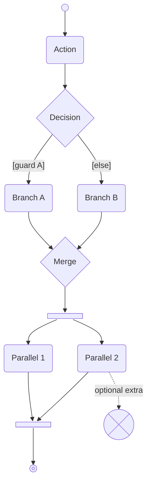
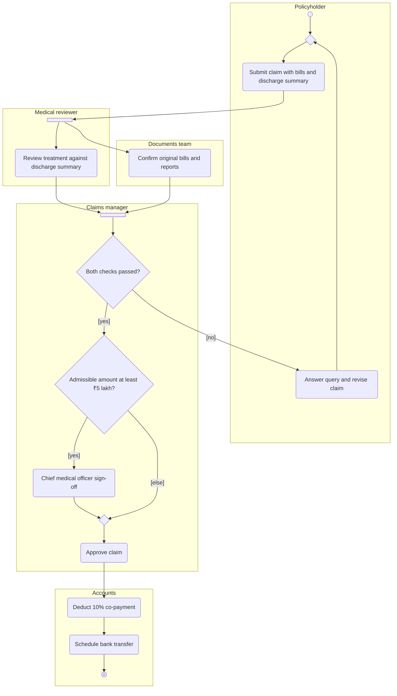
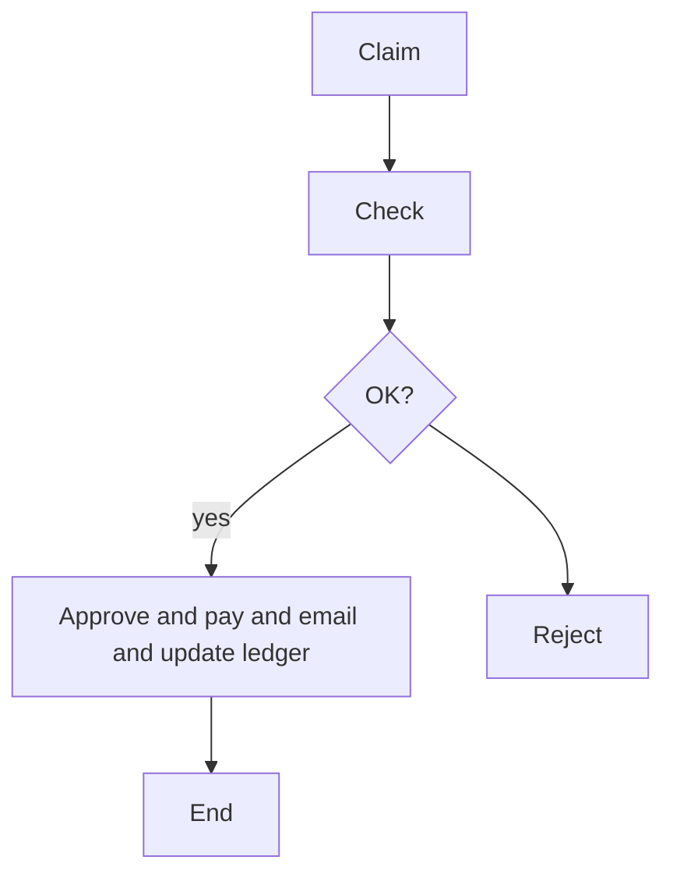
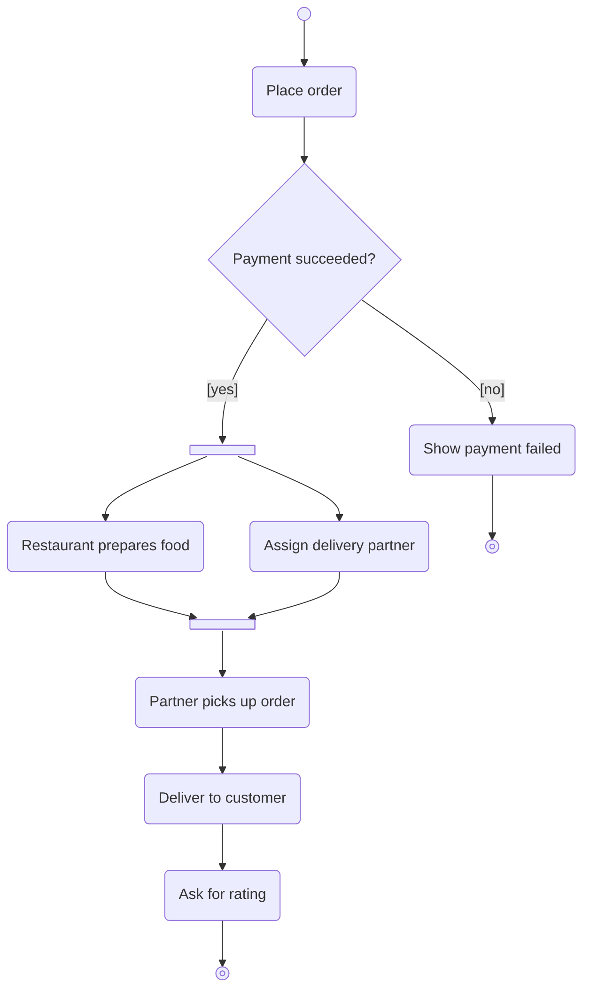
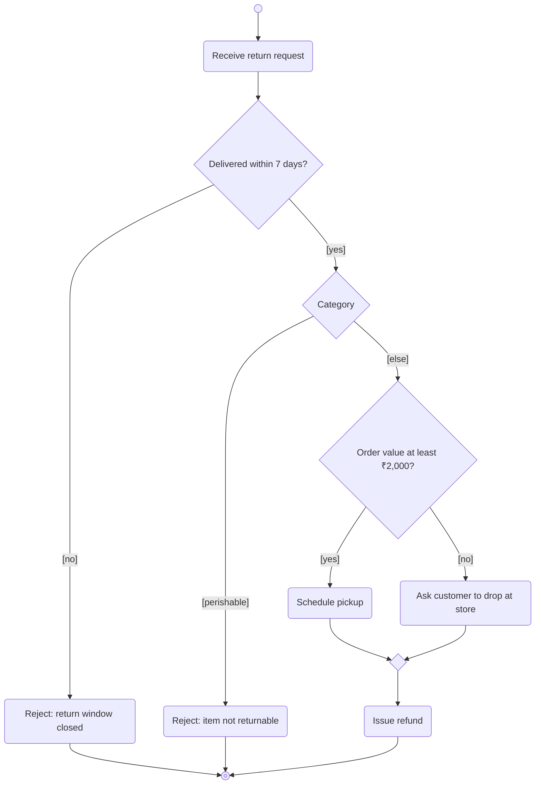
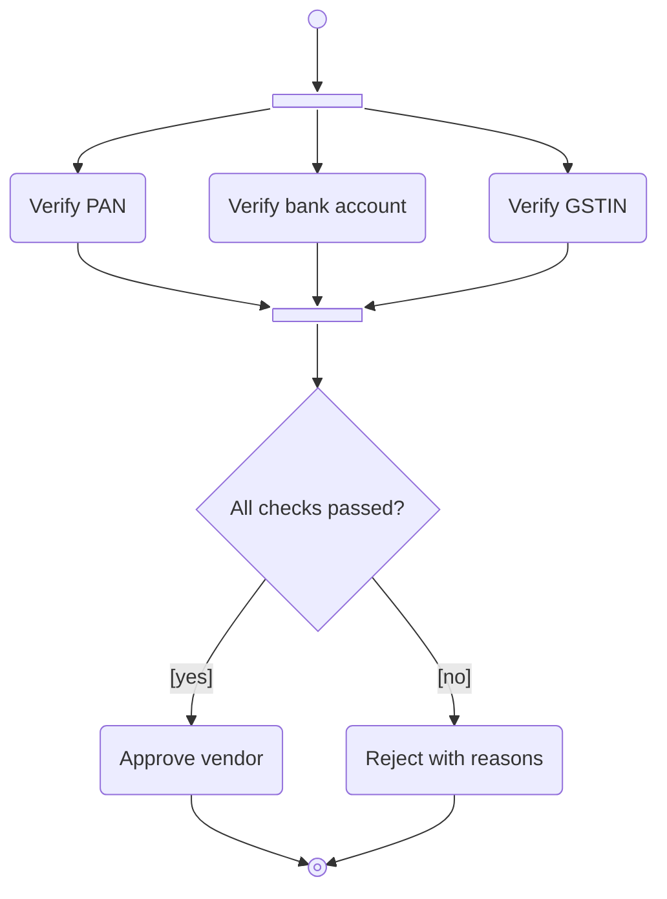
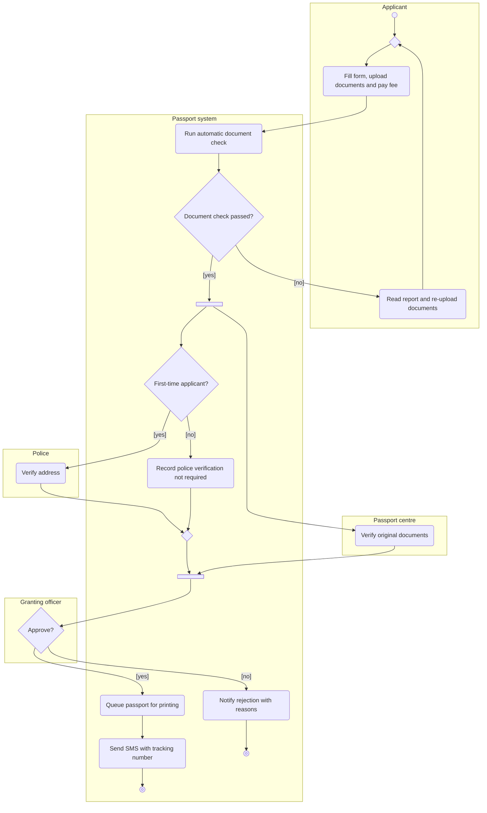
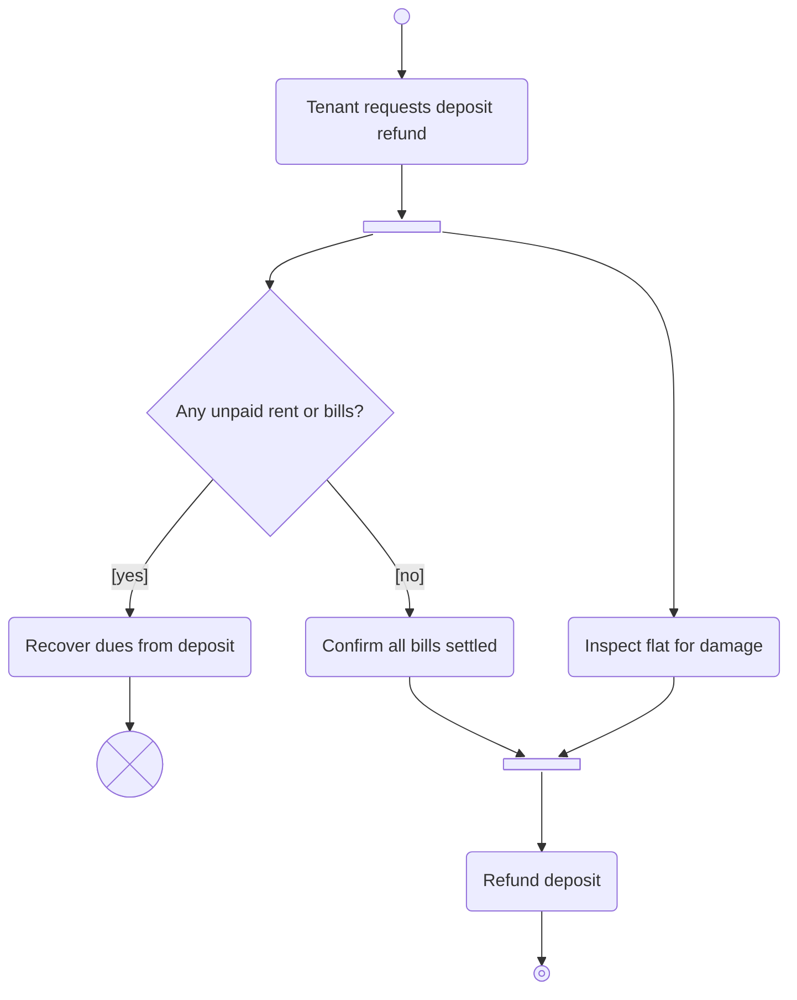

A class diagram shows what your code *is*. An activity diagram shows what your business *does*: the steps of a process, the choices along the way, the work that can happen at the same time, and who is responsible for each step. It is the diagram you draw when someone says "walk me through how an insurance claim gets paid" or "what happens after the customer clicks Return?". This lesson teaches the notation, how to write it in Mermaid, and how each symbol becomes C#.

## Learning objectives

By the end of this lesson you will be able to:

1. Name and draw the core activity-diagram elements: initial node, action, decision, merge, fork, join, activity final and flow final.
2. Write guards on decision branches and check that they cover every case without overlapping.
3. Use forks and joins to show parallel work, and avoid the classic "join that waits forever" mistake.
4. Use swimlanes (partitions) to show which person, team or system performs each action.
5. Write activity diagrams in Mermaid using `flowchart`, node shapes, edge labels and `subgraph` lanes.
6. Translate an activity diagram into C# code: sequence, `if`/`switch`, `Task.WhenAll`, and one interface per lane.

## Prerequisites

- [UML fundamentals](#/lesson/m05-uml-fundamentals): what UML is and why behaviour diagrams differ from structure diagrams.
- [Variables, types, conditions, loops and functions in C#](#/lesson/m01-csharp-basics): you need `if`, loops and methods.
- Basic `async`/`await` helps for the fork/join section. [Asynchronous programming with async/await](#/lesson/m03-async-await) covers it in depth, but this lesson explains what it needs.

## Explain it like I'm a beginner

### A recipe card with arrows

Think of a recipe for dal tadka. "Wash the dal. Pressure-cook it for three whistles. *While it cooks*, chop onions and tomatoes. When both are ready, make the tadka and pour it over. If guests like it spicy, add extra chilli." That paragraph has everything an activity diagram has:

- **Steps** in order (wash, cook, chop): these are **actions**.
- **A choice** (spicy or not): a **decision**.
- **Two things at once** (cooking while chopping): a **fork**, and later a **join** where you wait for both.
- **A start and an end.**

An activity diagram is that recipe drawn as boxes and arrows, so anyone can follow it and spot problems, like "what if the pressure cooker never whistles?".

### A relay race with lanes

Now imagine a relay race. Each runner has their own lane, and the baton passes from one lane to the next. In a business process, the "runners" are people, teams or systems: the customer, the warehouse, the payment gateway. Drawing each in its own **lane** (a **swimlane**, formally a *partition*) makes hand-offs visible. Hand-offs are where processes usually break: the baton gets dropped between the medical reviewer and the accounts team, not inside either.

### Our example: paying a health insurance claim

Priya was in hospital for three days and paid the bill herself. Now she claims the money back from her health insurer. This is a **reimbursement claim**, and a simplified version of the insurer's process is:

1. The **policyholder** submits the claim online with the hospital bills and discharge summary (for example ₹1,20,000).
2. A **medical reviewer** checks the treatment against the discharge summary and the policy, and works out the admissible amount. *At the same time*, the **documents team** confirms that every original bill, pharmacy receipt and test report is present.
3. If either check fails, the claim goes back to the policyholder with a query, and she corrects or completes it.
4. If both pass, the **claims manager** approves it. Claims of ₹5 lakh or more need a second sign-off from the chief medical officer.
5. **Accounts** deducts the policy's co-payment (say 10 %) and schedules the bank transfer.

Every symbol in this lesson will be shown on this process.

## First-principles explanation

### What an activity diagram models

An activity diagram models a **flow of control**: which step runs after which, under what conditions. UML formally describes it with *tokens*: imagine a coin placed on the start node. The coin moves along arrows. An action runs when a coin arrives. A decision sends the coin down one branch. A fork copies the coin into several branches; a join waits until a coin has arrived on *every* incoming arrow, then lets one coin out. Thinking in coins (tokens) answers almost every "is this diagram correct?" question.

### The elements

| Element | Looks like | Meaning | Token rule |
|---|---|---|---|
| **Initial node** | small filled circle | where the flow starts | one token placed here |
| **Action** | rounded rectangle | one step of work ("Review treatment") | runs when a token arrives, then passes it on |
| **Control flow** | arrow | "then" | carries the token |
| **Decision** | diamond, one arrow in, several out | a choice | token goes down exactly **one** branch whose guard is true |
| **Merge** | diamond, several in, one out | branches rejoin | passes on **each** token that arrives, without waiting |
| **Fork** | thick bar, one in, several out | start parallel work | copies the token onto **every** outgoing arrow |
| **Join** | thick bar, several in, one out | wait for parallel work | waits for a token on **every** incoming arrow |
| **Activity final** | bullseye (circle in a ring) | the whole activity ends | destroys **all** tokens, stopping every branch |
| **Flow final** | circle with an X | this branch ends | destroys only this token, others continue |

Two pairs confuse beginners, so slow down here:

- **Decision vs fork.** Both split one arrow into many. A decision picks **one** path ("approved *or* rejected"). A fork takes **all** paths ("review the treatment *and* check the documents").
- **Merge vs join.** Both combine arrows. A merge passes through whatever arrives ("whichever path we came from, now send the email"). A join **waits** for all branches ("only approve once both checks are done").

### Guards

A **guard** is a condition in square brackets on an arrow leaving a decision: `[amount >= ₹5 lakh]`, `[else]`. Two rules make guards correct:

1. **Complete**: for every possible input, at least one guard is true. Otherwise the token gets stuck. `[else]` is the usual safety net.
2. **Exclusive**: at most one guard is true. `[amount > 5 lakh]` and `[amount < 5 lakh]` fail rule 1 for exactly ₹5 lakh. `[amount >= 5 lakh]` with `[else]` passes both rules.

This is the same discipline as writing a `switch` with a `default`, and the diagram is where you catch the gap before the code is written.

### Swimlanes (partitions)

A **partition** groups actions by who performs them. It can be a role (medical reviewer), a department (accounts), or a system (payment gateway, hospital billing system). Lanes add no new behaviour. They answer "who?" and make every **hand-off** (an arrow that crosses a lane boundary) obvious. Each hand-off is a place where you need a notification, a queue, a task in someone's inbox, or an API call, and a place where things get lost.

### Objects on the flow (optional)

UML also lets you draw **object nodes**: rectangles for the *things* that flow between actions, such as `Claim [submitted]` or `Payment advice`. The text in brackets is the object's state. Use them when the main question is "what document moves where?". Most teams leave them out to keep the diagram light, and model the object's life separately in a [state machine diagram](#/lesson/m05-state-diagrams).

### Loops

There is no special loop symbol. A loop is an arrow that goes back to an earlier action, usually through a decision: "Revise claim → Submit → Review → [failed] → Revise claim". Always make sure a loop can exit. If a claim can be returned forever, ask whether the business wants a limit (say three queries, then a phone call from a claims officer).

Strictly, UML 2 gives an action with several incoming arrows an *implicit join*: the action waits for a token on every one of them. A loop that points straight back at "Submit claim" would then wait for both the start token and the loop token, which never happens. So route the loop (and any other rejoining paths) through a **merge** diamond in front of the action. Many informal diagrams skip it; anything that executes or validates diagrams will not.

### Activity, sequence or state diagram?

| Question you're answering | Diagram |
|---|---|
| What steps happen, in what order, by whom, with what choices? | **Activity** |
| Which objects or services send which messages, in what order, for one scenario? | [Sequence](#/lesson/m05-sequence-diagrams) |
| What states can one object be in, and what moves it between them? | [State machine](#/lesson/m05-state-diagrams) |

An activity diagram is about **the process**. A sequence diagram is about **the conversation** between participants for one path. A state diagram is about **one thing's life**. The claim process could be drawn all three ways, and each would answer a different question.

### Writing activity diagrams in Mermaid

Mermaid has no dedicated "activity diagram" keyword. Teams use **`flowchart`**, which has every shape needed. Here is the syntax, piece by piece.

**Header and direction.**

```text
flowchart TD
```

`TD` (or `TB`) is top-down, `LR` left-to-right. `BT` and `RL` also exist. Activity diagrams usually read top-down.

**Actions.** Give each node a short id, then its label. Rounded rectangles match the UML action shape:

```text
submit("Submit claim")
review("Review treatment")
```

`id["text"]` is a sharp rectangle, `id("text")` rounded, `id(["text"])` a pill (stadium). Always **quote labels** that contain brackets, commas, `₹`, `%`, colons or other special characters. Quoting everything is the simplest habit.

**Start and end.** Mermaid's newer shape syntax `id@{ shape: ... }` (Mermaid 11.3 and later) has UML-style shapes:

```text
start@{ shape: sm-circ }          %% small filled circle: initial node
done@{ shape: framed-circle }     %% bullseye: activity final
stopBranch@{ shape: cross-circ }  %% circle with a cross: flow final
```

On older renderers, use `start((" "))` and `done(((" ")))` (a double circle) instead. `%%` starts a comment.

**Decisions and merges.** A diamond is written with braces:

```text
check{"Both checks passed?"}
```

Mermaid draws merges with the same diamond. Give a merge a short label or a single space: `m1{" "}`.

**Forks and joins.**

```text
forkChecks@{ shape: fork }
joinChecks@{ shape: fork }
```

The `fork` shape is the UML thick bar. Mermaid uses it for both forks and joins, because what matters is the number of arrows in and out.

**Arrows and guards.** `-->` is a flow. Put a guard on the arrow with `-->|"text"|`:

```text
check -->|"[yes]"| approve
check -->|"[no]"| revise
```

The quotes are needed because `[` and `]` are otherwise Mermaid syntax. Other arrow styles: `-.->` dotted (good for "optional" or "async"), `==>` thick, and `--x` ends with a cross.

**Swimlanes as subgraphs.** Each lane is a `subgraph` with an id and a quoted title. Nodes declared inside belong to the lane. Arrows between lanes can be written anywhere, usually after all lanes:

```text
subgraph holder["Policyholder"]
    submit("Submit claim")
end
subgraph medical["Medical reviewer"]
    review("Review treatment")
end
submit --> review
```

A node belongs to the **first** subgraph that declares it. Declaring the same id in two lanes doesn't create two nodes; it silently keeps the first, so keep ids unique. Use `direction TB` inside a subgraph to control its layout.

**Styling (sparingly).** `classDef reject fill:#fde2e2,stroke:#c0392b` defines a style, and `class revise reject` applies it. Use one style to highlight unhappy paths, not a rainbow.

Common Mermaid errors with activity diagrams: an unquoted label containing `(` or `[`; reusing the id `end`, which is a keyword (use `done`); and a typo in an id on an arrow, which silently creates a new, unconnected box.

### Mapping an activity diagram to C#

| Diagram element | Typical C# |
|---|---|
| Action | a method call, often `await service.DoThingAsync(...)` |
| Sequence of actions | statements one after another |
| Decision + guards | `if`/`else if`/`else`, or a `switch` expression with `_ =>` as `[else]` |
| Merge | the code after the `if`/`else` blocks rejoin |
| Fork | start several tasks without awaiting each one: `var a = CheckAAsync(); var b = CheckBAsync();` |
| Join | `await Task.WhenAll(a, b);` |
| Loop back | `while`/`do` loop, with an exit condition and preferably a maximum count |
| Swimlane | one interface per lane (`IMedicalReviewDesk`, `IDocumentsDesk`), so each actor's work is behind its own boundary |
| Hand-off between people | not a method call at all, but a persisted task, a message on a queue, or a status change that someone else picks up later |
| Activity final | `return` from the workflow method |
| Flow final | a branch task that completes without affecting the others |

The last few rows matter most in real systems. Inside one request, a fork is `Task.WhenAll`. Across people and days, the "workflow" is not one running method: it is a record with a status in PostgreSQL, and each lane's action is a separate API call or background job that moves it on. The activity diagram is the same either way. Only the implementation changes. That is one of its strengths: you can agree on the process with the business before choosing how to build it.

### When an activity diagram isn't worth it

- A straight line of three steps with no choices. A numbered list is clearer.
- A flow where the hard part is message timing between services. Use a sequence diagram.
- A thing with many states and events (an order that can be paid, shipped, returned, partially refunded). Use a state machine diagram; an activity diagram will become spaghetti.

## Visual explanation

### Notation reference



Read it top to bottom. The small filled circle starts the flow. After the first action, the diamond is a **decision**: exactly one of the two guarded arrows is followed, and `[else]` makes the guards complete. The second diamond is a **merge**: both branches arrive at it and the flow continues once. The first thick bar is a **fork**, so "Parallel 1" and "Parallel 2" both run. The second bar is a **join**, which waits for both. The dotted arrow from "Parallel 2" to the crossed circle shows a **flow final**: that side branch ends quietly without stopping anything else. The bullseye at the bottom is the **activity final**: when the token reaches it, the whole activity is over.

### The claim process with swimlanes



Follow one claim through it:

- The flow starts in the **Policyholder** lane and the claim is submitted. The arrow into the **Medical reviewer** lane is a hand-off: in a real system this is a notification and a task in the reviewer's work queue.
- The **fork** sends work to two lanes at once: the medical reviewer checks the treatment, and the documents team checks the paperwork. Neither waits for the other.
- The **join** sits in the claims manager's lane, because that's who waits for both results. If the documents team takes three days and the reviewer one, the join simply waits three days.
- The first **decision** loops back to the policyholder on failure. The arrow from "Answer query and revise claim" back to the merge in front of "Submit" is the loop, and its exit is "both checks pass". A real insurer would also cap the number of queries before a claims officer phones the customer.
- The second decision uses `[yes]` and `[else]`, which is complete and exclusive. Note the threshold wording, "at least ₹5 lakh", so a claim of exactly ₹5,00,000 has one clear path.
- "Approve claim" is reached from two paths (direct, or after the chief medical officer). They meet at an explicit **merge** diamond first. Without it, UML's implicit-join rule would make "Approve claim" wait for *both* arrows, and small claims would never be approved.
- The **activity final** is in the Accounts lane, where the process ends.

Count the lane crossings: there are six. Each needs a mechanism (an email, a dashboard task, an API call) and an owner if it is forgotten. That count is a cheap, useful measure of process risk.

## Step-by-step example

How do you get from a conversation with the business to that diagram? Six steps.

### Step 1 — write the happy path as verbs

Ask "what happens, step by step, when everything goes right?" and write one verb phrase per line: *submit claim, review treatment, check documents, approve, deduct co-payment, schedule transfer*. Each becomes an action. Use verb-object names ("Review treatment"), never nouns ("Treatment").

### Step 2 — ask "who does this?" for every step

Write the actor next to each verb. Group them into lanes. If two actors share a step ("the reviewer and the hospital's billing desk reconcile the bill together"), either pick the one accountable for it, or split it into two actions.

### Step 3 — ask "can these happen at the same time?"

For each pair of neighbouring steps, ask whether the second needs the first's result. Reviewing the treatment and checking the documents don't depend on each other, so they go between a fork and a join. Parallel work is often the biggest time saving in a real process: here, total waiting time becomes the slower of the two checks instead of their sum.

### Step 4 — ask "what can go wrong, and what then?"

For each action, ask about failure: a treatment the policy doesn't cover, a missing pharmacy receipt, an approver on leave. Add decisions with complete guards. Decide where each failure goes: back to an earlier step (a loop), to an escalation, or to an end.

### Step 5 — check the token flow

Walk a coin through every path:

- Does every decision have an `[else]` or otherwise complete guards?
- Does every fork's branch reach its join on **every** path? (A decision inside a forked branch that exits to "Reject" without reaching the join leaves the join waiting forever.)
- Do paths that rejoin meet at a merge, not at an action or a join?
- Can every loop exit?
- Is there exactly one initial node, and does every path reach a final node?

### Step 6 — write it in Mermaid and review it with the people in the lanes

Commit the Mermaid next to the code that implements the workflow. Then show it to the medical reviewer and the accountant, not just developers. People recognise their own lane instantly and will tell you "actually, we also check the policy's waiting period here", which is exactly the kind of gap you want to find before coding.

## Production-style C# implementation

Here is the claim process implemented as an ASP.NET Core service. Each lane is an interface, the fork and join are `Task.WhenAll`, and the workflow records a trace of the actions it performed so tests can compare it with the diagram. In production the lanes' implementations would call other systems or create inbox tasks. Here they are in-memory fakes, so the code compiles and runs offline.

```text
Claims.Api/
  Program.cs
  Domain/Claim.cs                   // the claim, the outcome, money rules
  Lanes/Lanes.cs                    // one interface per swimlane
  Lanes/InMemoryLanes.cs            // fakes for demos and tests
  Workflow/ClaimApprovalWorkflow.cs // the activity diagram as code
```

```csharp file=Domain/Claim.cs
namespace Claims.Api.Domain;

/// <summary>A reimbursement claim: the object that flows through the activity.</summary>
public sealed record ReimbursementClaim(Guid Id, string PolicyNumber, string AdmissionRef, decimal ClaimedAmount);

public enum ClaimOutcome { ReturnedWithQuery, Scheduled }

/// <summary>Result of one run of the workflow. Trace lists the actions in the order they ran.</summary>
public sealed record ClaimDecision(
    ClaimOutcome Outcome,
    decimal ApprovedAmount,
    decimal CoPayment,
    IReadOnlyList<string> Reasons,
    IReadOnlyList<string> Trace);

public static class ClaimRules
{
    /// <summary>Guard on the "needs chief medical officer" decision: at least ₹5 lakh.</summary>
    public const decimal CmoSignOffThreshold = 5_00_000m;
    public const decimal CoPaymentRate = 0.10m;

    public static decimal CoPaymentOn(decimal amount) => decimal.Round(amount * CoPaymentRate, 2, MidpointRounding.AwayFromZero);
}
```

```csharp file=Lanes/Lanes.cs
using Claims.Api.Domain;

namespace Claims.Api.Lanes;

/// <summary>Medical reviewer lane: "Review treatment against discharge summary".</summary>
public interface IMedicalReviewDesk
{
    /// <returns>The amount the reviewer accepts. Less than claimed means a query.</returns>
    Task<decimal> AssessAdmissibleAmountAsync(ReimbursementClaim claim, CancellationToken ct);
}

/// <summary>Documents team lane: "Confirm original bills and reports".</summary>
public interface IDocumentsDesk
{
    Task<bool> HasCompleteDocumentsAsync(string admissionRef, CancellationToken ct);
}

/// <summary>Claims manager lane, including the chief medical officer's sign-off.</summary>
public interface IApprovalDesk
{
    Task<bool> CmoSignOffAsync(ReimbursementClaim claim, decimal amount, CancellationToken ct);
}

/// <summary>Accounts lane: "Schedule bank transfer".</summary>
public interface IAccountsDesk
{
    Task<DateOnly> ScheduleTransferAsync(ReimbursementClaim claim, decimal payable, CancellationToken ct);
}
```

```csharp file=Lanes/InMemoryLanes.cs
using System.Collections.Concurrent;
using Claims.Api.Domain;

namespace Claims.Api.Lanes;

/// <summary>Reviewer's assessments held in memory: admissible amount per hospital admission.</summary>
public sealed class InMemoryMedicalReviewDesk : IMedicalReviewDesk
{
    private readonly ConcurrentDictionary<string, decimal> _admissible = new(StringComparer.OrdinalIgnoreCase);

    public void Record(string admissionRef, decimal admissibleAmount) => _admissible[admissionRef] = admissibleAmount;

    public async Task<decimal> AssessAdmissibleAmountAsync(ReimbursementClaim claim, CancellationToken ct)
    {
        await Task.Delay(20, ct);   // stands in for a database or reviewer-app call
        return Math.Min(claim.ClaimedAmount, _admissible.GetValueOrDefault(claim.AdmissionRef));
    }
}

public sealed class InMemoryDocumentsDesk : IDocumentsDesk
{
    private readonly ConcurrentDictionary<string, bool> _complete = new(StringComparer.OrdinalIgnoreCase);

    public void Record(string admissionRef, bool complete) => _complete[admissionRef] = complete;

    public async Task<bool> HasCompleteDocumentsAsync(string admissionRef, CancellationToken ct)
    {
        await Task.Delay(20, ct);
        return _complete.GetValueOrDefault(admissionRef);
    }
}

/// <summary>Auto-approves up to a configurable ceiling. A real desk would create an inbox task and wait.</summary>
public sealed class AutoApprovalDesk(decimal cmoCeiling) : IApprovalDesk
{
    public Task<bool> CmoSignOffAsync(ReimbursementClaim claim, decimal amount, CancellationToken ct) =>
        Task.FromResult(amount <= cmoCeiling);
}

public sealed class InMemoryAccountsDesk(TimeProvider clock) : IAccountsDesk
{
    public ConcurrentQueue<(Guid ClaimId, decimal Payable, DateOnly On)> Scheduled { get; } = new();

    public Task<DateOnly> ScheduleTransferAsync(ReimbursementClaim claim, decimal payable, CancellationToken ct)
    {
        // Rule of thumb for the demo: transfer three days after approval.
        var on = DateOnly.FromDateTime(clock.GetUtcNow().UtcDateTime).AddDays(3);
        Scheduled.Enqueue((claim.Id, payable, on));
        return Task.FromResult(on);
    }
}
```

```csharp file=Workflow/ClaimApprovalWorkflow.cs
using Claims.Api.Domain;
using Claims.Api.Lanes;

namespace Claims.Api.Workflow;

/// <summary>
/// The claim activity diagram as code. Each comment names the diagram element.
/// This version runs inside one request. If approvals take days, the same diagram is
/// implemented as persisted status changes instead (see "Real-world application").
/// </summary>
public sealed class ClaimApprovalWorkflow(
    IMedicalReviewDesk medical, IDocumentsDesk documents, IApprovalDesk approvals, IAccountsDesk accounts)
{
    public async Task<ClaimDecision> RunAsync(ReimbursementClaim claim, CancellationToken ct)
    {
        ArgumentNullException.ThrowIfNull(claim);
        var trace = new List<string> { "Submit claim" };

        // FORK: start both checks without awaiting either one.
        var reviewTask = medical.AssessAdmissibleAmountAsync(claim, ct);
        var documentsTask = documents.HasCompleteDocumentsAsync(claim.AdmissionRef, ct);

        // JOIN: wait until both branches have finished.
        await Task.WhenAll(reviewTask, documentsTask);
        var admissible = await reviewTask;
        var documentsOk = await documentsTask;
        trace.Add("Review treatment");
        trace.Add("Check documents");

        // DECISION "Both checks passed?" — guards [no] / [yes].
        var reasons = new List<string>();
        if (admissible < claim.ClaimedAmount)
            reasons.Add($"Admissible {admissible:N0} against {claim.ClaimedAmount:N0} claimed.");
        if (!documentsOk)
            reasons.Add($"Documents incomplete for admission {claim.AdmissionRef}.");
        if (reasons.Count > 0)
        {
            trace.Add("Revise claim");                      // [no] -> loop back to the policyholder
            return new ClaimDecision(ClaimOutcome.ReturnedWithQuery, 0m, 0m, reasons, trace);
        }

        var amount = admissible;

        // DECISION "Admissible amount at least ₹5 lakh?" — guards [yes] / [else].
        if (amount >= ClaimRules.CmoSignOffThreshold)
        {
            trace.Add("Chief medical officer sign-off");
            if (!await approvals.CmoSignOffAsync(claim, amount, ct))
            {
                trace.Add("Revise claim");
                return new ClaimDecision(ClaimOutcome.ReturnedWithQuery, 0m, 0m,
                    new[] { "Chief medical officer did not sign off." }, trace);
            }
        }
        // MERGE: both paths continue here.
        trace.Add("Approve claim");

        var coPayment = ClaimRules.CoPaymentOn(amount);
        trace.Add("Deduct 10% co-payment");

        await accounts.ScheduleTransferAsync(claim, amount - coPayment, ct);
        trace.Add("Schedule bank transfer");

        // ACTIVITY FINAL.
        return new ClaimDecision(ClaimOutcome.Scheduled, amount, coPayment, Array.Empty<string>(), trace);
    }
}
```

```csharp file=Program.cs
using Claims.Api.Domain;
using Claims.Api.Lanes;
using Claims.Api.Workflow;

var builder = WebApplication.CreateBuilder(args);

var medical = new InMemoryMedicalReviewDesk();
medical.Record("ADM-1001", 1_20_000m);    // three-day stay: ₹1,20,000 admissible
var documents = new InMemoryDocumentsDesk();
documents.Record("ADM-1001", complete: true);

builder.Services.AddSingleton(TimeProvider.System);
builder.Services.AddSingleton<IMedicalReviewDesk>(medical);
builder.Services.AddSingleton<IDocumentsDesk>(documents);
builder.Services.AddSingleton<IApprovalDesk>(new AutoApprovalDesk(cmoCeiling: 25_00_000m));
builder.Services.AddSingleton<IAccountsDesk, InMemoryAccountsDesk>();
builder.Services.AddSingleton<ClaimApprovalWorkflow>();

var app = builder.Build();

app.MapPost("/claims", async (SubmitClaim req, ClaimApprovalWorkflow workflow, CancellationToken ct) =>
{
    if (req.Amount <= 0) return Results.Problem("Claimed amount must be positive.", statusCode: 400);
    var claim = new ReimbursementClaim(Guid.NewGuid(), req.PolicyNumber, req.AdmissionRef, req.Amount);
    var decision = await workflow.RunAsync(claim, ct);
    return decision.Outcome == ClaimOutcome.Scheduled
        ? Results.Ok(decision)
        : Results.UnprocessableEntity(decision);
});

app.Run();

public sealed record SubmitClaim(string PolicyNumber, string AdmissionRef, decimal Amount);
```

Check the mapping against the diagram:

- **Fork and join are two lines.** Calling both methods *before* awaiting either starts them together; `Task.WhenAll` is the join. If you wrote `var amount = await medical...; var ok = await documents...;` the code would be correct but sequential, and the diagram's fork would be a lie. With the two 20 ms fakes, the parallel version waits about 20 ms and the sequential one about 40 ms. With real people, the difference is days.
- **Each guard is an `if`.** The threshold is a named constant with `>=`, matching "at least ₹5 lakh" exactly. A claim of ₹1,20,000 skips the chief medical officer; a claim of ₹6,40,000 (a week in intensive care, say) needs her.
- **The merge is just "the code after the `if`".** That's why merges are invisible in code and easy to forget on diagrams.
- **Lanes are interfaces.** You can swap the in-memory documents desk for one that calls a document-scanning (OCR) service without touching the workflow.
- **The trace makes the diagram testable.** Each string is exactly an action label, so a test can assert "this input followed this path".

:::callout type=tradeoff title="One method or a persisted workflow?"
This code runs the whole activity inside one HTTP request, which is right when every lane is a system that answers in milliseconds. When lanes are people who answer in days, a running method can't wait: the server restarts, the request times out. Then you store the claim with a status (`Submitted`, `UnderReview`, `QueryRaised`, `Approved`...) and each lane's action is its own endpoint or background job. A fork becomes "create two tasks"; a join becomes "when the second task completes, check whether the other is done too", done inside one transaction (or with a row lock) so two tasks finishing at the same moment can't both miss each other, or both trigger the next step. Make each step idempotent too: a reviewer double-clicking "Done" must not schedule two transfers. The diagram doesn't change, which is why you draw it first. The [state machine diagrams lesson](#/lesson/m05-state-diagrams) shows how to model that status.
:::

## Bad design vs good design

### A diagram that hides the process



What's wrong:

- **Nouns, not actions.** "Claim" and "Check" don't say what happens. Check *what*? By *whom*?
- **No start node and a box called "End".** Readers can't tell where the flow begins, and "End" is an action box, not a final node.
- **One unguarded branch.** `C --> E` has no label, so it's unclear whether it's `[no]` or "always". In UML, an unguarded arrow from a decision is always taken, which would make both branches run.
- **Four actions in one box.** "Approve and pay and email and update ledger" hides the parallel work, the ordering and the failure points. What if the ledger update fails after payment?
- **"Reject" is a dead end.** It has no outgoing arrow and no final node. Does the policyholder know? Can she resubmit?
- **No lanes.** Nobody knows who checks or who pays.

### The same process, drawn well

The swimlane diagram in the visual section fixes each problem: verb-object names, a start and a final node, complete guards, one action per box, parallel checks made explicit, a loop for queries, and lanes for responsibility. It is longer, but every box answers a question someone will ask.

### Is more detail always better?

No. The good diagram leaves out the waiting-period check, the room-rent cap and the email template. Put detail in where decisions or hand-offs happen. Leave out detail that doesn't change the flow. For a slide to senior management, five boxes with three lanes may be the right diagram.

:::callout type=mistake title="The join that waits forever"
A fork starts two branches. Inside one branch, a decision says "[documents missing] → Reject → final". If that branch ends at a **flow final** (or any node other than the join), the join never receives its second token. In UML terms the activity is stuck. In code, this is a `Task.WhenAll` that never completes, or a "both tasks done?" check that is never true. Every path inside a forked branch must reach the join, or reach an **activity final**, which ends everything. Exercise 6 asks you to find and fix one.
:::

## Practical playground

Run the workflow with four claims and watch the trace. Then change the inputs: mark the documents as incomplete, set a claim to exactly its admissible amount, or set a claim of exactly ₹5,00,000 and confirm the chief medical officer path is taken. Finally, make the fork sequential (await each check in turn) and compare the printed elapsed time.

:::playground type=csharp title="Trace the claim activity"
```csharp file=Program.cs
using System;
using System.Collections.Generic;
using System.Diagnostics;
using System.Threading.Tasks;

public static class Program
{
    private static readonly Dictionary<string, decimal> Admissible = new()
    {
        ["ADM-1001"] = 120000m, ["ADM-1002"] = 640000m, ["ADM-1003"] = 70000m, ["ADM-1004"] = 45000m,
    };
    private static readonly Dictionary<string, bool> DocumentsComplete = new()
    {
        ["ADM-1001"] = true, ["ADM-1002"] = true, ["ADM-1003"] = true, ["ADM-1004"] = false,
    };

    private static async Task<decimal> ReviewTreatmentAsync(string admission, decimal claimed)
    {
        await Task.Delay(200);                       // the medical reviewer takes "200 ms"
        return Math.Min(claimed, Admissible.GetValueOrDefault(admission));
    }

    private static async Task<bool> CheckDocumentsAsync(string admission)
    {
        await Task.Delay(300);                       // the documents team takes "300 ms"
        return DocumentsComplete.GetValueOrDefault(admission);
    }

    private static async Task<List<string>> RunAsync(string admission, decimal claimed)
    {
        var trace = new List<string> { "Submit claim" };
        var r = ReviewTreatmentAsync(admission, claimed);   // fork
        var d = CheckDocumentsAsync(admission);
        await Task.WhenAll(r, d);                            // join
        trace.Add("Review treatment");
        trace.Add("Check documents");
        if (await r < claimed || !await d) { trace.Add("Revise claim"); return trace; }
        if (claimed >= 500000m) trace.Add("Chief medical officer sign-off");
        trace.Add("Approve claim");
        trace.Add($"Deduct 10% co-payment (Rs {claimed * 0.10m:N0})");
        trace.Add($"Schedule bank transfer (Rs {claimed * 0.90m:N0})");
        return trace;
    }

    public static async Task Main()
    {
        var claims = new (string Admission, decimal Amount)[]
        {
            ("ADM-1001", 120000m),   // three-day stay, all good
            ("ADM-1002", 640000m),   // Rs 6.4 lakh: needs the chief medical officer
            ("ADM-1003", 85000m),    // claims more than the reviewer admits
            ("ADM-1004", 45000m),    // pharmacy receipts missing
        };
        foreach (var c in claims)
        {
            var sw = Stopwatch.StartNew();
            var trace = await RunAsync(c.Admission, c.Amount);
            Console.WriteLine($"{c.Admission} Rs {c.Amount:N0} ({sw.ElapsedMilliseconds} ms)");
            foreach (var step in trace) Console.WriteLine($"   -> {step}");
        }
    }
}
```
:::

You should see each run take roughly 300 ms (the slower branch), not 500 ms (the sum). That gap is the fork in action. The first claim pays ₹1,08,000 after a ₹12,000 co-payment; the second pays ₹5,76,000 after ₹64,000.

## Exercises

:::exercise id=m05-activity-diagrams-ex1 difficulty=beginner kind=written title="Read an activity diagram aloud"
A food-delivery app's order process:



Answer in full sentences:

1. Which actions can happen at the same time?
2. Can the partner pick up the order before the food is ready? How does the diagram say so?
3. What happens if payment fails? Is that path complete?
4. Are the guards on "Payment succeeded?" complete and exclusive?
5. If you added swimlanes, which lanes would you create, and in which lane does the join belong?
::acceptance
- Identifies "Restaurant prepares food" and "Assign delivery partner" as parallel, because they are between a fork and a join.
- Explains that the join waits for both branches, so pickup can't start until both are done.
- Traces the failed-payment path to its activity final.
- Explains completeness and exclusivity of `[yes]` / `[no]`.
- Proposes sensible lanes (customer, app/platform, restaurant, delivery partner) and justifies the join's lane.
::hint
Find the thick bars first. What sits between them?
::hint
A join only lets the flow continue once a token has arrived on *every* incoming arrow.
::hint
For guards, ask: is there any payment result that is neither yes nor no? Could both be true?
::hint
The join belongs to whoever *waits* for both results, or to the system coordinating them.
::solution
1. "Restaurant prepares food" and "Assign delivery partner" happen in parallel. They sit between a fork (the first bar) and a join (the second bar).
2. No. "Partner picks up order" comes after the join, and the join waits for both branches. So the food must be prepared **and** a partner assigned before pickup starts. (In reality a partner may arrive early and wait. The diagram says pickup, the action, can't happen until the food is ready.)
3. The flow goes to "Show payment failed" and then to an activity final, which ends the whole activity. The path is complete: it has a clear end. A product manager might still ask whether the customer can retry, which would be a loop back to "Place order".
4. Yes. A payment result is either success or not, so `[yes]` and `[no]` cover every case (complete) and can't both be true (exclusive). If "pending" were possible (UPI collect requests often are), the guards would be incomplete and you'd need a third branch or a wait.
5. Lanes: **Customer** (place order, receives "payment failed"), **Platform** (payment decision, assign partner, ask for rating), **Restaurant** (prepare food) and **Delivery partner** (pick up, deliver). The join belongs in the **Platform** lane, because the platform waits for "food ready" and "partner assigned" before telling the partner to pick up.
::mistakes
- Calling the bars "decisions". A bar is never a choice: every branch runs.
- Saying pickup can happen any time after the fork.
- Forgetting that UPI and card payments can be "pending", which breaks guard completeness.
:::

:::exercise id=m05-activity-diagrams-ex2 difficulty=beginner kind=code title="Implement a return-request activity"
Implement this returns process for an online store exactly. The method records the label of every action it performs, in order.


::requirements
- `ReturnFlow.Run(ReturnRequest request)` returns a `ReturnResult` with an `Outcome` (`Rejected` or `Refunded`) and `Trace`, the list of action labels **exactly** as written in the diagram.
- "Within 7 days" includes day 7: `DaysSinceDelivery <= 7`.
- "At least ₹2,000" includes ₹2,000.
- A negative `DaysSinceDelivery` or `OrderValue` throws `ArgumentOutOfRangeException`.
::acceptance
- 3 days, electronics, ₹5,000: trace is receive, schedule pickup, issue refund; outcome `Refunded`.
- 8 days: trace is receive, reject window; outcome `Rejected`.
- 7 days, ₹2,000 exactly: pickup path.
- Perishable within the window: rejected as not returnable.
- ₹1,999: drop-at-store path.
::hint
Each diamond is one `if`. Each action box is one `trace.Add("...")`.
::hint
The merge diamond has no code: it is simply where the `if`/`else` for pickup and drop-off end.
::hint
Guard boundaries: "within 7 days" is `<= 7`; "at least ₹2,000" is `>= 2000m`.
::hint
```csharp
var trace = new List<string> { "Receive return request" };
if (r.DaysSinceDelivery > 7) { trace.Add("Reject: return window closed"); return new(ReturnOutcome.Rejected, trace); }
```
::starter
```csharp file=ReturnFlow.cs
using System;
using System.Collections.Generic;

public enum ProductCategory { Electronics, Clothing, Perishable, Books }

public enum ReturnOutcome { Rejected, Refunded }

public sealed record ReturnRequest(int DaysSinceDelivery, ProductCategory Category, decimal OrderValue);

public sealed record ReturnResult(ReturnOutcome Outcome, IReadOnlyList<string> Trace);

public static class ReturnFlow
{
    public static ReturnResult Run(ReturnRequest request) => throw new NotImplementedException();
}
```
::tests
```csharp file=ReturnFlowTests.cs
using System;
using Xunit;

public class ReturnFlowTests
{
    [Fact]
    public void Happy_path_with_pickup()
    {
        var r = ReturnFlow.Run(new ReturnRequest(3, ProductCategory.Electronics, 5000m));
        Assert.Equal(ReturnOutcome.Refunded, r.Outcome);
        Assert.Equal(new[] { "Receive return request", "Schedule pickup", "Issue refund" }, r.Trace);
    }

    [Fact]
    public void Window_closed()
    {
        var r = ReturnFlow.Run(new ReturnRequest(8, ProductCategory.Books, 400m));
        Assert.Equal(ReturnOutcome.Rejected, r.Outcome);
        Assert.Equal(new[] { "Receive return request", "Reject: return window closed" }, r.Trace);
    }

    [Fact]
    public void Day_seven_and_exactly_2000_take_pickup()
    {
        var r = ReturnFlow.Run(new ReturnRequest(7, ProductCategory.Clothing, 2000m));
        Assert.Equal(new[] { "Receive return request", "Schedule pickup", "Issue refund" }, r.Trace);
    }

    [Fact]
    public void Perishable_is_not_returnable()
    {
        var r = ReturnFlow.Run(new ReturnRequest(1, ProductCategory.Perishable, 900m));
        Assert.Equal(ReturnOutcome.Rejected, r.Outcome);
        Assert.Equal(new[] { "Receive return request", "Reject: item not returnable" }, r.Trace);
    }

    [Fact]
    public void Small_order_dropped_at_store()
    {
        var r = ReturnFlow.Run(new ReturnRequest(2, ProductCategory.Books, 1999m));
        Assert.Equal(new[] { "Receive return request", "Ask customer to drop at store", "Issue refund" }, r.Trace);
    }

    [Fact]
    public void Negative_inputs_rejected()
    {
        Assert.Throws<ArgumentOutOfRangeException>(() => ReturnFlow.Run(new ReturnRequest(-1, ProductCategory.Books, 10m)));
        Assert.Throws<ArgumentOutOfRangeException>(() => ReturnFlow.Run(new ReturnRequest(1, ProductCategory.Books, -10m)));
    }
}
```
::solution
```csharp file=ReturnFlow.cs
using System;
using System.Collections.Generic;

public enum ProductCategory { Electronics, Clothing, Perishable, Books }

public enum ReturnOutcome { Rejected, Refunded }

public sealed record ReturnRequest(int DaysSinceDelivery, ProductCategory Category, decimal OrderValue);

public sealed record ReturnResult(ReturnOutcome Outcome, IReadOnlyList<string> Trace);

public static class ReturnFlow
{
    public const int WindowDays = 7;
    public const decimal PickupThreshold = 2000m;

    public static ReturnResult Run(ReturnRequest request)
    {
        ArgumentNullException.ThrowIfNull(request);
        ArgumentOutOfRangeException.ThrowIfNegative(request.DaysSinceDelivery);
        ArgumentOutOfRangeException.ThrowIfNegative(request.OrderValue);

        var trace = new List<string> { "Receive return request" };

        // Decision: "Delivered within 7 days?"
        if (request.DaysSinceDelivery > WindowDays)
        {
            trace.Add("Reject: return window closed");
            return new ReturnResult(ReturnOutcome.Rejected, trace);
        }

        // Decision: "Category" with [perishable] / [else]
        if (request.Category == ProductCategory.Perishable)
        {
            trace.Add("Reject: item not returnable");
            return new ReturnResult(ReturnOutcome.Rejected, trace);
        }

        // Decision: "Order value at least ₹2,000?"
        if (request.OrderValue >= PickupThreshold) trace.Add("Schedule pickup");
        else trace.Add("Ask customer to drop at store");

        // Merge: both paths continue here.
        trace.Add("Issue refund");
        return new ReturnResult(ReturnOutcome.Refunded, trace);
    }
}
```

Every diamond became one `if`, every action one `trace.Add`, and the merge became "the line after the `if`/`else`". The thresholds are named constants, so the diagram's wording and the code can be compared at a glance.
::mistakes
- Using `< 7` for "within 7 days", which rejects day-7 returns. The diagram's words are the spec.
- Adding "Issue refund" inside both branches, which duplicates the merge.
- Checking category before the window, which changes the trace order and therefore the process.
::extensions
Add a "Partner inspects item" action after pickup, with a decision `[damaged by customer]` that leads to "Reject: damaged" instead of the refund. Update the diagram first, then the code and tests.
:::

:::exercise id=m05-activity-diagrams-ex3 difficulty=intermediate kind=code title="Fork and join: parallel vendor checks"
A company onboards vendors. The diagram:



Implement `VendorOnboarding.RunAsync` so the three checks really run in parallel.
::requirements
- Constructor: `VendorOnboarding(IVendorCheck pan, IVendorCheck bank, IVendorCheck gst)`. Each `IVendorCheck` has `string Name` and `Task<bool> CheckAsync(Vendor vendor, CancellationToken ct)`.
- **Fork**: all three checks must be started before any of them is awaited.
- **Join**: wait for all three. A check that **throws** counts as failed, with the reason `"<Name>: error"`. A check that returns `false` gives the reason `"<Name>: failed"`.
- Return `OnboardingResult(bool Approved, IReadOnlyList<string> Reasons)`. Reasons are in the order pan, bank, gst.
- Cancellation: pass the token to every check. If the token is cancelled, let `OperationCanceledException` propagate (don't turn it into a failure).
::acceptance
- All three checks are observed as started before any completes (the test holds them open with `TaskCompletionSource`).
- All passing gives `Approved == true` and no reasons.
- A failing bank check and a throwing GSTIN check give two reasons in order.
- A cancelled token surfaces as `OperationCanceledException` (or a subclass).
::hint
Calling an async method starts it. Store the three `Task<bool>`s in variables before any `await`.
::hint
`await Task.WhenAll(...)` throws if any task faulted. You want to inspect each one instead. Wrap each check so it returns a result rather than throwing.
::hint
Write a small helper: `async Task<(string Name, bool Ok, bool Errored)> Guarded(IVendorCheck c)` with a `try`/`catch (Exception ex) when (ex is not OperationCanceledException)`.
::hint
After `var results = await Task.WhenAll(Guarded(pan), Guarded(bank), Guarded(gst));`, `results` is an array in the same order you passed the tasks. Build the reasons from it.
::starter
```csharp file=VendorOnboarding.cs
using System;
using System.Collections.Generic;
using System.Threading;
using System.Threading.Tasks;

public sealed record Vendor(string Name, string Pan, string Gstin, string Ifsc, string AccountNumber);

public sealed record OnboardingResult(bool Approved, IReadOnlyList<string> Reasons);

public interface IVendorCheck
{
    string Name { get; }
    Task<bool> CheckAsync(Vendor vendor, CancellationToken ct);
}

public sealed class VendorOnboarding
{
    public VendorOnboarding(IVendorCheck pan, IVendorCheck bank, IVendorCheck gst) => throw new NotImplementedException();

    public Task<OnboardingResult> RunAsync(Vendor vendor, CancellationToken ct) => throw new NotImplementedException();
}
```
::tests
```csharp file=VendorOnboardingTests.cs
using System;
using System.Threading;
using System.Threading.Tasks;
using Xunit;

public class VendorOnboardingTests
{
    private static readonly Vendor Acme = new("Acme Traders", "ABCDE1234F", "27ABCDE1234F1Z5", "HDFC0001234", "50100012345678");

    private sealed class GatedCheck(string name, bool result) : IVendorCheck
    {
        public TaskCompletionSource Started { get; } = new(TaskCreationOptions.RunContinuationsAsynchronously);
        public TaskCompletionSource Release { get; } = new(TaskCreationOptions.RunContinuationsAsynchronously);
        public string Name { get; } = name;
        public async Task<bool> CheckAsync(Vendor vendor, CancellationToken ct)
        {
            Started.TrySetResult();
            await Release.Task.WaitAsync(ct);
            return result;
        }
    }

    private sealed class FixedCheck(string name, bool result, bool throws = false) : IVendorCheck
    {
        public string Name { get; } = name;
        public async Task<bool> CheckAsync(Vendor vendor, CancellationToken ct)
        {
            await Task.Yield();
            ct.ThrowIfCancellationRequested();
            if (throws) throw new TimeoutException("GSTN portal timed out");
            return result;
        }
    }

    [Fact]
    public async Task Checks_run_in_parallel()
    {
        var pan = new GatedCheck("PAN", true);
        var bank = new GatedCheck("Bank", true);
        var gst = new GatedCheck("GSTIN", true);
        var run = new VendorOnboarding(pan, bank, gst).RunAsync(Acme, CancellationToken.None);

        var allStarted = Task.WhenAll(pan.Started.Task, bank.Started.Task, gst.Started.Task);
        var first = await Task.WhenAny(allStarted, Task.Delay(2000));
        Assert.Same(allStarted, first);   // all three started while none had finished

        pan.Release.SetResult(); bank.Release.SetResult(); gst.Release.SetResult();
        var result = await run;
        Assert.True(result.Approved);
        Assert.Empty(result.Reasons);
    }

    [Fact]
    public async Task Failures_and_errors_become_reasons_in_order()
    {
        var sut = new VendorOnboarding(new FixedCheck("PAN", true), new FixedCheck("Bank", false), new FixedCheck("GSTIN", true, throws: true));
        var result = await sut.RunAsync(Acme, CancellationToken.None);
        Assert.False(result.Approved);
        Assert.Equal(new[] { "Bank: failed", "GSTIN: error" }, result.Reasons);
    }

    [Fact]
    public async Task Cancellation_propagates()
    {
        using var cts = new CancellationTokenSource();
        cts.Cancel();
        var sut = new VendorOnboarding(new FixedCheck("PAN", true), new FixedCheck("Bank", true), new FixedCheck("GSTIN", true));
        await Assert.ThrowsAnyAsync<OperationCanceledException>(() => sut.RunAsync(Acme, cts.Token));
    }
}
```
::solution
```csharp file=VendorOnboarding.cs
using System;
using System.Collections.Generic;
using System.Linq;
using System.Threading;
using System.Threading.Tasks;

public sealed record Vendor(string Name, string Pan, string Gstin, string Ifsc, string AccountNumber);

public sealed record OnboardingResult(bool Approved, IReadOnlyList<string> Reasons);

public interface IVendorCheck
{
    string Name { get; }
    Task<bool> CheckAsync(Vendor vendor, CancellationToken ct);
}

public sealed class VendorOnboarding
{
    private readonly IVendorCheck[] _checks;

    public VendorOnboarding(IVendorCheck pan, IVendorCheck bank, IVendorCheck gst)
    {
        ArgumentNullException.ThrowIfNull(pan);
        ArgumentNullException.ThrowIfNull(bank);
        ArgumentNullException.ThrowIfNull(gst);
        _checks = new[] { pan, bank, gst };
    }

    public async Task<OnboardingResult> RunAsync(Vendor vendor, CancellationToken ct)
    {
        ArgumentNullException.ThrowIfNull(vendor);

        // FORK: start every branch before awaiting any of them.
        var branches = _checks.Select(c => GuardedAsync(c, vendor, ct)).ToArray();

        // JOIN: wait for all branches. Results keep the order of the array.
        var results = await Task.WhenAll(branches);

        // DECISION: all checks passed?
        var reasons = results.Where(r => r.Reason is not null).Select(r => r.Reason!).ToList();
        return new OnboardingResult(reasons.Count == 0, reasons);
    }

    private static async Task<(string Name, string? Reason)> GuardedAsync(IVendorCheck check, Vendor vendor, CancellationToken ct)
    {
        try
        {
            var ok = await check.CheckAsync(vendor, ct);
            return (check.Name, ok ? null : $"{check.Name}: failed");
        }
        catch (Exception ex) when (ex is not OperationCanceledException)
        {
            return (check.Name, $"{check.Name}: error");
        }
    }
}
```

`Select(...).ToArray()` calls every check immediately, which is the fork. `Task.WhenAll` is the join, and its result array preserves order, so reasons come out as pan, bank, gst whatever order the checks finished in. The guard wrapper turns "a branch crashed" into data, which is what the diagram's decision needs. Cancellation is excluded from the `catch`, so a cancelled request stops rather than rejecting a vendor for a reason that isn't true.
::alternatives
If a single failure should stop the other checks early (to save paid API calls), link a `CancellationTokenSource` to `ct` and cancel it when the first failure arrives, processing tasks with `Task.WhenEach` (.NET 9+). The diagram then needs a note, because UML's join waits for all branches.
::mistakes
- `foreach (var c in checks) results.Add(await c.CheckAsync(...))`: correct answers, but sequential. The test that waits for all three to start catches this.
- Using `await Task.WhenAll(tasks)` directly with checks that can throw, then losing the other results in the exception.
- Catching `OperationCanceledException` and reporting "error", so cancelled requests reject vendors.
::extensions
Give each branch its own timeout (for example 5 seconds) using `CancellationTokenSource.CreateLinkedTokenSource(ct)` plus `CancelAfter`, and report `"<Name>: timeout"` separately from errors.
:::

:::exercise id=m05-activity-diagrams-ex4 difficulty=intermediate kind=written title="Draw a swimlane diagram for a passport application"
A passport office describes its online application process:

> "The applicant fills in the form online, uploads proof of address and date of birth, and pays the fee. The system runs an automatic document check (photo size, file type, name matching across documents). If the check fails, the applicant gets the report and can re-upload. If it passes, two things happen at the same time: the local police verify the applicant's address (only for first-time applicants; renewals with no change of address skip it), and an officer at the passport centre verifies the original documents during the applicant's appointment. When both are done, the granting officer approves or rejects. On approval the system queues the passport for printing and sends an SMS with the courier tracking number."

Write a Mermaid activity diagram with swimlanes. Then list every hand-off between lanes and say how the system should implement each one.
::acceptance
- Lanes for at least: applicant, system, police, passport centre, granting officer.
- A loop for the failed document check back to re-upload, entering through a merge.
- A fork and a join around the police verification and the centre's document verification.
- The "first-time applicant" condition is handled so the join never waits for a police verification that doesn't happen.
- Guards are complete and quoted correctly in Mermaid.
- Every lane crossing is listed with an implementation mechanism.
::hint
List the verbs first, then put an actor next to each.
::hint
The police verification is conditional, but the join must always receive a token from that branch. Put a decision *inside* the branch with two paths, and merge them before the join.
::hint
In Mermaid, put each lane in `subgraph id["Title"] ... end` and write cross-lane arrows after the lanes.
::hint
Hand-offs to people are usually "create a task in their queue and notify them". Hand-offs to the system are usually an API call or an event.
::solution


Hand-offs and mechanisms:

| From → to | Mechanism |
|---|---|
| Applicant → system (upload) | Web upload API; fee via a payment gateway callback, checked for idempotency so a retried callback doesn't create two applications |
| System → applicant (failed report) | Email/SMS with a link to the report; status "Returned" on the portal |
| System → police | Verification task created in the police station's queue for the applicant's address, with an SLA timer |
| System → passport centre | Appointment slot booked; the officer's worklist for that day shows the application |
| Police / centre → system (join) | Each completes their task via the API; the system checks, in one transaction, whether the other branch is done |
| System → granting officer | Task in the officer's inbox once the join completes |
| Granting officer → system | Decision submitted via the portal; the system queues printing or notifies rejection |

The key design point is the decision **inside** the police branch: for renewals the branch still produces a token ("Record police verification not required"), and the two paths meet at a **merge** before the join. If both arrows went straight into the join, the join would wait for a token on each of them, and every application would hang.
::mistakes
- Putting the "first-time applicant" decision *before* the fork, with the `[no]` path skipping straight to the join. The join then waits for a police-branch token that never comes.
- Drawing both outcomes of the inner decision directly into the join, without a merge. The join then has three incoming arrows and waits for all three.
- Unquoted guards like `-->|[yes]|`, which Mermaid can't parse.
- Drawing the granting officer's decision without a rejection path.
::extensions
Add an SLA: if the police verification isn't done in 15 days, escalate to the district superintendent's office. How do you show a timer in an activity diagram? (UML has an "accept time event" action, an hourglass shape; in Mermaid use an action labelled "Wait 15 days" on a parallel branch, or a note.)
:::

:::exercise id=m05-activity-diagrams-ex5 difficulty=advanced kind=code title="Validate an activity graph and export it to Mermaid"
Build a small tool that checks an activity diagram for structural errors, then writes it as Mermaid. Tools like this run in CI over workflow definitions so that broken processes never reach production.
::requirements
`ActivityGraph(IEnumerable<ActivityNode> nodes, IEnumerable<ActivityEdge> edges)` with:

`IReadOnlyList<string> Validate()` returns error messages (empty when valid). Each message **starts with** the prefix shown:

- `"initial: expected 1, found N"` when the number of `Initial` nodes isn't 1.
- `"final: none"` when there is no `Final` node.
- `"edge: unknown node X"` for an edge whose `From` or `To` doesn't exist (one message per unknown id per edge end).
- `"unreachable: X"` for every node not reachable from the initial node (only checked when there is exactly one initial node).
- `"decision X: needs 2+ outgoing"` and `"decision X: unguarded edge to Y"` (every edge leaving a decision needs a non-blank guard).
- `"fork X: needs 2+ outgoing"` and `"join X: needs 2+ incoming"`.
- `"final X: has outgoing edge"`.

`string ToMermaid()` returns `flowchart TD` on the first line, then one line per node, then one line per edge, in the given order:

- Initial: `id@{ shape: sm-circ }`. Final: `id@{ shape: framed-circle }`. Fork and Join: `id@{ shape: fork }`.
- Action: `id("Label")`. Decision and Merge: `id{"Label"}` (use a single space if the label is empty).
- Edge without guard: `a --> b`. With guard: `a -->|"[guard]"| b` (square brackets added by you).
- Double quotes inside labels are replaced with `#quot;` (Mermaid's escape).

Tests compare trimmed lines, so indentation is up to you.
::acceptance
- A valid claim-approval-style graph produces no errors.
- Each rule above is triggered by a dedicated test.
- `ToMermaid()` produces the exact lines described, including guard brackets and `#quot;` escaping.
::hint
Index nodes by id in a dictionary first. Most rules are then simple counts over edges.
::hint
Reachability is a breadth-first search from the initial node over outgoing edges. Ignore edges to unknown nodes.
::hint
Group edges once: `var outgoing = edges.ToLookup(e => e.From)` and `var incoming = edges.ToLookup(e => e.To)`.
::hint
For `ToMermaid`, a `switch` expression over `NodeKind` gives one line per node kind.
::hint
```csharp
var seen = new HashSet<string> { start };
var queue = new Queue<string>(seen);
while (queue.TryDequeue(out var id))
    foreach (var e in outgoing[id])
        if (byId.ContainsKey(e.To) && seen.Add(e.To)) queue.Enqueue(e.To);
```
::starter
```csharp file=ActivityGraph.cs
using System;
using System.Collections.Generic;
using System.Linq;
using System.Text;

public enum NodeKind { Initial, Action, Decision, Merge, Fork, Join, Final }

public sealed record ActivityNode(string Id, NodeKind Kind, string Label = "");

public sealed record ActivityEdge(string From, string To, string? Guard = null);

public sealed class ActivityGraph
{
    public ActivityGraph(IEnumerable<ActivityNode> nodes, IEnumerable<ActivityEdge> edges) => throw new NotImplementedException();

    public IReadOnlyList<ActivityNode> Nodes => throw new NotImplementedException();
    public IReadOnlyList<ActivityEdge> Edges => throw new NotImplementedException();

    public IReadOnlyList<string> Validate() => throw new NotImplementedException();

    public string ToMermaid() => throw new NotImplementedException();
}
```
::tests
```csharp file=ActivityGraphTests.cs
using System;
using System.Collections.Generic;
using System.Linq;
using Xunit;

public class ActivityGraphTests
{
    private static List<ActivityNode> ValidNodes() => new()
    {
        new("start", NodeKind.Initial),
        new("submit", NodeKind.Action, "Submit claim"),
        new("f1", NodeKind.Fork),
        new("verify", NodeKind.Action, "Review treatment"),
        new("tests", NodeKind.Action, "Check documents"),
        new("j1", NodeKind.Join),
        new("ok", NodeKind.Decision, "Checks passed?"),
        new("approve", NodeKind.Action, "Approve claim"),
        new("revise", NodeKind.Action, "Revise claim"),
        new("done", NodeKind.Final),
    };

    private static List<ActivityEdge> ValidEdges() => new()
    {
        new("start", "submit"), new("submit", "f1"), new("f1", "verify"), new("f1", "tests"),
        new("verify", "j1"), new("tests", "j1"), new("j1", "ok"),
        new("ok", "approve", "yes"), new("ok", "revise", "no"),
        new("revise", "submit"), new("approve", "done"),
    };

    private static IReadOnlyList<string> Errors(List<ActivityNode> n, List<ActivityEdge> e) => new ActivityGraph(n, e).Validate();

    [Fact] public void Valid_graph_has_no_errors() => Assert.Empty(Errors(ValidNodes(), ValidEdges()));

    [Fact]
    public void Exactly_one_initial()
    {
        var n = ValidNodes(); n.Add(new("start2", NodeKind.Initial));
        var e = ValidEdges(); e.Add(new("start2", "submit"));
        Assert.Contains(Errors(n, e), x => x.StartsWith("initial: expected 1, found 2"));
    }

    [Fact]
    public void Needs_a_final()
    {
        var n = ValidNodes().Where(x => x.Id != "done").ToList();
        var e = ValidEdges().Where(x => x.To != "done").ToList();
        Assert.Contains(Errors(n, e), x => x.StartsWith("final: none"));
    }

    [Fact]
    public void Unknown_node_in_edge()
    {
        var e = ValidEdges(); e.Add(new("approve", "pay"));
        Assert.Contains(Errors(ValidNodes(), e), x => x.StartsWith("edge: unknown node pay"));
    }

    [Fact]
    public void Unreachable_node()
    {
        var n = ValidNodes(); n.Add(new("orphan", NodeKind.Action, "Archive"));
        var e = ValidEdges(); e.Add(new("orphan", "done"));
        var errs = Errors(n, e);
        Assert.Contains(errs, x => x.StartsWith("unreachable: orphan"));
        Assert.DoesNotContain(errs, x => x.StartsWith("unreachable: done"));
    }

    [Fact]
    public void Decision_rules()
    {
        var e = ValidEdges().Where(x => !(x.From == "ok" && x.To == "revise")).ToList();
        e.Add(new("ok", "revise", "  "));
        var errs = Errors(ValidNodes(), e);
        Assert.Contains(errs, x => x.StartsWith("decision ok: unguarded edge to revise"));

        var single = ValidEdges().Where(x => !(x.From == "ok" && x.To == "revise")).ToList();
        Assert.Contains(Errors(ValidNodes(), single), x => x.StartsWith("decision ok: needs 2+ outgoing"));
    }

    [Fact]
    public void Fork_and_join_arity()
    {
        var e = ValidEdges().Where(x => !(x.From == "f1" && x.To == "tests") && !(x.From == "tests")).ToList();
        var n = ValidNodes().Where(x => x.Id != "tests").ToList();
        var errs = Errors(n, e);
        Assert.Contains(errs, x => x.StartsWith("fork f1: needs 2+ outgoing"));
        Assert.Contains(errs, x => x.StartsWith("join j1: needs 2+ incoming"));
    }

    [Fact]
    public void Final_has_no_outgoing()
    {
        var e = ValidEdges(); e.Add(new("done", "submit"));
        Assert.Contains(Errors(ValidNodes(), e), x => x.StartsWith("final done: has outgoing edge"));
    }

    [Fact]
    public void Writes_mermaid()
    {
        var n = ValidNodes(); n.Add(new("m1", NodeKind.Merge));
        n[1] = new("submit", NodeKind.Action, "Submit \"cashless\" claim");
        var lines = new ActivityGraph(n, ValidEdges()).ToMermaid()
            .Split('\n').Select(l => l.Trim()).Where(l => l.Length > 0).ToArray();
        Assert.Equal("flowchart TD", lines[0]);
        Assert.Contains("start@{ shape: sm-circ }", lines);
        Assert.Contains("done@{ shape: framed-circle }", lines);
        Assert.Contains("f1@{ shape: fork }", lines);
        Assert.Contains("j1@{ shape: fork }", lines);
        Assert.Contains("submit(\"Submit #quot;cashless#quot; claim\")", lines);
        Assert.Contains("ok{\"Checks passed?\"}", lines);
        Assert.Contains("m1{\" \"}", lines);
        Assert.Contains("start --> submit", lines);
        Assert.Contains("ok -->|\"[yes]\"| approve", lines);
    }
}
```
::solution
```csharp file=ActivityGraph.cs
using System;
using System.Collections.Generic;
using System.Linq;
using System.Text;

public enum NodeKind { Initial, Action, Decision, Merge, Fork, Join, Final }

public sealed record ActivityNode(string Id, NodeKind Kind, string Label = "");

public sealed record ActivityEdge(string From, string To, string? Guard = null);

public sealed class ActivityGraph
{
    private readonly ActivityNode[] _nodes;
    private readonly ActivityEdge[] _edges;

    public ActivityGraph(IEnumerable<ActivityNode> nodes, IEnumerable<ActivityEdge> edges)
    {
        ArgumentNullException.ThrowIfNull(nodes);
        ArgumentNullException.ThrowIfNull(edges);
        _nodes = nodes.ToArray();
        _edges = edges.ToArray();
    }

    public IReadOnlyList<ActivityNode> Nodes => _nodes;
    public IReadOnlyList<ActivityEdge> Edges => _edges;

    public IReadOnlyList<string> Validate()
    {
        var errors = new List<string>();
        var byId = new Dictionary<string, ActivityNode>();
        foreach (var n in _nodes) byId.TryAdd(n.Id, n);
        var outgoing = _edges.ToLookup(e => e.From);
        var incoming = _edges.ToLookup(e => e.To);

        var initials = _nodes.Where(n => n.Kind == NodeKind.Initial).ToList();
        if (initials.Count != 1) errors.Add($"initial: expected 1, found {initials.Count}");
        if (!_nodes.Any(n => n.Kind == NodeKind.Final)) errors.Add("final: none");

        foreach (var e in _edges)
        {
            if (!byId.ContainsKey(e.From)) errors.Add($"edge: unknown node {e.From}");
            if (!byId.ContainsKey(e.To)) errors.Add($"edge: unknown node {e.To}");
        }

        if (initials.Count == 1)
        {
            var seen = new HashSet<string> { initials[0].Id };
            var queue = new Queue<string>(seen);
            while (queue.TryDequeue(out var id))
                foreach (var e in outgoing[id])
                    if (byId.ContainsKey(e.To) && seen.Add(e.To)) queue.Enqueue(e.To);
            foreach (var n in _nodes.Where(n => !seen.Contains(n.Id)))
                errors.Add($"unreachable: {n.Id}");
        }

        foreach (var n in _nodes)
        {
            var outs = outgoing[n.Id].ToList();
            switch (n.Kind)
            {
                case NodeKind.Decision:
                    if (outs.Count < 2) errors.Add($"decision {n.Id}: needs 2+ outgoing");
                    foreach (var e in outs.Where(e => string.IsNullOrWhiteSpace(e.Guard)))
                        errors.Add($"decision {n.Id}: unguarded edge to {e.To}");
                    break;
                case NodeKind.Fork when outs.Count < 2:
                    errors.Add($"fork {n.Id}: needs 2+ outgoing");
                    break;
                case NodeKind.Join when incoming[n.Id].Count() < 2:
                    errors.Add($"join {n.Id}: needs 2+ incoming");
                    break;
                case NodeKind.Final when outs.Count > 0:
                    errors.Add($"final {n.Id}: has outgoing edge");
                    break;
            }
        }
        return errors;
    }

    public string ToMermaid()
    {
        var sb = new StringBuilder("flowchart TD\n");
        foreach (var n in _nodes)
        {
            var label = Escape(n.Label);
            var line = n.Kind switch
            {
                NodeKind.Initial => $"{n.Id}@{{ shape: sm-circ }}",
                NodeKind.Final => $"{n.Id}@{{ shape: framed-circle }}",
                NodeKind.Fork or NodeKind.Join => $"{n.Id}@{{ shape: fork }}",
                NodeKind.Action => $"{n.Id}(\"{label}\")",
                _ => $"{n.Id}{{\"{(label.Length == 0 ? " " : label)}\"}}",
            };
            sb.Append("    ").Append(line).Append('\n');
        }
        foreach (var e in _edges)
        {
            var arrow = string.IsNullOrWhiteSpace(e.Guard) ? "-->" : $"-->|\"[{Escape(e.Guard)}]\"|";
            sb.Append("    ").Append(e.From).Append(' ').Append(arrow).Append(' ').Append(e.To).Append('\n');
        }
        return sb.ToString();
    }

    private static string Escape(string s) => s.Replace("\"", "#quot;");
}
```

The validator encodes the token rules from the lesson: one start, at least one end, nothing unreachable, decisions with guarded branches, forks that really split, joins that really wait for several branches, and finals that end. Interpolated strings need `{{` and `}}` to emit Mermaid's literal braces.
::alternatives
A stronger checker would also simulate tokens to find joins that can never fire (the "join that waits forever" case), by exploring every combination of decision outcomes. That is a small model checker; for large graphs it grows exponentially, which is why real BPM tools limit it or use structural rules.
::mistakes
- Reporting "unreachable" for every node when there are zero or two initial nodes. The rule only makes sense with one start.
- Forgetting that `ToLookup` returns an empty sequence for a missing key, so no `ContainsKey` check is needed there.
- Writing `$"{n.Id}@{ shape: fork }"`, which doesn't compile; braces in interpolated strings must be doubled.
::extensions
Add `Lane` to `ActivityNode` and emit one `subgraph` per lane, then count lane crossings as a "hand-off" metric.
:::

:::exercise id=m05-activity-diagrams-ex6 difficulty=advanced kind=written title="Find the stuck join"
A rental-flat platform drew this process for refunding a tenant's security deposit when they move out:



1. Walk tokens through the diagram. In which case does the process get stuck, and why?
2. What would the code equivalent of this bug look like?
3. Propose two different fixes and say which the business probably wants.
::acceptance
- Identifies the `[yes]` path ending at a flow final, so the join never receives the second token.
- Describes the code equivalent (a `Task.WhenAll` or "both done" check that never completes).
- Gives two valid fixes, for example continuing to the clearance step after recovery, or merging recovery into the join's branch, and argues for one.
::hint
Place a coin on the start and follow it. At the fork, it becomes two coins.
::hint
What does the crossed circle do to a coin? What does the join need?
::hint
Ask the business: after dues are recovered, should the rest of the deposit still be refunded?
::solution
1. At the fork, one token goes to "Inspect flat for damage" and reaches the join. The other goes to "Any unpaid rent or bills?". If dues **are** pending, it goes to "Recover dues from deposit" and then to a **flow final**, which destroys that token. The join is still waiting for a token on its second incoming arrow, and none will ever come. The tenant's deposit is never refunded, and nothing says so. (If no dues are pending, the flow works.)
2. In code it looks like this: the second branch `return`s early without completing the task the join is waiting on, for example a `TaskCompletionSource` that is never set, or a database flag `DuesCleared` that is never set to `true`, so a "refund when both flags are true" job never fires. In workflow tools it shows up as an instance stuck "in progress" forever, and in real life as an angry tenant on social media.
3. Fixes:
   - **Recovery then continue**: `recover --> clearance`. After recovering the dues, confirm everything is settled, and the token reaches the join. This is almost certainly what the business wants: recovering ₹4,500 of unpaid electricity from a ₹60,000 deposit is a step, not a reason to keep the other ₹55,500.
   - **Merge the two paths**: add a merge diamond after `recover` and `clearance`, route it into the join, and have "Refund deposit" pay the balance after recovery.
   - If the business really wanted "pending dues stops the refund", the branch should end at an **activity final** with an explicit "Reject refund and notify tenant" action, so the whole activity ends visibly instead of hanging.

The general rule: inside a forked region, every path must reach the join, or end the whole activity explicitly.
::mistakes
- Saying "the diagram is fine because the `[no]` path works". Diagrams must be correct for every path.
- Replacing the flow final with an activity final without adding a visible action, so the process ends silently.
- Fixing it by drawing `recover --> j1` *and* keeping `clearance --> j1`. The join now has three incoming arrows and waits for all of them; use a merge.
:::

## Automated testing

An activity diagram is a promise about **paths**. Tests should check those paths.

**1. One test per path through the diagram.** Count the paths: the claim diagram has four (checks fail; small claim approved; big claim approved by the chief medical officer; big claim refused by her). Write one test for each, asserting the trace:

```csharp
public class ClaimApprovalWorkflowTests
{
    private static (ClaimApprovalWorkflow Wf, InMemoryAccountsDesk Accounts) Build(decimal admissible, bool documentsOk, decimal cmoCeiling = decimal.MaxValue)
    {
        var medical = new InMemoryMedicalReviewDesk(); medical.Record("ADM-7", admissible);
        var documents = new InMemoryDocumentsDesk(); documents.Record("ADM-7", documentsOk);
        var accounts = new InMemoryAccountsDesk(TimeProvider.System);
        return (new ClaimApprovalWorkflow(medical, documents, new AutoApprovalDesk(cmoCeiling), accounts), accounts);
    }

    [Fact]
    public async Task Exactly_five_lakh_needs_cmo()
    {
        var (wf, _) = Build(admissible: 5_00_000m, documentsOk: true);
        var result = await wf.RunAsync(new ReimbursementClaim(Guid.NewGuid(), "HP-2291", "ADM-7", 5_00_000m), CancellationToken.None);
        Assert.Contains("Chief medical officer sign-off", result.Trace);
        Assert.Equal(50_000m, result.CoPayment);
    }

    [Fact]
    public async Task Missing_documents_return_claim_and_pay_nothing()
    {
        var (wf, accounts) = Build(admissible: 40_000m, documentsOk: false);
        var result = await wf.RunAsync(new ReimbursementClaim(Guid.NewGuid(), "HP-2291", "ADM-7", 40_000m), CancellationToken.None);
        Assert.Equal(ClaimOutcome.ReturnedWithQuery, result.Outcome);
        Assert.Equal("Revise claim", result.Trace[^1]);
        Assert.Empty(accounts.Scheduled);
    }
}
```

**2. Test the guard boundaries.** Every guard with a number has two important inputs: exactly on the boundary and one unit either side (₹4,99,999.99, ₹5,00,000, ₹5,00,000.01). Boundaries are where code and diagram most often disagree.

**3. Test that the fork is really parallel.** Use fakes built on `TaskCompletionSource` that record "started" and wait for a release signal, as in exercise 3. A sequential implementation fails because the second branch never starts while the first is held open. Avoid tests based on elapsed time; they are flaky on busy CI machines.

**4. Validate the diagram itself.** If workflows are defined as data (JSON, YAML, or a BPMN file), run a validator like exercise 5's in CI. If the diagram is documentation, render the Mermaid in CI (`@mermaid-js/mermaid-cli`) so syntax errors fail the build.

## Real-world application

- **Approval workflows in insurance, banking and government.** Insurance claims, loan applications, passport and licence applications move through many desks. Activity diagrams with swimlanes are the shared language between the department and the developers, and the lane crossings become the system's task queues and notifications.
- **Order fulfilment and payments.** A system like a food-delivery or e-commerce platform has forks (cook while assigning a rider) and many decisions (payment pending, item out of stock). The activity diagram is drawn first; the implementation is often a saga or an orchestrated workflow.
- **Workflow engines.** Tools such as BPMN engines, Azure Logic Apps, Azure Durable Functions, AWS Step Functions and Temporal (which has a .NET SDK) implement the same ideas as running infrastructure: tasks, choices, parallel branches and joins that wait. Learning activity diagrams makes their models easy to read. (BPMN is a separate standard with a richer notation, but its gateways and lanes map directly to decisions, forks and partitions.)
- **ASP.NET Core background processing.** Long-running flows are split into steps run by `BackgroundService` workers reading from a queue, with status stored in PostgreSQL. The activity diagram tells you which steps and which status values you need. See [Background services and hosted workers](#/lesson/m03-background-services).
- **Requirements workshops.** Drawing the "as-is" process with the people who do it, then the "to-be" process, is one of the fastest ways to find waste: sequential steps that could be parallel, and hand-offs that could be removed.

## Interview questions

:::interview
::q beginner
What is the difference between a decision and a fork in an activity diagram?
::a
A **decision** (diamond) chooses exactly one outgoing path based on guards, such as `[approved]` or `[else]`. A **fork** (thick bar) starts **all** outgoing paths at the same time. The matching combiners are different too: a **merge** diamond passes on whatever arrives without waiting, while a **join** bar waits until every incoming branch has finished. In C#, a decision is an `if`/`switch`, and a fork/join is starting several tasks and then `await Task.WhenAll(...)`.
::q beginner
What are swimlanes for, and what do they tell you about a process?
::a
Swimlanes (partitions) group actions by who performs them: a person, a team or a system. They don't change the flow, but they make responsibility and **hand-offs** visible. Every arrow that crosses a lane is a hand-off that needs a mechanism (notification, task queue, API call), has a delay, and is a common place for work to get lost. Counting lane crossings is a quick way to judge how complex and fragile a process is.
::q intermediate
How do you make sure guards on a decision are correct?
::a
Check that they are **complete** (at least one is true for every possible input, so the flow can't get stuck) and **exclusive** (at most one is true, so the path is unambiguous). Use `[else]` to guarantee completeness. Be precise at boundaries: "at least ₹5 lakh" (`>=`) with `[else]`, instead of `> 5 lakh` and `< 5 lakh`, which both miss the exact value. Then test the boundary values in code.
::q intermediate
You have an activity diagram for a process that takes days and involves several people. How would you implement it in ASP.NET Core?
::a
Not as one long-running method, because the process must survive restarts and wait for humans. Store the process instance in PostgreSQL with a status and the data each step needs. Each lane's action becomes an endpoint or a background job that loads the instance, checks the current status, performs the step and moves it to the next status in a transaction. A fork creates several pending tasks; the join is a check, run whenever a task completes and inside the same transaction (with a row lock or an optimistic concurrency check), that all sibling tasks are done, so two tasks finishing together neither miss nor double-fire the next step. Steps must be idempotent because people double-click and jobs retry. Hand-offs become notifications and inbox queries. For complex flows, consider a workflow engine. The activity diagram stays the same; it defines the statuses, tasks and transitions.
::q advanced
What is the "stuck join" problem and how do you prevent it?
::a
A join waits for a token from every incoming branch. If a path inside one forked branch ends somewhere else, for example at a flow final after a rejection, the join waits forever and the process hangs silently. Prevent it by design rules: every path inside a forked region must reach its join, or end the whole activity with an activity final and a visible action. Put conditional work as a decision *inside* the branch, with both outcomes meeting at a merge before the join (not as two arrows into the join, which would make it wait for both). In code, make sure every branch completes its task, including error paths, and add timeouts and monitoring for instances that stay "in progress" too long. Validators can check this structurally, or by simulating token flows.
::q advanced
When would you choose an activity diagram over a state machine diagram, and when might you need both?
::a
Use an activity diagram when the question is about a **process**: steps, order, parallel work, and who does what. Use a state machine when the question is about **one object's lifecycle**: which states it can be in and which events move it between them. Long business processes often need both: the activity diagram for the workshop with the business and for designing tasks and hand-offs, and a state machine for the main document (the claim: Submitted, UnderReview, QueryRaised, Approved, Paid) that the code enforces. They must agree: every status change in the activity should be a legal transition in the state machine.
:::

## Summary and revision

**Key takeaways**

- An activity diagram models a **process**: actions, the order between them, choices, parallel work and responsibility.
- Think in **tokens**: decisions send a token down one branch; forks copy it to all; joins wait for all; merges pass each through; an activity final ends everything; a flow final ends one branch.
- Guards must be **complete** and **exclusive**. Use `[else]` and precise boundary wording.
- **Swimlanes** show who does what. Every lane crossing is a hand-off that needs a mechanism.
- Every path inside a fork must reach the join, or the process hangs.
- Mermaid: `flowchart TD`, `id("Action")`, `id{"Decision"}`, `id@{ shape: sm-circ }` start, `framed-circle` end, `fork` bars, `-->|"[guard]"|` labels, and `subgraph id["Lane"] ... end` for lanes. Quote labels.
- C#: actions are calls, decisions are `if`/`switch`, merges are where blocks rejoin, forks are tasks started together and joins are `Task.WhenAll`, lanes are interfaces. Long human processes become persisted statuses and tasks.

**Terminology**: activity, action, control flow, token, initial node, activity final, flow final, decision, merge, guard, fork, join, partition (swimlane), object node, hand-off.

:::flashcards
Q: What is the difference between a merge and a join?
A: A merge (diamond) passes on each token as it arrives, without waiting. A join (bar) waits until a token has arrived on every incoming flow.
Q: Activity final vs flow final?
A: Activity final (bullseye) ends the whole activity and every branch. Flow final (circle with X) ends only the branch that reaches it.
Q: Two rules for guards on a decision?
A: Complete (some guard is always true, use [else]) and exclusive (no two can be true at once).
Q: What does a swimlane show?
A: Who performs each action. Arrows crossing lanes are hand-offs.
Q: How do you write a guard on an arrow in Mermaid?
A: `a -->|"[approved]"| b`. The quotes are needed because square brackets are Mermaid syntax.
Q: How do you draw a fork or join bar in Mermaid?
A: `f1@{ shape: fork }`, the same shape for both. The arrows in and out decide which it is.
Q: How do you draw a swimlane in Mermaid?
A: `subgraph lane1["Accounts"] ... end` and declare the lane's nodes inside it.
Q: What is a fork/join in C#?
A: Start several tasks without awaiting them, then `await Task.WhenAll(...)`.
Q: What causes a stuck join?
A: A path inside a forked branch that ends without reaching the join, so the join waits forever.
:::

## Knowledge check

:::quiz pass=70
::q single
A loan process checks the applicant's credit score and verifies their salary slips. Neither check needs the other's result. Both must pass before the loan is approved. Which notation fits?
- [ ] A decision followed by a merge
- [x] A fork, the two checks, then a join before "Approve loan"
- [ ] Two activity finals
- [ ] A loop
> Independent work that must all finish before continuing is a fork plus a join.
::q single
A decision has guards `[amount > 10,000]` and `[amount < 10,000]`. What happens for exactly ₹10,000?
- [ ] Both branches run.
- [x] No guard is true, so the flow is stuck: the guards are incomplete.
- [ ] The first branch runs by default.
- [ ] The diagram is valid because merges handle it.
> Guards must be complete. Use `[amount >= 10,000]` and `[else]`.
::q single
In a forked branch, a decision leads to "Cancel request" and then a flow final. The other branch reaches the join. What is the risk?
- [ ] None, flow finals are always safe.
- [x] When the cancel path is taken, the join waits forever for a token that never arrives.
- [ ] The whole activity ends immediately.
- [ ] Mermaid can't draw it.
> A flow final destroys only its own token. The join still waits. Route the path to the join, or end the activity explicitly.
::q single
Which Mermaid line correctly draws a guarded flow from `check` to `approve`?
- [ ] `check --> [yes] approve`
- [ ] `check -->|[yes]| approve`
- [x] `check -->|"[yes]"| approve`
- [ ] `check -- yes --> [approve]`
> Square brackets are Mermaid syntax, so the guard text must be quoted inside the pipes.
::q single
Which C# code correctly implements a fork and join of two checks?
- [ ] `var a = await CheckAAsync(); var b = await CheckBAsync();`
- [x] `var a = CheckAAsync(); var b = CheckBAsync(); await Task.WhenAll(a, b);`
- [ ] `Task.Run(CheckAAsync); Task.Run(CheckBAsync);` with no await
- [ ] `await CheckAAsync().ContinueWith(_ => CheckBAsync());`
> Start both before awaiting, then join with `Task.WhenAll`. The first option is sequential; the third has no join at all.
::q multi
You are drawing an activity diagram for a passport application handled by five teams. Which are good practice? (Select all that apply.)
- [x] One swimlane per team or role
- [x] Verb-object action names such as "Verify address"
- [ ] Combining several steps into one box to keep it small, such as "Approve, pay and email"
- [x] An `[else]` guard on decisions
> Lanes show responsibility, verb-object names say what happens, and `[else]` keeps guards complete. Combining steps hides failure points and parallelism.
::q single
The business wants to know what states a support ticket can be in (Open, InProgress, Resolved, Closed) and which events change it. Which diagram should you draw first?
- [ ] Activity diagram
- [x] State machine diagram
- [ ] Deployment diagram
- [ ] Class diagram
> One object's lifecycle is a state machine. An activity diagram models a process across people and steps.
:::

## Completion criteria

You have finished this lesson when you can:

- [ ] Score at least 70 % on the knowledge check.
- [ ] Complete exercises 1 and 2 (exercise 2's tests pass).
- [ ] Complete exercise 3 so its parallelism test passes.
- [ ] Draw a swimlane diagram for a real process at your workplace in Mermaid, with complete guards and at least one fork and join.
- [ ] Explain the stuck-join problem and how to avoid it, in your own words.
