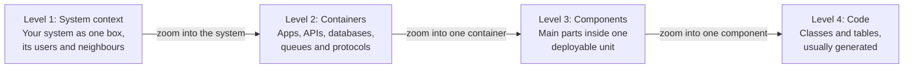
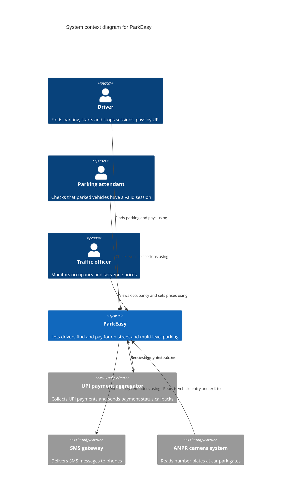
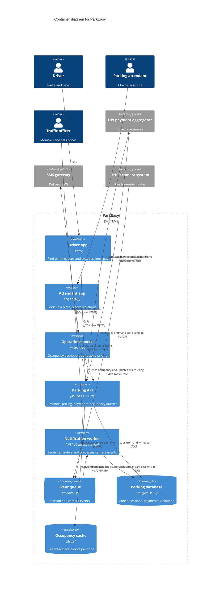
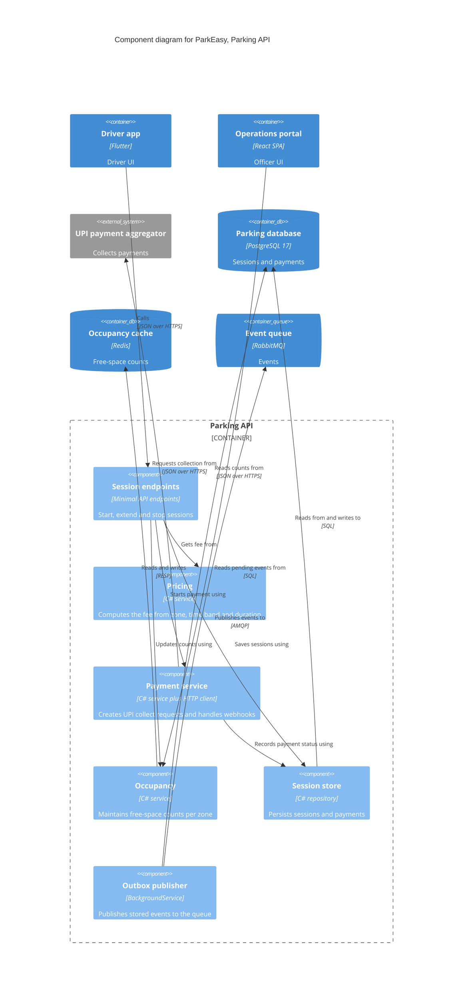
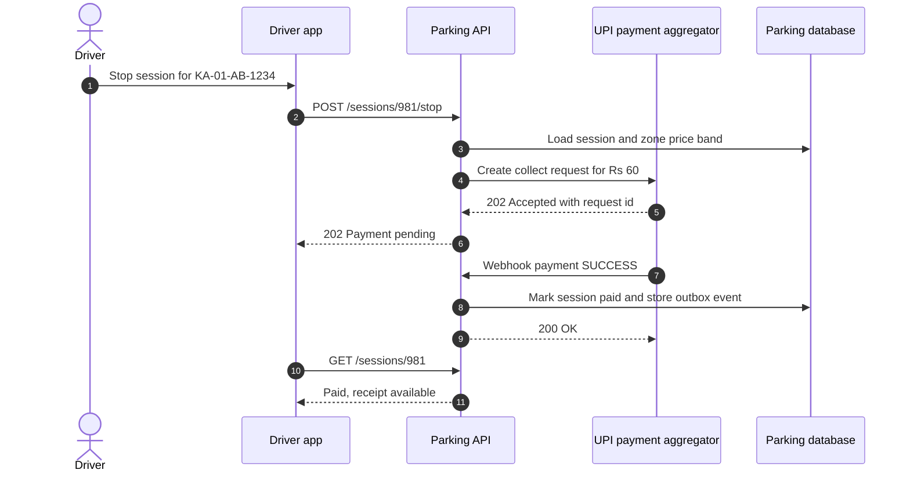
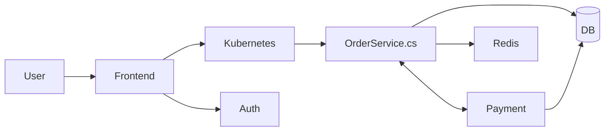
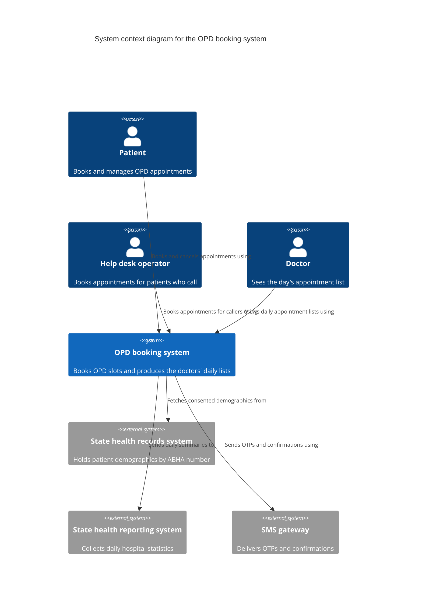
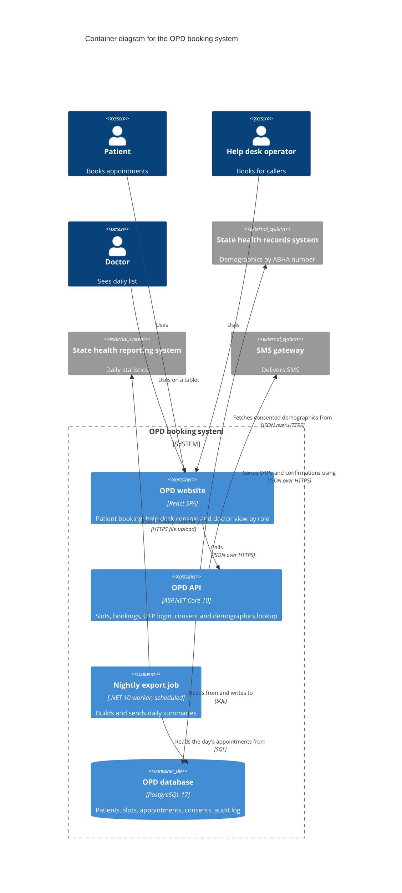

Most architecture diagrams fail in the same way: boxes with no labels, arrows with no meaning, a database next to a "user" next to a Kubernetes pod next to a class name, all on one slide. Nobody can say what level of detail it shows or who it is for. The **C4 model**, created by Simon Brown, fixes this with a simple idea borrowed from maps: **zoom levels**. You draw a few diagrams, each at one level of detail, each for a known audience, and each using the same small set of building blocks.

## Learning objectives

By the end of this lesson you will be able to:

1. Name the four C4 abstractions (person, software system, container, component) and the four core diagrams (system context, container, component, code).
2. Decide whether something is a software system, a container or a component, including the tricky cases (databases, queues, serverless functions, libraries).
3. Apply the C4 notation rules: titles, element types, descriptions, technology, labelled one-way relationships and a legend.
4. Pick the right diagram for an audience: executives, product owners, developers, operations, auditors.
5. Know the supplementary diagrams (system landscape, dynamic, deployment) and when to use them.
6. Write C4 diagrams as code with Mermaid, and understand how a model-based tool generates many views from one model.

## Prerequisites

- [UML fundamentals](#/lesson/m05-uml-fundamentals): why diagrams help and when they don't.
- [What is software architecture?](#/lesson/m02-what-is-architecture) and [HLD versus LLD](#/lesson/m02-hld-vs-lld): the difference between big decisions and code-level detail.
- A rough idea of what a web API, a database and a message queue are.

## Explain it like I'm a beginner

### Google Maps for software

Open a map app and look at Bengaluru. Fully zoomed out, you see India and a dot for the city. Zoom in: the city's areas and main roads. Zoom in again: the streets of Koramangala. Once more: one building. Each zoom level answers a different question and hides the detail that would get in the way. Nobody wants every building in India on one screen.

C4 gives software the same four zoom levels:

1. **System context**: the dot on the map. Our system, the people who use it, and the other systems it talks to. No technology.
2. **Container**: the city's areas. The separately running parts inside our system: the mobile app, the web API, the database, the background worker, and how they talk.
3. **Component**: the streets of one area. The main building blocks *inside one* container, such as the pricing logic or the payment webhook handler in the API.
4. **Code**: one building. Classes and tables for one component. Usually generated by your IDE or skipped.

The name C4 comes from those four "C"s: **Context, Containers, Components, Code**.

### Our running example: ParkEasy

A city's smart-parking system, *ParkEasy*, lets drivers in Bengaluru find on-street parking, start a session from a phone, and pay by UPI. Parking attendants check vehicles with a handheld app. Number-plate cameras at multi-level car parks report entries and exits. City traffic officers see occupancy dashboards and set prices per zone. The system sends SMS reminders before a session expires.

We'll draw ParkEasy at every level in this lesson. The [next lesson](#/lesson/m05-c4-views) does a larger worked example from start to finish.

## First-principles explanation

### Why "just boxes and arrows" fails

Ask five engineers to draw the same system and you get five pictures with five different meanings for a box. Common problems:

- **Mixed abstraction levels**: "Customer", "Kubernetes", "OrderService class" and "PostgreSQL" side by side.
- **Unlabelled arrows**: does the arrow mean "calls", "sends data to", "depends on" or "deploys to"? Which way does the data go?
- **No key**: what does a dashed line mean? A blue box? A cylinder?
- **Missing technology**: is this arrow HTTP, gRPC, a queue, or a shared database?

UML solves this with a large, precise notation that most teams never fully learn. C4 takes a different route: **a small set of abstractions, a few rules, and freedom in how things look**. C4 is "notation independent": you can use any shapes and colours, as long as you include a legend and follow the rules.

### The four abstractions

C4 is built on a hierarchy. Get these four words right and the diagrams follow.

**Person.** A human who uses the system: a driver, a parking attendant, a traffic officer. Roles, not individuals. ("Mr Gowda from the transport department" is a person; "traffic officer" is the role you draw.)

**Software system.** The highest level of abstraction: something that delivers value to its users and is **owned by one team** (or one organisation). ParkEasy is a software system. So is the UPI payment aggregator it calls, and the SMS gateway. A practical test: *if you can't change its code or deploy it, it's someone else's software system*.

**Container.** A **separately runnable or deployable** unit that executes code or stores data, inside a software system. Examples:

- A server-side web application or API (an ASP.NET Core 10 app).
- A single-page app running in the browser, or a mobile app on a phone.
- A background worker or scheduled job.
- A database schema (PostgreSQL 17), a cache (Redis), a queue or topic (RabbitMQ), a blob container in object storage.
- A serverless function app.

Important: **a C4 container is not a Docker container.** The word was chosen before Docker became popular. A C4 container is anything that needs to be running for the system to work, whether it runs on a VM, in Kubernetes, in a browser or as a managed cloud service. A Docker container is one *deployment* option for a C4 container.

**Component.** A grouping of related functionality behind a well-defined interface, **inside one container**, that isn't separately deployable. In C#, a component is usually a few classes: an interface and its implementation, a feature folder, or a namespace. "Pricing", "Payment webhook handler", "Session repository" are components of the ParkEasy API. A component lives and dies with its container: you can't deploy "Pricing" on its own.

**Code.** The classes, interfaces, functions and tables that make up a component. C4 doesn't define a notation for this level; you use [class diagrams](#/lesson/m05-class-diagrams) or [ER diagrams](#/lesson/m05-er-diagrams).

The hierarchy is strict: a software system is made of containers, a container is made of components, a component is implemented by code. This strictness is what makes zooming work.

### Tricky classification cases

| Thing | C4 element | Why |
|---|---|---|
| The PostgreSQL database our API uses | Container (inside our system) | Runs separately and stores our data; we own its schema |
| A shared enterprise data warehouse another team runs | Software system (external) | We can't change or deploy it |
| Redis used as a cache | Container | Separately running process |
| A NuGet library such as a PDF generator | Not an element; part of a component | Not separately running; mention it as technology |
| An Azure Function app with 6 functions | One container | Deployed as one unit; functions may be components |
| A Kubernetes cluster, a VM, an Azure region | Not an element on the core diagrams | Infrastructure; it belongs on a **deployment** diagram |
| An API gateway or load balancer | Usually not shown on container diagrams | Infrastructure that routes traffic; show it on a deployment diagram unless it contains your logic |
| A microservice | A software system (if a separate team owns it) or a group of containers (API + its database) | Ownership decides |
| A UPI app on the driver's phone | Usually not drawn; drawn as an external system only if our system talks to it | Draw what our system interacts with |

The last two rows show the most common debate. C4's guidance is to decide by **ownership and deployment**: if a "microservice" is owned by your team and is part of your product, model its API and its database as two containers in your system. If it belongs to another team with its own roadmap, it's an external software system.

### The four core diagrams and their audiences

**Level 1, System context diagram.** Shows your system as one box in the middle, the people who use it, and the external systems it depends on or that depend on it. No technology, no protocols, no internal parts.

- *Audience*: everyone, technical or not: product owners, sponsors, auditors, new team members, a client's business head.
- *Answers*: What is this system? Who uses it? What does it connect to? What is in scope and what isn't?

**Level 2, Container diagram.** Zooms into your system and shows its containers, their technologies, and how they communicate (protocols, sync or async). People and external systems from level 1 stay at the edges.

- *Audience*: developers, architects, operations and security reviewers.
- *Answers*: What are the major technical building blocks? Where does data live? How do the parts talk? Where are the trust boundaries?

**Level 3, Component diagram.** Zooms into **one** container and shows its components and their responsibilities and dependencies.

- *Audience*: developers working on that container.
- *Answers*: How is this API structured? Where does pricing logic live? What does the webhook handler depend on?
- Draw it only for containers that are complex or important. Many teams generate it, or skip it.

**Level 4, Code diagram.** Class or ER diagrams for one component. Simon Brown's own advice is to draw this level only when it adds value and prefer generating it, because code changes too fast for hand-drawn class diagrams to stay true.

A good rule of thumb: **levels 1 and 2 are useful for almost every system; level 3 for some containers; level 4 rarely**.

### Supplementary diagrams

The core four describe *static structure*. C4 adds three supplementary diagrams:

- **System landscape diagram**: a context diagram for a whole organisation, showing many systems and people without focusing on one. Useful for an enterprise architecture team, or a state government department with 40 systems.
- **Dynamic diagram**: shows how elements collaborate at runtime for one scenario (like "driver pays for parking"), with numbered steps. Many teams use a [sequence diagram](#/lesson/m05-sequence-diagrams) instead, which shows order more clearly.
- **Deployment diagram**: maps containers onto infrastructure: regions, clusters, VMs, managed services, availability zones. This is where Kubernetes, load balancers and Azure regions go. See [Deployment diagrams](#/lesson/m05-deployment-diagrams).

### The notation rules

C4 doesn't prescribe shapes, but it does prescribe content. The checklist from the C4 model, in plain words:

**For every diagram:**

- A **title** that says the diagram type and scope: "Container diagram for ParkEasy".
- A **key or legend** that explains every shape, colour, line style and arrowhead you used. (Even if you think it's obvious.)
- **Acronyms and abbreviations explained**: ANPR, VPA, KYC.

**For every element:**

- A **name**.
- The **element type** made explicit: Person, Software System, Container, Component. Often written in square brackets under the name: `[Container: ASP.NET Core 10]`.
- A short **description** of its responsibility: "Handles session start and stop, pricing and payment confirmation."
- For containers and components, the **technology**: "ASP.NET Core 10 minimal API", "PostgreSQL 17", "Flutter".

**For every relationship:**

- **One direction**. If data flows both ways, it's usually a request and a response: label the *request* direction ("Reads occupancy from"). If two things genuinely initiate calls to each other, draw two arrows, each labelled.
- A **label describing intent**, written so it reads as a sentence from source to destination: "Sends SMS reminders using". Avoid vague labels: "uses", "calls", "data".
- For relationships between containers, the **technology or protocol**: "JSON over HTTPS", "AMQP", "SQL over TCP 5432".

These rules sound fussy, but they are what lets a stranger understand your diagram without you in the room.

### Showing synchronous and asynchronous communication

C4 itself doesn't fix line styles, so define them in your legend. A common convention:

- Solid line: synchronous request and response (HTTP, gRPC, SQL).
- Dashed line: asynchronous messaging (publishing to a queue or topic).

Many teams draw the queue as its own container (`ContainerQueue` in Mermaid), so the arrows show "API publishes `SessionStarted` to the queue" and "Worker consumes `SessionStarted` from the queue". This makes ownership of the queue, and the failure point it introduces, visible.

### How C4 relates to UML

C4 isn't a replacement for UML; it sits above it:

| Need | Use |
|---|---|
| System scope and users | C4 system context |
| Runtime building blocks and protocols | C4 container |
| Inside one deployable | C4 component, or a [UML component diagram](#/lesson/m05-component-diagrams) |
| Classes, tables | UML class diagram, ER diagram |
| Runtime order | UML sequence diagram, C4 dynamic |
| Infrastructure | C4 deployment, UML deployment diagram |

UML's component and deployment diagrams can draw the same content as C4's levels 3 and deployment. C4's advantage is a shared, small vocabulary that non-UML readers understand.

### Diagrams as code: model versus picture

There are two ways to keep C4 diagrams:

1. **Diagram-first.** Each diagram is a separate file (Mermaid, PlantUML with the C4 library, or a drawing tool). Simple, but if you rename the "Parking API" you must edit every diagram that shows it.
2. **Model-first.** You describe the model once (people, systems, containers, components and relationships), and a tool generates each view. The Structurizr DSL is the reference tool for this. Renaming happens in one place, and the tool can **infer** higher-level relationships: if the Pricing component reads from the database, then the API container reads from the database, and ParkEasy as a whole needs nothing external for that.

Mermaid has C4 diagram types (`C4Context`, `C4Container`, `C4Component`, `C4Dynamic`, `C4Deployment`). Mermaid's C4 support is still marked experimental and its automatic layout is basic, so keep diagrams small and use layout hints (`Rel_D`, `UpdateLayoutConfig`) sparingly. The syntax:

```text
C4Container
    title Container diagram for ParkEasy
    Person(driver, "Driver", "Parks a car and pays by UPI")
    System_Boundary(pe, "ParkEasy") {
        Container(api, "Parking API", "ASP.NET Core 10", "Sessions, pricing, payments")
        ContainerDb(db, "Parking database", "PostgreSQL 17", "Zones, sessions, payments")
    }
    System_Ext(upi, "UPI payment aggregator", "Collects UPI payments")
    Rel(driver, api, "Starts and stops sessions using", "HTTPS")
    Rel(api, db, "Reads from and writes to", "SQL")
    Rel(api, upi, "Requests payment collection from", "JSON over HTTPS")
```

- `Person`, `Person_Ext`, `System`, `System_Ext`, `SystemDb`, `SystemQueue`: arguments are `(id, "name", "description")`.
- `Container`, `ContainerDb`, `ContainerQueue`, `Container_Ext`, `Component`, `ComponentDb`: `(id, "name", "technology", "description")`.
- Boundaries group children: `System_Boundary(id, "label") { ... }`, `Container_Boundary`, `Enterprise_Boundary`.
- `Rel(from, to, "label", "technology")`. `Rel_D`, `Rel_U`, `Rel_L`, `Rel_R` hint a direction. `BiRel` exists, but prefer two one-way arrows.

The platform's **HLD playground** works in a similar model-first way: you build the graph once, and the playground can render it and **compare your design with a reference** design. The **LLD playground** does the same for class models at C4's code level.

### When C4 is overkill

- A single ASP.NET Core app with one database and no integrations: a three-box container diagram is plenty; skip context and component diagrams.
- A throwaway prototype: a whiteboard photo is fine.
- When your organisation already has a well-understood notation (for example, ArchiMate for enterprise architecture) and everybody reads it: don't introduce a second one for the same audience.

C4 is a tool for communication. If a diagram doesn't help someone make a decision or understand the system faster, don't draw it.

## Visual explanation

### The zoom levels



Each arrow is a zoom: you pick **one** element from the diagram on the left and open it up. You never zoom into everything at once. The container diagram opens up the single system box from the context diagram; a component diagram opens up one container, not all of them. Detail and audience change together: moving right, the diagrams get more technical and are read by fewer people.

### Level 1: ParkEasy system context



This is the whole system on one page, for anyone. Three **roles** use ParkEasy, each with a different goal written in their description. Three **external systems** sit at the edge: we don't own them, but ParkEasy depends on each, and each is a risk to discuss (what happens when the payment aggregator is slow?). Notice the two arrows between ParkEasy and the UPI aggregator: we call them to request payment, and they call us back with the result. Those are separate interactions initiated by different sides, so they get separate, labelled arrows. There is no technology on this diagram, because the audience doesn't need it.

### Level 2: ParkEasy containers



Now the technical audience can see the moving parts:

- **Three user-facing containers**, one per role, each with its technology. People connect only to the app they use, not to the API directly.
- **The Parking API** is the only container that talks to the database synchronously from user requests, and the only one that talks to the payment aggregator. That's a design decision you can now discuss: it puts payment code in one place, but also makes the API a critical dependency for every user.
- **The queue** decouples slow work (SMS) and bursty work (camera events at 9 a.m.) from user requests. The camera system publishes straight into our queue, which is a trust boundary: the security reviewer will ask how it authenticates.
- **Two data stores** with different jobs: PostgreSQL is the source of truth; Redis holds counts that can be rebuilt from the database if lost.
- **Every arrow has a protocol.** "RESP" is the Redis protocol. Readers who don't know it can look it up in the legend.

What's *not* here is as important: no load balancer, no Kubernetes, no Azure region. They are deployment concerns and belong on a deployment diagram.

### Level 3: components of the Parking API



This diagram is for the developers of one container. Each component is a cohesive part with one responsibility, implemented as a few C# classes. Relationships between components inside the API have no protocol, because they are in-process method calls. Relationships that leave the container do have one. The **Outbox publisher** shows a design choice clearly: session endpoints don't publish to RabbitMQ directly; they store events in the database in the same transaction, and a background service publishes them, so an event is never lost if RabbitMQ is down. A reviewer can see that from the arrows alone.

### Dynamic view: a driver pays for a session



C4's dynamic diagram and a sequence diagram show the same thing; most teams find the sequence diagram easier to read for ordered steps. Each participant is an element from the container diagram, so readers can switch between the two. The diagram makes one important property visible: payment is **asynchronous**. The API returns "pending" immediately, and the real result arrives later as a webhook. The app then polls (or could receive a push notification). Without this diagram, many developers would assume the stop call waits for payment.

## Step-by-step example

How do you create a C4 diagram set for a system you are joining, with no documentation? Here's a workable sequence, using ParkEasy.

### Step 1 — agree the scope and the name

Write one sentence: "ParkEasy lets drivers find and pay for on-street and multi-level parking in Bengaluru." This settles what is *inside* the system box. The ANPR cameras are bought from a vendor and run their own software, so they are outside.

### Step 2 — list people and external systems (level 1)

Ask: who uses it (roles), and what does it talk to? Check configuration files and `appsettings.json` for base URLs: every external URL is a candidate external system. For ParkEasy: `Upi:BaseUrl`, `Sms:BaseUrl`, and a RabbitMQ user for the camera vendor. Draw the context diagram and show it to the product owner. Ask: "Is anything missing? Is anything wrong?" This takes 30 minutes and often reveals a forgotten integration (in our case, the attendant app).

### Step 3 — list the deployables (level 2)

Look at the deployment pipeline, the solution file, the Kubernetes manifests or the cloud portal. Every separately deployed thing is a candidate container: the API, the worker, the two apps, the portal, PostgreSQL, Redis, RabbitMQ. For each, write its technology and one sentence of responsibility.

### Step 4 — draw the arrows and label them

For each container, ask: who does it call, and how? Use the code (HTTP clients, connection strings, message publishers) rather than memory. Label each arrow with intent and protocol. If you find yourself writing "uses", ask "uses for what?"

### Step 5 — decide whether level 3 is worth it

Draw a component diagram only for a container that is complex, risky or frequently changed. For ParkEasy, the Parking API qualifies; the notification worker, with two message handlers, doesn't.

### Step 6 — add titles, legends and a date, and put them next to the code

Commit the diagrams as Mermaid (or a Structurizr workspace) in `docs/architecture/`, link them from the README, and add "update the diagrams if this changes the architecture" to the pull request template.

## Production-style C# implementation

Teams that adopt the model-first approach describe their architecture once, in code, and generate views from it. Below is a small "architecture as code" library in C#: a model with C4's hierarchy rules, a linter for the notation rules, a view builder that **infers** higher-level relationships, and a Mermaid writer. A minimal ASP.NET Core API serves the generated diagrams so the docs site always shows the current model.

```text
ParkEasy.Architecture/
  Program.cs
  Model/
    C4Model.cs          // elements, relationships, hierarchy rules
    NotationLinter.cs   // C4 notation checklist as code
  Views/
    ViewBuilder.cs      // system context and container views, with implied relationships
    MermaidC4Writer.cs  // view -> C4Context / C4Container text
  ParkEasyModel.cs      // the model from this lesson
```

```csharp file=Model/C4Model.cs
namespace ParkEasy.Architecture.Model;

public enum ElementKind { Person, SoftwareSystem, Container, Component }

public enum Shape { Box, Database, Queue }

public sealed record Element(
    string Id,
    string Name,
    ElementKind Kind,
    string Description,
    string? Technology = null,
    string? ParentId = null,
    bool IsExternal = false,
    Shape Shape = Shape.Box);

/// <summary>One-way, labelled relationship. The label reads as a sentence from source to destination.</summary>
public sealed record Relationship(string SourceId, string DestinationId, string Description, string? Technology = null);

public sealed class ArchitectureModel
{
    private readonly List<Element> _elements = new();
    private readonly Dictionary<string, Element> _byId = new(StringComparer.Ordinal);
    private readonly List<Relationship> _relationships = new();

    public IReadOnlyList<Element> Elements => _elements;
    public IReadOnlyList<Relationship> Relationships => _relationships;

    public ArchitectureModel Add(Element element)
    {
        ArgumentNullException.ThrowIfNull(element);
        ArgumentException.ThrowIfNullOrWhiteSpace(element.Id);
        if (_byId.ContainsKey(element.Id)) throw new InvalidOperationException($"Duplicate element id '{element.Id}'.");

        // The C4 hierarchy: system > container > component. People and systems are top level.
        var expectedParent = element.Kind switch
        {
            ElementKind.Container => ElementKind.SoftwareSystem,
            ElementKind.Component => ElementKind.Container,
            _ => (ElementKind?)null,
        };
        if (expectedParent is null && element.ParentId is not null)
            throw new InvalidOperationException($"{element.Kind} '{element.Id}' must not have a parent.");
        if (expectedParent is { } kind)
        {
            if (element.ParentId is null || !_byId.TryGetValue(element.ParentId, out var parent) || parent.Kind != kind)
                throw new InvalidOperationException($"{element.Kind} '{element.Id}' needs a parent of kind {kind}.");
        }

        _elements.Add(element);
        _byId[element.Id] = element;
        return this;
    }

    public ArchitectureModel Relate(string sourceId, string destinationId, string description, string? technology = null)
    {
        if (!_byId.ContainsKey(sourceId)) throw new InvalidOperationException($"Unknown source '{sourceId}'.");
        if (!_byId.ContainsKey(destinationId)) throw new InvalidOperationException($"Unknown destination '{destinationId}'.");
        if (sourceId == destinationId) throw new InvalidOperationException("An element can't have a relationship with itself.");
        _relationships.Add(new Relationship(sourceId, destinationId, description, technology));
        return this;
    }

    public Element Get(string id) => _byId.TryGetValue(id, out var e) ? e : throw new KeyNotFoundException(id);

    public IEnumerable<Element> ChildrenOf(string parentId) => _elements.Where(e => e.ParentId == parentId);

    /// <summary>Walks up the hierarchy to the nearest element of the given kind (or the element itself).</summary>
    public Element? AncestorOrSelf(string id, ElementKind kind)
    {
        for (var current = Get(id); ; current = Get(current.ParentId!))
        {
            if (current.Kind == kind) return current;
            if (current.ParentId is null) return null;
        }
    }

    public bool IsInside(string id, string ancestorId)
    {
        for (var current = Get(id); ; current = Get(current.ParentId!))
        {
            if (current.Id == ancestorId) return true;
            if (current.ParentId is null) return false;
        }
    }
}
```

```csharp file=Model/NotationLinter.cs
namespace ParkEasy.Architecture.Model;

/// <summary>The C4 notation checklist, as code. Run it in CI so diagrams stay readable.</summary>
public static class NotationLinter
{
    private static readonly HashSet<string> VagueLabels = new(StringComparer.OrdinalIgnoreCase)
    {
        "uses", "calls", "talks to", "connects to", "data", "sends",
    };

    public static IReadOnlyList<string> Lint(ArchitectureModel model)
    {
        var problems = new List<string>();
        foreach (var e in model.Elements)
        {
            if (string.IsNullOrWhiteSpace(e.Description))
                problems.Add($"{e.Id}: add a description of its responsibility");
            if (e.Kind is ElementKind.Container or ElementKind.Component && string.IsNullOrWhiteSpace(e.Technology))
                problems.Add($"{e.Id}: {e.Kind} needs a technology");
        }

        foreach (var r in model.Relationships)
        {
            var source = model.Get(r.SourceId);
            var destination = model.Get(r.DestinationId);
            if (string.IsNullOrWhiteSpace(r.Description))
                problems.Add($"{r.SourceId} -> {r.DestinationId}: missing label");
            // "Uses" is acceptable from a person to the app they use; elsewhere say what and why.
            else if (VagueLabels.Contains(r.Description.Trim()) && source.Kind != ElementKind.Person)
                problems.Add($"{r.SourceId} -> {r.DestinationId}: vague label '{r.Description}'");

            var crossesProcess = source.Kind is ElementKind.Container or ElementKind.SoftwareSystem
                || destination.Kind is ElementKind.Container or ElementKind.SoftwareSystem;
            if (crossesProcess && source.Kind != ElementKind.Person && string.IsNullOrWhiteSpace(r.Technology)
                && source.ParentId is not null)
                problems.Add($"{r.SourceId} -> {r.DestinationId}: add the protocol or technology");
        }
        return problems;
    }
}
```

```csharp file=Views/ViewBuilder.cs
using ParkEasy.Architecture.Model;

namespace ParkEasy.Architecture.Views;

public sealed record View(string Title, Element Scope, IReadOnlyList<Element> InScope,
    IReadOnlyList<Element> Neighbours, IReadOnlyList<Relationship> Relationships);

/// <summary>
/// Builds C4 views from one model. Relationships drawn at a lower level (component to database) are
/// lifted to the level of the view (container to database, or system to system). This is how model-based
/// tools keep every diagram consistent.
/// </summary>
public static class ViewBuilder
{
    public static View SystemContext(ArchitectureModel model, string systemId)
    {
        var system = Require(model, systemId, ElementKind.SoftwareSystem);
        // Everything inside the system collapses to the system box; outside elements show at system level.
        Element? Project(Element e) => model.IsInside(e.Id, systemId)
            ? system
            : e.Kind == ElementKind.Person ? e : model.AncestorOrSelf(e.Id, ElementKind.SoftwareSystem);

        return Build(model, $"System context diagram for {system.Name}", system, [system], Project);
    }

    public static View Containers(ArchitectureModel model, string systemId)
    {
        var system = Require(model, systemId, ElementKind.SoftwareSystem);
        var containers = model.ChildrenOf(systemId).ToList();
        Element? Project(Element e)
        {
            if (model.IsInside(e.Id, systemId))
                return e.Id == systemId ? null : model.AncestorOrSelf(e.Id, ElementKind.Container);
            // Containers of other systems appear as their system, unless that system is ours.
            return e.Kind == ElementKind.Person ? e : model.AncestorOrSelf(e.Id, ElementKind.SoftwareSystem);
        }

        return Build(model, $"Container diagram for {system.Name}", system, containers, Project);
    }

    private static View Build(ArchitectureModel model, string title, Element scope, IReadOnlyList<Element> inScope,
        Func<Element, Element?> project)
    {
        var inScopeIds = inScope.Select(e => e.Id).ToHashSet();
        var seen = new HashSet<(string, string)>();
        var relationships = new List<Relationship>();
        var neighbours = new List<Element>();

        foreach (var r in model.Relationships)
        {
            var from = project(model.Get(r.SourceId));
            var to = project(model.Get(r.DestinationId));
            if (from is null || to is null || from.Id == to.Id) continue;                 // internal to one box
            if (!inScopeIds.Contains(from.Id) && !inScopeIds.Contains(to.Id)) continue;  // unrelated to this view
            if (!seen.Add((from.Id, to.Id))) continue;                                   // keep the first label per pair

            var lifted = from.Id != r.SourceId || to.Id != r.DestinationId;
            relationships.Add(new Relationship(from.Id, to.Id, r.Description, lifted && scope.Kind == ElementKind.SoftwareSystem
                && inScopeIds.Count == 1 ? null : r.Technology));
            foreach (var e in new[] { from, to })
                if (!inScopeIds.Contains(e.Id) && neighbours.All(n => n.Id != e.Id)) neighbours.Add(e);
        }
        return new View(title, scope, inScope, neighbours, relationships);
    }

    private static Element Require(ArchitectureModel model, string id, ElementKind kind)
    {
        var e = model.Get(id);
        return e.Kind == kind ? e : throw new ArgumentException($"'{id}' is a {e.Kind}, not a {kind}.", nameof(id));
    }
}
```

```csharp file=Views/MermaidC4Writer.cs
using System.Text;
using ParkEasy.Architecture.Model;

namespace ParkEasy.Architecture.Views;

public static class MermaidC4Writer
{
    public static string Write(View view)
    {
        var isContext = view.InScope.Count == 1 && view.InScope[0].Kind == ElementKind.SoftwareSystem;
        var sb = new StringBuilder(isContext ? "C4Context\n" : "C4Container\n");
        sb.Append($"    title {view.Title}\n");

        foreach (var n in view.Neighbours) sb.Append("    ").Append(ElementLine(n)).Append('\n');

        if (isContext)
        {
            sb.Append("    ").Append(ElementLine(view.Scope)).Append('\n');
        }
        else
        {
            sb.Append($"    System_Boundary({view.Scope.Id}, \"{Q(view.Scope.Name)}\") {{\n");
            foreach (var c in view.InScope) sb.Append("        ").Append(ElementLine(c)).Append('\n');
            sb.Append("    }\n");
        }

        foreach (var r in view.Relationships)
        {
            var tech = string.IsNullOrWhiteSpace(r.Technology) ? "" : $", \"{Q(r.Technology)}\"";
            sb.Append($"    Rel({r.SourceId}, {r.DestinationId}, \"{Q(r.Description)}\"{tech})\n");
        }
        return sb.ToString();
    }

    private static string ElementLine(Element e)
    {
        var ext = e.IsExternal ? "_Ext" : "";
        return e.Kind switch
        {
            ElementKind.Person => $"Person{ext}({e.Id}, \"{Q(e.Name)}\", \"{Q(e.Description)}\")",
            ElementKind.SoftwareSystem => $"{ShapeName("System", e.Shape)}{ext}({e.Id}, \"{Q(e.Name)}\", \"{Q(e.Description)}\")",
            ElementKind.Container => $"{ShapeName("Container", e.Shape)}{ext}({e.Id}, \"{Q(e.Name)}\", \"{Q(e.Technology ?? "")}\", \"{Q(e.Description)}\")",
            _ => $"{ShapeName("Component", e.Shape)}{ext}({e.Id}, \"{Q(e.Name)}\", \"{Q(e.Technology ?? "")}\", \"{Q(e.Description)}\")",
        };
    }

    private static string ShapeName(string baseName, Shape shape) => shape switch
    {
        Shape.Database => baseName + "Db",
        Shape.Queue => baseName + "Queue",
        _ => baseName,
    };

    /// <summary>Mermaid C4 arguments are double-quoted strings, so inner quotes become single quotes.</summary>
    private static string Q(string text) => text.Replace('"', '\'');
}
```

```csharp file=ParkEasyModel.cs
using ParkEasy.Architecture.Model;

namespace ParkEasy.Architecture;

public static class ParkEasyModel
{
    public static ArchitectureModel Build()
    {
        var m = new ArchitectureModel()
            .Add(new Element("driver", "Driver", ElementKind.Person, "Finds parking, starts and stops sessions, pays by UPI"))
            .Add(new Element("officer", "Traffic officer", ElementKind.Person, "Monitors occupancy and sets zone prices"))
            .Add(new Element("parkeasy", "ParkEasy", ElementKind.SoftwareSystem, "Find and pay for parking in Bengaluru"))
            .Add(new Element("upi", "UPI payment aggregator", ElementKind.SoftwareSystem, "Collects UPI payments", IsExternal: true))
            .Add(new Element("sms", "SMS gateway", ElementKind.SoftwareSystem, "Delivers SMS messages", IsExternal: true))
            .Add(new Element("mobile", "Driver app", ElementKind.Container, "Find parking, start and stop sessions", "Flutter", "parkeasy"))
            .Add(new Element("portal", "Operations portal", ElementKind.Container, "Occupancy dashboards and pricing", "React SPA", "parkeasy"))
            .Add(new Element("api", "Parking API", ElementKind.Container, "Sessions, pricing, payments", "ASP.NET Core 10", "parkeasy"))
            .Add(new Element("worker", "Notification worker", ElementKind.Container, "Sends expiry reminders", ".NET 10 worker service", "parkeasy"))
            .Add(new Element("queue", "Event queue", ElementKind.Container, "Session events", "RabbitMQ", "parkeasy", Shape: Shape.Queue))
            .Add(new Element("db", "Parking database", ElementKind.Container, "Zones, sessions, payments", "PostgreSQL 17", "parkeasy", Shape: Shape.Database))
            .Add(new Element("sessions", "Session endpoints", ElementKind.Component, "Start, extend and stop sessions", "Minimal API endpoints", "api"))
            .Add(new Element("payments", "Payment service", ElementKind.Component, "UPI collect requests and webhooks", "C# service", "api"))
            .Add(new Element("store", "Session store", ElementKind.Component, "Persists sessions", "C# repository", "api"));

        return m
            .Relate("driver", "mobile", "Uses")
            .Relate("officer", "portal", "Uses")
            .Relate("mobile", "sessions", "Starts and stops sessions using", "JSON over HTTPS")
            .Relate("portal", "api", "Reads occupancy and updates prices using", "JSON over HTTPS")
            .Relate("sessions", "payments", "Starts payment using")
            .Relate("sessions", "store", "Saves sessions using")
            .Relate("payments", "upi", "Requests payment collection from", "JSON over HTTPS")
            .Relate("store", "db", "Reads from and writes to", "SQL")
            .Relate("api", "queue", "Publishes session events to", "AMQP")
            .Relate("queue", "worker", "Delivers events to", "AMQP")
            .Relate("worker", "sms", "Sends reminders using", "JSON over HTTPS");
    }
}
```

```csharp file=Program.cs
using ParkEasy.Architecture;
using ParkEasy.Architecture.Model;
using ParkEasy.Architecture.Views;

var builder = WebApplication.CreateBuilder(args);
builder.Services.AddSingleton(ParkEasyModel.Build());

var app = builder.Build();

app.MapGet("/architecture/{systemId}/context", (string systemId, ArchitectureModel model) =>
    Results.Text(MermaidC4Writer.Write(ViewBuilder.SystemContext(model, systemId)), "text/plain"));

app.MapGet("/architecture/{systemId}/containers", (string systemId, ArchitectureModel model) =>
    Results.Text(MermaidC4Writer.Write(ViewBuilder.Containers(model, systemId)), "text/plain"));

// CI calls this and fails the build if the list isn't empty.
app.MapGet("/architecture/lint", (ArchitectureModel model) => NotationLinter.Lint(model));

app.Run();
```

What the implementation shows:

- **The hierarchy is enforced.** A component without a container parent is rejected when added, so the model can't contain the "mixed levels" mistake.
- **Relationships are recorded at the most specific level** (`mobile -> sessions`, `store -> db`) and **lifted** for each view. On the container view, `mobile -> sessions` becomes `mobile -> api`; on the context view, `payments -> upi` becomes `parkeasy -> upi`, and the driver's relationship goes to the ParkEasy box. Internal relationships (`sessions -> payments`) disappear because both ends collapse into the same box.
- **The context view drops technology** on lifted relationships, matching the audience rule: no protocols on level 1.
- **The linter encodes the notation checklist.** "Uses" is accepted from a person to their app, which is the one place it is clear; elsewhere it is flagged.
- **One model, many diagrams.** Renaming the "Parking API" is a one-line change, and every view updates.

This is a deliberately small version of what the Structurizr DSL gives you, written so you can see the mechanics. For a real team, using an existing tool is usually better than maintaining your own.

## Bad design vs good design

A diagram from a project kick-off deck:



What's wrong:

- **Mixed levels.** `User` (person), `Frontend` (container), `Kubernetes` (infrastructure) and `OrderService.cs` (code) on one diagram.
- **No element types or technology.** Is `Frontend` a React app or a mobile app? Is `Auth` our service or Microsoft Entra ID?
- **Unlabelled arrows.** What does `FE --> K8S` mean? Kubernetes doesn't receive requests in any meaningful design sense.
- **A two-way arrow** between `API` and `Payment` hides which side starts the conversation (and whether there is a webhook).
- **`Payment --> DB`**: is an external payment provider writing to our database? Or is `Payment` our own service? The diagram can't say.
- **No title, no legend, no scope.** Which system is this? What does the cylinder mean?

The good version is the pair of ParkEasy context and container diagrams above: one level per diagram, every element with a type, technology and description, every arrow one-way, labelled with intent and protocol, and infrastructure moved to a deployment diagram.

:::callout type=mistake title="The 'everything' diagram"
A single diagram that tries to show context, containers, components and infrastructure is unreadable for every audience. The executive sees pods; the developer can't find the API's structure. Split it by zoom level. Three small diagrams are easier to read and to keep correct than one large one.
:::

:::callout type=tradeoff title="Hand-drawn diagrams or a model?"
A Mermaid file per diagram is easy to start and renders on GitHub and Azure DevOps with no tooling. A model (Structurizr DSL or code like the example above) keeps many views consistent and infers relationships, but needs a tool and someone who looks after it. For one system with three diagrams, files are fine. For an organisation with 20 systems and a system landscape view, a model pays for itself.
:::

## Practical playground

The HLD playground below starts with ParkEasy's container diagram drawn as a graph. Use it as a level 2 view:

1. Add the **attendant app** container and connect it to the API with a labelled edge.
2. Add the ANPR camera system as an `external` node publishing to the queue. Mark the edge `async`.
3. Add a Redis cache for occupancy counts and decide which edges go to it.
4. Compare your graph with the container diagram in the visual section. What's missing?

The playground can render the graph and compare it with a reference design, which is the model-first idea from this lesson in action. The **LLD playground** does the same for code-level class models.

:::playground type=hld title="ParkEasy container view"
```json
{
  "nodes": [
    { "id": "drivers", "type": "client", "label": "Driver app (Flutter)", "props": { "rps": 150 } },
    { "id": "portal", "type": "client", "label": "Operations portal (React SPA)" },
    { "id": "api", "type": "app-server", "label": "Parking API (ASP.NET Core 10)", "props": { "instances": 2 } },
    { "id": "db", "type": "database", "label": "Parking database (PostgreSQL 17)", "props": { "replicas": 0 } },
    { "id": "queue", "type": "queue", "label": "Event queue (RabbitMQ)" },
    { "id": "worker", "type": "worker", "label": "Notification worker (.NET 10)", "props": { "instances": 1 } },
    { "id": "upi", "type": "external", "label": "UPI payment aggregator" },
    { "id": "sms", "type": "external", "label": "SMS gateway" }
  ],
  "edges": [
    { "from": "drivers", "to": "api", "kind": "sync", "label": "JSON over HTTPS" },
    { "from": "portal", "to": "api", "kind": "sync", "label": "JSON over HTTPS" },
    { "from": "api", "to": "db", "kind": "sync", "label": "SQL" },
    { "from": "api", "to": "upi", "kind": "sync", "label": "collect request" },
    { "from": "api", "to": "queue", "kind": "async", "label": "session events" },
    { "from": "queue", "to": "worker", "kind": "async" },
    { "from": "worker", "to": "sms", "kind": "sync", "label": "reminders" }
  ]
}
```
:::

## Exercises

:::exercise id=m05-c4-model-ex1 difficulty=beginner kind=written title="Which C4 element is it?"
A state transport corporation runs an online bus-pass system. Classify each item as **person**, **software system** (yours or external), **container**, **component**, or **not a C4 element on the core diagrams** (with where it belongs instead). Give a one-line reason for each.

1. Students applying for a monthly pass.
2. The ASP.NET Core API that processes applications.
3. The `ConcessionRulesEngine` class library inside that API.
4. The PostgreSQL database holding applications.
5. DigiLocker, used to fetch a student's college ID.
6. The Azure Kubernetes Service cluster the API runs on.
7. An Azure Blob Storage container holding uploaded photos.
8. A nightly job that expires old passes, deployed separately.
9. The conductor's handheld ticket machine app, which this team also builds.
10. The NuGet package used to generate QR codes.
::acceptance
- At least 9 of 10 classified correctly.
- Reasons refer to ownership, separate deployment, or being inside one deployable.
- Item 6 is placed on a deployment diagram, and item 10 is treated as technology inside a component.
::hint
Ask first: "Do we own and deploy it?" If not, it's an external software system.
::hint
Then ask: "Does it run, or store data, separately from other parts?" If yes, it's a container.
::hint
If it's inside one deployable and has a clear responsibility, it's a component.
::hint
Infrastructure (clusters, VMs, regions) and libraries are not elements on the context, container or component diagrams.
::solution
1. **Person** (role: student).
2. **Container** in our system: a separately deployed web API.
3. **Component** of the API container: it's inside one deployable, with a clear responsibility.
4. **Container**: our data store, runs separately.
5. **External software system**: owned by someone else; we call its API.
6. **Not on the core diagrams**: it's infrastructure; show it on a **deployment diagram**.
7. **Container**: a data store we own (C4 treats a blob container or bucket as a container that stores data).
8. **Container**: separately deployed and runs on its own schedule.
9. **Container** in our system, because the same team builds and deploys it as part of the bus-pass system. If a different team owned it with its own roadmap, it could be modelled as a separate software system.
10. **Not an element**: a library is technology inside a component. Mention it in the component's technology ("C# service, QRCoder") if it matters.
::mistakes
- Calling the Kubernetes cluster a container because "it runs containers".
- Calling DigiLocker a container because "we use it".
- Treating every class as a component; components are groupings with an interface, not single helper classes.
:::

:::exercise id=m05-c4-model-ex2 difficulty=beginner kind=code title="Lint a C4 model against the notation rules"
Write a linter that checks a small C4 model against the notation checklist.
::requirements
- `C4Element(string Id, string Kind, string Name, string? Description, string? Technology)`; `Kind` is `person`, `system`, `container` or `component`.
- `C4Relationship(string From, string To, string? Label, string? Technology)`.
- `C4Linter.Lint(IReadOnlyList<C4Element> elements, IReadOnlyList<C4Relationship> relationships)` returns messages **in this order**: for each element in input order, its messages (rule 1 then rule 2); then for each relationship in input order, its messages (rule 3 then 4).
  1. `"{id}: missing description"` if the description is null or whitespace.
  2. `"{id}: {kind} needs a technology"` for a container or component without technology.
  3. `"{from} -> {to}: unknown element '{x}'"` for each end that isn't in the element list (from first, then to). If either end is unknown, skip rule 4.
  4. `"{from} -> {to}: missing label"` if the label is null or whitespace; otherwise `"{from} -> {to}: vague label '{label}'"` if the trimmed label, compared case-insensitively, is one of `uses`, `calls`, `talks to`, `connects to`, `data` **and the source is not a person**.
- A clean model returns an empty list.
::acceptance
- A container with no technology and no description produces two messages in order.
- `Rel(api, db, "Uses")` is flagged as vague; `Rel(driver, app, "Uses")` from a person is not.
- An unknown destination is reported, and no label check runs for that relationship.
- The output order matches the rules exactly.
::hint
Build a dictionary from id to element first, so relationship checks are quick.
::hint
Use a `HashSet<string>` with `StringComparer.OrdinalIgnoreCase` for the vague labels.
::hint
For rule 3, check both ends, add a message for each missing one, then `continue` if any were missing.
::hint
```csharp
foreach (var e in elements)
{
    if (string.IsNullOrWhiteSpace(e.Description)) messages.Add($"{e.Id}: missing description");
    if (e.Kind is "container" or "component" && string.IsNullOrWhiteSpace(e.Technology))
        messages.Add($"{e.Id}: {e.Kind} needs a technology");
}
```
::starter
```csharp file=C4Linter.cs
using System;
using System.Collections.Generic;
using System.Linq;

public sealed record C4Element(string Id, string Kind, string Name, string? Description, string? Technology);
public sealed record C4Relationship(string From, string To, string? Label, string? Technology);

public static class C4Linter
{
    public static IReadOnlyList<string> Lint(IReadOnlyList<C4Element> elements, IReadOnlyList<C4Relationship> relationships) =>
        throw new NotImplementedException();
}
```
::tests
```csharp file=C4LinterTests.cs
using System;
using System.Collections.Generic;
using Xunit;

public class C4LinterTests
{
    private static List<C4Element> Good() => new()
    {
        new("driver", "person", "Driver", "Parks and pays", null),
        new("app", "container", "Driver app", "Driver UI", "Flutter"),
        new("api", "container", "Parking API", "Sessions and payments", "ASP.NET Core 10"),
        new("db", "container", "Parking database", "Sessions", "PostgreSQL 17"),
        new("upi", "system", "UPI aggregator", "Collects payments", null),
    };

    [Fact]
    public void Clean_model_has_no_messages()
    {
        var rels = new List<C4Relationship>
        {
            new("driver", "app", "Uses", null),
            new("app", "api", "Starts sessions using", "HTTPS"),
            new("api", "db", "Reads from and writes to", "SQL"),
        };
        Assert.Empty(C4Linter.Lint(Good(), rels));
    }

    [Fact]
    public void Element_rules_in_order()
    {
        var elements = new List<C4Element> { new("worker", "container", "Worker", " ", null), new("pricing", "component", "Pricing", "Fees", "") };
        Assert.Equal(new[] { "worker: missing description", "worker: container needs a technology", "pricing: component needs a technology" },
            C4Linter.Lint(elements, new List<C4Relationship>()));
    }

    [Fact]
    public void Vague_labels_flagged_except_from_people()
    {
        var rels = new List<C4Relationship> { new("driver", "app", "uses", null), new("api", "db", " Uses ", "SQL"), new("api", "upi", "CALLS", "HTTPS") };
        Assert.Equal(new[] { "api -> db: vague label ' Uses '", "api -> upi: vague label 'CALLS'" }, C4Linter.Lint(Good(), rels));
    }

    [Fact]
    public void Missing_label()
    {
        var rels = new List<C4Relationship> { new("app", "api", null, "HTTPS") };
        Assert.Equal(new[] { "app -> api: missing label" }, C4Linter.Lint(Good(), rels));
    }

    [Fact]
    public void Unknown_elements_reported_and_label_check_skipped()
    {
        var rels = new List<C4Relationship> { new("api", "redis", "", "RESP"), new("ghost", "phantom", "uses", null) };
        Assert.Equal(new[]
        {
            "api -> redis: unknown element 'redis'",
            "ghost -> phantom: unknown element 'ghost'",
            "ghost -> phantom: unknown element 'phantom'",
        }, C4Linter.Lint(Good(), rels));
    }
}
```
::solution
```csharp file=C4Linter.cs
using System;
using System.Collections.Generic;
using System.Linq;

public sealed record C4Element(string Id, string Kind, string Name, string? Description, string? Technology);
public sealed record C4Relationship(string From, string To, string? Label, string? Technology);

public static class C4Linter
{
    private static readonly HashSet<string> Vague = new(StringComparer.OrdinalIgnoreCase)
    {
        "uses", "calls", "talks to", "connects to", "data",
    };

    public static IReadOnlyList<string> Lint(IReadOnlyList<C4Element> elements, IReadOnlyList<C4Relationship> relationships)
    {
        ArgumentNullException.ThrowIfNull(elements);
        ArgumentNullException.ThrowIfNull(relationships);
        var messages = new List<string>();
        var byId = new Dictionary<string, C4Element>(StringComparer.Ordinal);

        foreach (var e in elements)
        {
            byId[e.Id] = e;
            if (string.IsNullOrWhiteSpace(e.Description)) messages.Add($"{e.Id}: missing description");
            if (e.Kind is "container" or "component" && string.IsNullOrWhiteSpace(e.Technology))
                messages.Add($"{e.Id}: {e.Kind} needs a technology");
        }

        foreach (var r in relationships)
        {
            var prefix = $"{r.From} -> {r.To}";
            var unknown = false;
            foreach (var end in new[] { r.From, r.To })
            {
                if (byId.ContainsKey(end)) continue;
                messages.Add($"{prefix}: unknown element '{end}'");
                unknown = true;
            }
            if (unknown) continue;

            if (string.IsNullOrWhiteSpace(r.Label))
                messages.Add($"{prefix}: missing label");
            else if (Vague.Contains(r.Label.Trim()) && byId[r.From].Kind != "person")
                messages.Add($"{prefix}: vague label '{r.Label}'");
        }
        return messages;
    }
}
```

The linter makes the C4 checklist executable. The person exception exists because "Driver uses Driver app" is perfectly clear; "API uses database" isn't (reads? writes? both? for what?).
::alternatives
Return structured results (`LintResult(Code, ElementId, Message, Severity)`) instead of strings, so a CI step can treat some rules as warnings and others as errors.
::mistakes
- Sorting the messages, which breaks the required order.
- Running the label check for relationships with unknown ends, producing confusing extra messages.
- Comparing labels without trimming, so `" Uses "` slips through.
:::

:::exercise id=m05-c4-model-ex3 difficulty=intermediate kind=design title="Context and container diagrams for an OPD booking system"
A district hospital in Mysuru wants an outpatient (OPD) appointment system:

> "Patients book OPD slots on a website or by calling the help desk, where an operator books for them. Patients log in with an OTP sent by SMS. Doctors see their day's list on a tablet. The system pulls patient demographics from the state's health records system using the patient's ABHA number, when the patient allows it. Daily summaries go to the state health department's reporting system every night. The hospital's IT team will build a React website, an ASP.NET Core API, and a nightly export job; they'll use PostgreSQL and send SMS through a commercial gateway."

Draw **(a)** a system context diagram and **(b)** a container diagram in Mermaid C4 syntax, following every notation rule. Then answer: which arrows cross a trust boundary, and what would the security reviewer ask about each?
::acceptance
- The context diagram has three roles (patient, help desk operator, doctor), the hospital system, and three external systems (state health records, state reporting, SMS gateway), with no technology.
- The container diagram has the website, the API, the export job and the database inside the system boundary, with technology on each.
- Every relationship is one-way and labelled with intent; container relationships include a protocol.
- The doctors' tablet view is modelled sensibly (a separate app container, or the same website with a doctor view, with the choice explained).
- At least three trust-boundary crossings are named, with a concrete security question for each.
::hint
On the context diagram, the help desk operator is a person who uses the system on a patient's behalf. Is the phone call part of the system? (No: the call is between two people.)
::hint
Does the nightly job call the reporting system, or does the reporting system pull from us? The requirements say "go to", so we push.
::hint
Trust boundaries are where data enters or leaves something you control: the internet to your API, your API to external systems, and external callbacks into your system.
::hint
Use `ContainerDb` for PostgreSQL and `System_Ext` for the three external systems. Keep the people at the top of the source so Mermaid lays them out first.
::solution
(a) System context:



(b) Containers:



The doctors' view is modelled as a role inside the same website, because the requirements mention one React website and a tablet browser is enough. A separate tablet app would be a new container with its own release cycle, justified only if offline use is needed.

Trust boundary crossings:

1. **Internet → OPD API (through the website)**: how are OTPs rate-limited to stop SMS bombing and brute-force login? How is the help desk console restricted to staff (network or role)?
2. **OPD API → State health records**: how is patient consent recorded and checked before each fetch? Which credentials does the API use, and where are they stored?
3. **OPD API → SMS gateway**: does any message contain health information beyond what's necessary? Is the gateway contractually allowed to process this data?
4. **Nightly job → State reporting**: are summaries aggregated (no patient identifiers)? What happens if the upload fails at 2 a.m., and who is told?
::alternatives
If the help desk uses a separate internal console (for example on the hospital intranet only), draw it as its own container. That makes the trust boundary clearer and lets you keep staff features off the public internet.
::mistakes
- Putting "React" or "PostgreSQL" on the context diagram.
- Drawing the phone call as a relationship between the patient and the system.
- A two-way arrow between the API and the state health records system.
- Leaving out the nightly job because "it's just a cron job". It runs separately and touches an external system, so it's a container.
:::

:::exercise id=m05-c4-model-ex4 difficulty=intermediate kind=code title="Lift relationships to a zoom level"
Model-based tools infer higher-level relationships from detailed ones. Implement the lifting rule.
::requirements
- `Kind` is an enum: `Person`, `SoftwareSystem`, `Container`, `Component`. `Node(string Id, Kind Kind, string? ParentId)`. `Link(string From, string To)`.
- `Lifter.LiftTo(Kind level, IReadOnlyList<Node> nodes, IReadOnlyList<Link> links)` returns lines `"from -> to"`:
  - Each end is replaced by its **nearest ancestor-or-self at `level`**. Levels from top to bottom: `SoftwareSystem` (people count as this level too), `Container`, `Component`. If an element is already **at or above** the requested level (for example a person, or an external system when lifting to `Container`), it stays as it is.
  - Links whose two ends map to the same element are dropped (they're internal).
  - Duplicates are removed, and the result is sorted with `StringComparer.Ordinal`.
- `level` must be `SoftwareSystem`, `Container` or `Component`; `Person` throws `ArgumentException`. An unknown id throws `KeyNotFoundException`.
::acceptance
- Lifting the sample model to `Container` gives `api -> db`, `api -> upi`, `driver -> api`, `worker -> db`, `worker -> sms`.
- Lifting to `SoftwareSystem` gives `driver -> park`, `park -> sms`, `park -> upi`.
- Lifting to `Component` keeps component links but still removes duplicates.
::hint
Give each kind a rank: `SoftwareSystem` and `Person` = 1, `Container` = 2, `Component` = 3.
::hint
To lift an element: while its rank is **greater** than the target rank, move to its parent.
::hint
Use a `SortedSet<string>` with `StringComparer.Ordinal` to dedupe and sort in one step.
::hint
```csharp
Node Lift(Node n)
{
    while (Rank(n.Kind) > target) n = byId[n.ParentId!];
    return n;
}
```
::starter
```csharp file=Lifter.cs
using System;
using System.Collections.Generic;
using System.Linq;

public enum Kind { Person, SoftwareSystem, Container, Component }
public sealed record Node(string Id, Kind Kind, string? ParentId);
public sealed record Link(string From, string To);

public static class Lifter
{
    public static IReadOnlyList<string> LiftTo(Kind level, IReadOnlyList<Node> nodes, IReadOnlyList<Link> links) =>
        throw new NotImplementedException();
}
```
::tests
```csharp file=LifterTests.cs
using System;
using System.Collections.Generic;
using Xunit;

public class LifterTests
{
    private static readonly List<Node> Nodes = new()
    {
        new("driver", Kind.Person, null),
        new("park", Kind.SoftwareSystem, null),
        new("upi", Kind.SoftwareSystem, null),
        new("sms", Kind.SoftwareSystem, null),
        new("api", Kind.Container, "park"),
        new("db", Kind.Container, "park"),
        new("worker", Kind.Container, "park"),
        new("endpoints", Kind.Component, "api"),
        new("pricing", Kind.Component, "api"),
        new("repo", Kind.Component, "api"),
        new("notifier", Kind.Component, "worker"),
    };

    private static readonly List<Link> Links = new()
    {
        new("driver", "endpoints"), new("endpoints", "pricing"), new("pricing", "repo"), new("repo", "db"),
        new("endpoints", "upi"), new("notifier", "sms"), new("notifier", "db"), new("endpoints", "repo"), new("repo", "db"),
    };

    [Fact]
    public void Lift_to_containers() =>
        Assert.Equal(new[] { "api -> db", "api -> upi", "driver -> api", "worker -> db", "worker -> sms" },
            Lifter.LiftTo(Kind.Container, Nodes, Links));

    [Fact]
    public void Lift_to_systems() =>
        Assert.Equal(new[] { "driver -> park", "park -> sms", "park -> upi" }, Lifter.LiftTo(Kind.SoftwareSystem, Nodes, Links));

    [Fact]
    public void Component_level_dedupes()
    {
        var result = Lifter.LiftTo(Kind.Component, Nodes, Links);
        Assert.Equal(8, result.Count);
        Assert.Contains("repo -> db", result);
        Assert.Contains("driver -> endpoints", result);
    }

    [Fact]
    public void Person_level_is_rejected() => Assert.Throws<ArgumentException>(() => Lifter.LiftTo(Kind.Person, Nodes, Links));

    [Fact]
    public void Unknown_id_throws() =>
        Assert.Throws<KeyNotFoundException>(() => Lifter.LiftTo(Kind.Container, Nodes, new List<Link> { new("api", "nowhere") }));
}
```
::solution
```csharp file=Lifter.cs
using System;
using System.Collections.Generic;
using System.Linq;

public enum Kind { Person, SoftwareSystem, Container, Component }
public sealed record Node(string Id, Kind Kind, string? ParentId);
public sealed record Link(string From, string To);

public static class Lifter
{
    private static int Rank(Kind k) => k switch
    {
        Kind.Person or Kind.SoftwareSystem => 1,
        Kind.Container => 2,
        Kind.Component => 3,
        _ => throw new ArgumentOutOfRangeException(nameof(k)),
    };

    public static IReadOnlyList<string> LiftTo(Kind level, IReadOnlyList<Node> nodes, IReadOnlyList<Link> links)
    {
        if (level == Kind.Person) throw new ArgumentException("Lift to a structural level, not Person.", nameof(level));
        var byId = nodes.ToDictionary(n => n.Id, StringComparer.Ordinal);
        var target = Rank(level);

        Node Lift(string id)
        {
            var n = byId.TryGetValue(id, out var found) ? found : throw new KeyNotFoundException($"Unknown element '{id}'.");
            while (Rank(n.Kind) > target)
                n = byId[n.ParentId ?? throw new InvalidOperationException($"'{n.Id}' has no parent.")];
            return n;
        }

        var result = new SortedSet<string>(StringComparer.Ordinal);
        foreach (var link in links)
        {
            var from = Lift(link.From);
            var to = Lift(link.To);
            if (from.Id != to.Id) result.Add($"{from.Id} -> {to.Id}");
        }
        return result.ToList();
    }
}
```

This is the mechanism that keeps a model's diagrams consistent: record a relationship once, at the most detailed level you know, and every higher view derives its arrows from it. `endpoints -> pricing` disappears on the container view because both ends become `api`.
::alternatives
Keep the original links as "evidence" for each lifted line (`api -> db` because of `repo -> db`). Tools use this to show tooltips like "implied by 2 relationships", and it helps reviewers check that an arrow isn't stale.
::mistakes
- Lifting people or external systems to a parent they don't have.
- Keeping self-links such as `api -> api`.
- Comparing ranks the wrong way round and lifting components *down*.
:::

:::exercise id=m05-c4-model-ex5 difficulty=advanced kind=written title="Plan the diagram set for five audiences"
You are the lead for a state's **land records modernisation** programme: a citizen portal for mutation (ownership change) requests, a revenue-officer workflow app, integration with the registration department's system, the state payment gateway, an SMS gateway, and a document store for scanned deeds. Five groups need architecture documentation:

1. The Principal Secretary and the programme steering committee.
2. A third-party security auditor (CERT-In empanelled).
3. The six developers building the workflow API.
4. The operations team at the state data centre.
5. A vendor building a mobile app that will call your public API next year.

For each audience, say **which C4 diagrams** (and supplementary diagrams) you would give them, **what level of detail** and **what they must be able to answer** from them. Then describe how you'll keep the set consistent over a two-year programme with three vendors.
::acceptance
- Each audience gets a specific set of diagrams with a reason.
- The steering committee gets context (and possibly landscape) only; developers get container and component views.
- The auditor's set includes trust boundaries, data stores holding personal data, and external integrations; ideally a deployment view.
- Operations gets a deployment diagram that maps containers onto data-centre infrastructure.
- The vendor gets a context view from their perspective and the public API contract, not internal components.
- A consistency plan is given (model-first tooling or diagrams-as-code in the repo, ownership, review in pull requests, versioning).
::hint
Start from the question each group needs to answer, then pick the zoom level that answers it with the least detail.
::hint
Supplementary diagrams matter here: who needs the deployment view, and who needs dynamic views of key flows (such as a mutation request)?
::hint
For an external vendor, what *shouldn't* they see?
::hint
With three vendors over two years, think "one model, many views", with an owner and a review step.
::solution
**1. Steering committee.** A **system landscape** showing the land records system next to the registration, payment and SMS systems, and a **system context** diagram for the new system. No technology. They must answer: what are we building, who uses it, which departments' systems does it depend on, and which dependencies are risks to the timeline (for example, the registration department's API readiness).

**2. Security auditor.** **Context** (to see all external parties), **container** diagram with trust boundaries drawn as boundaries and every protocol labelled, a **deployment** diagram (network zones, DMZ, where the document store sits), and **dynamic** views for the two sensitive flows: citizen login and mutation approval. Annotate which containers hold personal data (Aadhaar-masked IDs, addresses, scanned deeds). They must answer: where does personal data live and flow, how does each crossing authenticate, and what's exposed to the internet.

**3. Workflow API developers.** **Container** diagram, plus a **component** diagram of the workflow API (case intake, verification, officer tasks, approval rules, document service client, audit). Code-level class or ER diagrams for complex components, generated where possible. They must answer: where does this logic belong, and what does this component depend on.

**4. Operations.** **Deployment** diagram mapping each container to data-centre infrastructure: VM or cluster, node counts, database primary and standby, backup targets, the document store's storage, and network paths to external systems. Plus the container diagram for context. They must answer: what runs where, what talks to what on which ports, and what to restart or fail over.

**5. Mobile app vendor.** A **context** diagram drawn **from their perspective** (their app, our public API as an external system, the citizen) and the OpenAPI contract and authentication flow. Not our internal containers or components: that leaks design details they don't need, and creates coupling to things we want to change.

**Consistency over two years.** One model-first source (Structurizr DSL or equivalent) in the programme's repository, owned by the solution architect, with views for each audience generated from it. Every vendor's pull request that changes containers, external integrations or protocols must update the model; a CI step renders all views and runs a notation linter. Diagrams carry a version and date, and the steering committee pack is regenerated per release, not edited by hand. Significant changes are recorded as [Architecture Decision Records](#/lesson/m02-adr) linked from the diagram.
::mistakes
- Giving everyone the container diagram "because it has everything".
- Showing internal components to an external vendor.
- No deployment view for operations or the auditor.
- A consistency plan that relies on people remembering to update slides.
:::

## Automated testing

C4 models can be tested like any other code once they're data.

**1. Model rules.** Unit-test the hierarchy and the notation rules: a component without a container parent is rejected; the linter returns no problems for the committed model.

```csharp
public class ArchitectureModelTests
{
    [Fact]
    public void Committed_model_passes_the_notation_linter() =>
        Assert.Empty(NotationLinter.Lint(ParkEasyModel.Build()));

    [Fact]
    public void Container_view_lifts_component_relationships()
    {
        var view = ViewBuilder.Containers(ParkEasyModel.Build(), "parkeasy");
        Assert.Contains(view.Relationships, r => r.SourceId == "mobile" && r.DestinationId == "api");
        Assert.DoesNotContain(view.Relationships, r => r.SourceId == "sessions");
    }
}
```

**2. Architecture fitness tests.** Turn container-diagram promises into tests. "Only the Parking API talks to the payment aggregator" becomes: no other project references the payment client package. "The worker never calls the API" becomes a dependency rule. Libraries such as NetArchTest, or a simple reflection test over assembly references, check these on every build.

**3. Diagram freshness.** Generate the Mermaid from the model in CI and compare it with the committed file, or render every diagram (Mermaid CLI or Structurizr CLI) so syntax errors fail the build. A test that fails when the diagram is stale is the only reliable way to keep diagrams true over years.

## Real-world application

- **Onboarding.** A context and container diagram in the README cuts the "what talks to what?" questions in a new developer's first week. It's usually the first documentation worth writing.
- **Security and compliance reviews.** Auditors ask for data-flow and trust-boundary views. A container diagram with labelled protocols is most of the answer, and a deployment diagram the rest.
- **RFP responses and client proposals.** Banks, insurers and government departments buying software often ask for an architecture section in a proposal (a request-for-proposal, or RFP, response). C4 context and container diagrams fit well, because non-technical evaluators can read level 1 and technical evaluators level 2.
- **Design reviews and RFCs.** Proposals show the "before" and "after" container diagram, which makes the change, and its new failure points, obvious.
- **System design interviews.** An HLD answer is essentially a container diagram drawn live: clients, services, databases, caches, queues, labelled with protocols. Thinking in C4 levels helps you stay at the right level of detail until the interviewer asks you to zoom in.

## Interview questions

:::interview
::q beginner
What are the four levels of the C4 model, and who is each for?
::a
**System context** shows the system as one box with its users and external systems, for everyone including non-technical stakeholders. **Container** zooms into the system to show separately running parts (apps, APIs, databases, queues) with technology and protocols, for developers, architects and operations. **Component** zooms into one container to show its main building blocks, for that container's developers. **Code** shows classes or tables for a component, usually generated, for developers who need that detail. Most systems need the first two; component diagrams for some containers; code diagrams rarely.
::q beginner
Is a C4 container the same as a Docker container?
::a
No. A C4 container is anything that must be running for the system to work and that executes code or stores data: a web API, a single-page app in the browser, a mobile app, a worker, a database, a queue, a blob store. A Docker container is one way to package and deploy a C4 container. A React SPA is a C4 container that runs in a browser, not in Docker; PostgreSQL may run as a managed cloud service, not in Docker. Deployment details belong on a deployment diagram.
::q intermediate
How do you decide whether a service is a container in your system or an external software system?
::a
By ownership and deployment. If my team owns the code, decides its roadmap and deploys it as part of our product, it's a container (or several: its API and its database) inside our system. If another team or organisation owns it, I can't change it, and it has its own release cycle, it's an external software system, even if it's in the same company. For microservices owned by different teams, each team's service is often best modelled as its own software system, with a system landscape diagram showing them together.
::q intermediate
What makes a good relationship label on a C4 diagram?
::a
It's one-way, it reads as a sentence from source to destination, it describes intent ("Requests payment collection from", "Publishes session events to"), and between containers it includes the protocol or technology ("JSON over HTTPS", "AMQP", "SQL"). Vague labels like "uses" or "calls" hide whether data is read or written and why. If both sides initiate interactions, such as a request and a webhook callback, draw two arrows with their own labels instead of a two-way arrow.
::q advanced
Your organisation has 25 systems and every team draws C4 diagrams by hand. They contradict each other. What would you change?
::a
Move from diagrams to a model. Keep a shared model (for example the Structurizr DSL) where each team owns the part describing its own system, and generate the system landscape, context and container views from it, so a rename or a new integration appears everywhere at once. Record relationships at the most specific level and let the tool infer higher-level ones. Run a linter in CI for the notation rules (descriptions, technology, labels), render all views on every change, and require architecture-affecting pull requests to update the model. Add a few architecture fitness tests that check the most important arrows against the code. Finally, assign an owner for the landscape view, because a shared model with no owner decays.
::q advanced
When would you not draw a component diagram?
::a
When the container is simple enough that the code's folder structure already explains it (an API with three endpoints, a worker with two handlers); when the internal structure changes faster than anyone would update a hand-drawn diagram; or when no decision depends on it. In those cases I'd rely on a clear project structure, maybe generate a component view from code if a tool can, and spend the effort on the container and deployment views, which change less often and are read by more people. I'd draw one for a complex or risky container, such as a payments API, where reviewers need to see where responsibilities sit.
:::

## Summary and revision

**Key takeaways**

- C4 = four zoom levels: **context, container, component, code**, built on four abstractions: **person, software system, container, component**.
- A **software system** is owned by one team; a **container** is separately running or deployable (API, SPA, mobile app, worker, database, queue); a **component** is a part inside one container; **code** is classes and tables.
- A C4 container **is not** a Docker container. Infrastructure goes on a **deployment** diagram.
- Every diagram: title, legend, explained acronyms. Every element: name, type, description, and technology for containers and components. Every relationship: one-way, labelled with intent, plus protocol between containers.
- Audiences: context for everyone, container for technical people, component for one team, code rarely.
- Supplementary: **system landscape**, **dynamic** (or a sequence diagram), **deployment**.
- **Model-first** tools keep many views consistent and infer higher-level relationships; Mermaid C4 diagrams are fine for a few small views.

**Terminology**: C4 model, system context, container, component, code, software system, person, system landscape, dynamic diagram, deployment diagram, implied relationship, legend, trust boundary, diagrams as code.

:::flashcards
Q: What do the four Cs stand for?
A: Context, Containers, Components, Code.
Q: What is a C4 container?
A: A separately runnable or deployable unit that executes code or stores data: an API, SPA, mobile app, worker, database, queue or blob store.
Q: Where do Kubernetes clusters and load balancers go?
A: On a deployment diagram, not on the context, container or component diagrams.
Q: What must every C4 relationship have?
A: One direction, a label describing intent, and (between containers) a technology or protocol.
Q: Who is the system context diagram for?
A: Everyone, including non-technical stakeholders. No technology on it.
Q: What decides whether something is your container or an external system?
A: Ownership and deployment: if your team owns and deploys it, it's yours.
Q: What is an implied relationship?
A: A higher-level relationship inferred from a lower-level one, e.g. component → database implies container → database.
Q: Name the three supplementary C4 diagrams.
A: System landscape, dynamic, deployment.
Q: Which C4 levels do most systems need?
A: Context and container; component for some containers; code rarely.
:::

## Knowledge check

:::quiz pass=70
::q single
A system context diagram for a ride-hailing app's driver payouts shows "Payout API (ASP.NET Core)", "Payouts DB (PostgreSQL)" and "Partner bank (IMPS payouts)". What's the main problem?
- [ ] Banks should never appear on context diagrams.
- [x] It shows internal containers and technology on a context diagram, which should show the payout system as one box.
- [ ] It should show the Kubernetes cluster too.
- [ ] Nothing; context diagrams list all parts.
> Level 1 shows the system as a single box with people and external systems. The API and database belong on the container diagram.
::q single
Your team's React SPA, ASP.NET Core API and PostgreSQL database are drawn as three C4 containers. A colleague says the SPA isn't a container because it isn't in Docker. Who is right?
- [x] You: a C4 container is anything separately running that executes code or stores data; the SPA runs in the browser.
- [ ] The colleague: only Docker containers count.
- [ ] Neither: the SPA is a component of the API.
- [ ] Neither: the SPA is a person.
> The C4 term predates Docker. Packaging is a deployment concern.
::q single
The API and a payment provider interact in both directions: the API requests a payment, and later the provider calls a webhook. How should this appear on a container diagram?
- [ ] One two-way arrow labelled "payments".
- [x] Two one-way arrows: "Requests payment collection from" and "Posts payment status webhooks to", each with a protocol.
- [ ] No arrow, because the provider is external.
- [ ] One arrow from the provider to the API.
> Each interaction has its own initiator, label and security concerns. Two-way arrows hide that.
::q single
A `ReportingService` class library is referenced by both your API and your worker. What is it in C4 terms?
- [ ] A container.
- [ ] A software system.
- [x] Code shared by components in two containers; it's not a separate element on the container diagram.
- [ ] A person.
> A library isn't separately running. It may appear as a component inside each container that uses it, or just as technology.
::q multi
Which belong on a container diagram? (Select all that apply.)
- [x] A RabbitMQ queue your system owns.
- [x] The protocol between the mobile app and the API.
- [ ] The Azure region and availability zones.
- [x] External systems the containers talk to.
- [ ] Every class in the API.
> Regions belong on a deployment diagram; classes on code-level diagrams.
::q single
In a model-based tool you record "Pricing component reads from the Parking database". What appears on the system context diagram?
- [ ] An arrow from Pricing to the database.
- [x] Nothing for this relationship: both ends are inside ParkEasy, so it is internal at that level.
- [ ] An arrow from ParkEasy to PostgreSQL.
- [ ] An arrow from the database to the driver.
> Both ends lift to the ParkEasy box, so the relationship disappears from the context view.
::q single
Which audience most needs a C4 deployment diagram?
- [ ] The marketing team.
- [x] The operations team that runs the system.
- [ ] End users.
- [ ] A product owner prioritising features.
> Deployment diagrams map containers onto infrastructure: what runs where, and how it connects.
:::

## Completion criteria

You have finished this lesson when you can:

- [ ] Score at least 70 % on the knowledge check.
- [ ] Complete exercises 1 and 2.
- [ ] Complete at least two of exercises 3–5, including exercise 4's tests.
- [ ] Explain, without notes, the difference between a software system, a container and a component, with one tricky example of each.
- [ ] Draw a context and a container diagram for a system you work on, in Mermaid, that passes the notation checklist.
