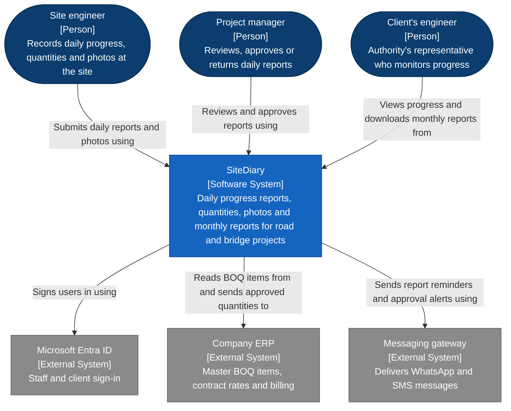
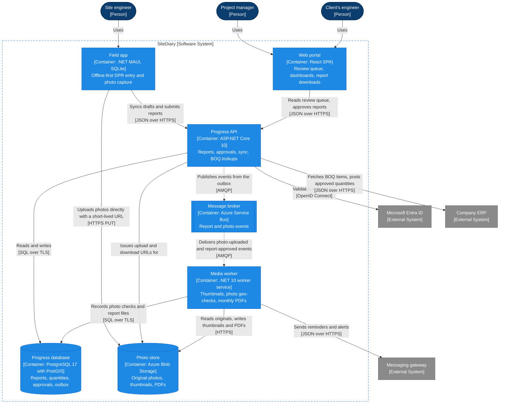
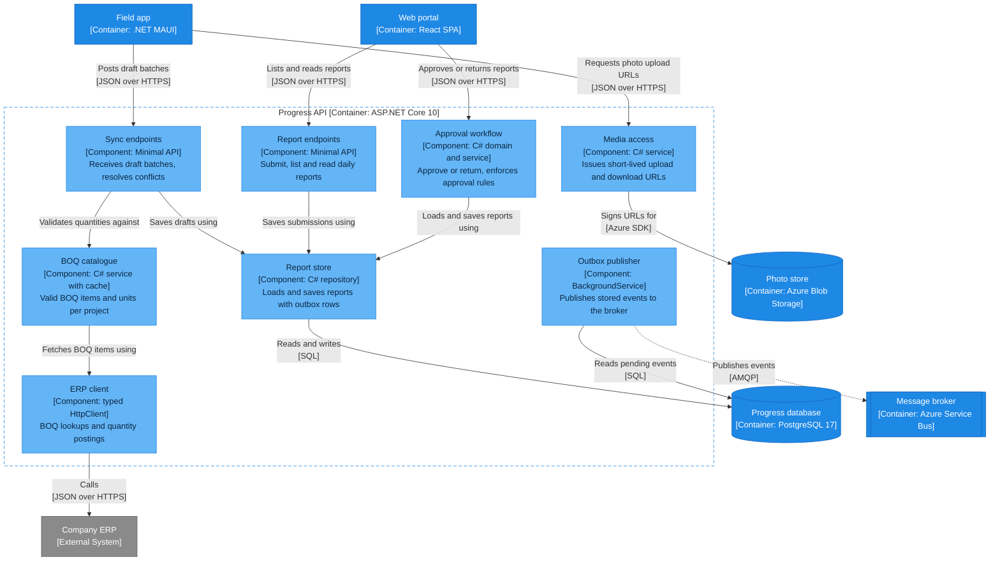
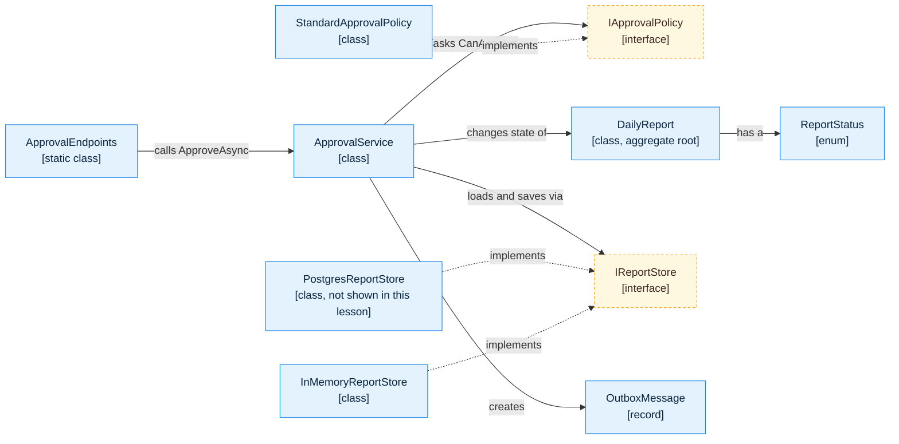
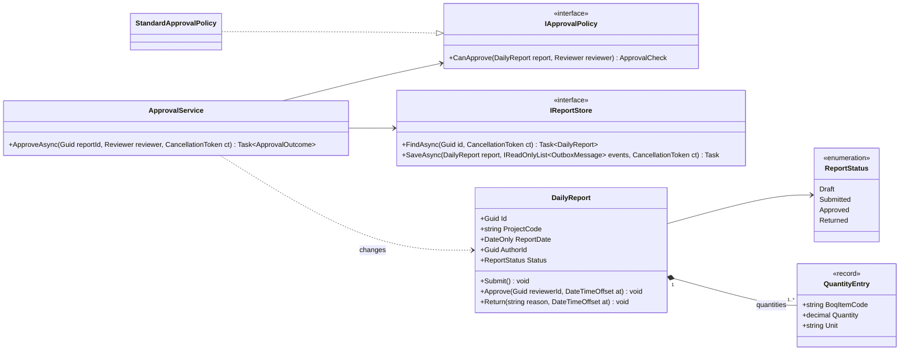
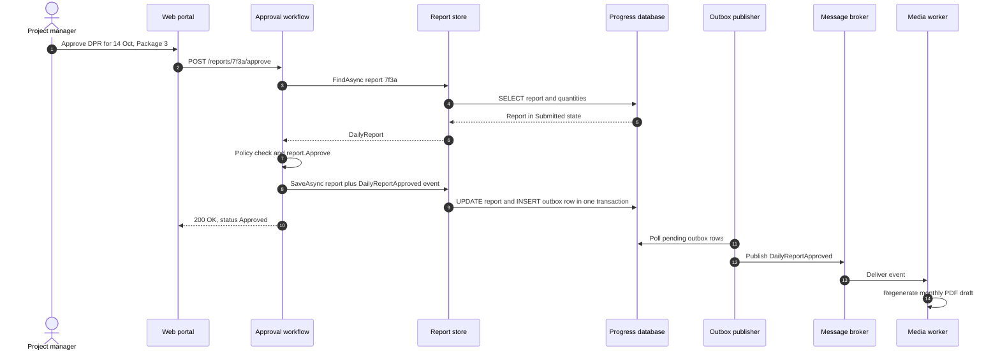
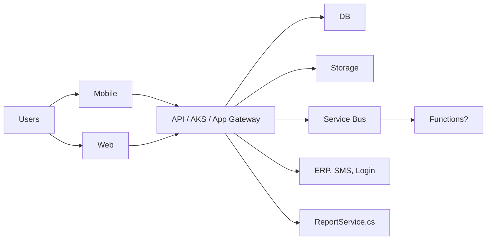

The [C4 model lesson](#/lesson/m05-c4-model) taught you the four zoom levels and the notation. This lesson is the practical half: we take **one realistic system** and draw all four views, end to end, the way you would on a real project. Every diagram is a plain Mermaid `flowchart`, so it renders in GitHub, Azure DevOps and this platform without any C4 plugin. At each level we stop and ask: what did this view let us decide that the previous one could not?

## Learning objectives

By the end of this lesson you will be able to:

1. Draw a system context, container, component and code view for one system, with each view zooming into exactly one element of the view above it.
2. Express C4 notation (people, systems, containers, databases, queues, boundaries, legends) with Mermaid flowchart shapes and `classDef` styles.
3. Explain every element and every arrow on each view, including protocols and synchronous versus asynchronous communication.
4. Decide when a level is worth drawing, and when to stop.
5. Trace a code-level view to real C# types, and check automatically that the code still matches the component view.
6. Use a dynamic view (sequence diagram) to explain one important flow across the static views.

## Prerequisites

- [C4 architecture model](#/lesson/m05-c4-model): the four abstractions and the notation rules. This lesson does not repeat them in detail.
- [Class diagrams](#/lesson/m05-class-diagrams): needed for the code-level view.
- [Sequence diagrams](#/lesson/m05-sequence-diagrams): needed for the dynamic view.
- Basic ASP.NET Core minimal APIs and dependency injection.

## Explain it like I'm a beginner

### A metro map, then a station plan, then a floor plan

Imagine you are explaining Delhi Metro to three people. A tourist needs the **network map**: lines, stations, where it connects to the airport and the railway stations. A station manager at Rajiv Chowk needs the **station plan**: platforms, ticket counters, lifts, exits. An electrician needs the **wiring plan of one escalator**. Same metro, four very different drawings, and nobody would want all of them on one sheet.

C4 is the same idea for software. The **context view** is the network map: our system as one box, the people who use it and the other systems it talks to. The **container view** opens that box: the apps, APIs, databases and queues inside. The **component view** opens one of those containers: the main parts inside one API. The **code view** opens one component: its classes.

### Our worked example: SiteDiary

A mid-sized engineering consultancy supervises highway and bridge projects across several states. Today, site engineers send daily progress as photos and spreadsheets on WhatsApp. Project managers copy numbers into Excel, and the client's engineer asks every week, "Is chainage 12+400 to 13+000 really finished?" Nobody trusts the numbers.

The company builds **SiteDiary**:

- **Site engineers** fill a **daily progress report (DPR)** on a phone: work done against **bill of quantities (BOQ)** items (for example, "Item 4.02 — Dense Bituminous Macadam, 380 cubic metres"), weather, labour and machinery, plus geo-tagged photos. Connectivity at many sites is poor, so the app must work **offline**.
- **Project managers** review each report and **approve** it or **return** it with a reason.
- The **client's engineer** (the authority's representative) sees approved progress on a dashboard and downloads the **monthly progress report** PDF.
- Approved quantities flow to the company's **ERP** for billing. Reminders go out over **WhatsApp and SMS**. Staff sign in with **Microsoft Entra ID**.

Rough size (estimates for planning, not measurements): 40 active projects × 25 engineers ≈ 1,000 reports per day, each with about 15 photos of about 3 MB. That is roughly 15,000 photos and 45 GB of uploads per day, mostly between 5 p.m. and 8 p.m. when engineers return to the camp office. Keep these numbers in mind: they drive several decisions on the container view.

## First-principles explanation

### One model, four zooms, one rule

A C4 diagram set is a **hierarchy**. Each view zooms into **one** element of the view above:

| View | Zooms into | Shows | Main reader |
|---|---|---|---|
| System context | (nothing, it is the top) | SiteDiary as one box, people, external systems | Everyone, including the client and management |
| Container | the SiteDiary box | Apps, APIs, workers, databases, queues, and how they talk | Architects, developers, operations, security |
| Component | one container (the Progress API) | The main parts inside it and their responsibilities | Developers of that container |
| Code | one component (Approval workflow) | Classes, interfaces and their relationships | Developers changing that component |

The rule that makes the set work: **an element keeps the same name, description and colour on every view where it appears.** If the context view says "Company ERP" and the container view says "SAP connector", the reader can no longer move between them. Teams that use a modelling tool such as Structurizr get this for free because views are generated from one model. Teams that hand-write Mermaid, like we do here, must keep it by discipline and review (and, as you'll see in the exercises, a little automation).

### Mapping C4 notation to Mermaid flowcharts

Mermaid has a dedicated `C4Context` syntax, which the previous lesson used. It is still marked experimental and its layout is hard to control, so many teams draw C4 with ordinary flowcharts instead. The mapping we use throughout:

| C4 element | Flowchart shape | Mermaid syntax | Style class |
|---|---|---|---|
| Person | Stadium (rounded ends) | `id(["Name<br/>[Person]<br/>description"])` | `person` |
| Our software system | Rectangle | `id["Name<br/>[Software System]<br/>description"]` | `system` |
| External software system | Rectangle, grey | same as above | `external` |
| Container (app, API, worker) | Rectangle | `id["Name<br/>[Container: technology]<br/>description"]` | `container` |
| Database or file store | Cylinder | `id[("Name<br/>[Container: technology]<br/>description")]` | `store` |
| Queue or message broker | Subroutine (double-sided box) | `id[["Name<br/>[Container: technology]<br/>description"]]` | `queue` |
| Component | Rectangle, lighter | `id["Name<br/>[Component: technology]<br/>description"]` | `component` |
| Boundary | Subgraph | `subgraph b["SiteDiary"] ... end` | dashed style |
| Synchronous call | Solid arrow | `a -->|"intent<br/>[protocol]"| b` | |
| Asynchronous message | Dotted arrow | `a -.->|"intent<br/>[protocol]"| b` | |

Three small details matter. **Quote every label** that contains brackets, colons or plus signs, or Mermaid will try to read them as syntax. **Put the element type in square brackets** in the label (`[Container: PostgreSQL 17]`), because shape and colour alone fail for colour-blind readers and for black-and-white printouts. And **define the colours once** with `classDef` at the bottom of each diagram, using the same palette on every view, so blue always means "ours" and grey always means "someone else's".

### What each view must answer

A view is useful only if it answers questions its reader actually has. Before drawing, write them down:

- **Context:** Who uses SiteDiary? What does it depend on that we don't control? Where does data leave the company?
- **Container:** What do we deploy? Which technology does each part use? Who calls whom, synchronously or asynchronously, over which protocol? Where is data stored?
- **Component:** What are the main parts of the Progress API? Which part owns approval rules? Which parts touch the database or the ERP?
- **Code:** Which classes implement approval? Where is the "author cannot approve their own report" rule? What do I need to fake in a unit test?

If a box or arrow doesn't help answer any of these, it probably belongs on a different view, or nowhere.

### When to stop zooming

Most systems need the context and container views, always. A component view is worth it for a container that is **complex, risky or changed often**. A code view is worth it only for a component where the class structure itself is the hard part, and it should ideally be **generated** from the code rather than hand-drawn, because it goes stale in weeks. In SiteDiary we draw one component view (the Progress API, because it holds the business rules) and one code view (the approval workflow, because auditors ask about it). We deliberately do **not** draw component views for the photo worker (two message handlers) or the web portal (a React app whose structure follows its routes).

### Static views and dynamic views

The four core views are **static**: they show structure, not order. To explain how one important flow moves through the structure, add a **dynamic view**. A sequence diagram is the most readable form. Its participants must be elements that already appear on a static view, with the same names, so the reader can point from one to the other.

## Visual explanation

### Level 1 — System context



Read it top to bottom. **Three people** (roles, not named individuals) use SiteDiary, and each description says what they want, not which screen they click. **Three external systems** sit outside our control. Each arrow is labelled with **intent**, phrased so the sentence reads naturally: "Site engineer submits daily reports and photos using SiteDiary".

Notice what this view already lets us discuss with a non-technical audience:

- **The ERP arrow carries money.** Approved quantities become bills. The client will want to know that only *approved* quantities flow, and the finance team will want to know what happens if the ERP is down.
- **Personal data leaves the company** through the messaging gateway (phone numbers). That is a privacy discussion under India's DPDP Act, and it starts here, not on page 40 of a design document.
- **There is no "database" or "server" box.** Technology is deliberately absent. If a reviewer asks "is it on Azure?", the answer is "see the container view".

One arrow is missing on purpose: the client's engineer doesn't talk to the ERP. If someone draws that arrow, ask whether it's a real requirement (it would change the security boundary) or a guess.

### Level 2 — Container view of SiteDiary



The dashed subgraph is the **boundary** of the SiteDiary box from level 1. Everything inside it is something we build or run and deploy separately. Outside, the same three people and three external systems appear with the **same names**; their descriptions are shortened because the reader has already seen level 1.

Walk through each container and the reason it exists:

- **Field app** (.NET MAUI with a local SQLite database). It is a separate container because it runs on the engineer's phone, not on our servers. The local database is *inside* this container; it is not a separate box because it is not deployed or run separately. Offline-first is a big decision visible only here: drafts live on the phone and **sync** when there is signal.
- **Web portal** (React single-page app). Static files served from a CDN or the API host; it calls the API from the browser.
- **Progress API** (ASP.NET Core 10). The only container that writes business data. Every rule about reports and approvals lives here, which is why it gets a component view.
- **Media worker** (.NET 10 worker service). Slow, bursty work: making thumbnails, checking that each photo's GPS position is inside the project corridor, generating monthly PDFs. Keeping it out of the API means a 6 p.m. upload burst doesn't slow down the review screen.
- **Progress database** (PostgreSQL 17 with PostGIS). The source of truth. PostGIS stores the project alignment so "is this photo within 200 m of chainage 12+400?" is one query.
- **Photo store** (Azure Blob Storage). A container even though it is a managed service, because we own and configure it and it holds our data.
- **Message broker** (Azure Service Bus). Decouples the API from slow work.

Now the arrows, because that is where most design decisions hide:

- **The field app uploads photos straight to blob storage**, not through the API. Remember the estimate: about 45 GB per day, concentrated in three evening hours. That is roughly 45 GB ÷ 3 h ≈ 15 GB per hour, or about 4 MB/s on average and several times that at peak. Pushing those bytes through the API would tie up API instances doing nothing but copying. Instead, the API issues a **short-lived upload URL** (a shared access signature, the **Valet Key pattern**) and the app uploads directly. On the diagram that is two arrows: "issues upload URLs for" from the API and "uploads photos directly" from the app.
- **Dotted arrows are asynchronous.** The API never calls the worker. It writes an event into an **outbox table** in the same database transaction as the business change, and publishes it to the broker afterwards. The worker picks it up whenever it can. If the worker is down for an hour, users notice only that thumbnails appear late.
- **Every arrow that crosses the boundary has a protocol.** OpenID Connect to Entra ID, JSON over HTTPS to the ERP and the gateway. A security reviewer reads exactly these arrows.
- **People connect to apps, never to the API.** "Uses" is fine for a person-to-app arrow; between containers it is too vague, so each of those says what is exchanged.

What's *not* on this view: Azure regions, App Service plans, Kubernetes, load balancers, the CDN. They belong on a **deployment diagram**. Putting them here would double the number of boxes without answering any container-level question.

### Level 3 — Component view of the Progress API



We zoomed into **one** container. Its neighbours from level 2 appear outside the boundary, but only those that the Progress API actually talks to. The worker isn't here, because the API never calls it directly. Arrows between components have **no protocol**, because they are in-process method calls; arrows that leave the container keep their protocol.

What this view lets the API team decide and discuss:

- **Approval rules live in exactly one component.** The portal calls the approval workflow; nothing else changes a report's status to Approved. If a developer adds an "auto-approve on Sundays" shortcut in the sync endpoints, the diagram makes it obviously wrong.
- **Only the report store touches the database for business data**, and the outbox publisher reads pending events. That is a small, checkable rule ("no other component uses `NpgsqlConnection`"), and we will check it with code later.
- **The ERP is behind one client component.** When the ERP vendor changes their API, one component changes.
- **The BOQ catalogue has a cache.** Engineers validate quantities against BOQ items thousands of times a day, while the ERP's BOQ changes a few times a month. The description says "with cache"; how long items are cached is a detail for the code.

A frequent mistake here is drawing every class as a component. "ReportDto", "DateHelper" and "ReportValidator" are not components. A component is a **group of code with one clear responsibility behind an interface**, the kind of thing you could hand to one developer as "you own this".

### Level 4 — Code view of the approval workflow



This is the lowest zoom: one component, opened into classes. We drew it as a flowchart to keep the whole set in one notation, but most teams use a **UML class diagram** at this level, because it can show members and multiplicities. Here is the same structure as a class diagram:



Read the two together. The **policy is an interface**, so the rule "who may approve" can change per client contract without touching the service. The **store is an interface**, so unit tests use an in-memory store and production uses PostgreSQL. `DailyReport` **owns** its quantity entries (composition, filled diamond): they are created through the report and saved with it. The status enum shows the state machine's states; the transitions themselves would be a [state machine diagram](#/lesson/m05-state-diagrams).

Should you hand-draw this view? Usually not. The production code in the next section *is* the code view; a generator or your IDE can draw it on demand. We drew it here to show how the zoom ends.

### Dynamic view — a project manager approves a report



Every participant is an element from the component or container view, with the same name. The diagram shows two things the static views can't. First, the **order**: the response to the portal (step 10) happens before the event is published (step 12), so the user never waits for the worker. Second, **atomicity**: the report update and the outbox row are written in one transaction (step 9), so we can't approve a report and lose its event, or publish an event for an approval that rolled back. If the broker is down, rows wait in the outbox and are published later.

## Step-by-step example

Here is the order we actually followed to produce the views above, with the questions asked at each step. Use it on your own system.

### Step 1 — write the one-sentence scope

"SiteDiary records daily progress, quantities and photos for road and bridge projects, and produces approved progress for billing and the client." This decides the boundary: the ERP does billing, so it's outside; the field app captures progress, so it's inside.

### Step 2 — draw level 1 from conversations, not code

List roles from interviews: site engineer, project manager, client's engineer. List external systems from `appsettings.json` and the integration list: Entra ID, ERP, messaging gateway. Label every arrow with intent. Show it to the product owner and the client's representative and ask "what's missing?" In our case the first draft missed the client's engineer entirely, because the team thought of the client as "someone who gets a PDF by email".

### Step 3 — draw level 2 from the deployment pipeline

Open the CI/CD pipelines and the cloud resource group. Every separately deployed or separately running thing is a candidate container: the MAUI app, the SPA, the API, the worker, PostgreSQL, Blob Storage, Service Bus. Write each one's technology and one-line responsibility. Then add arrows by reading the code: each `HttpClient` base address, connection string and message publisher is an arrow. Mark asynchronous ones dotted.

### Step 4 — challenge the arrows with numbers

Take the busiest flows and estimate them. Photos: about 45 GB a day, mostly in three hours. Reports: about 1,000 a day, which is tiny. The numbers tell you which arrows deserve a design discussion (photo upload, so it bypasses the API) and which don't (report submission). Record the decision as an [ADR](#/lesson/m02-adr) and link it from the diagram.

### Step 5 — choose which containers deserve level 3

Ask for each container: is it complex, risky or changed every sprint? The Progress API: yes on all three. The media worker: two handlers, no. The portal: a React app whose structure follows its routes, no. Draw one component view.

### Step 6 — draw level 3 from the code's folders and DI registrations

The `Program.cs` DI registrations and the folder structure usually reveal the components: `Features/Sync`, `Features/Reports`, `Approvals`, `Boq`, `Media`, `Persistence`, `Integrations/Erp`. Group classes by responsibility, name each group, and draw who calls whom. If two components call each other in a circle, you have found a design problem before writing a line of new code.

### Step 7 — generate level 4 on demand, and keep everything in the repository

Commit the views as Markdown files under `docs/architecture/` next to the code, link them from the README, and add "update the diagram if this changes a container or component" to the pull request template. Add a test that checks the code still respects the component view (shown in the production section). Generate the code view when someone needs it.

## Production-style C# implementation

The code view is only honest if it matches real code. Below is the approval workflow component as it would appear in the Progress API: the domain object, the policy, the ports (interfaces), the application service, in-memory adapters for local runs and tests, an outbox publisher background service, and the endpoint. Every type on the level 4 view exists here with the same name, except `PostgresReportStore`, which would use Npgsql and is replaced by an in-memory store so the example compiles without packages.

```text
SiteDiary.Api/
  Program.cs
  Approvals/Domain/DailyReport.cs
  Approvals/Domain/ApprovalPolicy.cs
  Approvals/Application/Ports.cs
  Approvals/Application/ApprovalService.cs
  Approvals/Infrastructure/InMemoryAdapters.cs
  Approvals/Infrastructure/OutboxPublisher.cs
```

```csharp file=Approvals/Domain/DailyReport.cs
namespace SiteDiary.Api.Approvals.Domain;

public enum ReportStatus { Draft, Submitted, Approved, Returned }

public sealed record QuantityEntry(string BoqItemCode, decimal Quantity, string Unit);

/// <summary>Aggregate root: one engineer's daily progress report for one project.</summary>
public sealed class DailyReport
{
    private readonly List<QuantityEntry> _quantities = new();
    private readonly List<string> _photoKeys = new();

    public DailyReport(Guid id, string projectCode, DateOnly reportDate, Guid authorId)
    {
        if (string.IsNullOrWhiteSpace(projectCode))
            throw new ArgumentException("Project code is required.", nameof(projectCode));
        Id = id;
        ProjectCode = projectCode;
        ReportDate = reportDate;
        AuthorId = authorId;
    }

    public Guid Id { get; }
    public string ProjectCode { get; }
    public DateOnly ReportDate { get; }
    public Guid AuthorId { get; }
    public ReportStatus Status { get; private set; } = ReportStatus.Draft;
    public string? ReturnReason { get; private set; }
    public Guid? DecidedBy { get; private set; }
    public DateTimeOffset? DecidedAt { get; private set; }
    public IReadOnlyList<QuantityEntry> Quantities => _quantities;
    public IReadOnlyList<string> PhotoKeys => _photoKeys;

    public void AddQuantity(string boqItemCode, decimal quantity, string unit)
    {
        EnsureEditable();
        if (quantity <= 0) throw new ArgumentOutOfRangeException(nameof(quantity), "Quantity must be positive.");
        _quantities.Add(new QuantityEntry(boqItemCode, quantity, unit));
    }

    public void AttachPhoto(string objectKey)
    {
        EnsureEditable();
        _photoKeys.Add(objectKey);
    }

    public void Submit()
    {
        EnsureEditable();
        if (_quantities.Count == 0)
            throw new InvalidOperationException("A report needs at least one quantity entry.");
        Status = ReportStatus.Submitted;
        ReturnReason = null;
    }

    public void Approve(Guid reviewerId, DateTimeOffset at)
    {
        if (Status != ReportStatus.Submitted)
            throw new InvalidOperationException($"Cannot approve a report in state {Status}.");
        Status = ReportStatus.Approved;
        DecidedBy = reviewerId;
        DecidedAt = at;
    }

    public void Return(Guid reviewerId, string reason, DateTimeOffset at)
    {
        if (Status != ReportStatus.Submitted)
            throw new InvalidOperationException($"Cannot return a report in state {Status}.");
        if (string.IsNullOrWhiteSpace(reason))
            throw new ArgumentException("A reason is required when returning a report.", nameof(reason));
        Status = ReportStatus.Returned;
        ReturnReason = reason;
        DecidedBy = reviewerId;
        DecidedAt = at;
    }

    private void EnsureEditable()
    {
        if (Status is not (ReportStatus.Draft or ReportStatus.Returned))
            throw new InvalidOperationException($"A report in state {Status} cannot be edited.");
    }
}
```

```csharp file=Approvals/Domain/ApprovalPolicy.cs
namespace SiteDiary.Api.Approvals.Domain;

public sealed record Reviewer(Guid Id, string Role, IReadOnlySet<string> ProjectCodes);

public sealed record ApprovalCheck(bool Allowed, string? Reason)
{
    public static readonly ApprovalCheck Ok = new(true, null);
    public static ApprovalCheck Deny(string reason) => new(false, reason);
}

public interface IApprovalPolicy
{
    ApprovalCheck CanApprove(DailyReport report, Reviewer reviewer);
}

/// <summary>The default rules most contracts use. A client-specific policy can replace it via DI.</summary>
public sealed class StandardApprovalPolicy : IApprovalPolicy
{
    public const string ProjectManagerRole = "ProjectManager";

    public ApprovalCheck CanApprove(DailyReport report, Reviewer reviewer)
    {
        if (reviewer.Id == report.AuthorId)
            return ApprovalCheck.Deny("Authors cannot approve their own report.");
        if (reviewer.Role != ProjectManagerRole)
            return ApprovalCheck.Deny("Only project managers approve daily reports.");
        if (!reviewer.ProjectCodes.Contains(report.ProjectCode))
            return ApprovalCheck.Deny($"Reviewer is not assigned to project {report.ProjectCode}.");
        if (report.PhotoKeys.Count == 0)
            return ApprovalCheck.Deny("At least one site photo is required before approval.");
        return ApprovalCheck.Ok;
    }
}
```

```csharp file=Approvals/Application/Ports.cs
using SiteDiary.Api.Approvals.Domain;

namespace SiteDiary.Api.Approvals.Application;

public sealed record OutboxMessage(Guid Id, string Type, string PayloadJson, DateTimeOffset CreatedAt);

/// <summary>Port for the Report store component. Saving the report and its events is one atomic operation.</summary>
public interface IReportStore
{
    Task<DailyReport?> FindAsync(Guid id, CancellationToken ct);
    Task SaveAsync(DailyReport report, IReadOnlyList<OutboxMessage> events, CancellationToken ct);
}

/// <summary>Port used by the Outbox publisher component.</summary>
public interface IOutboxReader
{
    Task<IReadOnlyList<OutboxMessage>> TakePendingAsync(int max, CancellationToken ct);
}

/// <summary>Port for the message broker container.</summary>
public interface IMessagePublisher
{
    Task PublishAsync(OutboxMessage message, CancellationToken ct);
}
```

```csharp file=Approvals/Application/ApprovalService.cs
using System.Text.Json;
using SiteDiary.Api.Approvals.Domain;

namespace SiteDiary.Api.Approvals.Application;

public enum ApprovalResultKind { Approved, NotFound, Forbidden, Conflict }

public sealed record ApprovalOutcome(ApprovalResultKind Kind, string? Detail = null);

public sealed class ApprovalService(IReportStore store, IApprovalPolicy policy, TimeProvider clock)
{
    public async Task<ApprovalOutcome> ApproveAsync(Guid reportId, Reviewer reviewer, CancellationToken ct)
    {
        var report = await store.FindAsync(reportId, ct);
        if (report is null) return new(ApprovalResultKind.NotFound);

        var check = policy.CanApprove(report, reviewer);
        if (!check.Allowed) return new(ApprovalResultKind.Forbidden, check.Reason);

        if (report.Status != ReportStatus.Submitted)
            return new(ApprovalResultKind.Conflict, $"Report is {report.Status}, not Submitted.");

        var now = clock.GetUtcNow();
        report.Approve(reviewer.Id, now);

        var payload = JsonSerializer.Serialize(new
        {
            report.Id,
            report.ProjectCode,
            ReportDate = report.ReportDate.ToString("yyyy-MM-dd"),
            ApprovedBy = reviewer.Id,
            Quantities = report.Quantities,
        });
        var evt = new OutboxMessage(Guid.NewGuid(), "DailyReportApproved", payload, now);

        // One call, one transaction: the report change and its event succeed or fail together.
        await store.SaveAsync(report, new[] { evt }, ct);
        return new(ApprovalResultKind.Approved);
    }
}
```

```csharp file=Approvals/Infrastructure/InMemoryAdapters.cs
using System.Collections.Concurrent;
using SiteDiary.Api.Approvals.Application;
using SiteDiary.Api.Approvals.Domain;

namespace SiteDiary.Api.Approvals.Infrastructure;

/// <summary>Stands in for PostgresReportStore in local runs and tests.</summary>
public sealed class InMemoryReportStore : IReportStore, IOutboxReader
{
    private readonly ConcurrentDictionary<Guid, DailyReport> _reports = new();
    private readonly ConcurrentQueue<OutboxMessage> _outbox = new();
    private readonly object _txLock = new();

    public Task<DailyReport?> FindAsync(Guid id, CancellationToken ct) =>
        Task.FromResult(_reports.TryGetValue(id, out var r) ? r : null);

    public Task SaveAsync(DailyReport report, IReadOnlyList<OutboxMessage> events, CancellationToken ct)
    {
        lock (_txLock) // simulates one database transaction
        {
            _reports[report.Id] = report;
            foreach (var e in events) _outbox.Enqueue(e);
        }
        return Task.CompletedTask;
    }

    public Task<IReadOnlyList<OutboxMessage>> TakePendingAsync(int max, CancellationToken ct)
    {
        var batch = new List<OutboxMessage>();
        while (batch.Count < max && _outbox.TryDequeue(out var m)) batch.Add(m);
        return Task.FromResult<IReadOnlyList<OutboxMessage>>(batch);
    }
}

public sealed class LoggingMessagePublisher(ILogger<LoggingMessagePublisher> logger) : IMessagePublisher
{
    public Task PublishAsync(OutboxMessage message, CancellationToken ct)
    {
        logger.LogInformation("Published {Type} {Id}", message.Type, message.Id);
        return Task.CompletedTask;
    }
}
```

```csharp file=Approvals/Infrastructure/OutboxPublisher.cs
using SiteDiary.Api.Approvals.Application;

namespace SiteDiary.Api.Approvals.Infrastructure;

/// <summary>The "Outbox publisher" component from the level 3 view.</summary>
public sealed class OutboxPublisher(IOutboxReader outbox, IMessagePublisher publisher, ILogger<OutboxPublisher> logger)
    : BackgroundService
{
    protected override async Task ExecuteAsync(CancellationToken stoppingToken)
    {
        using var timer = new PeriodicTimer(TimeSpan.FromSeconds(2));
        while (await timer.WaitForNextTickAsync(stoppingToken))
        {
            try
            {
                foreach (var message in await outbox.TakePendingAsync(50, stoppingToken))
                    await publisher.PublishAsync(message, stoppingToken);
            }
            catch (Exception ex) when (ex is not OperationCanceledException)
            {
                // A real store marks rows published only after success, so a failure here means a retry, not a loss.
                logger.LogWarning(ex, "Outbox publish failed; will retry on the next tick.");
            }
        }
    }
}
```

```csharp file=Program.cs
using SiteDiary.Api.Approvals.Application;
using SiteDiary.Api.Approvals.Domain;
using SiteDiary.Api.Approvals.Infrastructure;

var builder = WebApplication.CreateBuilder(args);

builder.Services.AddSingleton(TimeProvider.System);
builder.Services.AddSingleton<InMemoryReportStore>();
builder.Services.AddSingleton<IReportStore>(sp => sp.GetRequiredService<InMemoryReportStore>());
builder.Services.AddSingleton<IOutboxReader>(sp => sp.GetRequiredService<InMemoryReportStore>());
builder.Services.AddSingleton<IMessagePublisher, LoggingMessagePublisher>();
builder.Services.AddSingleton<IApprovalPolicy, StandardApprovalPolicy>();
builder.Services.AddScoped<ApprovalService>();
builder.Services.AddHostedService<OutboxPublisher>();

var app = builder.Build();

// Demo data: one submitted report on project NH-48-PKG3.
var engineerId = Guid.Parse("aaaaaaaa-0000-0000-0000-000000000001");
var managerId = Guid.Parse("bbbbbbbb-0000-0000-0000-000000000002");
var demo = new DailyReport(Guid.Parse("7f3a0000-0000-0000-0000-000000000000"), "NH-48-PKG3", new DateOnly(2026, 10, 14), engineerId);
demo.AddQuantity("4.02", 380m, "cum");
demo.AttachPhoto("nh48-pkg3/2026-10-14/ch12400.jpg");
demo.Submit();
await app.Services.GetRequiredService<IReportStore>().SaveAsync(demo, Array.Empty<OutboxMessage>(), CancellationToken.None);

var reviewers = new Dictionary<Guid, Reviewer>
{
    [managerId] = new(managerId, StandardApprovalPolicy.ProjectManagerRole, new HashSet<string> { "NH-48-PKG3" }),
};

app.MapPost("/reports/{id:guid}/approve", async (Guid id, ApproveRequest body, ApprovalService service, CancellationToken ct) =>
{
    if (!reviewers.TryGetValue(body.ReviewerId, out var reviewer)) return Results.Unauthorized();
    var outcome = await service.ApproveAsync(id, reviewer, ct);
    return outcome.Kind switch
    {
        ApprovalResultKind.Approved => Results.Ok(new { id, status = "Approved" }),
        ApprovalResultKind.NotFound => Results.NotFound(),
        ApprovalResultKind.Forbidden => Results.Problem(outcome.Detail, statusCode: StatusCodes.Status403Forbidden),
        _ => Results.Problem(outcome.Detail, statusCode: StatusCodes.Status409Conflict),
    };
});

app.Run();

public sealed record ApproveRequest(Guid ReviewerId);
```

Trace the diagrams into this code:

- **Level 4 → types.** Every box on the code view is a type here. The dotted "implements" arrows are `: IApprovalPolicy` and `: IReportStore`. The composition diamond from `DailyReport` to `QuantityEntry` is the private `_quantities` list that only `AddQuantity` can fill.
- **Level 3 → folders and DI.** "Approval workflow" is `Approvals/Domain` plus `ApprovalService`. "Report store" is `IReportStore` and its implementations. "Outbox publisher" is the `BackgroundService`. The arrows "loads and saves using" become constructor parameters. In a real API, the reviewer would come from the Entra ID token's claims, not a request body; the demo keeps it simple.
- **Level 2 → process boundaries.** The `IMessagePublisher` port is where the API's code stops and the broker container starts. Swapping `LoggingMessagePublisher` for a Service Bus publisher changes no domain code.
- **Dynamic view → method order.** `ApproveAsync` does what steps 3 to 10 of the sequence diagram say, in the same order.

## Bad design vs good design

Here is a "single diagram" that a team might put in a project kickoff deck for SiteDiary:



Everything on it is roughly true, and almost nothing is useful. "Users" hides three roles with different security needs. "API / AKS / App Gateway" mixes a container with deployment infrastructure. "ERP, SMS, Login" merges three external systems with different failure modes into one box. A class file (`ReportService.cs`) sits next to a database. No arrow has a label, so you can't tell that photos go directly to storage or that the queue is asynchronous. There's no legend, no title, and "Functions?" records an undecided question as if it were architecture.

| Bad | Good |
|---|---|
| One diagram for every audience | Four zoom levels, each for a named reader |
| Containers, infrastructure and classes mixed | One abstraction level per view; infrastructure on a deployment view |
| Unlabelled arrows | Intent plus protocol on every arrow; dotted for async |
| Generic boxes ("DB", "Users") | Named roles and containers with technology and responsibility |
| Colour and shape without explanation | Type in brackets in every label, consistent `classDef` palette, legend |
| Open questions drawn as boxes | Open questions in an ADR or a note, not in the architecture |

:::callout type=tradeoff title="Hand-written Mermaid or a model?"
We hand-wrote four Mermaid flowcharts. That is fine for one system with one team: it renders everywhere and anyone can edit it in a pull request. The cost is consistency: renaming "Progress API" means editing four files. When you have several systems, or several teams editing the same picture, move to a model-first tool (Structurizr DSL, or the small C# model from the previous lesson) and generate the views.
:::

:::callout type=mistake title="Zooming into everything at once"
A "component view of SiteDiary" that opens the API, the worker and the portal on one page is three diagrams glued together. Zoom into one container per component view.
:::

## Practical playground

The HLD playground below holds a **partial** SiteDiary container view. It renders the graph and can compare it with a reference design, which is the "one model, many views" idea in action. (The LLD playground does the same for class models, so you can rebuild the level 4 view there and compare it with the code above.)

1. Add the **Photo store** as `object-storage` and connect both the field app (direct upload) and the media worker to it. Decide which edges are `sync` and which `async`.
2. Add the **Message broker** as a `queue` between the API and the worker. Remove the direct API → worker edge. Why is it wrong?
3. Add the three external systems with labelled edges.
4. Set the client `rps` to a value that matches the estimate in this lesson (1,000 reports plus sync calls over the evening peak) and justify your number in a note.
5. Compare with the level 2 diagram above. List every difference and decide whether yours or ours is better.

:::playground type=hld title="SiteDiary container view (partial)"
```json
{
  "nodes": [
    { "id": "app", "type": "client", "label": "Field app (.NET MAUI, offline-first)", "props": { "rps": 20 } },
    { "id": "portal", "type": "client", "label": "Web portal (React SPA)" },
    { "id": "api", "type": "app-server", "label": "Progress API (ASP.NET Core 10)", "props": { "instances": 2 } },
    { "id": "worker", "type": "worker", "label": "Media worker (.NET 10)", "props": { "instances": 1 } },
    { "id": "db", "type": "database", "label": "Progress database (PostgreSQL 17 + PostGIS)", "props": { "replicas": 0 } }
  ],
  "edges": [
    { "from": "app", "to": "api", "kind": "sync", "label": "sync drafts, submit reports" },
    { "from": "portal", "to": "api", "kind": "sync", "label": "review and approve" },
    { "from": "api", "to": "db", "kind": "sync", "label": "SQL" },
    { "from": "api", "to": "worker", "kind": "sync", "label": "make thumbnails" }
  ]
}
```
:::

## Exercises

:::exercise id=m05-c4-views-ex1 difficulty=beginner kind=written title="Which view answers the question?"
For each question about SiteDiary, name the **one view** that best answers it (system context, container, component, code, dynamic, or deployment) and say in one line why.

1. "Does SiteDiary send any personal data outside the company?"
2. "Which technology does the offline storage on the phone use?"
3. "Where is the rule that an engineer can't approve their own report?"
4. "Is the media worker called synchronously by the API?"
5. "Which classes do I need to fake to unit-test approval?"
6. "Does the portal respond to the manager before or after the PDF is regenerated?"
7. "How many API instances run in the Mumbai region?"
8. "Which part of the API talks to the ERP?"
::acceptance
- At least 7 of 8 answered correctly.
- Each answer names one view and gives a reason based on what that view shows.
- Question 7 is placed on a deployment diagram, not the container view.
- Question 6 is answered with the dynamic view.
::hint
Start with the audience: is the question one a client, an architect, an API developer or an operations engineer would ask?
::hint
Technology appears from level 2 down. Classes appear only at level 4.
::hint
"Before or after" is a question about order. Static views don't show order.
::hint
Instance counts and regions are about where things run, not what they are.
::solution
1. **System context.** Arrows to external systems show where data leaves; the messaging gateway receives phone numbers.
2. **Container.** The field app's label says `.NET MAUI, SQLite`; the local database is inside that container.
3. **Component** first (it's in the Approval workflow), then **code** to find the exact class (`StandardApprovalPolicy`).
4. **Container.** The API → broker → worker arrows are dotted (asynchronous); there's no direct API → worker arrow.
5. **Code.** The interfaces `IReportStore` and `IApprovalPolicy` are the seams to fake.
6. **Dynamic** (sequence) view: the 200 OK is step 10, the worker acts after step 12.
7. **Deployment** diagram. Instance counts and regions are infrastructure, deliberately absent from C4's core views.
8. **Component.** The ERP client component is the only one with an arrow to the ERP.
::mistakes
- Answering "container view" for everything because it "has the most on it".
- Looking for regions or instance counts on the container view.
- Answering question 3 with "the API" (that's a container, too coarse to find a rule).
:::

:::exercise id=m05-c4-views-ex2 difficulty=beginner kind=code title="Check that a view sticks to one zoom level"
Write a checker that flags elements that don't belong on a view.
::requirements
- `ElementKind`: `Person`, `SoftwareSystem`, `Container`, `Component`, `CodeElement`.
- `ViewLevel`: `SystemContext`, `Container`, `Component`, `Code`.
- `ViewElement(string Id, ElementKind Kind, string? ParentId)`: `ParentId` is the id of the element this one lives inside (a container's system, a component's container), or `null`.
- `ViewRules.IsAllowed(ViewLevel level, ElementKind kind)`:
  - SystemContext allows `Person`, `SoftwareSystem`.
  - Container allows `Person`, `SoftwareSystem`, `Container`.
  - Component allows `Person`, `SoftwareSystem`, `Container`, `Component`.
  - Code allows only `CodeElement`.
- `ViewRules.Check(ViewLevel level, string? focusId, IReadOnlyList<ViewElement> elements)` returns messages in element order:
  - `"{id}: {Kind} does not belong on a {Level} view"` if not allowed (use the enum names, e.g. `Component`, `SystemContext`). Skip the next rule for that element.
  - On Container, Component and Code views, the **zoomed kind** is `Container`, `Component` and `CodeElement` respectively. Each element of the zoomed kind must have `ParentId == focusId`; otherwise `"{id}: {Kind} belongs to '{parent}', not '{focus}'"` where a null parent prints as `(none)`.
  - On a Container view, a `Container` whose parent isn't the focus is still a container, but from another system: it should be drawn as its software system instead, so the same message applies.
::acceptance
- A component on a context view is reported as not belonging.
- A container from another system on SiteDiary's container view is reported with its parent.
- Neighbouring containers on a component view are allowed whatever their parent.
- A clean view returns an empty list.
::hint
A `switch` expression on `level` that returns a set of allowed kinds keeps `IsAllowed` to a few lines.
::hint
Write a second small function, `ZoomedKind(level)`, returning `ElementKind?` (null for SystemContext).
::hint
For each element: if not allowed, add a message and `continue`. Then, if its kind equals the zoomed kind and its parent differs from the focus, add the second message.
::hint
```csharp
var zoomed = ZoomedKind(level);
if (zoomed == e.Kind && e.ParentId != focusId)
    messages.Add($"{e.Id}: {e.Kind} belongs to '{e.ParentId ?? "(none)"}', not '{focusId}'");
```
::starter
```csharp file=ViewRules.cs
using System;
using System.Collections.Generic;

public enum ElementKind { Person, SoftwareSystem, Container, Component, CodeElement }

public enum ViewLevel { SystemContext, Container, Component, Code }

public sealed record ViewElement(string Id, ElementKind Kind, string? ParentId);

public static class ViewRules
{
    public static bool IsAllowed(ViewLevel level, ElementKind kind) =>
        throw new NotImplementedException();

    public static IReadOnlyList<string> Check(ViewLevel level, string? focusId, IReadOnlyList<ViewElement> elements) =>
        throw new NotImplementedException();
}
```
::tests
```csharp file=ViewRulesTests.cs
using System.Collections.Generic;
using Xunit;

public class ViewRulesTests
{
    [Fact]
    public void Context_view_allows_people_and_systems_only()
    {
        Assert.True(ViewRules.IsAllowed(ViewLevel.SystemContext, ElementKind.Person));
        Assert.True(ViewRules.IsAllowed(ViewLevel.SystemContext, ElementKind.SoftwareSystem));
        Assert.False(ViewRules.IsAllowed(ViewLevel.SystemContext, ElementKind.Container));
        Assert.False(ViewRules.IsAllowed(ViewLevel.Code, ElementKind.Component));
        Assert.True(ViewRules.IsAllowed(ViewLevel.Component, ElementKind.Container));
    }

    [Fact]
    public void Component_on_context_view_is_reported()
    {
        var msgs = ViewRules.Check(ViewLevel.SystemContext, null, new List<ViewElement>
        {
            new("eng", ElementKind.Person, null),
            new("sd", ElementKind.SoftwareSystem, null),
            new("approval", ElementKind.Component, "api"),
        });
        Assert.Equal(new[] { "approval: Component does not belong on a SystemContext view" }, msgs);
    }

    [Fact]
    public void Foreign_container_on_container_view_is_reported()
    {
        var msgs = ViewRules.Check(ViewLevel.Container, "sd", new List<ViewElement>
        {
            new("api", ElementKind.Container, "sd"),
            new("erpdb", ElementKind.Container, "erp"),
            new("erp", ElementKind.SoftwareSystem, null),
        });
        Assert.Equal(new[] { "erpdb: Container belongs to 'erp', not 'sd'" }, msgs);
    }

    [Fact]
    public void Neighbour_containers_are_fine_on_component_view()
    {
        var msgs = ViewRules.Check(ViewLevel.Component, "api", new List<ViewElement>
        {
            new("db", ElementKind.Container, "sd"),
            new("approval", ElementKind.Component, "api"),
            new("store", ElementKind.Component, "api"),
        });
        Assert.Empty(msgs);
    }

    [Fact]
    public void Component_without_parent_and_wrong_kind_are_both_reported_in_order()
    {
        var msgs = ViewRules.Check(ViewLevel.Component, "api", new List<ViewElement>
        {
            new("orphan", ElementKind.Component, null),
            new("Report", ElementKind.CodeElement, "approval"),
            new("thumbs", ElementKind.Component, "worker"),
        });
        Assert.Equal(new[]
        {
            "orphan: Component belongs to '(none)', not 'api'",
            "Report: CodeElement does not belong on a Component view",
            "thumbs: Component belongs to 'worker', not 'api'",
        }, msgs);
    }

    [Fact]
    public void Code_view_checks_code_elements_parent()
    {
        var msgs = ViewRules.Check(ViewLevel.Code, "approval", new List<ViewElement>
        {
            new("ApprovalService", ElementKind.CodeElement, "approval"),
            new("ErpClient", ElementKind.CodeElement, "erpc"),
        });
        Assert.Equal(new[] { "ErpClient: CodeElement belongs to 'erpc', not 'approval'" }, msgs);
    }
}
```
::solution
The allowed kinds grow by one at each zoom from context to component; the code view is different because it shows only code elements.

```csharp file=ViewRules.cs
using System;
using System.Collections.Generic;

public enum ElementKind { Person, SoftwareSystem, Container, Component, CodeElement }

public enum ViewLevel { SystemContext, Container, Component, Code }

public sealed record ViewElement(string Id, ElementKind Kind, string? ParentId);

public static class ViewRules
{
    public static bool IsAllowed(ViewLevel level, ElementKind kind) => level switch
    {
        ViewLevel.SystemContext => kind is ElementKind.Person or ElementKind.SoftwareSystem,
        ViewLevel.Container => kind is ElementKind.Person or ElementKind.SoftwareSystem or ElementKind.Container,
        ViewLevel.Component => kind is ElementKind.Person or ElementKind.SoftwareSystem
                                   or ElementKind.Container or ElementKind.Component,
        ViewLevel.Code => kind is ElementKind.CodeElement,
        _ => false,
    };

    private static ElementKind? ZoomedKind(ViewLevel level) => level switch
    {
        ViewLevel.Container => ElementKind.Container,
        ViewLevel.Component => ElementKind.Component,
        ViewLevel.Code => ElementKind.CodeElement,
        _ => null,
    };

    public static IReadOnlyList<string> Check(ViewLevel level, string? focusId, IReadOnlyList<ViewElement> elements)
    {
        var messages = new List<string>();
        var zoomed = ZoomedKind(level);
        foreach (var e in elements)
        {
            if (!IsAllowed(level, e.Kind))
            {
                messages.Add($"{e.Id}: {e.Kind} does not belong on a {level} view");
                continue;
            }
            if (zoomed == e.Kind && e.ParentId != focusId)
                messages.Add($"{e.Id}: {e.Kind} belongs to '{e.ParentId ?? "(none)"}', not '{focusId}'");
        }
        return messages;
    }
}
```
::mistakes
- Checking the parent of neighbour containers on a component view; neighbours legitimately come from the level above.
- Forgetting `continue`, which produces two messages for an element of the wrong kind.
- Printing `null` instead of `(none)` for a missing parent.
::extensions
- Add a rule that every element on a component view, other than components, must have at least one relationship with a component of the focus container.
:::

:::exercise id=m05-c4-views-ex3 difficulty=intermediate kind=hld title="Container view for lab report delivery"
A chain of diagnostic labs in Tamil Nadu wants **ReportLink**: patients get a WhatsApp or SMS message with a secure link when their lab report is ready, and doctors see their patients' reports in a portal.

- Lab analysers already send results to the existing **Laboratory Information System (LIS)**, which ReportLink doesn't own. The LIS pushes "report finalised" messages (HL7 over HTTPS) to ReportLink.
- ReportLink renders a PDF for each report (about 6,000 reports a day, each about 400 KB), stores it, and sends the patient a link that expires after 7 days. Patients open it on a mobile web page after entering an OTP.
- Doctors use a web portal and sign in with the lab's identity provider.
- Messages go out through a WhatsApp/SMS provider.

Turn the starter graph (which is mostly wrong) into a correct **container view**. Use labelled edges, mark asynchronous edges, and keep deployment details out.
::acceptance
- The LIS, identity provider and messaging provider are `external` nodes; the LIS pushes to ReportLink rather than ReportLink polling it.
- PDF rendering happens in a worker fed by a queue, not inside the request that receives the LIS message.
- PDFs are in object storage; patients download them through short-lived links, not through the API streaming every file.
- There is one relational database as the source of truth (reports, patients, links, OTP attempts).
- Every edge has a label; asynchronous edges are `async`.
- No load balancer or region nodes (they belong on a deployment view), or if present, a note says why.
::hint
Start from the busiest or slowest step: rendering a PDF. Should the LIS wait for it?
::hint
6,000 × 400 KB ≈ 2.4 GB a day. Not huge, but every download through the API costs API time. Which pattern from this lesson avoids that?
::hint
Separate the two user-facing apps: a patient mobile web page (OTP, link) and a doctor portal. Can one SPA serve both? Possibly, but the security model differs, so draw them separately first.
::hint
Shape: LIS → API (sync, HL7) → DB, API → queue (async) → render worker → object storage and DB, worker → messaging (sync); patient page → API (OTP) and → object storage (download via signed URL); doctor portal → API; API → identity provider.
::starter
```json
{
  "nodes": [
    { "id": "lis", "type": "app-server", "label": "LIS" },
    { "id": "api", "type": "app-server", "label": "ReportLink API", "props": { "instances": 2 } },
    { "id": "db", "type": "database", "label": "Database" },
    { "id": "patient", "type": "client", "label": "Patients" }
  ],
  "edges": [
    { "from": "api", "to": "lis", "kind": "sync", "label": "poll every minute" },
    { "from": "api", "to": "db", "kind": "sync" },
    { "from": "patient", "to": "api", "kind": "sync", "label": "download PDF" }
  ]
}
```
::solution
The key decisions: the LIS is **external** and **pushes**; the API acknowledges quickly and hands rendering to a **worker through a queue**; PDFs live in **object storage** and are downloaded with **signed URLs**; patient and doctor apps are separate containers.

```json
{
  "nodes": [
    { "id": "lis", "type": "external", "label": "Laboratory Information System (existing)" },
    { "id": "idp", "type": "external", "label": "Lab identity provider (OIDC)" },
    { "id": "msg", "type": "external", "label": "WhatsApp/SMS provider" },
    { "id": "patient", "type": "client", "label": "Patient report page (mobile web)", "props": { "rps": 5 } },
    { "id": "doctor", "type": "client", "label": "Doctor portal (React SPA)", "props": { "rps": 2 } },
    { "id": "api", "type": "app-server", "label": "ReportLink API (ASP.NET Core 10)", "props": { "instances": 2 } },
    { "id": "q", "type": "queue", "label": "Report events queue" },
    { "id": "worker", "type": "worker", "label": "PDF render and notify worker (.NET 10)", "props": { "instances": 2 } },
    { "id": "db", "type": "database", "label": "ReportLink database (PostgreSQL 17)" },
    { "id": "files", "type": "object-storage", "label": "Report PDFs (blob storage)" }
  ],
  "edges": [
    { "from": "lis", "to": "api", "kind": "sync", "label": "report finalised (HL7 over HTTPS)" },
    { "from": "api", "to": "db", "kind": "sync", "label": "reports, links, OTPs (SQL)" },
    { "from": "api", "to": "q", "kind": "async", "label": "ReportReceived (via outbox)" },
    { "from": "q", "to": "worker", "kind": "async", "label": "deliver events" },
    { "from": "worker", "to": "files", "kind": "sync", "label": "write PDF" },
    { "from": "worker", "to": "db", "kind": "sync", "label": "record file and link" },
    { "from": "worker", "to": "msg", "kind": "sync", "label": "send link (JSON over HTTPS)" },
    { "from": "patient", "to": "api", "kind": "sync", "label": "verify OTP, get signed URL" },
    { "from": "patient", "to": "files", "kind": "sync", "label": "download PDF with signed URL" },
    { "from": "doctor", "to": "api", "kind": "sync", "label": "list patients' reports" },
    { "from": "api", "to": "idp", "kind": "sync", "label": "validate doctor tokens (OIDC)" }
  ]
}
```

Why: the LIS integration must be fast and reliable, so the API just stores the message and returns; if PDF rendering fails, the event stays in the queue and is retried. The signed-URL path keeps file bytes off the API (only about 2.4 GB a day here, so this is about simplicity and cost rather than survival). OTP attempts are in the database so rate limits survive restarts. A separate patient page and doctor portal reflect different authentication: OTP for patients, single sign-on for doctors.
::alternatives
- If volume were much lower, the API could render the PDF synchronously in a background task and skip the queue, at the cost of losing retries on crash.
- The patient page and doctor portal can be one SPA with two route groups if the team is small; draw them as one container then, and show the two authentication paths in a dynamic view.
::mistakes
- Modelling the LIS as one of our containers because "we connect to it".
- Streaming every PDF through the API.
- Drawing a load balancer and two availability zones on a container view.
- Unlabelled edges, especially the patient's two different calls.
:::

:::exercise id=m05-c4-views-ex4 difficulty=intermediate kind=code title="Generate a C4-style Mermaid flowchart"
Keep your container view as data and generate the Mermaid text, so names can never drift between views.
::requirements
- `NodeKind`: `Person`, `System`, `ExternalSystem`, `Container`, `Database`, `Queue`.
- `C4Node(string Id, string Name, NodeKind Kind, string? Technology, string Description)`.
- `C4Edge(string From, string To, string Label, string? Technology, bool Async)`.
- `C4Flowchart.Write(IReadOnlyList<C4Node> nodes, IReadOnlyList<C4Edge> edges)` returns lines joined with `\n`:
  1. `flowchart TB`
  2. One line per node, in order, indented four spaces: `{id}{open}"{label}"{close}:::{class}` where `label = Name<br/>[{type}]<br/>Description`.
     - Person: shape `(["` … `"])`, type `Person`, class `person`.
     - System: `["` … `"]`, type `Software System`, class `system`.
     - ExternalSystem: `["` … `"]`, type `External System`, class `external`.
     - Container: `["` … `"]`, type `Container: {Technology}`, class `container`.
     - Database: `[("` … `")]`, type `Container: {Technology}`, class `store`.
     - Queue: `[["` … `"]]`, type `Container: {Technology}`, class `queue`.
  3. One line per edge, in order, indented four spaces: `{from} -->|"{text}"| {to}`, or `-.->` when `Async`. `text` is `Label`, followed by `<br/>[{Technology}]` when technology is not null.
  4. Then one `classDef` line per **distinct class used**, in order of first use, indented four spaces: `classDef {class} {style}` with styles from the table below.
- Double quotes inside any name, description, label or technology are written as `#quot;`.
- Throw `ArgumentException` if a container, database or queue has no technology, or if an edge refers to an unknown node id.

| class | style |
|---|---|
| person | `fill:#0b3d6e,color:#ffffff` |
| system | `fill:#1565c0,color:#ffffff` |
| external | `fill:#8a8a8a,color:#ffffff` |
| container, store, queue | `fill:#1e88e5,color:#ffffff` |
::acceptance
- The output for a person, a container and a database matches the expected lines exactly.
- Async edges use `-.->`; technology appears in brackets after the label.
- `classDef` lines appear once per used class, in order of first use.
- Quotes are escaped; missing technology and unknown edge ends throw.
::hint
Write a helper `Esc(string s) => s.Replace("\"", "#quot;")` and use it for every piece of text.
::hint
Use a `switch` on `Kind` returning a tuple `(open, close, type, cls)`.
::hint
Keep a `List<string>` of classes used, adding a class only if it isn't already there, to preserve first-use order.
::hint
Validate first (technology, edge ends), then build lines, so a bad model never produces partial output.
::hint
```csharp
var (open, close, type, cls) = n.Kind switch
{
    NodeKind.Person => ("([\"", "\"])", "Person", "person"),
    NodeKind.Database => ("[(\"", "\")]", $"Container: {n.Technology}", "store"),
    // ...
};
```
::starter
```csharp file=C4Flowchart.cs
using System;
using System.Collections.Generic;

public enum NodeKind { Person, System, ExternalSystem, Container, Database, Queue }

public sealed record C4Node(string Id, string Name, NodeKind Kind, string? Technology, string Description);

public sealed record C4Edge(string From, string To, string Label, string? Technology, bool Async);

public static class C4Flowchart
{
    public static string Write(IReadOnlyList<C4Node> nodes, IReadOnlyList<C4Edge> edges) =>
        throw new NotImplementedException();
}
```
::tests
```csharp file=C4FlowchartTests.cs
using System;
using System.Collections.Generic;
using Xunit;

public class C4FlowchartTests
{
    private static readonly List<C4Node> Nodes = new()
    {
        new("eng", "Site engineer", NodeKind.Person, null, "Records progress"),
        new("api", "Progress API", NodeKind.Container, "ASP.NET Core 10", "Reports and approvals"),
        new("db", "Progress database", NodeKind.Database, "PostgreSQL 17", "Source of truth"),
        new("bus", "Message broker", NodeKind.Queue, "Azure Service Bus", "Events"),
    };

    [Fact]
    public void Writes_header_nodes_edges_and_styles()
    {
        var text = C4Flowchart.Write(Nodes, new List<C4Edge>
        {
            new("eng", "api", "Submits reports to", "JSON over HTTPS", false),
            new("api", "db", "Reads and writes", "SQL", false),
            new("api", "bus", "Publishes events", null, true),
        });
        var lines = text.Split('\n');
        Assert.Equal("flowchart TB", lines[0]);
        Assert.Equal("    eng([\"Site engineer<br/>[Person]<br/>Records progress\"]):::person", lines[1]);
        Assert.Equal("    api[\"Progress API<br/>[Container: ASP.NET Core 10]<br/>Reports and approvals\"]:::container", lines[2]);
        Assert.Equal("    db[(\"Progress database<br/>[Container: PostgreSQL 17]<br/>Source of truth\")]:::store", lines[3]);
        Assert.Equal("    bus[[\"Message broker<br/>[Container: Azure Service Bus]<br/>Events\"]]:::queue", lines[4]);
        Assert.Equal("    eng -->|\"Submits reports to<br/>[JSON over HTTPS]\"| api", lines[5]);
        Assert.Equal("    api -->|\"Reads and writes<br/>[SQL]\"| db", lines[6]);
        Assert.Equal("    api -.->|\"Publishes events\"| bus", lines[7]);
        Assert.Equal("    classDef person fill:#0b3d6e,color:#ffffff", lines[8]);
        Assert.Equal("    classDef container fill:#1e88e5,color:#ffffff", lines[9]);
        Assert.Equal("    classDef store fill:#1e88e5,color:#ffffff", lines[10]);
        Assert.Equal("    classDef queue fill:#1e88e5,color:#ffffff", lines[11]);
        Assert.Equal(12, lines.Length);
    }

    [Fact]
    public void Class_defs_are_not_repeated()
    {
        var nodes = new List<C4Node>
        {
            new("erp", "Company ERP", NodeKind.ExternalSystem, null, "Billing"),
            new("msg", "Messaging gateway", NodeKind.ExternalSystem, null, "SMS"),
            new("sd", "SiteDiary", NodeKind.System, null, "Progress"),
        };
        var lines = C4Flowchart.Write(nodes, new List<C4Edge>()).Split('\n');
        Assert.Equal("    erp[\"Company ERP<br/>[External System]<br/>Billing\"]:::external", lines[1]);
        Assert.Equal("    sd[\"SiteDiary<br/>[Software System]<br/>Progress\"]:::system", lines[3]);
        Assert.Equal("    classDef external fill:#8a8a8a,color:#ffffff", lines[4]);
        Assert.Equal("    classDef system fill:#1565c0,color:#ffffff", lines[5]);
        Assert.Equal(6, lines.Length);
    }

    [Fact]
    public void Quotes_are_escaped()
    {
        var nodes = new List<C4Node> { new("p", "The \"boss\"", NodeKind.Person, null, "Says \"approve\"") };
        var text = C4Flowchart.Write(nodes, new List<C4Edge>());
        Assert.Contains("The #quot;boss#quot;<br/>[Person]<br/>Says #quot;approve#quot;", text);
        Assert.DoesNotContain("\"boss\"", text);
    }

    [Fact]
    public void Container_without_technology_throws()
    {
        var nodes = new List<C4Node> { new("w", "Worker", NodeKind.Container, null, "Jobs") };
        Assert.Throws<ArgumentException>(() => C4Flowchart.Write(nodes, new List<C4Edge>()));
    }

    [Fact]
    public void Unknown_edge_end_throws()
    {
        Assert.Throws<ArgumentException>(() =>
            C4Flowchart.Write(Nodes, new List<C4Edge> { new("api", "erp", "Calls", null, false) }));
    }
}
```
::solution
Validate first, then emit nodes, edges and the class definitions actually used.

```csharp file=C4Flowchart.cs
using System;
using System.Collections.Generic;
using System.Linq;

public enum NodeKind { Person, System, ExternalSystem, Container, Database, Queue }

public sealed record C4Node(string Id, string Name, NodeKind Kind, string? Technology, string Description);

public sealed record C4Edge(string From, string To, string Label, string? Technology, bool Async);

public static class C4Flowchart
{
    private static readonly Dictionary<string, string> Styles = new()
    {
        ["person"] = "fill:#0b3d6e,color:#ffffff",
        ["system"] = "fill:#1565c0,color:#ffffff",
        ["external"] = "fill:#8a8a8a,color:#ffffff",
        ["container"] = "fill:#1e88e5,color:#ffffff",
        ["store"] = "fill:#1e88e5,color:#ffffff",
        ["queue"] = "fill:#1e88e5,color:#ffffff",
    };

    private static string Esc(string s) => s.Replace("\"", "#quot;");

    public static string Write(IReadOnlyList<C4Node> nodes, IReadOnlyList<C4Edge> edges)
    {
        foreach (var n in nodes)
            if (n.Kind is NodeKind.Container or NodeKind.Database or NodeKind.Queue && string.IsNullOrWhiteSpace(n.Technology))
                throw new ArgumentException($"{n.Id}: {n.Kind} needs a technology.");
        var ids = nodes.Select(n => n.Id).ToHashSet();
        foreach (var e in edges)
            if (!ids.Contains(e.From) || !ids.Contains(e.To))
                throw new ArgumentException($"Edge {e.From} -> {e.To} refers to an unknown node.");

        var lines = new List<string> { "flowchart TB" };
        var used = new List<string>();
        foreach (var n in nodes)
        {
            var tech = Esc(n.Technology ?? "");
            var (open, close, type, cls) = n.Kind switch
            {
                NodeKind.Person => ("([\"", "\"])", "Person", "person"),
                NodeKind.System => ("[\"", "\"]", "Software System", "system"),
                NodeKind.ExternalSystem => ("[\"", "\"]", "External System", "external"),
                NodeKind.Container => ("[\"", "\"]", $"Container: {tech}", "container"),
                NodeKind.Database => ("[(\"", "\")]", $"Container: {tech}", "store"),
                _ => ("[[\"", "\"]]", $"Container: {tech}", "queue"),
            };
            lines.Add($"    {n.Id}{open}{Esc(n.Name)}<br/>[{type}]<br/>{Esc(n.Description)}{close}:::{cls}");
            if (!used.Contains(cls)) used.Add(cls);
        }
        foreach (var e in edges)
        {
            var text = Esc(e.Label) + (e.Technology is null ? "" : $"<br/>[{Esc(e.Technology)}]");
            var arrow = e.Async ? "-.->" : "-->";
            lines.Add($"    {e.From} {arrow}|\"{text}\"| {e.To}");
        }
        foreach (var cls in used) lines.Add($"    classDef {cls} {Styles[cls]}");
        return string.Join("\n", lines);
    }
}
```
::alternatives
- Generate Mermaid's `C4Container` syntax instead; same model, different writer. Keeping the model separate from the writer makes this a small change.
- Use Structurizr DSL as the model and its exporters; better for many systems, heavier for one.
::mistakes
- Writing `classDef` once per node, producing duplicates.
- Forgetting to escape quotes, which breaks the Mermaid parser.
- Building output before validation, so an exception leaves callers with half a diagram in a log.
::extensions
- Add boundaries: a `ParentId` on nodes, emitted as `subgraph` blocks.
- Add a test that parses the output with the Mermaid CLI in CI.
:::

:::exercise id=m05-c4-views-ex5 difficulty=advanced kind=code title="Check that the code still matches the component view"
The component view says which components may call which. Write a conformance checker that compares the view's arrows with real type-to-type dependencies (which a build step could extract with Roslyn or reflection).
::requirements
- `ComponentMap(string Component, IReadOnlyList<string> NamespacePrefixes)`.
- `TypeDependency(string FromType, string ToType)`, using full type names such as `SiteDiary.Api.Approvals.ApprovalService`.
- `Conformance.Check(IReadOnlyList<ComponentMap> components, IReadOnlyList<(string From, string To)> diagramEdges, IReadOnlyList<TypeDependency> dependencies)` returns messages in three groups, in this order:
  1. **Unmapped types**: a type belongs to the component whose prefix matches it with the **longest** prefix; a prefix matches if the type equals it or starts with `prefix + "."`. For each type with no match, `"unmapped type {type}"`, once per type, in first-seen order (scan dependencies in order, `FromType` before `ToType`).
  2. **Undocumented dependencies**: for each dependency between two **different** mapped components whose pair is not a diagram edge, `"undocumented: {fromComponent} -> {toComponent} ({FromType} uses {ToType})"`, once per component pair (first example only), in first-seen order. Dependencies inside one component are ignored.
  3. **Stale arrows**: for each diagram edge, in order, with no dependency in the code, `"stale: {from} -> {to} is on the diagram but not in the code"`.
::acceptance
- `SiteDiary.Api.Approvals.Domain.DailyReport` maps to the component with prefix `SiteDiary.Api.Approvals.Domain`, not the shorter `SiteDiary.Api.Approvals`.
- `SiteDiary.Api.ApprovalsExtra.X` does not match prefix `SiteDiary.Api.Approvals`.
- A sync endpoint using the ERP client directly is reported as undocumented, once.
- A diagram arrow with no code behind it is reported as stale.
- Unmapped types are reported once each.
::hint
Write `string? ComponentOf(string type)` first. Loop over all prefixes and keep the longest match.
::hint
Use `HashSet<(string, string)>` for diagram edges, for undocumented pairs already reported, and for pairs seen in the code.
::hint
Collect the three groups in three separate lists and concatenate them at the end; that guarantees the order.
::hint
A pair seen in the code counts for stale-arrow purposes whether or not it's documented.
::hint
```csharp
foreach (var d in dependencies)
{
    var from = ComponentOf(d.FromType); var to = ComponentOf(d.ToType);
    if (from is null) AddUnmapped(d.FromType);
    if (to is null) AddUnmapped(d.ToType);
    if (from is null || to is null || from == to) continue;
    seen.Add((from, to));
    if (!allowed.Contains((from, to)) && reported.Add((from, to))) undocumented.Add(...);
}
```
::starter
```csharp file=Conformance.cs
using System;
using System.Collections.Generic;

public sealed record ComponentMap(string Component, IReadOnlyList<string> NamespacePrefixes);

public sealed record TypeDependency(string FromType, string ToType);

public static class Conformance
{
    public static IReadOnlyList<string> Check(
        IReadOnlyList<ComponentMap> components,
        IReadOnlyList<(string From, string To)> diagramEdges,
        IReadOnlyList<TypeDependency> dependencies) =>
        throw new NotImplementedException();
}
```
::tests
```csharp file=ConformanceTests.cs
using System.Collections.Generic;
using Xunit;

public class ConformanceTests
{
    private static readonly List<ComponentMap> Map = new()
    {
        new("Approval workflow", new[] { "SiteDiary.Api.Approvals" }),
        new("Report store", new[] { "SiteDiary.Api.Approvals.Persistence", "SiteDiary.Api.Persistence" }),
        new("Sync endpoints", new[] { "SiteDiary.Api.Sync" }),
        new("ERP client", new[] { "SiteDiary.Api.Integrations.Erp" }),
        new("BOQ catalogue", new[] { "SiteDiary.Api.Boq" }),
    };

    private static readonly List<(string, string)> Edges = new()
    {
        ("Approval workflow", "Report store"),
        ("Sync endpoints", "BOQ catalogue"),
        ("BOQ catalogue", "ERP client"),
    };

    [Fact]
    public void Clean_code_produces_no_messages()
    {
        var deps = new List<TypeDependency>
        {
            new("SiteDiary.Api.Approvals.ApprovalService", "SiteDiary.Api.Approvals.Persistence.ReportStore"),
            new("SiteDiary.Api.Approvals.ApprovalService", "SiteDiary.Api.Approvals.Domain.DailyReport"),
            new("SiteDiary.Api.Sync.SyncEndpoints", "SiteDiary.Api.Boq.BoqCatalogue"),
            new("SiteDiary.Api.Boq.BoqCatalogue", "SiteDiary.Api.Integrations.Erp.ErpClient"),
        };
        Assert.Empty(Conformance.Check(Map, Edges, deps));
    }

    [Fact]
    public void Longest_prefix_wins()
    {
        // Persistence is inside Approvals by namespace but belongs to Report store; the edge is documented.
        var deps = new List<TypeDependency>
        {
            new("SiteDiary.Api.Approvals.ApprovalService", "SiteDiary.Api.Approvals.Persistence.ReportStore"),
        };
        var msgs = Conformance.Check(Map, Edges, deps);
        Assert.DoesNotContain(msgs, m => m.StartsWith("undocumented"));
    }

    [Fact]
    public void Shortcut_to_erp_is_undocumented_and_reported_once()
    {
        var deps = new List<TypeDependency>
        {
            new("SiteDiary.Api.Sync.SyncEndpoints", "SiteDiary.Api.Integrations.Erp.ErpClient"),
            new("SiteDiary.Api.Sync.ConflictResolver", "SiteDiary.Api.Integrations.Erp.ErpRates"),
            new("SiteDiary.Api.Sync.SyncEndpoints", "SiteDiary.Api.Boq.BoqCatalogue"),
            new("SiteDiary.Api.Boq.BoqCatalogue", "SiteDiary.Api.Integrations.Erp.ErpClient"),
            new("SiteDiary.Api.Approvals.ApprovalService", "SiteDiary.Api.Persistence.ReportStore"),
        };
        Assert.Equal(new[]
        {
            "undocumented: Sync endpoints -> ERP client (SiteDiary.Api.Sync.SyncEndpoints uses SiteDiary.Api.Integrations.Erp.ErpClient)",
        }, Conformance.Check(Map, Edges, deps));
    }

    [Fact]
    public void Stale_arrows_and_unmapped_types_are_reported_in_groups()
    {
        var deps = new List<TypeDependency>
        {
            new("SiteDiary.Api.ApprovalsExtra.Helper", "SiteDiary.Api.Approvals.ApprovalService"),
            new("SiteDiary.Api.Approvals.ApprovalService", "SiteDiary.Api.Approvals.Persistence.ReportStore"),
            new("SiteDiary.Api.Sync.SyncEndpoints", "Shared.Clock"),
            new("SiteDiary.Api.ApprovalsExtra.Helper", "Shared.Clock"),
        };
        Assert.Equal(new[]
        {
            "unmapped type SiteDiary.Api.ApprovalsExtra.Helper",
            "unmapped type Shared.Clock",
            "stale: Sync endpoints -> BOQ catalogue is on the diagram but not in the code",
            "stale: BOQ catalogue -> ERP client is on the diagram but not in the code",
        }, Conformance.Check(Map, Edges, deps));
    }
}
```
::solution
Three lists, filled in one pass over dependencies plus one pass over diagram edges.

```csharp file=Conformance.cs
using System;
using System.Collections.Generic;
using System.Linq;

public sealed record ComponentMap(string Component, IReadOnlyList<string> NamespacePrefixes);

public sealed record TypeDependency(string FromType, string ToType);

public static class Conformance
{
    public static IReadOnlyList<string> Check(
        IReadOnlyList<ComponentMap> components,
        IReadOnlyList<(string From, string To)> diagramEdges,
        IReadOnlyList<TypeDependency> dependencies)
    {
        string? ComponentOf(string type)
        {
            string? best = null;
            var bestLength = -1;
            foreach (var c in components)
                foreach (var p in c.NamespacePrefixes)
                    if ((type == p || type.StartsWith(p + ".", StringComparison.Ordinal)) && p.Length > bestLength)
                    {
                        best = c.Component;
                        bestLength = p.Length;
                    }
            return best;
        }

        var allowed = diagramEdges.ToHashSet();
        var seen = new HashSet<(string, string)>();
        var reported = new HashSet<(string, string)>();
        var unmappedSeen = new HashSet<string>();
        var unmapped = new List<string>();
        var undocumented = new List<string>();

        void AddUnmapped(string type)
        {
            if (unmappedSeen.Add(type)) unmapped.Add($"unmapped type {type}");
        }

        foreach (var d in dependencies)
        {
            var from = ComponentOf(d.FromType);
            var to = ComponentOf(d.ToType);
            if (from is null) AddUnmapped(d.FromType);
            if (to is null) AddUnmapped(d.ToType);
            if (from is null || to is null || from == to) continue;
            seen.Add((from, to));
            if (!allowed.Contains((from, to)) && reported.Add((from, to)))
                undocumented.Add($"undocumented: {from} -> {to} ({d.FromType} uses {d.ToType})");
        }

        var stale = diagramEdges
            .Where(e => !seen.Contains((e.From, e.To)))
            .Select(e => $"stale: {e.From} -> {e.To} is on the diagram but not in the code");

        return unmapped.Concat(undocumented).Concat(stale).ToList();
    }
}
```

In a real pipeline, a small Roslyn or reflection step produces the `TypeDependency` list from the compiled API assembly, the component map lives next to the diagram in `docs/architecture/components.json`, and this check runs as a unit test. An undocumented dependency then fails the build with a message that names the diagram arrow that's missing, so the developer either fixes the code or updates the diagram on purpose.
::alternatives
- Libraries such as NetArchTest or ArchUnitNET express the same rules as fluent assertions ("types in Sync should not depend on Integrations.Erp"). They are excellent for enforcing rules; this checker additionally finds **stale** arrows, which those rule-based tests don't.
::mistakes
- Using `StartsWith(prefix)` without the dot, so `ApprovalsExtra` matches `Approvals`.
- Taking the first matching prefix instead of the longest.
- Reporting every offending type pair, flooding the build log with duplicates.
- Treating dependencies within one component as violations.
::extensions
- Allow wildcard rules such as "any component may depend on `Shared.Kernel`".
- Output a Mermaid flowchart of the **actual** component dependencies, with undocumented edges in red, so reviewers can compare it visually with the intended view.
:::

## Automated testing

A diagram set stays trustworthy only if something fails when it drifts. Three practical checks, from cheapest to strongest:

**1. Parse every diagram in CI.** A broken Mermaid diagram renders as an error box in the wiki, often unnoticed for months. Run the Mermaid parser (or `@mermaid-js/mermaid-cli`) over `docs/**/*.md` in the pipeline. It takes seconds and catches unquoted labels and typos.

**2. Test the rules the views promise.** The component view promises "only the approval workflow approves reports" and "authors can't approve their own report". Those are unit tests against the code from this lesson:

```csharp
public class ApprovalViewContractTests
{
    private sealed class FixedClock(DateTimeOffset now) : TimeProvider
    {
        public override DateTimeOffset GetUtcNow() => now;
    }

    [Fact] // Level 3: approval rules live in the Approval workflow component
    public async Task Author_cannot_approve_own_report()
    {
        var author = Guid.NewGuid();
        var report = new DailyReport(Guid.NewGuid(), "NH-48-PKG3", new DateOnly(2026, 10, 14), author);
        report.AddQuantity("4.02", 380m, "cum");
        report.AttachPhoto("p1.jpg");
        report.Submit();
        var store = new InMemoryReportStore();
        await store.SaveAsync(report, Array.Empty<OutboxMessage>(), CancellationToken.None);
        var service = new ApprovalService(store, new StandardApprovalPolicy(), new FixedClock(DateTimeOffset.UnixEpoch));

        var self = new Reviewer(author, StandardApprovalPolicy.ProjectManagerRole, new HashSet<string> { "NH-48-PKG3" });
        var outcome = await service.ApproveAsync(report.Id, self, CancellationToken.None);

        Assert.Equal(ApprovalResultKind.Forbidden, outcome.Kind);
        Assert.Equal(ReportStatus.Submitted, report.Status);
    }

    [Fact] // Dynamic view step 9: the report change and its event are saved together
    public async Task Approval_writes_exactly_one_outbox_event()
    {
        // arrange as above with a different reviewer, approve, then:
        // var pending = await store.TakePendingAsync(10, CancellationToken.None);
        // Assert.Single(pending, m => m.Type == "DailyReportApproved");
    }
}
```

The comment on each test names the view and the element it protects, so a failure points to a design decision, not just a line of code.

**3. Check conformance between the component view and the code.** Exercise 5's checker, fed by a reflection or Roslyn step, turns "the diagram says Sync doesn't call the ERP" into a failing test when someone adds that shortcut. It also reports stale arrows, the other half of drift.

## Real-world application

- **Bid documents and client reviews.** Infrastructure consultancies often include a solution architecture in technical bids for e-governance and project-monitoring portals. A clean context and container view, with a one-paragraph explanation each, reads better to an evaluation committee than one dense slide.
- **Security reviews.** Auditors want the container view with every boundary-crossing arrow labelled with protocol and authentication. The SiteDiary view answers "where do photos go, and who can read them?" without a meeting.
- **Onboarding.** New developers read context → container → the component view for the container they'll work on, in about 20 minutes, before opening the solution.
- **Incident response.** During an outage, the container view tells the on-call engineer that a Service Bus problem delays thumbnails and PDFs but not approvals. That shapes the status message to users.
- **Interviews.** In system design interviews, candidates who draw a context box first and then zoom in once come across as structured. You don't need to say "C4", but the habit shows.
- **Docs as code.** Diagrams live in `docs/architecture/` and change in the same pull request as the code. On this platform, the HLD playground can render a container view from a graph and compare it with a reference, and the LLD playground does the same for class models at the code level.

## Interview questions

:::interview
::q beginner
Walk me through how you'd document the architecture of a system you've just joined.
::a
I'd draw a **system context** first: the system as one box, the roles that use it, and the external systems it depends on, with labelled arrows. I'd check it with the product owner. Then a **container** view: every separately deployed app, API, worker and data store, with technology and protocols on the arrows, built from the deployment pipeline and the code's connection strings and HTTP clients. I'd add a **component** view only for the one or two containers that are complex or change often, and generate class-level views on demand. Finally, one or two **dynamic** views for the most important flows. All of it goes in the repository next to the code.
::q beginner
On a container diagram, why is the phone app's SQLite database not a separate container?
::a
A container is something that runs or stores data **separately**. The SQLite file lives inside the app's process on the phone; it's deployed with the app and can't be used without it. So it's a technology detail of the field app container, written in its label (`.NET MAUI, SQLite`). A server-side PostgreSQL database is a separate container because it runs as its own process and is shared by several containers.
::q intermediate
How do you show synchronous and asynchronous communication on C4 views, and why does it matter?
::a
Solid arrows for synchronous request/response, dotted arrows for asynchronous messages, and the protocol in the label (`JSON over HTTPS`, `AMQP`). It matters because it changes failure behaviour: if a synchronous dependency is down, the caller fails; if an asynchronous consumer is down, work waits in the queue. A reader of the SiteDiary view can see immediately that a worker outage delays thumbnails but doesn't block approvals. Also, the API never calls the worker; both talk to the broker, so there must be no direct API → worker arrow.
::q intermediate
Your component view has 25 components. What do you do?
::a
That's usually a sign of one of three things. The view may show classes instead of components (helpers, DTOs, validators), so group them by responsibility. The container may genuinely be too big and should be split, or at least organised into modules with clear boundaries; the view is telling you about the design. Or the view mixes several concerns, so split it into two views focused on different areas (for example "reporting" and "integration"), each with the shared neighbours. Mechanically, aim for something a person can read on one screen: roughly 5 to 12 components.
::q advanced
How do you stop C4 diagrams drifting from the code over two years?
::a
Combine ownership, placement and automation. Keep diagrams as code (Mermaid or a Structurizr model) in the repository, changed in the same pull request as the code, with a PR template checkbox. Generate the lowest level (code) instead of drawing it. Parse diagrams in CI so broken ones fail the build. Add conformance tests: map components to namespaces and fail when the code has a dependency the component view doesn't show, or when the view has an arrow the code no longer has. For several systems, move to one model with generated views so names stay consistent. And review the diagrams in architecture review meetings, so someone looks at them on purpose.
::q advanced
A client asks for "one architecture diagram" for a tender. How do you answer, and what do you give them?
::a
I'd explain that one diagram for every reader ends up useful to none, then give them what they actually need: a **context** view (who uses the system, which external systems such as payment gateways, identity providers and their existing ERP it connects to) and a **container** view (major deployable parts with technology, data stores and protocols), each with a title, a legend and a short paragraph. If they need hosting and security information, a **deployment** view with network zones. I'd keep component views internal unless they evaluate design depth. The one-diagram request is usually about readability, so a short, consistent set with the same names and colours meets the real need better than a single crowded slide.
:::

## Summary and revision

**Key takeaways**

- A C4 set is a **hierarchy**: context → one system's containers → one container's components → one component's code. Each view zooms into **one** element.
- Elements keep the **same name, description and colour** on every view. That is what makes the set navigable.
- Mermaid flowcharts express C4 well: stadium for people, rectangles for systems and containers, cylinders for stores, subroutine boxes for queues, subgraphs for boundaries, dotted arrows for async, `classDef` for a consistent palette, and the element type in brackets in every label.
- **Context** answers who and what outside; **container** answers what we deploy and how parts talk; **component** answers where responsibilities and rules live; **code** answers which types implement them.
- Numbers drive arrows: SiteDiary's ~45 GB/day of photos is why uploads bypass the API.
- Draw component views only for complex, risky or busy containers. Generate code views.
- Add a **dynamic view** (sequence diagram) for important flows; its participants come from the static views.
- Prevent drift with diagrams as code, CI parsing, and conformance tests between the component view and the code.

**Terminology**: system context view, container view, component view, code view, dynamic view, boundary, legend, outbox, valet key (signed URL), conformance test, architecture drift.

:::flashcards
Q: What does each C4 view zoom into?
A: Context: nothing (top level). Container: the one system. Component: one container. Code: one component.
Q: In a Mermaid flowchart, which shapes represent a person, a database and a queue?
A: Person: stadium `(["..."])`. Database: cylinder `[("...")]`. Queue: subroutine box `[["..."]]`.
Q: Why put the element type in brackets inside each label?
A: Colour and shape alone fail for colour-blind readers and black-and-white printouts; the text makes the type unambiguous.
Q: Why does SiteDiary's field app upload photos directly to blob storage?
A: About 45 GB/day of photos would tie up API instances copying bytes. The API issues short-lived signed URLs (Valet Key pattern) instead.
Q: Why do arrows between components inside one container usually have no protocol?
A: They are in-process method calls. Arrows that leave the container keep their protocol.
Q: Which neighbours appear on a component view?
A: Only the containers, systems and people that the focus container actually interacts with, copied from the container view.
Q: When should you draw a code-level view by hand?
A: Rarely: only for a component whose class structure is the hard part, and ideally generate it from code instead.
Q: What is a stale arrow?
A: An arrow on a diagram that no longer has any dependency behind it in the code.
:::

## Knowledge check

:::quiz pass=70
::q single
A teammate's SiteDiary container view shows "Azure App Service (P1v3, 2 instances)" as a box between the portal and the API. What's the best feedback?
- [ ] Fine, more detail is always better.
- [x] That's deployment infrastructure; move it to a deployment view and keep the container view about deployable units and protocols.
- [ ] Replace it with a component box.
- [ ] Put it on the context view instead.
> Hosting plans and instance counts are deployment concerns. The container view shows what runs and how it talks, not where it is hosted.
::q single
On SiteDiary's component view, which neighbours should appear outside the Progress API boundary?
- [ ] All containers from the container view, for completeness.
- [x] Only the containers and external systems the Progress API interacts with.
- [ ] None; component views show only components.
- [ ] Only people.
> Neighbours are included when they have a relationship with the focus container; the media worker doesn't, so it's left out.
::q single
The API writes the "report approved" event in the same transaction as the report update and a background service publishes it later. Which view shows this best?
- [ ] System context
- [ ] Code view only
- [x] Component view (outbox publisher component) plus a dynamic view showing the order of steps
- [ ] Deployment view
> The component view shows the outbox publisher as a separate part, and the sequence diagram shows the transaction and ordering.
::q multi
Which are valid reasons to draw a component view for a container? Select all that apply.
- [x] It holds most of the business rules.
- [x] It changes every sprint and several developers work on it.
- [ ] It exists, so it should be documented at every level.
- [x] Auditors ask where specific rules are enforced.
> Component views pay off for complex, risky or busy containers. Drawing every level for every container creates diagrams nobody maintains.
::q single
On the context view, the arrow from SiteDiary to the ERP reads "Reads BOQ items from and sends approved quantities to". Why is that better than "Integrates with"?
- [ ] It's shorter.
- [x] It states what flows in each direction, which shows that approved quantities (money) leave SiteDiary.
- [ ] C4 forbids the word "integrates".
- [ ] It includes the protocol.
> Intent labels expose business-relevant flows. The protocol belongs on the container view.
::q single
A sequence diagram for "approve report" uses a participant named "Backend". The container view calls it "Progress API". What's the problem?
- [ ] None, they're the same thing.
- [x] Readers can't map the dynamic view onto the static views; participants should use the same names as elements.
- [ ] Sequence diagrams must not show containers.
- [ ] "Backend" should be split into components.
> Consistent names across views are what let a reader move between them.
::q single
Exercise 5's checker reports `undocumented: Sync endpoints -> ERP client`. What are the correct responses?
- [ ] Always delete the arrow from the diagram.
- [ ] Ignore it; diagrams are approximate.
- [x] Either remove the shortcut in code (go through the BOQ catalogue) or, if the dependency is intended, add the arrow to the component view on purpose.
- [ ] Disable the check.
> The point of the check is a conscious decision: fix the code or update the design, never silently drift.
:::

## Completion criteria

You have finished this lesson when you can:

- [ ] Score at least 70 % on the knowledge check.
- [ ] Complete exercises 1 and 2 (exercise 2's tests pass).
- [ ] Complete at least two of exercises 3, 4 and 5, and compare your answers with the solutions.
- [ ] Draw context and container views for a system you work on as Mermaid flowcharts, with a consistent palette, labelled arrows and a dynamic view of one key flow.
- [ ] Explain, for each arrow on your container view, whether it is synchronous or asynchronous and what happens when its target is down.
