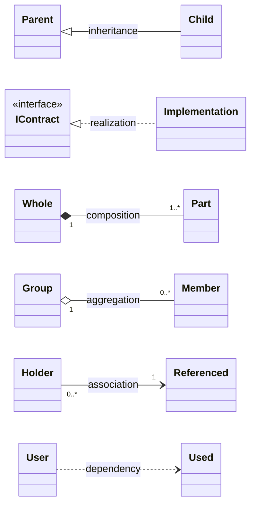
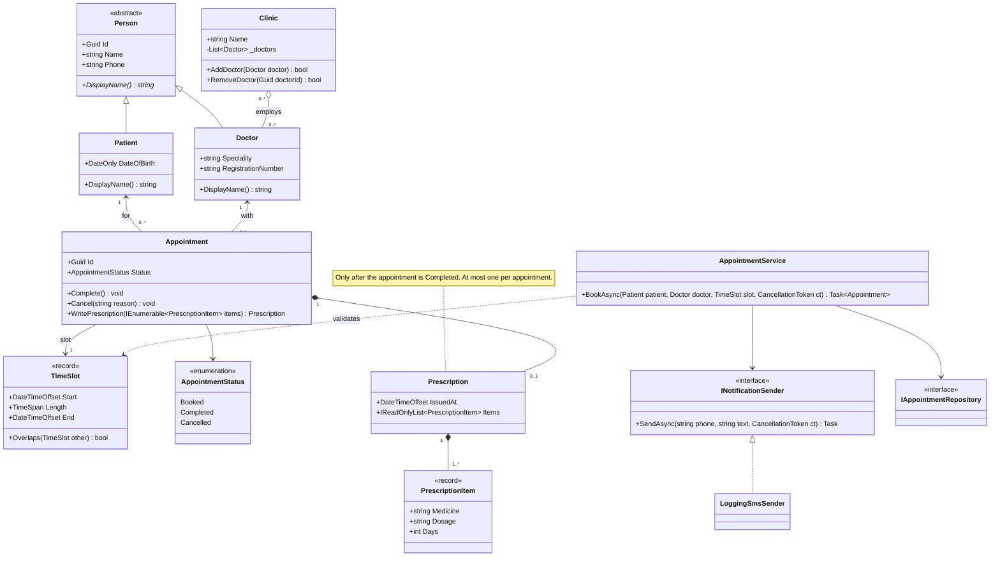
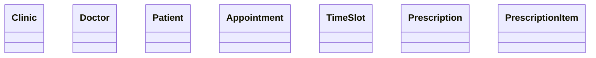
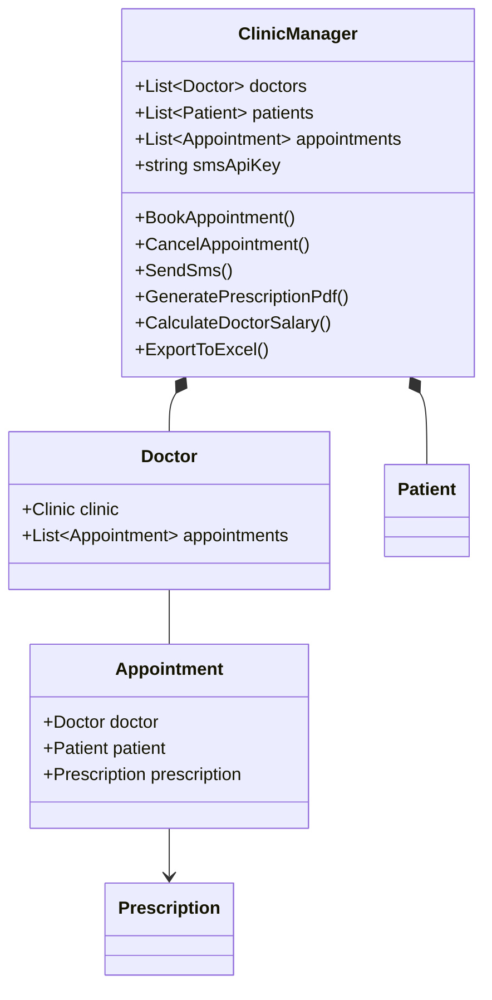
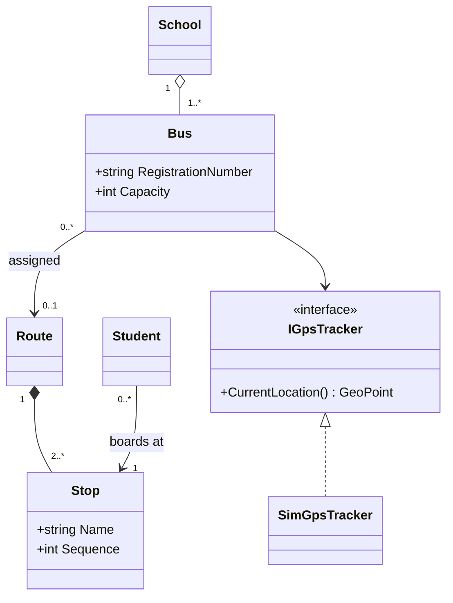
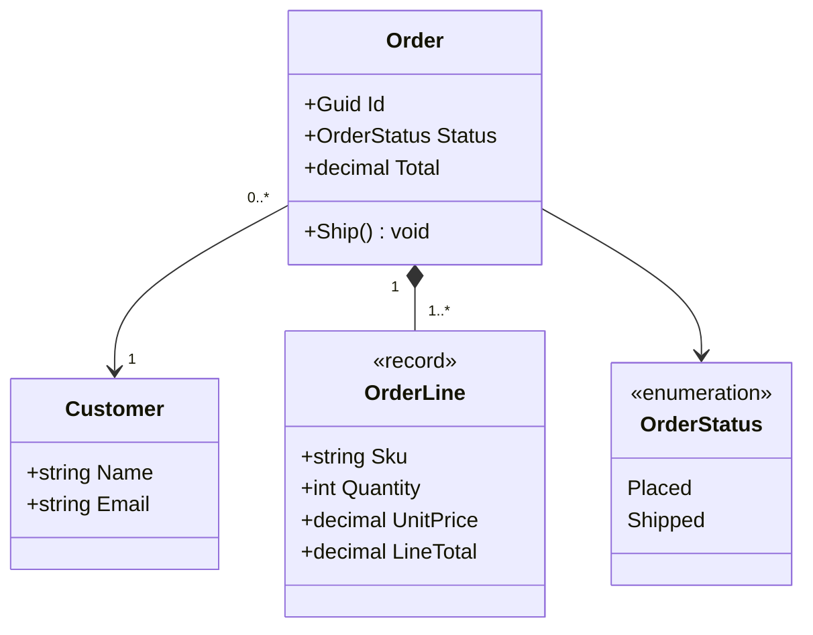
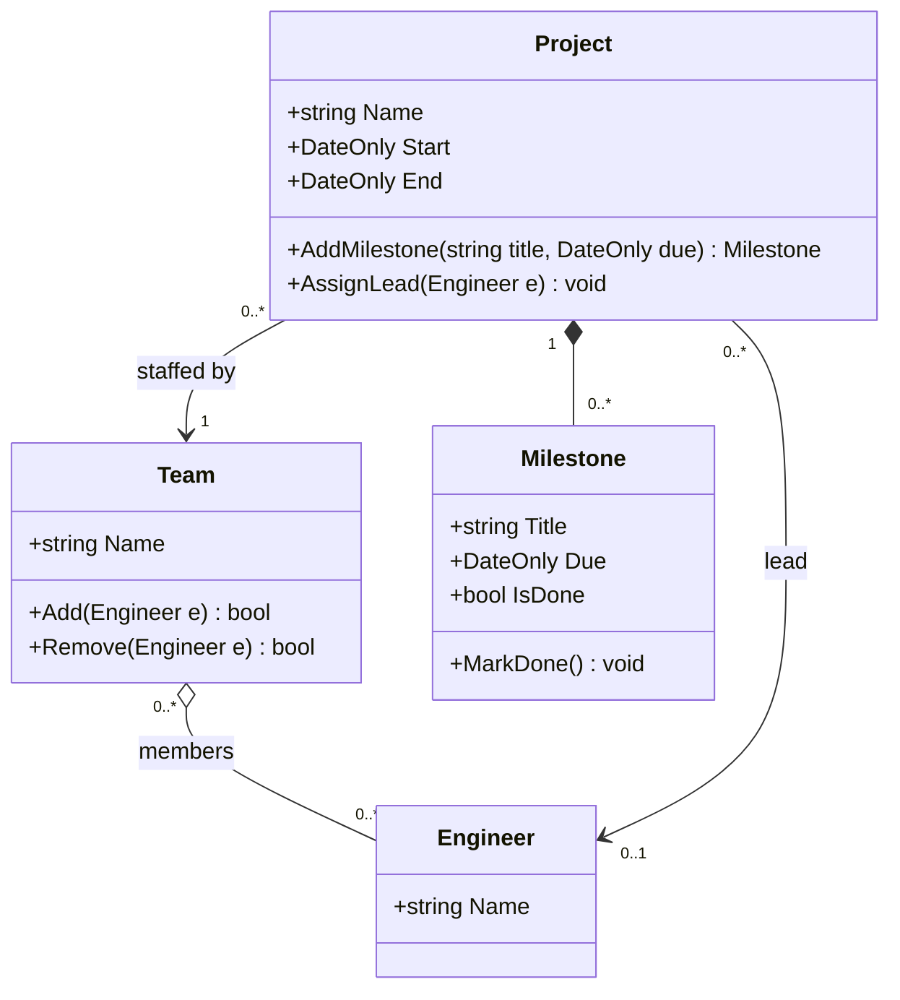
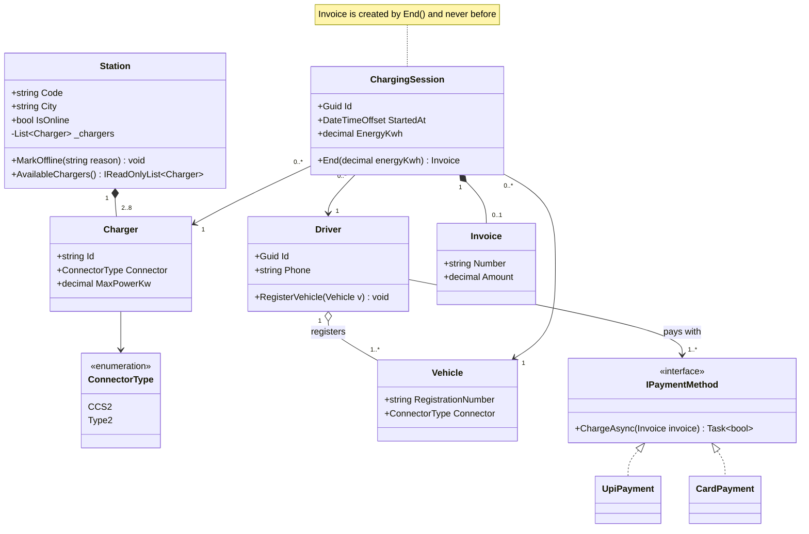
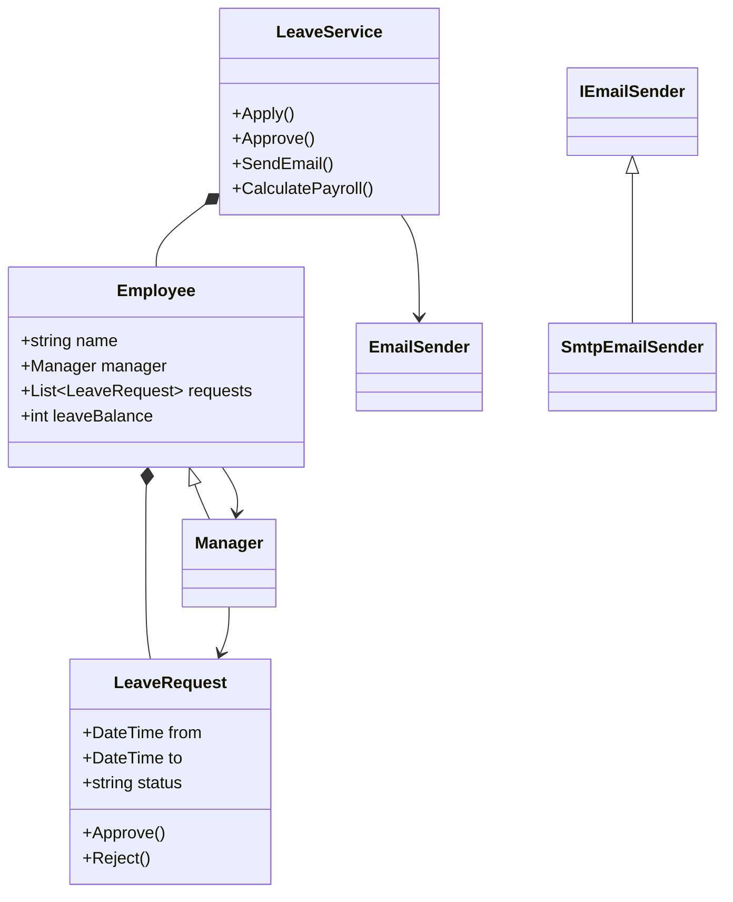
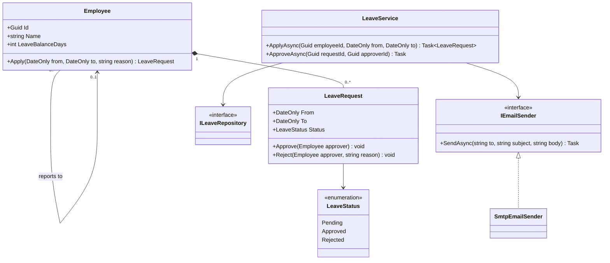

A class diagram is a map of your code's *structure*: which classes exist, what each holds and does, and how they are connected. Engineers draw them on whiteboards in design discussions, in interviews, and, more and more, as text in the repository using Mermaid. This lesson teaches the full notation, slowly, and maps every symbol to the C# you already know.

## Learning objectives

By the end of this lesson you will be able to:

1. Read a UML class box: name, attributes, operations, visibility, static and abstract markers.
2. Recognise all the main relationships (association, aggregation, composition, inheritance, realization, dependency) and say what each means.
3. Read and write multiplicity (`1`, `0..1`, `*`, `1..*`) and put it on the correct end of a line.
4. Translate a class diagram into C#, and a C# design into a class diagram.
5. Write class diagrams in Mermaid `classDiagram` syntax, including generics, annotations, notes and namespaces.
6. Decide how much detail a diagram needs for its audience, and spot common diagram mistakes.

## Prerequisites

- [Classes, objects, fields, properties and methods](#/lesson/m01-classes-objects).
- [Encapsulation, abstraction, inheritance and polymorphism](#/lesson/m01-oop-pillars): you need to know what an interface, an abstract class and inheritance are.
- [UML fundamentals](#/lesson/m05-uml-fundamentals) is helpful but not required. This lesson is self-contained.

## Explain it like I'm a beginner

### A family tree, but for code

Think of the family tree a relative drew on the back of a wedding card. Each box is a person. Lines show who is married to whom and who is whose child. You don't see what anybody ate for breakfast, only **who exists and how they are related**.

A class diagram does the same for code. Each box is a **class** (a blueprint, as you learned [earlier](#/lesson/m01-classes-objects)). Lines between boxes show **relationships**: "a Doctor *is a* Person", "an Appointment *has* a Prescription", "the booking service *uses* the SMS sender". It doesn't show *when* things happen. That is the job of a [sequence diagram](#/lesson/m05-sequence-diagrams).

### A building floor plan

A floor plan of a hospital uses standard symbols: a door is an arc, a window is a thin double line. Any architect in Delhi or Dublin can read it. UML (the Unified Modeling Language) is that shared symbol set for software. Once you learn it, you can read any team's diagrams.

### Our example: a clinic in Hyderabad

A multi-speciality clinic wants an appointment system:

- The clinic has several **doctors**. A doctor can also visit other clinics.
- **Patients** book **appointments** with a doctor for a **time slot**.
- After a consultation, the doctor may write one **prescription**, which lists one or more **medicines**.
- Patients get an **SMS** when they book.

Keep this in mind. Every symbol below will be shown on it.

## First-principles explanation

### The class box

A class is drawn as a rectangle with up to three parts:

```text
+------------------------------+
|          Appointment         |   1. name
+------------------------------+
| - status : AppointmentStatus |   2. attributes (data)
| + slot : TimeSlot            |
+------------------------------+
| + Cancel(reason : string)    |   3. operations (methods)
| + Complete() : void          |
+------------------------------+
```

- **Name**: the class name. *Italic* (or the label `<<abstract>>`) means an abstract class.
- **Attributes**: the data. The formal UML form is `visibility name : Type`, for example `- status : AppointmentStatus`.
- **Operations**: the methods. UML form is `visibility Name(param : Type) : ReturnType`.

You may leave out any part. A box with just a name is perfectly valid, and often best in early design talks.

### Visibility symbols

| Symbol | UML meaning | C# keyword |
|---|---|---|
| `+` | public | `public` |
| `-` | private | `private` |
| `#` | protected | `protected` |
| `~` | package | `internal` (closest C# equivalent) |

So `- _balance : decimal` is a private field, and `+ Book(slot : TimeSlot) : Appointment` is a public method.

### Static and abstract members

- **Static** members (belonging to the class, not an object) are **underlined**.
- **Abstract** members (no body; subclasses must provide one) are written in *italics*.

### Stereotypes (annotations)

A word in guillemets, `<<like this>>`, above the class name adds a category:

- `<<interface>>`: a contract with no data, like a C# `interface`.
- `<<abstract>>`: an abstract class (an alternative to italics, easier to see on a whiteboard).
- `<<enumeration>>`: an `enum`. Its "attributes" are the values.
- Teams also invent their own, such as `<<record>>`, `<<service>>` or `<<value object>>`. That is allowed. Explain them in a legend.

### Relationships: the lines between boxes

This is the heart of the lesson. There are six relationships you must know. They differ in **how strongly two classes are tied together**, from weakest to strongest.

**1. Dependency: "uses for a moment" (dashed line, open arrow).**
`AppointmentService ..> TimeSlot`. The service *uses* a `TimeSlot` as a method parameter or a local variable, but doesn't keep it. In C#: a parameter, a local, a return type, or a call to a static method. If `TimeSlot` changes, the service might need to change. That's all a dependency says.

**2. Association: "knows about, keeps a reference" (solid line, optionally with an arrow).**
`Appointment --> Patient`. Every appointment *holds* a reference to its patient. In C#: a field or property of that type. The arrow shows **navigability**: from an `Appointment` you can reach its `Patient`. A line with no arrowheads means "navigable both ways" or "not decided yet".

**3. Aggregation: "has, but doesn't own" (solid line, hollow diamond at the owner).**
`Clinic o-- Doctor`. A clinic has doctors, but the doctors exist independently. If the clinic closes, the doctors still exist and can work elsewhere. A doctor can belong to two clinics. In C#: a collection of references to objects that were **created somewhere else** and passed in (`clinic.AddDoctor(doctor)`).

**4. Composition: "owns; the part dies with the whole" (solid line, filled diamond at the owner).**
`Appointment *-- Prescription`. A prescription only makes sense as part of one appointment. It is created by the appointment, belongs to exactly one appointment, and is meaningless if the appointment is deleted. In C#: the owner **creates** the part (often in a method like `WritePrescription(...)`), doesn't let anyone else replace it, and never shares it with another owner.

**5. Inheritance (generalization): "is a" (solid line, hollow triangle at the parent).**
`Person <|-- Doctor`. A doctor *is a* person. In C#: `class Doctor : Person`.

**6. Realization (implementation): "fulfils the contract" (dashed line, hollow triangle at the interface).**
`INotificationSender <|.. SmsNotificationSender`. In C#: `class SmsNotificationSender : INotificationSender`.

A quick way to remember the shapes:

| Shape | Says |
|---|---|
| Triangle (hollow) | "is a kind of" (solid line: class; dashed: interface) |
| Diamond, hollow | "has, loosely" (aggregation) |
| Diamond, filled | "owns completely" (composition) |
| Plain arrow, solid line | "keeps a reference to" (association) |
| Plain arrow, dashed line | "uses briefly" (dependency) |

:::callout type=tip title="Aggregation vs composition: one question"
Ask: **"If I delete the whole, should the part be deleted too, and can the part belong to two wholes?"** Delete the appointment, delete its prescription, and a prescription never belongs to two appointments: composition. Close the clinic, but the doctor lives on and may work at another clinic: aggregation. If you are unsure, a plain association is always acceptable. Many experienced engineers rarely use the hollow diamond for exactly this reason.
:::

### Multiplicity: how many?

Multiplicity is written at **each end** of a line and answers: *"for one object at the other end, how many of these are there?"*

| Notation | Meaning | Typical C# |
|---|---|---|
| `1` | exactly one | non-nullable reference, required in the constructor |
| `0..1` | zero or one | nullable reference, `Prescription?` |
| `*` or `0..*` | any number, including none | `IReadOnlyList<T>`, can be empty |
| `1..*` | at least one | collection plus a constructor check that it isn't empty |
| `2..8` | a specific range | collection plus a range check |

**The reading rule:** read from one class, *across* the line, and say the number written at the **far end**.

`Patient "1" --> "0..*" Appointment` reads:
- "One patient has **zero or more** appointments." (start at `Patient`, read the number near `Appointment`)
- "Each appointment belongs to **exactly one** patient." (start at `Appointment`, read the number near `Patient`)

Beginners often put the number on the wrong end. Reading the sentence aloud both ways catches it.

### Labels and role names

A word on the line (`: books`) names the relationship. Role names at the ends say what the reference is *called*: on `Project --> Engineer` you might label the end `lead`, which becomes the property `Lead` in C#.

### Drawing a class diagram in Mermaid

Mermaid turns text into diagrams. GitHub, GitLab, Azure DevOps wikis, many documentation tools and this platform render it. Because it's text, it goes in your repository, appears in code reviews, and changes alongside the code.

**Start and direction.**

```text
classDiagram
    direction LR
```

`direction` can be `TB` (top to bottom, the default), `BT`, `LR` or `RL`.

**Declaring a class with members.**

```text
class Appointment {
    -AppointmentStatus _status
    +TimeSlot Slot
    +int MaxPerDoctorPerDay$
    +Cancel(string reason) void
    +Complete() void
    +Describe()* string
}
```

- Mermaid's convention is `Type name` (C#-like), not UML's `name : Type`. Both render; pick one style per diagram.
- The **return type goes after the closing bracket**: `+Complete() void`.
- `$` at the end of a member marks it **static** (rendered underlined). `*` marks it **abstract** (rendered italic). For methods you can put the marker right after `)` or at the very end of the line.
- Visibility is the first character: `+`, `-`, `#`, `~`.

**Generics.** Mermaid uses tildes instead of angle brackets, because `<` and `>` confuse the parser: `List~Appointment~`, `IReadOnlyList~PrescriptionItem~`, and a generic class `class Repository~T~`.

**Annotations.**

```text
class INotificationSender {
    <<interface>>
    +SendAsync(string phone, string text) Task
}
class AppointmentStatus {
    <<enumeration>>
    Booked
    Completed
    Cancelled
}
```

You can also write `<<interface>> INotificationSender` on its own line.

**Relationships.** The arrowhead or diamond is drawn at the end where the symbol is written:

| Mermaid | Relationship | Symbol drawn at |
|---|---|---|
| `Person <\|-- Doctor` | inheritance | `Person` (triangle) |
| `INotificationSender <\|.. SmsSender` | realization | the interface |
| `SmsSender ..\|> INotificationSender` | realization, written the other way | the interface |
| `Appointment *-- Prescription` | composition | `Appointment` (filled diamond) |
| `Clinic o-- Doctor` | aggregation | `Clinic` (hollow diamond) |
| `Appointment --> Patient` | association | `Patient` (arrowhead) |
| `Service ..> TimeSlot` | dependency | `TimeSlot` (arrowhead) |
| `A -- B` / `A .. B` | solid / dashed link, no arrows | none |

(The `\|` in this table is only escaping for the table; in Mermaid you write a plain `|`.)

**Multiplicity and labels.** Quote the multiplicity next to each class, and put the label after a colon:

```text
Patient "1" --> "0..*" Appointment : books
Clinic "1" o-- "1..*" Doctor : employs
Appointment "1" *-- "0..1" Prescription
```

**Notes and namespaces.**

```text
note for Appointment "A prescription can only be written after the consultation"
namespace Scheduling {
    class Appointment
    class TimeSlot
}
```

Common Mermaid errors: forgetting `classDiagram` on the first line; using `<` `>` for generics; a stray `:` inside a member type; and declaring relationships to a misspelt class name, which silently creates a second, empty box.

### Mapping a class diagram to C#

| On the diagram | In C# |
|---|---|
| Class box | `public sealed class Appointment` (sealed unless designed for inheritance) |
| `<<abstract>>` or italic name | `public abstract class Person` |
| `<<interface>>` | `public interface INotificationSender` |
| `<<enumeration>>` | `public enum AppointmentStatus` |
| `-AppointmentStatus _status` | `private AppointmentStatus _status;` |
| `+TimeSlot Slot` | `public TimeSlot Slot { get; }` |
| `+Cancel(string reason) void` | `public void Cancel(string reason)` |
| Static (underlined, `$`) | `static` |
| Abstract member (italic, `*`) | `abstract` |
| `A ..> B` (dependency) | `B` appears only as a parameter, local or return type in `A` |
| `A --> "1" B` (association) | `public B B { get; }`, set in the constructor, never null |
| `A --> "0..1" B` | `public B? B { get; private set; }` |
| `A o-- "*" B` (aggregation) | `private readonly List<B> _bs;` filled with objects **passed in** |
| `A *-- "1..*" B` (composition) | `A` **creates** its `B`s; exposes them read-only; constructor checks at least one |
| `A <\|-- B` (inheritance) | `class B : A` |
| `I <\|.. C` (realization) | `class C : I` |

Two important consequences:

- **The diagram usually shows *either* an attribute *or* an association line for the same reference, not both.** If `Appointment` has a line to `Patient`, you don't also list `+Patient Patient` inside the box. Some teams do list both for clarity; just be consistent.
- **C# has no keyword for aggregation or composition.** The difference is in *behaviour*: who creates the object, who can see it, and what happens when the owner goes away. That's why the diagram is useful. It records an intention the code can't state on its own.

### How much detail?

Different readers need different levels of detail:

| Audience | Show |
|---|---|
| Whiteboard discussion, interview | Class names and relationships only; key multiplicities |
| Design document for a feature | Plus the important public methods and properties |
| Onboarding or API reference | Plus visibility, types and notes on rules |

Never draw every getter, `ToString` and private helper. A diagram's value is in what it **leaves out**. Martin Fowler calls this using "UML as a sketch": a tool for thinking and talking, not a complete blueprint.

### When a class diagram is unnecessary

- A feature that adds one class with no relationships.
- Code that is mostly data passing through (DTOs mapping to DTOs). A table of fields is clearer.
- Designs that will change completely in a week. Sketch them on paper, and don't commit them.

Diagrams that nobody updates become wrong, and a wrong diagram is worse than none. Keep committed diagrams small, and put them next to the code they describe so they are reviewed together.

## Visual explanation

### Notation cheat sheet



Keep this one as your reference card. Each pair of boxes shows one relationship, labelled with its name. Notice where the symbols sit: triangles and diamonds are at the "parent" or "whole" end, and plain arrowheads point *at* the class being referenced or used. Solid lines mean a lasting structural link; dashed lines mean "contract" (realization) or "temporary use" (dependency). The multiplicities show a typical choice for each: a whole owns at least one part, a group may be empty, and many holders can refer to one shared object.

### The clinic model



Walk through it with the rules you just learned:

- **Inheritance**: `Patient` and `Doctor` are kinds of `Person`. `Person` is abstract, and `DisplayName()` is abstract (`*`), so each subclass must provide it. Both list it again because they override it.
- **Aggregation**: a clinic has doctors, and the multiplicity says a doctor can be at zero or more clinics. Doctors are created independently and added with `AddDoctor`.
- **Association with navigability**: the arrows point from `Appointment` to `Patient` and `Doctor`. An appointment knows its patient and doctor, but a `Patient` object does not hold a list of appointments. (You find a patient's appointments by asking the repository.) This one decision avoids a two-way reference that must be kept in sync.
- **Composition, twice**: an appointment owns zero or one prescription; a prescription owns one or more items. Cancel the appointment's record and the prescription has no meaning.
- **Realization**: `LoggingSmsSender` implements `INotificationSender`. The service depends on the interface, so tests can pass a fake.
- **Dependency**: the service uses `TimeSlot` as a parameter to check it, but doesn't store it, so the line is dashed.
- **The note** records a rule that the boxes alone can't express.

## Step-by-step example

How do you get from a paragraph of requirements to that diagram? Five steps.

### Step 1 — find the nouns and verbs

From the clinic's requirements: *clinic, doctor, patient, appointment, time slot, prescription, medicine, SMS* are nouns. *Book, cancel, complete, write prescription, notify* are verbs. Nouns are candidate classes or attributes. Verbs are candidate methods. See [Identifying classes and responsibilities](#/lesson/m07-classes-responsibilities) for more.

### Step 2 — draw boxes with names only



Is "medicine" a class? For now it's just a name on a prescription line, so it becomes an attribute of `PrescriptionItem`. If the clinic later needs a medicine catalogue with stock, it becomes a class.

### Step 3 — connect them and choose the relationship type

For each pair that is related, ask the questions in order:

1. Is one *a kind of* the other? Use **inheritance**. (Doctor and Patient share Name and Phone, so a `Person` base class appears.)
2. Does one *own* the other, so the part dies with it? Use **composition**. (Appointment and Prescription.)
3. Does one *have* a group of the other, which lives independently? Use **aggregation**, or simply association. (Clinic and Doctor.)
4. Does one *keep a reference* to the other? Use **association**. (Appointment to Patient.)
5. Does one only *use* the other briefly? Use **dependency**.

### Step 4 — add multiplicity, reading each line aloud both ways

"One appointment has exactly one patient. One patient has zero or more appointments." Write `1` near `Patient` and `0..*` near `Appointment`.

### Step 5 — add only the important members

Add the methods that carry business rules (`WritePrescription`, `Cancel`) and the properties people will ask about. Skip the rest. Add a note for any rule a box can't express.

## Production-style C# implementation

Here is the clinic diagram turned into code. Each comment names the diagram element it implements, so you can check the mapping line by line.

```text
Clinic.Api/
  Program.cs
  Domain/
    People.cs              // Person (abstract) <|-- Patient, Doctor
    ClinicRoster.cs        // Clinic o-- Doctor (aggregation)
    TimeSlot.cs            // <<record>>
    Appointment.cs         // associations, composition of Prescription, AppointmentStatus enum
    Prescription.cs        // composition of PrescriptionItem (1..*)
  Application/
    INotificationSender.cs // <<interface>> + LoggingSmsSender (realization)
    IAppointmentRepository.cs
    AppointmentService.cs  // association to interfaces, dependency on TimeSlot
```

```csharp file=Domain/People.cs
namespace Clinic.Api.Domain;

/// <summary>Person &lt;&lt;abstract&gt;&gt;. DisplayName()* is abstract, so subclasses must override it.</summary>
public abstract class Person
{
    protected Person(Guid id, string name, string phone)
    {
        ArgumentException.ThrowIfNullOrWhiteSpace(name);
        ArgumentException.ThrowIfNullOrWhiteSpace(phone);
        Id = id;
        Name = name.Trim();
        Phone = phone.Trim();
    }

    public Guid Id { get; }
    public string Name { get; }
    public string Phone { get; }
    public abstract string DisplayName();
}

/// <summary>Person &lt;|-- Patient</summary>
public sealed class Patient(Guid id, string name, string phone, DateOnly dateOfBirth) : Person(id, name, phone)
{
    public DateOnly DateOfBirth { get; } = dateOfBirth;
    public override string DisplayName() => Name;
}

/// <summary>Person &lt;|-- Doctor</summary>
public sealed class Doctor : Person
{
    public Doctor(Guid id, string name, string phone, string speciality, string registrationNumber) : base(id, name, phone)
    {
        ArgumentException.ThrowIfNullOrWhiteSpace(speciality);
        ArgumentException.ThrowIfNullOrWhiteSpace(registrationNumber);
        Speciality = speciality;
        RegistrationNumber = registrationNumber;
    }

    public string Speciality { get; }
    public string RegistrationNumber { get; }
    public override string DisplayName() => $"Dr. {Name} ({Speciality})";
}
```

```csharp file=Domain/ClinicRoster.cs
namespace Clinic.Api.Domain;

/// <summary>The Clinic box. Clinic "0..*" o-- "0..*" Doctor: aggregation.
/// Doctors are created elsewhere and passed in; removing one does not destroy it,
/// and the same Doctor object may be added to several clinics.</summary>
public sealed class ClinicRoster
{
    private readonly List<Doctor> _doctors = new();

    public ClinicRoster(string name)
    {
        ArgumentException.ThrowIfNullOrWhiteSpace(name);
        Name = name;
    }

    public string Name { get; }
    public IReadOnlyList<Doctor> Doctors => _doctors.ToArray();

    public bool AddDoctor(Doctor doctor)
    {
        ArgumentNullException.ThrowIfNull(doctor);
        if (_doctors.Any(d => d.Id == doctor.Id)) return false;
        _doctors.Add(doctor);
        return true;
    }

    public bool RemoveDoctor(Guid doctorId) => _doctors.RemoveAll(d => d.Id == doctorId) > 0;

    public Doctor? FindDoctor(Guid doctorId) => _doctors.FirstOrDefault(d => d.Id == doctorId);
}
```

```csharp file=Domain/TimeSlot.cs
namespace Clinic.Api.Domain;

/// <summary>TimeSlot &lt;&lt;record&gt;&gt;: a value, compared by its data.</summary>
public sealed record TimeSlot
{
    public TimeSlot(DateTimeOffset start, TimeSpan length)
    {
        if (length <= TimeSpan.Zero || length > TimeSpan.FromHours(2))
            throw new ArgumentOutOfRangeException(nameof(length), "A slot must be between 1 minute and 2 hours.");
        Start = start;
        Length = length;
    }

    public DateTimeOffset Start { get; }
    public TimeSpan Length { get; }
    public DateTimeOffset End => Start + Length;

    public bool Overlaps(TimeSlot other) => Start < other.End && other.Start < End;
}
```

```csharp file=Domain/Appointment.cs
namespace Clinic.Api.Domain;

/// <summary>AppointmentStatus &lt;&lt;enumeration&gt;&gt;</summary>
public enum AppointmentStatus { Booked, Completed, Cancelled }

public sealed class Appointment
{
    private Prescription? _prescription;    // Appointment "1" *-- "0..1" Prescription

    public Appointment(Guid id, Patient patient, Doctor doctor, TimeSlot slot)
    {
        // Association "1": required, never null.
        Patient = patient ?? throw new ArgumentNullException(nameof(patient));
        Doctor = doctor ?? throw new ArgumentNullException(nameof(doctor));
        Slot = slot ?? throw new ArgumentNullException(nameof(slot));
        Id = id;
    }

    public Guid Id { get; }
    public Patient Patient { get; }          // Patient "1" <-- "0..*" Appointment (navigable from Appointment only)
    public Doctor Doctor { get; }            // Doctor "1" <-- "0..*" Appointment
    public TimeSlot Slot { get; }            // Appointment --> "1" TimeSlot
    public AppointmentStatus Status { get; private set; } = AppointmentStatus.Booked;
    public string? CancellationReason { get; private set; }
    public Prescription? Prescription => _prescription;   // "0..1" maps to a nullable reference

    public void Complete()
    {
        if (Status != AppointmentStatus.Booked)
            throw new InvalidOperationException($"Only a booked appointment can be completed (it is {Status}).");
        Status = AppointmentStatus.Completed;
    }

    public void Cancel(string reason)
    {
        ArgumentException.ThrowIfNullOrWhiteSpace(reason);
        if (Status != AppointmentStatus.Booked)
            throw new InvalidOperationException($"Only a booked appointment can be cancelled (it is {Status}).");
        Status = AppointmentStatus.Cancelled;
        CancellationReason = reason;
    }

    /// <summary>Composition: the appointment creates its prescription. Nobody can attach
    /// an existing one, and it can never be shared with another appointment.</summary>
    public Prescription WritePrescription(IEnumerable<PrescriptionItem> items, DateTimeOffset issuedAt)
    {
        if (Status != AppointmentStatus.Completed)
            throw new InvalidOperationException("A prescription can only be written after the consultation.");
        if (_prescription is not null)
            throw new InvalidOperationException("This appointment already has a prescription.");
        _prescription = new Prescription(items, issuedAt);
        return _prescription;
    }
}
```

```csharp file=Domain/Prescription.cs
namespace Clinic.Api.Domain;

/// <summary>PrescriptionItem &lt;&lt;record&gt;&gt;</summary>
public sealed record PrescriptionItem(string Medicine, string Dosage, int Days);

/// <summary>Prescription "1" *-- "1..*" PrescriptionItem. The internal constructor means only
/// code in this project (in practice, Appointment) can create one.</summary>
public sealed class Prescription
{
    private readonly PrescriptionItem[] _items;

    internal Prescription(IEnumerable<PrescriptionItem> items, DateTimeOffset issuedAt)
    {
        ArgumentNullException.ThrowIfNull(items);
        _items = items.ToArray();
        if (_items.Length == 0) throw new ArgumentException("A prescription needs at least one item.", nameof(items)); // "1..*"
        foreach (var i in _items)
        {
            ArgumentException.ThrowIfNullOrWhiteSpace(i.Medicine);
            ArgumentOutOfRangeException.ThrowIfNegativeOrZero(i.Days);
        }
        IssuedAt = issuedAt;
    }

    public DateTimeOffset IssuedAt { get; }
    public IReadOnlyList<PrescriptionItem> Items => _items;
}
```

```csharp file=Application/INotificationSender.cs
using Microsoft.Extensions.Logging;

namespace Clinic.Api.Application;

/// <summary>INotificationSender &lt;&lt;interface&gt;&gt;</summary>
public interface INotificationSender
{
    Task SendAsync(string phone, string text, CancellationToken ct);
}

/// <summary>INotificationSender &lt;|.. LoggingSmsSender. Stands in for a real SMS gateway.</summary>
public sealed class LoggingSmsSender(ILogger<LoggingSmsSender> logger) : INotificationSender
{
    public Task SendAsync(string phone, string text, CancellationToken ct)
    {
        logger.LogInformation("SMS to {Phone}: {Text}", phone, text);
        return Task.CompletedTask;
    }
}
```

```csharp file=Application/IAppointmentRepository.cs
using System.Collections.Concurrent;
using Clinic.Api.Domain;

namespace Clinic.Api.Application;

public interface IAppointmentRepository
{
    Task<IReadOnlyList<Appointment>> ForDoctorAsync(Guid doctorId, DateOnly day, CancellationToken ct);
    Task AddAsync(Appointment appointment, CancellationToken ct);
    Task<Appointment?> FindAsync(Guid id, CancellationToken ct);
}

public sealed class InMemoryAppointmentRepository : IAppointmentRepository
{
    private readonly ConcurrentDictionary<Guid, Appointment> _items = new();

    public Task<IReadOnlyList<Appointment>> ForDoctorAsync(Guid doctorId, DateOnly day, CancellationToken ct) =>
        Task.FromResult<IReadOnlyList<Appointment>>(_items.Values
            .Where(a => a.Doctor.Id == doctorId && DateOnly.FromDateTime(a.Slot.Start.DateTime) == day)
            .ToList());

    public Task AddAsync(Appointment appointment, CancellationToken ct)
    {
        if (!_items.TryAdd(appointment.Id, appointment))
            throw new InvalidOperationException($"Appointment {appointment.Id} already exists.");
        return Task.CompletedTask;
    }

    public Task<Appointment?> FindAsync(Guid id, CancellationToken ct) => Task.FromResult(_items.GetValueOrDefault(id));
}
```

```csharp file=Application/AppointmentService.cs
using Clinic.Api.Domain;

namespace Clinic.Api.Application;

/// <summary>AppointmentService --> IAppointmentRepository, --> INotificationSender (associations: kept as fields).
/// AppointmentService ..> TimeSlot (dependency: only a parameter).</summary>
public sealed class AppointmentService(IAppointmentRepository repository, INotificationSender notifications, TimeProvider clock)
{
    public async Task<Appointment> BookAsync(Patient patient, Doctor doctor, TimeSlot slot, CancellationToken ct)
    {
        if (slot.Start <= clock.GetUtcNow())
            throw new InvalidOperationException("Appointments must be booked in the future.");

        // A simple check-then-add. Two simultaneous bookings could both pass it; a real system
        // would enforce "no overlap" in PostgreSQL with an exclusion constraint.
        var sameDay = await repository.ForDoctorAsync(doctor.Id, DateOnly.FromDateTime(slot.Start.DateTime), ct);
        if (sameDay.Any(a => a.Status == AppointmentStatus.Booked && a.Slot.Overlaps(slot)))
            throw new InvalidOperationException($"{doctor.DisplayName()} is not free at {slot.Start:HH:mm}.");

        var appointment = new Appointment(Guid.NewGuid(), patient, doctor, slot);
        await repository.AddAsync(appointment, ct);
        await notifications.SendAsync(patient.Phone,
            $"Booked with {doctor.DisplayName()} on {slot.Start:dd MMM, HH:mm}.", ct);
        return appointment;
    }
}
```

```csharp file=Program.cs
using Clinic.Api.Application;
using Clinic.Api.Domain;

var builder = WebApplication.CreateBuilder(args);

// Demo data: one clinic, one doctor, one patient.
var clinic = new ClinicRoster("Banjara Hills Multi-speciality Clinic");
var doctor = new Doctor(Guid.Parse("11111111-1111-1111-1111-111111111111"), "Kavya Reddy", "+91-90000-00001", "Paediatrics", "TSMC-12345");
clinic.AddDoctor(doctor);
var patients = new Dictionary<Guid, Patient>
{
    [Guid.Parse("22222222-2222-2222-2222-222222222222")] =
        new(Guid.Parse("22222222-2222-2222-2222-222222222222"), "Rohan Das", "+91-90000-00002", new DateOnly(2019, 6, 1)),
};

builder.Services.AddSingleton(clinic);
builder.Services.AddSingleton<IReadOnlyDictionary<Guid, Patient>>(patients);
builder.Services.AddSingleton(TimeProvider.System);
builder.Services.AddSingleton<IAppointmentRepository, InMemoryAppointmentRepository>();
builder.Services.AddSingleton<INotificationSender, LoggingSmsSender>();
builder.Services.AddSingleton<AppointmentService>();

var app = builder.Build();

app.MapGet("/doctors", (ClinicRoster c) => c.Doctors.Select(d => new { d.Id, Name = d.DisplayName() }));

app.MapPost("/appointments", async (BookRequest req, ClinicRoster c, IReadOnlyDictionary<Guid, Patient> people,
    AppointmentService service, CancellationToken ct) =>
{
    if (c.FindDoctor(req.DoctorId) is not { } doc) return Results.NotFound("Doctor not found.");
    if (!people.TryGetValue(req.PatientId, out var patient)) return Results.NotFound("Patient not found.");
    try
    {
        var appt = await service.BookAsync(patient, doc, new TimeSlot(req.Start, TimeSpan.FromMinutes(req.Minutes)), ct);
        return Results.Created($"/appointments/{appt.Id}", new { appt.Id, appt.Status });
    }
    catch (ArgumentException ex) { return Results.Problem(ex.Message, statusCode: 400); }
    catch (InvalidOperationException ex) { return Results.Problem(ex.Message, statusCode: 409); }
});

app.Run();

public sealed record BookRequest(Guid PatientId, Guid DoctorId, DateTimeOffset Start, int Minutes);
```

Check the mapping yourself:

- The class is called `ClinicRoster` in code, not `Clinic`, because `Clinic` is already the root namespace (`Clinic.Api`). A small difference like this belongs in a note on the diagram, or the diagram should use the code's name. **When the diagram and the code disagree, the code wins**, and the diagram needs fixing.
- **Composition is enforced by behaviour.** `Prescription` has an `internal` constructor, and `Appointment` is the only class that calls it. There is no `SetPrescription(Prescription p)` method that would let a prescription be attached to two appointments.
- **Aggregation is enforced by the opposite behaviour.** `AddDoctor` accepts a doctor created elsewhere, and `RemoveDoctor` just forgets the reference.
- **Navigability is a real decision.** `Patient` has no `Appointments` list. If it did, every booking would need to update two objects, and they could drift apart.
- **Multiplicity becomes code.** `1` is a non-null constructor argument; `0..1` is `Prescription?`; `1..*` is the "at least one item" check.

## Bad design vs good design

Diagrams can be badly designed too. Here is a diagram from a real-looking code review:



Problems:

- **A god class.** `ClinicManager` books, sends SMS, renders PDFs, runs payroll and exports Excel. It will change for every reason in the business.
- **Wrong diamonds.** Composition from `ClinicManager` to `Doctor` claims doctors are destroyed with the manager object. That's false.
- **Public fields everywhere** (`+List~Doctor~ doctors`), so any code can add or remove anything with no rules.
- **Missing multiplicities**, so nobody knows if a prescription is required or optional.
- **Two-way reference** between `Doctor` and `Appointment` (`Doctor.appointments` plus `Appointment.doctor`) with no statement of who keeps them in sync.
- **A secret in a class diagram** (`smsApiKey`). Configuration doesn't belong in the domain model, or in documentation.

The good version is the clinic model in the visual section: small focused classes, correct diamonds, navigability chosen on purpose, multiplicities on every important line, and infrastructure (SMS) behind an interface.

**Is a full diagram always worth it?** No. For a pull request that adds `WritePrescription`, a four-box diagram (Appointment, Prescription, PrescriptionItem, status enum) is better than the whole model. Draw the part that matters to the change.

:::callout type=mistake title="Diagrams that drift"
A class diagram pasted as a PNG into a wiki goes stale the week after it is drawn. Prefer Mermaid in a Markdown file next to the code (for example `docs/clinic-model.md`), so changes to the design show up in the same pull request as changes to the code.
:::

## Practical playground

Open the clinic model in the LLD designer. Try these changes and watch how the diagram reads:

1. Change `Clinic → Doctor` from aggregation to composition. Say aloud what that now claims. Is it true?
2. Add a `Medicine` class with stock, and connect `PrescriptionItem` to it. Which relationship and multiplicity?
3. Add a two-way association between `Patient` and `Appointment`. What extra code would that force?

:::playground type=lld title="Clinic class model"
```json
{
  "classes": [
    { "id": "Person", "name": "Person", "kind": "abstract", "fields": ["+Guid Id", "+string Name", "+string Phone"], "methods": ["+string DisplayName()"], "responsibility": "Shared identity and contact details" },
    { "id": "Patient", "name": "Patient", "kind": "class", "fields": ["+DateOnly DateOfBirth"], "methods": ["+string DisplayName()"] },
    { "id": "Doctor", "name": "Doctor", "kind": "class", "fields": ["+string Speciality", "+string RegistrationNumber"], "methods": ["+string DisplayName()"] },
    { "id": "Clinic", "name": "Clinic", "kind": "class", "fields": ["+string Name", "-List<Doctor> _doctors"], "methods": ["+bool AddDoctor(Doctor doctor)", "+bool RemoveDoctor(Guid id)"], "responsibility": "Roster of doctors" },
    { "id": "TimeSlot", "name": "TimeSlot", "kind": "record", "fields": ["+DateTimeOffset Start", "+TimeSpan Length"], "methods": ["+bool Overlaps(TimeSlot other)"] },
    { "id": "Appointment", "name": "Appointment", "kind": "class", "fields": ["+Guid Id", "+AppointmentStatus Status"], "methods": ["+void Complete()", "+void Cancel(string reason)", "+Prescription WritePrescription(IEnumerable<PrescriptionItem> items)"], "responsibility": "One consultation and its lifecycle" },
    { "id": "AppointmentStatus", "name": "AppointmentStatus", "kind": "enum", "fields": ["Booked", "Completed", "Cancelled"], "methods": [] },
    { "id": "Prescription", "name": "Prescription", "kind": "class", "fields": ["+DateTimeOffset IssuedAt"], "methods": [] },
    { "id": "PrescriptionItem", "name": "PrescriptionItem", "kind": "record", "fields": ["+string Medicine", "+string Dosage", "+int Days"], "methods": [] },
    { "id": "INotificationSender", "name": "INotificationSender", "kind": "interface", "fields": [], "methods": ["Task SendAsync(string phone, string text)"] },
    { "id": "LoggingSmsSender", "name": "LoggingSmsSender", "kind": "class", "fields": [], "methods": ["+Task SendAsync(string phone, string text)"] },
    { "id": "AppointmentService", "name": "AppointmentService", "kind": "class", "fields": [], "methods": ["+Task<Appointment> BookAsync(Patient p, Doctor d, TimeSlot slot)"], "responsibility": "Books appointments and notifies patients" }
  ],
  "relations": [
    { "from": "Patient", "to": "Person", "kind": "inherits" },
    { "from": "Doctor", "to": "Person", "kind": "inherits" },
    { "from": "Clinic", "to": "Doctor", "kind": "aggregation", "multiplicity": "0..*", "label": "employs" },
    { "from": "Appointment", "to": "Patient", "kind": "association", "multiplicity": "1", "label": "for" },
    { "from": "Appointment", "to": "Doctor", "kind": "association", "multiplicity": "1", "label": "with" },
    { "from": "Appointment", "to": "TimeSlot", "kind": "association", "multiplicity": "1" },
    { "from": "Appointment", "to": "Prescription", "kind": "composition", "multiplicity": "0..1" },
    { "from": "Prescription", "to": "PrescriptionItem", "kind": "composition", "multiplicity": "1..*" },
    { "from": "LoggingSmsSender", "to": "INotificationSender", "kind": "implements" },
    { "from": "AppointmentService", "to": "INotificationSender", "kind": "association" },
    { "from": "AppointmentService", "to": "TimeSlot", "kind": "dependency", "label": "validates" }
  ]
}
```
:::

## Exercises

:::exercise id=m05-class-diagrams-ex1 difficulty=beginner kind=written title="Read a diagram aloud"
Here is part of a diagram for a school bus tracking app:



Answer in full sentences:

1. How many stops can a route have? Can a route exist with one stop?
2. Can a bus exist without a route? Can two buses share a route?
3. If a route is deleted, what happens to its stops? Why?
4. If a school is deleted, what happens to its buses? Why might the designer have chosen that?
5. From a `Student` object, can you reach the `Stop`? From a `Stop`, can you reach its students?
6. What does the dashed line with the triangle mean, and how would you write it in C#?
::acceptance
- All six questions answered as sentences that state the multiplicity both ways where relevant.
- Composition and aggregation are explained in terms of lifetime and ownership.
- Navigability (question 5) is answered from the arrow direction.
- The C# for question 6 uses `class SimGpsTracker : IGpsTracker`.
::hint
Read each line from one class across to the number at the *other* end.
::hint
Filled diamond: the part lives and dies with the whole. Hollow diamond: the part can outlive the whole.
::hint
An arrowhead shows which way you can navigate. No arrowhead at the `Student` end means a `Stop` doesn't hold a list of students.
::hint
A shape for each answer: "One X has N Y; each Y belongs to M X."
::solution
1. A route has **two or more** stops (`2..*`). A route with one stop cannot exist, which makes sense: a route needs a start and an end.
2. A bus is assigned **zero or one** route, so it can exist without one (a spare bus). The other end says one route can be assigned to zero or more buses, so yes, two buses can share a route (for example, morning and afternoon shifts).
3. The stops are **deleted with the route**. It's composition: these stops are defined as positions on this route and have no meaning without it.
4. The buses **remain**. It's aggregation: a bus could be transferred to another school or sold, and has its own registration and records. The designer is saying "the school uses these buses; it doesn't own their existence".
5. From `Student` you can reach the `Stop` (the arrow points at `Stop`, and each student has exactly one). From `Stop` you **cannot** reach its students: there is no arrowhead towards `Student`. To find them you would query a repository.
6. It is **realization**: `SimGpsTracker` implements the `IGpsTracker` contract. In C#: `public sealed class SimGpsTracker : IGpsTracker { public GeoPoint CurrentLocation() { ... } }`.
::mistakes
- Reading the multiplicity at the near end, which gives "one stop has 2 or more routes".
- Saying aggregation means "the school can't have zero buses". Lifetime and multiplicity are separate questions; here `1..*` says it must have at least one.
- Thinking an association line means both classes hold references to each other.
:::

:::exercise id=m05-class-diagrams-ex2 difficulty=beginner kind=code title="Turn an order diagram into C#"
Implement this diagram exactly:


::requirements
- `Order(Guid id, Customer customer, IEnumerable<OrderLine> lines)`. A null customer throws `ArgumentNullException` (multiplicity `1`). No lines throws `ArgumentException` (`1..*`).
- The order **copies** its lines (composition): changing the caller's list later must not change the order. `Lines` is exposed as `IReadOnlyList<OrderLine>` and is not a `List<OrderLine>`.
- `LineTotal` = `Quantity × UnitPrice`. `Total` = sum of line totals.
- A new order is `Placed`. `Ship()` moves it to `Shipped`; shipping twice throws `InvalidOperationException`.
::acceptance
- Two lines (2 × ₹250 and 1 × ₹120) give a total of ₹620.
- A null customer throws `ArgumentNullException`; an empty list throws `ArgumentException`.
- Adding to the original list after construction leaves the order with 2 lines.
- `Ship()` twice throws.
::hint
Start with the multiplicities. `1` means "required and not null". `1..*` means "a collection that is never empty".
::hint
Composition: the order must own its lines. Make a private copy, for example `lines.ToArray()`.
::hint
`ArgumentNullException.ThrowIfNull(customer)` throws exactly `ArgumentNullException`.
::hint
```csharp
_lines = (lines ?? throw new ArgumentNullException(nameof(lines))).ToArray();
if (_lines.Length == 0) throw new ArgumentException("At least one line is required.", nameof(lines));
```
::starter
```csharp file=Orders.cs
using System;
using System.Collections.Generic;
using System.Linq;

public enum OrderStatus { Placed, Shipped }

public sealed record Customer(string Name, string Email);

public sealed record OrderLine(string Sku, int Quantity, decimal UnitPrice)
{
    public decimal LineTotal => throw new NotImplementedException();
}

public sealed class Order
{
    public Order(Guid id, Customer customer, IEnumerable<OrderLine> lines) => throw new NotImplementedException();

    public Guid Id { get; }
    public Customer Customer { get; }
    public OrderStatus Status { get; private set; }
    public IReadOnlyList<OrderLine> Lines => throw new NotImplementedException();
    public decimal Total => throw new NotImplementedException();

    public void Ship() => throw new NotImplementedException();
}
```
::tests
```csharp file=OrderTests.cs
using System;
using System.Collections.Generic;
using Xunit;

public class OrderTests
{
    private static readonly Customer Asha = new("Asha", "asha@example.com");
    private static List<OrderLine> TwoLines() => new() { new("TEA-500G", 2, 250m), new("MUG", 1, 120m) };

    [Fact] public void Total_is_sum_of_lines() => Assert.Equal(620m, new Order(Guid.NewGuid(), Asha, TwoLines()).Total);

    [Fact] public void Customer_is_required() => Assert.Throws<ArgumentNullException>(() => new Order(Guid.NewGuid(), null!, TwoLines()));

    [Fact] public void At_least_one_line() => Assert.Throws<ArgumentException>(() => new Order(Guid.NewGuid(), Asha, new List<OrderLine>()));

    [Fact]
    public void Lines_are_owned_by_the_order()
    {
        var source = TwoLines();
        var order = new Order(Guid.NewGuid(), Asha, source);
        source.Add(new OrderLine("SPOON", 4, 30m));
        Assert.Equal(2, order.Lines.Count);
        Assert.False(order.Lines is List<OrderLine>);
    }

    [Fact]
    public void Ship_once_only()
    {
        var order = new Order(Guid.NewGuid(), Asha, TwoLines());
        Assert.Equal(OrderStatus.Placed, order.Status);
        order.Ship();
        Assert.Equal(OrderStatus.Shipped, order.Status);
        Assert.Throws<InvalidOperationException>(() => order.Ship());
    }
}
```
::solution
```csharp file=Orders.cs
using System;
using System.Collections.Generic;
using System.Linq;

public enum OrderStatus { Placed, Shipped }

public sealed record Customer(string Name, string Email);

public sealed record OrderLine(string Sku, int Quantity, decimal UnitPrice)
{
    public decimal LineTotal => Quantity * UnitPrice;
}

public sealed class Order
{
    private readonly OrderLine[] _lines;                       // Order *-- "1..*" OrderLine

    public Order(Guid id, Customer customer, IEnumerable<OrderLine> lines)
    {
        ArgumentNullException.ThrowIfNull(customer);           // Order --> "1" Customer
        ArgumentNullException.ThrowIfNull(lines);
        _lines = lines.ToArray();                              // own copy: composition
        if (_lines.Length == 0) throw new ArgumentException("An order needs at least one line.", nameof(lines));
        Id = id;
        Customer = customer;
    }

    public Guid Id { get; }
    public Customer Customer { get; }
    public OrderStatus Status { get; private set; } = OrderStatus.Placed;
    public IReadOnlyList<OrderLine> Lines => _lines;
    public decimal Total => _lines.Sum(l => l.LineTotal);

    public void Ship()
    {
        if (Status != OrderStatus.Placed) throw new InvalidOperationException($"Order is already {Status}.");
        Status = OrderStatus.Shipped;
    }
}
```

Every symbol became something concrete: `1` became a null check, `1..*` an emptiness check, the filled diamond a private copy, the enumeration an `enum`, and the `+` members public properties.
::mistakes
- Storing the caller's list directly (`_lines = lines.ToList()` is fine; `_lines = (List<OrderLine>)lines` is not), so later changes leak in.
- Making `Customer` nullable because "it's a reference type". The diagram says exactly one.
- Adding a `Customer.Orders` list. The arrow points one way only.
::extensions
Add `Order "0..*" --> "0..1" Coupon` and implement it as a nullable property with an `ApplyCoupon` method that only works while the order is `Placed`.
:::

:::exercise id=m05-class-diagrams-ex3 difficulty=intermediate kind=code title="Aggregation, composition and an optional association"
Implement this project-tracking model for an infrastructure consultancy:


::requirements
- **Aggregation**: `Team.Add` accepts an existing `Engineer` and returns `false` if that engineer (same object) is already a member. The same engineer may be in several teams. `Remove` returns whether it removed anything, and the engineer object is unaffected.
- **Association `1`**: `Project(string name, Team team, DateOnly start, DateOnly end)`. A null team throws `ArgumentNullException`. `end < start` throws `ArgumentException`.
- **Composition**: milestones are created only by `Project.AddMilestone(title, due)`. A due date outside `[Start, End]` throws `ArgumentOutOfRangeException`. `Milestones` is read-only.
- **Association `0..1`**: `Lead` starts as `null`. `AssignLead(e)` requires `e` to be a member of the project's team, otherwise `InvalidOperationException`.
::acceptance
- One engineer in two teams; removing them from one leaves them in the other.
- Adding the same engineer twice to one team returns `false` the second time.
- A milestone due one day after `End` throws `ArgumentOutOfRangeException`.
- Assigning a lead who is not in the team throws; assigning a member works.
::hint
Which class creates `Milestone` objects? Only `Project`. Make `Milestone`'s constructor `internal` so it can't be called from another project.
::hint
For aggregation, store references in a `List<Engineer>`, and compare by reference (the default for classes).
::hint
`0..1` means a nullable property with a private setter: `public Engineer? Lead { get; private set; }`.
::hint
The rule "the lead must be in the team" crosses two associations. The `Project` is the only object that sees both, so it enforces the rule.
::hint
```csharp
public Milestone AddMilestone(string title, DateOnly due)
{
    if (due < Start || due > End) throw new ArgumentOutOfRangeException(nameof(due));
    var m = new Milestone(title, due);
    _milestones.Add(m);
    return m;
}
```
::starter
```csharp file=Projects.cs
using System;
using System.Collections.Generic;
using System.Linq;

public sealed class Engineer(string name)
{
    public string Name { get; } = name;
}

public sealed class Team
{
    public Team(string name) => Name = name;
    public string Name { get; }
    public IReadOnlyList<Engineer> Members => throw new NotImplementedException();
    public bool Add(Engineer engineer) => throw new NotImplementedException();
    public bool Remove(Engineer engineer) => throw new NotImplementedException();
}

public sealed class Milestone
{
    internal Milestone(string title, DateOnly due) => throw new NotImplementedException();
    public string Title { get; }
    public DateOnly Due { get; }
    public bool IsDone { get; private set; }
    public void MarkDone() => throw new NotImplementedException();
}

public sealed class Project
{
    public Project(string name, Team team, DateOnly start, DateOnly end) => throw new NotImplementedException();
    public string Name { get; }
    public Team Team { get; }
    public DateOnly Start { get; }
    public DateOnly End { get; }
    public Engineer? Lead { get; private set; }
    public IReadOnlyList<Milestone> Milestones => throw new NotImplementedException();
    public Milestone AddMilestone(string title, DateOnly due) => throw new NotImplementedException();
    public void AssignLead(Engineer engineer) => throw new NotImplementedException();
}
```
::tests
```csharp file=ProjectTests.cs
using System;
using Xunit;

public class ProjectTests
{
    private static readonly DateOnly Start = new(2026, 4, 1);
    private static readonly DateOnly End = new(2027, 3, 31);

    [Fact]
    public void Engineer_can_be_in_two_teams()
    {
        var priya = new Engineer("Priya");
        var bridges = new Team("Bridges");
        var highways = new Team("Highways");
        Assert.True(bridges.Add(priya));
        Assert.True(highways.Add(priya));
        Assert.True(bridges.Remove(priya));
        Assert.Contains(priya, highways.Members);
        Assert.Empty(bridges.Members);
    }

    [Fact]
    public void Duplicate_member_rejected()
    {
        var t = new Team("Survey");
        var e = new Engineer("Imran");
        Assert.True(t.Add(e));
        Assert.False(t.Add(e));
        Assert.Single(t.Members);
    }

    [Fact] public void Team_is_required() => Assert.Throws<ArgumentNullException>(() => new Project("NH-48 widening", null!, Start, End));

    [Fact] public void End_before_start_rejected() => Assert.Throws<ArgumentException>(() => new Project("X", new Team("T"), End, Start));

    [Fact]
    public void Milestones_belong_to_project_and_respect_dates()
    {
        var p = new Project("NH-48 widening", new Team("Highways"), Start, End);
        var m = p.AddMilestone("Detailed project report", new DateOnly(2026, 6, 30));
        Assert.Same(m, Assert.Single(p.Milestones));
        Assert.Throws<ArgumentOutOfRangeException>(() => p.AddMilestone("Late", End.AddDays(1)));
        m.MarkDone();
        Assert.True(m.IsDone);
    }

    [Fact]
    public void Lead_must_be_team_member()
    {
        var team = new Team("Highways");
        var member = new Engineer("Neha");
        team.Add(member);
        var p = new Project("NH-48 widening", team, Start, End);
        Assert.Null(p.Lead);
        Assert.Throws<InvalidOperationException>(() => p.AssignLead(new Engineer("Outsider")));
        p.AssignLead(member);
        Assert.Same(member, p.Lead);
    }
}
```
::solution
```csharp file=Projects.cs
using System;
using System.Collections.Generic;
using System.Linq;

public sealed class Engineer(string name)
{
    public string Name { get; } = name;
}

/// <summary>Team "0..*" o-- "0..*" Engineer: holds references to engineers created elsewhere.</summary>
public sealed class Team
{
    private readonly List<Engineer> _members = new();

    public Team(string name) => Name = name;
    public string Name { get; }
    public IReadOnlyList<Engineer> Members => _members.ToArray();

    public bool Add(Engineer engineer)
    {
        ArgumentNullException.ThrowIfNull(engineer);
        if (_members.Contains(engineer)) return false;    // reference equality for classes
        _members.Add(engineer);
        return true;
    }

    public bool Remove(Engineer engineer) => _members.Remove(engineer);
}

public sealed class Milestone
{
    internal Milestone(string title, DateOnly due)
    {
        ArgumentException.ThrowIfNullOrWhiteSpace(title);
        Title = title;
        Due = due;
    }

    public string Title { get; }
    public DateOnly Due { get; }
    public bool IsDone { get; private set; }
    public void MarkDone() => IsDone = true;
}

public sealed class Project
{
    private readonly List<Milestone> _milestones = new();    // Project "1" *-- "0..*" Milestone

    public Project(string name, Team team, DateOnly start, DateOnly end)
    {
        ArgumentException.ThrowIfNullOrWhiteSpace(name);
        ArgumentNullException.ThrowIfNull(team);              // --> "1" Team
        if (end < start) throw new ArgumentException("End must not be before start.", nameof(end));
        Name = name;
        Team = team;
        Start = start;
        End = end;
    }

    public string Name { get; }
    public Team Team { get; }
    public DateOnly Start { get; }
    public DateOnly End { get; }
    public Engineer? Lead { get; private set; }               // --> "0..1" Engineer
    public IReadOnlyList<Milestone> Milestones => _milestones.ToArray();

    public Milestone AddMilestone(string title, DateOnly due)
    {
        if (due < Start || due > End)
            throw new ArgumentOutOfRangeException(nameof(due), due, $"Due date must be between {Start} and {End}.");
        var milestone = new Milestone(title, due);            // the owner creates the part
        _milestones.Add(milestone);
        return milestone;
    }

    public void AssignLead(Engineer engineer)
    {
        ArgumentNullException.ThrowIfNull(engineer);
        if (!Team.Members.Contains(engineer))
            throw new InvalidOperationException($"{engineer.Name} is not a member of team {Team.Name}.");
        Lead = engineer;
    }
}
```

The same `List<T>` type implements both aggregation (`Team._members`) and composition (`Project._milestones`). The difference is all in behaviour: who creates the objects, whether they can be shared, and what removal means.
::alternatives
If milestones must be persisted and loaded by EF Core, the `internal` constructor still works (EF can use non-public constructors). If engineers are identified by an employee id rather than by object identity, compare by id in `Team.Add`.
::mistakes
- A public `Milestone` constructor plus `Project.Milestones.Add(m)`. Anyone can then create milestones outside the project's date range.
- Composition from `Team` to `Engineer`, which would mean deleting a team deletes people.
- Checking "lead is in team" only in the API controller. The rule belongs to `Project`.
::extensions
What should happen when the lead is removed from the team? Draw the options (forbid, clear the lead, raise an event) and implement one.
:::

:::exercise id=m05-class-diagrams-ex4 difficulty=intermediate kind=design title="Model an EV charging network"
Draw a class diagram (in Mermaid) for this description from a charging-network operator:

> "We run charging stations across Pune and Bengaluru. Each station has between 2 and 8 chargers, and a charger always belongs to one station. Each charger has one connector type (CCS2 or Type 2) and a maximum power in kW. Drivers register one or more vehicles. A charging session links one driver, one vehicle and one charger, records the energy delivered in kWh, and when it ends it produces exactly one invoice. Drivers pay by UPI or card, and we want to add wallets later. A station can be temporarily marked offline."

Include classes, key attributes and methods with visibility, an enumeration, every relationship with the correct notation, and multiplicities. Then write the C# signature for three of the relationships.
::acceptance
- Station → Charger is composition with `2..8`.
- Driver → Vehicle has a clear multiplicity (`1..*`), and its relationship type is justified.
- `ChargingSession` has associations of multiplicity `1` to driver, vehicle and charger, and `0..1` to invoice (none until it ends).
- Payment methods are modelled with an interface and at least two implementations, leaving room for wallets.
- `ConnectorType` is an enumeration.
- Three relationships are translated into C# member declarations.
::hint
List the nouns: station, charger, connector type, driver, vehicle, session, invoice, payment. Which are classes, which are attributes, and which is an enum?
::hint
"A charger always belongs to one station" and "between 2 and 8" tell you both the diamond and the multiplicity.
::hint
"When it ends it produces exactly one invoice" means `0..1` while the session is running and exactly one afterwards. Diagrams show the general rule (`0..1`); a note can explain the timing.
::hint
"Add wallets later" is a hint for an interface: `IPaymentMethod <|.. UpiPayment`, `IPaymentMethod <|.. CardPayment`.
::solution


- `Station *-- "2..8" Charger`: chargers are installed in and belong to one station.
- `Driver o-- "1..*" Vehicle`: aggregation, because a vehicle can be sold and re-registered by another driver; it outlives the driver's account. A plain association is also acceptable.
- `ChargingSession *-- "0..1" Invoice`: the session creates the invoice when it ends.

C# for three relationships:

```csharp
public sealed class Station { private readonly List<Charger> _chargers; public IReadOnlyList<Charger> Chargers => _chargers; }
public sealed class ChargingSession { public Driver Driver { get; } public Invoice? Invoice { get; private set; } }
public sealed class UpiPayment : IPaymentMethod { public Task<bool> ChargeAsync(Invoice invoice) => /* ... */ Task.FromResult(true); }
```
::alternatives
You could model `Vehicle` as owned by `Driver` (composition) if the business never transfers vehicle records between drivers. You could also attach the payment method to the session (`ChargingSession --> "1" IPaymentMethod`) if drivers choose per session.
::mistakes
- Modelling `ConnectorType` as a class with no behaviour, or as a free-text string.
- Putting `Invoice` multiplicity as `1`, which claims a running session already has an invoice.
- Using inheritance (`UpiPayment : CardPayment`) to share code.
:::

:::exercise id=m05-class-diagrams-ex5 difficulty=advanced kind=code title="Generate a Mermaid class diagram from C# types"
Diagrams drift from code. One fix is to *generate* them. Write `MermaidClassDiagramWriter` that uses reflection to produce a Mermaid `classDiagram` from a set of types.
::requirements
- `FriendlyName(Type t)`: `int`, `string`, `decimal`, `bool`, `double`, `long` and `void` use their C# keywords. `Nullable<T>` becomes `T?` (for example `int?`). Arrays become `Elem[]`. Generic types become `Name~Arg~`, with several arguments joined by `,` (for example `List~int~`, `IReadOnlyList~Circle~`). Any other type uses `Type.Name`.
- `Write(params Type[] types)` returns text whose first line is `classDiagram`. For each type, in order: a `class Name {` line, then `<<interface>>` for interfaces or `<<abstract>>` for abstract classes, then members, then `}`.
- Members are **public instance members declared on that type** only. Properties render as `+Type Name`. Methods render as `+Name(Type a, Type b) Return`. Skip property accessors and other special-name methods. For abstract methods on classes (not interfaces), put `*` right after `)`, for example `+Area()* decimal`.
- Relationships, only between types in the given set:
  - base class: `Base <|-- Derived`;
  - interfaces the type implements that are **not already implemented by its base class**: `Interface <|.. Type`;
  - properties whose type, or one of whose generic arguments, is in the set: `Owner --> Target`, at most once per pair.
- Tests compare **trimmed lines**, so indentation is up to you.
::acceptance
- `FriendlyName(typeof(int?))` is `int?`, `FriendlyName(typeof(List<int>))` is `List~int~`, `FriendlyName(typeof(string[]))` is `string[]`.
- For the sample shapes: `ShapeBase` gets `<<abstract>>`, `+Area()* decimal` and `IShape <|.. ShapeBase`. `Circle` gets `ShapeBase <|-- Circle` but **not** `IShape <|.. Circle`.
- `Drawing` with `List<IShape> Shapes` and `Circle? Highlight` produces `Drawing --> IShape` and `Drawing --> Circle`.
- A method `Add(IShape shape, int? layer)` renders as `+Add(IShape shape, int? layer) void`.
::hint
Start with `FriendlyName`, because everything else uses it. Handle the special cases in order: `Nullable<T>`, arrays, generics, keywords, then the default.
::hint
For a generic type, `t.Name` is something like ``List`1``. Cut at the backtick, then append `~` + the arguments + `~`.
::hint
Reflection flags: `BindingFlags.Public | BindingFlags.Instance | BindingFlags.DeclaredOnly`. Filter methods with `!m.IsSpecialName` to drop `get_Name`.
::hint
Interfaces the type adds itself: `t.GetInterfaces().Except(t.BaseType?.GetInterfaces() ?? Type.EmptyTypes)`.
::hint
For associations, collect "candidate" types from each property: the property type itself plus `GetGenericArguments()`. Keep those in the set, skip the owner itself, and use a `HashSet<string>` of lines to avoid duplicates.
::starter
```csharp file=MermaidClassDiagramWriter.cs
using System;
using System.Collections.Generic;
using System.Linq;
using System.Reflection;
using System.Text;

public static class MermaidClassDiagramWriter
{
    public static string FriendlyName(Type t) => throw new NotImplementedException();

    public static string Write(params Type[] types) => throw new NotImplementedException();
}
```
::tests
```csharp file=MermaidClassDiagramWriterTests.cs
using System;
using System.Collections.Generic;
using System.Linq;
using Xunit;

public interface IShape { string Name { get; } decimal Area(); }

public abstract class ShapeBase : IShape
{
    public string Name { get; init; } = "";
    public abstract decimal Area();
}

public sealed class Circle : ShapeBase
{
    public decimal Radius { get; init; }
    public override decimal Area() => 3.14m * Radius * Radius;
}

public sealed class Drawing
{
    public List<IShape> Shapes { get; } = new();
    public Circle? Highlight { get; set; }
    public void Add(IShape shape, int? layer) => Shapes.Add(shape);
}

public class MermaidClassDiagramWriterTests
{
    private static string[] Lines() =>
        MermaidClassDiagramWriter.Write(typeof(IShape), typeof(ShapeBase), typeof(Circle), typeof(Drawing))
            .Split('\n').Select(l => l.Trim()).Where(l => l.Length > 0).ToArray();

    [Theory]
    [InlineData(typeof(int?), "int?")]
    [InlineData(typeof(List<int>), "List~int~")]
    [InlineData(typeof(string[]), "string[]")]
    [InlineData(typeof(IReadOnlyList<Circle>), "IReadOnlyList~Circle~")]
    [InlineData(typeof(Guid), "Guid")]
    public void Friendly_names(Type t, string expected) => Assert.Equal(expected, MermaidClassDiagramWriter.FriendlyName(t));

    [Fact] public void Starts_with_header() => Assert.Equal("classDiagram", Lines()[0]);

    [Fact]
    public void Interface_and_abstract_annotations()
    {
        var l = Lines();
        Assert.Contains("class IShape {", l);
        Assert.Contains("<<interface>>", l);
        Assert.Contains("<<abstract>>", l);
        Assert.Contains("+Area()* decimal", l);
        Assert.Contains("+string Name", l);
    }

    [Fact]
    public void Inheritance_and_realization()
    {
        var l = Lines();
        Assert.Contains("ShapeBase <|-- Circle", l);
        Assert.Contains("IShape <|.. ShapeBase", l);
        Assert.DoesNotContain("IShape <|.. Circle", l);
    }

    [Fact]
    public void Associations_from_properties()
    {
        var l = Lines();
        Assert.Contains("Drawing --> IShape", l);
        Assert.Contains("Drawing --> Circle", l);
        Assert.Equal(1, l.Count(x => x == "Drawing --> IShape"));
        Assert.Contains("+List~IShape~ Shapes", l);
        Assert.Contains("+Circle Highlight", l);
    }

    [Fact]
    public void Methods_with_parameters()
    {
        var l = Lines();
        Assert.Contains("+Add(IShape shape, int? layer) void", l);
        Assert.Contains("+Area() decimal", l);
        Assert.DoesNotContain(l, x => x.Contains("get_"));
    }
}
```
::solution
```csharp file=MermaidClassDiagramWriter.cs
using System;
using System.Collections.Generic;
using System.Linq;
using System.Reflection;
using System.Text;

public static class MermaidClassDiagramWriter
{
    private const BindingFlags Declared = BindingFlags.Public | BindingFlags.Instance | BindingFlags.DeclaredOnly;

    private static readonly Dictionary<Type, string> Keywords = new()
    {
        [typeof(int)] = "int", [typeof(string)] = "string", [typeof(decimal)] = "decimal", [typeof(bool)] = "bool",
        [typeof(double)] = "double", [typeof(long)] = "long", [typeof(void)] = "void",
    };

    public static string FriendlyName(Type t)
    {
        if (Nullable.GetUnderlyingType(t) is { } inner) return FriendlyName(inner) + "?";
        if (t.IsArray) return FriendlyName(t.GetElementType()!) + "[]";
        if (t.IsGenericType)
        {
            var name = t.Name[..t.Name.IndexOf('`')];
            return $"{name}~{string.Join(",", t.GetGenericArguments().Select(FriendlyName))}~";
        }
        return Keywords.TryGetValue(t, out var k) ? k : t.Name;
    }

    public static string Write(params Type[] types)
    {
        var set = new HashSet<Type>(types);
        var sb = new StringBuilder("classDiagram\n");
        var relations = new List<string>();
        var seen = new HashSet<string>();
        void Relate(string line) { if (seen.Add(line)) relations.Add(line); }

        foreach (var t in types)
        {
            sb.Append("    class ").Append(FriendlyName(t)).Append(" {\n");
            if (t.IsInterface) sb.Append("        <<interface>>\n");
            else if (t.IsAbstract) sb.Append("        <<abstract>>\n");

            foreach (var p in t.GetProperties(Declared))
                sb.Append("        +").Append(FriendlyName(p.PropertyType)).Append(' ').Append(p.Name).Append('\n');

            foreach (var m in t.GetMethods(Declared).Where(m => !m.IsSpecialName))
            {
                var ps = string.Join(", ", m.GetParameters().Select(p => $"{FriendlyName(p.ParameterType)} {p.Name}"));
                var marker = m.IsAbstract && !t.IsInterface ? "*" : "";
                sb.Append($"        +{m.Name}({ps}){marker} {FriendlyName(m.ReturnType)}\n");
            }
            sb.Append("    }\n");

            if (t.BaseType is { } b && set.Contains(b)) Relate($"{FriendlyName(b)} <|-- {FriendlyName(t)}");

            var inherited = t.BaseType?.GetInterfaces() ?? Type.EmptyTypes;
            foreach (var i in t.GetInterfaces().Except(inherited).Where(set.Contains))
                Relate($"{FriendlyName(i)} <|.. {FriendlyName(t)}");

            foreach (var p in t.GetProperties(Declared))
            {
                var candidates = new[] { p.PropertyType }.Concat(p.PropertyType.GetGenericArguments());
                foreach (var target in candidates.Where(c => c != t && set.Contains(c)))
                    Relate($"{FriendlyName(t)} --> {FriendlyName(target)}");
            }
        }

        foreach (var r in relations) sb.Append("    ").Append(r).Append('\n');
        return sb.ToString();
    }
}
```

The key decisions mirror the notation rules. `DeclaredOnly` stops inherited members being repeated in every box. Subtracting the base type's interfaces avoids a misleading second realization line. Treating generic arguments as association targets turns `List<IShape>` into "has many shapes".
::alternatives
Generate multiplicity too: a collection property becomes `"0..*"` and a nullable reference `"0..1"`. Reading nullable reference annotations needs `NullabilityInfoContext` (in `System.Reflection`), because `Circle?` and `Circle` are the same runtime type. Tools such as source generators or Roslyn analyzers can produce diagrams at build time instead of at runtime.
::mistakes
- Forgetting `DeclaredOnly`, so every class lists `Name` from its base and every method from `object` (`GetType`, `ToString`).
- Emitting `IShape <|.. Circle` because `GetInterfaces()` includes inherited interfaces.
- Using `<` and `>` for generics, which breaks the Mermaid parser.
::extensions
Add static members with `$`, multiplicities from collection and nullable types, and a `--namespace` option that only includes types from one namespace. Run it in a unit test that fails when the committed diagram differs from the generated one.
:::

:::exercise id=m05-class-diagrams-ex6 difficulty=advanced kind=design title="Review a flawed diagram"
A colleague submits this diagram for a leave management feature. List every problem you find (there are at least six), explain why each is a problem, and draw a corrected version.


::acceptance
- At least six distinct problems, each with a reason.
- Fixes cover multiplicities, the relationship notation, the status type, and the misplaced responsibilities.
- The corrected diagram is valid Mermaid and uses interface notation properly.
::hint
Check each line's symbol against its meaning. Does `LeaveService` really own employees?
::hint
Look for references that appear both as an attribute in a box *and* as a line.
::hint
`string status` and `int leaveBalance` hide rules. What types would make invalid values impossible?
::hint
Count the classes mentioned in relationships that have no box, or whose names don't match a box.
::solution
Problems:

1. **`LeaveService *-- Employee`** claims employees are destroyed with the service. A service uses employees; at most a dependency or an association through a repository.
2. **`IEmailSender <|-- SmtpEmailSender`** uses a solid line (class inheritance) for an interface. It should be realization, `<|..`, and `IEmailSender` needs `<<interface>>`.
3. **`LeaveService --> EmailSender`** points at a class that doesn't exist (a typo creates an empty box), and should depend on the interface.
4. **No multiplicities** anywhere. Can an employee have no manager (the CEO)? Can a request exist with no employee?
5. **Duplicated references**: `+Manager manager` *and* `Employee --> Manager`; `+List~LeaveRequest~ requests` *and* `Employee *-- LeaveRequest`. Choose one.
6. **`Manager --> LeaveRequest`** has no label or multiplicity. Is it "requests to approve"? It duplicates information derivable from employees.
7. **`string status`** allows "aproved". Use an `<<enumeration>> LeaveStatus`.
8. **`Approve()` on both `LeaveRequest` and `LeaveService`**: the rule's owner is unclear. The request should own its state transitions; the service orchestrates.
9. **`CalculatePayroll()` and `SendEmail()` on `LeaveService`**: unrelated responsibilities, a growing god class.
10. **Public mutable `leaveBalance`** with no rules, and `DateTime` for whole days (use `DateOnly`).

Corrected:



`Manager` disappears as a subclass: "manager" is a role (someone has reports), modelled as a self-association `reports to` with `0..1`. That avoids having to change an object's class when someone is promoted. Payroll moves out of this feature entirely.
::mistakes
- Fixing notation but leaving the god class.
- Keeping `Manager : Employee` without asking what happens on promotion.
:::

## Automated testing

Class diagrams aren't code, but you can still test that code and diagram agree.

**1. Test the multiplicities and ownership rules the diagram promises.** Each `1`, `0..1`, `1..*` and filled diamond becomes a small test, as in exercises 2 and 3:

```csharp
public class AppointmentDiagramContractTests
{
    private static Appointment Completed()
    {
        var p = new Patient(Guid.NewGuid(), "Rohan", "+91-90000-00002", new DateOnly(2019, 6, 1));
        var d = new Doctor(Guid.NewGuid(), "Kavya", "+91-90000-00001", "Paediatrics", "TSMC-1");
        var a = new Appointment(Guid.NewGuid(), p, d, new TimeSlot(DateTimeOffset.UnixEpoch, TimeSpan.FromMinutes(15)));
        a.Complete();
        return a;
    }

    [Fact] // Appointment "1" *-- "0..1" Prescription
    public void At_most_one_prescription()
    {
        var a = Completed();
        a.WritePrescription(new[] { new PrescriptionItem("Paracetamol 250 mg", "1-0-1", 3) }, DateTimeOffset.UnixEpoch);
        Assert.Throws<InvalidOperationException>(() =>
            a.WritePrescription(new[] { new PrescriptionItem("ORS", "as needed", 2) }, DateTimeOffset.UnixEpoch));
    }

    [Fact] // Prescription "1" *-- "1..*" PrescriptionItem
    public void Prescription_needs_an_item() =>
        Assert.Throws<ArgumentException>(() => Completed().WritePrescription(Array.Empty<PrescriptionItem>(), DateTimeOffset.UnixEpoch));
}
```

The comment on each test names the diagram line it protects. When someone changes the code, the failing test points straight at the design decision being broken.

**2. Generate and compare.** With a generator like the one in exercise 5, a test can regenerate the diagram from the real types and compare it with the committed Markdown file. If they differ, the test fails and the pull request must update the diagram. This is the strongest guard against drift, at the cost of a less hand-tuned diagram.

**3. Check Mermaid syntax in CI.** The Mermaid CLI (`@mermaid-js/mermaid-cli`) can render every diagram in your docs folder. A failed render fails the build, so broken diagrams never reach the wiki.

## Real-world application

- **Design reviews and RFCs.** Before building a feature, engineers share a small class diagram of the new and changed types. Reviewers spot wrong ownership (a filled diamond that should be hollow) before any code exists.
- **System design interviews (LLD rounds).** Parking lots, elevators, libraries: the interviewer expects a class diagram first, with sensible relationships and multiplicities. See [Module 18](#/lesson/m18-parking-lot).
- **Docs as code.** Teams keep `docs/*.md` with Mermaid diagrams in the repository. GitHub and Azure DevOps render them in pull requests.
- **Onboarding.** A one-page diagram of the core domain (orders, customers, payments, or for an infrastructure project: contracts, BOQ items, measurement entries and bills) helps new developers more than a thousand lines of code.
- **Mapping to the database.** The same model drives tables: composition often becomes a foreign key with `ON DELETE CASCADE`, aggregation a nullable or junction-table relationship. The [ER diagrams lesson](#/lesson/m05-er-diagrams) covers that side.

## Interview questions

:::interview
::q beginner
What is the difference between aggregation and composition?
::a
Both are "whole has parts". In **composition** (filled diamond), the whole owns the part: the part is created by and belongs to exactly one whole, and is destroyed with it. An appointment and its prescription is an example. In **aggregation** (hollow diamond), the whole groups parts that have their own lifetime and may be shared: a clinic and its doctors. In C# there is no keyword for either; the difference shows in who creates the part, whether it can be shared, and what deleting the whole does. Many teams use plain association when the distinction isn't important.
::q beginner
How do you read multiplicity on an association line?
::a
Start at one class, cross the line, and read the number at the far end. For `Patient "1" --> "0..*" Appointment`: one patient has zero or more appointments, and each appointment has exactly one patient. Common values are `1`, `0..1`, `*` (same as `0..*`), `1..*` and specific ranges like `2..8`. In C#, `1` usually becomes a required non-null reference, `0..1` a nullable one, and `*` a collection.
::q intermediate
What is the difference between association and dependency, and how does each appear in C#?
::a
An **association** (solid line) is a lasting structural link: the class holds a reference to the other as a field or property, such as `Appointment.Patient`. A **dependency** (dashed arrow) is a weaker, temporary use: the other type appears only as a method parameter, local variable, return type or static call, such as `AppointmentService.BookAsync(TimeSlot slot)`. Dependency says "if that type changes, I might need to change". Association also says "my objects are connected to those objects".
::q intermediate
How do you decide how much detail to put on a class diagram?
::a
By audience and purpose. For a whiteboard discussion or interview: class names, relationships and the important multiplicities. For a feature design: plus the public operations that carry business rules. For reference documentation: plus visibility, types and notes. Leave out getters, `ToString`, private helpers and framework classes. Draw only the part of the model the conversation is about. A diagram's value comes from what it leaves out, and smaller diagrams are more likely to be kept up to date.
::q advanced
Your team's diagrams are always out of date. What would you do?
::a
Treat diagrams as code. Store them as Mermaid in the repository next to the code they describe, so changes show up in the same pull request. Keep each diagram small and focused (one feature or aggregate), so an update is a two-line change. Add a pull request checklist item for design changes. For core models, generate diagrams from the code (reflection, Roslyn or a source generator) and add a test that fails when the committed diagram differs. Render all diagrams in CI to catch syntax errors. And delete diagrams nobody uses: a missing diagram is better than a misleading one.
::q advanced
A diagram shows `Employee <|-- Manager`. What questions would you ask before accepting it?
::a
Is "manager" a stable kind of thing, or a role that changes? If people get promoted, an object would need to change its class, which isn't possible: you would have to delete and recreate it, losing identity and history. Does a `Manager` behave differently in every way an `Employee` does (is the "is a" relationship substitutable), or does it only add a list of reports? Usually the better model is composition or association: an `Employee` with a self-association `reports to` (`0..1`), or a `Role` collection. Inheritance is right only when the subtype is permanent and truly specialises behaviour.
:::

## Summary and revision

**Key takeaways**

- A class box has a name, attributes and operations. Visibility: `+` public, `-` private, `#` protected, `~` package (`internal`). Static is underlined (`$` in Mermaid); abstract is italic (`*`).
- Relationships, weakest to strongest: **dependency** `..>` (uses briefly), **association** `-->` (keeps a reference), **aggregation** `o--` (has, shared lifetime), **composition** `*--` (owns, same lifetime). Plus **inheritance** `<|--` and **realization** `<|..`.
- **Multiplicity** goes at each end. Read across the line to the far end. `1` means required, `0..1` optional, `*` many, `1..*` at least one.
- **Navigability** (arrow direction) is a real design choice that avoids two-way references.
- In C#, composition and aggregation show up as **behaviour**: who creates, who can share, what removal means.
- Mermaid: `classDiagram`, `Type name` members, return type after `)`, `~T~` for generics, quoted multiplicities, `: label`, `note for`, `namespace`, `direction`.
- Draw only what the audience needs, and keep diagrams next to the code.

**Terminology**: class diagram, attribute, operation, visibility, stereotype, association, navigability, aggregation, composition, generalization, realization, dependency, multiplicity, role name, Mermaid.

:::flashcards
Q: Which UML relationship has a filled diamond, and what does it mean?
A: Composition: the whole owns the part; the part is created by it, belongs to only one whole, and dies with it.
Q: Hollow diamond?
A: Aggregation: the whole groups parts that have their own lifetime and may be shared.
Q: Solid line with a hollow triangle vs dashed line with a hollow triangle?
A: Solid: inheritance (class : BaseClass). Dashed: realization (class : IInterface).
Q: Dashed line with an open arrow?
A: Dependency: temporary use (parameter, local, return type, static call).
Q: What do `+ - # ~` mean?
A: public, private, protected, package (C# internal).
Q: How do you read `Patient "1" --> "0..*" Appointment`?
A: One patient has zero or more appointments; each appointment has exactly one patient.
Q: How does Mermaid write generics and static/abstract members?
A: Generics with tildes, `List~Order~`; `$` suffix for static; `*` suffix for abstract.
Q: What C# usually implements multiplicity 0..1?
A: A nullable reference property, e.g. `public Prescription? Prescription { get; private set; }`.
Q: Where is the return type written in a Mermaid method?
A: After the closing bracket: `+Book(TimeSlot slot) Appointment`.
Q: When the diagram and the code disagree, which wins?
A: The code describes reality; fix the diagram (or the code, deliberately, if the diagram was the agreed design).
:::

## Knowledge check

:::quiz pass=70
::q single
An `Invoice` has `InvoiceLine`s. Lines are created by the invoice, can't move to another invoice, and are deleted with it. Which notation fits?
- [ ] `Invoice o-- InvoiceLine`
- [x] `Invoice "1" *-- "1..*" InvoiceLine`
- [ ] `Invoice ..> InvoiceLine`
- [ ] `Invoice <|-- InvoiceLine`
> Created by, owned by and deleted with the whole is composition. `1..*` says an invoice has at least one line.
::q single
A diagram shows `Course "0..*" o-- "1..*" Instructor`. Which statement is correct?
- [ ] Each instructor teaches exactly one course.
- [x] A course has at least one instructor, an instructor can teach zero or more courses, and instructors exist independently of courses.
- [ ] Deleting a course deletes its instructors.
- [ ] A course can have no instructors.
> Read across: one course → `1..*` instructors; one instructor → `0..*` courses. Hollow diamond: independent lifetime.
::q single
`ReportService` has a method `Export(Report report, IFileStore store)` and keeps neither in a field. How should the relationships to `Report` and `IFileStore` be drawn?
- [ ] Composition
- [ ] Association
- [x] Dependency (dashed arrow)
- [ ] Realization
> Types used only as parameters are dependencies. If the service stored `IFileStore` in a field (constructor injection), that would be an association.
::q single
Which Mermaid line correctly says "`SmsSender` implements `INotifier`"?
- [ ] `INotifier <|-- SmsSender`
- [x] `INotifier <|.. SmsSender`
- [ ] `INotifier *-- SmsSender`
- [ ] `SmsSender --> INotifier`
> Realization uses a dashed line with a hollow triangle at the interface. `<|--` (solid) is class inheritance.
::q single
Mermaid fails to parse `+List<Doctor> Doctors`. What is the fix?
- [x] Write `+List~Doctor~ Doctors`.
- [ ] Remove the `+`.
- [ ] Put the line outside the class block.
- [ ] Mermaid doesn't support collections.
> Mermaid uses tildes for generic type parameters, because angle brackets are part of its own syntax.
::q multi
A `Project` has a `Lead` with multiplicity `0..1` to `Engineer`. Which C# details match? (Select all that apply.)
- [x] `public Engineer? Lead { get; private set; }`
- [ ] `public List<Engineer> Lead { get; }`
- [x] A method such as `AssignLead(Engineer e)` that enforces any rules.
- [ ] A constructor parameter `Engineer lead` that must not be null.
> `0..1` means optional and single: a nullable reference, changed through a method. A required constructor parameter would mean multiplicity `1`.
::q single
In a review, a diagram shows `Patient "1" <--> "0..*" Appointment`, and the code has `Patient.Appointments` plus `Appointment.Patient`. What is the main risk?
- [ ] Mermaid can't draw two-way arrows.
- [x] Two references must be kept in sync; code can update one side and forget the other.
- [ ] Two-way associations are forbidden in UML.
- [ ] It makes the diagram too small.
> Make navigation one-way unless you really need both. Find a patient's appointments with a query instead.
::q single
For a 20-minute interview LLD round on a library system, what should your first class diagram show?
- [ ] Every property with its type, every getter and private helpers.
- [x] The main classes, their relationships and the key multiplicities; details only where they carry rules.
- [ ] Only the database tables.
- [ ] Nothing; start coding immediately.
> Match detail to audience. Interviewers look for sensible structure and ownership first.
:::

## Completion criteria

You have finished this lesson when you can:

- [ ] Score at least 70 % on the knowledge check.
- [ ] Complete exercises 1 and 2 (exercise 2's tests pass).
- [ ] Complete at least one of exercises 3–6 and compare your answer with the solution.
- [ ] Draw the six relationship symbols from memory and give a C# example for each.
- [ ] Write a valid Mermaid class diagram of one feature in your own code, with multiplicities, and commit it next to the code.
