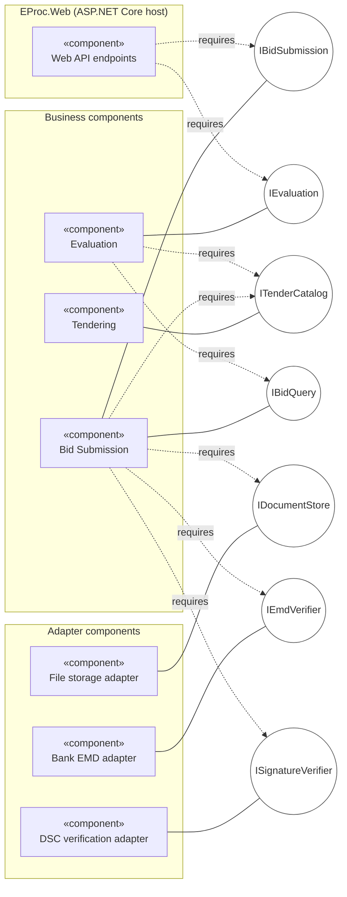
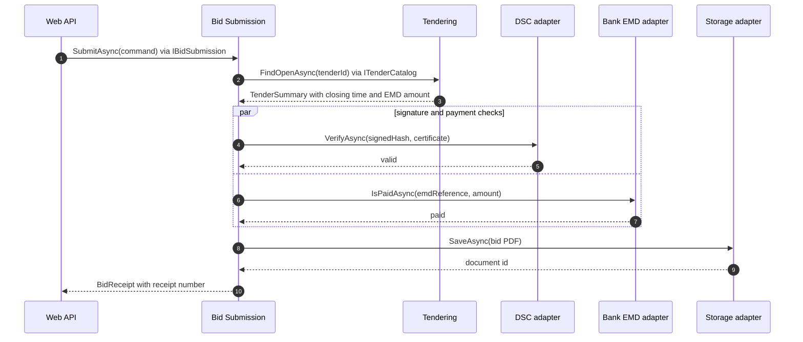
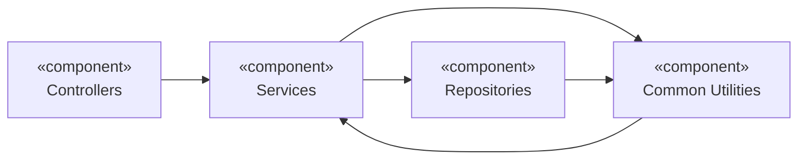
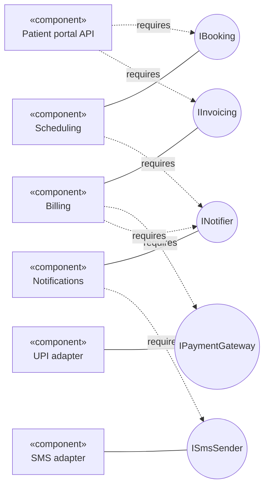
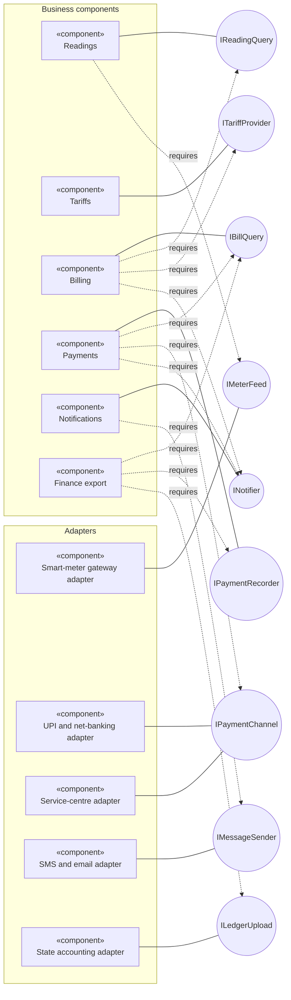

A class diagram shows dozens of small boxes. Past a certain size, nobody can see the shape of the system any more. A component diagram zooms out: each box is a **replaceable part** of the system with a clear job, and the lines show which **interfaces** each part offers and which it needs from others. It's the diagram you use to answer "if we replace the payment provider, what else changes?" or "can the evaluation team work without waiting for the bids team?". This lesson teaches the notation, how to draw it in Mermaid, and how to make .NET enforce it so the diagram stays true.

## Learning objectives

By the end of this lesson you will be able to:

1. Explain what a UML component is, and how it differs from a class and from a deployed server.
2. Read and draw provided interfaces (lollipops), required interfaces (sockets), assembly connectors, ports and dependencies.
3. Draw component diagrams in Mermaid, using flowchart subgraphs and the class-diagram lollipop notation.
4. Map components to .NET projects, public contract types, `internal` implementations and DI registration extension methods.
5. Decide who owns an interface (the provider or the consumer), and explain the trade-offs.
6. Enforce the diagram with project references, `ValidateOnBuild` and architecture tests.

## Prerequisites

- [Class diagrams](#/lesson/m05-class-diagrams): interfaces, realization and dependency arrows.
- [Dependency injection](#/lesson/m03-dependency-injection): registering services in `IServiceCollection`.
- [Dependency Inversion Principle](#/lesson/m04-dip): who should own an abstraction.

## Explain it like I'm a beginner

### Plugs and sockets

Look at the back of a television. It has an HDMI socket, a power socket and an antenna socket. The TV doesn't care whether the HDMI cable comes from a set-top box, a laptop or a game console. It only cares that whatever is plugged in **speaks HDMI**. The set-top box, in turn, *offers* an HDMI plug and *needs* a power socket and a dish connection.

A component diagram draws software the same way:

- Each **component** is a box, like the TV or the set-top box.
- What a component **offers** to others is a **provided interface**, drawn as a "lollipop": a line ending in a circle, like a plug.
- What a component **needs** from others is a **required interface**, drawn as a "socket": a line ending in a half-circle, like the socket waiting for a plug.
- When a plug fits a socket, the parts are **connected** (an *assembly connector*).

The value is in the swap. Because the TV only depends on "HDMI", you can replace the set-top box without opening up the TV. Software components work the same way when their interfaces are designed well.

### Our example: an e-procurement portal

A state public works department runs an online tendering portal. Contractors download tender documents, upload bids with a digital signature, pay an earnest money deposit (EMD), and after the deadline, a committee evaluates bids and picks the lowest qualified bidder (often called **L1**). The system is built as a [modular monolith](#/lesson/m02-modular-monolith) in ASP.NET Core with these parts:

- **Tendering**: publishes tenders and answers "is this tender open, and what EMD does it need?".
- **Bid Submission**: accepts bids, checks the signature and EMD, stores documents.
- **Evaluation**: after closing, ranks bids and finds L1.
- **Document Store**: keeps uploaded PDFs (local disk today, object storage tomorrow).
- **EMD Verification**: confirms payment with the bank.
- **Signature Verification**: validates digital signature certificates (DSC).

The question the team wants answered: *which parts can we change, test or hand to another team independently?* A component diagram answers it.

## First-principles explanation

### What is a component?

In UML, a **component** is a modular, replaceable part of a system that **encapsulates** its contents and exposes its behaviour only through **interfaces**. Three ideas are packed into that sentence:

1. **Modular**: it has one clear responsibility ("bid submission"), not a technical layer ("all the repositories").
2. **Replaceable**: another part that provides the same interfaces could take its place.
3. **Encapsulated**: other parts can't reach inside. They use its interfaces only.

A component is drawn as a rectangle with the keyword `«component»` or a small component icon (a box with two tabs) in the corner.

**Component vs class vs node.** A class is a code-level building block; a component is usually made of many classes. A *node* (in a [deployment diagram](#/lesson/m05-deployment-diagrams)) is hardware or a runtime environment where software runs. A component is a logical part; you decide separately where it is deployed. In .NET, a component usually maps to a **project** (an assembly, a `.dll`), or a well-guarded folder inside one.

### Provided and required interfaces

- A **provided interface** is a set of operations the component offers. Notation: a **lollipop** (a line ending in a full circle) attached to the component, labelled with the interface name, such as `ITenderCatalog`. Formally it's a *realization*: the component implements the interface.
- A **required interface** is a set of operations the component needs from its environment. Notation: a **socket** (a line ending in a half-circle). Formally it's a *dependency*: the component uses the interface.
- An alternative notation, useful in tools that can't draw lollipops, is a class-like box `«interface» ITenderCatalog` with a dashed realization arrow from the provider and a dashed dependency arrow from the consumer.

An interface here is not only a C# `interface`. It's a **contract**: the operations, the data types they use (DTOs), and the rules (errors, ordering, performance expectations). An HTTP API, a message schema on a queue, or a set of database views can all be interfaces in the UML sense.

### Connectors

- An **assembly connector** joins a required interface (socket) to a matching provided interface (lollipop): "Bid Submission's need for `ITenderCatalog` is satisfied by Tendering". Drawn as the lollipop sitting inside the socket ("ball and socket").
- A **dependency** (dashed arrow) between components is the simpler, less precise version: "Bid Submission depends on Tendering". Use it on high-level diagrams.
- A **delegation connector** links an interface on a component's outside to the internal part that implements it, when you draw what's inside.

### Ports

A **port** is a small square on the component's border: a named point of interaction that groups interfaces. For example, Bid Submission might have a `contractor` port (providing `IBidSubmission`) and an `evaluation` port (providing `IBidQuery`). Ports are useful when a component has different faces for different clients. In .NET terms, a port often maps to a separate API surface: a public HTTP endpoint group versus an internal C# interface.

### Inside a component

You can open a component and draw its internal parts (classes or sub-components) and how the outer interfaces delegate to them. Do it only when the inside is what the discussion is about. Most component diagrams are **black-box**: they show what each part offers and needs, and nothing inside.

### Who owns the interface?

This is the most important design question in a component diagram, and it's the [Dependency Inversion Principle](#/lesson/m04-dip) at the scale of components.

| Style | Who defines the interface | Example | Good when |
|---|---|---|---|
| **Provider-owned contract** | the component that implements it | Tendering publishes `ITenderCatalog` in `Tendering.Contracts` | many consumers use one stable service |
| **Consumer-owned port** | the component that needs it | Bid Submission defines `IDocumentStore` with exactly the two operations it uses; an adapter implements it | the provider is infrastructure or an external system you want to swap |

Rule of thumb: **business components publish contracts; infrastructure is reached through ports owned by the business component.** Bid Submission shouldn't depend on the bank's SDK. It declares "I require an `IEmdVerifier`", and an adapter component plugs the bank in. Swapping banks then touches only the adapter.

### Good components: cohesion and coupling

The [coupling and cohesion](#/lesson/m02-coupling-cohesion) rules apply directly:

- **High cohesion**: everything inside a component changes for the same business reason. "Bids" is cohesive; "Utilities" is not.
- **Low coupling**: few, small, stable interfaces between components. Count the lines on your diagram: each line is a reason two teams must coordinate.
- **No cycles**: if A requires B and B requires A, neither can be built, tested or replaced alone. They are really one component. (In .NET, two projects that reference each other won't even build, which is why splitting into projects is such a good enforcement tool.)
- **Stable dependencies**: depend in the direction of stability. Evaluation (changes every time the procurement rules change) may depend on Bids' query contract, which changes rarely, not the other way round.

### Component diagram or C4 component diagram?

The [C4 model](#/lesson/m05-c4-model) also has a "component" level. C4 components live **inside a container** (one deployable app) and are drawn as boxes with arrows labelled by purpose and technology. UML component diagrams add a precise notation for provided and required interfaces. In practice, use C4 style when talking to a mixed audience and UML lollipops when the interfaces themselves are the topic, such as in an API ownership review.

### Writing component diagrams in Mermaid

Mermaid has no `componentDiagram` type. Two approaches work well.

**Approach 1: flowchart with interface circles.** Draw components as rectangles, interfaces as small circles, provided interfaces as solid lines, and required interfaces as dashed arrows into the circle.

```text
flowchart LR
    tendering["«component»<br/>Tendering"]
    bids["«component»<br/>Bid Submission"]
    iTender(("ITenderCatalog"))
    tendering --- iTender
    bids -.->|"requires"| iTender
```

- `(("text"))` draws a circle: the lollipop's head.
- `---` is a line with no arrowhead: "provides".
- `-.->` is a dashed arrow: "requires" (a dependency).
- `<br/>` breaks a label over two lines. `«component»` is just text; you can also write `<<component>>` inside quotes.
- Use `subgraph` to group components into a container or layer: `subgraph app["EProc.Web (ASP.NET Core)"] ... end`.
- `classDef iface fill:#fff,stroke:#555` and `class iTender,iBids iface` style all interfaces the same way.

**Approach 2: class diagram with lollipops.** Mermaid's `classDiagram` has a real lollipop notation:

```text
classDiagram
    class Tendering {
        <<component>>
    }
    class Bids {
        <<component>>
    }
    ITenderCatalog ()-- Tendering
    Bids ..> ITenderCatalog : requires
```

`ITenderCatalog ()-- Tendering` draws a lollipop named `ITenderCatalog` on `Tendering`. The `<<component>>` annotation labels the box. This is closer to UML, but layout control is weaker. Use it for small diagrams.

**Approach 3: runtime view with a sequence diagram.** A component diagram is static. To show how a request flows *through* the interfaces, pair it with a [sequence diagram](#/lesson/m05-sequence-diagrams) whose participants are components. In Mermaid sequence diagrams, keep message text free of semicolons, which end a statement.

Common Mermaid mistakes: forgetting quotes around labels with `«»`, `<br/>`, brackets or dots; reusing an id for a component and an interface; and arrows pointing the wrong way. A "requires" arrow points **from the consumer to the interface**.

### Mapping a component diagram to .NET

| Diagram element | .NET mapping |
|---|---|
| Component | a project (assembly), for example `EProc.Bids` |
| Provided interface (contract) | public interfaces and DTO records in a small `EProc.Bids.Contracts` project, or a `Contracts` folder that is the only `public` part |
| Implementation inside the component | `internal sealed class` types, invisible to other projects |
| Required interface (consumer-owned port) | a public interface in the consumer's contracts, such as `IDocumentStore`, implemented by an adapter component |
| Assembly connector | a DI registration: `services.AddScoped<ITenderCatalog, TenderCatalog>()` |
| The component's "plug-in point" | an extension method `services.AddBids()` that registers its internals and declares what it provides |
| Dependency between components | a `<ProjectReference>`, ideally only to the other component's `Contracts` project |
| No cycles | the compiler refuses circular project references |
| Port | a group of endpoints (`app.MapGroup("/api/bids")`) or a separate interface per client |
| Required interface must be satisfied | `ValidateOnBuild = true`: the app fails at startup if any registered service has an unresolvable dependency |

In a real solution, the folder layout looks like this:

```text
src/
  EProc.Web/                    // composition root: Program.cs, endpoints
  Tendering/
    EProc.Tendering.Contracts/  // public: ITenderCatalog, TenderSummary
    EProc.Tendering/            // internal implementation + AddTendering()
  Bids/
    EProc.Bids.Contracts/       // public: IBidSubmission, IBidQuery, required ports
    EProc.Bids/                 // internal implementation + AddBids()
  Evaluation/
    EProc.Evaluation/
  Adapters/
    EProc.Adapters.Storage/     // implements IDocumentStore (disk, S3, Azure Blob)
    EProc.Adapters.Bank/        // implements IEmdVerifier
```

And the project references *are* the arrows of the diagram:

```xml
<!-- EProc.Bids.csproj -->
<ItemGroup>
  <ProjectReference Include="..\EProc.Bids.Contracts\EProc.Bids.Contracts.csproj" />
  <ProjectReference Include="..\..\Tendering\EProc.Tendering.Contracts\EProc.Tendering.Contracts.csproj" />
  <!-- No reference to EProc.Tendering itself: Bids sees only the contract. -->
</ItemGroup>
```

If a developer tries to use Tendering's internal `TenderCatalog` class from Bids, the build fails. That is the strongest possible guarantee that the diagram and the code agree.

### When a component diagram isn't worth it

- A small app with one project and one team. The folder structure says enough.
- When the question is about runtime behaviour (use a sequence diagram) or servers and networks (use a deployment diagram).
- When you would only be drawing layers ("UI → Services → Data"). That's a layered architecture diagram, and it says little about replaceable parts.

## Visual explanation

### The e-procurement components



How to read it:

- Each rectangle is a **component**; the circles are **interfaces**. A solid line from a component to a circle means the component **provides** that interface (it's the lollipop). A dashed "requires" arrow into a circle means the component **needs** it (the socket). A circle with both is an assembly connector.
- **Bid Submission** provides two interfaces, `IBidSubmission` for contractors (through the API) and `IBidQuery` for Evaluation. These are its two ports in practice: different clients, different operations.
- Bid Submission **requires** four interfaces. `ITenderCatalog` is a provider-owned contract from Tendering. `IDocumentStore`, `IEmdVerifier` and `ISignatureVerifier` are **consumer-owned ports**: Bids defined them, and adapters implement them. Swapping local disk for object storage changes only the storage adapter.
- **Evaluation** needs only `IBidQuery` and `ITenderCatalog`. It never touches Bids' internals or the document store directly, so the evaluation team can work against fakes of two small interfaces.
- The **arrows never form a cycle**. Tendering requires nothing; adapters require nothing from business components. You could build and test the components from the bottom up.
- The subgraphs group components by kind and show that everything runs inside one host. That's a logical grouping; *where* it runs is a deployment question.

### One bid flowing through the interfaces



The sequence diagram is the runtime partner of the component diagram. Every arrow passes through an interface the component diagram promised: the API never calls the storage adapter directly, and Bids reaches the bank only through `IEmdVerifier`. The `par` block shows the signature and EMD checks running at the same time, which the C# below does with `Task.WhenAll`. If a sequence diagram ever shows a call that isn't backed by an interface on the component diagram, one of the two diagrams is wrong.

## Step-by-step example

How do you find the components and draw the diagram? Six steps.

### Step 1 — list business capabilities, not layers

Ask "what are the big jobs this system does?": publish tenders, receive bids, evaluate bids. Each is a candidate business component. Avoid "Controllers", "Services", "Repositories" as components: they are layers that cut across every capability.

### Step 2 — list external systems and infrastructure

Bank, DSC certificate authority, file storage, SMS gateway. Each becomes an adapter component behind a port, so business components don't depend on vendor SDKs.

### Step 3 — for each component, write what it offers and what it needs

Write interface names and two or three operations each. Keep them small and named after the client's need: `IBidQuery.ListForTenderAsync(tenderId)`, not `IBidRepository` with twenty methods. This is the [Interface Segregation Principle](#/lesson/m04-isp) at component scale.

### Step 4 — decide who owns each interface

Business-to-business: provider-owned contract (Tendering owns `ITenderCatalog`). Business-to-infrastructure: consumer-owned port (Bids owns `IDocumentStore`).

### Step 5 — draw it and check the shape

Look for cycles, components with many incoming dependencies (they must be very stable), and components with many outgoing dependencies (they're hard to test). Bid Submission has four requirements, which is acceptable because three are tiny ports.

### Step 6 — make the build enforce it

Create one project per component (or at least one `Contracts` project per component), make implementation types `internal`, add a `services.AddX()` extension per component, and turn on `ValidateOnBuild`. Add an architecture test (exercise 5) for the rules the compiler can't check.

## Production-style C# implementation

The checker compiles this lesson's code as one project, so the components are separated by **namespaces** and `internal` here. In a real solution each `namespace` group below is its own project, and `internal` then really hides implementations from other components. The structure, the DI wiring and the contracts are exactly what you'd ship.

```csharp file=Tendering/TenderingContracts.cs
namespace EProc.Tendering.Contracts;

/// <summary>Provided interface of the Tendering component (provider-owned contract).</summary>
public interface ITenderCatalog
{
    Task<TenderSummary?> FindOpenAsync(string tenderId, CancellationToken ct);
}

public sealed record TenderSummary(string TenderId, string Title, DateTimeOffset ClosesAt, decimal EmdAmount);
```

```csharp file=Tendering/TenderingComponent.cs
using System.Collections.Concurrent;
using EProc.Tendering.Contracts;
using Microsoft.Extensions.DependencyInjection;

namespace EProc.Tendering;

/// <summary>Internal implementation: other components can only see ITenderCatalog.</summary>
internal sealed class TenderCatalog(TimeProvider clock) : ITenderCatalog
{
    private readonly ConcurrentDictionary<string, TenderSummary> _tenders = new(StringComparer.OrdinalIgnoreCase);

    public void Publish(TenderSummary tender) => _tenders[tender.TenderId] = tender;

    public Task<TenderSummary?> FindOpenAsync(string tenderId, CancellationToken ct)
    {
        var found = _tenders.GetValueOrDefault(tenderId);
        return Task.FromResult(found is not null && found.ClosesAt > clock.GetUtcNow() ? found : null);
    }
}

public static class TenderingComponent
{
    /// <summary>The component's plug: registers its internals and its provided interface.</summary>
    public static IServiceCollection AddTendering(this IServiceCollection services, params TenderSummary[] seed)
    {
        services.AddSingleton(sp =>
        {
            var catalog = new TenderCatalog(sp.GetRequiredService<TimeProvider>());
            foreach (var t in seed) catalog.Publish(t);
            return catalog;
        });
        services.AddSingleton<ITenderCatalog>(sp => sp.GetRequiredService<TenderCatalog>());
        return services;
    }
}
```

```csharp file=Bids/BidsContracts.cs
namespace EProc.Bids.Contracts;

// ----- Provided interfaces (two "ports": contractors and evaluation) -----

public interface IBidSubmission
{
    Task<BidReceipt> SubmitAsync(SubmitBid command, CancellationToken ct);
}

public interface IBidQuery
{
    Task<IReadOnlyList<BidSummary>> ListForTenderAsync(string tenderId, CancellationToken ct);
}

public sealed record SubmitBid(string TenderId, string ContractorId, decimal QuotedAmount,
    byte[] Document, string SignedHash, string CertificateSerial, string EmdReference);

public sealed record BidReceipt(string ReceiptNumber, string TenderId, DateTimeOffset ReceivedAt);

public sealed record BidSummary(string ReceiptNumber, string ContractorId, decimal QuotedAmount);

public sealed class BidRejectedException(string reason) : Exception(reason);

// ----- Required interfaces (consumer-owned ports: Bids defines exactly what it needs) -----

public interface IDocumentStore
{
    Task<string> SaveAsync(string folder, byte[] content, CancellationToken ct);
}

public interface IEmdVerifier
{
    Task<bool> IsPaidAsync(string emdReference, decimal amount, CancellationToken ct);
}

public interface ISignatureVerifier
{
    Task<bool> VerifyAsync(string signedHash, string certificateSerial, CancellationToken ct);
}
```

```csharp file=Bids/BidsComponent.cs
using System.Collections.Concurrent;
using EProc.Bids.Contracts;
using EProc.Tendering.Contracts;
using Microsoft.Extensions.DependencyInjection;

namespace EProc.Bids;

/// <summary>Internal implementation of both provided interfaces. Its constructor lists the
/// required interfaces: exactly the sockets on the component diagram.</summary>
internal sealed class BidService(
    ITenderCatalog tenders,
    IDocumentStore documents,
    IEmdVerifier emd,
    ISignatureVerifier signatures,
    TimeProvider clock) : IBidSubmission, IBidQuery
{
    private static readonly ConcurrentDictionary<string, ConcurrentBag<BidSummary>> Bids = new(StringComparer.OrdinalIgnoreCase);
    private static int _sequence;

    public async Task<BidReceipt> SubmitAsync(SubmitBid c, CancellationToken ct)
    {
        ArgumentNullException.ThrowIfNull(c);
        if (c.QuotedAmount <= 0) throw new BidRejectedException("Quoted amount must be positive.");
        if (c.Document.Length == 0) throw new BidRejectedException("Bid document is empty.");

        var tender = await tenders.FindOpenAsync(c.TenderId, ct)
                     ?? throw new BidRejectedException($"Tender {c.TenderId} is not open for bids.");

        // Independent checks through two required interfaces, run together.
        var signatureTask = signatures.VerifyAsync(c.SignedHash, c.CertificateSerial, ct);
        var emdTask = emd.IsPaidAsync(c.EmdReference, tender.EmdAmount, ct);
        await Task.WhenAll(signatureTask, emdTask);
        if (!await signatureTask) throw new BidRejectedException("Digital signature could not be verified.");
        if (!await emdTask) throw new BidRejectedException($"EMD of {tender.EmdAmount:N0} not received.");

        await documents.SaveAsync($"tenders/{tender.TenderId}/{c.ContractorId}", c.Document, ct);

        var receipt = $"{tender.TenderId}-{Interlocked.Increment(ref _sequence):D5}";
        Bids.GetOrAdd(tender.TenderId, _ => new()).Add(new BidSummary(receipt, c.ContractorId, c.QuotedAmount));
        return new BidReceipt(receipt, tender.TenderId, clock.GetUtcNow());
    }

    public Task<IReadOnlyList<BidSummary>> ListForTenderAsync(string tenderId, CancellationToken ct) =>
        Task.FromResult<IReadOnlyList<BidSummary>>(
            Bids.TryGetValue(tenderId, out var bag) ? bag.OrderBy(b => b.ReceiptNumber).ToList() : new List<BidSummary>());
}

public static class BidsComponent
{
    /// <summary>Registers Bid Submission. It does NOT register its required interfaces:
    /// the host must plug in adapters, and ValidateOnBuild catches a missing one at startup.</summary>
    public static IServiceCollection AddBids(this IServiceCollection services)
    {
        services.AddScoped<BidService>();
        services.AddScoped<IBidSubmission>(sp => sp.GetRequiredService<BidService>());
        services.AddScoped<IBidQuery>(sp => sp.GetRequiredService<BidService>());
        return services;
    }
}
```

```csharp file=Evaluation/EvaluationComponent.cs
using EProc.Bids.Contracts;
using Microsoft.Extensions.DependencyInjection;

namespace EProc.Evaluation;

public interface IEvaluation
{
    Task<EvaluationResult> RankAsync(string tenderId, CancellationToken ct);
}

public sealed record EvaluationResult(string TenderId, IReadOnlyList<BidSummary> Ranked, BidSummary? L1);

/// <summary>Requires only IBidQuery. It cannot see BidService, documents or the bank.</summary>
internal sealed class LowestPriceEvaluation(IBidQuery bids) : IEvaluation
{
    public async Task<EvaluationResult> RankAsync(string tenderId, CancellationToken ct)
    {
        var ranked = (await bids.ListForTenderAsync(tenderId, ct))
            .OrderBy(b => b.QuotedAmount).ThenBy(b => b.ReceiptNumber).ToList();
        return new EvaluationResult(tenderId, ranked, ranked.FirstOrDefault());
    }
}

public static class EvaluationComponent
{
    public static IServiceCollection AddEvaluation(this IServiceCollection services) =>
        services.AddScoped<IEvaluation, LowestPriceEvaluation>();
}
```

```csharp file=Adapters/Adapters.cs
using System.Collections.Concurrent;
using EProc.Bids.Contracts;
using Microsoft.Extensions.DependencyInjection;

namespace EProc.Adapters;

/// <summary>Storage adapter: provides IDocumentStore. Swap for object storage without touching Bids.</summary>
internal sealed class InMemoryDocumentStore : IDocumentStore
{
    private readonly ConcurrentDictionary<string, byte[]> _files = new();

    public Task<string> SaveAsync(string folder, byte[] content, CancellationToken ct)
    {
        var id = $"{folder}/{Guid.NewGuid():N}.pdf";
        _files[id] = content.ToArray();
        return Task.FromResult(id);
    }
}

/// <summary>Bank adapter stand-in: references starting with "UTR" and a positive amount are treated as paid.</summary>
internal sealed class FakeBankEmdVerifier : IEmdVerifier
{
    public Task<bool> IsPaidAsync(string emdReference, decimal amount, CancellationToken ct) =>
        Task.FromResult(emdReference.StartsWith("UTR", StringComparison.OrdinalIgnoreCase) && amount > 0);
}

/// <summary>DSC adapter stand-in: a real one validates the certificate chain and revocation status.</summary>
internal sealed class FakeSignatureVerifier : ISignatureVerifier
{
    public Task<bool> VerifyAsync(string signedHash, string certificateSerial, CancellationToken ct) =>
        Task.FromResult(signedHash.Length >= 16 && !string.IsNullOrWhiteSpace(certificateSerial));
}

public static class AdapterComponents
{
    public static IServiceCollection AddDevelopmentAdapters(this IServiceCollection services)
    {
        services.AddSingleton<IDocumentStore, InMemoryDocumentStore>();
        services.AddSingleton<IEmdVerifier, FakeBankEmdVerifier>();
        services.AddSingleton<ISignatureVerifier, FakeSignatureVerifier>();
        return services;
    }
}
```

```csharp file=Program.cs
using EProc.Adapters;
using EProc.Bids;
using EProc.Bids.Contracts;
using EProc.Evaluation;
using EProc.Tendering;
using EProc.Tendering.Contracts;

var builder = WebApplication.CreateBuilder(args);

// Fail at startup if any component's required interface has no provider.
builder.Host.UseDefaultServiceProvider(o => { o.ValidateOnBuild = true; o.ValidateScopes = true; });

builder.Services.AddSingleton(TimeProvider.System);

// The composition root: this is where the component diagram's connectors are made.
builder.Services
    .AddTendering(new TenderSummary("PWD-2026-0141", "Two-lane bridge over Mahanadi canal, km 14.2",
        DateTimeOffset.UtcNow.AddDays(10), EmdAmount: 4_50_000m))
    .AddBids()
    .AddEvaluation()
    .AddDevelopmentAdapters();      // production: AddObjectStorage(), AddBankGateway(), AddDscService()

var app = builder.Build();

var bids = app.MapGroup("/api/bids");          // "contractor" port
bids.MapPost("/", async (SubmitBid cmd, IBidSubmission submission, CancellationToken ct) =>
{
    try { return Results.Ok(await submission.SubmitAsync(cmd, ct)); }
    catch (BidRejectedException ex) { return Results.Problem(ex.Message, statusCode: 422); }
});

var evaluation = app.MapGroup("/api/evaluation");   // "committee" port
evaluation.MapGet("/{tenderId}", async (string tenderId, IEvaluation eval, CancellationToken ct) =>
    Results.Ok(await eval.RankAsync(tenderId, ct)));

app.Run();
```

What to notice:

- **Constructors are the sockets.** `BidService`'s constructor lists exactly the required interfaces on the diagram. If a new dependency appears in a pull request, the diagram must change too, and a reviewer can see it.
- **`AddX()` methods are the plugs.** Each component registers its internals and its provided interfaces, and nothing else. `AddBids()` deliberately does *not* register a document store, because that's the host's choice.
- **`Program.cs` is the assembly of the diagram.** It is the only place that knows which adapter satisfies which port. Swapping the in-memory store for object storage is a one-line change here.
- **`ValidateOnBuild` enforces "every socket is filled".** Comment out `AddDevelopmentAdapters()` and the app refuses to start, with an error naming `IDocumentStore`, instead of failing on the first bid at 4:55 pm on closing day.
- **`internal` implementations.** In a multi-project solution, `TenderCatalog`, `BidService` and `LowestPriceEvaluation` are invisible outside their projects, so nobody can bypass the interfaces.
- **The two port groups.** `/api/bids` and `/api/evaluation` are separate endpoint groups. You could later protect them with different authorization policies or move evaluation to an internal-only host.

:::callout type=tradeoff title="Projects per component: how many?"
One project per component plus one `Contracts` project each gives the strongest enforcement, but a 10-component system then has 20+ projects, slower builds and more ceremony. A common middle ground: one project per component, with a `Contracts` folder that holds the only `public` types, and an architecture test that fails if anything else is public or if one component references another's internals. Start there, and split out `Contracts` projects when a component gets a second consumer team.
:::

## Bad design vs good design

### The "layers as components" diagram



What's wrong:

- **These aren't replaceable parts.** You can't replace "Services" without replacing everything. Every feature (tenders, bids, evaluation) is smeared across all four boxes, so every feature change touches every box.
- **No interfaces.** The arrows say "depends on" but not *on what*. You can't tell which operations matter.
- **A cycle**: `Services → Utilities → Services`. Neither can be built or tested alone.
- **"Common Utilities"** is a magnet for unrelated code. Everything depends on it, so it can never change safely.

### The good version

The e-procurement diagram in the visual section: components are business capabilities and adapters; every dependency goes through a named, small interface; infrastructure is behind consumer-owned ports; there are no cycles; and the composition happens in one place.

### Is splitting always better?

No. Each extra component adds an interface to design, version and test. If two "components" always change together, are always deployed together and are owned by one team, they're one component. Merge them. A useful test: can you describe what the component does in one sentence without "and"? Can you write a test for it using fakes of its required interfaces only? If yes to both, it's a good component.

:::callout type=mistake title="Interfaces that leak internals"
`IBidQuery.GetDbContext()` or a method returning `IQueryable<BidEntity>` hands the consumer the component's insides. The consumer can now query any table, and the component can never change its schema. Provided interfaces should return **DTOs designed for the consumer** (`BidSummary`), not entities or database handles.
:::

## Practical playground

Run the composition below. It wires three small components through DI, with `ValidateOnBuild` on. Then try:

1. Comment out the line that registers `ISmsGateway` and run again. Read the error: it names the missing required interface.
2. Replace `ConsoleSmsGateway` with your own implementation (for example one that prefixes "[TEST]") without changing `ReminderComponent`.
3. Add a second consumer of `ISmsGateway`. How many lines changed outside the composition root?

:::playground type=csharp title="Plug components together"
```csharp file=Program.cs
using System;
using System.Collections.Generic;
using System.Threading;
using System.Threading.Tasks;
using Microsoft.Extensions.DependencyInjection;

// ----- Contracts -----
public interface ISmsGateway { Task SendAsync(string phone, string text, CancellationToken ct); }          // required by Reminders
public interface ITenderDeadlines { IReadOnlyList<(string TenderId, DateTime ClosesAt)> ClosingSoon(); } // required by Reminders
public interface IReminderRun { Task<int> RunAsync(CancellationToken ct); }                             // provided by Reminders

// ----- Components -----
internal sealed class ReminderComponent(ITenderDeadlines deadlines, ISmsGateway sms) : IReminderRun
{
    public async Task<int> RunAsync(CancellationToken ct)
    {
        var sent = 0;
        foreach (var (id, closes) in deadlines.ClosingSoon())
        {
            await sms.SendAsync("+91-90000-11111", $"Tender {id} closes {closes:dd MMM HH:mm}", ct);
            sent++;
        }
        return sent;
    }
}

internal sealed class StaticDeadlines : ITenderDeadlines
{
    public IReadOnlyList<(string TenderId, DateTime ClosesAt)> ClosingSoon() => new List<(string TenderId, DateTime ClosesAt)>
    {
        ("PWD-2026-0141", new DateTime(2026, 11, 3, 15, 0, 0)),
        ("PWD-2026-0152", new DateTime(2026, 11, 4, 17, 30, 0)),
    };
}

internal sealed class ConsoleSmsGateway : ISmsGateway
{
    public Task SendAsync(string phone, string text, CancellationToken ct)
    {
        Console.WriteLine($"SMS to {phone}: {text}");
        return Task.CompletedTask;
    }
}

public static class Program
{
    public static async Task Main()
    {
        var services = new ServiceCollection();
        services.AddSingleton<ITenderDeadlines, StaticDeadlines>();
        services.AddSingleton<ISmsGateway, ConsoleSmsGateway>();      // try commenting this out
        services.AddSingleton<IReminderRun, ReminderComponent>();

        try
        {
            using var provider = services.BuildServiceProvider(new ServiceProviderOptions { ValidateOnBuild = true });
            var sent = await provider.GetRequiredService<IReminderRun>().RunAsync(CancellationToken.None);
            Console.WriteLine($"Reminders sent: {sent}");
        }
        catch (AggregateException ex)
        {
            Console.WriteLine("Startup failed, a required interface is not provided:");
            foreach (var inner in ex.InnerExceptions) Console.WriteLine("  " + inner.Message);
        }
    }
}
```
:::

## Exercises

:::exercise id=m05-component-diagrams-ex1 difficulty=beginner kind=written title="Read a component diagram"
A hospital's appointment platform:



Answer in full sentences:

1. Which interfaces does Billing provide, and which does it require?
2. The hospital switches from SMS to WhatsApp messages. Which components change? Which don't?
3. Which component would you test first with fakes, and which fakes would you need?
4. Is there a cycle? How do you check?
5. A developer proposes that Scheduling calls the UPI adapter directly to take a booking deposit. What would you say?
::acceptance
- Correctly reads provided (solid line to circle) and required (dashed arrow to circle) interfaces.
- Explains that only the SMS adapter (or a new WhatsApp adapter) and the composition root change.
- Names the fakes needed for a chosen component.
- Explains how to check for cycles by following arrows.
- Argues against the direct dependency, proposing to go through Billing's interface or a new provided interface.
::hint
Solid line to a circle: "provides". Dashed arrow to a circle: "requires".
::hint
Who requires `ISmsSender`? Only that component knows SMS exists.
::hint
For cycles, start at each component and follow "requires" arrows to the interface, then to the component that provides it. Do you ever return to the start?
::solution
1. Billing **provides** `IInvoicing` and **requires** `IPaymentGateway` (from the UPI adapter) and `INotifier` (from Notifications).
2. Only the messaging adapter changes: write a WhatsApp adapter that provides `ISmsSender` (or, better, rename the port to `IMessageSender`), and change one registration in the composition root. Notifications doesn't change if the port's contract still fits. Scheduling, Billing and the portal don't change at all, because they only know `INotifier`.
3. Scheduling is a good first target: it requires only `INotifier`, so one small fake (that records messages) is enough. Billing needs two fakes, `IPaymentGateway` and `INotifier`.
4. No cycle. Following the arrows: portal → Scheduling → Notifications → SMS adapter (requires nothing), and portal → Billing → UPI adapter / Notifications → SMS adapter. No path returns to its start. The adapters and Notifications are at the bottom, the portal at the top.
5. Scheduling would gain a dependency on payment infrastructure, so a change of payment provider would ripple into scheduling, and payment rules (refunds, GST invoices, reconciliation) would be split across two components. Instead, Scheduling should require something like `IDepositCollection`, provided by Billing, or the portal should orchestrate: book the slot, then call `IInvoicing` to collect the deposit.
::mistakes
- Reading the dashed arrow as "provides".
- Saying every component changes when SMS becomes WhatsApp.
- Allowing business components to depend on adapters directly "just this once".
:::

:::exercise id=m05-component-diagrams-ex2 difficulty=beginner kind=code title="Package a component behind its interfaces"
Build a **Reminders** component that provides `IReminderService` and requires `IMessageSender` and `IClock`. Package it as other teams will consume it.
::requirements
- `IReminderService.ScheduleAsync(string phone, string text, DateTimeOffset at)` stores a reminder and returns its id (any non-empty string). A blank phone or text throws `ArgumentException`; a time in the past (`at <= clock.Now`) throws `ArgumentOutOfRangeException`.
- `IReminderService.SendDueAsync()` sends every stored reminder whose time is `<= clock.Now` through `IMessageSender`, removes them, and returns the number sent.
- The implementation class must be **`internal`**. Only the interfaces and `RemindersComponent` are public.
- `RemindersComponent.AddReminders(this IServiceCollection services)` registers the implementation as a **singleton** behind `IReminderService`. It must **not** register `IMessageSender` or `IClock`.
- With `ValidateOnBuild = true`, building a provider without an `IMessageSender` registration throws `AggregateException`.
::acceptance
- The resolved `IReminderService` is not a public type.
- Due reminders are sent once and removed; future ones stay.
- A missing required interface fails at provider build time, not on first use.
- Input validation follows the rules above.
::hint
`internal sealed class ReminderService(IMessageSender sender, IClock clock) : IReminderService`.
::hint
Use a `ConcurrentDictionary<string, (string Phone, string Text, DateTimeOffset At)>` for storage, keyed by a `Guid.NewGuid().ToString("N")` id.
::hint
`services.AddSingleton<IReminderService, ReminderService>()` is enough: DI will need `IMessageSender` and `IClock`, and `ValidateOnBuild` checks they exist.
::hint
In `SendDueAsync`, copy the due items with `.Where(kv => kv.Value.At <= now).ToList()` before removing, so you don't modify the dictionary while iterating over a live query.
::starter
```csharp file=Reminders.cs
using System;
using System.Collections.Concurrent;
using System.Collections.Generic;
using System.Linq;
using System.Threading.Tasks;
using Microsoft.Extensions.DependencyInjection;

// ----- Provided interface -----
public interface IReminderService
{
    Task<string> ScheduleAsync(string phone, string text, DateTimeOffset at);
    Task<int> SendDueAsync();
}

// ----- Required interfaces -----
public interface IMessageSender
{
    Task SendAsync(string phone, string text);
}

public interface IClock
{
    DateTimeOffset Now { get; }
}

// ----- The component's plug -----
public static class RemindersComponent
{
    public static IServiceCollection AddReminders(this IServiceCollection services) => throw new NotImplementedException();
}
```
::tests
```csharp file=RemindersTests.cs
using System;
using System.Collections.Generic;
using System.Threading.Tasks;
using Microsoft.Extensions.DependencyInjection;
using Xunit;

public class RemindersTests
{
    private sealed class FakeClock : IClock { public DateTimeOffset Now { get; set; } = new(2026, 11, 1, 9, 0, 0, TimeSpan.FromHours(5.5)); }

    private sealed class RecordingSender : IMessageSender
    {
        public List<string> Sent { get; } = new();
        public Task SendAsync(string phone, string text) { Sent.Add($"{phone}:{text}"); return Task.CompletedTask; }
    }

    private static (IReminderService Svc, FakeClock Clock, RecordingSender Sender) Build()
    {
        var clock = new FakeClock();
        var sender = new RecordingSender();
        var services = new ServiceCollection();
        services.AddSingleton<IClock>(clock);
        services.AddSingleton<IMessageSender>(sender);
        services.AddReminders();
        var provider = services.BuildServiceProvider(new ServiceProviderOptions { ValidateOnBuild = true });
        return (provider.GetRequiredService<IReminderService>(), clock, sender);
    }

    [Fact]
    public void Implementation_is_internal()
    {
        var (svc, _, _) = Build();
        Assert.False(svc.GetType().IsPublic);
    }

    [Fact]
    public async Task Sends_due_reminders_once()
    {
        var (svc, clock, sender) = Build();
        await svc.ScheduleAsync("+91-98000-00001", "Pre-bid meeting at 11:00", clock.Now.AddMinutes(30));
        await svc.ScheduleAsync("+91-98000-00002", "Bid closes tomorrow", clock.Now.AddDays(1));
        clock.Now = clock.Now.AddHours(1);
        Assert.Equal(1, await svc.SendDueAsync());
        Assert.Equal(0, await svc.SendDueAsync());
        Assert.Equal(new[] { "+91-98000-00001:Pre-bid meeting at 11:00" }, sender.Sent);
        clock.Now = clock.Now.AddDays(1);
        Assert.Equal(1, await svc.SendDueAsync());
    }

    [Fact]
    public async Task Validates_input()
    {
        var (svc, clock, _) = Build();
        await Assert.ThrowsAsync<ArgumentException>(() => svc.ScheduleAsync(" ", "x", clock.Now.AddHours(1)));
        await Assert.ThrowsAsync<ArgumentOutOfRangeException>(() => svc.ScheduleAsync("+91-1", "x", clock.Now));
        Assert.False(string.IsNullOrWhiteSpace(await svc.ScheduleAsync("+91-1", "ok", clock.Now.AddHours(1))));
    }

    [Fact]
    public void Missing_required_interface_fails_at_build()
    {
        var services = new ServiceCollection();
        services.AddSingleton<IClock>(new FakeClock());
        services.AddReminders();
        Assert.Throws<AggregateException>(() => services.BuildServiceProvider(new ServiceProviderOptions { ValidateOnBuild = true }));
    }

    [Fact]
    public void Does_not_register_its_requirements()
    {
        var services = new ServiceCollection();
        services.AddReminders();
        Assert.DoesNotContain(services, d => d.ServiceType == typeof(IMessageSender) || d.ServiceType == typeof(IClock));
    }
}
```
::solution
```csharp file=Reminders.cs
using System;
using System.Collections.Concurrent;
using System.Collections.Generic;
using System.Linq;
using System.Threading.Tasks;
using Microsoft.Extensions.DependencyInjection;

// ----- Provided interface -----
public interface IReminderService
{
    Task<string> ScheduleAsync(string phone, string text, DateTimeOffset at);
    Task<int> SendDueAsync();
}

// ----- Required interfaces -----
public interface IMessageSender
{
    Task SendAsync(string phone, string text);
}

public interface IClock
{
    DateTimeOffset Now { get; }
}

/// <summary>Hidden inside the component. Its constructor lists the required interfaces.</summary>
internal sealed class ReminderService(IMessageSender sender, IClock clock) : IReminderService
{
    private readonly ConcurrentDictionary<string, (string Phone, string Text, DateTimeOffset At)> _pending = new();

    public Task<string> ScheduleAsync(string phone, string text, DateTimeOffset at)
    {
        ArgumentException.ThrowIfNullOrWhiteSpace(phone);
        ArgumentException.ThrowIfNullOrWhiteSpace(text);
        if (at <= clock.Now) throw new ArgumentOutOfRangeException(nameof(at), "Reminder time must be in the future.");
        var id = Guid.NewGuid().ToString("N");
        _pending[id] = (phone, text, at);
        return Task.FromResult(id);
    }

    public async Task<int> SendDueAsync()
    {
        var now = clock.Now;
        var due = _pending.Where(kv => kv.Value.At <= now).ToList();
        var sent = 0;
        foreach (var (id, r) in due)
        {
            if (!_pending.TryRemove(id, out _)) continue;   // another caller already took it
            await sender.SendAsync(r.Phone, r.Text);
            sent++;
        }
        return sent;
    }
}

// ----- The component's plug -----
public static class RemindersComponent
{
    public static IServiceCollection AddReminders(this IServiceCollection services)
    {
        ArgumentNullException.ThrowIfNull(services);
        services.AddSingleton<IReminderService, ReminderService>();   // requirements are the host's job
        return services;
    }
}
```

The public surface is exactly the component diagram: one provided interface, two required interfaces and one registration method. Removing items with `TryRemove` before sending means two concurrent `SendDueAsync` calls can't send the same reminder twice.
::alternatives
If `IClock` is generic infrastructure, use the BCL's `TimeProvider` instead of a custom interface. If reminders must survive restarts, the component would require an `IReminderStore` port too, with a PostgreSQL adapter.
::mistakes
- Making `ReminderService` public "for testing". Test through the interface instead.
- Registering a default `IMessageSender` inside `AddReminders`, which hides the requirement and makes the host's choice silently ignored (or duplicated).
- Iterating the dictionary and removing in the same loop without copying first.
::extensions
Add an `InternalsVisibleTo` attribute for a test project in a real multi-project solution, and explain when testing internals is (rarely) justified.
:::

:::exercise id=m05-component-diagrams-ex3 difficulty=intermediate kind=code title="Check a component graph for cycles and layer violations"
Architects often keep the component graph as data and check it in CI. Implement `ComponentGraph`.
::requirements
- `AddComponent(string name, int layer)`: higher numbers are higher layers (for example host = 3, business = 2, adapters/contracts = 1). Duplicate names throw `ArgumentException`.
- `AddDependency(string from, string to)`: "from requires to". Unknown components throw `ArgumentException`.
- `FindCycles()` returns each **elementary cycle once**, as a string like `"Bids -> Tendering -> Bids"`, rotated so it **starts at the alphabetically smallest** component in the cycle. Sort the returned list alphabetically. A self-dependency `A -> A` is a cycle `"A -> A"`.
- `LayerViolations()` returns `"from -> to"` for every dependency where `from`'s layer is **lower** than `to`'s, in the order dependencies were added.
- `DependsOn(from, to)` is true if `to` is reachable from `from` (directly or indirectly).
::acceptance
- An acyclic graph returns no cycles.
- Two-, three- and four-component cycles are each reported once, correctly rotated (one new edge can close several cycles).
- Self-dependency is reported.
- An adapter that depends on a business component is a layer violation.
- `DependsOn` follows indirect paths and returns false for unrelated components.
::hint
For `DependsOn`, a depth-first search from `from` is enough.
::hint
To find all elementary cycles in a small graph, start a DFS from every node `s` and only visit nodes whose name is greater than `s` (ordinal comparison), except for returning to `s` itself. Every cycle is then found exactly once, from its smallest node.
::hint
Keep the current path in a `List<string>`; when an edge leads back to `s`, record `string.Join(" -> ", path) + " -> " + s`.
::hint
```csharp
void Dfs(string start, string node, List<string> path, HashSet<string> onPath)
{
    foreach (var next in _edges[node])
    {
        if (next == start) cycles.Add(string.Join(" -> ", path.Append(start)));
        else if (string.CompareOrdinal(next, start) > 0 && onPath.Add(next))
        {
            path.Add(next); Dfs(start, next, path, onPath); path.RemoveAt(path.Count - 1); onPath.Remove(next);
        }
    }
}
```
::starter
```csharp file=ComponentGraph.cs
using System;
using System.Collections.Generic;
using System.Linq;

public sealed class ComponentGraph
{
    public void AddComponent(string name, int layer) => throw new NotImplementedException();

    public void AddDependency(string from, string to) => throw new NotImplementedException();

    public IReadOnlyList<string> FindCycles() => throw new NotImplementedException();

    public IReadOnlyList<string> LayerViolations() => throw new NotImplementedException();

    public bool DependsOn(string from, string to) => throw new NotImplementedException();
}
```
::tests
```csharp file=ComponentGraphTests.cs
using System;
using Xunit;

public class ComponentGraphTests
{
    private static ComponentGraph EProc()
    {
        var g = new ComponentGraph();
        g.AddComponent("Web", 3);
        g.AddComponent("Bids", 2);
        g.AddComponent("Evaluation", 2);
        g.AddComponent("Tendering", 2);
        g.AddComponent("StorageAdapter", 1);
        g.AddDependency("Web", "Bids");
        g.AddDependency("Web", "Evaluation");
        g.AddDependency("Evaluation", "Bids");
        g.AddDependency("Bids", "Tendering");
        g.AddDependency("Bids", "StorageAdapter");
        return g;
    }

    [Fact] public void Acyclic_graph_has_no_cycles() => Assert.Empty(EProc().FindCycles());

    [Fact]
    public void Two_and_three_component_cycles()
    {
        var g = EProc();
        g.AddDependency("Tendering", "Bids");              // Bids <-> Tendering
        g.AddDependency("Tendering", "Web");               // closes two more cycles through Web
        Assert.Equal(new[]
        {
            "Bids -> Tendering -> Bids",
            "Bids -> Tendering -> Web -> Bids",
            "Bids -> Tendering -> Web -> Evaluation -> Bids",
        }, g.FindCycles());
    }

    [Fact]
    public void Self_dependency_is_a_cycle()
    {
        var g = EProc();
        g.AddDependency("Evaluation", "Evaluation");
        Assert.Equal(new[] { "Evaluation -> Evaluation" }, g.FindCycles());
    }

    [Fact]
    public void Lower_layer_must_not_depend_on_higher()
    {
        var g = EProc();
        g.AddDependency("StorageAdapter", "Bids");
        g.AddDependency("Bids", "Web");
        Assert.Equal(new[] { "StorageAdapter -> Bids", "Bids -> Web" }, g.LayerViolations());
    }

    [Fact]
    public void Transitive_dependency()
    {
        var g = EProc();
        Assert.True(g.DependsOn("Web", "Tendering"));
        Assert.True(g.DependsOn("Evaluation", "StorageAdapter"));
        Assert.False(g.DependsOn("Tendering", "Bids"));
        Assert.False(g.DependsOn("StorageAdapter", "Web"));
    }

    [Fact]
    public void Unknown_and_duplicate_components_rejected()
    {
        var g = EProc();
        Assert.Throws<ArgumentException>(() => g.AddComponent("Bids", 2));
        Assert.Throws<ArgumentException>(() => g.AddDependency("Bids", "Payroll"));
    }
}
```
::solution
```csharp file=ComponentGraph.cs
using System;
using System.Collections.Generic;
using System.Linq;

public sealed class ComponentGraph
{
    private readonly Dictionary<string, int> _layers = new();
    private readonly Dictionary<string, List<string>> _edges = new();
    private readonly List<(string From, string To)> _dependencies = new();

    public void AddComponent(string name, int layer)
    {
        ArgumentException.ThrowIfNullOrWhiteSpace(name);
        if (!_layers.TryAdd(name, layer)) throw new ArgumentException($"Component {name} already exists.", nameof(name));
        _edges[name] = new List<string>();
    }

    public void AddDependency(string from, string to)
    {
        if (!_layers.ContainsKey(from)) throw new ArgumentException($"Unknown component {from}.", nameof(from));
        if (!_layers.ContainsKey(to)) throw new ArgumentException($"Unknown component {to}.", nameof(to));
        if (_edges[from].Contains(to)) return;
        _edges[from].Add(to);
        _dependencies.Add((from, to));
    }

    public IReadOnlyList<string> FindCycles()
    {
        var cycles = new List<string>();
        foreach (var start in _layers.Keys)
        {
            var path = new List<string> { start };
            Dfs(start, start, path, new HashSet<string> { start }, cycles);
        }
        cycles.Sort(StringComparer.Ordinal);
        return cycles;
    }

    // Only visit nodes "greater" than the start, so each cycle is found once, from its smallest node.
    private void Dfs(string start, string node, List<string> path, HashSet<string> onPath, List<string> cycles)
    {
        foreach (var next in _edges[node])
        {
            if (next == start)
            {
                cycles.Add(string.Join(" -> ", path) + " -> " + start);
            }
            else if (string.CompareOrdinal(next, start) > 0 && onPath.Add(next))
            {
                path.Add(next);
                Dfs(start, next, path, onPath, cycles);
                path.RemoveAt(path.Count - 1);
                onPath.Remove(next);
            }
        }
    }

    public IReadOnlyList<string> LayerViolations() =>
        _dependencies.Where(d => _layers[d.From] < _layers[d.To]).Select(d => $"{d.From} -> {d.To}").ToList();

    public bool DependsOn(string from, string to)
    {
        var seen = new HashSet<string>();
        var stack = new Stack<string>(_edges.GetValueOrDefault(from) ?? new List<string>());
        while (stack.TryPop(out var n))
        {
            if (n == to) return true;
            if (seen.Add(n)) foreach (var m in _edges[n]) stack.Push(m);
        }
        return false;
    }
}
```

The "start from every node, only visit larger nodes" trick enumerates each elementary cycle exactly once, already rotated to begin at its smallest member. It explores many paths in the worst case, which is fine for the tens of components a real system has; for thousands of nodes you'd use Johnson's algorithm or Tarjan's strongly connected components.
::alternatives
Instead of listing every cycle, Tarjan's algorithm finds **strongly connected components**: groups of components that all depend on each other. Each group with more than one member is a "component that should be merged or split by a new interface". For CI, that's often the more useful report.
::mistakes
- Reporting the same cycle several times, once from each of its members.
- Treating any back-edge in a DFS as a cycle string without rotating it, so the report changes order between runs.
- Treating "same layer" as a violation. Only upward dependencies are.
::extensions
Read the graph from real `.csproj` files: parse `<ProjectReference Include="...">` with `System.Xml.Linq`, build the graph and fail the build on any cycle or violation.
:::

:::exercise id=m05-component-diagrams-ex4 difficulty=intermediate kind=written title="Draw components for a water-meter billing system"
A city water utility is replacing its billing system:

> "Field staff read meters using a mobile app, or smart meters send readings over a gateway every night. Readings are validated (no negative consumption, flag jumps above 300 % of the 6-month average). Billing calculates the bill with slab tariffs, which the board changes once a year. Customers pay by UPI, net banking or at a citizen service centre. Consumers get bills and payment receipts by SMS and email. The finance department needs a daily export to the state's accounting system."

1. Draw a component diagram in Mermaid with at least six components, provided interfaces (circles) and required interfaces (dashed arrows).
2. Mark which interfaces are provider-owned contracts and which are consumer-owned ports.
3. Map your components to a .NET solution: list the projects and which projects reference which.
::acceptance
- Business components (for example Readings, Billing, Payments) are separate from adapters (meter gateway, payment providers, SMS/email, accounting export).
- Each component has at least one provided interface; dependencies go through interfaces.
- There are no cycles; adapters don't depend on business components' internals.
- Tariff changes are isolated (for example a `ITariffProvider` or a Tariffs component).
- The project list and references match the diagram.
::hint
Find the business capabilities first: readings, billing, payments, notifications, export. Then the outside systems.
::hint
"The board changes tariffs once a year" suggests tariffs change for a different reason than billing logic. That's a hint for a separate component or at least a separate interface.
::hint
Payments has three channels. One port, `IPaymentChannel`, with three adapters, or one adapter per channel behind the same port.
::hint
Who needs readings? Billing. Who needs bills? Payments (to match amounts), Notifications, Export.
::solution


**Ownership**: `IReadingQuery`, `ITariffProvider`, `IBillQuery`, `IPaymentRecorder` and `INotifier` are provider-owned contracts (business components serving other business components). `IMeterFeed`, `IPaymentChannel`, `IMessageSender` and `ILedgerUpload` are consumer-owned ports, each defined by the component that needs it and implemented by an adapter.

**Projects** (one per component, plus contracts for the shared business interfaces):

- `Water.Readings`, `Water.Tariffs`, `Water.Billing`, `Water.Payments`, `Water.Notifications`, `Water.FinanceExport`, each with a `Contracts` project or folder.
- `Water.Adapters.MeterGateway` → references `Water.Readings.Contracts` (implements `IMeterFeed`).
- `Water.Adapters.Payments` → `Water.Payments.Contracts`.
- `Water.Adapters.Messaging` → `Water.Notifications.Contracts`.
- `Water.Adapters.Accounting` → `Water.FinanceExport.Contracts`.
- `Water.Billing` → `Readings.Contracts`, `Tariffs.Contracts`, `Notifications.Contracts`.
- `Water.Payments` → `Billing.Contracts`, `Notifications.Contracts`.
- `Water.FinanceExport` → `Billing.Contracts`, `Payments.Contracts`.
- `Water.Web` (host) → all components and adapters, for registration only.

Validation rules (negative consumption, 300 % jumps) live inside Readings; slab tariffs inside Tariffs, so the annual change touches one component.
::alternatives
A smaller team could merge Tariffs into Billing and keep only the interface `ITariffProvider` inside it. Payments could be split into one adapter per channel if each has a different vendor and failure behaviour.
::mistakes
- A single "Integration" component holding all adapters, which couples SMS, banks and the accounting system together.
- Billing depending on the UPI adapter directly.
- Finance export reading Billing's database tables instead of using `IBillQuery`.
:::

:::exercise id=m05-component-diagrams-ex5 difficulty=advanced kind=code title="Architecture tests with reflection"
The compiler enforces project references, but inside one project nothing stops `Evaluation` from using a `Bids` internal class. Write two architecture rules that a test suite can run against any assembly.
::requirements
`ArchitectureRules` (static) with:

1. `IReadOnlyList<string> ForbiddenReferences(Assembly assembly, string fromNamespace, string forbiddenNamespace)`: for every type whose namespace equals `fromNamespace` or starts with `fromNamespace + "."`, look at the types used by its **declared** constructors' parameters, fields, properties, and methods' parameters and return types (public and non-public, instance and static). Unwrap arrays and generic arguments (for example `List<Foo>` uses `Foo`). Report each `"{TypeName} -> {UsedTypeName}"` once, where the used type's namespace is **exactly** `forbiddenNamespace` (so forbidding `Shop.Orders` doesn't forbid `Shop.Orders.Contracts`). Return the list sorted ordinally.
2. `IReadOnlyList<string> PublicTypesOutsideContracts(Assembly assembly, string componentNamespace)`: list the full names of **public** types (`Type.IsPublic`, top-level only) in `componentNamespace` or its sub-namespaces, whose namespace does **not** end with `.Contracts`. Sort ordinally.

Ignore compiler-generated types (names containing `<`).
::acceptance
- A component that only uses another's `Contracts` types has no violations.
- A field, a constructor parameter, and a generic argument (`List<T>`) of a forbidden type are each detected.
- Each violation pair is reported once.
- A public implementation class outside `.Contracts` is reported; public contracts and internal classes are not.
::hint
`BindingFlags.Public | BindingFlags.NonPublic | BindingFlags.Instance | BindingFlags.Static | BindingFlags.DeclaredOnly`.
::hint
Write `IEnumerable<Type> Expand(Type t)`: yield `t`; if it's an array, expand its element type; if generic, expand each generic argument.
::hint
Use a `SortedSet<string>` with `StringComparer.Ordinal` to get "once" and "sorted" for free.
::hint
Field names like `<Name>k__BackingField` belong to auto-properties. They're fine to inspect (their type is the property type). Skip **types** whose name contains `<`, such as closure classes.
::starter
```csharp file=ArchitectureRules.cs
using System;
using System.Collections.Generic;
using System.Linq;
using System.Reflection;

public static class ArchitectureRules
{
    public static IReadOnlyList<string> ForbiddenReferences(Assembly assembly, string fromNamespace, string forbiddenNamespace) =>
        throw new NotImplementedException();

    public static IReadOnlyList<string> PublicTypesOutsideContracts(Assembly assembly, string componentNamespace) =>
        throw new NotImplementedException();
}
```
::tests
```csharp file=ArchitectureRulesTests.cs
using System;
using System.Collections.Generic;
using System.Reflection;
using Xunit;

namespace Shop.Orders.Contracts
{
    public interface IOrderQuery { OrderDto? Find(Guid id); }
    public sealed record OrderDto(Guid Id, decimal Total);
}

namespace Shop.Orders
{
    internal sealed class OrderRepository { public List<string> Rows { get; } = new(); }
    public sealed class OrderService { }                                   // public, but not a contract: violation of rule 2
    internal sealed class OrderQuery : Shop.Orders.Contracts.IOrderQuery
    {
        public Shop.Orders.Contracts.OrderDto? Find(Guid id) => null;
    }
}

namespace Shop.Invoicing
{
    internal sealed class GoodInvoicer(Shop.Orders.Contracts.IOrderQuery orders)
    {
        public decimal TotalFor(Guid id) => orders.Find(id)?.Total ?? 0m;
    }

    internal sealed class SneakyInvoicer(Shop.Orders.OrderRepository repo)            // constructor parameter
    {
        private readonly Shop.Orders.OrderService _service = new();                    // field
        public List<Shop.Orders.OrderRepository> History { get; } = new();             // generic argument
        public int Count() => repo.Rows.Count + History.Count;
    }
}

public class ArchitectureRulesTests
{
    private static readonly Assembly Asm = typeof(ArchitectureRulesTests).Assembly;

    [Fact]
    public void Detects_references_to_internals_once()
    {
        var v = ArchitectureRules.ForbiddenReferences(Asm, "Shop.Invoicing", "Shop.Orders");
        Assert.Contains("SneakyInvoicer -> OrderRepository", v);
        Assert.Contains("SneakyInvoicer -> OrderService", v);
        Assert.DoesNotContain(v, x => x.StartsWith("GoodInvoicer"));
        Assert.Equal(2, v.Count);
    }

    [Fact]
    public void Contracts_are_allowed_when_excluded()
    {
        var v = ArchitectureRules.ForbiddenReferences(Asm, "Shop.Invoicing", "Shop.Orders.Contracts");
        Assert.Equal(new[] { "GoodInvoicer -> IOrderQuery" }, v);
    }

    [Fact]
    public void Public_types_must_live_in_contracts()
    {
        var v = ArchitectureRules.PublicTypesOutsideContracts(Asm, "Shop.Orders");
        Assert.Equal(new[] { "Shop.Orders.OrderService" }, v);
    }
}
```
::solution
```csharp file=ArchitectureRules.cs
using System;
using System.Collections.Generic;
using System.Linq;
using System.Reflection;

public static class ArchitectureRules
{
    private const BindingFlags All = BindingFlags.Public | BindingFlags.NonPublic | BindingFlags.Instance |
                                     BindingFlags.Static | BindingFlags.DeclaredOnly;

    public static IReadOnlyList<string> ForbiddenReferences(Assembly assembly, string fromNamespace, string forbiddenNamespace)
    {
        var result = new SortedSet<string>(StringComparer.Ordinal);
        foreach (var type in assembly.GetTypes().Where(t => !t.Name.Contains('<') && InNamespace(t, fromNamespace)))
        {
            foreach (var used in UsedTypes(type).SelectMany(Expand))
            {
                if (used != type && used.Namespace == forbiddenNamespace)
                    result.Add($"{type.Name} -> {used.Name}");
            }
        }
        return result.ToList();
    }

    public static IReadOnlyList<string> PublicTypesOutsideContracts(Assembly assembly, string componentNamespace) =>
        assembly.GetTypes()
            .Where(t => t.IsPublic && !t.Name.Contains('<') && InNamespace(t, componentNamespace)
                        && !(t.Namespace ?? "").EndsWith(".Contracts", StringComparison.Ordinal))
            .Select(t => t.FullName!)
            .OrderBy(n => n, StringComparer.Ordinal)
            .ToList();

    private static bool InNamespace(Type t, string ns) =>
        t.Namespace is { } n && (n == ns || n.StartsWith(ns + ".", StringComparison.Ordinal));

    private static IEnumerable<Type> UsedTypes(Type t)
    {
        foreach (var c in t.GetConstructors(All))
            foreach (var p in c.GetParameters()) yield return p.ParameterType;
        foreach (var f in t.GetFields(All)) yield return f.FieldType;
        foreach (var p in t.GetProperties(All)) yield return p.PropertyType;
        foreach (var m in t.GetMethods(All))
        {
            yield return m.ReturnType;
            foreach (var p in m.GetParameters()) yield return p.ParameterType;
        }
    }

    private static IEnumerable<Type> Expand(Type t)
    {
        if (t.IsByRef || t.IsPointer) t = t.GetElementType()!;
        yield return t;
        if (t.IsArray)
            foreach (var e in Expand(t.GetElementType()!)) yield return e;
        if (t.IsGenericType)
            foreach (var a in t.GetGenericArguments().SelectMany(Expand)) yield return a;
    }
}
```

Reflection sees what the compiler can't enforce inside one assembly: every member signature that mentions another component's types. The `SortedSet` gives each violation once and in a stable order, so a CI report doesn't change between runs. Note that `Nullable<T>` and `List<T>` are both handled by expanding generic arguments.
::alternatives
Libraries such as NetArchTest or ArchUnitNET provide fluent rules ("types in X should not depend on Y") and also inspect method bodies (IL), which reflection over signatures can't see: a `new OrderRepository()` inside a method body is invisible to this solution. Splitting components into separate projects makes most of these rules compiler-enforced and is the stronger fix.
::mistakes
- Forgetting `NonPublic`, so private fields and primary-constructor captures are missed.
- Not unwrapping generic arguments, so `List<OrderRepository>` slips through.
- Treating `Shop.InvoicingArchive` as inside `Shop.Invoicing` because of a plain `StartsWith(ns)` without the dot.
- Forbidding a namespace *prefix*, which also forbids the component's own `Contracts` sub-namespace.
::extensions
Add `ForbiddenReferencesInBodies` using `MethodBody.GetILAsByteArray()` and `Module.ResolveType` on `newobj`/`call` tokens, and compare what it catches with the signature-only version.
:::

:::exercise id=m05-component-diagrams-ex6 difficulty=advanced kind=written title="Split a god component"
A logistics company's "Core" project has 140 classes: shipment booking, rate calculation, driver payouts, invoice PDF generation, GPS tracking ingestion and customer notifications. Every team edits it, every release needs every team's sign-off, and a change to payout rules once broke shipment booking.

1. Propose a component diagram (in Mermaid or as a list) that splits Core. Name each component's provided and required interfaces.
2. Describe the migration in steps that keep the system working throughout.
3. What would you measure to know the split helped?
::acceptance
- Components follow business capabilities with clear provided/required interfaces, and no cycles.
- The migration is incremental (for example: introduce interfaces inside Core first, then move code behind them, then split projects), not a big-bang rewrite.
- Measures are concrete (for example: files changed per pull request across components, build time, number of cross-team approvals, incidents caused by unrelated changes).
::hint
Group the 140 classes by "which business rule change would make this class change?".
::hint
You can introduce component boundaries *inside* the existing project first: namespaces, interfaces and `internal`, plus architecture tests.
::hint
The "payout change broke booking" incident tells you where to cut first.
::solution
**Components:**

- **Booking**: provides `IShipmentBooking`, `IShipmentQuery`. Requires `IRateQuote`, `INotifier`.
- **Rating**: provides `IRateQuote`. Requires nothing (rate tables are its own data).
- **Tracking**: provides `ITrackingQuery`. Requires `IGpsFeed` (port, implemented by a GPS ingestion adapter).
- **Payouts**: provides `IPayoutStatement`. Requires `IShipmentQuery` (completed trips), `IBankTransfer` (port).
- **Invoicing**: provides `IInvoiceQuery`. Requires `IShipmentQuery`, `IRateQuote`, `IPdfRenderer` (port).
- **Notifications**: provides `INotifier`. Requires `IMessageSender` (port).
- Adapters: GPS ingestion, bank, PDF rendering, SMS/email.

No business component requires Payouts, so a payout change can't break booking anymore: Booking doesn't even reference it.

**Migration (strangler-style, see [Refactoring legacy code](#/lesson/m04-refactoring-legacy)):**

1. Write characterization tests around booking, rating and payouts.
2. Inside Core, create namespaces per component and move classes, without changing behaviour.
3. Introduce the provided interfaces and route calls between namespaces through them. Make everything else `internal`.
4. Add architecture tests (like exercise 5) that fail on cross-namespace use of internals. Fix violations one by one.
5. Move each namespace into its own project, starting with the one with fewest dependents (Rating, then Notifications). Project references now enforce the diagram.
6. Assign code ownership per project (`CODEOWNERS`), so pull requests only need the owning team's approval.

**Measures:** the share of pull requests that touch more than one component (should fall); the number of required reviewers per release; build and test time per component; and incidents where a change in one capability broke another (should approach zero). Also track interface churn: if a provided interface changes every sprint, the boundary is in the wrong place.
::mistakes
- Splitting by technical layer ("Core.Services", "Core.Data"), which keeps every feature coupled.
- A big-bang rewrite into microservices. Component boundaries should be proven inside one deployable first.
:::

## Automated testing

Component diagrams make three kinds of tests natural.

**1. Component tests through provided interfaces, with fakes for required ones.** Each component is tested alone. For Bid Submission, fakes of `ITenderCatalog`, `IDocumentStore`, `IEmdVerifier` and `ISignatureVerifier` are all you need, and each fake is a few lines because the ports are small:

```csharp
public class BidSubmissionComponentTests
{
    private sealed class OpenTender : ITenderCatalog
    {
        public Task<TenderSummary?> FindOpenAsync(string id, CancellationToken ct) =>
            Task.FromResult<TenderSummary?>(new TenderSummary(id, "Culvert at km 3.4", DateTimeOffset.UtcNow.AddDays(2), 50_000m));
    }
    private sealed class Unpaid : IEmdVerifier { public Task<bool> IsPaidAsync(string r, decimal a, CancellationToken ct) => Task.FromResult(false); }
    private sealed class ValidSignature : ISignatureVerifier { public Task<bool> VerifyAsync(string h, string c, CancellationToken ct) => Task.FromResult(true); }
    private sealed class NullStore : IDocumentStore { public Task<string> SaveAsync(string f, byte[] b, CancellationToken ct) => Task.FromResult("doc-1"); }

    [Fact]
    public async Task Unpaid_emd_is_rejected()
    {
        var services = new ServiceCollection()
            .AddSingleton(TimeProvider.System)
            .AddSingleton<ITenderCatalog, OpenTender>()
            .AddSingleton<IEmdVerifier, Unpaid>()
            .AddSingleton<ISignatureVerifier, ValidSignature>()
            .AddSingleton<IDocumentStore, NullStore>()
            .AddBids();
        using var provider = services.BuildServiceProvider(new ServiceProviderOptions { ValidateOnBuild = true });
        using var scope = provider.CreateScope();
        var submit = scope.ServiceProvider.GetRequiredService<IBidSubmission>();
        await Assert.ThrowsAsync<BidRejectedException>(() => submit.SubmitAsync(
            new SubmitBid("PWD-1", "C-9", 12_00_000m, new byte[] { 1 }, new string('a', 32), "DSC-77", "UTR123"), CancellationToken.None));
    }
}
```

Notice the test wires the component exactly as the composition root does, through `AddBids()`, so it also checks the registration.

**2. Composition tests.** One test builds the real host's service collection with `ValidateOnBuild = true` (or uses `WebApplicationFactory` in an integration test project). It fails if any required interface lacks a provider: the "unplugged socket" bug.

**3. Architecture tests.** Rules like "Invoicing must not reference Orders internals", "only `.Contracts` types are public" and "no cycles between component projects" (exercises 3 and 5) run in CI on every pull request. They keep the diagram true long after the people who drew it have moved on.

## Real-world application

- **Modular monoliths in .NET.** Many teams build one ASP.NET Core host with several component projects, each with `AddX()` registration and a contracts surface. The component diagram is the module map, and the same boundaries later make it possible to extract a service if one component needs to scale or deploy independently. See [Modular monolith architecture](#/lesson/m02-modular-monolith).
- **Hexagonal / ports-and-adapters.** Consumer-owned ports with adapter components are exactly [hexagonal architecture](#/lesson/m02-hexagonal). The component diagram is its picture.
- **Vendor independence in government and enterprise systems.** Payment gateways, SMS providers, e-sign services and document storage often change through procurement cycles. Keeping each behind a port makes a vendor change a contained project, not a rewrite.
- **Team topology.** Components with clear interfaces can have clear owners. A component diagram with team names on each box is a quick way to see whether team boundaries and code boundaries match (Conway's law).
- **Microservices.** When components become services, provided interfaces become HTTP or gRPC APIs and message contracts, and the same diagram (with a [deployment diagram](#/lesson/m05-deployment-diagrams) beside it) describes the system.

## Interview questions

:::interview
::q beginner
What is a UML component, and how is it different from a class?
::a
A component is a modular, replaceable part of a system that hides its insides and is used only through its interfaces. It usually contains many classes. A class is a single code-level type. A component is defined by **what it provides and requires**, so you can swap one implementation for another without changing its clients. In .NET, a component typically maps to a project (assembly) with a small public contract and `internal` implementation classes.
::q beginner
What do the lollipop and socket symbols mean?
::a
The **lollipop** (a line ending in a circle) is a **provided interface**: operations the component offers, which it implements. The **socket** (a half-circle) is a **required interface**: operations the component needs from something else. When a socket is connected to a matching lollipop, that's an assembly connector. In C#, provided interfaces are the interfaces the component's internal classes implement and registers in DI; required interfaces are its constructor parameters.
::q intermediate
Should an interface between two components be owned by the provider or the consumer?
::a
Both are valid. A **provider-owned contract** (Tendering publishes `ITenderCatalog`) suits a stable business capability with several consumers. A **consumer-owned port** (Bids defines `IDocumentStore` with exactly the operations it needs, implemented by an adapter) suits infrastructure and external systems, because the business component then doesn't depend on any vendor and the port stays minimal. This is the Dependency Inversion Principle at component scale. A common rule: business components publish contracts to each other, and reach infrastructure through their own ports.
::q intermediate
How do you keep a component diagram true as the code changes?
::a
Make the build enforce it. Put each component in its own project so references are explicit and cycles impossible; reference only other components' contracts; make implementations `internal`; give each component one `AddX()` registration method; and turn on `ValidateOnBuild` so missing providers fail at startup. Add architecture tests for rules the compiler can't see, such as "only `.Contracts` types are public". Keep the Mermaid diagram next to the code and update it in the same pull request as the constructor or project-reference change.
::q advanced
Two components depend on each other. What are your options?
::a
A cycle means neither can be built, tested or replaced alone. Options: (1) **merge** them, if they always change together; (2) **extract** the shared part into a third component that both depend on; (3) **invert** one dependency: the lower-level component defines an interface (a port) that the higher-level one implements; (4) **replace a call with an event**: instead of B calling A, B publishes "something happened" and A subscribes, so B no longer knows A. Choose by asking which component is more stable and which direction the business rules flow.
::q advanced
How would you decide whether a component should become a separate microservice?
::a
Only when there's a concrete need the in-process component can't meet: it must scale very differently (GPS ingestion at 50,000 messages per second versus 20 bids per minute), it needs a different release cadence or technology, it has a different availability or security requirement, or a separate team owns it end to end and coordination is the bottleneck. Costs include network latency and failures, distributed data and consistency, versioned APIs, and more operations work. If the component already has a clean provided/required boundary, extraction is mostly moving the implementation behind an HTTP or messaging adapter. If it doesn't, extracting it first would just distribute the mess.
:::

## Summary and revision

**Key takeaways**

- A **component** is a replaceable, encapsulated part of a system, used only through its **interfaces**.
- **Provided** interfaces (lollipops) are what it offers; **required** interfaces (sockets) are what it needs. Connecting them is an **assembly connector**. **Ports** group interfaces by client.
- Business components publish **contracts**; infrastructure is reached through **consumer-owned ports** implemented by adapters.
- Good components are cohesive (one reason to change), loosely coupled (few small interfaces), and acyclic.
- Mermaid has no component diagram type: use a `flowchart` with `(("IName"))` interface circles, `---` for provided and `-.->|"requires"|` for required, `subgraph` for grouping; or `classDiagram` lollipops `IName ()-- Component`. Pair with a sequence diagram for runtime flow, without semicolons in messages.
- .NET mapping: component = project; contract = public interfaces and DTOs; implementation = `internal`; connector = DI registration; plug = `AddX()`; dependency = `ProjectReference`; "all sockets filled" = `ValidateOnBuild`; extra rules = architecture tests.

**Terminology**: component, provided interface, required interface, lollipop, socket, assembly connector, delegation connector, port, contract, port-and-adapter, composition root, cohesion, coupling, acyclic dependencies principle.

:::flashcards
Q: Lollipop vs socket?
A: Lollipop (full circle): provided interface, implemented by the component. Socket (half-circle): required interface, used by the component.
Q: What makes something a component rather than just a group of classes?
A: It's replaceable and encapsulated: others use it only through its interfaces.
Q: Provider-owned contract vs consumer-owned port?
A: A contract is defined by the component that implements it (good for stable business services). A port is defined by the component that needs it and implemented by an adapter (good for infrastructure and vendors).
Q: How do you draw an interface and a "requires" dependency in a Mermaid flowchart?
A: `iX(("IName"))` for the interface, `provider --- iX` for provided, `consumer -.->|"requires"| iX` for required.
Q: How do you draw a lollipop in a Mermaid class diagram?
A: `IName ()-- ComponentName`.
Q: What .NET feature catches an unfilled socket at startup?
A: `ValidateOnBuild = true` on the service provider options.
Q: What is the .NET equivalent of a dependency arrow between components?
A: A `ProjectReference`, ideally only to the other component's Contracts project.
Q: Why are cycles between components bad?
A: Neither can be built, tested, replaced or released alone; they're effectively one component.
Q: Where is the assembly of all components done in ASP.NET Core?
A: In the composition root, Program.cs, by calling each component's AddX() and choosing adapters.
:::

## Knowledge check

:::quiz pass=70
::q single
The Billing component calls a bank SDK's classes directly. The bank is being changed next year. What is the best component-level fix?
- [ ] Copy the SDK code into Billing.
- [x] Have Billing define a small port such as `IPaymentGateway`, and implement it in a bank adapter component.
- [ ] Make the SDK classes `internal`.
- [ ] Draw the SDK as part of Billing on the diagram.
> A consumer-owned port isolates Billing from the vendor. Changing banks then means a new adapter and one registration change.
::q single
On a component diagram, `Evaluation` has a dashed "requires" arrow to `IBidQuery`, and `Bids` has a solid line to it. What does this say?
- [ ] Evaluation implements IBidQuery.
- [x] Bids provides IBidQuery and Evaluation uses it.
- [ ] Bids and Evaluation are the same component.
- [ ] Evaluation owns Bids.
> The solid line to the circle is the lollipop (provided); the dashed arrow is the socket (required).
::q single
`AddBids()` registers `BidService`, which requires `IDocumentStore`. The host forgets to register a document store. With `ValidateOnBuild = true`, what happens?
- [ ] The first bid submission throws.
- [x] Building the service provider fails at startup with an error naming the missing service.
- [ ] DI creates a default implementation.
- [ ] Nothing, until garbage collection.
> Validation checks every registered service's dependencies when the provider is built, so the unfilled socket is found before any request.
::q single
Which project reference best matches "Bids requires Tendering's provided interface"?
- [ ] EProc.Tendering references EProc.Bids
- [x] EProc.Bids references EProc.Tendering.Contracts
- [ ] EProc.Bids references EProc.Tendering (the implementation project)
- [ ] Both reference each other
> Depend on the contract only. Referencing the implementation lets Bids reach Tendering's internals, and mutual references are a cycle.
::q multi
Which are signs of a poorly chosen component boundary? (Select all that apply.)
- [x] Two components always change in the same pull request.
- [x] A provided interface returns `IQueryable` of the component's database entities.
- [ ] A component requires two small ports implemented by adapters.
- [x] The diagram has a cycle between two components.
> Constant co-change, leaking internals and cycles all mean the boundary is wrong. Small ports are a sign of a good boundary.
::q single
In Mermaid, which line draws a circle for an interface named `INotifier` in a flowchart?
- [ ] `iNotify["INotifier"]`
- [x] `iNotify(("INotifier"))`
- [ ] `iNotify{"INotifier"}`
- [ ] `iNotify ()-- INotifier`
> Double round brackets draw a circle. `()--` is lollipop syntax in class diagrams, not flowcharts.
::q single
A team wants to show *how* a bid request travels through the components at runtime. What should they add next to the component diagram?
- [ ] A bigger component diagram
- [x] A sequence diagram whose participants are the components
- [ ] An ER diagram
- [ ] A deployment diagram
> Component diagrams are static. A sequence diagram shows the runtime calls through the interfaces.
:::

## Completion criteria

You have finished this lesson when you can:

- [ ] Score at least 70 % on the knowledge check.
- [ ] Complete exercises 1 and 2 (exercise 2's tests pass).
- [ ] Complete exercise 3 or 5 so its tests pass.
- [ ] Explain provider-owned contracts versus consumer-owned ports with an example from your own work.
- [ ] Draw a component diagram of a real system you work on in Mermaid, and list the .NET projects and references that would enforce it.
