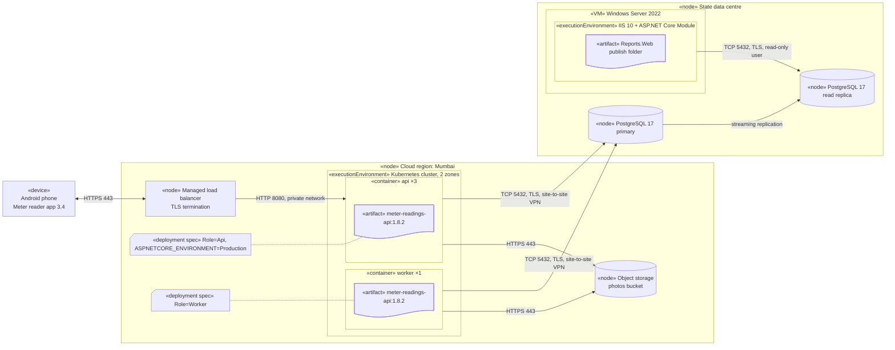
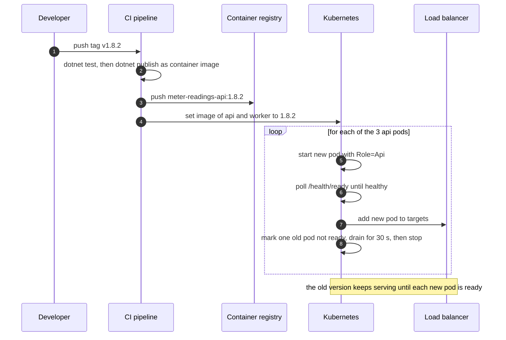
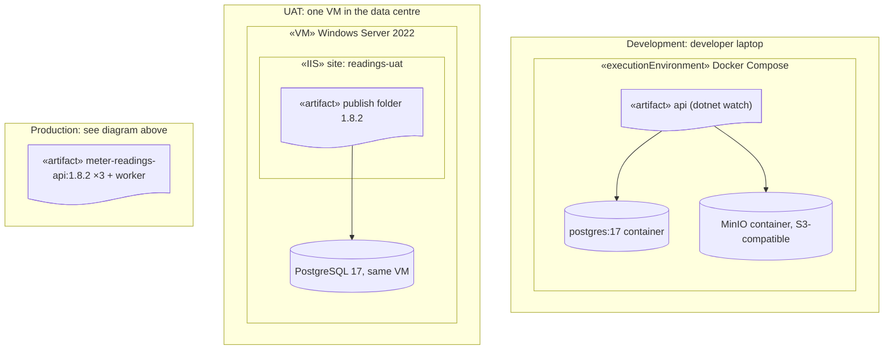
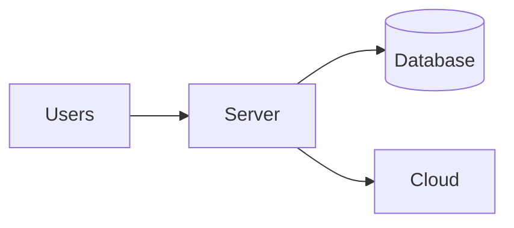
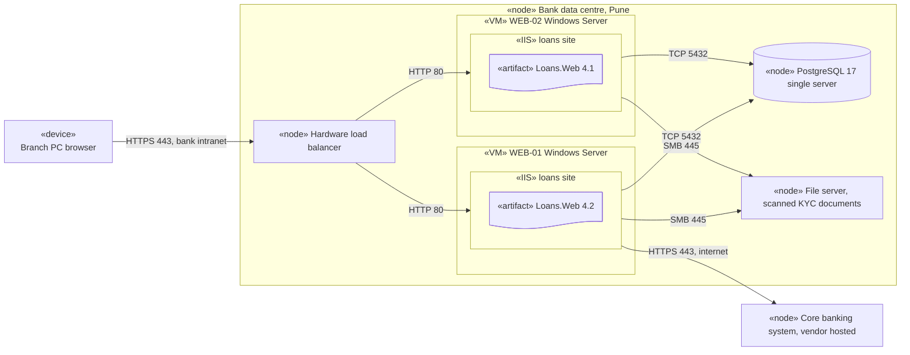
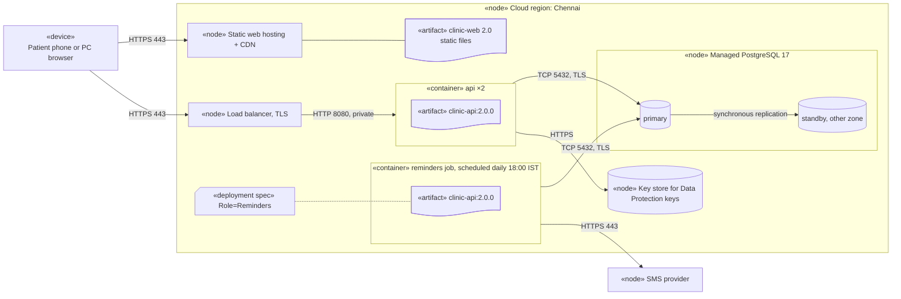
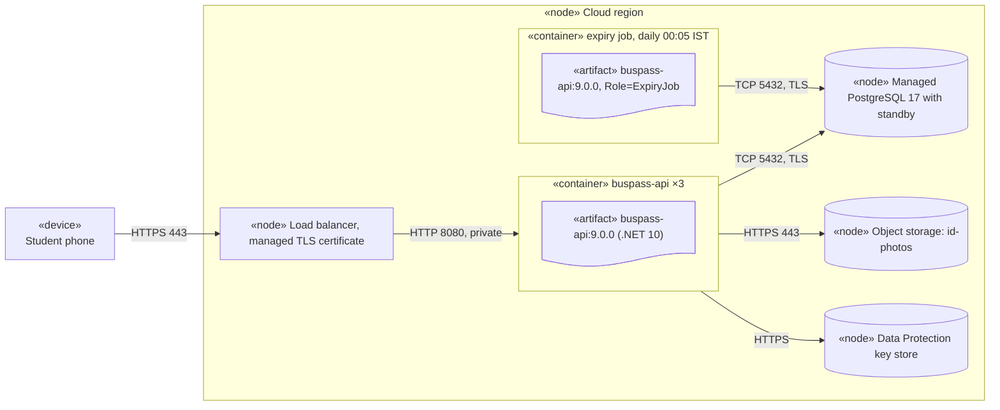

A component diagram tells you what the parts of a system are. It doesn't tell you that the API runs as three containers in a Mumbai cloud region, that the database lives in the state data centre for data-residency reasons, or that the legacy reports site is still on one Windows VM under IIS. A **deployment diagram** does. It shows the **physical** side: machines, runtimes, the files you deploy, and the network paths between them. It is the diagram you open during an outage, a security review, a cost discussion or a migration, and it is the bridge between "the code works on my laptop" and "the system works in production".

## Learning objectives

By the end of this lesson you will be able to:

1. Read and draw nodes (devices and execution environments), artifacts, deployments, communication paths and deployment specifications.
2. Show nesting (VM → container runtime → container → artifact), instance counts and environments.
3. Write deployment diagrams in Mermaid using nested subgraphs, artifact and database shapes, and labelled links.
4. Map a diagram to real .NET deployment targets: `dotnet publish` output, container images, IIS sites with the ASP.NET Core Module, VMs and managed services.
5. Use the diagram to find single points of failure, unencrypted paths and environment leaks.
6. Write the ASP.NET Core code each node needs: environment configuration, forwarded headers, health probes, roles and graceful shutdown.

## Prerequisites

- [Component diagrams](#/lesson/m05-component-diagrams): components are what gets deployed.
- [Configuration, environment variables and secrets](#/lesson/m03-configuration).
- [Health checks and graceful shutdown](#/lesson/m03-health-shutdown) is helpful; this lesson uses both.

## Explain it like I'm a beginner

### The seating plan of a wedding

A wedding has a guest list (who is coming) and a seating plan (who sits at which table, which tables are near the stage, where the exits are). The guest list is like a component diagram: it says *who*. The seating plan is like a deployment diagram: it says *where*. Both are about the same people, but they answer different questions. If the caterer asks "how far is table 12 from the kitchen?", the guest list is no help.

### Our example: an electricity meter-reading system

A state electricity distribution company reads about 40 lakh home meters every month. Meter readers walk from house to house with a **mobile app** that records each reading with a photo of the meter and its GPS position, so a disputed bill can be checked later. An **ASP.NET Core API** receives the readings. A **background worker** resizes photos and generates PDF reports. Data lives in **PostgreSQL**. Photos go to **object storage**. A **legacy reports website**, also ASP.NET Core, runs on **IIS** in the company's own data centre and reads from a database replica.

Where does each piece run? The deployment diagram answers:

- The app runs on Android phones (a **device** node).
- The API and worker run as **containers** in a cloud region, three API instances and one worker.
- PostgreSQL runs in the **state data centre**, because the company's policy says consumer and billing records must stay on its own premises. A read replica serves the reports site.
- The reports site runs on a **Windows Server VM** under **IIS**.
- They talk over **HTTPS** and **TLS-encrypted PostgreSQL connections**, through a site-to-site VPN between the cloud and the data centre.

Already, the picture raises questions a component diagram never would: what happens if the VPN drops? Is the single worker a problem? Is the database a single point of failure?

## First-principles explanation

### Nodes

A **node** is a computational resource on which artifacts can be deployed. It's drawn as a 3D box (a cube). UML distinguishes two kinds:

- A **device** node is physical hardware: a server, a phone, a router, an IoT gateway in an electricity substation. Stereotype `«device»`.
- An **execution environment** node is a software environment that hosts other software: an operating system, a container runtime, a JVM or .NET runtime, a web server like IIS, a database server. Stereotype `«executionEnvironment»`, or something more specific such as `«container»`, `«IIS»`, `«Kubernetes»`.

Nodes **nest**: a physical server contains a VM, the VM contains a container runtime, the runtime contains containers. Draw only the levels that matter for the question. For a security review, the VM boundary matters (who can log in?); for a capacity discussion, the container count matters.

Annotate nodes with what matters operationally: instance count (`×3`), size (`4 vCPU, 8 GB`), operating system, region or zone, and whether it's managed by a provider.

### Artifacts

An **artifact** is a physical piece of information that is deployed: a file or package. Drawn as a rectangle with `«artifact»` or a document icon. In .NET:

- the output folder of `dotnet publish` (DLLs, `appsettings.json`, `web.config` for IIS);
- a **container image** such as `meter-readings-api:1.8.2`;
- a self-contained single-file executable;
- a database migration script or bundle;
- a mobile app package (APK/AAB).

An artifact **manifests** one or more components: the `meter-readings-api` image contains the Readings, Photos and Billing components from the component diagram. That link (component → artifact → node) is how the logical and physical views connect.

### Deployment

A **deployment** places an artifact on a node: "`meter-readings-api:1.8.2` is deployed to the `api` container". Draw it by putting the artifact inside the node, or by a dashed arrow with `«deploy»` from the artifact to the node.

### Communication paths

A **communication path** is a line between nodes that can exchange messages. Label it with what matters: protocol and port (`HTTPS 443`, `TCP 5432`), encryption (`TLS`), direction, and network (`site-to-site VPN`, `private subnet`). On security reviews, these labels are the most important thing on the diagram.

### Deployment specifications

A **deployment specification** is the configuration that tells an artifact how to behave on a particular node: environment name, connection strings, feature flags, instance role. Drawn as a small rectangle `«deployment spec»` attached to the deployment. In ASP.NET Core this is concrete:

- `ASPNETCORE_ENVIRONMENT=Production` (or `DOTNET_ENVIRONMENT` for non-web hosts);
- `appsettings.Production.json`;
- environment variables such as `ConnectionStrings__Readings` (the double underscore maps to `:` in configuration keys);
- for IIS, `web.config` and the app pool's settings;
- for containers, the environment section of a Compose file or Kubernetes manifest, and secrets mounted from a vault.

A key principle: **the same artifact should be promoted unchanged from UAT to production**, with only the deployment specification changing. If you rebuild for each environment, what you tested isn't what you deployed.

### Environments

Most systems have several environments: development, test or UAT, staging, production. Each can have its own deployment diagram, or one diagram can show the production topology with a table of differences. Differences are where incidents hide ("UAT has one database server, production has a replica; the read-after-write bug only appears in production").

### What a deployment diagram helps you find

- **Single points of failure (SPOF).** Any node with one instance that a critical path depends on. Here: the worker (photo processing stops if it dies, but the API keeps working), the database primary (everything stops), and the VPN (the cloud API can't reach the data centre).
- **Latency.** Every hop across a region or a VPN adds milliseconds. A cloud API in Mumbai calling a database in a data centre in another city might add an estimated 10–30 ms per round trip (an estimate; measure your own link). An endpoint making 20 sequential queries feels that 20 times.
- **Security boundaries.** Which paths cross the internet? Which are encrypted? Which nodes hold personal data?
- **Cost.** Each node has a price. Three API containers that sit at 5 % CPU are a cost question.
- **Blast radius.** If a node fails, what goes with it? Two components in one container fail together.

### UML deployment diagram or C4 deployment diagram?

The [C4 model](#/lesson/m05-c4-model) also has a deployment view, with nested "deployment nodes" holding container instances. It's the same idea with a looser notation. UML gives you precise words (node, artifact, deployment specification); C4 gives you a consistent style with the other C4 levels. Teams often draw the C4 style and use the UML vocabulary to talk about it.

### Writing deployment diagrams in Mermaid

Mermaid has no `deploymentDiagram` type. A **flowchart with nested subgraphs** works well, because nodes nest. (Mermaid's newer `architecture-beta` diagram, with groups and service icons, is another option for cloud-style pictures, but it's still marked beta and offers less control over labels.)

**Nodes as subgraphs.** Each node or execution environment is a `subgraph` with an id and a quoted title that includes the stereotype:

```text
flowchart LR
    subgraph cloud["«node» Cloud region: Mumbai"]
        subgraph k8s["«executionEnvironment» Kubernetes cluster"]
            subgraph apiPod["«container» api ×3"]
                apiImage@{ shape: doc, label: "«artifact» meter-readings-api:1.8.2" }
            end
        end
    end
```

Subgraphs nest as deep as you need. Keep ids short and unique; the title can be long.

**Artifacts.** The `doc` shape (Mermaid 11.3+) looks like a document: `art@{ shape: doc, label: "«artifact» Reports.Web (publish folder)" }`. On older renderers use `art[/"«artifact» ..."/]` (a parallelogram) or a plain rectangle.

**Databases and devices.** `db[("«node» PostgreSQL 17")]` draws a cylinder. A device can be a simple box: `phone["«device» Android phone"]`.

**Communication paths.** Links between nodes (subgraph ids) or between items inside them, labelled with protocol and port:

```text
phone <-->|"HTTPS 443"| apiPod
apiPod -->|"TCP 5432, TLS, via VPN"| db
```

`<-->` is a two-way link; `-->` shows who opens the connection, which is what firewalls care about. Quote labels, because commas and colons are common in them.

**Deployment specifications.** A small note-like node attached with a dotted line: `spec@{ shape: notch-rect, label: "«deployment spec» ASPNETCORE_ENVIRONMENT=Production" }` and `spec -.- apiImage`.

**Styling.** `classDef prod stroke:#c0392b,stroke-width:2px` and `class cloud,dc prod` highlight production boundaries; `style dc fill:#f5f5f5` shades one subgraph.

Common Mermaid errors: linking to a subgraph id that's misspelt (Mermaid creates a new empty node); unquoted labels with `«»`, colons or commas; and very deep nesting with `LR` direction, which can make the layout unreadable. Try `TB`, or split the diagram per environment.

### Mapping a deployment diagram to .NET targets

| Diagram element | .NET reality |
|---|---|
| Artifact: publish folder | `dotnet publish -c Release -o out` (framework-dependent: needs the .NET runtime on the node) |
| Artifact: self-contained | `dotnet publish -r linux-x64 --self-contained` (brings its own runtime; bigger, no runtime install needed) |
| Artifact: container image | `dotnet publish /t:PublishContainer` (SDK-built image, no Dockerfile) or a `Dockerfile` |
| Execution environment: IIS | IIS with the **ASP.NET Core Module** (ANCM) and the .NET Hosting Bundle; app pool set to "No Managed Code"; `web.config` generated by publish; **in-process** hosting (default, faster) or **out-of-process** (IIS proxies to Kestrel) |
| Execution environment: container | Kestrel listens on port 8080 by default in the official .NET 8+ images, runs as a non-root user; a reverse proxy or ingress terminates TLS |
| Execution environment: VM / Linux service | Kestrel behind Nginx or YARP, managed by systemd; or a Windows Service via `UseWindowsService()` |
| Node instance count ×N | stateless app: no in-memory sessions; shared Data Protection keys; distributed cache if caching user data |
| Deployment specification | `ASPNETCORE_ENVIRONMENT`, `appsettings.{Environment}.json`, environment variables with `__`, secrets from a vault |
| Communication path through a proxy | `UseForwardedHeaders()` so the app sees the original scheme and client IP |
| Load balancer or orchestrator health | `/health/live` and `/health/ready` endpoints (`MapHealthChecks`) |
| Rolling update | graceful shutdown: `HostOptions.ShutdownTimeout`, readiness turning unhealthy before stop |

The last four rows are the ones teams forget. A diagram that shows "×3" behind a load balancer is a promise that the app works with three copies. That promise is only true if the code is written for it.

### When a deployment diagram isn't worth it

- A single app on a single platform-as-a-service instance with a managed database. A sentence says it all.
- When nothing about the infrastructure is being decided or reviewed. Draw it when you plan a migration, a security review, a capacity change or a disaster-recovery test, and keep it updated after.
- When infrastructure is fully defined as code (Terraform, Bicep, Kubernetes manifests). Then the diagram should be **generated** from, or reviewed against, that code; a hand-drawn diagram that disagrees with the code is worse than none.

## Visual explanation

### Production deployment



Read it node by node, then path by path:

- **The phone** is a device node, outside every boundary. Its only path is HTTPS to the load balancer. The app never talks to the database or storage directly.
- **The load balancer** terminates TLS, so traffic inside the cluster is plain HTTP on port 8080 over a private network. That's a deliberate trade-off, and it's why the API needs forwarded headers to know the original request was HTTPS.
- **The Kubernetes cluster** is an execution environment spanning two availability zones. Inside it, `api ×3` and `worker ×1` are containers. Both run **the same artifact**, `meter-readings-api:1.8.2`. The **deployment specifications** make the difference: `Role=Api` serves HTTP, `Role=Worker` processes photos. One build, two deployments.
- **Object storage** holds photos. Both containers reach it over HTTPS.
- **The state data centre** holds the database primary, its read replica and the IIS VM. The cloud containers reach the primary over a TLS connection through a site-to-site VPN. That VPN is on every write path, so it is a single point of failure and deserves redundancy (two tunnels) and monitoring.
- **The IIS VM** runs the legacy reports site as a publish folder under IIS with the ASP.NET Core Module. It uses a **read-only** database user against the replica, so heavy reports can't slow down meter readings, and a bug in the reports site can't write data.

Single points of failure visible at a glance: the primary database, the VPN, the single worker (degrades photo processing only) and the single IIS VM (degrades reports only). Each needs a decision: accept, add redundancy, or document a recovery time.

### How a release reaches the nodes



The deployment diagram is static; this sequence shows how it changes during a **rolling update**. The same image goes to both roles. Kubernetes only sends traffic to a new pod once `/health/ready` passes, and stops old pods only after draining in-flight requests. Both behaviours depend on the code: a readiness endpoint that checks real dependencies, and graceful shutdown. Strategies such as blue-green and canary are covered in [Blue-green, canary and rolling deployments](#/lesson/m15-deployment-strategies).

### Environments side by side



Three environments, three very different topologies. Development uses Docker Compose with a MinIO container standing in for object storage. UAT is one Windows VM with IIS and PostgreSQL on the same machine, cheap but unlike production. Production is the containerised setup. The diagram makes the **gaps** obvious: UAT has no replica, no VPN, no load balancer and no separate worker, so bugs involving replica lag, forwarded headers, multiple instances or the worker role can't be found in UAT. Either close the gaps (a staging environment that mirrors production) or test those behaviours specifically.

Note also that UAT runs the **publish folder** while production runs the **container image**. They're built from the same commit, but they aren't the same artifact. A stricter team would run the container in UAT too.

## Step-by-step example

How do you draw a deployment diagram for a system you've inherited? Six steps.

### Step 1 — list the artifacts

What gets built and shipped? Look at the CI pipeline: the API image, the publish folder for the reports site, the mobile app, database migration scripts. Each is an artifact.

### Step 2 — find where each artifact runs

Ask operations, or read the infrastructure code. Write "artifact → node" pairs: "reports publish folder → IIS on VM-RPT-01". Include instance counts.

### Step 3 — draw nodes from the outside in

Region or data centre first, then clusters or VMs, then execution environments (IIS, container runtime), then containers. Stop at the level the question needs.

### Step 4 — draw every communication path and label it

For each pair of nodes that talk, write protocol, port, encryption and network. Ask "who opens the connection?" and draw the arrow that way. Missing labels are the most common gap in real diagrams, and the most important for security.

### Step 5 — attach deployment specifications

Note the environment name, role and where secrets come from. Don't write secret **values** on a diagram. Write where they live ("connection string from vault: `readings-db`").

### Step 6 — review it for failure

Walk through: "this node dies, what happens?", "this link drops?", "load doubles?". Mark single points of failure and decide what to do about each. Then commit the diagram next to the infrastructure code and update it with every infrastructure change.

## Production-style C# implementation

What does the code need, so that the deployment diagram above is actually true? This implementation is one artifact that runs correctly on every node in the diagram: behind the load balancer, under IIS, in a container, as the API or as the worker.

```text
MeterReadings.Api/
  Program.cs
  Deployment/NodeOptions.cs            // the deployment specification, validated at startup
  Deployment/HostingInfo.cs            // "which node am I on?" for diagnostics
  Deployment/DependencyHealthChecks.cs // readiness = the communication paths are working
  Deployment/PhotoWorker.cs            // runs only when Role=Worker
```

```csharp file=Deployment/NodeOptions.cs
namespace MeterReadings.Api.Deployment;

public enum NodeRole { Api, Worker, All }

/// <summary>The deployment specification for one node, bound from configuration
/// ("Node" section, or environment variables such as Node__Role=Worker).</summary>
public sealed class NodeOptions
{
    public const string Section = "Node";

    public NodeRole Role { get; set; } = NodeRole.All;
    public string Region { get; set; } = "local";
    public string PhotoBucket { get; set; } = "";
    /// <summary>Shared folder or volume for Data Protection keys. Required when there is more than one instance.</summary>
    public string? KeyRingPath { get; set; }
    public int ExpectedInstances { get; set; } = 1;
    public int ShutdownSeconds { get; set; } = 30;

    public bool RunsHttp => Role is NodeRole.Api or NodeRole.All;
    public bool RunsWorker => Role is NodeRole.Worker or NodeRole.All;
}
```

```csharp file=Deployment/HostingInfo.cs
using System.Reflection;

namespace MeterReadings.Api.Deployment;

public enum HostingKind { SelfHosted, Container, Iis }

/// <summary>Describes the node this process is running on. Exposed at /about for operators.</summary>
public sealed record HostingInfo(string Machine, string Environment, HostingKind Hosting, NodeRole Role,
    string Region, string Version, string Framework)
{
    public static HostingInfo Detect(IHostEnvironment env, NodeOptions node)
    {
        var hosting =
            Environment_("DOTNET_RUNNING_IN_CONTAINER") == "true" ? HostingKind.Container :
            Environment_("ASPNETCORE_IIS_PHYSICAL_PATH") is not null || Environment_("APP_POOL_ID") is not null ? HostingKind.Iis :
            HostingKind.SelfHosted;

        var version = Assembly.GetEntryAssembly()?
            .GetCustomAttribute<AssemblyInformationalVersionAttribute>()?.InformationalVersion ?? "unknown";

        return new HostingInfo(System.Environment.MachineName, env.EnvironmentName, hosting, node.Role,
            node.Region, version, System.Runtime.InteropServices.RuntimeInformation.FrameworkDescription);
    }

    private static string? Environment_(string name) => System.Environment.GetEnvironmentVariable(name);
}
```

```csharp file=Deployment/DependencyHealthChecks.cs
using Microsoft.Extensions.Diagnostics.HealthChecks;

namespace MeterReadings.Api.Deployment;

/// <summary>One probe per communication path on the deployment diagram.</summary>
public interface IDependencyProbe
{
    string Name { get; }
    Task<bool> CanReachAsync(CancellationToken ct);
}

/// <summary>Stand-in probes. A real database probe runs "SELECT 1" with a short timeout;
/// a real storage probe does a HEAD request on the bucket.</summary>
public sealed class ConfiguredProbe(string name, Func<bool> reachable) : IDependencyProbe
{
    public string Name { get; } = name;
    public Task<bool> CanReachAsync(CancellationToken ct) => Task.FromResult(reachable());
}

/// <summary>Readiness: "send me traffic only if my paths to PostgreSQL and storage work".</summary>
public sealed class DependencyHealthCheck(IEnumerable<IDependencyProbe> probes) : IHealthCheck
{
    public async Task<HealthCheckResult> CheckHealthAsync(HealthCheckContext context, CancellationToken ct = default)
    {
        using var timeout = CancellationTokenSource.CreateLinkedTokenSource(ct);
        timeout.CancelAfter(TimeSpan.FromSeconds(2));   // a probe must be fast, or the orchestrator times out first

        var list = probes.ToList();
        var results = await Task.WhenAll(list.Select(async p =>
        {
            try { return (p.Name, Ok: await p.CanReachAsync(timeout.Token)); }
            catch (Exception) when (!ct.IsCancellationRequested) { return (p.Name, Ok: false); }
        }));

        var failed = results.Where(r => !r.Ok).Select(r => r.Name).ToList();
        var data = results.ToDictionary(r => r.Name, r => (object)(r.Ok ? "ok" : "unreachable"));
        return failed.Count == 0
            ? HealthCheckResult.Healthy("All dependencies reachable.", data)
            : HealthCheckResult.Unhealthy($"Unreachable: {string.Join(", ", failed)}", data: data);
    }
}

/// <summary>Turns readiness off as soon as shutdown starts, so the load balancer stops
/// sending new requests while in-flight ones finish (the "drain" in the sequence diagram).</summary>
public sealed class ShutdownReadinessCheck(IHostApplicationLifetime lifetime) : IHealthCheck
{
    public Task<HealthCheckResult> CheckHealthAsync(HealthCheckContext context, CancellationToken ct = default) =>
        Task.FromResult(lifetime.ApplicationStopping.IsCancellationRequested
            ? HealthCheckResult.Unhealthy("Shutting down.")
            : HealthCheckResult.Healthy());
}
```

```csharp file=Deployment/PhotoWorker.cs
using System.Threading.Channels;

namespace MeterReadings.Api.Deployment;

public sealed record PhotoJob(Guid ReadingId, string ObjectKey);

/// <summary>The queue between the API role and the worker role. In production this is a
/// table or a message broker, because the two roles run in different containers.</summary>
public sealed class PhotoQueue
{
    private readonly Channel<PhotoJob> _channel = Channel.CreateBounded<PhotoJob>(1_000);
    public ValueTask EnqueueAsync(PhotoJob job, CancellationToken ct) => _channel.Writer.WriteAsync(job, ct);
    public IAsyncEnumerable<PhotoJob> ReadAllAsync(CancellationToken ct) => _channel.Reader.ReadAllAsync(ct);
}

/// <summary>Registered only on nodes whose deployment spec says Role=Worker (or All).</summary>
public sealed class PhotoWorker(PhotoQueue queue, ILogger<PhotoWorker> logger) : BackgroundService
{
    protected override async Task ExecuteAsync(CancellationToken stoppingToken)
    {
        try
        {
            await foreach (var job in queue.ReadAllAsync(stoppingToken))
            {
                // Resize, strip EXIF location if required, generate thumbnails...
                logger.LogInformation("Processed photo {Key} for reading {Id}", job.ObjectKey, job.ReadingId);
            }
        }
        catch (OperationCanceledException) when (stoppingToken.IsCancellationRequested)
        {
            logger.LogInformation("Photo worker stopping; unfinished jobs stay queued for the next instance.");
        }
    }
}
```

```csharp file=Program.cs
using MeterReadings.Api.Deployment;
using Microsoft.AspNetCore.DataProtection;
using Microsoft.AspNetCore.Diagnostics.HealthChecks;
using Microsoft.AspNetCore.HttpOverrides;
using Microsoft.Extensions.Diagnostics.HealthChecks;
using Microsoft.Extensions.Options;

var builder = WebApplication.CreateBuilder(args);
// Configuration layers = deployment specification: appsettings.json, appsettings.{Environment}.json,
// then environment variables (Node__Role=Worker), then command-line arguments.

builder.Services.AddOptions<NodeOptions>()
    .Bind(builder.Configuration.GetSection(NodeOptions.Section))
    .Validate(o => !builder.Environment.IsProduction() || !string.IsNullOrWhiteSpace(o.PhotoBucket),
        "Node:PhotoBucket is required in Production.")
    .Validate(o => o.ExpectedInstances <= 1 || !string.IsNullOrWhiteSpace(o.KeyRingPath),
        "Node:KeyRingPath is required when more than one instance is deployed.")
    .ValidateOnStart();   // a wrong deployment spec fails at startup, not on the first request

var node = builder.Configuration.GetSection(NodeOptions.Section).Get<NodeOptions>() ?? new NodeOptions();

// ×3 behind a load balancer: every instance must decrypt cookies and antiforgery tokens issued by the others.
var dataProtection = builder.Services.AddDataProtection().SetApplicationName("meter-readings");
if (!string.IsNullOrWhiteSpace(node.KeyRingPath))
    dataProtection.PersistKeysToFileSystem(new DirectoryInfo(node.KeyRingPath));

// Rolling updates: give in-flight requests and the worker time to finish.
builder.Services.Configure<HostOptions>(o => o.ShutdownTimeout = TimeSpan.FromSeconds(node.ShutdownSeconds));

// TLS ends at the load balancer: trust X-Forwarded-For and X-Forwarded-Proto from it.
builder.Services.Configure<ForwardedHeadersOptions>(o =>
{
    o.ForwardedHeaders = ForwardedHeaders.XForwardedFor | ForwardedHeaders.XForwardedProto;
    // By default only loopback proxies are trusted. Add the load balancer's subnet to KnownIPNetworks
    // (.NET 10; KnownNetworks in older versions). Never clear the lists to "trust everyone".
});

// One probe per communication path. The lambdas stand in for SELECT 1 and a bucket HEAD request.
builder.Services.AddSingleton<IDependencyProbe>(new ConfiguredProbe("postgresql-primary", () => true));
builder.Services.AddSingleton<IDependencyProbe>(new ConfiguredProbe("photo-storage", () => true));
builder.Services.AddHealthChecks()
    .AddCheck<DependencyHealthCheck>("dependencies", tags: new[] { "ready" })
    .AddCheck<ShutdownReadinessCheck>("shutdown", tags: new[] { "ready" });

builder.Services.AddSingleton<PhotoQueue>();
if (node.RunsWorker) builder.Services.AddHostedService<PhotoWorker>();   // Role decides what this node does

var app = builder.Build();

app.UseForwardedHeaders();

// Liveness: "is the process alive?" No dependency checks, or a database blip restarts every pod.
app.MapHealthChecks("/health/live", new HealthCheckOptions { Predicate = _ => false });
// Readiness: "should I receive traffic?" Checks the communication paths.
app.MapHealthChecks("/health/ready", new HealthCheckOptions { Predicate = c => c.Tags.Contains("ready") });

app.MapGet("/about", (IHostEnvironment env, IOptions<NodeOptions> opts) => HostingInfo.Detect(env, opts.Value));

if (node.RunsHttp)
{
    app.MapPost("/readings/{id:guid}/photos", async (Guid id, PhotoUpload upload, PhotoQueue queue, HttpContext http, CancellationToken ct) =>
    {
        // Thanks to forwarded headers, this is "https" even though Kestrel received plain HTTP on 8080.
        var scheme = http.Request.Scheme;
        await queue.EnqueueAsync(new PhotoJob(id, upload.ObjectKey), ct);
        return Results.Accepted($"{scheme}://{http.Request.Host}/readings/{id}");
    });
}

app.Run();

public sealed record PhotoUpload(string ObjectKey);
```

How each line ties back to the diagram:

- **Deployment specifications become validated options.** `Node__Role=Worker` on the worker container and `Node__Role=Api` on the API containers change what the same artifact does. `ValidateOnStart` means a container deployed with a missing bucket name crashes immediately, so the rolling update stops at the first pod instead of replacing all three with broken ones.
- **"×3" becomes shared Data Protection keys.** Without them, a user logged in through pod 1 gets an error when the load balancer sends the next request to pod 2, because each pod would generate its own keys. (Keys can live on a shared volume, in a database, or in a key vault; a file path is the simplest to show.)
- **"TLS terminates at the load balancer" becomes `UseForwardedHeaders`.** Without it, the app thinks every request is plain HTTP, so redirects and generated links use `http://`, and the client IP in logs is the load balancer's.
- **Communication paths become readiness probes.** `/health/ready` checks PostgreSQL and storage. `/health/live` checks nothing external, on purpose: if the VPN drops, you want pods marked *not ready* (no traffic), not *dead* (restarted in a loop, which makes recovery slower).
- **Rolling updates become graceful shutdown.** `ShutdownReadinessCheck` flips readiness to unhealthy the moment shutdown begins, and `ShutdownTimeout` gives requests and the worker time to finish.
- **`/about` makes the diagram checkable.** An operator can call it on any node and see the environment, role, hosting kind and version. If production pods report `1.8.1` while the diagram says `1.8.2`, you've found your problem.

:::callout type=tip title="Hosting the same artifact under IIS"
`dotnet publish` generates a `web.config` that tells IIS to load the app through the ASP.NET Core Module. In-process hosting (the default) runs the app inside the IIS worker process, `w3wp.exe`, without Kestrel in front. Set the app pool to "No Managed Code", install the .NET Hosting Bundle on the VM, and set `ASPNETCORE_ENVIRONMENT` in `web.config` or the app pool's environment variables. Forwarded headers are handled by IIS integration automatically. See [Reverse proxies and IIS hosting](#/lesson/m15-reverse-proxy-iis).
:::

## Bad design vs good design

### The "cloud with arrows" diagram



Why it's useless in an incident or a review:

- **No node types or counts.** Is "Server" one VM or ten containers? Is it a single point of failure?
- **No artifacts or versions.** What's deployed? Which version?
- **No protocols, ports or encryption.** A security reviewer can't tell whether database traffic crosses the internet in plain text.
- **"Cloud"** is not a node. Which service? Which region?
- **No environment.** Is this production? UAT?
- **No boundaries.** Where are the network zones, the VPN, the data centre?

### The good version

The production diagram in the visual section: nested nodes with stereotypes and counts, artifacts with versions, deployment specifications, labelled communication paths, and clear boundaries between the cloud region and the data centre. It's longer, and it answers the questions people actually ask.

### Is more detail always better?

No. IP addresses, VM sizes and every firewall rule belong in infrastructure code and runbooks, not on the diagram. Add detail that changes decisions: counts, zones, protocols, encryption, data location. For an executive summary, three boxes (phones, cloud, data centre) and two lines might be right.

:::callout type=mistake title="Diagrams that describe the plan, not production"
Teams often draw the deployment diagram during design and never again. Six months later production has a second worker someone added during an incident, a database moved to a managed service, and a forgotten VM still running last year's reports site. Generate what you can (from Kubernetes, Terraform or cloud inventory), add an `/about` endpoint to every artifact, and review the diagram as part of every infrastructure change.
:::

## Practical playground

A deployment diagram also lets you **estimate availability**. Nodes in series (every request needs all of them) multiply their availabilities; redundant nodes in parallel (any one is enough) multiply their *unavailabilities*. Run the program, then change the numbers: add a second VPN tunnel, make the database a single instance, or remove one API pod. The figures are illustrative assumptions, not vendor SLAs.

:::playground type=csharp title="Availability from a deployment diagram"
```csharp file=Program.cs
using System;
using System.Linq;

public static class Program
{
    // Availability of N identical redundant instances where any one is enough.
    private static double Parallel(double a, int n) => 1 - Math.Pow(1 - a, n);

    // Availability of a chain where every element is needed.
    private static double Series(params double[] parts) => parts.Aggregate(1.0, (x, y) => x * y);

    private static string Pct(double a) => $"{a * 100:F4} %";

    private static string Downtime(double a) => $"{(1 - a) * 365 * 24 * 60:N0} min/year";

    public static void Main()
    {
        // Illustrative per-element availabilities (assumptions for the exercise).
        double loadBalancer = 0.9999, apiPod = 0.995, vpnTunnel = 0.995, dbPrimary = 0.999;

        var apiTier = Parallel(apiPod, 3);
        var oneVpn = vpnTunnel;
        var twoVpn = Parallel(vpnTunnel, 2);

        var writePathOneVpn = Series(loadBalancer, apiTier, oneVpn, dbPrimary);
        var writePathTwoVpn = Series(loadBalancer, apiTier, twoVpn, dbPrimary);

        Console.WriteLine($"API tier, 3 pods:          {Pct(apiTier)}");
        Console.WriteLine($"Write path, 1 VPN tunnel:  {Pct(writePathOneVpn)}  ~{Downtime(writePathOneVpn)}");
        Console.WriteLine($"Write path, 2 VPN tunnels: {Pct(writePathTwoVpn)}  ~{Downtime(writePathTwoVpn)}");
        Console.WriteLine();
        Console.WriteLine("The weakest single element dominates the chain. Find it on the diagram first.");
    }
}
```
:::

With these assumptions, three API pods make the API tier almost never the problem, while a single VPN tunnel costs roughly 3,000 minutes a year and the database primary about 500. That's the deployment diagram doing quantitative work: it tells you where redundancy is worth paying for. (Real failures are often correlated, for example two tunnels on one router, so treat the result as an upper bound.)

## Exercises

:::exercise id=m05-deployment-diagrams-ex1 difficulty=beginner kind=written title="Read a deployment diagram"
A cooperative bank's loan-origination system:



Answer in full sentences:

1. List every single point of failure.
2. Find two problems with what is deployed.
3. Which communication paths would a security reviewer question first, and why?
4. A user logs in, and the next request goes to the other server. What code-level requirement does this diagram imply?
::acceptance
- Identifies the database, file server, load balancer (if single) and the core-banking link as SPOFs.
- Notices the version mismatch (4.2 vs 4.1) and that only WEB-01 has a path to core banking.
- Questions unencrypted HTTP 80 and TCP 5432, and the internet path to the vendor.
- States the need for shared Data Protection keys or shared session state across instances.
::hint
For each node, ask: "if this one fails, can the system still serve a loan application?"
::hint
Compare the two IIS nodes carefully: artifacts and paths.
::hint
Which labels say "TLS"? Which don't?
::hint
Two instances behind a load balancer: what must they share for a login cookie to work on both?
::solution
1. **Single points of failure**: the PostgreSQL server (one server, no replica); the file server; the load balancer (drawn as one); and the core-banking connection (one path, over the internet, from one server). The two web VMs are redundant with each other, which is the only redundant tier.
2. **Deployment problems**: WEB-01 runs **4.2** and WEB-02 runs **4.1**. Users will see different behaviour depending on which server they hit, and any database change in 4.2 may break 4.1. Second, **only WEB-01 has a path to the core banking system**. Any request on WEB-02 that needs core banking will fail, which looks like a random, intermittent bug.
3. **Security**: `HTTP 80` from the load balancer to IIS and `TCP 5432` to PostgreSQL are not marked as encrypted, so customer data travels in plain text inside the data centre. The path to the vendor crosses the **internet**; it needs TLS with certificate validation at least, and ideally a private link or VPN plus IP allow-listing. The SMB path to scanned KYC documents (personal identity data) also needs encryption (SMB 3 encryption) and tight access control.
4. Because the load balancer can send consecutive requests to different servers, both must be able to read each other's authentication cookies: **shared ASP.NET Core Data Protection keys** (for example persisted to the database or a shared folder, with the same application name), and any session state must be in a shared store rather than in memory. Alternatively, sticky sessions on the load balancer, which is weaker because a server failure still logs users out.
::mistakes
- Saying "two web servers, so no single points of failure".
- Missing the version mismatch because the boxes look identical.
- Treating "inside the data centre" as automatically safe.
:::

:::exercise id=m05-deployment-diagrams-ex2 difficulty=beginner kind=code title="Resolve a deployment specification"
An artifact's behaviour on each node comes from layered configuration. Implement the same layering rules ASP.NET Core uses, in a small, testable form.
::requirements
`DeploymentSpec.Resolve(string environment, IReadOnlyDictionary<string, string> baseSettings, IReadOnlyDictionary<string, IReadOnlyDictionary<string, string>> environmentFiles, IReadOnlyDictionary<string, string> environmentVariables)` returns the effective settings as a dictionary with **case-insensitive** keys:

1. Start with `baseSettings` (like `appsettings.json`).
2. Overlay the file for `environment` if present in `environmentFiles` (like `appsettings.Production.json`). The environment name is matched case-insensitively.
3. Overlay environment variables. Only variables starting with the prefix `APP_` are used. Remove the prefix, and convert `__` (double underscore) to `:` (for example `APP_ConnectionStrings__Main` → `ConnectionStrings:Main`).
4. Later layers win.

`DeploymentSpec.RequireForProduction(string environment, IReadOnlyDictionary<string, string> settings, params string[] keys)` throws `InvalidOperationException` listing **all** missing or blank keys when `environment` is `Production` (case-insensitive). In other environments it does nothing.
::acceptance
- Production file values override base values; environment variables override both.
- `APP_Node__Role=Worker` sets `Node:Role` to `Worker`; variables without the prefix are ignored.
- Key lookups are case-insensitive.
- A missing environment file is not an error.
- Missing required keys in Production produce one exception naming every missing key.
::hint
Use `new Dictionary<string, string>(StringComparer.OrdinalIgnoreCase)` and copy each layer in order with the indexer, so later layers overwrite.
::hint
For the environment file, look up with a case-insensitive comparison: `environmentFiles.FirstOrDefault(kv => string.Equals(kv.Key, environment, StringComparison.OrdinalIgnoreCase))`.
::hint
`name.Substring("APP_".Length).Replace("__", ":")`.
::hint
Collect missing keys with `keys.Where(k => !settings.TryGetValue(k, out var v) || string.IsNullOrWhiteSpace(v))`.
::starter
```csharp file=DeploymentSpec.cs
using System;
using System.Collections.Generic;
using System.Linq;

public static class DeploymentSpec
{
    public const string Prefix = "APP_";

    public static IReadOnlyDictionary<string, string> Resolve(
        string environment,
        IReadOnlyDictionary<string, string> baseSettings,
        IReadOnlyDictionary<string, IReadOnlyDictionary<string, string>> environmentFiles,
        IReadOnlyDictionary<string, string> environmentVariables) => throw new NotImplementedException();

    public static void RequireForProduction(string environment, IReadOnlyDictionary<string, string> settings, params string[] keys) =>
        throw new NotImplementedException();
}
```
::tests
```csharp file=DeploymentSpecTests.cs
using System;
using System.Collections.Generic;
using Xunit;

public class DeploymentSpecTests
{
    private static readonly Dictionary<string, string> Base = new()
    {
        ["Node:Role"] = "All",
        ["Node:PhotoBucket"] = "",
        ["Logging:LogLevel:Default"] = "Information",
    };

    private static readonly Dictionary<string, IReadOnlyDictionary<string, string>> Files = new()
    {
        ["Production"] = new Dictionary<string, string> { ["Logging:LogLevel:Default"] = "Warning", ["Node:PhotoBucket"] = "insp-photos-prod" },
        ["UAT"] = new Dictionary<string, string> { ["Node:PhotoBucket"] = "insp-photos-uat" },
    };

    private static readonly Dictionary<string, string> Env = new()
    {
        ["APP_Node__Role"] = "Worker",
        ["APP_ConnectionStrings__Main"] = "Host=db.dc.local;Database=readings",
        ["PATH"] = "/usr/bin",
    };

    [Fact]
    public void Layers_apply_in_order()
    {
        var s = DeploymentSpec.Resolve("Production", Base, Files, Env);
        Assert.Equal("Warning", s["Logging:LogLevel:Default"]);
        Assert.Equal("insp-photos-prod", s["Node:PhotoBucket"]);
        Assert.Equal("Worker", s["Node:Role"]);
        Assert.Equal("Host=db.dc.local;Database=readings", s["ConnectionStrings:Main"]);
    }

    [Fact]
    public void Unprefixed_variables_are_ignored_and_keys_are_case_insensitive()
    {
        var s = DeploymentSpec.Resolve("uat", Base, Files, Env);
        Assert.False(s.ContainsKey("PATH"));
        Assert.Equal("insp-photos-uat", s["node:photobucket"]);
    }

    [Fact]
    public void Missing_environment_file_is_fine()
    {
        var s = DeploymentSpec.Resolve("Development", Base, Files, new Dictionary<string, string>());
        Assert.Equal("All", s["Node:Role"]);
        Assert.Equal("Information", s["Logging:LogLevel:Default"]);
    }

    [Fact]
    public void Production_requires_all_keys_and_reports_every_missing_one()
    {
        var s = DeploymentSpec.Resolve("Production", Base, Files, new Dictionary<string, string>());
        var ex = Assert.Throws<InvalidOperationException>(() =>
            DeploymentSpec.RequireForProduction("production", s, "Node:PhotoBucket", "ConnectionStrings:Main", "Node:KeyRingPath"));
        Assert.Contains("ConnectionStrings:Main", ex.Message);
        Assert.Contains("Node:KeyRingPath", ex.Message);
        Assert.DoesNotContain("Node:PhotoBucket", ex.Message);
    }

    [Fact]
    public void Other_environments_are_not_checked()
    {
        var s = DeploymentSpec.Resolve("UAT", Base, Files, new Dictionary<string, string>());
        DeploymentSpec.RequireForProduction("UAT", s, "ConnectionStrings:Main");
    }
}
```
::solution
```csharp file=DeploymentSpec.cs
using System;
using System.Collections.Generic;
using System.Linq;

public static class DeploymentSpec
{
    public const string Prefix = "APP_";

    public static IReadOnlyDictionary<string, string> Resolve(
        string environment,
        IReadOnlyDictionary<string, string> baseSettings,
        IReadOnlyDictionary<string, IReadOnlyDictionary<string, string>> environmentFiles,
        IReadOnlyDictionary<string, string> environmentVariables)
    {
        var result = new Dictionary<string, string>(StringComparer.OrdinalIgnoreCase);

        foreach (var (k, v) in baseSettings) result[k] = v;                       // 1. appsettings.json

        var file = environmentFiles.FirstOrDefault(kv =>
            string.Equals(kv.Key, environment, StringComparison.OrdinalIgnoreCase)).Value;
        if (file is not null)
            foreach (var (k, v) in file) result[k] = v;                           // 2. appsettings.{Environment}.json

        foreach (var (name, value) in environmentVariables)                       // 3. environment variables
        {
            if (!name.StartsWith(Prefix, StringComparison.OrdinalIgnoreCase)) continue;
            var key = name.Substring(Prefix.Length).Replace("__", ":");
            result[key] = value;
        }
        return result;
    }

    public static void RequireForProduction(string environment, IReadOnlyDictionary<string, string> settings, params string[] keys)
    {
        if (!string.Equals(environment, "Production", StringComparison.OrdinalIgnoreCase)) return;
        var missing = keys.Where(k => !settings.TryGetValue(k, out var v) || string.IsNullOrWhiteSpace(v)).ToList();
        if (missing.Count > 0)
            throw new InvalidOperationException($"Deployment specification incomplete for Production. Missing: {string.Join(", ", missing)}");
    }
}
```

This is a miniature of `WebApplication.CreateBuilder`'s configuration: JSON file, environment-specific JSON file, then environment variables (where `__` stands in for `:` because many shells don't allow colons in variable names). Reporting every missing key at once saves a deploy-fail-fix loop per key.
::alternatives
In a real app, use the built-in configuration system and `AddOptions<T>().Validate(...).ValidateOnStart()`, as in the lesson's `Program.cs`. `AddEnvironmentVariables("APP_")` gives you the same prefix behaviour.
::mistakes
- Applying environment variables before the environment file, so the file silently overrides what operators set on the node.
- Case-sensitive keys: `node:role` and `Node:Role` become two different settings.
- Failing on the first missing key only.
::extensions
Add a fourth layer for command-line arguments (`--Node:Role=Api`), and a `Describe()` that shows, for each key, which layer its value came from. That's very useful when debugging "why is production using the UAT bucket?".
:::

:::exercise id=m05-deployment-diagrams-ex3 difficulty=intermediate kind=code title="Lint a deployment topology"
Represent a deployment diagram as data and check it for the problems reviewers look for.
::requirements
Types (in the starter): `DeploymentNode(Id, Kind, Environment, Zone, Instances = 1)`, `DeployedArtifact(Name, NodeId, Critical = true)`, `CommunicationPath(From, To, Protocol, Port, Encrypted)`, and `NodeKind { Device, VirtualMachine, Container, ManagedService, Iis }`.

`Topology.Check()` returns messages in this order:

1. `"unknown node: X"` for each artifact `NodeId`, path `From` or path `To` that doesn't exist (in the order they appear: artifacts first, then paths).
2. For each artifact, in order: `"spof: {Name} on {NodeId}"` if it's `Critical`, its node's `Environment` is `"prod"`, the node has `Instances < 2`, and the node is not a `ManagedService` (assume managed services are redundant under their provider's SLA).
3. For each path, in order:
   - `"unencrypted: {From} -> {To} ({Protocol} {Port})"` if not encrypted **and** the two nodes are in different `Zone`s;
   - `"cross-environment: {From} -> {To}"` if the two nodes have different `Environment`s, unless either is a `Device` (devices belong to users, not environments).

Skip rules 2 and 3 for items that reference unknown nodes.
::acceptance
- A clean production topology returns no messages.
- A single-instance critical artifact on a prod VM is a SPOF; on a managed service it is not; a non-critical one is not.
- Unencrypted traffic within one zone is allowed; across zones it's reported.
- A prod API calling a UAT database is reported; a phone calling the prod API is not.
- Unknown node ids are reported and don't crash the checks.
::hint
Index nodes by id with a dictionary first.
::hint
Each rule is a simple condition over one artifact or one path and its nodes. Write them as separate loops in the required order.
::hint
For "unknown node", check artifacts, then each path's `From` and `To`.
::hint
`if (!nodes.TryGetValue(p.From, out var a) || !nodes.TryGetValue(p.To, out var b)) continue;` before applying path rules.
::starter
```csharp file=Topology.cs
using System;
using System.Collections.Generic;
using System.Linq;

public enum NodeKind { Device, VirtualMachine, Container, ManagedService, Iis }

public sealed record DeploymentNode(string Id, NodeKind Kind, string Environment, string Zone, int Instances = 1);

public sealed record DeployedArtifact(string Name, string NodeId, bool Critical = true);

public sealed record CommunicationPath(string From, string To, string Protocol, int Port, bool Encrypted);

public sealed class Topology
{
    public Topology(IEnumerable<DeploymentNode> nodes, IEnumerable<DeployedArtifact> artifacts, IEnumerable<CommunicationPath> paths) =>
        throw new NotImplementedException();

    public IReadOnlyList<string> Check() => throw new NotImplementedException();
}
```
::tests
```csharp file=TopologyTests.cs
using System;
using System.Collections.Generic;
using System.Linq;
using Xunit;

public class TopologyTests
{
    private static List<DeploymentNode> Nodes() => new()
    {
        new("phone", NodeKind.Device, "any", "internet"),
        new("lb", NodeKind.ManagedService, "prod", "cloud-mumbai"),
        new("api", NodeKind.Container, "prod", "cloud-mumbai", Instances: 3),
        new("worker", NodeKind.Container, "prod", "cloud-mumbai", Instances: 2),
        new("db", NodeKind.ManagedService, "prod", "cloud-mumbai"),
        new("reports-vm", NodeKind.Iis, "prod", "dc-pune"),
        new("uat-db", NodeKind.VirtualMachine, "uat", "dc-pune"),
    };

    private static List<DeployedArtifact> Artifacts() => new()
    {
        new("meter-readings-api:1.8.2", "api"),
        new("meter-readings-worker:1.8.2", "worker"),
        new("Reports.Web 2.3", "reports-vm", Critical: false),
    };

    private static List<CommunicationPath> Paths() => new()
    {
        new("phone", "lb", "HTTPS", 443, true),
        new("lb", "api", "HTTP", 8080, false),          // same zone: allowed
        new("api", "db", "TCP", 5432, true),
        new("reports-vm", "db", "TCP", 5432, true),
    };

    private static IReadOnlyList<string> Check(List<DeploymentNode> n, List<DeployedArtifact> a, List<CommunicationPath> p) =>
        new Topology(n, a, p).Check();

    [Fact] public void Clean_topology() => Assert.Empty(Check(Nodes(), Artifacts(), Paths()));

    [Fact]
    public void Single_instance_critical_artifact_is_spof()
    {
        var n = Nodes().Select(x => x.Id == "worker" ? x with { Instances = 1 } : x).ToList();
        var a = Artifacts();
        a.Add(new("Reports.Scheduler", "reports-vm"));                     // critical, single IIS VM
        var msgs = Check(n, a, Paths());
        Assert.Equal(new[] { "spof: meter-readings-worker:1.8.2 on worker", "spof: Reports.Scheduler on reports-vm" }, msgs);
    }

    [Fact]
    public void Managed_services_are_not_spofs()
    {
        var a = Artifacts();
        a.Add(new("schema-migrations", "db"));
        Assert.Empty(Check(Nodes(), a, Paths()));
    }

    [Fact]
    public void Unencrypted_across_zones()
    {
        var p = Paths();
        p.Add(new("reports-vm", "api", "HTTP", 80, false));
        Assert.Equal(new[] { "unencrypted: reports-vm -> api (HTTP 80)" }, Check(Nodes(), Artifacts(), p));
    }

    [Fact]
    public void Cross_environment_paths()
    {
        var p = Paths();
        p.Add(new("api", "uat-db", "TCP", 5432, true));
        var msgs = Check(Nodes(), Artifacts(), p);
        Assert.Equal(new[] { "cross-environment: api -> uat-db" }, msgs);
    }

    [Fact]
    public void Unknown_nodes_are_reported_and_skipped()
    {
        var a = Artifacts();
        a.Add(new("legacy.exe", "old-server"));
        var p = Paths();
        p.Add(new("api", "redis", "TCP", 6379, false));
        var msgs = Check(Nodes(), a, p);
        Assert.Equal(new[] { "unknown node: old-server", "unknown node: redis" }, msgs);
    }
}
```
::solution
```csharp file=Topology.cs
using System;
using System.Collections.Generic;
using System.Linq;

public enum NodeKind { Device, VirtualMachine, Container, ManagedService, Iis }

public sealed record DeploymentNode(string Id, NodeKind Kind, string Environment, string Zone, int Instances = 1);

public sealed record DeployedArtifact(string Name, string NodeId, bool Critical = true);

public sealed record CommunicationPath(string From, string To, string Protocol, int Port, bool Encrypted);

public sealed class Topology
{
    private readonly Dictionary<string, DeploymentNode> _nodes;
    private readonly DeployedArtifact[] _artifacts;
    private readonly CommunicationPath[] _paths;

    public Topology(IEnumerable<DeploymentNode> nodes, IEnumerable<DeployedArtifact> artifacts, IEnumerable<CommunicationPath> paths)
    {
        _nodes = nodes.ToDictionary(n => n.Id);
        _artifacts = artifacts.ToArray();
        _paths = paths.ToArray();
    }

    public IReadOnlyList<string> Check()
    {
        var messages = new List<string>();

        foreach (var a in _artifacts)
            if (!_nodes.ContainsKey(a.NodeId)) messages.Add($"unknown node: {a.NodeId}");
        foreach (var p in _paths)
        {
            if (!_nodes.ContainsKey(p.From)) messages.Add($"unknown node: {p.From}");
            if (!_nodes.ContainsKey(p.To)) messages.Add($"unknown node: {p.To}");
        }

        foreach (var a in _artifacts)
        {
            if (!_nodes.TryGetValue(a.NodeId, out var n)) continue;
            if (a.Critical && n.Environment == "prod" && n.Instances < 2 && n.Kind != NodeKind.ManagedService)
                messages.Add($"spof: {a.Name} on {n.Id}");
        }

        foreach (var p in _paths)
        {
            if (!_nodes.TryGetValue(p.From, out var from) || !_nodes.TryGetValue(p.To, out var to)) continue;
            if (!p.Encrypted && from.Zone != to.Zone)
                messages.Add($"unencrypted: {p.From} -> {p.To} ({p.Protocol} {p.Port})");
            if (from.Environment != to.Environment && from.Kind != NodeKind.Device && to.Kind != NodeKind.Device)
                messages.Add($"cross-environment: {p.From} -> {p.To}");
        }
        return messages;
    }
}
```

Each rule is a question a reviewer would ask of the drawing: "is this the only copy?", "does this cross a boundary in plain text?", "is production talking to UAT?". Encoding them as data checks means they run on every infrastructure change, not only when a reviewer happens to look.
::alternatives
Real tools apply rules like these to infrastructure-as-code: policy engines check Terraform plans or Kubernetes manifests (for example "every Deployment in namespace prod must have at least 2 replicas"). The model here is a simplified version of that idea.
::mistakes
- Treating every single-instance node as a SPOF, including managed services and non-critical artifacts, which floods the report.
- Flagging unencrypted traffic inside one private zone (often a deliberate trade-off after TLS termination), while missing it across zones.
- Crashing with `KeyNotFoundException` on unknown node ids.
::extensions
Add a rule that flags any `Device` connecting directly to a `database`-like node (by a new `NodeKind.Database`), and one that warns when a prod artifact's version differs between two nodes that should run the same thing.
:::

:::exercise id=m05-deployment-diagrams-ex4 difficulty=intermediate kind=written title="Draw three environments for a clinic booking app"
A chain of 40 clinics in Tamil Nadu runs an appointment system: a React web app, an ASP.NET Core 10 API, a nightly job that sends reminder SMSs, and PostgreSQL. Today everything is on one Windows VM under IIS, including the database. The team wants:

- **Development** on laptops with Docker Compose.
- **UAT** on one Linux VM with containers.
- **Production** with two API instances behind a load balancer, the job as a separate process, and a managed PostgreSQL with a standby.

1. Draw the production deployment diagram in Mermaid (nodes, artifacts, communication paths with protocol and port, deployment specs).
2. Draw or table the differences between the three environments.
3. List the code or configuration changes the move from "one IIS VM" to "two API instances plus a separate job" requires.
::acceptance
- Production diagram shows the load balancer, two API instances, a separate job node, managed PostgreSQL with standby, the SMS provider and the static web app hosting, with labelled paths.
- Artifacts are named with versions, and the same artifact is reused across environments where appropriate.
- The environment comparison lists real differences and their testing risks.
- The change list includes shared Data Protection keys, no in-memory session or cache for user data, job scheduling that runs once (not once per instance), forwarded headers, health endpoints, and configuration per environment.
::hint
Start with the artifacts: web static files, API image, job (same image with a different role, or a separate small console app).
::hint
The nightly job was a scheduled task on the VM. With two API instances, where does it run so it sends each SMS once?
::hint
Ask "what did the single VM give us for free?" Local disk, in-memory state, one clock, one scheduler.
::solution


| | Development | UAT | Production |
|---|---|---|---|
| Host | Docker Compose on laptop | one Linux VM, containers | managed containers ×2 + job |
| Database | `postgres:17` container | container on the same VM | managed, with standby |
| Load balancer | none | none (or Nginx) | managed, TLS termination |
| SMS | fake sender logging to console | provider sandbox | provider live account |
| Risk | multi-instance bugs invisible | multi-instance and failover bugs invisible | |

UAT should at least run two API containers behind Nginx so multi-instance bugs show up before production.

**Changes required:**

1. Persist **Data Protection keys** to a shared store with a fixed application name, so cookies work on both instances.
2. Remove any in-memory session or per-user cache; use a distributed cache if needed.
3. Move the **nightly job** out of the API process (or guard it with a database lock), so two instances don't send every SMS twice. Make it idempotent: record "reminder sent" per appointment.
4. Add **forwarded headers**, because TLS now ends at the load balancer.
5. Add **`/health/live` and `/health/ready`**, and graceful shutdown for rolling updates.
6. Stop writing uploads or logs to local disk; use object storage and structured logs shipped to a central place.
7. Use `ASPNETCORE_ENVIRONMENT` and per-environment configuration; secrets from a vault, not `web.config`.
8. Use UTC in the database and convert to IST only for display, since containers usually run in UTC while the old VM ran in IST.
::mistakes
- Keeping the scheduled task inside the API, so it runs on both instances.
- Drawing the standby without saying it's in another zone, which hides whether it actually protects against a zone outage.
- Assuming the VM's local time zone survives the move to containers.
:::

:::exercise id=m05-deployment-diagrams-ex5 difficulty=advanced kind=code title="Readiness from communication paths"
A readiness endpoint should reflect the communication paths on the deployment diagram: critical paths (the database) make the node not ready; optional ones (an SMS provider) only degrade it. Probes must run in parallel and must never hang the endpoint.
::requirements
- `IDependencyProbe` has `string Name`, `bool Critical` and `Task<bool> ProbeAsync(CancellationToken ct)`.
- `ReadinessEvaluator(IEnumerable<IDependencyProbe> probes, TimeSpan perProbeTimeout)`.
- `EvaluateAsync(CancellationToken ct)` returns `ReadinessReport(Readiness Status, IReadOnlyList<ProbeResult> Results)`, with results in the same order as the probes.
- Each `ProbeResult(string Name, bool Ok, string Detail)`: `Detail` is `"ok"`, `"failed"` (probe returned false), `"timeout"` (didn't finish within `perProbeTimeout`, **even if the probe ignores its cancellation token**), or `"error: <message>"` (threw).
- Status: `NotReady` if any **critical** probe isn't ok; otherwise `Degraded` if any non-critical probe isn't ok; otherwise `Ready`.
- All probes start before any is awaited (parallel).
- If the caller's `ct` is cancelled, throw `OperationCanceledException` rather than reporting timeouts.
::acceptance
- All ok gives `Ready`.
- A failing optional probe gives `Degraded`; a failing critical probe gives `NotReady`.
- A probe that hangs and ignores cancellation is reported as `"timeout"` and the evaluation finishes in well under a second with a 100 ms timeout.
- An exception becomes `"error: ..."` with the message.
- Probes are started in parallel.
- Caller cancellation propagates.
::hint
Start every probe with a helper that returns a `ProbeResult`, then `await Task.WhenAll(...)`.
::hint
For a probe that ignores its token, a linked `CancellationTokenSource` isn't enough. Use `task.WaitAsync(timeout, ct)`, which stops *waiting* after the timeout even if the task keeps running.
::hint
`WaitAsync` throws `TimeoutException` on timeout and `OperationCanceledException` when `ct` is cancelled. Treat the first as `"timeout"` and let the second propagate.
::hint
Also pass a token that's cancelled after the timeout into `ProbeAsync`, so well-behaved probes stop their work.
::hint
```csharp
using var cts = CancellationTokenSource.CreateLinkedTokenSource(ct);
cts.CancelAfter(_timeout);
try { var ok = await probe.ProbeAsync(cts.Token).WaitAsync(_timeout, ct); ... }
catch (TimeoutException) { return new(probe.Name, false, "timeout"); }
```
::starter
```csharp file=ReadinessEvaluator.cs
using System;
using System.Collections.Generic;
using System.Linq;
using System.Threading;
using System.Threading.Tasks;

public enum Readiness { Ready, Degraded, NotReady }

public interface IDependencyProbe
{
    string Name { get; }
    bool Critical { get; }
    Task<bool> ProbeAsync(CancellationToken ct);
}

public sealed record ProbeResult(string Name, bool Ok, string Detail);

public sealed record ReadinessReport(Readiness Status, IReadOnlyList<ProbeResult> Results);

public sealed class ReadinessEvaluator
{
    public ReadinessEvaluator(IEnumerable<IDependencyProbe> probes, TimeSpan perProbeTimeout) => throw new NotImplementedException();

    public Task<ReadinessReport> EvaluateAsync(CancellationToken ct) => throw new NotImplementedException();
}
```
::tests
```csharp file=ReadinessEvaluatorTests.cs
using System;
using System.Diagnostics;
using System.Threading;
using System.Threading.Tasks;
using Xunit;

public class ReadinessEvaluatorTests
{
    private sealed class Probe(string name, bool critical, Func<CancellationToken, Task<bool>> body) : IDependencyProbe
    {
        public string Name { get; } = name;
        public bool Critical { get; } = critical;
        public Task<bool> ProbeAsync(CancellationToken ct) => body(ct);
    }

    private static Probe Ok(string n, bool c = true) => new(n, c, _ => Task.FromResult(true));
    private static Probe Fails(string n, bool c = true) => new(n, c, _ => Task.FromResult(false));

    private static readonly TimeSpan Timeout = TimeSpan.FromMilliseconds(100);

    [Fact]
    public async Task All_ok_is_ready()
    {
        var r = await new ReadinessEvaluator(new[] { Ok("postgresql"), Ok("storage") }, Timeout).EvaluateAsync(CancellationToken.None);
        Assert.Equal(Readiness.Ready, r.Status);
        Assert.Equal(new[] { "postgresql", "storage" }, new[] { r.Results[0].Name, r.Results[1].Name });
        Assert.Equal("ok", r.Results[0].Detail);
    }

    [Fact]
    public async Task Optional_failure_degrades_critical_failure_blocks()
    {
        var degraded = await new ReadinessEvaluator(new[] { Ok("postgresql"), Fails("sms", c: false) }, Timeout).EvaluateAsync(CancellationToken.None);
        Assert.Equal(Readiness.Degraded, degraded.Status);
        Assert.Equal("failed", degraded.Results[1].Detail);

        var notReady = await new ReadinessEvaluator(new[] { Fails("postgresql"), Fails("sms", c: false) }, Timeout).EvaluateAsync(CancellationToken.None);
        Assert.Equal(Readiness.NotReady, notReady.Status);
    }

    [Fact]
    public async Task Hanging_probe_that_ignores_token_times_out()
    {
        var hang = new Probe("vpn-db", true, async _ => { await Task.Delay(5000); return true; });
        var sw = Stopwatch.StartNew();
        var r = await new ReadinessEvaluator(new IDependencyProbe[] { hang, Ok("storage") }, Timeout).EvaluateAsync(CancellationToken.None);
        sw.Stop();
        Assert.True(sw.ElapsedMilliseconds < 2000, $"took {sw.ElapsedMilliseconds} ms");
        Assert.Equal("timeout", r.Results[0].Detail);
        Assert.Equal(Readiness.NotReady, r.Status);
    }

    [Fact]
    public async Task Exceptions_become_errors()
    {
        var boom = new Probe("storage", false, _ => throw new InvalidOperationException("bucket not found"));
        var r = await new ReadinessEvaluator(new IDependencyProbe[] { Ok("postgresql"), boom }, Timeout).EvaluateAsync(CancellationToken.None);
        Assert.Equal("error: bucket not found", r.Results[1].Detail);
        Assert.Equal(Readiness.Degraded, r.Status);
    }

    [Fact]
    public async Task Probes_run_in_parallel()
    {
        var started = 0;
        var gate = new TaskCompletionSource(TaskCreationOptions.RunContinuationsAsynchronously);
        Func<CancellationToken, Task<bool>> body = async ct =>
        {
            if (Interlocked.Increment(ref started) == 3) gate.TrySetResult();
            await gate.Task.WaitAsync(ct);
            return true;
        };
        var probes = new IDependencyProbe[] { new Probe("a", true, body), new Probe("b", true, body), new Probe("c", true, body) };
        var r = await new ReadinessEvaluator(probes, TimeSpan.FromSeconds(2)).EvaluateAsync(CancellationToken.None);
        Assert.Equal(Readiness.Ready, r.Status);
    }

    [Fact]
    public async Task Caller_cancellation_propagates()
    {
        using var cts = new CancellationTokenSource();
        cts.Cancel();
        var slow = new Probe("db", true, async ct => { await Task.Delay(1000, ct); return true; });
        await Assert.ThrowsAnyAsync<OperationCanceledException>(() =>
            new ReadinessEvaluator(new IDependencyProbe[] { slow }, TimeSpan.FromSeconds(1)).EvaluateAsync(cts.Token));
    }
}
```
::solution
```csharp file=ReadinessEvaluator.cs
using System;
using System.Collections.Generic;
using System.Linq;
using System.Threading;
using System.Threading.Tasks;

public enum Readiness { Ready, Degraded, NotReady }

public interface IDependencyProbe
{
    string Name { get; }
    bool Critical { get; }
    Task<bool> ProbeAsync(CancellationToken ct);
}

public sealed record ProbeResult(string Name, bool Ok, string Detail);

public sealed record ReadinessReport(Readiness Status, IReadOnlyList<ProbeResult> Results);

public sealed class ReadinessEvaluator
{
    private readonly IDependencyProbe[] _probes;
    private readonly TimeSpan _timeout;

    public ReadinessEvaluator(IEnumerable<IDependencyProbe> probes, TimeSpan perProbeTimeout)
    {
        ArgumentNullException.ThrowIfNull(probes);
        if (perProbeTimeout <= TimeSpan.Zero) throw new ArgumentOutOfRangeException(nameof(perProbeTimeout));
        _probes = probes.ToArray();
        _timeout = perProbeTimeout;
    }

    public async Task<ReadinessReport> EvaluateAsync(CancellationToken ct)
    {
        ct.ThrowIfCancellationRequested();
        var running = _probes.Select(p => RunOneAsync(p, ct)).ToArray();   // all started: parallel
        var results = await Task.WhenAll(running);

        var status = Readiness.Ready;
        for (var i = 0; i < _probes.Length; i++)
        {
            if (results[i].Ok) continue;
            if (_probes[i].Critical) { status = Readiness.NotReady; break; }
            status = Readiness.Degraded;
        }
        return new ReadinessReport(status, results);
    }

    private async Task<ProbeResult> RunOneAsync(IDependencyProbe probe, CancellationToken ct)
    {
        using var cts = CancellationTokenSource.CreateLinkedTokenSource(ct);
        cts.CancelAfter(_timeout);                           // ask well-behaved probes to stop
        try
        {
            // WaitAsync stops *waiting* after the timeout even if the probe ignores its token.
            var ok = await Task.Run(() => probe.ProbeAsync(cts.Token), CancellationToken.None).WaitAsync(_timeout, ct);
            return new ProbeResult(probe.Name, ok, ok ? "ok" : "failed");
        }
        catch (TimeoutException)
        {
            return new ProbeResult(probe.Name, false, "timeout");
        }
        catch (OperationCanceledException) when (ct.IsCancellationRequested)
        {
            throw;                                           // the caller gave up: don't pretend it's a timeout
        }
        catch (OperationCanceledException)
        {
            return new ProbeResult(probe.Name, false, "timeout");   // the probe honoured our timeout token
        }
        catch (Exception ex)
        {
            return new ProbeResult(probe.Name, false, $"error: {ex.Message}");
        }
    }
}
```

Three details make this production-grade. `Task.Run` protects against probes that block synchronously before their first `await`, so one bad probe can't delay starting the others. `WaitAsync(timeout, ct)` bounds the *wait* regardless of the probe's behaviour, which is what keeps the readiness endpoint itself from hanging and being killed by the orchestrator. And separating "caller cancelled" from "probe timed out" keeps reports honest.
::alternatives
In ASP.NET Core, implement each probe as an `IHealthCheck` with tags, register them with `AddHealthChecks()`, and set per-check timeouts with the `timeout` parameter of `AddCheck`. The built-in middleware maps `Degraded` and `Unhealthy` to status codes that load balancers understand. Building it by hand, as here, shows what that machinery does.
::mistakes
- Awaiting probes one after another, so readiness takes the sum of all timeouts.
- Relying only on `CancelAfter`, so a probe that ignores its token hangs the endpoint.
- Making liveness check the database, so a database blip restarts every instance.
::extensions
Cache the report for 5 seconds so a load balancer polling every second from three nodes doesn't open a database connection per poll, and expose the cached report's age.
:::

:::exercise id=m05-deployment-diagrams-ex6 difficulty=advanced kind=written title="Plan a migration from one IIS VM to containers"
A state transport department's bus-pass system runs on one Windows Server VM: IIS hosts an ASP.NET Core 8 app (in-process), PostgreSQL 13 runs on the same VM, uploaded ID photos are saved to `D:\uploads`, a Windows Task Scheduler job runs a `.exe` at midnight to expire passes, and the TLS certificate is installed in the VM's certificate store. They want to move to containers (three API instances) with managed PostgreSQL 17, during the academic-year rush when 2 lakh students renew passes in four weeks.

1. Draw the before and after deployment diagrams (Mermaid or a clear list of nodes, artifacts and paths).
2. List everything the single VM was silently providing that the new topology must replace, and how.
3. Propose a migration plan with rollback, and say when you would schedule it.
::acceptance
- Before/after diagrams show nodes, artifacts and labelled paths.
- Identifies local disk uploads, in-process scheduling, local certificate, Data Protection keys, in-memory state, local time zone and same-host database latency.
- The plan is incremental with a rollback at each step, avoids the peak period for risky steps, and includes a data migration and verification approach for PostgreSQL 13 → 17.
::hint
Walk through the VM's disk, clock, certificate store, task scheduler and memory. Each is a dependency that was never drawn.
::hint
With three instances, which of these would now happen three times, or on the wrong instance?
::hint
For the database, consider logical replication or dump/restore, a rehearsal, and a short read-only window.
::solution
**Before:**

- Node: `«VM» Windows Server` containing `«IIS»` with artifact `BusPass.Web` publish folder (ASP.NET Core 8), `PostgreSQL 13` on the same VM, folder `D:\uploads`, Task Scheduler running `ExpirePasses.exe`, certificate in the VM store.
- Paths: browser → IIS `HTTPS 443`; IIS → PostgreSQL `localhost 5432` (no network hop).

**After:**



**What the VM provided silently, and replacements:**

1. **Local disk** for uploads → object storage, with an upload service behind an interface; copy existing `D:\uploads` files and keep paths as object keys.
2. **One scheduler** → a single scheduled job container (or a database-locked background service), made idempotent so a rerun doesn't double-expire.
3. **Certificate store** → a managed certificate on the load balancer; app gets forwarded headers.
4. **Data Protection keys** in the user profile → a shared key store, so cookies work across three instances.
5. **In-memory state** (caches, sessions, rate-limit counters) → distributed cache or database, or accept per-instance caches only for non-user data.
6. **Local time zone (IST)** → containers run in UTC; store UTC, convert for display, and schedule "midnight IST" explicitly.
7. **Same-host database** (sub-millisecond queries) → network hops of a few milliseconds (estimate); look for chatty endpoints that make dozens of sequential queries and batch them.
8. **Windows-only APIs** (registry, `D:\` paths, Windows authentication) → find and replace before choosing Linux containers.

**Plan with rollback:**

1. Upgrade the app to .NET 10 and run it on the existing VM. Rollback: redeploy the old publish folder.
2. Introduce interfaces for file storage and the scheduler; switch uploads to object storage while still on the VM (dual-write to disk for a week). Rollback: config flag back to disk.
3. Migrate PostgreSQL 13 → 17 with logical replication to the managed instance; rehearse twice in a copy; cut over during a short read-only window at night, after verifying row counts and checksums on key tables. Rollback: reverse replication or keep the old database read-only and switch the connection string back.
4. Run the containerised API against the new database in a staging environment with three instances; load-test at the expected peak (2 lakh renewals over 4 weeks is roughly 7,000 a day on average; plan for several times that on the first and last days).
5. Move traffic with the load balancer: 10 % to containers, then 50 %, then 100 %, keeping the VM warm for a week. Rollback: shift traffic back.

**Timing:** finish steps 1–3 **before** the academic-year rush, and freeze infrastructure changes during the four peak weeks. If the schedule slips, postpone the cut-over rather than migrating during peak.
::mistakes
- Moving the scheduled task into the API, so it runs on three instances at midnight.
- Migrating the database and the hosting in one step, which makes rollback impossible to reason about.
- Ignoring the UTC vs IST change, so passes expire 5.5 hours early or late.
:::

## Automated testing

A deployment diagram makes promises that ordinary unit tests don't check. Test them where they can break.

**1. Startup tests for each deployment specification.** For every role and environment on the diagram, build the host with that configuration and assert it starts, or fails with a clear message:

```csharp
public class DeploymentSpecStartupTests
{
    [Fact]
    public void Production_without_bucket_fails_fast()
    {
        var builder = WebApplication.CreateBuilder(new WebApplicationOptions { EnvironmentName = "Production" });
        builder.Configuration.AddInMemoryCollection(new Dictionary<string, string?> { ["Node:Role"] = "Api" });
        builder.Services.AddOptions<NodeOptions>()
            .Bind(builder.Configuration.GetSection(NodeOptions.Section))
            .Validate(o => !string.IsNullOrWhiteSpace(o.PhotoBucket), "Node:PhotoBucket is required in Production.")
            .ValidateOnStart();
        using var app = builder.Build();
        var ex = Assert.ThrowsAny<OptionsValidationException>(() => app.StartAsync().GetAwaiter().GetResult());
        Assert.Contains("PhotoBucket", ex.Message);
    }
}
```

**2. Health endpoint tests.** With `WebApplicationFactory` (in an integration test project), replace a probe with a failing fake and assert `/health/ready` returns 503 while `/health/live` still returns 200. That one test guards the "liveness must not check dependencies" rule.

**3. Multi-instance tests.** Run two instances in a test (two `WebApplicationFactory`s sharing a key directory), log in on one and call the other with the cookie. It fails if Data Protection keys aren't shared.

**4. Topology checks in CI.** If the topology is described as data (exercise 3) or as infrastructure code, lint it on every change: replica counts, encryption, environment separation.

**5. Smoke tests after every deployment.** Call `/about` and `/health/ready` on each node and compare the version and environment with the release record. A deployment isn't finished until the diagram's version is what the nodes report.

## Real-world application

- **Data residency and hybrid hosting.** Government, banking and healthcare systems often must keep data in a specific data centre or region while running stateless parts in a public cloud. The deployment diagram is where that decision, and the VPN or private link it requires, becomes visible.
- **IIS to containers migrations.** Many .NET teams are moving from Windows VMs with IIS to Linux containers. Drawing before and after diagrams, and listing what the VM gave for free (disk, scheduler, certificate store, keys), is the core of the plan.
- **Security reviews and audits.** Auditors ask "where does personal data travel, and is it encrypted?". A deployment diagram with labelled communication paths answers in one page.
- **Incident response.** During an outage, the deployment diagram tells you which nodes share a failure domain and where to look first. Teams that keep `/about` and health endpoints on every node can check the diagram against reality in minutes.
- **Cost reviews.** Each node and each instance count has a monthly cost. The diagram makes it easy to ask "do we need three worker instances at night?".
- **Kubernetes and cloud.** In containers, the deployment diagram maps to manifests: Deployments with replica counts, Services, Ingress, and Secrets. See [Docker](#/lesson/m15-docker) and [Kubernetes fundamentals](#/lesson/m15-kubernetes).

## Interview questions

:::interview
::q beginner
What is the difference between a node and an artifact in a deployment diagram?
::a
A **node** is where software runs: a device (server, phone) or an execution environment (operating system, IIS, container runtime, database server). An **artifact** is what you deploy: a file or package, such as a `dotnet publish` folder, a container image or a mobile app package. A deployment places an artifact on a node, for example "`orders-api:3.2` runs in the `api` container ×3". Artifacts manifest components from the component diagram, which links the logical and physical views.
::q beginner
What should you write on a communication path, and why?
::a
The protocol and port (`HTTPS 443`, `TCP 5432`), whether it's encrypted (TLS), the direction (who opens the connection), and the network it crosses (internet, VPN, private subnet). These labels are what security reviews, firewall rules and incident responders need. An unlabelled line says two nodes talk but not how, so it hides the most important risks.
::q intermediate
Your deployment diagram shows three API instances behind a load balancer. What must the ASP.NET Core code do for that to work?
::a
Be stateless across requests or share its state: persist **Data Protection keys** to a shared store with a fixed application name (so cookies and antiforgery tokens work on any instance); keep sessions and user caches in a distributed store; don't write files to local disk; run scheduled jobs once (separate role or a database lock), not on every instance; use **forwarded headers** if TLS terminates at the load balancer; expose **liveness and readiness** endpoints; and shut down gracefully so rolling updates don't drop requests.
::q intermediate
What is a deployment specification, and how does it look in .NET?
::a
It's the configuration that tells an artifact how to behave on a specific node. In ASP.NET Core it's the environment name (`ASPNETCORE_ENVIRONMENT`), `appsettings.{Environment}.json`, environment variables (with `__` for nested keys), command-line arguments, and secrets from a vault; for IIS, also `web.config` and app pool settings. The goal is that the **same artifact** is promoted from UAT to production with only the specification changing, validated at startup with `ValidateOnStart` so a wrong specification fails fast.
::q advanced
How would you use a deployment diagram to estimate and improve availability?
::a
Trace the critical request path through nodes and communication paths. Elements in series multiply their availabilities; redundant instances in parallel multiply their unavailabilities. With illustrative numbers, three API instances at 99.5 % each give about 99.9999 % for the tier, while a single VPN tunnel at 99.5 % in the same chain caps the whole path near 99.5 %. That shows where redundancy pays: the weakest single element. Then check for correlated failures the arithmetic hides (two tunnels on one router, a standby in the same zone), and verify with failure tests, not just math.
::q advanced
You inherit a system whose deployment diagram is two years old. How do you bring it up to date and keep it current?
::a
Rebuild it from evidence: the CI/CD pipelines (artifacts), infrastructure code or cloud inventory (nodes and counts), firewall rules and connection strings (communication paths), and an `/about` endpoint on each app (version, environment, role). Interview operations for anything undocumented, like scheduled tasks and file shares. Then keep it current by storing it as Mermaid next to the infrastructure code, updating it in the same pull request as infrastructure changes, generating parts from inventory where possible, and checking deployed versions against it in post-deployment smoke tests.
:::

## Summary and revision

**Key takeaways**

- A deployment diagram shows **where** software runs: **nodes** (devices and execution environments, nested), **artifacts** (what's deployed), **deployments** (artifact on node), **communication paths** (with protocol, port and encryption) and **deployment specifications** (per-node configuration).
- Artifacts manifest components, linking the component diagram (logical) to the deployment diagram (physical).
- Promote the **same artifact** between environments; change only the deployment specification.
- Use the diagram to find single points of failure, unencrypted boundary crossings, environment leaks, latency and cost.
- Mermaid: `flowchart` with nested `subgraph id["«node» Title"]`, artifacts as `@{ shape: doc, label: "..." }`, databases as `[("...")]`, specs as `notch-rect`, labelled links `-->|"TCP 5432, TLS"|`. Pair with a sequence diagram for rollouts, with no semicolons in messages.
- .NET mapping: publish folder, self-contained build or container image as artifacts; IIS with the ASP.NET Core Module, containers on port 8080, VMs with a reverse proxy as execution environments; `ASPNETCORE_ENVIRONMENT` and environment variables as specifications; forwarded headers, shared Data Protection keys, liveness/readiness endpoints and graceful shutdown to make "×N behind a load balancer" true.

**Terminology**: node, device, execution environment, artifact, manifestation, deployment, communication path, deployment specification, environment, single point of failure, TLS termination, liveness, readiness, rolling update.

:::flashcards
Q: Node vs artifact?
A: A node is where software runs (device or execution environment). An artifact is what is deployed (publish folder, container image, package).
Q: Device node vs execution environment node?
A: Device: physical hardware (server, phone). Execution environment: software that hosts software (OS, IIS, container runtime, database server).
Q: What is a deployment specification in ASP.NET Core terms?
A: The per-node configuration: ASPNETCORE_ENVIRONMENT, appsettings.{Environment}.json, environment variables (with __), secrets, web.config for IIS.
Q: How do you draw nested nodes in Mermaid?
A: Nested `subgraph id["«node» Title"] ... end` blocks inside each other.
Q: How do you draw an artifact in a Mermaid flowchart?
A: `art@{ shape: doc, label: "«artifact» name:version" }`.
Q: What must a communication path label include?
A: Protocol and port, encryption, and the network crossed (and direction if it matters).
Q: Why must liveness not check the database?
A: A database blip would make every instance "dead" and restart them all, slowing recovery. Readiness should check dependencies instead.
Q: What breaks first when going from one IIS VM to three instances?
A: Login cookies (unshared Data Protection keys), in-memory sessions, local-disk files and scheduled jobs that now run three times.
Q: Why promote the same artifact from UAT to production?
A: So what you tested is exactly what you run; only the deployment specification should differ.
:::

## Knowledge check

:::quiz pass=70
::q single
After scaling from one to two API instances behind a load balancer, users are randomly logged out. What does the deployment diagram suggest is missing?
- [ ] A bigger VM
- [x] Shared Data Protection keys (and shared session state) across instances
- [ ] A second database
- [ ] HTTPS between the browser and the load balancer
> Each instance generates its own keys unless they're persisted to a shared store, so a cookie from one can't be read by the other.
::q single
TLS is terminated at the load balancer, and the app generates `http://` links and logs the load balancer's IP for every request. What fixes it?
- [ ] Removing the load balancer
- [x] Enabling forwarded headers (`UseForwardedHeaders`) for the trusted proxy
- [ ] Installing the certificate in every container
- [ ] Changing the container port to 443
> Forwarded headers let the app see the original scheme and client IP the proxy received.
::q single
Which is the best artifact strategy for UAT and production?
- [ ] Rebuild from source separately for each environment with environment-specific code
- [x] Build one artifact (for example a container image) and promote it, changing only configuration
- [ ] Copy the UAT VM's disk to production
- [ ] Use Debug builds in UAT and Release in production
> Promoting the same artifact means production runs exactly what was tested.
::q single
A readiness probe checks PostgreSQL through a VPN. The VPN drops for two minutes. What should happen?
- [ ] Liveness fails and every pod restarts.
- [x] Readiness fails, so pods stop receiving traffic, and they recover without restarting when the VPN returns.
- [ ] Nothing, health checks should only check the process.
- [ ] The load balancer deletes the pods.
> Readiness reflects dependencies; liveness reflects the process. Restarting healthy processes doesn't fix a network outage.
::q single
In a Mermaid flowchart, which line correctly labels a communication path from `api` to `db`?
- [ ] `api --> db : TCP 5432, TLS`
- [x] `api -->|"TCP 5432, TLS"| db`
- [ ] `api -- TCP 5432 --> db`
- [ ] `api ==> [TCP 5432] db`
> Flowchart edge labels go between pipes; quote them because of the comma. The colon form belongs to other diagram types.
::q multi
A team moves a scheduled job from Windows Task Scheduler on one VM into the ASP.NET Core API, which now runs as three containers. Which risks appear? (Select all that apply.)
- [x] The job runs three times, once per instance.
- [x] "Midnight" changes meaning if containers run in UTC while the VM ran in IST.
- [ ] The job can no longer access the database.
- [x] A rolling update can stop the job mid-run unless it shuts down gracefully and is idempotent.
> Multiple instances, time zones and restarts are exactly what the single VM hid. Use a single job role or a lock, explicit time zones, and idempotent work.
::q single
Which deployment diagram detail is most important for a security review?
- [ ] The colour of each node
- [ ] The VM's CPU count
- [x] Protocol, port and encryption on paths that cross network boundaries
- [ ] The names of the developers
> Reviewers need to see where data travels and whether it's protected.
:::

## Completion criteria

You have finished this lesson when you can:

- [ ] Score at least 70 % on the knowledge check.
- [ ] Complete exercises 1 and 2 (exercise 2's tests pass).
- [ ] Complete exercise 3 or 5 so its tests pass.
- [ ] Draw the production deployment diagram of a system you work on in Mermaid, with labelled communication paths and instance counts, and mark its single points of failure.
- [ ] List what your app needs to run correctly as more than one instance, and check that it does.
