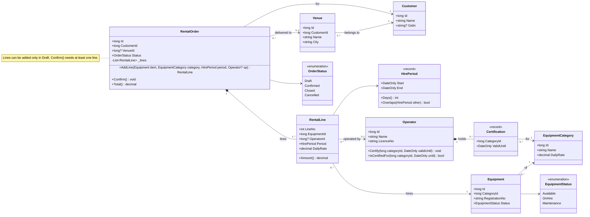
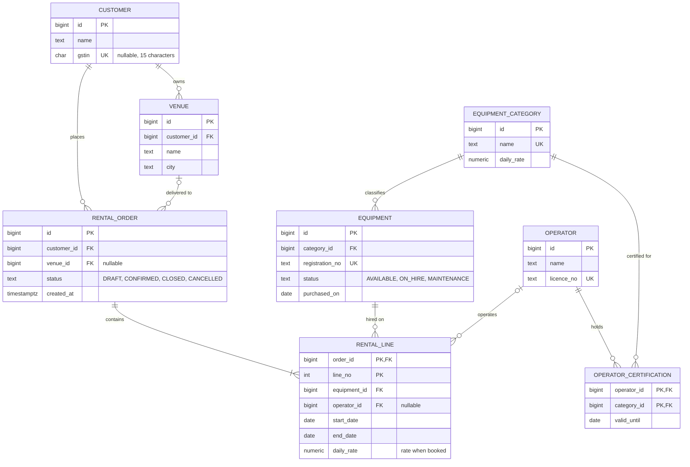
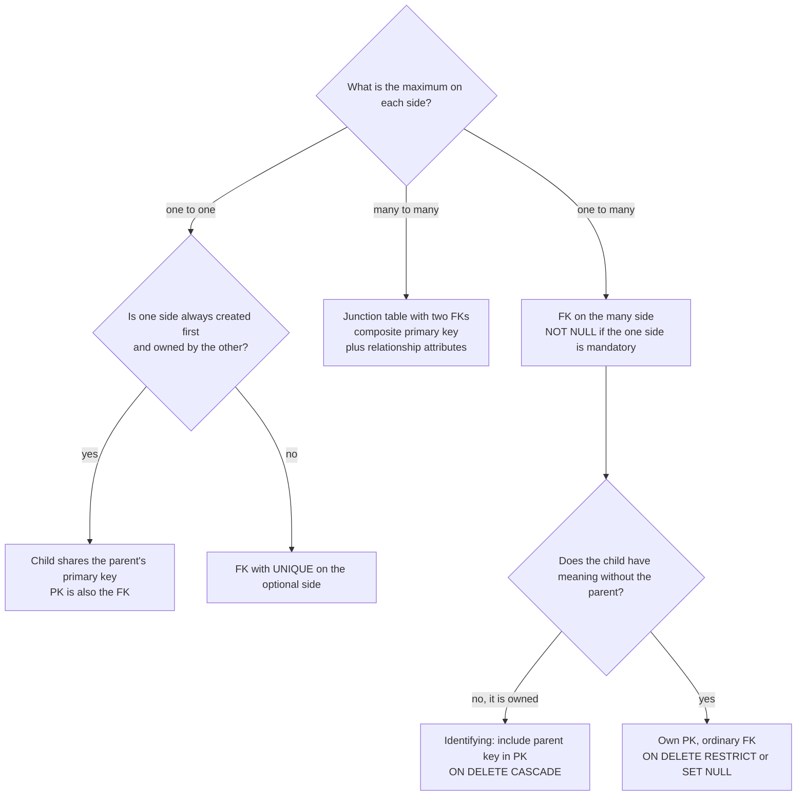
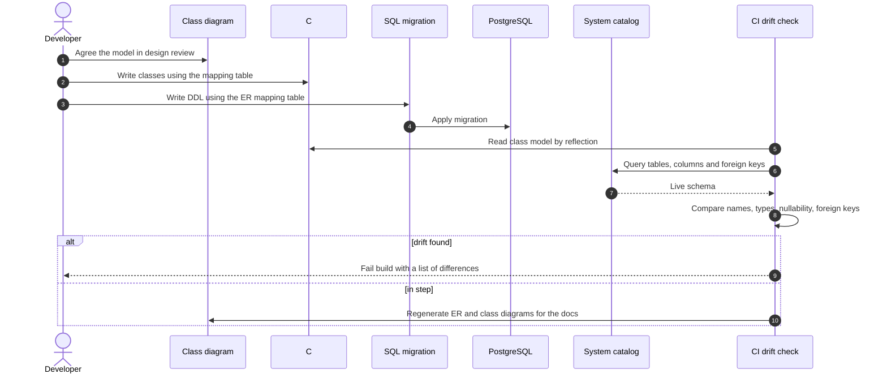
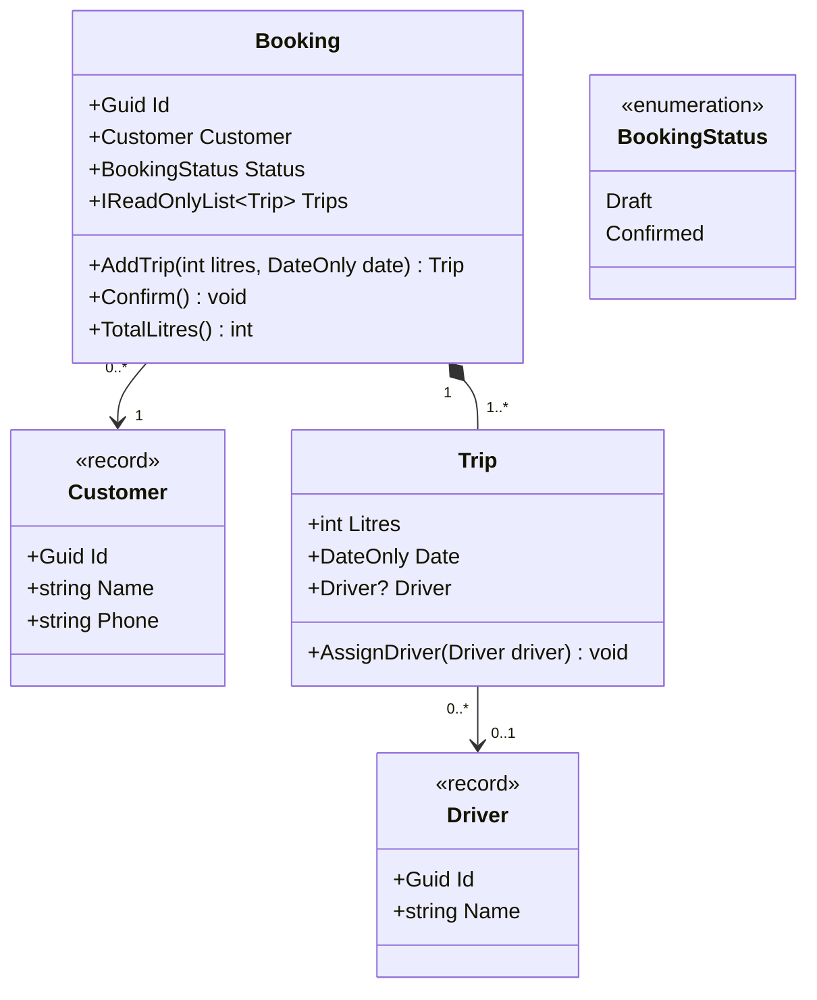

A diagram is only useful if the code and the database end up saying the same thing. In practice they drift: a filled diamond on the class diagram becomes a public setter that lets anyone swap the parts; a "zero or one" line on the ER diagram becomes a `NOT NULL` column; a many-to-many line becomes a comma-separated text field. This lesson gives you exact translation rules in both directions (diagram to code, code back to diagram) for class diagrams with C# and ER diagrams with PostgreSQL, and shows how to check the round trip automatically.

## Learning objectives

By the end of this lesson you will be able to:

1. Translate each class-diagram element (class, attribute, operation, visibility, multiplicity, association, aggregation, composition, dependency, inheritance, realization, enumeration) into specific C#.
2. Translate each ER-diagram element (entity, attribute, key, one-to-one, one-to-many, many-to-many, optionality, identifying relationship) into PostgreSQL DDL with the right constraints.
3. Recover a class diagram from C# and an ER diagram from a live PostgreSQL schema using the system catalog.
4. Name the object-relational mismatches (identity, inheritance, collections, navigation, value objects, enums) and choose a mapping for each.
5. Know which diagram promises a database constraint can't enforce, and where to enforce them instead.
6. Automate round-trip checks between diagram, code and schema.

## Prerequisites

- [Class diagrams](#/lesson/m05-class-diagrams): notation for relationships and multiplicity.
- [Entity-relationship diagrams](#/lesson/m05-er-diagrams): crow's foot notation.
- [Relational database fundamentals](#/lesson/m09-relational-fundamentals): tables, keys, constraints.
- Helpful: [association, aggregation and composition](#/lesson/m07-association-aggregation-composition).

## Explain it like I'm a beginner

### Recipe, dish and food label

A packet of ready-to-eat biryani is described three ways. The **recipe** in the company's kitchen lists ingredients and how they combine. The **dish** in the packet is the real thing. The **label** on the back lists ingredients, weight and allergens in a fixed format that regulators and shoppers read for years. All three describe the same food, in different languages, for different readers. If the recipe says cashews and the cook leaves them out, or the label forgets to mention nuts, someone eventually has a problem.

Software has the same three. The **class diagram** is the recipe for the code's structure. The **C# code** is the dish. The **database schema**, described by an **ER diagram**, is the label that has to survive for years, outlive several versions of the code, and be read by other systems. Mapping between them is translation, and translation has rules.

### Our example: GigGear

**GigGear** rents event equipment (LED video walls, line-array sound systems, diesel generators) to wedding planners and event companies across Telangana and Maharashtra.

- Each **equipment** item belongs to a **category**, which has a daily rate (for example, ₹18,000 a day for an LED video wall).
- **Customers** (event companies identified by GSTIN, or individuals without one) have one or more saved **venues**.
- A **rental order** is for one customer and is delivered to one of their venues, or collected from the warehouse.
- An order has one or more **rental lines**. Each line hires one equipment item for a **hire period** (start and end date) at the daily rate that applied when it was booked, and may include an **operator**.
- **Operators** hold **certifications** for categories, each with an expiry date. An operator can only be assigned to a line if certified for that category for the whole hire.

We will draw the class diagram, translate it to C#, draw the ER diagram, translate it to PostgreSQL, and then check that all three agree.

## First-principles explanation

### Two diagrams, two different questions

A class diagram and an ER diagram look similar (boxes and lines), but they answer different questions:

| | Class diagram | ER diagram |
|---|---|---|
| Describes | Objects in memory and their behaviour | Data at rest and its integrity rules |
| Boxes contain | Attributes **and operations** | Attributes (columns) and keys |
| Relationships | Navigable references, ownership (diamonds), inheritance | Foreign keys, cardinality, optionality |
| Lifetime | One request or one process | Years; survives code rewrites |
| Enforced by | Constructors, methods, encapsulation | Constraints: `PRIMARY KEY`, `FOREIGN KEY`, `UNIQUE`, `CHECK`, `NOT NULL` |

That's why one diagram can't simply be "converted" into the other. A class can have behaviour and private state the database never sees; a table can have audit columns and indexes the class never mentions. The mapping is a set of **decisions**, and good teams write those decisions down.

### Class diagram to C#: the translation table

| Diagram element | C# | Notes |
|---|---|---|
| Class | `class` or `sealed class` | Seal by default unless designed for inheritance |
| `<<record>>` or value object | `record` / `readonly record struct` | Equality by value |
| `<<interface>>` | `interface` | |
| `<<abstract>>` or italic name | `abstract class` | |
| `<<enumeration>>` | `enum` | |
| `+Name string` | `public string Name { get; }` | Prefer get-only or `private set` |
| `-_lines List~T~` | `private readonly List<T> _lines = new();` | |
| `#` protected, `~` package | `protected`, `internal` | |
| `$` static | `static` | |
| `+Confirm() void` | `public void Confirm()` | |
| Multiplicity `1` | Non-nullable reference, required in the constructor | Guard against `null` at the boundary |
| Multiplicity `0..1` | Nullable reference `T?` | Nullable reference types make this visible |
| Multiplicity `*` / `0..*` | `IReadOnlyList<T>` backed by a private `List<T>` | Expose read-only; change through methods |
| Multiplicity `1..*` | Collection plus a rule enforced in a method (`Confirm`, constructor) | Types alone can't say "at least one" |
| Association `A --> B` | A has a field or property of type B (or B's id) | Arrowhead = who holds the reference |
| Aggregation `A o-- B` | A holds references to Bs created elsewhere | Add and remove accept existing objects |
| Composition `A *-- B` | A creates and owns its Bs; B's constructor is `internal` or private | No setter that accepts an outside B |
| Dependency `A ..> B` | B appears only as a parameter, local or return type | No field |
| Inheritance `B --|> A` | `class B : A` | |
| Realization `B ..|> I` | `class B : I` | |

Two judgement calls come up in every real codebase.

**References or ids?** A diagram line `RentalOrder --> Customer` can become `public Customer Customer { get; }` or `public long CustomerId { get; }`. Inside one **aggregate** (a cluster of objects saved together, like an order and its lines), use object references. Across aggregates (order to customer), domain-driven design recommends **ids**, so loading an order doesn't load the customer graph and each aggregate can be saved independently. The [aggregates lesson](#/lesson/m08-aggregates) covers why. The diagram line stays the same; the code differs.

**Bidirectional navigation?** If the diagram has no arrowheads, someone will ask "does Customer have a list of Orders?". Two-way references double the work of keeping objects consistent. Default to **one direction** (the one the use cases need) and add the other only with a reason.

### ER diagram to SQL: the translation table

| ER element | PostgreSQL | Notes |
|---|---|---|
| Entity | `CREATE TABLE` | Singular snake_case names are a common convention |
| Attribute | Column with a type | `numeric(10,2)` for money, `date`, `timestamptz`, `text` |
| Primary key (PK) | `PRIMARY KEY` | `bigint GENERATED ALWAYS AS IDENTITY` or `uuid` |
| Natural or alternate key | `UNIQUE` | Registration number, GSTIN, licence number |
| One-to-many `A ||--o{ B` | FK column on **B** (the many side) | `b.a_id REFERENCES a (id)` |
| Mandatory many side (`||` at A's end) | `NOT NULL` on the FK | Each B must have an A |
| Optional (`|o` at A's end) | Nullable FK | B may exist without an A |
| One-to-one `A ||--o| B` | FK on B with `UNIQUE` | Or share the primary key |
| Many-to-many `A }o--o{ B` | Junction table with two FKs and a composite PK | Add attributes of the relationship as columns |
| Identifying relationship (solid line) | Child's PK includes the parent's key | `PRIMARY KEY (order_id, line_no)` |
| Non-identifying (dashed line) | Child has its own PK; FK is an ordinary column | |
| Derived attribute | Generated column, view or query | Don't store what you can compute, unless you must |
| Composition-like ownership | `ON DELETE CASCADE` on the child's FK | Lines die with their order |
| Reference to shared data | `ON DELETE RESTRICT` (default `NO ACTION`) or `SET NULL` | Don't delete a customer who has orders |

The most common translation error is putting the foreign key on the wrong side. A simple rule: **the foreign key goes on the side with the crow's foot** (the "many" side). A rental line refers to its order; the order doesn't store a list of line ids.

### What the database can't promise

Foreign keys and `NOT NULL` express **maximum** cardinality and **optionality of the child**. Some diagram promises are beyond them:

- **"At least one" on the many side** (`||--|{`: an order has one or more lines). A foreign key can't force a parent to have children. Enforce it in the domain (`Confirm()` throws with no lines), optionally backed by a deferred constraint trigger.
- **Rules across rows**: "an equipment item can't be on two overlapping hires". PostgreSQL can enforce this with an **exclusion constraint** on a date range (it needs the `btree_gist` extension); otherwise the application checks it under a lock.
- **Rules across tables**: "the delivery venue must belong to the order's customer". A composite foreign key can enforce it: make `(id, customer_id)` unique on `venue` and reference both columns from `rental_order`. It costs an extra column and index; many teams enforce it in code instead.
- **Rules about time**: "the operator's certification must be valid for the whole hire". That needs a query or a trigger, or (more simply) a check in the domain at booking time.

Write down where each rule is enforced. A rule enforced nowhere is a bug waiting for a busy Monday.

```sql
-- Not used in the exercises (needs an extension): no overlapping hires for one equipment item.
CREATE EXTENSION IF NOT EXISTS btree_gist;
ALTER TABLE rental_line
  ADD CONSTRAINT no_overlapping_hire
  EXCLUDE USING gist (equipment_id WITH =, daterange(start_date, end_date, '[]') WITH &&);
```

### The object-relational mismatch, named

Objects and tables differ in ways that no tool hides completely. This is often called the **object-relational impedance mismatch**. Naming each part helps you make a decision instead of discovering one:

| Mismatch | Objects | Tables | Usual mapping |
|---|---|---|---|
| Identity | Reference equality, or `Equals` | Primary key | Map the PK to an `Id` property; records for value objects |
| Collections | `List<RentalLine>` inside the order | Rows in another table pointing back | FK on the child; load lines with the order |
| Navigation | Can point both ways | FK points one way | Choose a direction; query for the other |
| Inheritance | `LedWall : Equipment` | No inheritance | Table per hierarchy, per type, or per concrete class |
| Value objects | `HirePeriod(Start, End)` | Columns | Flatten into columns (`start_date`, `end_date`) or a range type |
| Enums | `EquipmentStatus.OnHire` | Integer or text | `text` with `CHECK`, or a PostgreSQL `ENUM` type |
| Types | `decimal`, `DateOnly`, `DateTimeOffset` | `numeric`, `date`, `timestamptz` | Choose precise types; never `float` for money |
| Null | Nullable reference types | `NULL` / `NOT NULL` | Make them agree, and test that they do |

**Inheritance mapping** deserves a closer look, because the diagram gives no hint which option to pick. Suppose GigGear tracks LED-wall-specific data (panel count, pixel pitch) and generator-specific data (kVA rating, fuel tank size):

- **Table per hierarchy (TPH):** one `equipment` table with a `kind` discriminator column and nullable type-specific columns, plus `CHECK` constraints such as "if kind is led_wall, pixel_pitch_mm is not null". Fast (no joins), simple, but many nullable columns. EF Core's default.
- **Table per type (TPT):** a base `equipment` table plus `led_wall` and `generator` tables sharing the primary key. Clean, normalised, but every load needs a join.
- **Table per concrete class (TPC):** separate `led_wall` and `generator` tables each with all columns. No joins for one type, but queries across all equipment need `UNION ALL`, and ids must be unique across tables.

For a handful of subtypes with a few extra columns each, TPH is usually the simplest choice. If subtypes have many columns or different owners, TPT is cleaner. And often the best answer is **no inheritance at all**: a `category` with a JSON column or a small attribute table for specifications, if the behaviour doesn't differ by type.

### Going backwards: code and schema to diagrams

You'll often join a project where only the code and the database exist. Reverse the mappings:

- **C# to class diagram.** Fields and properties become attributes; properties whose type is another class become associations (collections give `*`, nullable gives `0..1`); `internal` constructors and factory methods hint at composition; `: Base` and `: IInterface` give inheritance and realization. IDEs and small reflection-based generators (see the [class diagrams lesson](#/lesson/m05-class-diagrams)) can produce Mermaid automatically. Ownership (aggregation versus composition) can't be read from types alone; you have to read the methods.
- **Schema to ER diagram.** Every table is an entity. Every foreign key is a relationship, with the crow's foot on the table that has the FK column. A nullable FK means the parent end is optional (`|o`); a `UNIQUE` FK makes it one-to-one; a table whose primary key is made of two foreign keys is a junction table, which becomes a many-to-many line (or an entity, if it has its own attributes). PostgreSQL's `information_schema` and `pg_catalog` expose all of this to a query, which you'll write in exercise 4. Tools such as EF Core scaffolding (`dotnet ef dbcontext scaffold`) reverse a schema into C# classes the same way.

Reverse engineering recovers **structure**, never **intent**. The schema can't tell you that `venue_id` is optional "because some customers collect from the warehouse". Write the intent back into the diagram as notes.

### Keeping three descriptions in step

Pick one **source of truth** for each concern:

- **Code-first:** the C# model is the truth; migrations are generated from it (EF Core migrations) and the diagrams are generated from code and schema. Fast for one team and one application.
- **Database-first:** the schema (hand-written migration scripts, reviewed by a DBA) is the truth; code maps to it. Common when several applications or reporting tools share the database, or in regulated environments.
- **Diagram-first:** the diagram is agreed in design review, then code and schema are written to match. Good for the first design of a new area; the diagram should then become generated documentation, not a parallel source.

Whichever you choose, add **round-trip checks**: generate the diagram from the truth in CI, or compare the class model with the schema and fail on drift. Exercise 5 builds one.

## Visual explanation

### The GigGear class diagram



Read the important lines aloud, then think about the code each one forces:

- `RentalOrder "1" *-- "1..*" RentalLine`: an order **owns** its lines (filled diamond). Lines are created by `AddLine`, can't move to another order, and disappear with it. "At least one" is a rule for `Confirm()`, as the note says.
- `RentalOrder "0..*" --> "1" Customer`: every order has exactly one customer, and the arrow says the order knows its customer, not the reverse. The attribute list shows `CustomerId`: across aggregates we hold the **id**, not the object.
- `RentalOrder --> "0..1" Venue`: optional, so `long? VenueId`.
- `Operator "1" *-- "0..*" Certification` plus `Certification --> EquipmentCategory`: this is how a class diagram shows a many-to-many relationship **with data** (the expiry date). The certification is a small value owned by the operator.
- `HirePeriod` is a `<<record>>`: a value object with no identity, compared by its dates, with the overlap logic inside it.

### The GigGear ER diagram



Now compare it with the class diagram, line by line:

- **Composition became an identifying relationship.** `RENTAL_LINE` has the primary key `(order_id, line_no)`: a line can't exist, or even be identified, without its order. In SQL that's a composite primary key plus `ON DELETE CASCADE`.
- **The value object became columns.** `HirePeriod` is two columns, `start_date` and `end_date`, with a `CHECK (end_date >= start_date)`. The record's invariant becomes a table constraint.
- **The many-to-many with data became a junction table.** `OPERATOR_CERTIFICATION` has a composite primary key made of two foreign keys, plus `valid_until`.
- **Optional associations became nullable foreign keys.** `venue_id` and `operator_id` are the only nullable FKs, matching the two `0..1` ends on the class diagram. The `|o` symbols at the `VENUE` and `OPERATOR` ends say the same thing.
- **Enums became text with a check.** `status` columns store readable values and reject anything else.
- **The rate is a snapshot.** `rental_line.daily_rate` copies the category rate at booking time, so changing the price list next month doesn't change old invoices. This is a deliberate **denormalisation**, and it appears on both diagrams.
- **`||--|{` (one or more lines) is a promise the database can't keep**, as discussed above. The domain's `Confirm()` keeps it.

### Which table gets the foreign key?



Start at the top with the maximum cardinality on each side, which decides the structure (column, unique column or junction table). Then the minimum cardinality decides `NULL` versus `NOT NULL`. Finally, ownership decides the delete rule and whether the parent's key is part of the child's identity. `rental_line` goes down the left path to "identifying, cascade"; `rental_order.venue_id` goes to "ordinary FK, nullable"; `operator_certification` takes the junction-table path.

### The round trip, step by step



The sequence shows who does what and in which order. Humans make the decisions (steps 1 to 3); the machine checks them (steps 5 to 8) and regenerates the documentation (step 10) so the diagrams people read are always current. The check reads the **live** schema from the catalog, not the migration files, because a hand-applied hotfix in production is exactly the drift you want to find.

## Step-by-step example

Let's translate one feature end to end: "book an LED wall with an operator on an order".

### Step 1 — read the relevant diagram lines

`RentalOrder *-- "1..*" RentalLine`, `RentalLine --> "1" Equipment`, `RentalLine --> "0..1" Operator`, `Operator *-- Certification --> EquipmentCategory`, `RentalLine --> HirePeriod`.

### Step 2 — decide references or ids

The line is inside the order aggregate, so the order holds `RentalLine` objects. Equipment and operators are separate aggregates (they are managed independently and appear on many orders), so the line stores `EquipmentId` and `OperatorId`.

### Step 3 — write the C# shape from the multiplicities

- `1` equipment: `long EquipmentId` (required, non-nullable).
- `0..1` operator: `long? OperatorId`.
- Composition: `RentalLine` has an `internal` constructor; only `RentalOrder.AddLine` creates lines.
- Value object: `HirePeriod` is a `record` that validates `End >= Start` in its constructor.

### Step 4 — put the rules where they belong

- "Operator must be certified for the category for the whole hire" needs the operator's certifications and the category, so `AddLine` takes both and checks `op.IsCertifiedFor(category.Id, period.End)`.
- "No overlapping hire of the same equipment on this order" is checked in `AddLine`; across orders it needs the database (exclusion constraint) or a query under a lock.
- "Rate is the category rate at booking" is copied into the line.

### Step 5 — write the DDL from the ER lines

`rental_line` gets `order_id NOT NULL REFERENCES rental_order (id) ON DELETE CASCADE`, `PRIMARY KEY (order_id, line_no)`, `equipment_id NOT NULL REFERENCES equipment (id)`, nullable `operator_id REFERENCES operator (id) ON DELETE SET NULL`, the two date columns with a `CHECK`, and indexes on the foreign keys that aren't the leading column of the primary key (PostgreSQL doesn't index foreign keys automatically, and you'll want these for joins and for deletes on the parent).

### Step 6 — write the mapping and check the round trip

A small mapper converts the order to rows and back. A test saves an order, reads it back and compares. A CI check compares `RentalLine`'s properties with `rental_line`'s columns. If someone later adds `DiscountPercent` to the class without a migration, the build tells them.

## Production-style C# implementation

Below is the GigGear model as code, following the class diagram exactly, plus the PostgreSQL schema that follows the ER diagram, and an explicit row mapper. Real projects would usually let EF Core do the mapping (a configuration snippet follows), but writing the mapper by hand once makes every mapping decision visible.

```text
GigGear.Api/
  Program.cs
  Domain/Catalog.cs           // Customer, Venue, EquipmentCategory, Equipment, EquipmentStatus
  Domain/Operators.cs         // Operator, Certification
  Domain/Rentals.cs           // RentalOrder, RentalLine, HirePeriod, OrderStatus
  Persistence/GigGearSchema.cs // DDL that matches the ER diagram
  Persistence/RentalRows.cs     // row records and the explicit mapper
```

```csharp file=Domain/Catalog.cs
namespace GigGear.Api.Domain;

public enum EquipmentStatus { Available, OnHire, Maintenance }

public sealed record Customer(long Id, string Name, string? Gstin)
{
    public string Name { get; } = string.IsNullOrWhiteSpace(Name)
        ? throw new ArgumentException("Customer name is required.", nameof(Name))
        : Name;

    public string? Gstin { get; } = Gstin is null || Gstin.Length == 15
        ? Gstin
        : throw new ArgumentException("A GSTIN has 15 characters.", nameof(Gstin));
}

public sealed record Venue(long Id, long CustomerId, string Name, string City);

public sealed record EquipmentCategory(long Id, string Name, decimal DailyRate)
{
    public decimal DailyRate { get; } = DailyRate > 0
        ? DailyRate
        : throw new ArgumentOutOfRangeException(nameof(DailyRate), "Daily rate must be positive.");
}

public sealed class Equipment(long id, long categoryId, string registrationNo)
{
    public long Id { get; } = id;
    public long CategoryId { get; } = categoryId;
    public string RegistrationNo { get; } = registrationNo;
    public EquipmentStatus Status { get; private set; } = EquipmentStatus.Available;

    public void SendForMaintenance() => Status = Status == EquipmentStatus.OnHire
        ? throw new InvalidOperationException("Equipment on hire can't go for maintenance.")
        : EquipmentStatus.Maintenance;
}
```

```csharp file=Domain/Operators.cs
namespace GigGear.Api.Domain;

/// <summary>Association class for the operator-category many-to-many, owned by the operator.</summary>
public sealed record Certification(long CategoryId, DateOnly ValidUntil);

public sealed class Operator(long id, string name, string licenceNo)
{
    private readonly List<Certification> _certifications = new();

    public long Id { get; } = id;
    public string Name { get; } = name;
    public string LicenceNo { get; } = licenceNo;
    public IReadOnlyList<Certification> Certifications => _certifications.AsReadOnly();

    /// <summary>Adds or renews a certification. One row per category, like the junction table's PK.</summary>
    public void Certify(long categoryId, DateOnly validUntil)
    {
        _certifications.RemoveAll(c => c.CategoryId == categoryId);
        _certifications.Add(new Certification(categoryId, validUntil));
    }

    public bool IsCertifiedFor(long categoryId, DateOnly until) =>
        _certifications.Any(c => c.CategoryId == categoryId && c.ValidUntil >= until);
}
```

```csharp file=Domain/Rentals.cs
namespace GigGear.Api.Domain;

public enum OrderStatus { Draft, Confirmed, Closed, Cancelled }

/// <summary>Value object: maps to start_date and end_date with CHECK (end_date >= start_date).</summary>
public sealed record HirePeriod
{
    public HirePeriod(DateOnly start, DateOnly end)
    {
        if (end < start) throw new ArgumentException("A hire can't end before it starts.", nameof(end));
        Start = start;
        End = end;
    }

    public DateOnly Start { get; }
    public DateOnly End { get; }

    /// <summary>Both dates are hire days, so 1 to 20 October is 20 days.</summary>
    public int Days() => End.DayNumber - Start.DayNumber + 1;

    public bool Overlaps(HirePeriod other) => Start <= other.End && other.Start <= End;
}

/// <summary>Part of the RentalOrder aggregate. Only RentalOrder creates lines (composition).</summary>
public sealed class RentalLine
{
    internal RentalLine(int lineNo, long equipmentId, long? operatorId, HirePeriod period, decimal dailyRate)
    {
        LineNo = lineNo;
        EquipmentId = equipmentId;
        OperatorId = operatorId;
        Period = period;
        DailyRate = dailyRate;
    }

    public int LineNo { get; }
    public long EquipmentId { get; }
    public long? OperatorId { get; }
    public HirePeriod Period { get; }
    public decimal DailyRate { get; }

    public decimal Amount() => Period.Days() * DailyRate;
}

public sealed class RentalOrder
{
    private readonly List<RentalLine> _lines = new();

    public RentalOrder(long id, Customer customer, Venue? venue)
    {
        ArgumentNullException.ThrowIfNull(customer);
        if (venue is not null && venue.CustomerId != customer.Id)
            throw new ArgumentException("The delivery venue must belong to the order's customer.", nameof(venue));
        Id = id;
        CustomerId = customer.Id;
        VenueId = venue?.Id;
    }

    private RentalOrder(long id, long customerId, long? venueId, OrderStatus status)
    {
        Id = id;
        CustomerId = customerId;
        VenueId = venueId;
        Status = status;
    }

    public long Id { get; }
    public long CustomerId { get; }
    public long? VenueId { get; }
    public OrderStatus Status { get; private set; } = OrderStatus.Draft;
    public IReadOnlyList<RentalLine> Lines => _lines.AsReadOnly();

    public RentalLine AddLine(Equipment item, EquipmentCategory category, HirePeriod period, Operator? op)
    {
        if (Status != OrderStatus.Draft) throw new InvalidOperationException("Lines can be added only to a draft order.");
        if (item.CategoryId != category.Id) throw new ArgumentException("Category doesn't match the equipment.", nameof(category));
        if (op is not null && !op.IsCertifiedFor(category.Id, period.End))
            throw new InvalidOperationException($"Operator {op.Name} isn't certified for {category.Name} until {period.End:yyyy-MM-dd}.");
        if (_lines.Any(l => l.EquipmentId == item.Id && l.Period.Overlaps(period)))
            throw new InvalidOperationException($"{item.RegistrationNo} is already on this order for an overlapping period.");

        var line = new RentalLine(_lines.Count + 1, item.Id, op?.Id, period, category.DailyRate);
        _lines.Add(line);
        return line;
    }

    public void Confirm()
    {
        if (Status != OrderStatus.Draft) throw new InvalidOperationException($"Order is already {Status}.");
        if (_lines.Count == 0) throw new InvalidOperationException("An order needs at least one line."); // the 1..* rule
        Status = OrderStatus.Confirmed;
    }

    public decimal Total() => _lines.Sum(l => l.Amount());

    /// <summary>Used only by the persistence mapper to rebuild an order from rows.</summary>
    internal static RentalOrder Rehydrate(long id, long customerId, long? venueId, OrderStatus status, IEnumerable<RentalLine> lines)
    {
        var order = new RentalOrder(id, customerId, venueId, status);
        order._lines.AddRange(lines.OrderBy(l => l.LineNo));
        return order;
    }
}
```

```csharp file=Persistence/GigGearSchema.cs
namespace GigGear.Api.Persistence;

/// <summary>The ER diagram as DDL. In a real project this is migration V001, applied by a migration tool.</summary>
public static class GigGearSchema
{
    public const string Ddl = """
        CREATE TABLE customer (
          id    bigint GENERATED ALWAYS AS IDENTITY PRIMARY KEY,
          name  text NOT NULL,
          gstin char(15) UNIQUE
        );
        CREATE TABLE venue (
          id          bigint GENERATED ALWAYS AS IDENTITY PRIMARY KEY,
          customer_id bigint NOT NULL REFERENCES customer (id),
          name        text NOT NULL,
          city        text NOT NULL
        );
        CREATE INDEX ix_venue_customer_id ON venue (customer_id);
        CREATE TABLE equipment_category (
          id         bigint GENERATED ALWAYS AS IDENTITY PRIMARY KEY,
          name       text NOT NULL UNIQUE,
          daily_rate numeric(10,2) NOT NULL CHECK (daily_rate > 0)
        );
        CREATE TABLE equipment (
          id              bigint GENERATED ALWAYS AS IDENTITY PRIMARY KEY,
          category_id     bigint NOT NULL REFERENCES equipment_category (id),
          registration_no text NOT NULL UNIQUE,
          status          text NOT NULL DEFAULT 'AVAILABLE'
                          CHECK (status IN ('AVAILABLE', 'ON_HIRE', 'MAINTENANCE')),
          purchased_on    date NOT NULL
        );
        CREATE INDEX ix_equipment_category_id ON equipment (category_id);
        CREATE TABLE operator (
          id         bigint GENERATED ALWAYS AS IDENTITY PRIMARY KEY,
          name       text NOT NULL,
          licence_no text NOT NULL UNIQUE
        );
        CREATE TABLE operator_certification (
          operator_id bigint NOT NULL REFERENCES operator (id) ON DELETE CASCADE,
          category_id bigint NOT NULL REFERENCES equipment_category (id),
          valid_until date   NOT NULL,
          PRIMARY KEY (operator_id, category_id)
        );
        CREATE INDEX ix_operator_certification_category_id ON operator_certification (category_id);
        CREATE TABLE rental_order (
          id          bigint GENERATED ALWAYS AS IDENTITY PRIMARY KEY,
          customer_id bigint NOT NULL REFERENCES customer (id),
          venue_id    bigint REFERENCES venue (id),
          status      text NOT NULL DEFAULT 'DRAFT'
                      CHECK (status IN ('DRAFT', 'CONFIRMED', 'CLOSED', 'CANCELLED')),
          created_at  timestamptz NOT NULL DEFAULT now()
        );
        CREATE INDEX ix_rental_order_customer_id ON rental_order (customer_id);
        CREATE INDEX ix_rental_order_venue_id ON rental_order (venue_id);
        CREATE TABLE rental_line (
          order_id     bigint NOT NULL REFERENCES rental_order (id) ON DELETE CASCADE,
          line_no      int    NOT NULL CHECK (line_no > 0),
          equipment_id bigint NOT NULL REFERENCES equipment (id),
          operator_id  bigint REFERENCES operator (id) ON DELETE SET NULL,
          start_date   date   NOT NULL,
          end_date     date   NOT NULL,
          daily_rate   numeric(10,2) NOT NULL CHECK (daily_rate > 0),
          PRIMARY KEY (order_id, line_no),
          CHECK (end_date >= start_date)
        );
        CREATE INDEX ix_rental_line_equipment_id ON rental_line (equipment_id);
        CREATE INDEX ix_rental_line_operator_id ON rental_line (operator_id);
        """;
}
```

```csharp file=Persistence/RentalRows.cs
using GigGear.Api.Domain;

namespace GigGear.Api.Persistence;

/// <summary>One record per table: the shape the database sees.</summary>
public sealed record RentalOrderRow(long Id, long CustomerId, long? VenueId, string Status);

public sealed record RentalLineRow(
    long OrderId, int LineNo, long EquipmentId, long? OperatorId,
    DateOnly StartDate, DateOnly EndDate, decimal DailyRate);

/// <summary>Every mapping decision in one place: aggregate to rows, and rows back to the aggregate.</summary>
public static class RentalOrderMapper
{
    public static (RentalOrderRow Order, IReadOnlyList<RentalLineRow> Lines) ToRows(RentalOrder order)
    {
        var orderRow = new RentalOrderRow(order.Id, order.CustomerId, order.VenueId, ToDb(order.Status));
        var lineRows = order.Lines
            .Select(l => new RentalLineRow(order.Id, l.LineNo, l.EquipmentId, l.OperatorId,
                l.Period.Start, l.Period.End, l.DailyRate))   // value object flattened into two columns
            .ToList();
        return (orderRow, lineRows);
    }

    public static RentalOrder FromRows(RentalOrderRow order, IEnumerable<RentalLineRow> lines)
    {
        var domainLines = lines
            .Where(r => r.OrderId == order.Id)
            .Select(r => new RentalLine(r.LineNo, r.EquipmentId, r.OperatorId,
                new HirePeriod(r.StartDate, r.EndDate), r.DailyRate));
        return RentalOrder.Rehydrate(order.Id, order.CustomerId, order.VenueId, FromDb(order.Status), domainLines);
    }

    // Enums are stored as readable text that matches the CHECK constraint.
    public static string ToDb(OrderStatus s) => s switch
    {
        OrderStatus.Draft => "DRAFT",
        OrderStatus.Confirmed => "CONFIRMED",
        OrderStatus.Closed => "CLOSED",
        OrderStatus.Cancelled => "CANCELLED",
        _ => throw new ArgumentOutOfRangeException(nameof(s)),
    };

    public static OrderStatus FromDb(string s) => s switch
    {
        "DRAFT" => OrderStatus.Draft,
        "CONFIRMED" => OrderStatus.Confirmed,
        "CLOSED" => OrderStatus.Closed,
        "CANCELLED" => OrderStatus.Cancelled,
        _ => throw new InvalidOperationException($"Unknown order status '{s}' in the database."),
    };
}
```

```csharp file=Program.cs
using System.Collections.Concurrent;
using GigGear.Api.Domain;
using GigGear.Api.Persistence;

var builder = WebApplication.CreateBuilder(args);
var app = builder.Build();

// Reference data, as it would be loaded from the tables.
var customer = new Customer(1, "Deccan Wedding Co.", "36AABCD1234E1Z5");
var venue = new Venue(1, 1, "Lakeview Convention Centre", "Hyderabad");
var ledWalls = new EquipmentCategory(1, "LED wall", 18_000m);
var led0142 = new Equipment(1, 1, "HYD-LED-0142");
var ravi = new Operator(1, "Ravi Kumar", "OPR-0192");
ravi.Certify(1, new DateOnly(2027, 3, 31));

// "Tables" held in memory, so the round trip through rows is visible without a database driver.
var orderRows = new ConcurrentDictionary<long, RentalOrderRow>();
var lineRows = new ConcurrentDictionary<(long, int), RentalLineRow>();
long nextOrderId = 0;

app.MapGet("/schema", () => Results.Text(GigGearSchema.Ddl, "text/plain"));

app.MapPost("/orders/demo", () =>
{
    var order = new RentalOrder(Interlocked.Increment(ref nextOrderId), customer, venue);
    order.AddLine(led0142, ledWalls, new HirePeriod(new DateOnly(2026, 10, 1), new DateOnly(2026, 10, 20)), ravi);
    order.Confirm();

    var (row, lines) = RentalOrderMapper.ToRows(order);
    orderRows[row.Id] = row;
    foreach (var l in lines) lineRows[(l.OrderId, l.LineNo)] = l;
    return Results.Created($"/orders/{row.Id}", new { row.Id, total = order.Total() });
});

app.MapGet("/orders/{id:long}", (long id) =>
{
    if (!orderRows.TryGetValue(id, out var row)) return Results.NotFound();
    var order = RentalOrderMapper.FromRows(row, lineRows.Values);
    return Results.Ok(new
    {
        order.Id,
        Status = order.Status.ToString(),
        order.CustomerId,
        order.VenueId,
        Lines = order.Lines.Select(l => new { l.LineNo, l.EquipmentId, l.OperatorId, l.Period.Start, l.Period.End, Amount = l.Amount() }),
        Total = order.Total(),
    });
});

app.Run();
```

Check each mapping decision in the code:

- **Composition** → `RentalLine`'s constructor is `internal`, `Lines` is read-only, `AddLine` is the only way in, and the table has `ON DELETE CASCADE` plus a composite PK.
- **`1..*`** → `Confirm()` throws with no lines. The database can't express it, so the domain does.
- **`0..1`** → `long? VenueId` and `long? OperatorId` in C#, nullable columns in SQL.
- **Across-aggregate associations** → ids (`CustomerId`, `EquipmentId`), with foreign keys in SQL.
- **Value object** → `HirePeriod` validates itself and is flattened by the mapper into `start_date` and `end_date`; the table's `CHECK` repeats the rule, so data written by another tool can't break it.
- **Enum** → text values matching the `CHECK`, converted in exactly one place. An unknown value from the database fails loudly instead of becoming `default`.
- **The venue belongs to the customer** → checked in the constructor. The schema doesn't enforce it (no composite FK), and that's a written-down decision.

With EF Core the same decisions become configuration. This snippet isn't compiled here (EF Core isn't available to the checker), but it shows where each decision lives:

```csharp
// Inside OnModelCreating, for comparison only.
modelBuilder.Entity<RentalOrder>(b =>
{
    b.ToTable("rental_order");
    b.Property(o => o.Status).HasConversion<string>().HasColumnName("status"); // plus a value converter for upper case
    b.OwnsMany(o => o.Lines, lines =>
    {
        lines.ToTable("rental_line");
        lines.WithOwner().HasForeignKey("OrderId");
        lines.HasKey("OrderId", nameof(RentalLine.LineNo));                 // identifying relationship
        lines.OwnsOne(l => l.Period, p =>
        {
            p.Property(x => x.Start).HasColumnName("start_date");           // value object flattened
            p.Property(x => x.End).HasColumnName("end_date");
        });
        lines.Property(l => l.DailyRate).HasPrecision(10, 2);
    });
    b.Navigation(o => o.Lines).UsePropertyAccessMode(PropertyAccessMode.Field); // fill the private _lines list
});
```

## Bad design vs good design

Here is a "quick" translation of the same diagrams that compiles and runs, and breaks most of the promises:

```csharp
// Bad: every diagram promise is lost in translation.
public class RentalOrder
{
    public int Id { get; set; }
    public Customer Customer { get; set; } = null!;     // full object graph across aggregates
    public Venue Venue { get; set; } = null!;             // 0..1 became "never null" (and lies)
    public string Status { get; set; } = "draft";       // any string, any case
    public List<RentalLine> Lines { get; set; } = new(); // anyone can add, remove or replace lines
}
public class RentalLine
{
    public int Id { get; set; }
    public int EquipmentId { get; set; }
    public string OperatorIds { get; set; } = "";       // "3,7" instead of a relationship
    public DateTime Start { get; set; }                 // time zone confusion for a date
    public DateTime End { get; set; }                   // no rule that End >= Start
    public double Rate { get; set; }                    // floating point money
}
```

```sql
-- Bad: the matching schema.
CREATE TABLE rental_line (
  id          serial PRIMARY KEY,
  order_id    int,                 -- nullable, no FK, no cascade
  equipment_id int,
  operator_ids text,               -- a list hidden in a string
  start_ts    timestamp,
  end_ts      timestamp,
  rate        double precision
);
```

| Diagram promise | Bad translation | Good translation |
|---|---|---|
| Composition, `1..*` | Public `List<T>` with a setter | Private list, `internal` constructor, `AddLine`, `Confirm()` check |
| `0..1` venue | Non-nullable `Venue` with `null!` | `long? VenueId` and a nullable FK |
| `0..1` operator | `"3,7"` in a text column | `long? OperatorId`, FK to `operator` |
| Enum | Free text | `enum` plus text with `CHECK` |
| Value object with a rule | Two loose `DateTime`s | `HirePeriod` record plus a table `CHECK` |
| Money | `double` | `decimal` and `numeric(10,2)` |
| Identifying relationship | Separate `id`, nullable `order_id` | `PRIMARY KEY (order_id, line_no)`, `ON DELETE CASCADE` |

:::callout type=mistake title="Comma-separated ids"
Storing `"3,7"` in a column looks like a shortcut for a many-to-many relationship. It removes referential integrity (operator 7 can be deleted), makes "which orders does operator 7 work on?" a string search, and can't be indexed properly. A junction table is always the right translation of a many-to-many line.
:::

:::callout type=tradeoff title="Readable text or integers for enums?"
Text with a `CHECK` is readable in queries and reports and safe against reordering the C# enum. Integers are smaller and faster to compare, but `status = 2` means nothing to a report writer and silently changes meaning if someone inserts a new enum member in the middle. PostgreSQL `ENUM` types are compact and readable but need a migration to add values. For most business systems, text with a `CHECK` is the pragmatic default.
:::

## Practical playground

The SQL playground below is seeded with GigGear's schema and some data. Try these, and connect each query back to a line on the ER diagram:

1. Total value of each order (days × daily rate per line). Order 1 should be ₹4,07,500.
2. Which equipment is on hire on 15 October 2026, and on which venue?
3. Delete order 3 and confirm its lines disappear (the cascade from the identifying relationship).
4. Try to delete operator 4, who is on a line. What happens, and why (`ON DELETE SET NULL` on `rental_line`, `CASCADE` on certifications)?
5. Try to insert a line whose end date is before its start date.
6. Query `information_schema.table_constraints` to list every constraint on `rental_line`.

You can also open the GigGear class diagram in the **LLD playground**, which can generate a class model and compare it with a reference, and use the **HLD playground** for the container-level views from the [C4 views lesson](#/lesson/m05-c4-views).

:::playground type=sql title="GigGear schema and data"
```sql
CREATE TABLE customer (
  id    bigint GENERATED ALWAYS AS IDENTITY PRIMARY KEY,
  name  text NOT NULL,
  gstin char(15) UNIQUE
);
CREATE TABLE venue (
  id          bigint GENERATED ALWAYS AS IDENTITY PRIMARY KEY,
  customer_id bigint NOT NULL REFERENCES customer (id),
  name        text NOT NULL,
  city        text NOT NULL
);
CREATE TABLE equipment_category (
  id         bigint GENERATED ALWAYS AS IDENTITY PRIMARY KEY,
  name       text NOT NULL UNIQUE,
  daily_rate numeric(10,2) NOT NULL CHECK (daily_rate > 0)
);
CREATE TABLE equipment (
  id              bigint GENERATED ALWAYS AS IDENTITY PRIMARY KEY,
  category_id     bigint NOT NULL REFERENCES equipment_category (id),
  registration_no text NOT NULL UNIQUE,
  status          text NOT NULL DEFAULT 'AVAILABLE'
                  CHECK (status IN ('AVAILABLE', 'ON_HIRE', 'MAINTENANCE')),
  purchased_on    date NOT NULL
);
CREATE TABLE operator (
  id         bigint GENERATED ALWAYS AS IDENTITY PRIMARY KEY,
  name       text NOT NULL,
  licence_no text NOT NULL UNIQUE
);
CREATE TABLE operator_certification (
  operator_id bigint NOT NULL REFERENCES operator (id) ON DELETE CASCADE,
  category_id bigint NOT NULL REFERENCES equipment_category (id),
  valid_until date   NOT NULL,
  PRIMARY KEY (operator_id, category_id)
);
CREATE TABLE rental_order (
  id          bigint GENERATED ALWAYS AS IDENTITY PRIMARY KEY,
  customer_id bigint NOT NULL REFERENCES customer (id),
  venue_id    bigint REFERENCES venue (id),
  status      text NOT NULL DEFAULT 'DRAFT'
              CHECK (status IN ('DRAFT', 'CONFIRMED', 'CLOSED', 'CANCELLED')),
  created_at  timestamptz NOT NULL DEFAULT now()
);
CREATE TABLE rental_line (
  order_id     bigint NOT NULL REFERENCES rental_order (id) ON DELETE CASCADE,
  line_no      int    NOT NULL CHECK (line_no > 0),
  equipment_id bigint NOT NULL REFERENCES equipment (id),
  operator_id  bigint REFERENCES operator (id) ON DELETE SET NULL,
  start_date   date   NOT NULL,
  end_date     date   NOT NULL,
  daily_rate   numeric(10,2) NOT NULL CHECK (daily_rate > 0),
  PRIMARY KEY (order_id, line_no),
  CHECK (end_date >= start_date)
);
INSERT INTO customer (name, gstin) VALUES
  ('Deccan Wedding Co.', '36AABCD1234E1Z5'),
  ('Konkan Live Events', '27AAACK5678F1Z2'),
  ('Shree Ganesh Caterers', NULL);
INSERT INTO venue (customer_id, name, city) VALUES
  (1, 'Lakeview Convention Centre', 'Hyderabad'),
  (1, 'Shamshabad Farmhouse Lawns', 'Hyderabad'),
  (2, 'Vashi Exhibition Grounds', 'Navi Mumbai');
INSERT INTO equipment_category (name, daily_rate) VALUES
  ('LED wall', 18000), ('Line-array sound system', 42000), ('Diesel generator', 9500);
INSERT INTO equipment (category_id, registration_no, status, purchased_on) VALUES
  (1, 'HYD-LED-0142', 'ON_HIRE', '2022-04-11'),
  (1, 'HYD-LED-0187', 'AVAILABLE', '2023-08-02'),
  (2, 'MUM-SND-0031', 'ON_HIRE', '2021-01-20'),
  (3, 'HYD-GEN-0410', 'MAINTENANCE', '2020-11-05'),
  (3, 'HYD-GEN-0415', 'AVAILABLE', '2024-02-14');
INSERT INTO operator (name, licence_no) VALUES
  ('Ravi Kumar', 'OPR-0192'), ('Anjali Patil', 'OPR-2231'), ('Mohammed Irfan', 'OPR-0457'),
  ('Suresh Naidu', 'OPR-3310'), ('Deepa Rao', 'OPR-1188');
INSERT INTO operator_certification VALUES
  (1, 1, '2027-03-31'), (1, 2, '2026-10-31'), (2, 1, '2026-11-01'), (3, 1, '2026-10-15'),
  (3, 3, '2027-01-31'), (4, 2, '2027-06-30'), (5, 3, '2026-12-31');
INSERT INTO rental_order (customer_id, venue_id, status) VALUES
  (1, 1, 'CONFIRMED'), (2, 3, 'CONFIRMED'), (3, NULL, 'DRAFT');
INSERT INTO rental_line VALUES
  (1, 1, 1, 1, '2026-10-01', '2026-10-20', 18000),
  (1, 2, 5, NULL, '2026-10-05', '2026-10-09', 9500),
  (2, 1, 3, 4, '2026-10-10', '2026-11-10', 42000),
  (3, 1, 2, NULL, '2026-11-02', '2026-11-04', 18000);
```
:::

## Exercises

:::exercise id=m05-diagrams-to-code-ex1 difficulty=beginner kind=code title="Translate a water-tanker booking diagram into C#"
A municipal water board books tanker deliveries to housing societies. Implement this class diagram in C#, keeping every promise it makes.


::requirements
- `Customer(Guid Id, string Name, string Phone)` and `Driver(Guid Id, string Name)` are records.
- `Booking(Guid id, Customer customer)` throws `ArgumentNullException` for a null customer. New bookings are `Draft`.
- `AddTrip(int litres, DateOnly date)` creates and returns a `Trip`. Litres must be between 1 and 12,000 inclusive (one tanker's capacity), otherwise `ArgumentOutOfRangeException`. Adding to a confirmed booking throws `InvalidOperationException`.
- `Trips` is read-only to callers: it must not be castable to a modifiable collection.
- `Trip` has **no public constructor** (composition: only `Booking` creates trips).
- `Confirm()` throws `InvalidOperationException` with no trips (the `1..*` rule) or if already confirmed.
- `TotalLitres()` sums the trips.
- `Trip.Driver` starts as `null`; `AssignDriver` sets it and throws `ArgumentNullException` for `null`.
::acceptance
- All multiplicities are visible in the types: `Customer` non-null, `Driver?` nullable, a read-only collection of trips.
- Composition is enforced: `Trip` has no public constructor, and `Trips` can't be modified from outside.
- The `1..*` rule is enforced by `Confirm()`.
- All tests pass.
::hint
Start with the multiplicities: `1` → required constructor parameter, `0..1` → nullable property, `1..*` → a collection plus a rule.
::hint
Composition means the whole creates the part. Make `Trip`'s constructor `internal`.
::hint
Expose `_trips.AsReadOnly()`, not the list itself. A `ReadOnlyCollection<T>` reports `IsReadOnly == true`.
::hint
```csharp
public Trip AddTrip(int litres, DateOnly date)
{
    if (Status != BookingStatus.Draft) throw new InvalidOperationException("...");
    if (litres is < 1 or > 12_000) throw new ArgumentOutOfRangeException(nameof(litres));
    var trip = new Trip(litres, date);
    _trips.Add(trip);
    return trip;
}
```
::starter
```csharp file=Tankers.cs
using System;
using System.Collections.Generic;

public sealed record Customer(Guid Id, string Name, string Phone);

public sealed record Driver(Guid Id, string Name);

public enum BookingStatus { Draft, Confirmed }

public sealed class Trip
{
    internal Trip(int litres, DateOnly date) => throw new NotImplementedException();

    public int Litres => throw new NotImplementedException();
    public DateOnly Date => throw new NotImplementedException();
    public Driver? Driver => throw new NotImplementedException();

    public void AssignDriver(Driver driver) => throw new NotImplementedException();
}

public sealed class Booking
{
    public Booking(Guid id, Customer customer) => throw new NotImplementedException();

    public Guid Id => throw new NotImplementedException();
    public Customer Customer => throw new NotImplementedException();
    public BookingStatus Status => throw new NotImplementedException();
    public IReadOnlyList<Trip> Trips => throw new NotImplementedException();

    public Trip AddTrip(int litres, DateOnly date) => throw new NotImplementedException();
    public void Confirm() => throw new NotImplementedException();
    public int TotalLitres() => throw new NotImplementedException();
}
```
::tests
```csharp file=TankerTests.cs
using System;
using System.Collections.Generic;
using Xunit;

public class TankerTests
{
    private static readonly Customer Society = new(Guid.NewGuid(), "Green Meadows CHS, Kondapur", "+91-90000-11111");
    private static readonly DateOnly Day = new(2026, 11, 3);

    [Fact]
    public void New_booking_is_draft_with_customer()
    {
        var b = new Booking(Guid.NewGuid(), Society);
        Assert.Equal(BookingStatus.Draft, b.Status);
        Assert.Same(Society, b.Customer);
        Assert.Empty(b.Trips);
    }

    [Fact]
    public void Customer_is_required() =>
        Assert.Throws<ArgumentNullException>(() => new Booking(Guid.NewGuid(), null!));

    [Fact]
    public void Trips_are_created_by_the_booking_and_summed()
    {
        var b = new Booking(Guid.NewGuid(), Society);
        var t1 = b.AddTrip(10_000, Day);
        b.AddTrip(6_000, Day.AddDays(1));
        Assert.Equal(10_000, t1.Litres);
        Assert.Equal(Day, t1.Date);
        Assert.Equal(2, b.Trips.Count);
        Assert.Equal(16_000, b.TotalLitres());
    }

    [Theory]
    [InlineData(0)]
    [InlineData(12_001)]
    [InlineData(-5)]
    public void Litres_must_fit_one_tanker(int litres) =>
        Assert.Throws<ArgumentOutOfRangeException>(() => new Booking(Guid.NewGuid(), Society).AddTrip(litres, Day));

    [Fact]
    public void Boundary_capacities_are_allowed()
    {
        var b = new Booking(Guid.NewGuid(), Society);
        b.AddTrip(1, Day);
        b.AddTrip(12_000, Day);
        Assert.Equal(12_001, b.TotalLitres());
    }

    [Fact]
    public void Confirm_needs_at_least_one_trip()
    {
        var b = new Booking(Guid.NewGuid(), Society);
        Assert.Throws<InvalidOperationException>(() => b.Confirm());
        b.AddTrip(8_000, Day);
        b.Confirm();
        Assert.Equal(BookingStatus.Confirmed, b.Status);
        Assert.Throws<InvalidOperationException>(() => b.Confirm());
        Assert.Throws<InvalidOperationException>(() => b.AddTrip(2_000, Day));
    }

    [Fact]
    public void Trips_cannot_be_modified_from_outside()
    {
        var b = new Booking(Guid.NewGuid(), Society);
        b.AddTrip(5_000, Day);
        Assert.False(b.Trips is List<Trip>);
        Assert.True(b.Trips is ICollection<Trip> c && c.IsReadOnly);
    }

    [Fact]
    public void Trip_has_no_public_constructor() => Assert.Empty(typeof(Trip).GetConstructors());

    [Fact]
    public void Driver_is_optional_until_assigned()
    {
        var trip = new Booking(Guid.NewGuid(), Society).AddTrip(9_000, Day);
        Assert.Null(trip.Driver);
        var d = new Driver(Guid.NewGuid(), "Venkatesh");
        trip.AssignDriver(d);
        Assert.Same(d, trip.Driver);
        Assert.Throws<ArgumentNullException>(() => trip.AssignDriver(null!));
    }
}
```
::solution
Each diagram element maps to one decision: required constructor parameter (`1`), nullable property (`0..1`), private list exposed read-only plus a `Confirm` rule (`1..*` composition), `internal` constructor (composition).

```csharp file=Tankers.cs
using System;
using System.Collections.Generic;
using System.Linq;

public sealed record Customer(Guid Id, string Name, string Phone);

public sealed record Driver(Guid Id, string Name);

public enum BookingStatus { Draft, Confirmed }

public sealed class Trip
{
    internal Trip(int litres, DateOnly date)
    {
        Litres = litres;
        Date = date;
    }

    public int Litres { get; }
    public DateOnly Date { get; }
    public Driver? Driver { get; private set; }

    public void AssignDriver(Driver driver)
    {
        ArgumentNullException.ThrowIfNull(driver);
        Driver = driver;
    }
}

public sealed class Booking
{
    public const int TankerCapacityLitres = 12_000;
    private readonly List<Trip> _trips = new();

    public Booking(Guid id, Customer customer)
    {
        ArgumentNullException.ThrowIfNull(customer);
        Id = id;
        Customer = customer;
    }

    public Guid Id { get; }
    public Customer Customer { get; }
    public BookingStatus Status { get; private set; } = BookingStatus.Draft;
    public IReadOnlyList<Trip> Trips => _trips.AsReadOnly();

    public Trip AddTrip(int litres, DateOnly date)
    {
        if (Status != BookingStatus.Draft) throw new InvalidOperationException("Trips can be added only to a draft booking.");
        if (litres is < 1 or > TankerCapacityLitres)
            throw new ArgumentOutOfRangeException(nameof(litres), $"A trip carries 1 to {TankerCapacityLitres} litres.");
        var trip = new Trip(litres, date);
        _trips.Add(trip);
        return trip;
    }

    public void Confirm()
    {
        if (Status != BookingStatus.Draft) throw new InvalidOperationException("Booking is already confirmed.");
        if (_trips.Count == 0) throw new InvalidOperationException("A booking needs at least one trip.");
        Status = BookingStatus.Confirmed;
    }

    public int TotalLitres() => _trips.Sum(t => t.Litres);
}
```
::alternatives
- If bookings and customers were separate aggregates saved independently, `Booking` would hold `Guid CustomerId` instead of `Customer`; the diagram line is the same, the code differs.
- An `ImmutableList<Trip>` replaced on each add also protects the collection, at the cost of an allocation per change.
::mistakes
- `public List<Trip> Trips { get; set; }`: callers can add, remove or replace trips, breaking composition and the capacity rule.
- Returning `_trips` typed as `IReadOnlyList<Trip>`: a caller can cast it back to `List<Trip>`.
- A public `Trip` constructor, so trips can be created outside a booking.
- Making `Driver` non-nullable with `null!`, which hides the `0..1`.
:::

:::exercise id=m05-diagrams-to-code-ex2 difficulty=beginner kind=sql ordered=true title="Walk a many-to-many line: certified operators"
The ER diagram has `OPERATOR ||--o{ OPERATOR_CERTIFICATION }o--|| EQUIPMENT_CATEGORY`: the junction table that implements "operators are certified for categories".

A customer wants an LED wall with an operator from **1 November 2026**. List the operators whose **LED wall** certification is valid on that date (`valid_until` on or after 1 November 2026). Return `name`, `licence_no` and `valid_until`, ordered by name.
::setup
```sql
CREATE TABLE equipment_category (
  id         bigint GENERATED ALWAYS AS IDENTITY PRIMARY KEY,
  name       text NOT NULL UNIQUE,
  daily_rate numeric(10,2) NOT NULL CHECK (daily_rate > 0)
);
CREATE TABLE operator (
  id         bigint GENERATED ALWAYS AS IDENTITY PRIMARY KEY,
  name       text NOT NULL,
  licence_no text NOT NULL UNIQUE
);
CREATE TABLE operator_certification (
  operator_id bigint NOT NULL REFERENCES operator (id) ON DELETE CASCADE,
  category_id bigint NOT NULL REFERENCES equipment_category (id),
  valid_until date   NOT NULL,
  PRIMARY KEY (operator_id, category_id)
);
INSERT INTO equipment_category (name, daily_rate) VALUES
  ('LED wall', 18000), ('Line-array sound system', 42000), ('Diesel generator', 9500);
INSERT INTO operator (name, licence_no) VALUES
  ('Ravi Kumar', 'OPR-0192'), ('Anjali Patil', 'OPR-2231'), ('Mohammed Irfan', 'OPR-0457'),
  ('Suresh Naidu', 'OPR-3310'), ('Deepa Rao', 'OPR-1188');
INSERT INTO operator_certification VALUES
  (1, 1, '2027-03-31'), (1, 2, '2026-10-31'), (2, 1, '2026-11-01'), (3, 1, '2026-10-15'),
  (3, 3, '2027-01-31'), (4, 2, '2027-06-30'), (5, 3, '2026-12-31');
```
::check
```sql
SELECT o.name, o.licence_no, oc.valid_until
FROM operator o
JOIN operator_certification oc ON oc.operator_id = o.id
JOIN equipment_category c ON c.id = oc.category_id
WHERE c.name = 'LED wall'
  AND oc.valid_until >= DATE '2026-11-01'
ORDER BY o.name;
```
::acceptance
- Returns Anjali Patil (valid until 2026-11-01) and Ravi Kumar (2027-03-31), in that order.
- Mohammed Irfan is excluded: his LED wall certification expired on 2026-10-15.
- Operators certified only for other categories are excluded.
- The query joins through the junction table rather than hard-coding the category id.
::hint
A many-to-many line in an ER diagram is two one-to-many lines meeting at the junction table. Join along both.
::hint
Start from `operator`, join `operator_certification` on `operator_id`, then join `equipment_category` on `category_id`.
::hint
Filter on the category **name**, so the query still works if ids differ between environments.
::hint
"Valid on 1 November" includes a certification that expires on 1 November, so use `>=`.
::solution
```sql
SELECT o.name, o.licence_no, oc.valid_until
FROM operator o
JOIN operator_certification oc ON oc.operator_id = o.id
JOIN equipment_category c ON c.id = oc.category_id
WHERE c.name = 'LED wall'
  AND oc.valid_until >= DATE '2026-11-01'
ORDER BY o.name;
```
The two joins are the two halves of the many-to-many line. The junction table's composite primary key `(operator_id, category_id)` guarantees at most one certification per operator per category, so the query can't return duplicates. In the C# model the same question is `op.IsCertifiedFor(excavatorId, until)`, a method on the operator; in SQL it's a join. Same diagram line, two natural translations.

For the real booking rule ("valid for the **whole** hire"), compare `valid_until` with the hire's end date instead of its start date.
::mistakes
- Using `>` instead of `>=`, which drops Anjali even though she is certified on the day.
- Hard-coding `category_id = 1`.
- Joining `operator` directly to `equipment_category`, which has no column linking them.
:::

:::exercise id=m05-diagrams-to-code-ex3 difficulty=intermediate kind=code title="Turn ER relationships into DDL"
Write a translator from an ER relationship to the PostgreSQL statements that implement it.
::requirements
- `Cardinality`: `OneToOne`, `OneToMany`, `ManyToMany`.
- `ErRelationship(string Parent, string Child, Cardinality Cardinality, bool ChildRequiresParent)`. `Parent` is the "one" side; `Child` gets the foreign key. For many-to-many, `Parent` and `Child` are just the two tables, in that order.
- All tables have a `bigint` primary key named `id`.
- `RelationshipDdl.ToSql(ErRelationship r)` returns statements (each ending in `;`):
  - **OneToMany**: `ALTER TABLE {child} ADD COLUMN {parent}_id bigint{ NOT NULL} REFERENCES {parent} (id);` then `CREATE INDEX ix_{child}_{parent}_id ON {child} ({parent}_id);` (` NOT NULL` only if `ChildRequiresParent`).
  - **OneToOne**: `ALTER TABLE {child} ADD COLUMN {parent}_id bigint{ NOT NULL} UNIQUE REFERENCES {parent} (id);` and **no** separate index (the unique constraint creates one).
  - **ManyToMany**: `CREATE TABLE {parent}_{child} ({parent}_id bigint NOT NULL REFERENCES {parent} (id), {child}_id bigint NOT NULL REFERENCES {child} (id), PRIMARY KEY ({parent}_id, {child}_id));` then `CREATE INDEX ix_{parent}_{child}_{child}_id ON {parent}_{child} ({child}_id);`. `ChildRequiresParent` is ignored (foreign keys can't force participation).
- Table names must match `^[a-z_][a-z0-9_]*$`; otherwise throw `ArgumentException` (never build SQL from unchecked identifiers).
- A many-to-many relationship from a table to itself throws `ArgumentException` (it needs role names, such as `manager_id` and `report_id`).
::acceptance
- One-to-many puts the FK on the child, with `NOT NULL` only when required, plus an index.
- One-to-one adds `UNIQUE` and no extra index.
- Many-to-many creates a junction table with a composite primary key and an index on the second column.
- Invalid identifiers and self many-to-many throw.
::hint
Validate both names first with a `Regex`, then `switch` on the cardinality.
::hint
The index for one-to-many matters: PostgreSQL doesn't index foreign key columns automatically, and joins and parent deletes need it.
::hint
For many-to-many, why index only the second column? The composite primary key's index already serves lookups by the first.
::hint
```csharp
var notNull = r.ChildRequiresParent ? " NOT NULL" : "";
return r.Cardinality switch
{
    Cardinality.OneToMany => new[] { $"ALTER TABLE {c} ADD COLUMN {p}_id bigint{notNull} REFERENCES {p} (id);", $"CREATE INDEX ix_{c}_{p}_id ON {c} ({p}_id);" },
    // ...
};
```
::starter
```csharp file=RelationshipDdl.cs
using System;
using System.Collections.Generic;

public enum Cardinality { OneToOne, OneToMany, ManyToMany }

public sealed record ErRelationship(string Parent, string Child, Cardinality Cardinality, bool ChildRequiresParent);

public static class RelationshipDdl
{
    public static IReadOnlyList<string> ToSql(ErRelationship r) =>
        throw new NotImplementedException();
}
```
::tests
```csharp file=RelationshipDdlTests.cs
using System;
using Xunit;

public class RelationshipDdlTests
{
    [Fact]
    public void Required_one_to_many()
    {
        Assert.Equal(new[]
        {
            "ALTER TABLE venue ADD COLUMN customer_id bigint NOT NULL REFERENCES customer (id);",
            "CREATE INDEX ix_venue_customer_id ON venue (customer_id);",
        }, RelationshipDdl.ToSql(new ErRelationship("customer", "venue", Cardinality.OneToMany, true)));
    }

    [Fact]
    public void Optional_one_to_many()
    {
        Assert.Equal(new[]
        {
            "ALTER TABLE rental_order ADD COLUMN venue_id bigint REFERENCES venue (id);",
            "CREATE INDEX ix_rental_order_venue_id ON rental_order (venue_id);",
        }, RelationshipDdl.ToSql(new ErRelationship("venue", "rental_order", Cardinality.OneToMany, false)));
    }

    [Fact]
    public void One_to_one_is_unique_without_extra_index()
    {
        Assert.Equal(new[]
        {
            "ALTER TABLE gps_tracker ADD COLUMN equipment_id bigint UNIQUE REFERENCES equipment (id);",
        }, RelationshipDdl.ToSql(new ErRelationship("equipment", "gps_tracker", Cardinality.OneToOne, false)));
        Assert.Equal(
            "ALTER TABLE operator_profile ADD COLUMN operator_id bigint NOT NULL UNIQUE REFERENCES operator (id);",
            RelationshipDdl.ToSql(new ErRelationship("operator", "operator_profile", Cardinality.OneToOne, true))[0]);
    }

    [Fact]
    public void Many_to_many_creates_junction_table()
    {
        Assert.Equal(new[]
        {
            "CREATE TABLE operator_equipment_category (operator_id bigint NOT NULL REFERENCES operator (id), equipment_category_id bigint NOT NULL REFERENCES equipment_category (id), PRIMARY KEY (operator_id, equipment_category_id));",
            "CREATE INDEX ix_operator_equipment_category_equipment_category_id ON operator_equipment_category (equipment_category_id);",
        }, RelationshipDdl.ToSql(new ErRelationship("operator", "equipment_category", Cardinality.ManyToMany, true)));
    }

    [Theory]
    [InlineData("Customer", "venue")]
    [InlineData("customer", "venue; DROP TABLE customer")]
    [InlineData("1venue", "customer")]
    [InlineData("", "venue")]
    public void Invalid_identifiers_throw(string parent, string child) =>
        Assert.Throws<ArgumentException>(() =>
            RelationshipDdl.ToSql(new ErRelationship(parent, child, Cardinality.OneToMany, true)));

    [Fact]
    public void Self_many_to_many_throws() =>
        Assert.Throws<ArgumentException>(() =>
            RelationshipDdl.ToSql(new ErRelationship("employee", "employee", Cardinality.ManyToMany, false)));

    [Fact]
    public void Self_one_to_many_is_allowed()
    {
        // A manager hierarchy: the default column name collides with nothing, so it's allowed here.
        Assert.Equal("ALTER TABLE employee ADD COLUMN employee_id bigint REFERENCES employee (id);",
            RelationshipDdl.ToSql(new ErRelationship("employee", "employee", Cardinality.OneToMany, false))[0]);
    }
}
```
::solution
```csharp file=RelationshipDdl.cs
using System;
using System.Collections.Generic;
using System.Text.RegularExpressions;

public enum Cardinality { OneToOne, OneToMany, ManyToMany }

public sealed record ErRelationship(string Parent, string Child, Cardinality Cardinality, bool ChildRequiresParent);

public static class RelationshipDdl
{
    private static readonly Regex Identifier = new("^[a-z_][a-z0-9_]*$", RegexOptions.CultureInvariant);

    public static IReadOnlyList<string> ToSql(ErRelationship r)
    {
        foreach (var name in new[] { r.Parent, r.Child })
            if (name is null || !Identifier.IsMatch(name))
                throw new ArgumentException($"'{name}' is not a valid lower-case SQL identifier.");

        var p = r.Parent;
        var c = r.Child;
        var notNull = r.ChildRequiresParent ? " NOT NULL" : "";

        switch (r.Cardinality)
        {
            case Cardinality.OneToMany:
                return new[]
                {
                    $"ALTER TABLE {c} ADD COLUMN {p}_id bigint{notNull} REFERENCES {p} (id);",
                    $"CREATE INDEX ix_{c}_{p}_id ON {c} ({p}_id);",
                };
            case Cardinality.OneToOne:
                return new[] { $"ALTER TABLE {c} ADD COLUMN {p}_id bigint{notNull} UNIQUE REFERENCES {p} (id);" };
            case Cardinality.ManyToMany:
                if (p == c) throw new ArgumentException("A many-to-many relationship to the same table needs role names.");
                var j = $"{p}_{c}";
                return new[]
                {
                    $"CREATE TABLE {j} ({p}_id bigint NOT NULL REFERENCES {p} (id), {c}_id bigint NOT NULL REFERENCES {c} (id), PRIMARY KEY ({p}_id, {c}_id));",
                    $"CREATE INDEX ix_{j}_{c}_id ON {j} ({c}_id);",
                };
            default:
                throw new ArgumentOutOfRangeException(nameof(r));
        }
    }
}
```

The three cases are the three rows of the "which table gets the foreign key?" flowchart. Note what the generator can't decide for you: the delete rule (`CASCADE`, `RESTRICT`, `SET NULL`), whether the relationship is identifying, and the name when a table relates to another table twice (an order's `billing_venue_id` and `delivery_venue_id`). Those need role names and ownership information that a bare cardinality doesn't carry, which is why real ER models include them.
::alternatives
- Generate full `CREATE TABLE` statements from a model of entities and relationships, rather than `ALTER TABLE` per relationship; better for a new schema, while `ALTER` statements suit migrations.
- Let EF Core migrations generate DDL from configuration; you still make the same decisions, just in C#.
::mistakes
- Putting the foreign key on the parent ("customer has venue_ids").
- Adding a second index on a one-to-one FK that already has a unique index.
- Building SQL from unchecked names, which is both an injection risk and a source of mixed-case identifiers that need quoting forever.
::extensions
- Add `OnDelete` (`Cascade`, `Restrict`, `SetNull`) and reject `SetNull` on a `NOT NULL` column.
- Add an optional role name, so `rental_order` can have both `billing_venue_id` and `delivery_venue_id`.
:::

:::exercise id=m05-diagrams-to-code-ex4 difficulty=intermediate kind=sql ordered=true title="Reverse-engineer the ER diagram from the catalog"
You have joined a project with a live GigGear database and no ER diagram. Recover every relationship from PostgreSQL's catalog.

Write a query that lists every foreign key in the `public` schema with: `child_table` (the table with the FK column), `fk_column`, `parent_table` (the referenced table) and `optional` (true if the FK column is nullable, which becomes `|o` instead of `||` at the parent end). Order by `child_table`, then `fk_column`. All foreign keys in this schema are single-column.
::setup
```sql
CREATE TABLE customer (
  id    bigint GENERATED ALWAYS AS IDENTITY PRIMARY KEY,
  name  text NOT NULL,
  gstin char(15) UNIQUE
);
CREATE TABLE venue (
  id          bigint GENERATED ALWAYS AS IDENTITY PRIMARY KEY,
  customer_id bigint NOT NULL REFERENCES customer (id),
  name        text NOT NULL,
  city        text NOT NULL
);
CREATE TABLE equipment_category (
  id         bigint GENERATED ALWAYS AS IDENTITY PRIMARY KEY,
  name       text NOT NULL UNIQUE,
  daily_rate numeric(10,2) NOT NULL CHECK (daily_rate > 0)
);
CREATE TABLE equipment (
  id              bigint GENERATED ALWAYS AS IDENTITY PRIMARY KEY,
  category_id     bigint NOT NULL REFERENCES equipment_category (id),
  registration_no text NOT NULL UNIQUE,
  status          text NOT NULL DEFAULT 'AVAILABLE'
                  CHECK (status IN ('AVAILABLE', 'ON_HIRE', 'MAINTENANCE')),
  purchased_on    date NOT NULL
);
CREATE TABLE operator (
  id         bigint GENERATED ALWAYS AS IDENTITY PRIMARY KEY,
  name       text NOT NULL,
  licence_no text NOT NULL UNIQUE
);
CREATE TABLE operator_certification (
  operator_id bigint NOT NULL REFERENCES operator (id) ON DELETE CASCADE,
  category_id bigint NOT NULL REFERENCES equipment_category (id),
  valid_until date   NOT NULL,
  PRIMARY KEY (operator_id, category_id)
);
CREATE TABLE rental_order (
  id          bigint GENERATED ALWAYS AS IDENTITY PRIMARY KEY,
  customer_id bigint NOT NULL REFERENCES customer (id),
  venue_id    bigint REFERENCES venue (id),
  status      text NOT NULL DEFAULT 'DRAFT'
              CHECK (status IN ('DRAFT', 'CONFIRMED', 'CLOSED', 'CANCELLED')),
  created_at  timestamptz NOT NULL DEFAULT now()
);
CREATE TABLE rental_line (
  order_id     bigint NOT NULL REFERENCES rental_order (id) ON DELETE CASCADE,
  line_no      int    NOT NULL CHECK (line_no > 0),
  equipment_id bigint NOT NULL REFERENCES equipment (id),
  operator_id  bigint REFERENCES operator (id) ON DELETE SET NULL,
  start_date   date   NOT NULL,
  end_date     date   NOT NULL,
  daily_rate   numeric(10,2) NOT NULL CHECK (daily_rate > 0),
  PRIMARY KEY (order_id, line_no),
  CHECK (end_date >= start_date)
);
```
::check
```sql
SELECT kcu.table_name  AS child_table,
       kcu.column_name AS fk_column,
       ccu.table_name  AS parent_table,
       (col.is_nullable = 'YES') AS optional
FROM information_schema.table_constraints tc
JOIN information_schema.key_column_usage kcu
  ON kcu.constraint_schema = tc.constraint_schema AND kcu.constraint_name = tc.constraint_name
JOIN information_schema.constraint_column_usage ccu
  ON ccu.constraint_schema = tc.constraint_schema AND ccu.constraint_name = tc.constraint_name
JOIN information_schema.columns col
  ON col.table_schema = kcu.table_schema AND col.table_name = kcu.table_name AND col.column_name = kcu.column_name
WHERE tc.constraint_type = 'FOREIGN KEY'
  AND tc.table_schema = 'public'
ORDER BY child_table, fk_column;
```
::acceptance
- Returns 9 rows, one per foreign key.
- Exactly two rows are optional: `rental_line.operator_id` and `rental_order.venue_id`.
- `operator_certification` appears twice (once per parent), which identifies it as a junction table.
- Rows are ordered by child table, then column.
::hint
`information_schema.table_constraints` lists constraints; filter `constraint_type = 'FOREIGN KEY'`.
::hint
`key_column_usage` gives the FK's own column; `constraint_column_usage` gives the referenced (parent) table.
::hint
Nullability lives in `information_schema.columns.is_nullable`, as the text `'YES'` or `'NO'`.
::hint
Join all four views on schema and constraint name (and table and column name for `columns`). Alternatively, use `pg_constraint` with `contype = 'f'`, `conrelid::regclass` and `confrelid::regclass`.
::solution
```sql
SELECT kcu.table_name  AS child_table,
       kcu.column_name AS fk_column,
       ccu.table_name  AS parent_table,
       (col.is_nullable = 'YES') AS optional
FROM information_schema.table_constraints tc
JOIN information_schema.key_column_usage kcu
  ON kcu.constraint_schema = tc.constraint_schema AND kcu.constraint_name = tc.constraint_name
JOIN information_schema.constraint_column_usage ccu
  ON ccu.constraint_schema = tc.constraint_schema AND ccu.constraint_name = tc.constraint_name
JOIN information_schema.columns col
  ON col.table_schema = kcu.table_schema AND col.table_name = kcu.table_name AND col.column_name = kcu.column_name
WHERE tc.constraint_type = 'FOREIGN KEY'
  AND tc.table_schema = 'public'
ORDER BY child_table, fk_column;
```

The PostgreSQL-specific catalog gives the same rows and is easier to extend (for example to multi-column keys):

```sql
SELECT c.conrelid::regclass::text  AS child_table,
       a.attname::text             AS fk_column,
       c.confrelid::regclass::text AS parent_table,
       NOT a.attnotnull            AS optional
FROM pg_constraint c
JOIN pg_attribute a ON a.attrelid = c.conrelid AND a.attnum = ANY (c.conkey)
WHERE c.contype = 'f' AND c.connamespace = 'public'::regnamespace
ORDER BY child_table, fk_column;
```

Each row is one line of the ER diagram: `{parent_table} ||--o{ {child_table}` when `optional` is false, `|o--o{` when it's true. The many side is always `o{` here because nothing in the schema forces a parent to have children. Two rows for `operator_certification`, whose primary key is exactly its two foreign keys, mark it as a junction table: draw it as a many-to-many between `operator` and `equipment_category` with `valid_until` as a relationship attribute. What the catalog can't tell you is **why** `venue_id` is optional, or that an order should have at least one line. Add those as notes when you draw the diagram.
::mistakes
- Joining only `key_column_usage`, which gives the child column but not the parent table.
- Forgetting the schema filter, which pulls in system or extension tables in a real database.
- Treating every FK as mandatory; the nullability decides `||` versus `|o`.
::extensions
- Add a column `is_one_to_one` that is true when the FK column has its own unique constraint.
- Generate the Mermaid `erDiagram` lines directly in SQL with `format()`.
:::

:::exercise id=m05-diagrams-to-code-ex5 difficulty=advanced kind=code title="Detect drift between a class and its table"
Write a check that compares a C# class (described as data, as a reflection step would produce it) with a table (as a catalog query would produce it), using the mapping conventions in this lesson.
::requirements
- `PropertyModel(string Name, string ClrType, bool Nullable)`; `ClassModel(string Name, IReadOnlyList<PropertyModel> Properties)`.
- `ColumnModel(string Name, string SqlType, bool Nullable)`; `TableModel(string Name, IReadOnlyList<ColumnModel> Columns)`.
- `SchemaDrift.ToSnakeCase(string name)`: insert `_` before an upper-case letter that follows a lower-case letter or digit, or that is followed by a lower-case letter and preceded by an upper-case letter; then lower-case everything. `RegistrationNo` → `registration_no`, `GSTNumber` → `gst_number`, `Line2Total` → `line2_total`.
- `SchemaDrift.Compare(ClassModel cls, TableModel table, IReadOnlySet<string> enumTypes)` returns messages:
  - For each property, in order:
    - Skip collection types: `ClrType` starting with `List<`, `IReadOnlyList<`, `ICollection<` or `IEnumerable<` (they map to another table).
    - **Scalars** (`string`, `int`, `long`, `short`, `decimal`, `bool`, `DateOnly`, `DateTimeOffset`, `Guid`) and **enums** (names in `enumTypes`) map to column `snake(Name)`. Any other type is a **reference** and maps to `snake(Name) + "_id"`.
    - Missing column: `"{Name}: no column {col}"` (then go to the next property).
    - Type mismatch: `"{Name}: {ClrType} does not match {col} {SqlType}"`.
    - Nullability mismatch: `"{Name}: property is {nullable|required} but {col} is {NULL|NOT NULL}"`.
  - Then for each column, in order, not matched by any property: `"{col}: no property"`.
- Compatible SQL types (compare case-insensitively, ignoring any `(...)` suffix such as `numeric(10,2)` or `varchar(40)`): `string`: text, varchar, character varying, char, character. `int`: integer, int, int4. `long`: bigint, int8. `short`: smallint, int2. `decimal`: numeric, decimal. `bool`: boolean, bool. `DateOnly`: date. `DateTimeOffset`: timestamptz, timestamp with time zone. `Guid`: uuid. Enums: text, varchar, character varying, integer, smallint. References: bigint, uuid.
::acceptance
- A class that matches its table returns no messages.
- A missing column, a type mismatch (e.g. `decimal` versus `double precision`) and a nullability mismatch are each reported.
- A reference property maps to `{name}_id`; a collection property is ignored.
- Extra columns are reported after property messages, in column order.
- `ToSnakeCase` handles acronyms and digits as specified.
::hint
Write `ToSnakeCase` first and test it on the three examples; most later failures come from it.
::hint
Normalise SQL types with a helper: lower-case, cut at the first `(`, trim.
::hint
Use a dictionary from CLR type to a set of compatible SQL types; enums and references get their own sets.
::hint
Keep a `HashSet<string>` of columns matched by properties, so the extra-column pass is a simple filter.
::hint
```csharp
var isRef = !Scalars.ContainsKey(p.ClrType) && !enumTypes.Contains(p.ClrType);
var col = ToSnakeCase(p.Name) + (isRef ? "_id" : "");
var allowed = isRef ? RefTypes : enumTypes.Contains(p.ClrType) ? EnumTypes : Scalars[p.ClrType];
```
::starter
```csharp file=SchemaDrift.cs
using System;
using System.Collections.Generic;

public sealed record PropertyModel(string Name, string ClrType, bool Nullable);

public sealed record ClassModel(string Name, IReadOnlyList<PropertyModel> Properties);

public sealed record ColumnModel(string Name, string SqlType, bool Nullable);

public sealed record TableModel(string Name, IReadOnlyList<ColumnModel> Columns);

public static class SchemaDrift
{
    public static string ToSnakeCase(string name) => throw new NotImplementedException();

    public static IReadOnlyList<string> Compare(ClassModel cls, TableModel table, IReadOnlySet<string> enumTypes) =>
        throw new NotImplementedException();
}
```
::tests
```csharp file=SchemaDriftTests.cs
using System.Collections.Generic;
using Xunit;

public class SchemaDriftTests
{
    private static readonly HashSet<string> Enums = new() { "OrderStatus" };

    private static readonly TableModel RentalOrderTable = new("rental_order", new List<ColumnModel>
    {
        new("id", "bigint", false),
        new("customer_id", "bigint", false),
        new("venue_id", "bigint", true),
        new("status", "text", false),
        new("created_at", "timestamp with time zone", false),
    });

    [Theory]
    [InlineData("RegistrationNo", "registration_no")]
    [InlineData("GSTNumber", "gst_number")]
    [InlineData("Line2Total", "line2_total")]
    [InlineData("Id", "id")]
    [InlineData("DailyRate", "daily_rate")]
    public void Snake_case(string input, string expected) => Assert.Equal(expected, SchemaDrift.ToSnakeCase(input));

    [Fact]
    public void Matching_class_has_no_drift()
    {
        var cls = new ClassModel("RentalOrder", new List<PropertyModel>
        {
            new("Id", "long", false),
            new("Customer", "Customer", false),
            new("Venue", "Venue", true),
            new("Status", "OrderStatus", false),
            new("CreatedAt", "DateTimeOffset", false),
            new("Lines", "IReadOnlyList<RentalLine>", false),
        });
        Assert.Empty(SchemaDrift.Compare(cls, RentalOrderTable, Enums));
    }

    [Fact]
    public void Reports_missing_type_nullability_and_extra_columns_in_order()
    {
        var cls = new ClassModel("RentalLine", new List<PropertyModel>
        {
            new("LineNo", "int", false),
            new("Equipment", "Equipment", false),
            new("Operator", "Operator", false),
            new("DailyRate", "decimal", false),
            new("DiscountPercent", "decimal", true),
            new("StartDate", "DateOnly", false),
        });
        var table = new TableModel("rental_line", new List<ColumnModel>
        {
            new("order_id", "bigint", false),
            new("line_no", "integer", false),
            new("equipment_id", "bigint", false),
            new("operator_id", "bigint", true),
            new("daily_rate", "double precision", false),
            new("start_date", "date", false),
            new("end_date", "date", false),
        });
        Assert.Equal(new[]
        {
            "Operator: property is required but operator_id is NULL",
            "DailyRate: decimal does not match daily_rate double precision",
            "DiscountPercent: no column discount_percent",
            "order_id: no property",
            "end_date: no property",
        }, SchemaDrift.Compare(cls, table, Enums));
    }

    [Fact]
    public void Type_suffixes_and_case_are_ignored()
    {
        var cls = new ClassModel("Category", new List<PropertyModel>
        {
            new("Name", "string", false),
            new("DailyRate", "decimal", false),
            new("Code", "string", true),
        });
        var table = new TableModel("equipment_category", new List<ColumnModel>
        {
            new("name", "VARCHAR(80)", false),
            new("daily_rate", "numeric(10,2)", false),
            new("code", "character varying(10)", true),
        });
        Assert.Empty(SchemaDrift.Compare(cls, table, Enums));
    }

    [Fact]
    public void Nullable_property_on_not_null_column_is_reported()
    {
        var cls = new ClassModel("Customer", new List<PropertyModel> { new("Gstin", "string", false) });
        var table = new TableModel("customer", new List<ColumnModel> { new("gstin", "char(15)", true) });
        Assert.Equal(new[] { "Gstin: property is required but gstin is NULL" }, SchemaDrift.Compare(cls, table, Enums));

        var cls2 = new ClassModel("Customer", new List<PropertyModel> { new("Name", "string", true) });
        var table2 = new TableModel("customer", new List<ColumnModel> { new("name", "text", false) });
        Assert.Equal(new[] { "Name: property is nullable but name is NOT NULL" }, SchemaDrift.Compare(cls2, table2, Enums));
    }

    [Fact]
    public void Reference_must_be_bigint_or_uuid()
    {
        var cls = new ClassModel("Venue", new List<PropertyModel> { new("Customer", "Customer", false) });
        var table = new TableModel("venue", new List<ColumnModel> { new("customer_id", "text", false) });
        Assert.Equal(new[] { "Customer: Customer does not match customer_id text" }, SchemaDrift.Compare(cls, table, Enums));
    }
}
```
::solution
```csharp file=SchemaDrift.cs
using System;
using System.Collections.Generic;
using System.Linq;
using System.Text;

public sealed record PropertyModel(string Name, string ClrType, bool Nullable);

public sealed record ClassModel(string Name, IReadOnlyList<PropertyModel> Properties);

public sealed record ColumnModel(string Name, string SqlType, bool Nullable);

public sealed record TableModel(string Name, IReadOnlyList<ColumnModel> Columns);

public static class SchemaDrift
{
    private static readonly string[] Text = { "text", "varchar", "character varying", "char", "character" };

    private static readonly Dictionary<string, string[]> Scalars = new()
    {
        ["string"] = Text,
        ["int"] = new[] { "integer", "int", "int4" },
        ["long"] = new[] { "bigint", "int8" },
        ["short"] = new[] { "smallint", "int2" },
        ["decimal"] = new[] { "numeric", "decimal" },
        ["bool"] = new[] { "boolean", "bool" },
        ["DateOnly"] = new[] { "date" },
        ["DateTimeOffset"] = new[] { "timestamptz", "timestamp with time zone" },
        ["Guid"] = new[] { "uuid" },
    };

    private static readonly string[] EnumTypes = { "text", "varchar", "character varying", "integer", "smallint" };
    private static readonly string[] RefTypes = { "bigint", "uuid" };
    private static readonly string[] CollectionPrefixes = { "List<", "IReadOnlyList<", "ICollection<", "IEnumerable<" };

    public static string ToSnakeCase(string name)
    {
        var sb = new StringBuilder();
        for (var i = 0; i < name.Length; i++)
        {
            var ch = name[i];
            if (i > 0 && char.IsUpper(ch))
            {
                var prev = name[i - 1];
                var nextIsLower = i + 1 < name.Length && char.IsLower(name[i + 1]);
                if (char.IsLower(prev) || char.IsDigit(prev) || (char.IsUpper(prev) && nextIsLower))
                    sb.Append('_');
            }
            sb.Append(char.ToLowerInvariant(ch));
        }
        return sb.ToString();
    }

    private static string Normalise(string sqlType)
    {
        var t = sqlType.ToLowerInvariant();
        var paren = t.IndexOf('(');
        return (paren >= 0 ? t[..paren] : t).Trim();
    }

    public static IReadOnlyList<string> Compare(ClassModel cls, TableModel table, IReadOnlySet<string> enumTypes)
    {
        var messages = new List<string>();
        var columns = table.Columns.ToDictionary(c => c.Name, StringComparer.Ordinal);
        var matched = new HashSet<string>(StringComparer.Ordinal);

        foreach (var p in cls.Properties)
        {
            if (CollectionPrefixes.Any(prefix => p.ClrType.StartsWith(prefix, StringComparison.Ordinal))) continue;

            var isEnum = enumTypes.Contains(p.ClrType);
            var isRef = !isEnum && !Scalars.ContainsKey(p.ClrType);
            var colName = ToSnakeCase(p.Name) + (isRef ? "_id" : "");

            if (!columns.TryGetValue(colName, out var col))
            {
                messages.Add($"{p.Name}: no column {colName}");
                continue;
            }
            matched.Add(colName);

            var allowed = isRef ? RefTypes : isEnum ? EnumTypes : Scalars[p.ClrType];
            if (!allowed.Contains(Normalise(col.SqlType)))
                messages.Add($"{p.Name}: {p.ClrType} does not match {colName} {col.SqlType}");

            if (p.Nullable != col.Nullable)
                messages.Add($"{p.Name}: property is {(p.Nullable ? "nullable" : "required")} but {colName} is {(col.Nullable ? "NULL" : "NOT NULL")}");
        }

        messages.AddRange(table.Columns.Where(c => !matched.Contains(c.Name)).Select(c => $"{c.Name}: no property"));
        return messages;
    }
}
```

In CI, a reflection step builds `ClassModel`s from the domain assembly (using `NullabilityInfoContext` to read nullable reference types), a catalog query like exercise 4's builds `TableModel`s from a database migrated from scratch, and this check runs as a test. In the example, `order_id: no property` is expected (the order id is implied by the aggregate), so a real check would take a per-table allow-list for such columns. The other findings are real: the operator is optional in the database but required in code (which one is right?), money is `double precision` (it should be `numeric`), and `DiscountPercent` was added to the class without a migration.
::alternatives
- EF Core can compare its model with the database through migrations: `dotnet ef migrations has-pending-model-changes` (available in recent EF Core versions) fails when the model and the latest migration disagree. That covers EF-mapped code; this check also works for hand-written SQL and Dapper.
::mistakes
- Comparing `numeric(10,2)` with `numeric` as different types instead of normalising.
- Treating a reference property `Customer` as a column `customer` instead of `customer_id`.
- Reporting collections as missing columns.
- A snake-case function that turns `GSTNumber` into `g_s_t_number`.
::extensions
- Read the real nullability of reference types with `NullabilityInfoContext` and build `ClassModel` from a `Type`.
- Add an allow-list per table for columns with no property (audit columns, implied parent keys).
:::

## Automated testing

Three kinds of tests keep diagram, code and schema in step.

**1. Tests for the promises the diagrams make.** Each multiplicity, ownership rule and constraint becomes a small test, named after the diagram line:

```csharp
public class RentalDiagramContractTests
{
    private static readonly Customer Deccan = new(1, "Deccan Wedding Co.", null);
    private static readonly EquipmentCategory LedWall = new(1, "LED wall", 18_000m);
    private static readonly Equipment Led0142 = new(1, 1, "HYD-LED-0142");
    private static readonly HirePeriod Oct1To20 = new(new DateOnly(2026, 10, 1), new DateOnly(2026, 10, 20));

    [Fact] // RentalOrder "1" *-- "1..*" RentalLine
    public void Confirm_requires_a_line() =>
        Assert.Throws<InvalidOperationException>(() => new RentalOrder(1, Deccan, null).Confirm());

    [Fact] // RentalLine --> "0..1" Operator, and the certification rule
    public void Uncertified_operator_is_rejected()
    {
        var op = new Operator(3, "Mohammed Irfan", "OPR-0457");
        op.Certify(1, new DateOnly(2026, 10, 15)); // expires before the hire ends
        Assert.Throws<InvalidOperationException>(() => new RentalOrder(1, Deccan, null).AddLine(Led0142, LedWall, Oct1To20, op));
    }

    [Fact] // Round trip: aggregate -> rows -> aggregate
    public void Mapper_round_trip_preserves_the_order()
    {
        var order = new RentalOrder(7, Deccan, null);
        order.AddLine(Led0142, LedWall, Oct1To20, null);
        order.Confirm();
        var (row, lines) = RentalOrderMapper.ToRows(order);
        var back = RentalOrderMapper.FromRows(row, lines);
        Assert.Equal(order.Total(), back.Total());       // 20 days x 18,000 = 3,60,000
        Assert.Equal(OrderStatus.Confirmed, back.Status);
        Assert.Null(back.VenueId);
    }
}
```

**2. Tests against a real database.** The mapper round trip above proves the code agrees with itself. To prove it agrees with PostgreSQL, run integration tests against a disposable database (a container started by Testcontainers, or a local instance), apply the migrations, save and load an aggregate, and assert that constraint violations (an end date before the start date) are rejected by the database, not just by the domain.

**3. Drift checks in CI.** Exercise 5's comparison (class model versus catalog) and exercise 4's catalog query (regenerating the ER diagram) run on every pull request. The regenerated diagram is committed to the docs, so the ER diagram people read is always the real one.

## Real-world application

- **Code reviews of migrations.** Reviewers check each new table against the ER mapping table: FK on the many side, `NOT NULL` matching the diagram, indexes on FK columns, delete rules matching ownership.
- **Shared databases.** In organisations where reporting tools, a GIS and two applications read the same PostgreSQL database (common in banks and government departments), the schema is the contract. Database-first design with reviewed DDL and a generated ER diagram is the norm.
- **Legacy onboarding.** On a project with no documentation, the catalog query from exercise 4 produces an ER diagram in minutes; EF Core scaffolding produces classes; you then add the intent as notes.
- **Data migrations between systems.** Moving from a vendor's schema to yours starts with both ER diagrams side by side and a column-by-column mapping table.
- **Interviews.** LLD interviews often end with "how would you store this?". Translating your class diagram into tables (FK placement, junction tables, composite keys, inheritance strategy) out loud is a strong signal.
- **This platform.** The LLD playground generates class models and compares them with a reference; the SQL playground runs your DDL and queries against a fresh PostgreSQL in the browser, so you can test each mapping decision immediately.

## Interview questions

:::interview
::q beginner
How do you translate a one-to-many relationship from an ER diagram into tables?
::a
Put a foreign key column on the "many" side (the side with the crow's foot) that references the "one" side's primary key: `venue.customer_id REFERENCES customer (id)`. Make it `NOT NULL` if every child must have a parent, nullable if the parent is optional. Add an index on the FK column, because PostgreSQL doesn't create one automatically and joins and parent deletes need it. Choose the delete rule from ownership: `CASCADE` for owned children, `RESTRICT` or `SET NULL` for references.
::q beginner
What does multiplicity `0..1` on a class diagram become in C# and in PostgreSQL?
::a
In C#, a nullable reference (`Operator?`) or nullable id (`long? OperatorId`), which nullable reference types make visible to the compiler. In PostgreSQL, a nullable foreign key column. The two must agree; if the property is nullable but the column is `NOT NULL`, inserts fail at runtime, and if the column is nullable but the property isn't, you get `null` where the code assumes a value.
::q intermediate
How do you map composition from a class diagram to code and to the database?
::a
In code, the whole creates and owns its parts: the part's constructor is `internal` or private, the whole exposes the parts read-only, and changes go through methods on the whole (`order.AddLine(...)`). There's no setter that accepts a part from outside. In the database, the part's table has a `NOT NULL` foreign key to the whole with `ON DELETE CASCADE`, and often an **identifying** relationship: the part's primary key includes the whole's key, like `PRIMARY KEY (order_id, line_no)`. The whole and its parts are loaded and saved together as one aggregate.
::q intermediate
A class diagram has `LedWall` and `Generator` inheriting from `Equipment`. How would you store them?
::a
Three options. Table per hierarchy: one table with a discriminator and nullable subtype columns, plus `CHECK` constraints per type; fastest and simplest, EF Core's default. Table per type: a base table plus one table per subtype sharing the primary key; normalised, but every load joins. Table per concrete class: one full table per subtype; no joins for one type, but cross-type queries need `UNION ALL` and ids must be unique across tables. For two or three subtypes with a few extra columns each, I'd use table per hierarchy. I'd also ask whether inheritance is needed at all: if behaviour doesn't differ, a category plus a specifications column may be simpler.
::q advanced
Which promises on an ER diagram can't be enforced by foreign keys, and how do you handle them?
::a
Minimum cardinality on the many side ("an order has at least one line"), rules across rows ("no overlapping hires of the same equipment"), rules across tables ("the delivery venue belongs to the order's customer") and time-based rules ("the operator is certified for the whole hire"). Options: enforce in the domain model (`Confirm()` checks for lines) and test it; use richer database constraints where possible (an exclusion constraint on a date range for overlaps, a composite foreign key for "same customer"); use triggers sparingly, such as a deferred constraint trigger for "at least one". The key is to write down where each rule is enforced, so none is enforced nowhere.
::q advanced
You join a team where the C# model, the EF Core migrations and the production schema have drifted apart. How do you get back to one truth?
::a
First, find the differences: script the production schema, compare it with a database built from the migrations, and compare both with the C# model (a drift check like exercise 5). Classify each difference: hotfix applied only in production, migration never applied, or code change without a migration. Decide the source of truth (usually the production schema for data, the code for behaviour), write corrective migrations so a fresh database matches production, and fix the model. Then prevent recurrence: migrations only through the pipeline, a CI check that the model has no pending changes, a drift check against a freshly migrated database on every pull request, and ER and class diagrams regenerated from the truth instead of maintained by hand.
:::

## Summary and revision

**Key takeaways**

- Class diagrams describe objects and behaviour; ER diagrams describe data and integrity. Mapping between them is a set of **decisions**.
- Class to C#: `1` → required constructor parameter; `0..1` → nullable; `*` → read-only collection over a private list; `1..*` → collection plus a rule; composition → `internal` part constructor and methods on the whole; dependency → parameter only.
- Within an aggregate, hold objects; across aggregates, hold **ids**.
- ER to SQL: FK on the **many** side; `NOT NULL` from the parent end's minimum; `UNIQUE` FK for one-to-one; **junction table** with a composite PK for many-to-many; identifying relationship → parent key in the child's PK plus `ON DELETE CASCADE`.
- Index foreign keys yourself; PostgreSQL doesn't.
- Foreign keys can't enforce "at least one", cross-row, cross-table or time rules. Decide and document where each is enforced.
- Name the mismatches (identity, collections, navigation, inheritance, value objects, enums, types, null) and choose a mapping for each. Inheritance: table per hierarchy, per type or per concrete class, or no inheritance.
- Reverse engineering recovers structure, not intent: query the catalog, scaffold classes, then add notes.
- Pick a source of truth and automate round-trip checks.

**Terminology**: mapping, aggregate, identifying relationship, junction table, association class, value object, object-relational impedance mismatch, table per hierarchy, table per type, table per concrete class, system catalog, `information_schema`, schema drift.

:::flashcards
Q: Which table gets the foreign key in a one-to-many relationship?
A: The "many" side, the one with the crow's foot: `venue.customer_id REFERENCES customer (id)`.
Q: How is a many-to-many relationship stored?
A: A junction table with two foreign keys and a composite primary key; relationship attributes (like `valid_until`) become its columns.
Q: What does an identifying relationship look like in SQL?
A: The child's primary key includes the parent's key, e.g. `PRIMARY KEY (order_id, line_no)`, usually with `ON DELETE CASCADE`.
Q: How do you enforce composition in C#?
A: The part's constructor is internal or private, the whole exposes parts read-only, and only methods on the whole create or remove parts.
Q: What does `1..*` become in code, given that types can't express "at least one"?
A: A collection plus a rule in a method, such as `Confirm()` throwing when there are no lines.
Q: References or ids for associations?
A: Object references inside one aggregate; ids across aggregates.
Q: Name the three inheritance mapping strategies.
A: Table per hierarchy (one table, discriminator), table per type (base table plus subtype tables), table per concrete class (one full table per subtype).
Q: Does PostgreSQL index foreign key columns automatically?
A: No. Create indexes on FK columns used in joins and on parents that get deleted.
Q: What can the system catalog not tell you when you reverse-engineer an ER diagram?
A: Intent: why a column is optional, minimum cardinalities, and business rules enforced in code.
:::

## Knowledge check

:::quiz pass=70
::q single
The ER diagram says `RENTAL_ORDER ||--|{ RENTAL_LINE`. Which part of that line can't a foreign key enforce?
- [ ] Each line belongs to exactly one order.
- [x] Each order has at least one line.
- [ ] A line can't refer to a missing order.
- [ ] Lines are deleted with their order.
> Foreign keys constrain the child. Forcing a parent to have children needs domain logic or a (deferred) trigger.
::q single
A class diagram shows `Booking "1" *-- "1..*" Trip`. Which C# design keeps the promise?
- [ ] `public List<Trip> Trips { get; set; } = new();`
- [ ] `public Trip[] Trips;` filled by callers
- [x] A private list exposed as `_trips.AsReadOnly()`, an `internal` `Trip` constructor, `AddTrip(...)`, and `Confirm()` rejecting zero trips
- [ ] A public `Trip` constructor taking a `Booking`
> Composition means the whole creates and controls its parts; `1..*` needs a rule because types can't express it.
::q single
Where does the foreign key go for "a venue belongs to one customer, a customer has many venues"?
- [ ] `customer.venue_ids`
- [x] `venue.customer_id`
- [ ] A junction table `customer_venue`
- [ ] Both tables
> The foreign key goes on the many side. A junction table is only needed for many-to-many.
::q single
`rental_order.venue_id` is nullable in the database, but the C# property is `long VenueId` (not nullable). What happens?
- [ ] Nothing; they agree.
- [x] Loading an order collected from the warehouse (null venue) fails or turns null into 0, and the class diagram's `0..1` is lost in code.
- [ ] The database rejects null venues.
- [ ] EF Core automatically makes the property nullable.
> Nullability must agree on both sides. A drift check catches exactly this.
::q multi
Which are reasonable translations of a `HirePeriod(Start, End)` value object? Select all that apply.
- [x] Two `date` columns with `CHECK (end_date >= start_date)`
- [x] A PostgreSQL `daterange` column
- [ ] A separate `hire_period` table with its own id, referenced by lines
- [ ] One `text` column storing "2026-10-01..2026-10-20"
> Value objects have no identity, so flatten them into columns or use a range type. A text column loses typing and constraints.
::q single
Your catalog query shows `operator_certification` with two foreign keys that together form its primary key, plus a `valid_until` column. How should it appear on the ER diagram?
- [ ] As an ordinary entity unrelated to the others.
- [x] As a junction table (or associative entity) implementing a many-to-many between operator and equipment category, with `valid_until` as a relationship attribute.
- [ ] As a one-to-one between operator and category.
- [ ] It should be omitted because it has no id.
> A PK made of two FKs is the signature of a junction table. Its extra column is data about the relationship.
::q single
A subtype hierarchy has 2 subtypes with 2 extra columns each, queried together most of the time. Which mapping is usually simplest?
- [x] Table per hierarchy with a discriminator and CHECK constraints
- [ ] Table per type
- [ ] Table per concrete class
- [ ] A separate database per subtype
> With few extra columns and mixed queries, one table avoids joins and unions. TPT or TPC pay off for larger, more separate subtypes.
:::

## Completion criteria

You have finished this lesson when you can:

- [ ] Score at least 70 % on the knowledge check.
- [ ] Complete exercises 1 and 2 (exercise 1's tests pass; exercise 2's query matches the reference).
- [ ] Complete at least two of exercises 3, 4 and 5.
- [ ] Translate a class diagram of your own into C# and explain each multiplicity and ownership decision.
- [ ] Translate an ER diagram into PostgreSQL DDL with the right foreign keys, nullability, indexes and delete rules, and regenerate the diagram from the live catalog.
