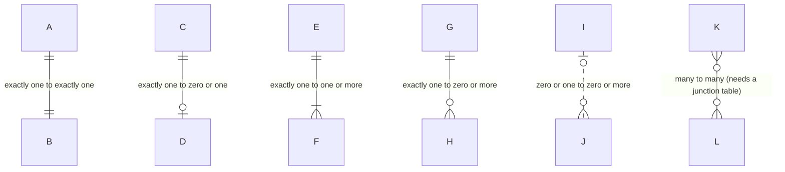
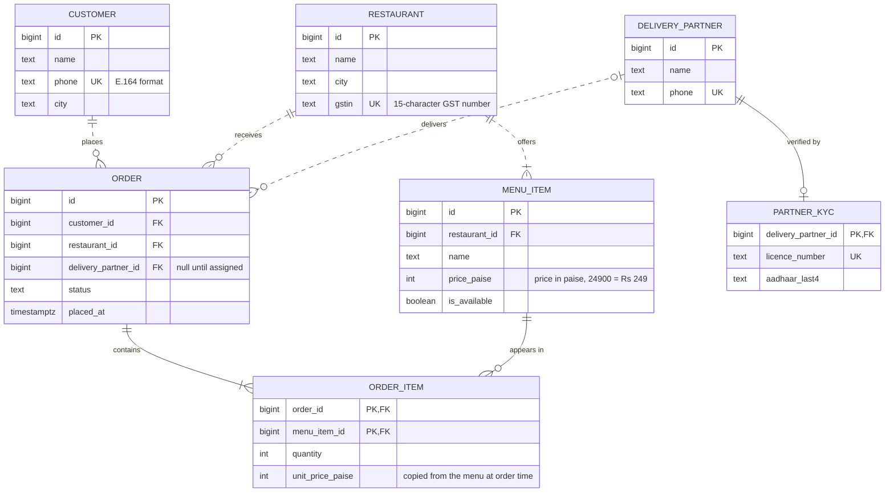
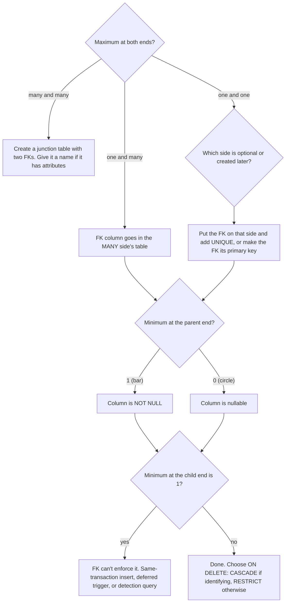
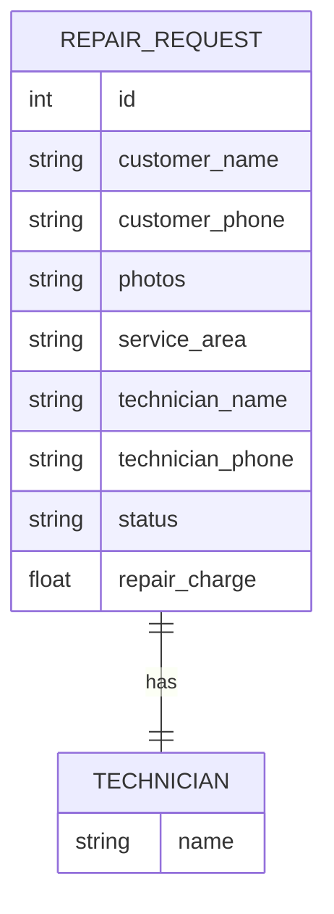
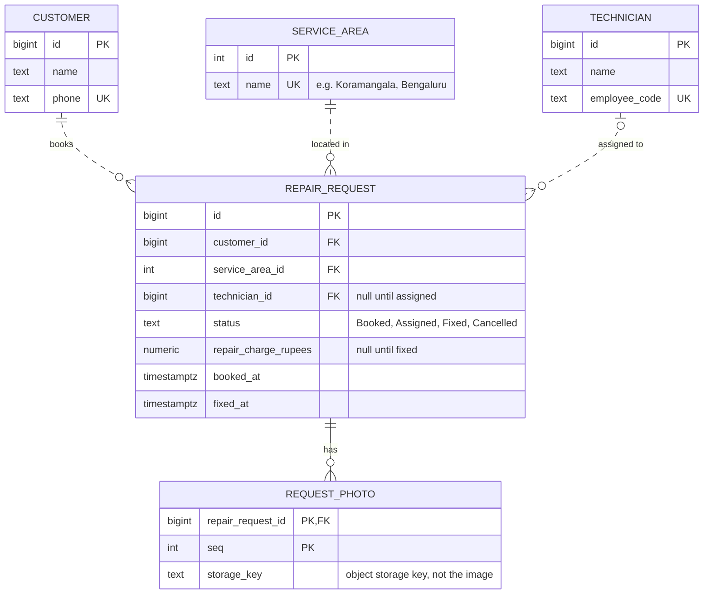
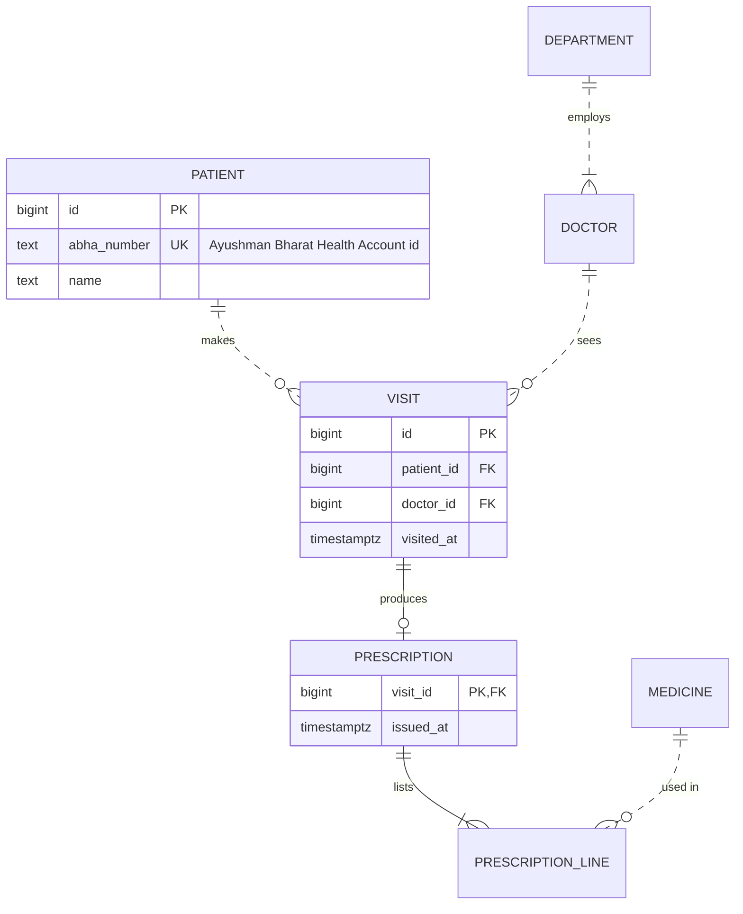
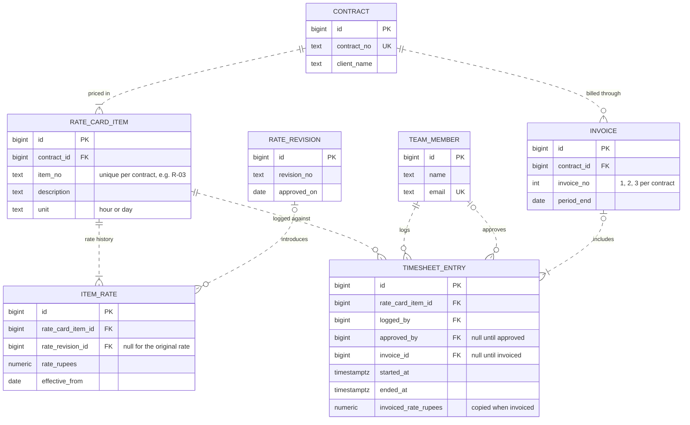

An entity-relationship diagram (ER diagram, or ERD) is a map of your **data**: which things the business stores, what facts it keeps about each one, and how those things are linked. A [class diagram](#/lesson/m05-class-diagrams) describes objects in memory. An ER diagram describes rows on disk. They look similar, but the questions they answer are different, and the ER diagram is the one your database administrator, your data analyst and your future self reading a migration will ask for.

## Learning objectives

By the end of this lesson you will be able to:

1. Identify entities, attributes, primary keys, foreign keys and unique keys on an ER diagram.
2. Read crow's foot notation: the minimum (optionality) and maximum (cardinality) at each end of a relationship.
3. Tell identifying relationships from non-identifying ones, and say what each means for the primary key.
4. Write ER diagrams in Mermaid `erDiagram` syntax that parse and render.
5. Map every kind of relationship (one-to-one, one-to-many, many-to-many, optional and mandatory) to PostgreSQL tables, foreign keys and constraints.
6. Spot the rules an ER diagram promises that foreign keys alone **cannot** enforce, and decide where to enforce them.

## Prerequisites

- [Class diagrams](#/lesson/m05-class-diagrams): you should be comfortable with multiplicity (`1`, `0..1`, `*`).
- [Relational database fundamentals](#/lesson/m09-relational-fundamentals): tables, rows, primary keys and foreign keys. If those words are new, skim that lesson first.
- Basic SQL `SELECT` with `JOIN`.

## Explain it like I'm a beginner

### A register book in a shop

Picture a small kirana shop in Nagpur that keeps three paper registers: one for **customers** (name, phone, address), one for **products** (name, price), and one for **credit sales** (date, which customer, which products, how many). The shopkeeper never writes a customer's full address in the sales register. He writes the customer's number from the customer register. That number is a pointer from one book to another.

An ER diagram is a drawing of those registers and the pointers between them:

- Each register is an **entity** (a kind of thing we store, which becomes a table).
- Each column in the register is an **attribute** (a fact about one thing, which becomes a column).
- The customer number written in the sales register is a **foreign key** (a value that points to a row in another table).
- The line between the "customers" and "sales" boxes, with little symbols at each end, says **how many** of one can be linked to the other. That is **cardinality**.

### The crow's foot

The most common way to draw "how many" is **crow's foot notation**. The many end of a line splits into three prongs, like a bird's foot. A single bar means "one". A small circle means "zero is allowed". So every end of a line answers two questions:

1. **At least how many?** Circle = zero (optional), bar = one (mandatory). This is the **optionality** or **minimum**.
2. **At most how many?** Bar = one, crow's foot = many. This is the **cardinality** or **maximum**.

You always read the symbol nearest the box you are talking *about*. "One customer places **zero or more** orders": look at the symbol next to `ORDER`, which is a circle and a crow's foot.

### Our running example: a cloud kitchen in Pune

A cloud-kitchen platform called *TiffinHub* lists several kitchens (restaurants) across Pune. Customers order dishes; a delivery partner picks the order up. The business rules, as the product owner wrote them:

- A customer can place any number of orders, including none (people sign up and browse).
- Every order is from exactly one restaurant and for exactly one customer.
- Every order has at least one line (dish and quantity). You can't pay for an empty basket.
- A restaurant offers at least one menu item. A menu item belongs to exactly one restaurant.
- A delivery partner is assigned only once the kitchen accepts the order, so a new order has no partner yet.
- Each delivery partner has exactly one KYC record (licence and Aadhaar-masked details), kept in a separate, access-controlled table.

Every symbol in this lesson will be shown on this model.

## First-principles explanation

### Where ER diagrams come from

Peter Chen introduced the entity-relationship model in 1976, drawing entities as rectangles, relationships as diamonds and attributes as ovals. In industry you will mostly see **crow's foot** notation instead (also called Information Engineering notation), because it is compact and maps almost one-to-one onto relational tables. Mermaid, most database tools and most whiteboard sketches use it, and so does this lesson.

### Entities

An **entity** is a kind of thing the business needs to remember, with its own identity: a customer, an order, one UPI payment in a wallet app's transaction history. Each **entity instance** becomes one row.

Naming conventions vary. Diagrams often use singular, upper-case names (`CUSTOMER`, `ORDER_ITEM`), while the PostgreSQL tables use plural snake_case (`customers`, `order_items`). Pick one convention per project and write it in the README. Watch out for SQL reserved words: an entity called `ORDER` is fine on a diagram, but a table called `order` must be quoted every time it appears (`"order"`), so use `orders` or `customer_orders`.

A useful test: **if two instances can have the same attributes but are still different things, it's an entity**. Two customers named "Rahul Sharma" are still two customers. A value such as an amount of money or a date range has no identity of its own; it becomes one or more **attributes** of an entity, not an entity.

### Attributes and keys

Each attribute has a name and a type. On a Mermaid ER diagram the type comes first: `text name`. Markers after the name say what role the attribute plays:

| Marker | Meaning | PostgreSQL |
|---|---|---|
| `PK` | primary key: uniquely identifies a row, never null | `PRIMARY KEY` |
| `FK` | foreign key: points to another entity's primary key | `REFERENCES other(id)` |
| `UK` | unique key: no two rows share it (a "natural" or alternate key) | `UNIQUE` |

You can combine them: `bigint order_id PK, FK` says the column is part of this table's primary key *and* points to another table.

**Surrogate versus natural keys.** A *natural key* is a real-world identifier: a phone number, a GSTIN, a vehicle registration number. A *surrogate key* is a meaningless number or UUID the system makes up (`id bigint GENERATED ALWAYS AS IDENTITY`). Real-world identifiers change more often than people expect (customers change phone numbers, GSTINs are re-issued after a business restructures), so most teams use a surrogate primary key and add a `UNIQUE` constraint on the natural key. The diagram shows both: `bigint id PK` and `text phone UK`.

**Derived attributes** (an order's total) can be calculated from other data. Show them only if you will store them, and say how they are kept in sync.

**Multi-valued attributes** (a customer's several addresses) are a warning sign. A column should hold one value. Several addresses means a new entity, `ADDRESS`, with a relationship back to `CUSTOMER`. This is the first normal form rule from [Normalization](#/lesson/m09-normalization), discovered at drawing time.

### Relationships: the four symbols

Every relationship line has two ends, and each end carries two marks: the inner mark (next to the line) is the minimum, the outer mark (next to the box) is the maximum.

| Symbol at an end | Read as | Minimum | Maximum |
|---|---|---|---|
| `\|o` / `o\|` (bar + circle) | zero or one | 0 | 1 |
| `\|\|` (two bars) | exactly one | 1 | 1 |
| `}o` / `o{` (crow's foot + circle) | zero or more | 0 | many |
| `}\|` / `\|{` (crow's foot + bar) | one or more | 1 | many |

(The backslashes are only escaping for this table. In Mermaid you write a plain `|`.)

In Mermaid the left two characters describe the **left** entity's end and the right two describe the **right** entity's end. The characters face their own box, which is why the left versions are mirror images of the right ones: `}o` on the left, `o{` on the right.

```text
CUSTOMER ||--o{ ORDER : places
```

Read it twice, once from each side:

- Start at `CUSTOMER`, cross the line, read the symbol next to `ORDER` (`o{`): "one customer places **zero or more** orders".
- Start at `ORDER`, cross the line, read the symbol next to `CUSTOMER` (`||`): "each order is placed by **exactly one** customer".

This is exactly the reading rule from class diagrams: **the number that describes how many Bs one A has is written at B's end**. Reading aloud both ways catches nearly every mistake.

### Cardinality versus optionality

Beginners often merge two different questions. Keep them apart:

- **Cardinality** (the maximum) decides the **table structure**: where the foreign key goes, and whether you need an extra table. One-to-many puts a foreign key on the "many" side. Many-to-many needs a junction table.
- **Optionality** (the minimum) decides the **constraints**: `NOT NULL` or nullable, and whether you need an extra check that a parent has at least one child.

So "a new order has no delivery partner yet" changes nothing about the structure (orders still point to partners) but makes `orders.delivery_partner_id` nullable.

### Identifying and non-identifying relationships

Mermaid draws two kinds of line:

- **Solid line (`--`): identifying.** The child can't be identified without its parent: the parent's key is **part of the child's primary key**. An `ORDER_ITEM` is "line for menu item 101 *in order 1001*"; its primary key is `(order_id, menu_item_id)`. Delete the order and its items have no meaning, much like composition in a class diagram.
- **Dashed line (`..`): non-identifying.** The child has its own primary key; the parent's key is an ordinary foreign key column. An `ORDER` has its own `id`; `customer_id` is just a column.

Many teams only use the solid line in sketches, and that is acceptable. The distinction matters when you choose primary keys and `ON DELETE` behaviour, so add it once the design settles.

### Relationship labels

The text after the colon names the relationship as a verb phrase read from left to right: `RESTAURANT ||..|{ MENU_ITEM : offers`. Mermaid needs quotes if the label has spaces: `: "appears in"`. Good labels turn the diagram into sentences a product owner can check: "a restaurant offers one or more menu items".

### Mapping to PostgreSQL: the rules

This is the payoff. Every pattern of symbols has a standard translation.

**One-to-many (`||--o{`, `||--|{`).** Put a foreign key column in the **many** side's table, pointing at the one side's primary key.

```sql
-- CUSTOMER ||..o{ ORDER : places
customer_id bigint NOT NULL REFERENCES customers (id)
```

The `||` at the `CUSTOMER` end (exactly one, minimum 1) becomes `NOT NULL`.

**Optional parent (`|o..o{`).** The same foreign key, but nullable.

```sql
-- DELIVERY_PARTNER |o..o{ ORDER : delivers
delivery_partner_id bigint NULL REFERENCES delivery_partners (id)
```

**One-to-one (`||--o|`, `||--||`).** A foreign key plus `UNIQUE`, so no parent can appear twice. If the child exists only for that parent (identifying), make the foreign key the child's primary key, which is unique automatically:

```sql
-- DELIVERY_PARTNER ||--o| PARTNER_KYC : "verified by"
CREATE TABLE partner_kyc (
  delivery_partner_id bigint PRIMARY KEY REFERENCES delivery_partners (id) ON DELETE CASCADE,
  licence_number text NOT NULL UNIQUE,
  aadhaar_last4 char(4) NOT NULL
);
```

Which side gets the foreign key? The side that is **optional** or **created later**. A partner exists before KYC is done, so KYC points to the partner, not the other way round. If both sides are mandatory (`||--||`), ask whether they are really two entities. Often they are one table split for a reason (security, size, change rate), and the diagram should say why.

**Many-to-many (`}o--o{`).** Relational tables can't hold a list in a cell, so you add a **junction table** (also called an associative entity, bridge or link table) with two foreign keys. Usually the junction has its own attributes, and then it deserves a name of its own. "Order contains menu item" is many-to-many, and its junction is `ORDER_ITEM`, which carries `quantity` and `unit_price_paise`. On a finished ER diagram you normally draw the junction explicitly, as two one-to-many lines:

```text
ORDER ||--|{ ORDER_ITEM : contains
MENU_ITEM ||--o{ ORDER_ITEM : "appears in"
```

**Identifying relationships become composite primary keys**, usually with `ON DELETE CASCADE`. **Non-identifying ones** use the child's own key and usually `ON DELETE RESTRICT` (the default `NO ACTION` behaves almost identically), because you don't want deleting a customer to silently delete their order history.

**Self-relationships.** An employee reports to another employee: `EMPLOYEE |o..o{ EMPLOYEE : manages` becomes `manager_id bigint NULL REFERENCES employees (id)` in the same table.

### What a foreign key cannot promise

Here is the part many tutorials skip. Two promises on our diagram are **not** enforced by any foreign key:

1. **"One or more" at the child end (`|{`).** `ORDER ||--|{ ORDER_ITEM` says every order has at least one item. A foreign key on `order_items` stops items pointing at missing orders, but nothing stops an order with zero items. The parent row is inserted first, and at that moment it has no children.
2. **Rules that cross two paths.** An order item's menu item must belong to the **same restaurant** as the order. Both foreign keys can be valid while the combination is wrong.

Your options, from simplest to strongest:

| Option | How | Trade-off |
|---|---|---|
| Application rule | The C# `Order` constructor requires at least one line; the service checks restaurants match | Simple. Bypassed by scripts, imports and other services that write directly |
| Insert in one transaction | Create order and items together; never commit an empty order | Good habit, not a guarantee |
| Composite foreign key | Add `restaurant_id` to `order_items` and reference `orders (id, restaurant_id)` and `menu_items (id, restaurant_id)` | Database-enforced for rule 2; one extra column |
| Deferred constraint trigger | A `CONSTRAINT TRIGGER ... DEFERRABLE INITIALLY DEFERRED` that checks at commit that each order has items | Enforces rule 1; more code to own and test |
| Detection query | A scheduled query that lists violations (you will write one in the exercises) | Catches drift from any source; finds problems after the fact |

Most production systems use the application rule plus a detection query, and reach for constraints where a violation is expensive (money, compliance). Write on the diagram, as a note in the surrounding document, which option you chose.

### Mermaid erDiagram syntax in one place

```text
erDiagram
    CUSTOMER ||..o{ ORDER : places
    CUSTOMER {
        bigint id PK
        text name
        text phone UK "E.164, e.g. +9198..."
    }
```

- First line: `erDiagram`.
- Relationship: `LEFT <left-end><line><right-end> RIGHT : label`. Line is `--` (identifying) or `..` (non-identifying).
- Attribute block: `ENTITY { type name [PK|FK|UK[, ...]] ["comment"] }`.
- Entity names: letters, digits, `_` and `-`. Use an alias in square brackets if you want a friendlier display name: `ORDER_ITEM["Order line"]`.
- Types: keep them single words (`bigint`, `text`, `timestamptz`, `numeric`). Parentheses and commas, as in `numeric(10,2)`, can confuse the parser; put precision in the comment instead.
- Mermaid also accepts word aliases such as `one or more` and `zero or many`, but the symbol form is shorter and is what most people recognise.

### ER diagram or class diagram?

| Question | ER diagram | Class diagram |
|---|---|---|
| Shows | tables, columns, keys | classes, fields, **methods** |
| Many-to-many | junction table drawn explicitly | two collections, no extra class |
| Inheritance | not native; mapped to one table, a table per type, or a shared key | native (`<|--`) |
| Behaviour | none | operations |
| Audience | DBAs, analysts, migration reviewers, reporting teams | developers designing behaviour |

They often describe the same domain differently, and that's healthy. The `Order` class may hold a list of `OrderLine` value objects while the database has an `order_items` table. [Mapping diagrams to code](#/lesson/m05-diagrams-to-code) goes through the translation in both directions.

### When an ER diagram is overkill

- A single table with no relationships: a column list in the README is clearer.
- A document store or a JSONB-heavy design: draw the aggregate's JSON shape instead (see [PostgreSQL JSONB](#/lesson/m09-jsonb)).
- A schema of 300 tables: no one reads that diagram. Draw one diagram per area (orders, catalogue, payments), each with fewer than about 12 entities, and show neighbouring entities as name-only boxes.

## Visual explanation

### Crow's foot cheat sheet



Read each row from left to right using the symbol at the **right** end, then from right to left using the symbol at the **left** end. The `A`–`B` pair is a strict one-to-one: every A has exactly one B and vice versa, which is rare in practice. `C`–`D` is the common one-to-one, where D is optional (an account and its optional profile). `E`–`F` and `G`–`H` are the two flavours of one-to-many: F must have at least one row per E, H can have none. `I`–`J` is drawn dashed (non-identifying) with an optional parent: a J may exist without an I, which becomes a nullable foreign key. The last pair is many-to-many, which you will always resolve into a junction table before writing SQL.

### The TiffinHub data model



Walk through it line by line:

- **`CUSTOMER ||..o{ ORDER`**: one customer, zero or more orders; each order has exactly one customer. Dashed because an order has its own `id`. In SQL: `orders.customer_id NOT NULL`.
- **`RESTAURANT ||..o{ ORDER`**: the same shape. A new kitchen can have no orders yet.
- **`RESTAURANT ||..|{ MENU_ITEM`**: a restaurant offers **one or more** items. The `|{` is a promise the foreign key can't keep alone (a new restaurant row starts with zero items), so the onboarding service creates the restaurant and its first menu in one transaction.
- **`ORDER ||--|{ ORDER_ITEM`**: solid, identifying. `order_id` is part of the item's primary key. At least one item per order, the second unenforceable promise.
- **`MENU_ITEM ||--o{ ORDER_ITEM`**: together with the line above, this resolves the many-to-many between orders and menu items. A menu item that was never ordered has zero order items.
- **`DELIVERY_PARTNER |o..o{ ORDER`**: the circle-bar at the partner end means an order has **zero or one** partner, so the column is nullable.
- **`DELIVERY_PARTNER ||--o| PARTNER_KYC`**: one-to-one, optional on the KYC side (onboarding may not be finished). The KYC table's primary key *is* the foreign key.
- **`unit_price_paise` on `ORDER_ITEM`** looks like duplication of `MENU_ITEM.price_paise`, but it isn't: it records the price **at order time**. Menu prices change; invoices must not. The comment on the diagram says so, which saves a well-meaning "normalisation" later.
- **Money in paise as `int`** avoids floating-point rounding. `numeric` is an equally good choice; `real` or `double precision` is not.

### Which table gets the foreign key?



This flowchart is the whole mapping procedure. The first question looks only at the **maximums** and decides the table structure. The second question looks at the **minimum at the parent end** and decides `NOT NULL`. The third question catches the one-or-more promise that needs extra work. Run every relationship line on your diagram through it, and you will have a complete, correct schema.

## Step-by-step example

Let's go from requirements to running SQL for a slice of the model: restaurants, menu items, orders and order items.

### Step 1 — list the nouns and decide which are entities

From the rules: *customer, order, restaurant, dish (menu item), quantity, price, delivery partner, KYC, status, time*. Customer, order, restaurant, menu item, delivery partner and KYC have identity: entities. Quantity and price are facts about an order line. Status and time are facts about an order. "Order line" isn't a noun in the rules, but "order has dishes and quantities" is a many-to-many with attributes, so it becomes the `ORDER_ITEM` entity.

### Step 2 — draw the boxes and the lines, maximums first

Ask "one or many?" for each pair, both ways. One order has many items; one menu item appears in many orders: many-to-many, resolved through `ORDER_ITEM`. One restaurant has many menu items; one menu item belongs to one restaurant: one-to-many.

### Step 3 — add the minimums

Ask "can it be zero?" for each end. Can a restaurant have zero menu items? The rules say no (`|{`). Can a menu item have zero orders? Yes (`o{`). Can an order have no delivery partner? Yes, at first (`|o`).

### Step 4 — choose keys and line types

`ORDER_ITEM` is identified by its order and its menu item, so its primary key is `(order_id, menu_item_id)`, and both lines are solid. (If the same dish can appear twice in one order with different customisations, such as "extra spicy", this key is wrong. You would add a `line_no` to the key instead. This is the kind of question the diagram makes you ask early.)

### Step 5 — translate each line using the flowchart

```sql
CREATE TABLE restaurants (
  id     bigint GENERATED ALWAYS AS IDENTITY PRIMARY KEY,
  name   text NOT NULL,
  city   text NOT NULL,
  gstin  text NOT NULL UNIQUE CHECK (length(gstin) = 15)
);

CREATE TABLE menu_items (
  id            bigint GENERATED ALWAYS AS IDENTITY PRIMARY KEY,
  restaurant_id bigint NOT NULL REFERENCES restaurants (id),       -- RESTAURANT ||..|{ MENU_ITEM
  name          text NOT NULL,
  price_paise   int  NOT NULL CHECK (price_paise > 0),
  is_available  boolean NOT NULL DEFAULT true,
  UNIQUE (id, restaurant_id)                                        -- target for the composite FK below
);

CREATE TABLE orders (
  id                  bigint GENERATED ALWAYS AS IDENTITY PRIMARY KEY,
  customer_id         bigint NOT NULL,                              -- CUSTOMER ||..o{ ORDER (FK omitted in this slice)
  restaurant_id       bigint NOT NULL REFERENCES restaurants (id),  -- RESTAURANT ||..o{ ORDER
  delivery_partner_id bigint NULL,                                  -- DELIVERY_PARTNER |o..o{ ORDER
  status              text NOT NULL CHECK (status IN ('Placed','Accepted','PickedUp','Delivered','Cancelled')),
  placed_at           timestamptz NOT NULL DEFAULT now(),
  UNIQUE (id, restaurant_id)
);

CREATE TABLE order_items (
  order_id         bigint NOT NULL,
  menu_item_id     bigint NOT NULL,
  restaurant_id    bigint NOT NULL,                                 -- extra column so the database can check "same restaurant"
  quantity         int NOT NULL CHECK (quantity BETWEEN 1 AND 50),
  unit_price_paise int NOT NULL CHECK (unit_price_paise > 0),
  PRIMARY KEY (order_id, menu_item_id),                             -- identifying on both sides
  FOREIGN KEY (order_id, restaurant_id)     REFERENCES orders (id, restaurant_id) ON DELETE CASCADE,
  FOREIGN KEY (menu_item_id, restaurant_id) REFERENCES menu_items (id, restaurant_id)
);

CREATE INDEX ON menu_items (restaurant_id);
CREATE INDEX ON orders (restaurant_id, placed_at);
CREATE INDEX ON order_items (menu_item_id);
```

Notice four things:

1. **Every comment names the diagram line it implements.** Reviewers can tick lines off.
2. **The composite foreign keys** enforce "the menu item belongs to the order's restaurant" in the database. That needs `UNIQUE (id, restaurant_id)` on the referenced tables, which looks redundant (the `id` alone is already unique) but is what PostgreSQL requires as a foreign key target.
3. **PostgreSQL does not create indexes on foreign key columns automatically.** Without `CREATE INDEX ON menu_items (restaurant_id)`, deleting or updating a restaurant scans the whole `menu_items` table to check for references, and "show this kitchen's menu" is a sequential scan. The primary key of `order_items` already starts with `order_id`, so only `menu_item_id` needs its own index.
4. **The `|{` promises are still not enforced.** We've chosen to create orders and their items in one transaction in the application, plus a detection query you'll write in exercise 4.

### Step 6 — check by reading the SQL back as a diagram

Cover the diagram, read the DDL, and redraw the lines from the foreign keys. If your redrawn diagram differs from the original, one of them is wrong. You'll automate this kind of round trip in [Mapping diagrams to code](#/lesson/m05-diagrams-to-code).

## Production-style C# implementation

Teams that keep their ER model as data (rather than only as a picture) can generate both the Mermaid diagram and the starting DDL from one source, and test that they agree. Below is a small model and two writers, exposed by a minimal ASP.NET Core API so a docs site or CI job can fetch the current diagram. This is the same idea behind the platform's **LLD and HLD playgrounds**, which generate diagrams from a structured model and can compare your design with a reference.

```text
KitchenSchema/
  Program.cs
  Schema/
    ErModel.cs            // entities, attributes, relationships, validation
    CrowsFoot.cs          // Cardinality <-> Mermaid symbols
    MermaidErWriter.cs    // model -> erDiagram text
    PostgresDdlWriter.cs  // model -> CREATE TABLE + foreign keys
    TiffinHubModel.cs     // the model from this lesson
```

```csharp file=Schema/ErModel.cs
namespace KitchenSchema.Schema;

/// <summary>Minimum and maximum at one end of a relationship line.</summary>
public enum Cardinality { ZeroOrOne, ExactlyOne, ZeroOrMore, OneOrMore }

public static class CardinalityExtensions
{
    public static bool IsMany(this Cardinality c) => c is Cardinality.ZeroOrMore or Cardinality.OneOrMore;
    public static bool AllowsZero(this Cardinality c) => c is Cardinality.ZeroOrOne or Cardinality.ZeroOrMore;
}

/// <summary>One column. SqlType is the PostgreSQL type, e.g. "bigint" or "numeric(10,2)".</summary>
public sealed record ErAttribute(string Name, string SqlType, bool IsPrimaryKey = false, bool IsNullable = false,
    bool IsUnique = false, string? Comment = null);

/// <summary>An entity. Name is the diagram name (CUSTOMER), Table the PostgreSQL table (customers).</summary>
public sealed record Entity(string Name, string Table, IReadOnlyList<ErAttribute> Attributes);

/// <summary>
/// Parent is the "one" side. ParentEnd says how many parents each child has (the symbol at the parent's box);
/// ChildEnd says how many children each parent has (the symbol at the child's box).
/// </summary>
public sealed record Relationship(string Parent, string Child, Cardinality ParentEnd, Cardinality ChildEnd,
    string Label, bool Identifying = false);

public sealed class ErModel
{
    private readonly List<Entity> _entities = new();
    private readonly List<Relationship> _relationships = new();

    public IReadOnlyList<Entity> Entities => _entities;
    public IReadOnlyList<Relationship> Relationships => _relationships;

    public ErModel Add(Entity entity)
    {
        ArgumentNullException.ThrowIfNull(entity);
        if (Find(entity.Name) is not null) throw new InvalidOperationException($"Entity {entity.Name} already exists.");
        // An entity may declare no primary key: identifying relationships added later supply it.
        _entities.Add(entity);
        return this;
    }

    public ErModel Relate(Relationship r)
    {
        ArgumentNullException.ThrowIfNull(r);
        _ = Find(r.Parent) ?? throw new InvalidOperationException($"Unknown entity {r.Parent}.");
        _ = Find(r.Child) ?? throw new InvalidOperationException($"Unknown entity {r.Child}.");
        if (r.ParentEnd.IsMany() && !r.ChildEnd.IsMany())
            throw new InvalidOperationException($"{r.Parent} -> {r.Child}: put the 'one' side first as Parent.");
        _relationships.Add(r);
        return this;
    }

    public Entity? Find(string name) =>
        _entities.FirstOrDefault(e => string.Equals(e.Name, name, StringComparison.OrdinalIgnoreCase));

    /// <summary>Foreign key column the child gets for a one-to-x relationship, e.g. RESTAURANT -> restaurant_id.</summary>
    public static string ForeignKeyColumn(string parentName) => parentName.ToLowerInvariant() + "_id";
}
```

```csharp file=Schema/CrowsFoot.cs
namespace KitchenSchema.Schema;

/// <summary>Converts between Cardinality and Mermaid's crow's foot symbols.
/// Left-hand symbols face the left box, right-hand symbols face the right box.</summary>
public static class CrowsFoot
{
    public static string Left(Cardinality c) => c switch
    {
        Cardinality.ZeroOrOne => "|o",
        Cardinality.ExactlyOne => "||",
        Cardinality.ZeroOrMore => "}o",
        Cardinality.OneOrMore => "}|",
        _ => throw new ArgumentOutOfRangeException(nameof(c)),
    };

    public static string Right(Cardinality c) => c switch
    {
        Cardinality.ZeroOrOne => "o|",
        Cardinality.ExactlyOne => "||",
        Cardinality.ZeroOrMore => "o{",
        Cardinality.OneOrMore => "|{",
        _ => throw new ArgumentOutOfRangeException(nameof(c)),
    };

    /// <summary>UML-style multiplicity, handy for reviewers who know class diagrams.</summary>
    public static string Multiplicity(Cardinality c) => c switch
    {
        Cardinality.ZeroOrOne => "0..1",
        Cardinality.ExactlyOne => "1",
        Cardinality.ZeroOrMore => "0..*",
        Cardinality.OneOrMore => "1..*",
        _ => throw new ArgumentOutOfRangeException(nameof(c)),
    };
}
```

```csharp file=Schema/MermaidErWriter.cs
using System.Text;

namespace KitchenSchema.Schema;

public static class MermaidErWriter
{
    public static string Write(ErModel model)
    {
        var sb = new StringBuilder("erDiagram\n");
        foreach (var r in model.Relationships)
        {
            var line = r.Identifying ? "--" : "..";
            var label = r.Label.Contains(' ') ? $"\"{r.Label}\"" : r.Label;
            sb.Append($"    {r.Parent} {CrowsFoot.Left(r.ParentEnd)}{line}{CrowsFoot.Right(r.ChildEnd)} {r.Child} : {label}\n");
        }

        foreach (var e in model.Entities)
        {
            sb.Append($"    {e.Name} {{\n");
            foreach (var a in AllColumns(model, e))
            {
                var keys = new List<string>();
                if (a.IsPrimaryKey) keys.Add("PK");
                if (a.IsForeignKey) keys.Add("FK");
                if (a.Attribute.IsUnique) keys.Add("UK");
                var keyText = keys.Count > 0 ? " " + string.Join(", ", keys) : "";
                var comment = a.Attribute.Comment is { Length: > 0 } c ? $" \"{c.Replace("\"", "'")}\"" : "";
                sb.Append($"        {DiagramType(a.Attribute.SqlType)} {a.Attribute.Name}{keyText}{comment}\n");
            }
            sb.Append("    }\n");
        }
        return sb.ToString();
    }

    /// <summary>Mermaid types must be single words, so "numeric(10,2)" is shown as "numeric".</summary>
    private static string DiagramType(string sqlType)
    {
        var cut = sqlType.IndexOfAny(['(', ' ']);
        return cut < 0 ? sqlType : sqlType[..cut];
    }

    internal sealed record Column(ErAttribute Attribute, bool IsPrimaryKey, bool IsForeignKey);

    /// <summary>Declared attributes plus the foreign key columns implied by one-to-x relationships.</summary>
    internal static IReadOnlyList<Column> AllColumns(ErModel model, Entity e)
    {
        var cols = e.Attributes.Select(a => new Column(a, a.IsPrimaryKey, false)).ToList();
        foreach (var r in model.Relationships.Where(r => !r.ParentEnd.IsMany()
                     && string.Equals(r.Child, e.Name, StringComparison.OrdinalIgnoreCase)))
        {
            var oneToOne = !r.ChildEnd.IsMany();
            var fk = new ErAttribute(ErModel.ForeignKeyColumn(r.Parent), "bigint",
                IsPrimaryKey: r.Identifying, IsNullable: r.ParentEnd.AllowsZero(), IsUnique: oneToOne && !r.Identifying);
            cols.Add(new Column(fk, r.Identifying, true));
        }
        return cols;
    }
}
```

```csharp file=Schema/PostgresDdlWriter.cs
using System.Text;

namespace KitchenSchema.Schema;

/// <summary>Generates a starting point for a migration. Review it; never apply generated DDL blindly.</summary>
public static class PostgresDdlWriter
{
    public static string Write(ErModel model)
    {
        var sb = new StringBuilder();
        foreach (var e in model.Entities)
        {
            var cols = MermaidErWriter.AllColumns(model, e);
            sb.Append($"CREATE TABLE {e.Table} (\n");
            var lines = cols.Select(c =>
            {
                var a = c.Attribute;
                var nullability = a.IsNullable && !c.IsPrimaryKey ? "NULL" : "NOT NULL";
                var unique = a.IsUnique && !c.IsPrimaryKey ? " UNIQUE" : "";
                return $"  {a.Name} {a.SqlType} {nullability}{unique}";
            }).ToList();
            var pk = cols.Where(c => c.IsPrimaryKey).Select(c => c.Attribute.Name).ToList();
            if (pk.Count == 0) throw new InvalidOperationException($"{e.Name} has no primary key.");
            lines.Add($"  PRIMARY KEY ({string.Join(", ", pk)})");
            sb.Append(string.Join(",\n", lines)).Append("\n);\n\n");
        }

        // Foreign keys last, so table order doesn't matter.
        foreach (var r in model.Relationships)
        {
            var parent = model.Find(r.Parent)!;
            var child = model.Find(r.Child)!;
            var parentPk = parent.Attributes.Single(a => a.IsPrimaryKey).Name;
            if (r.ParentEnd.IsMany())
            {
                sb.Append($"-- {r.Parent} many-to-many {r.Child}: add a junction table explicitly to the model.\n");
                continue;
            }
            var fk = ErModel.ForeignKeyColumn(r.Parent);
            var onDelete = r.Identifying ? "CASCADE" : "RESTRICT";
            sb.Append($"ALTER TABLE {child.Table} ADD FOREIGN KEY ({fk}) REFERENCES {parent.Table} ({parentPk}) ON DELETE {onDelete};\n");
            if (!IsLeadingKeyColumn(model, child, fk))
                sb.Append($"CREATE INDEX ON {child.Table} ({fk});\n");
            if (r.ChildEnd == Cardinality.OneOrMore)
                sb.Append($"-- {r.Parent} ||--|{{ {r.Child}: 'one or more' is not enforced by a foreign key. Insert together or add a deferred check.\n");
        }
        return sb.ToString();
    }

    /// <summary>The primary key index already serves lookups on its first column, so no extra index is needed.</summary>
    private static bool IsLeadingKeyColumn(ErModel model, Entity child, string column) =>
        MermaidErWriter.AllColumns(model, child).FirstOrDefault(c => c.IsPrimaryKey)?.Attribute.Name == column;
}
```

```csharp file=Schema/TiffinHubModel.cs
namespace KitchenSchema.Schema;

public static class TiffinHubModel
{
    public static ErModel Build()
    {
        static ErAttribute Id() => new("id", "bigint", IsPrimaryKey: true);

        return new ErModel()
            .Add(new Entity("CUSTOMER", "customers", [Id(), new("name", "text"), new("phone", "text", IsUnique: true, Comment: "E.164 format")]))
            .Add(new Entity("RESTAURANT", "restaurants", [Id(), new("name", "text"), new("gstin", "text", IsUnique: true)]))
            .Add(new Entity("MENU_ITEM", "menu_items", [Id(), new("name", "text"), new("price_paise", "int")]))
            .Add(new Entity("ORDER", "orders", [Id(), new("status", "text"), new("placed_at", "timestamptz")]))
            .Add(new Entity("ORDER_ITEM", "order_items", [new("quantity", "int"), new("unit_price_paise", "int")]))
            .Add(new Entity("DELIVERY_PARTNER", "delivery_partners", [Id(), new("name", "text")]))
            .Relate(new Relationship("CUSTOMER", "ORDER", Cardinality.ExactlyOne, Cardinality.ZeroOrMore, "places"))
            .Relate(new Relationship("RESTAURANT", "ORDER", Cardinality.ExactlyOne, Cardinality.ZeroOrMore, "receives"))
            .Relate(new Relationship("RESTAURANT", "MENU_ITEM", Cardinality.ExactlyOne, Cardinality.OneOrMore, "offers"))
            .Relate(new Relationship("ORDER", "ORDER_ITEM", Cardinality.ExactlyOne, Cardinality.OneOrMore, "contains", Identifying: true))
            .Relate(new Relationship("MENU_ITEM", "ORDER_ITEM", Cardinality.ExactlyOne, Cardinality.ZeroOrMore, "appears in", Identifying: true))
            .Relate(new Relationship("DELIVERY_PARTNER", "ORDER", Cardinality.ZeroOrOne, Cardinality.ZeroOrMore, "delivers"));
    }
}
```

```csharp file=Program.cs
using KitchenSchema.Schema;

var builder = WebApplication.CreateBuilder(args);
builder.Services.AddSingleton(TiffinHubModel.Build());

var app = builder.Build();

// A docs site or CI job fetches these and fails the build if the committed diagram differs.
app.MapGet("/schema/diagram", (ErModel model) => Results.Text(MermaidErWriter.Write(model), "text/plain"));
app.MapGet("/schema/ddl", (ErModel model) => Results.Text(PostgresDdlWriter.Write(model), "text/plain"));
app.MapGet("/schema/relationships", (ErModel model) => model.Relationships.Select(r => new
{
    r.Parent,
    r.Child,
    ParentEnd = CrowsFoot.Multiplicity(r.ParentEnd),
    ChildEnd = CrowsFoot.Multiplicity(r.ChildEnd),
    r.Label,
    r.Identifying,
}));

app.Run();
```

What to notice in the implementation:

- **One source of truth, two outputs.** The writers share `AllColumns`, so the diagram and the DDL can't disagree about which foreign key columns exist.
- **Optionality drives nullability, maximums drive structure** — the two rules from the first-principles section, encoded once: `IsNullable: r.ParentEnd.AllowsZero()`, and `UNIQUE` only when the child end is not many.
- **Identifying relationships become primary key columns** and `ON DELETE CASCADE`; non-identifying ones get `RESTRICT` and an index.
- **The model refuses many-to-many.** Instead of inventing a junction table with a guessed name and no attributes, the DDL writer leaves a comment asking for an explicit junction entity, exactly as you should on a real diagram.
- **The unenforceable `|{`** is surfaced as a comment in the generated DDL, so no one assumes the database guarantees it.
- **The generator is a starting point.** Indexes beyond foreign keys, `CHECK` constraints, defaults and the composite "same restaurant" key still need a human. Real projects write migrations by hand or with EF Core and use generated output for comparison, not as the migration itself.

## Bad design vs good design

Here is a diagram from a pull request for a home-services app (customers book a repair for a broken AC or washing machine; a technician visits and fixes it):



Problems:

- **Repeated facts.** Customer name and phone are copied into every request. When Ms Iyer changes her number, her 14 old requests show the wrong one. Same for technician details, which also exist in `TECHNICIAN`.
- **A multi-valued attribute.** `photos` holds a comma-separated list of URLs. You can't count, constrain or delete one photo cleanly.
- **Wrong cardinality.** `||--||` claims each technician handles exactly one request, ever.
- **No keys marked.** Which column identifies a technician? `name` isn't unique.
- **`float` for money.** ₹1,250.10 may be stored as 1250.0999999. Use `numeric` or integer paise.
- **`status` as free text**, so "Closed", "closed" and "CLOSED" will all appear within a month.
- **A missing time dimension.** When was it booked? When fixed? "Fixed within 24 hours" reports are impossible.

The better model:



Each fact now lives in one place, each relationship states its real cardinality, photos are rows (stored in object storage, referenced by key), and the optional technician is a nullable foreign key. The status values are written in the comment; in SQL they become a `CHECK` constraint, or a lookup table if business users must add values without a deployment.

**Is the "bad" version ever acceptable?** Sometimes. An **append-only reporting table** or an export to a data warehouse often deliberately copies names into each row (denormalisation), because reports must show the name *as it was* and must not join across 10 tables. That's a conscious choice for a read model, documented as such. It's wrong as the system of record.

## Practical playground

The playground below is a fresh in-browser PostgreSQL database seeded with the TiffinHub tables. Try:

1. `SELECT * FROM order_items oi JOIN menu_items m ON m.id = oi.menu_item_id;` and redraw the relationship from the result.
2. Insert an order item that points at a menu item from a different restaurant. Which constraint stops you?
3. Insert an order with no items. Nothing stops you. Which line on the diagram did you just violate?
4. Delete order 1001 and check what happened to its items (`ON DELETE CASCADE`). Then try deleting restaurant 10.

To work on the *diagram* side, open the platform's **LLD playground**, which generates diagrams from a structured model, and the **HLD playground**, which compares your design with a reference one. Both are used in the C4 and diagrams-to-code lessons of this module.

:::playground type=sql title="TiffinHub schema"
```sql
CREATE TABLE customers (
  id bigint PRIMARY KEY,
  name text NOT NULL,
  phone text NOT NULL UNIQUE,
  city text NOT NULL
);
CREATE TABLE restaurants (
  id bigint PRIMARY KEY,
  name text NOT NULL,
  city text NOT NULL,
  gstin text NOT NULL UNIQUE
);
CREATE TABLE menu_items (
  id bigint PRIMARY KEY,
  restaurant_id bigint NOT NULL REFERENCES restaurants (id),
  name text NOT NULL,
  price_paise int NOT NULL CHECK (price_paise > 0),
  UNIQUE (id, restaurant_id)
);
CREATE TABLE delivery_partners (
  id bigint PRIMARY KEY,
  name text NOT NULL,
  phone text NOT NULL UNIQUE
);
CREATE TABLE orders (
  id bigint PRIMARY KEY,
  customer_id bigint NOT NULL REFERENCES customers (id),
  restaurant_id bigint NOT NULL REFERENCES restaurants (id),
  delivery_partner_id bigint NULL REFERENCES delivery_partners (id),
  status text NOT NULL CHECK (status IN ('Placed','Accepted','PickedUp','Delivered','Cancelled')),
  placed_at timestamptz NOT NULL,
  UNIQUE (id, restaurant_id)
);
CREATE TABLE order_items (
  order_id bigint NOT NULL,
  menu_item_id bigint NOT NULL,
  restaurant_id bigint NOT NULL,
  quantity int NOT NULL CHECK (quantity > 0),
  unit_price_paise int NOT NULL,
  PRIMARY KEY (order_id, menu_item_id),
  FOREIGN KEY (order_id, restaurant_id) REFERENCES orders (id, restaurant_id) ON DELETE CASCADE,
  FOREIGN KEY (menu_item_id, restaurant_id) REFERENCES menu_items (id, restaurant_id)
);
INSERT INTO customers VALUES (1,'Asha Kulkarni','+919800000001','Pune'),(2,'Vikram Rao','+919800000002','Pune'),(3,'Meera Shah','+919800000003','Mumbai');
INSERT INTO restaurants VALUES (10,'Thali House','Pune','27AAAAA0000A1Z5'),(11,'Misal Point','Pune','27BBBBB0000B1Z5');
INSERT INTO menu_items VALUES (100,10,'Maharashtrian Thali',24900),(101,10,'Gulab Jamun',6000),(110,11,'Misal Pav',12000);
INSERT INTO delivery_partners VALUES (500,'Ravi','+919900000500');
INSERT INTO orders VALUES (1001,1,10,500,'Delivered','2026-10-12 13:05+05:30'),(1002,2,11,NULL,'Placed','2026-10-12 13:40+05:30');
INSERT INTO order_items VALUES (1001,100,10,1,24900),(1001,101,10,2,6000),(1002,110,11,2,12000);
```
:::

## Exercises

:::exercise id=m05-er-diagrams-ex1 difficulty=beginner kind=written title="Read a hospital ER diagram aloud"
A district hospital's outpatient system has this diagram:



Answer in full sentences:

1. Read `PATIENT ||..o{ VISIT` in both directions.
2. Can a visit have no prescription? Can it have two?
3. Can a department exist with no doctors? Can a doctor belong to two departments?
4. Why is the `PATIENT`–`VISIT` line dashed but the `VISIT`–`PRESCRIPTION` line solid?
5. Which columns would `PRESCRIPTION_LINE` need, and what is its primary key?
6. Which promise on this diagram can't be enforced by a foreign key alone?
::acceptance
- Each relationship is read using the symbol at the far end.
- Question 2 correctly reads `o|` as zero or one.
- Question 4 links solid lines to the parent key being part of the child's primary key.
- Question 6 identifies at least one `|{` end (department employs doctors, or prescription lists lines).
::hint
Start at one entity, cross the line, and read the symbol touching the *other* box.
::hint
`o|` is a circle (zero allowed) and a bar (at most one).
::hint
Look at the `PRESCRIPTION` attributes: is `visit_id` marked `PK`?
::hint
A `|{` at the child end means "at least one child per parent". Can a foreign key on the child table force a parent to have children?
::solution
1. One patient makes **zero or more** visits. Each visit is made by **exactly one** patient.
2. Yes, a visit can have no prescription (`o|` has a circle). No, it can't have two: the maximum is one. That matches `visit_id` being the prescription's primary key.
3. No: `|{` at the doctor end means a department employs **one or more** doctors. Each doctor belongs to **exactly one** department (`||` at the department end), so a doctor can't belong to two. If doctors do rotate across departments, the diagram is wrong and the relationship should be many-to-many with a junction such as `DOCTOR_POSTING`.
4. A visit has its own identity (`id`), and `patient_id` is just a foreign key column: non-identifying, dashed. A prescription is identified by its visit: `visit_id` is its primary key: identifying, solid.
5. `PRESCRIPTION_LINE(visit_id FK, medicine_id FK, dosage, days)`, with primary key `(visit_id, medicine_id)` because the line to `PRESCRIPTION` is identifying. If the same medicine can appear twice with different dosages, use `(visit_id, line_no)` instead.
6. "A department employs one or more doctors" and "a prescription lists one or more lines". A foreign key on the child stops orphans, but nothing forces the parent to have children.
::mistakes
- Reading the symbol at the near end ("one visit makes zero or more patients").
- Treating `o|` as "one or more".
- Saying a solid line means "mandatory". Line style is about identity; the bars and circles are about optionality.
:::

:::exercise id=m05-er-diagrams-ex2 difficulty=beginner kind=sql ordered=true title="Walk the relationships: customers per restaurant"
Using the TiffinHub schema, list every **Pune** restaurant with the number of **distinct customers** who have placed at least one order there. Restaurants with no orders must appear with 0. Return `restaurant` (the name) and `customers`, sorted by `customers` descending, then by name.
::setup
```sql
CREATE TABLE customers (id bigint PRIMARY KEY, name text NOT NULL, city text NOT NULL);
CREATE TABLE restaurants (id bigint PRIMARY KEY, name text NOT NULL, city text NOT NULL);
CREATE TABLE menu_items (id bigint PRIMARY KEY, restaurant_id bigint NOT NULL REFERENCES restaurants (id), name text NOT NULL, price_paise int NOT NULL);
CREATE TABLE delivery_partners (id bigint PRIMARY KEY, name text NOT NULL);
CREATE TABLE orders (
  id bigint PRIMARY KEY,
  customer_id bigint NOT NULL REFERENCES customers (id),
  restaurant_id bigint NOT NULL REFERENCES restaurants (id),
  delivery_partner_id bigint REFERENCES delivery_partners (id),
  status text NOT NULL
);
CREATE TABLE order_items (
  order_id bigint NOT NULL REFERENCES orders (id),
  menu_item_id bigint NOT NULL REFERENCES menu_items (id),
  quantity int NOT NULL,
  unit_price_paise int NOT NULL,
  PRIMARY KEY (order_id, menu_item_id)
);
INSERT INTO customers VALUES (1,'Asha','Pune'),(2,'Vikram','Pune'),(3,'Meera','Mumbai'),(4,'Farhan','Pune');
INSERT INTO restaurants VALUES (10,'Thali House','Pune'),(11,'Misal Point','Pune'),(12,'Coastal Curry','Mumbai'),(13,'Biryani Bros','Pune');
INSERT INTO menu_items VALUES (100,10,'Maharashtrian Thali',24900),(101,10,'Gulab Jamun',6000),(110,11,'Misal Pav',12000),(111,11,'Kokum Sharbat',5000),(120,12,'Fish Thali',32000),(130,13,'Chicken Biryani',28000);
INSERT INTO delivery_partners VALUES (500,'Ravi'),(501,'Sunita');
INSERT INTO orders VALUES (1001,1,10,500,'Delivered'),(1002,2,10,501,'Delivered'),(1003,1,10,NULL,'Placed'),(1004,1,11,500,'Delivered'),(1005,3,12,501,'Delivered'),(1006,4,11,NULL,'Placed'),(1007,2,11,500,'Delivered');
INSERT INTO order_items VALUES (1001,100,1,24900),(1001,101,2,6000),(1002,100,2,24900),(1003,101,1,6000),(1004,110,2,12000),(1005,120,1,32000),(1007,110,1,12000),(1007,100,1,24900);
```
::check
```sql
SELECT r.name AS restaurant, count(DISTINCT o.customer_id) AS customers
FROM restaurants r
LEFT JOIN orders o ON o.restaurant_id = r.id
WHERE r.city = 'Pune'
GROUP BY r.id, r.name
ORDER BY customers DESC, restaurant;
```
::acceptance
- Returns Misal Point 3, Thali House 2, Biryani Bros 0, in that order.
- Coastal Curry (Mumbai) is excluded.
- Asha's three orders at Thali House count as one customer.
::hint
Which line on the diagram connects restaurants to customers? There isn't a direct one; you go through `ORDER`.
::hint
"Restaurants with no orders must appear" is a sign you need a `LEFT JOIN` from restaurants.
::hint
`count(*)` counts rows, including the empty row a `LEFT JOIN` produces. `count(DISTINCT o.customer_id)` ignores nulls and duplicates.
::hint
Put the city filter in `WHERE` on `r.city`. Filtering on an `orders` column in `WHERE` would remove the zero-order restaurants again.
::solution
```sql
SELECT r.name AS restaurant, count(DISTINCT o.customer_id) AS customers
FROM restaurants r
LEFT JOIN orders o ON o.restaurant_id = r.id
WHERE r.city = 'Pune'
GROUP BY r.id, r.name
ORDER BY customers DESC, restaurant;
```
The query walks two relationship lines: `RESTAURANT ||..o{ ORDER` and `CUSTOMER ||..o{ ORDER`. The `o{` at the order end (zero orders allowed) is exactly why a `LEFT JOIN` is needed: an inner join silently drops Biryani Bros. Order 1006 has no items but is still an order, so Farhan counts for Misal Point. Grouping by `r.id` as well as the name is safer than grouping by name alone, because two restaurants can share a name.
::mistakes
- Using an inner `JOIN`, which loses restaurants with no orders.
- `count(*)`, which returns 1 for a restaurant with no orders.
- Counting orders instead of distinct customers (Thali House would show 3).
:::

:::exercise id=m05-er-diagrams-ex3 difficulty=intermediate kind=code title="Parse crow's foot symbols"
Write a parser for Mermaid relationship tokens such as `||--o{` so a linting tool can explain diagrams in plain English and catch typos.
::requirements
- `Multiplicity` is a record with `int Min` and `int? Max` (`null` means "many"). Its `ToString()` returns `1`, `0..1`, `0..*` or `1..*`.
- `CrowsFootParser.Parse(string token)` returns an `ErLink(Multiplicity Left, Multiplicity Right, bool Identifying)`.
  - Left end (first two characters): `|o` zero or one, `||` exactly one, `}o` zero or more, `}|` one or more.
  - Middle: `--` identifying, `..` non-identifying.
  - Right end (last two characters): `o|` zero or one, `||` exactly one, `o{` zero or more, `|{` one or more.
- Leading and trailing whitespace is ignored. Anything else (wrong length, unknown symbol, a left symbol used on the right) throws `FormatException` with a message naming the bad part.
- `CrowsFootParser.Describe(string left, string token, string right)` returns a sentence pair: `"One CUSTOMER has 0..* ORDER. One ORDER has 1 CUSTOMER."` for `Describe("CUSTOMER", "||--o{", "ORDER")`.
::acceptance
- `||--o{` parses to Left `1`, Right `0..*`, identifying.
- `|o..o{` parses to Left `0..1`, Right `0..*`, non-identifying.
- `}|--|{` parses to `1..*` on both ends.
- `o{--||` (right symbol on the left) and `||-o{` throw `FormatException`.
- `Describe` produces the exact sentence above.
::hint
The token always has exactly six characters: two, two, two. Slice it with ranges: `token[..2]`, `token[2..4]`, `token[4..]`.
::hint
Use two `switch` expressions, one for each side, because the symbols are mirror images.
::hint
`ToString` on a record can be overridden. Use a `switch` on `(Min, Max)`.
::hint
In `Describe`, the left entity's sentence uses the **right** multiplicity ("one CUSTOMER has `Right` ORDER"), and vice versa.
::hint
```csharp
static Multiplicity LeftEnd(string s) => s switch
{
    "|o" => new(0, 1), "||" => new(1, 1), "}o" => new(0, null), "}|" => new(1, null),
    _ => throw new FormatException($"Unknown left symbol '{s}'."),
};
```
::starter
```csharp file=CrowsFoot.cs
using System;

public sealed record Multiplicity(int Min, int? Max)
{
    public override string ToString() => throw new NotImplementedException();
}

public sealed record ErLink(Multiplicity Left, Multiplicity Right, bool Identifying);

public static class CrowsFootParser
{
    public static ErLink Parse(string token) => throw new NotImplementedException();

    public static string Describe(string left, string token, string right) => throw new NotImplementedException();
}
```
::tests
```csharp file=CrowsFootTests.cs
using System;
using Xunit;

public class CrowsFootTests
{
    [Theory]
    [InlineData("||--o{", "1", "0..*", true)]
    [InlineData("|o..o{", "0..1", "0..*", false)]
    [InlineData("}|--|{", "1..*", "1..*", true)]
    [InlineData("||..o|", "1", "0..1", false)]
    [InlineData("  }o--||  ", "0..*", "1", true)]
    public void Parses_valid_tokens(string token, string left, string right, bool identifying)
    {
        var link = CrowsFootParser.Parse(token);
        Assert.Equal(left, link.Left.ToString());
        Assert.Equal(right, link.Right.ToString());
        Assert.Equal(identifying, link.Identifying);
    }

    [Theory]
    [InlineData("o{--||")]
    [InlineData("||-o{")]
    [InlineData("||==o{")]
    [InlineData("")]
    [InlineData("||--{o")]
    public void Rejects_invalid_tokens(string token) =>
        Assert.Throws<FormatException>(() => CrowsFootParser.Parse(token));

    [Fact]
    public void Multiplicity_values()
    {
        Assert.Equal(new Multiplicity(0, null), CrowsFootParser.Parse("}o--||").Left);
        Assert.Null(CrowsFootParser.Parse("||--|{").Right.Max);
        Assert.Equal(1, CrowsFootParser.Parse("||--|{").Right.Min);
    }

    [Fact]
    public void Describes_both_directions() =>
        Assert.Equal("One CUSTOMER has 0..* ORDER. One ORDER has 1 CUSTOMER.",
            CrowsFootParser.Describe("CUSTOMER", "||--o{", "ORDER"));
}
```
::solution
```csharp file=CrowsFoot.cs
using System;

public sealed record Multiplicity(int Min, int? Max)
{
    public override string ToString() => (Min, Max) switch
    {
        (1, 1) => "1",
        (0, 1) => "0..1",
        (0, null) => "0..*",
        (1, null) => "1..*",
        _ => Max is null ? $"{Min}..*" : $"{Min}..{Max}",
    };
}

public sealed record ErLink(Multiplicity Left, Multiplicity Right, bool Identifying);

public static class CrowsFootParser
{
    public static ErLink Parse(string token)
    {
        ArgumentNullException.ThrowIfNull(token);
        var t = token.Trim();
        if (t.Length != 6) throw new FormatException($"A relationship token has 6 characters, got '{t}'.");

        var identifying = t[2..4] switch
        {
            "--" => true,
            ".." => false,
            var s => throw new FormatException($"Unknown line '{s}'. Use -- (identifying) or .. (non-identifying)."),
        };
        return new ErLink(LeftEnd(t[..2]), RightEnd(t[4..]), identifying);
    }

    public static string Describe(string left, string token, string right)
    {
        var link = Parse(token);
        return $"One {left} has {link.Right} {right}. One {right} has {link.Left} {left}.";
    }

    private static Multiplicity LeftEnd(string s) => s switch
    {
        "|o" => new(0, 1),
        "||" => new(1, 1),
        "}o" => new(0, null),
        "}|" => new(1, null),
        _ => throw new FormatException($"Unknown left-end symbol '{s}'."),
    };

    private static Multiplicity RightEnd(string s) => s switch
    {
        "o|" => new(0, 1),
        "||" => new(1, 1),
        "o{" => new(0, null),
        "|{" => new(1, null),
        _ => throw new FormatException($"Unknown right-end symbol '{s}'."),
    };
}
```

Two mirror-image lookup tables are the whole trick. The `Describe` method encodes the reading rule from the lesson: the number describing how many `ORDER`s a `CUSTOMER` has sits at the `ORDER` end, which is the right end.
::mistakes
- Using one lookup for both sides, so `o{` is accepted on the left.
- Swapping the multiplicities in `Describe` (the classic near-end reading mistake, now in code).
- Forgetting to trim, so tokens copied from an indented diagram fail.
:::

:::exercise id=m05-er-diagrams-ex4 difficulty=intermediate kind=sql ordered=true title="Find rows that break the diagram's promises"
The diagram says `ORDER ||--|{ ORDER_ITEM` (every order has at least one item), and the business rule says every item on an order must come from **the order's restaurant**. In this older database neither rule is enforced. Write one query that returns every violation as `order_id` and `problem`, where `problem` is `'no items'` or `'item from another restaurant'`. Each order and problem should appear once. Sort by `order_id`, then `problem`.
::setup
```sql
CREATE TABLE restaurants (id bigint PRIMARY KEY, name text NOT NULL);
CREATE TABLE menu_items (id bigint PRIMARY KEY, restaurant_id bigint NOT NULL REFERENCES restaurants (id), name text NOT NULL);
CREATE TABLE orders (id bigint PRIMARY KEY, restaurant_id bigint NOT NULL REFERENCES restaurants (id), status text NOT NULL);
CREATE TABLE order_items (
  order_id bigint NOT NULL REFERENCES orders (id),
  menu_item_id bigint NOT NULL REFERENCES menu_items (id),
  quantity int NOT NULL,
  PRIMARY KEY (order_id, menu_item_id)
);
INSERT INTO restaurants VALUES (10,'Thali House'),(11,'Misal Point'),(12,'Coastal Curry');
INSERT INTO menu_items VALUES (100,10,'Maharashtrian Thali'),(101,10,'Gulab Jamun'),(110,11,'Misal Pav'),(111,11,'Kokum Sharbat'),(120,12,'Fish Thali');
INSERT INTO orders VALUES (1001,10,'Delivered'),(1002,10,'Delivered'),(1004,11,'Delivered'),(1005,12,'Delivered'),(1006,11,'Placed'),(1007,11,'Delivered'),(1008,12,'Placed'),(1009,10,'Cancelled');
INSERT INTO order_items VALUES
 (1001,100,1),(1001,101,2),(1002,100,2),(1004,110,2),(1005,120,1),
 (1007,110,1),(1007,100,1),(1007,101,1),
 (1009,111,1);
```
::check
```sql
SELECT o.id AS order_id, 'no items' AS problem
FROM orders o
WHERE NOT EXISTS (SELECT 1 FROM order_items oi WHERE oi.order_id = o.id)
UNION
SELECT o.id, 'item from another restaurant'
FROM orders o
JOIN order_items oi ON oi.order_id = o.id
JOIN menu_items m ON m.id = oi.menu_item_id
WHERE m.restaurant_id <> o.restaurant_id
ORDER BY order_id, problem;
```
::acceptance
- Returns `(1006, no items)`, `(1007, item from another restaurant)`, `(1008, no items)` and `(1009, item from another restaurant)`.
- Order 1007 appears once even though two of its items are from the wrong restaurant.
- Orders whose items are all correct do not appear.
::hint
There are two independent checks. Write each as its own `SELECT`, then combine them.
::hint
"Has no children" is a classic `NOT EXISTS` (or `LEFT JOIN ... WHERE child IS NULL`).
::hint
For the second check, you need three tables: the order, its items, and each item's menu row, then compare the two `restaurant_id`s.
::hint
`UNION` (not `UNION ALL`) removes duplicates, so order 1007 is listed once. `ORDER BY` applies to the combined result and can use the first query's column names.
::solution
```sql
SELECT o.id AS order_id, 'no items' AS problem
FROM orders o
WHERE NOT EXISTS (SELECT 1 FROM order_items oi WHERE oi.order_id = o.id)
UNION
SELECT o.id, 'item from another restaurant'
FROM orders o
JOIN order_items oi ON oi.order_id = o.id
JOIN menu_items m ON m.id = oi.menu_item_id
WHERE m.restaurant_id <> o.restaurant_id
ORDER BY order_id, problem;
```
This is a **detection query**: it finds the rows that break promises the schema can't keep. Run it from a scheduled job and alert when it returns rows. To prevent the second problem permanently, add `restaurant_id` to `order_items` and replace the two foreign keys with composite ones, `(order_id, restaurant_id) REFERENCES orders (id, restaurant_id)` and `(menu_item_id, restaurant_id) REFERENCES menu_items (id, restaurant_id)`, as in the step-by-step example. Fix existing violations first, or the `ALTER TABLE` will fail. Order 1009 is cancelled, but the violation still matters: refunds and reports read its items.
::mistakes
- `UNION ALL`, which lists order 1007 twice.
- Comparing `oi.menu_item_id` with the order's restaurant id (comparing an item id with a restaurant id).
- Using an inner join for the first check, which can never find orders with zero items.
:::

:::exercise id=m05-er-diagrams-ex5 difficulty=advanced kind=code title="Detect drift between the ER model and the live schema"
Diagrams drift. Write a checker that compares the **expected** schema (from your ER model) with the **actual** one (as you would read it from `information_schema.columns` and the foreign key catalogue) and lists every difference.
::requirements
- Input: two `SchemaSnapshot(IReadOnlyList<ColumnInfo> Columns, IReadOnlyList<ForeignKeyInfo> ForeignKeys)`, where `ColumnInfo(string Table, string Column, bool IsNullable)` and `ForeignKeyInfo(string Table, string Column, string ReferencedTable)`.
- Names compare **case-insensitively** (PostgreSQL folds unquoted names to lower case). Messages use the expected snapshot's spelling for "missing" items and the actual snapshot's spelling for "unexpected" items.
- `SchemaDriftDetector.Compare(expected, actual)` returns messages, sorted with `StringComparer.Ordinal`:
  - `missing table T` (then nothing else for that table: no column or foreign key messages);
  - `unexpected table T` (likewise nothing else for it);
  - `missing column T.C` and `unexpected column T.C`, for tables present in both;
  - `nullability T.C: expected NOT NULL, found NULL` (or the reverse), for columns present in both;
  - `missing foreign key T.C -> R` and `unexpected foreign key T.C -> R`, for tables present in both.
- No differences gives an empty list.
::acceptance
- Identical snapshots (even with different letter case) produce no messages.
- A table only in `expected` produces exactly one message, `missing table ...`.
- A column that became nullable is reported with the exact nullability wording.
- A dropped foreign key and an extra one are both reported.
- Output is sorted ordinally.
::hint
Start by computing the set of tables on each side. Tables in only one side get one message each, and are excluded from all the later checks.
::hint
Build dictionaries keyed by a normalised `(table, column)` pair, for example `$"{t.ToLowerInvariant()}.{c.ToLowerInvariant()}"`.
::hint
For foreign keys, the key is table + column + referenced table, all lower-cased. A changed target shows as one missing and one unexpected foreign key, which is honest.
::hint
Collect messages into a `List<string>` and finish with `messages.Sort(StringComparer.Ordinal)`.
::hint
```csharp
var expTables = expected.Columns.Select(c => c.Table).Distinct(StringComparer.OrdinalIgnoreCase).ToList();
var actTables = new HashSet<string>(actual.Columns.Select(c => c.Table), StringComparer.OrdinalIgnoreCase);
foreach (var t in expTables.Where(t => !actTables.Contains(t))) messages.Add($"missing table {t}");
```
::starter
```csharp file=SchemaDrift.cs
using System;
using System.Collections.Generic;
using System.Linq;

public sealed record ColumnInfo(string Table, string Column, bool IsNullable);
public sealed record ForeignKeyInfo(string Table, string Column, string ReferencedTable);
public sealed record SchemaSnapshot(IReadOnlyList<ColumnInfo> Columns, IReadOnlyList<ForeignKeyInfo> ForeignKeys);

public static class SchemaDriftDetector
{
    public static IReadOnlyList<string> Compare(SchemaSnapshot expected, SchemaSnapshot actual) =>
        throw new NotImplementedException();
}
```
::tests
```csharp file=SchemaDriftTests.cs
using System;
using System.Collections.Generic;
using System.Linq;
using Xunit;

public class SchemaDriftTests
{
    private static SchemaSnapshot Expected() => new(
        new List<ColumnInfo>
        {
            new("orders", "id", false), new("orders", "customer_id", false), new("orders", "delivery_partner_id", true),
            new("order_items", "order_id", false), new("order_items", "menu_item_id", false),
            new("customers", "id", false),
        },
        new List<ForeignKeyInfo>
        {
            new("orders", "customer_id", "customers"),
            new("order_items", "order_id", "orders"),
        });

    [Fact]
    public void Identical_schemas_have_no_drift_even_with_different_case()
    {
        var e = Expected();
        var upper = new SchemaSnapshot(
            e.Columns.Select(c => c with { Table = c.Table.ToUpperInvariant(), Column = c.Column.ToUpperInvariant() }).ToList(),
            e.ForeignKeys.Select(f => f with { Table = f.Table.ToUpperInvariant() }).ToList());
        Assert.Empty(SchemaDriftDetector.Compare(e, upper));
    }

    [Fact]
    public void Missing_and_unexpected_tables_are_reported_once()
    {
        var e = Expected();
        var actual = new SchemaSnapshot(
            e.Columns.Where(c => c.Table != "customers").Append(new ColumnInfo("audit_log", "id", false)).ToList(),
            new List<ForeignKeyInfo> { new("order_items", "order_id", "orders"), new("audit_log", "id", "orders") });
        var drift = SchemaDriftDetector.Compare(e, actual);
        Assert.Equal(new[] { "missing foreign key orders.customer_id -> customers", "missing table customers", "unexpected table audit_log" }, drift);
    }

    [Fact]
    public void Column_and_nullability_drift()
    {
        var e = Expected();
        var cols = e.Columns.Where(c => c.Column != "menu_item_id")
            .Select(c => c.Column == "customer_id" ? c with { IsNullable = true } : c)
            .Append(new ColumnInfo("orders", "Notes", true)).ToList();
        var drift = SchemaDriftDetector.Compare(e, new SchemaSnapshot(cols, e.ForeignKeys));
        Assert.Equal(new[]
        {
            "missing column order_items.menu_item_id",
            "nullability orders.customer_id: expected NOT NULL, found NULL",
            "unexpected column orders.Notes",
        }, drift);
    }

    [Fact]
    public void Foreign_key_drift()
    {
        var e = Expected();
        var fks = new List<ForeignKeyInfo> { new("orders", "customer_id", "customers"), new("orders", "delivery_partner_id", "customers") };
        var drift = SchemaDriftDetector.Compare(e, new SchemaSnapshot(e.Columns, fks));
        Assert.Equal(new[]
        {
            "missing foreign key order_items.order_id -> orders",
            "unexpected foreign key orders.delivery_partner_id -> customers",
        }, drift);
    }

    [Fact]
    public void Output_is_sorted_ordinally()
    {
        var drift = SchemaDriftDetector.Compare(Expected(), new SchemaSnapshot(new List<ColumnInfo>(), new List<ForeignKeyInfo>()));
        Assert.Equal(drift.OrderBy(x => x, StringComparer.Ordinal), drift);
        Assert.Equal(3, drift.Count);
    }
}
```
::solution
```csharp file=SchemaDrift.cs
using System;
using System.Collections.Generic;
using System.Linq;

public sealed record ColumnInfo(string Table, string Column, bool IsNullable);
public sealed record ForeignKeyInfo(string Table, string Column, string ReferencedTable);
public sealed record SchemaSnapshot(IReadOnlyList<ColumnInfo> Columns, IReadOnlyList<ForeignKeyInfo> ForeignKeys);

public static class SchemaDriftDetector
{
    private static readonly StringComparer Ci = StringComparer.OrdinalIgnoreCase;

    public static IReadOnlyList<string> Compare(SchemaSnapshot expected, SchemaSnapshot actual)
    {
        ArgumentNullException.ThrowIfNull(expected);
        ArgumentNullException.ThrowIfNull(actual);
        var messages = new List<string>();

        var expTables = expected.Columns.Select(c => c.Table).Distinct(Ci).ToList();
        var actTables = actual.Columns.Select(c => c.Table).Distinct(Ci).ToList();
        var shared = new HashSet<string>(expTables.Intersect(actTables, Ci), Ci);

        messages.AddRange(expTables.Where(t => !shared.Contains(t)).Select(t => $"missing table {t}"));
        messages.AddRange(actTables.Where(t => !shared.Contains(t)).Select(t => $"unexpected table {t}"));

        static string Key(params string[] parts) => string.Join("|", parts.Select(p => p.ToLowerInvariant()));

        var exp = expected.Columns.Where(c => shared.Contains(c.Table)).ToDictionary(c => Key(c.Table, c.Column));
        var act = actual.Columns.Where(c => shared.Contains(c.Table)).ToDictionary(c => Key(c.Table, c.Column));

        foreach (var (key, e) in exp)
        {
            if (!act.TryGetValue(key, out var a)) { messages.Add($"missing column {e.Table}.{e.Column}"); continue; }
            if (e.IsNullable != a.IsNullable)
                messages.Add($"nullability {e.Table}.{e.Column}: expected {Null(e.IsNullable)}, found {Null(a.IsNullable)}");
        }
        messages.AddRange(act.Where(kv => !exp.ContainsKey(kv.Key)).Select(kv => $"unexpected column {kv.Value.Table}.{kv.Value.Column}"));

        var expFk = expected.ForeignKeys.Where(f => shared.Contains(f.Table)).ToDictionary(f => Key(f.Table, f.Column, f.ReferencedTable));
        var actFk = actual.ForeignKeys.Where(f => shared.Contains(f.Table)).ToDictionary(f => Key(f.Table, f.Column, f.ReferencedTable));
        messages.AddRange(expFk.Where(kv => !actFk.ContainsKey(kv.Key)).Select(kv => $"missing foreign key {kv.Value.Table}.{kv.Value.Column} -> {kv.Value.ReferencedTable}"));
        messages.AddRange(actFk.Where(kv => !expFk.ContainsKey(kv.Key)).Select(kv => $"unexpected foreign key {kv.Value.Table}.{kv.Value.Column} -> {kv.Value.ReferencedTable}"));

        messages.Sort(StringComparer.Ordinal);
        return messages;
    }

    private static string Null(bool nullable) => nullable ? "NULL" : "NOT NULL";
}
```

In a real pipeline you would fill `actual` from PostgreSQL:

```sql
SELECT table_name, column_name, is_nullable = 'YES' AS is_nullable
FROM information_schema.columns
WHERE table_schema = 'public';
```

and the foreign keys from `information_schema.key_column_usage` joined to `information_schema.constraint_column_usage`, or from `pg_constraint`. Run the comparison in CI against a database built from your migrations. A non-empty result fails the build, so the ER model, the migrations and the diagram can't silently drift apart.
::mistakes
- Reporting every column of a missing table, which buries the one real message.
- Comparing case-sensitively, so `Orders` and `orders` look different.
- Forgetting to sort, so the output order depends on dictionary internals and tests flicker.
::extensions
Add type drift (`expected bigint, found integer`) and unique-constraint drift. Then generate the expected snapshot directly from the `ErModel` in the production-style implementation.
:::

:::exercise id=m05-er-diagrams-ex6 difficulty=advanced kind=design title="Model timesheets and invoices for a software agency"
A software agency in Bengaluru bills its clients for hours worked, using a timesheet tool (think of a Harvest- or Jira-style app). The product owner's requirements:

> "Each client contract has a rate card with numbered items (for example item R-03, 'Senior .NET developer', unit hour, rate ₹2,400). Team members log timesheet entries against rate-card items: a start and end time on a date (09:30 to 13:00, 3.5 hours). Each entry is approved by one project manager, but not immediately. Every month the agency raises an invoice for the contract that includes many approved entries; an entry can be invoiced only once. Rate-card items are revised by a rate revision (for example from 1 April), which changes the rate from a date; old invoices must keep the old rate."

Draw a Mermaid ER diagram with attributes, keys and correct crow's foot symbols, and list the PostgreSQL constraints you would add that the diagram alone cannot express.
::acceptance
- Contract → rate-card item is one-to-many, and the item number is unique **within** a contract, not globally.
- Timesheet entry → rate-card item is mandatory; approved-by is an optional reference to a team member.
- An entry belongs to zero or one invoice (invoiced once), and the invoice has one or more entries.
- Rate history is modelled so that old invoices keep their rate (a rate table with effective dates, or the rate copied onto the invoiced entry).
- At least three constraints the diagram can't show are listed (for example `ended_at > started_at`, unique `(contract_id, item_no)`, a non-overlapping rate period).
::hint
Which nouns have identity? Contract, rate-card item, timesheet entry, team member, invoice, rate revision.
::hint
"Invoiced only once" is a maximum of one at the invoice end: `INVOICE |o..|{ TIMESHEET_ENTRY` reads "an entry is in zero or one invoice, an invoice has one or more entries".
::hint
For rates that change over time, either keep an `ITEM_RATE` table with `effective_from`, or copy the rate onto the entry when it is invoiced. The second is simpler and is how invoices usually work; many teams do both.
::hint
An entry has a start and an end time. What must be true about `started_at` and `ended_at`? And should `hours` be stored separately, or derived from them?
::solution


Two relationships between `TEAM_MEMBER` and `TIMESHEET_ENTRY` are normal: they have different roles (`logged_by`, `approved_by`) and different optionality. Name the foreign key columns after the role, not after the table.

Constraints the diagram can't express:

- `UNIQUE (contract_id, item_no)` on `rate_card_items`, and `UNIQUE (contract_id, invoice_no)` on `invoices`.
- `CHECK (ended_at > started_at)` on `timesheet_entries`, plus a sanity limit such as `CHECK (ended_at - started_at <= interval '16 hours')`. Hours are derived from the two times, so they can't disagree; if reports need an `hours` column, make it a generated column rather than a value someone types.
- `CHECK (approved_by IS NULL OR approved_by <> logged_by)`: nobody approves their own hours.
- Non-overlapping rate periods: `UNIQUE (rate_card_item_id, effective_from)` as a minimum. For true ranges, store a `daterange` and use an exclusion constraint (`EXCLUDE USING gist (rate_card_item_id WITH =, period WITH &&)`, which needs the `btree_gist` extension).
- An entry may be invoiced only after it is approved: `CHECK (invoice_id IS NULL OR approved_by IS NOT NULL)`.
- The entry's rate-card item and the invoice must belong to the same contract: a composite foreign key, as in the TiffinHub example.
- Optionally, one person can't log two overlapping entries: an exclusion constraint `EXCLUDE USING gist (logged_by WITH =, tstzrange(started_at, ended_at) WITH &&)`.

`invoiced_rate_rupees` is deliberately copied: an invoice is a financial (and GST) document and must not change when a later rate revision changes the rate. For example, 3.5 hours at ₹2,400 is invoiced as ₹8,400 in March, and must still read ₹8,400 after the rate rises to ₹2,600 in April.
::mistakes
- Making `item_no` globally unique, which breaks the second contract that also has item R-03.
- A single `rate` column on `RATE_CARD_ITEM`, so a rate revision rewrites history.
- Drawing `INVOICE ||--|{ TIMESHEET_ENTRY` (mandatory invoice), which claims every entry is invoiced the moment it is logged.
- Storing `hours` as an ordinary column next to `started_at` and `ended_at`, so the three values can disagree.
:::

## Automated testing

ER diagrams describe promises. Tests check them, in three layers.

**1. Test the generator or model.** If you keep the model as data, as in the production-style implementation, unit-test the mapping rules: an optional parent makes a nullable column, an identifying relationship joins the primary key.

```csharp
public class DdlMappingTests
{
    [Fact] // DELIVERY_PARTNER |o..o{ ORDER  ->  nullable FK
    public void Optional_parent_gives_nullable_column()
    {
        var ddl = PostgresDdlWriter.Write(TiffinHubModel.Build());
        Assert.Contains("delivery_partner_id bigint NULL", ddl);
        Assert.Contains("customer_id bigint NOT NULL", ddl);
    }

    [Fact] // ORDER ||--|{ ORDER_ITEM  ->  composite PK + cascade
    public void Identifying_relationship_joins_the_primary_key()
    {
        var ddl = PostgresDdlWriter.Write(TiffinHubModel.Build());
        Assert.Contains("PRIMARY KEY (order_id, menu_item_id)", ddl);
        Assert.Contains("REFERENCES orders (id) ON DELETE CASCADE", ddl);
    }
}
```

**2. Test the real database.** Run your migrations against a throwaway PostgreSQL 17 (Testcontainers is the usual choice in .NET) and assert that each constraint rejects bad data: an order item from the wrong restaurant fails with `23503` (foreign key violation), a duplicate GSTIN with `23505` (unique violation). Keep these slower integration tests to one per promise.

**3. Test for drift.** The drift detector from exercise 5, run in CI against a database built from migrations, fails the build when the model and the schema disagree. Render the Mermaid in CI too (the Mermaid CLI fails on syntax errors), so a broken diagram never reaches the wiki.

## Real-world application

- **Migration reviews.** A pull request that adds a table includes the changed part of the ER diagram. Reviewers check the crow's feet against the requirements before the migration ships, when changing them is still cheap.
- **Reporting and analytics.** Analysts writing SQL for dashboards (for example, average delivery time per restaurant per city for a food-delivery platform) start from the ER diagram to find join paths. Without one, wrong joins and double-counted totals are easy to make.
- **Long-lived systems that change hands.** Banking, insurance and public-service platforms (passport, rail or tax portals) live for decades and move between teams and vendors. An up-to-date ER diagram is often a formal handover deliverable, and the first thing a new team asks for.

## Interview questions

:::interview
::q beginner
What is the difference between cardinality and optionality in an ER diagram?
::a
Cardinality is the **maximum** number of related rows at one end of a relationship (one or many); optionality is the **minimum** (zero or one). In crow's foot notation the outer symbol shows the maximum (a bar for one, a crow's foot for many) and the inner symbol shows the minimum (a circle for zero, a bar for one). They map to different things in the database: the maximum decides the structure (where the foreign key goes, whether a junction table is needed), and the minimum decides constraints (`NOT NULL`, or an extra check that a parent has at least one child).
::q beginner
How do you implement a many-to-many relationship in PostgreSQL?
::a
With a junction table holding two foreign keys, one to each side, usually with a composite primary key on the pair so the same link can't appear twice. For students and courses: `enrolments(student_id REFERENCES students, course_id REFERENCES courses, PRIMARY KEY (student_id, course_id))`. If the link has its own facts (enrolled date, grade), they become columns of the junction, and the junction usually deserves a business name. Add an index on the second column, because the primary key index only helps lookups that start with the first.
::q intermediate
In a one-to-one relationship, which table gets the foreign key?
::a
The table on the side that is optional or created later, because it can point to a row that already exists. A user account exists before its KYC record, so `kyc.user_id` references `users.id` with a `UNIQUE` constraint, or better, `user_id` is the KYC table's primary key. Putting the foreign key on the mandatory side would require a nullable column that is filled later. If both sides are always mandatory, question whether they should be one table, and document the reason if you keep them separate (access control, large rarely-read columns, a different change rate).
::q intermediate
Your ER diagram says every order has at least one order item. How do you enforce that?
::a
A foreign key can't: it only stops children pointing at missing parents. Options: create the order and its items in one transaction through a single application method that rejects empty orders; a deferred constraint trigger that checks at commit time that the order has items; or a scheduled detection query that alerts on violations. I'd start with the application rule plus detection, because triggers add hidden logic, and add the deferred trigger if empty orders cause real financial or compliance problems. Whatever I choose, I'd write it next to the diagram so nobody assumes the database guarantees it.
::q advanced
When would you deliberately copy data that an ER diagram suggests should live in one place?
::a
When the copy has a different meaning: it records a value **at a point in time**. An order line's unit price, an invoice's customer address, the hourly rate on an invoiced timesheet entry are all historical facts; they must not change when the source changes, so copying is correct normalisation, not duplication. Separately, read models and reporting tables often denormalise deliberately to avoid expensive joins, with a clear owner and a rebuild process. What I avoid is copying a *current* fact (a customer's phone number into every order) into the system of record, because the copies drift.
::q advanced
How would you keep an ER diagram accurate for a schema that changes every sprint?
::a
Make the diagram cheap to update and impossible to ignore. Keep it as Mermaid text in the repository next to the migrations, split by area, so a change is a two-line diff in the same pull request. Better, generate the expected schema from a model or from the migrated database and run a drift check in CI that compares it with the committed diagram or model. Render diagrams in CI to catch syntax errors. And keep the diagram at the right level: entities, keys and relationships, not every audit column, so it doesn't need to change for every small migration.
:::

## Summary and revision

**Key takeaways**

- An **entity** becomes a table, an **attribute** a column, a **relationship** a foreign key (or a junction table).
- Crow's foot ends: `||` exactly one, `|o`/`o|` zero or one, `|{` one or more, `o{` zero or more. Read the symbol at the **far** end, both ways.
- **Maximums decide structure** (FK on the many side, junction for many-to-many, `UNIQUE` for one-to-one). **Minimums decide constraints** (`NOT NULL`, or extra checks).
- **Solid line**: identifying, parent key is part of the child's primary key. **Dashed**: non-identifying, ordinary FK column.
- "One or more" at the child end and cross-path rules are **not** enforced by foreign keys. Choose: application rule, composite FK, deferred trigger, detection query.
- PostgreSQL doesn't index foreign key columns for you.
- Copying a value to record it at a point in time (price, rate, address) is correct, not duplication.
- Mermaid: `erDiagram`, `A ||--o{ B : label`, attribute blocks with `PK`, `FK`, `UK` and quoted comments; single-word types.

**Terminology**: entity, attribute, primary key, surrogate key, natural key, foreign key, unique key, cardinality, optionality, crow's foot, identifying relationship, junction (associative) table, denormalisation, drift.

:::flashcards
Q: What does `||--o{` mean?
A: Left side: exactly one. Right side: zero or more. Solid line: identifying. Example: one customer has zero or more orders.
Q: Which symbol means "one or more" at the right end?
A: `|{` (a bar for minimum one, a crow's foot for many).
Q: Where does the foreign key go in a one-to-many relationship?
A: In the table on the "many" side, pointing at the "one" side's primary key.
Q: How is a many-to-many relationship implemented?
A: A junction table with two foreign keys and usually a composite primary key on them.
Q: What does a solid (identifying) line say about keys?
A: The parent's key is part of the child's primary key.
Q: Which diagram promises can a foreign key NOT enforce?
A: "At least one child" (`|{` at the child end) and rules that cross two paths, such as "the item's restaurant equals the order's restaurant".
Q: Does PostgreSQL create an index on a foreign key column automatically?
A: No. Only primary keys and unique constraints get indexes automatically. Index FK columns yourself.
Q: Why store `unit_price_paise` on an order item when the menu has a price?
A: It records the price at order time. Menu prices change; past orders and invoices must not.
Q: Optional parent (`|o`) becomes what in SQL?
A: A nullable foreign key column.
:::

## Knowledge check

:::quiz pass=70
::q single
A vehicle-tracking app says: "Each vehicle has at most one GPS device installed. A device can be in the store, not installed in any vehicle." Which Mermaid line fits, with `VEHICLE` on the left?
- [ ] `VEHICLE ||--|| GPS_DEVICE : has`
- [x] `VEHICLE |o..o| GPS_DEVICE : "fitted with"`
- [ ] `VEHICLE }o--o{ GPS_DEVICE : has`
- [ ] `VEHICLE ||--|{ GPS_DEVICE : has`
> Each vehicle has zero or one device (`o|` at the device end), and each device is in zero or one vehicle (`|o` at the vehicle end). The line is dashed because a device has its own identity (a serial number) and exists without a vehicle. In SQL, a nullable `vehicle_id` on devices with `UNIQUE`, or a nullable `device_id` on vehicles with `UNIQUE`.
::q single
`DEPARTMENT ||..|{ EMPLOYEE : employs`. What does the database need?
- [x] `employees.department_id NOT NULL REFERENCES departments(id)`, plus an application or trigger rule if departments must never be empty.
- [ ] `departments.employee_id NOT NULL REFERENCES employees(id)`.
- [ ] A junction table `department_employees`.
- [ ] Nothing; foreign keys enforce both ends.
> One-to-many: the FK goes on the many side. `||` at the department end makes it `NOT NULL`. The `|{` at the employee end can't be enforced by a foreign key.
::q single
A junction table `enrolments(student_id, course_id, enrolled_on)` has `PRIMARY KEY (student_id, course_id)`. A report lists all students in one course and is slow. What's the most likely fix?
- [ ] Add an index on `student_id`.
- [x] Add an index on `course_id`.
- [ ] Remove the primary key.
- [ ] Change the junction to a JSON array in `courses`.
> The composite primary key index serves lookups that start with `student_id`. Lookups by `course_id` alone need their own index.
::q single
Which change on a diagram should make you change a column from `NOT NULL` to nullable?
- [ ] `o{` becomes `|{` at the child end.
- [x] `||` becomes `|o` at the parent end.
- [ ] A solid line becomes dashed.
- [ ] `||` becomes `}|` at the parent end.
> The minimum at the parent end controls whether the child's FK column may be null. A dashed line changes the key structure, not nullability.
::q single
An `INVOICE` table has `customer_address` copied from `CUSTOMER`. In review someone calls it duplication. What is the best response?
- [ ] Agree and replace it with a join, always.
- [x] It's correct if it records the address at invoice time, which must not change later; document that on the diagram.
- [ ] Copies are always fine in PostgreSQL.
- [ ] Move the address into a JSONB column instead.
> A historical fact has a different meaning from the current value. Invoices, order prices and billed rates are classic examples.
::q multi
Which of these can a plain foreign key enforce? (Select all that apply.)
- [x] An order item can't point at an order that doesn't exist.
- [ ] Every order has at least one order item.
- [x] With `NOT NULL`, every order has a customer.
- [ ] The order item's menu item belongs to the order's restaurant (with single-column foreign keys only).
> Foreign keys stop orphans; `NOT NULL` makes the parent mandatory. "At least one child" and cross-path rules need something more: a composite foreign key, a trigger, or application logic.
::q single
You draw `PRODUCT }o--o{ WAREHOUSE : "stocked in"`, and the business also needs the quantity per product per warehouse. What should the finished diagram show?
- [ ] A `quantity` attribute on `PRODUCT`.
- [ ] A `quantity` attribute on `WAREHOUSE`.
- [x] A `STOCK` entity with `product_id` and `warehouse_id` as keys and `quantity`, linked one-to-many from each side.
- [ ] Keep the many-to-many line; quantities don't belong on ER diagrams.
> A fact that belongs to the pair lives in the junction entity, which deserves a business name.
:::

## Completion criteria

You have finished this lesson when you can:

- [ ] Score at least 70 % on the knowledge check.
- [ ] Complete exercises 1 and 2.
- [ ] Complete at least two of exercises 3–6, including one `code` exercise with passing tests.
- [ ] Draw the four crow's foot ends from memory and say what each becomes in PostgreSQL.
- [ ] Draw a Mermaid ER diagram for one area of a real system you know, and list which of its promises the database enforces and which it doesn't.
