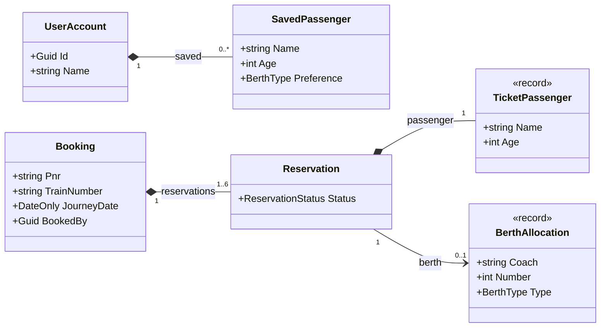
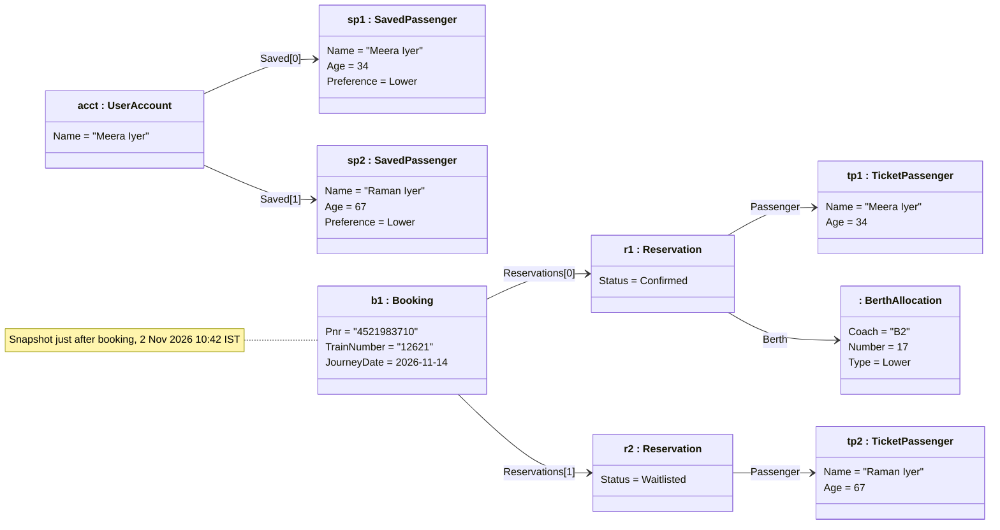
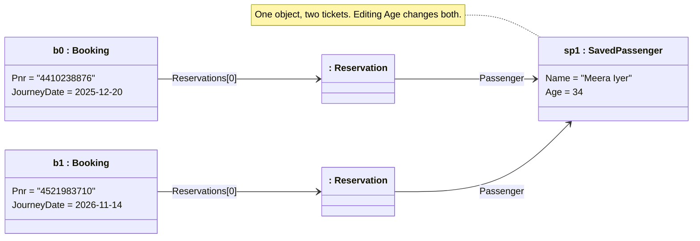
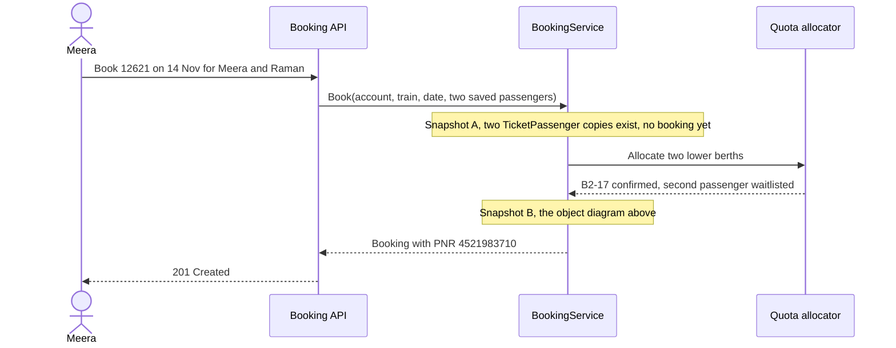
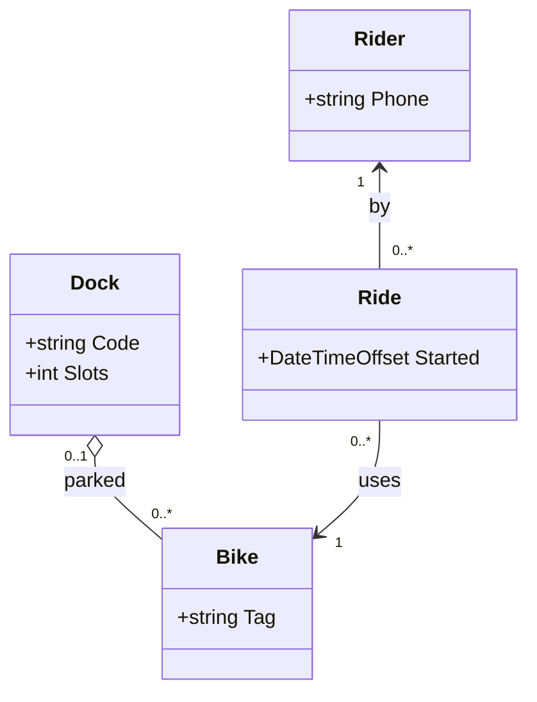
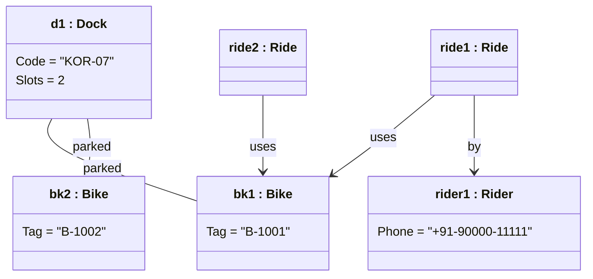
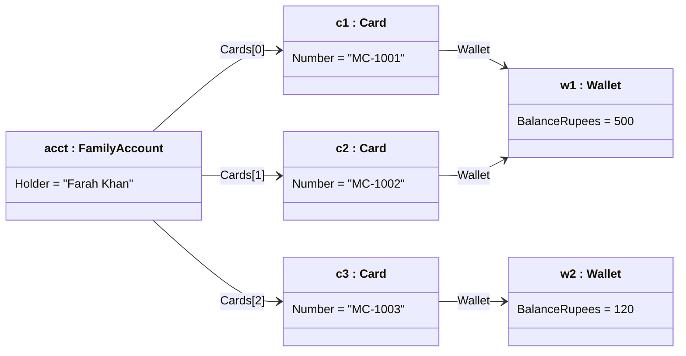
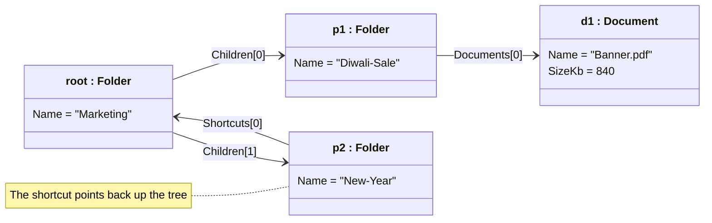

A class diagram describes every *possible* world your code allows. An object diagram shows *one actual* world: these specific objects, with these values, linked like this, right now. It is the photograph to the class diagram's floor plan. Object diagrams are small, quick to draw, and surprisingly powerful for explaining examples, testing a design, and finding bugs where two parts of a program share an object they should not.

## Learning objectives

By the end of this lesson you will be able to:

1. Explain the difference between a class diagram (types and rules) and an object diagram (instances and values at one moment).
2. Read and draw UML object notation: `name : Class`, anonymous objects, attribute values, links and role names.
3. Check whether an object diagram is a valid instance of a class diagram, using multiplicities.
4. Map an object diagram to a C# object graph: references, shared objects (aliasing), copies, cycles and value types.
5. Write object diagrams in Mermaid using `classDiagram` with instance-style labels.
6. Generate an object diagram from a live C# object graph for debugging and tests.

## Prerequisites

- [UML fundamentals](#/lesson/m05-uml-fundamentals): the diagram families and Mermaid basics.
- [Class diagrams](#/lesson/m05-class-diagrams): associations and multiplicity. Object diagrams are instances of class diagrams.
- [Value types, reference types and memory basics](#/lesson/m01-value-reference-memory): what a reference is, and how a `class` differs from a `struct`.

## Explain it like I'm a beginner

### The seating chart versus the photo

A wedding planner has a **seating plan rule**: "every table seats 8 to 10 guests; every guest sits at exactly one table". That rule is like a class diagram. It describes all valid weddings.

On the day, someone takes a **photo from the balcony** at 8:15 pm: table 4 has Anil, Priya, Joseph and five others; Priya's cousin has wandered over to table 6. That photo is like an object diagram. It shows real people, real tables, one moment. And it lets you check the rules: table 6 now has 11 people, which breaks the rule.

### Why would you want a photo?

Because rules are abstract, and people understand examples. If you tell a new developer "a booking has 1 to 6 reservations, each with a passenger and 0 or 1 berth", they nod. If you show them a picture of PNR 4521983710 with Meera on berth B2-17 and her father Raman on the waiting list with no berth yet, they *see* it.

Object diagrams are also how you think about bugs. "Why did changing Meera's age in her profile change the age on last month's ticket?" Draw the objects and the arrows, and you will see two tickets both pointing at the *same* profile object.

### Our example: train ticket booking

A rail-booking app, in the style of the sites Indian travellers use every day:

- A **user account** keeps a list of **saved passengers** (name, age, berth preference), so they don't retype them.
- A **booking** has a PNR (a 10-digit reference), a train number, a journey date, and **1 to 6 reservations**.
- Each **reservation** is for one **passenger** and has a status (Confirmed, RAC, Waitlisted) and, when confirmed, a **berth** such as coach B2, berth 17, Lower.

## First-principles explanation

### What an object diagram shows

An object diagram shows:

- **Objects** (also called instances): specific things that exist at run time.
- **Their attribute values**: not the types, the actual values.
- **Links**: the actual connections between those objects. A link is an *instance of an association*, just as an object is an instance of a class.

It does **not** show methods, because methods are the same for every object of a class. It does not show multiplicities either, because each link is a single connection: one line from this booking to that reservation.

### UML notation

An object is a rectangle. Its name compartment is **underlined** and has the form `objectName : ClassName`:

```text
+-------------------------------+
|     b1 : Booking              |   <- underlined in UML
+-------------------------------+
| pnr = "4521983710"            |   <- attribute values
| trainNumber = "12621"         |
| journeyDate = 2026-11-14      |
+-------------------------------+
```

Variations you will see:

| Name compartment | Meaning |
|---|---|
| `b1 : Booking` | A named object of class `Booking` |
| `: Booking` | An **anonymous** object: "some booking", the name doesn't matter |
| `b1` | A named object whose class is obvious or not important |
| `b1 : Booking [Confirmed]` | Some tools add the object's current state in brackets |

The underline is what tells a UML reader "this is an object, not a class". On a whiteboard, underline the name. In Mermaid you can't underline a class name, so the `name : Class` pattern does the job.

**Attribute values** are written `name = value`. Show only the attributes that matter for the point you are making. A booking with 20 fields might show just the PNR and status.

**Links** are plain solid lines between objects. Like associations, they can have:

- A **name** or **role name** at an end (`reservations`, `passenger`), which in C# is the property name.
- An **arrowhead** for navigability, if it matters: `b1 --> r1` means "b1 holds a reference to r1".

### The rule that connects the two diagrams

**Every object diagram must be a valid instance of the class diagram.**

- Every object's class must exist on the class diagram.
- Every link must correspond to an association between those classes.
- The number of links must respect the multiplicities.

If the class diagram says `Booking "1" *-- "1..6" Reservation` and your object diagram shows a booking with seven reservations, either the snapshot is impossible (good, you found a bug in the example) or the rule is wrong (good, you found a requirements question). This is the main design use of object diagrams: **testing a class diagram with concrete examples** before writing code.

### When object diagrams are worth drawing

- **To explain a class diagram with an example.** Especially for recursive or self-referencing structures (an org chart, a folder tree, a comment thread with replies) where the class diagram is one box with a loop and nobody understands it until they see three levels of real objects.
- **To check a design.** Draw two or three realistic snapshots, including awkward ones (a booking where one passenger is confirmed and another waitlisted). If you can't draw a real case, the class diagram is missing something.
- **To debug.** Draw what is actually in memory at the moment of the bug. Aliasing (two references to one object), unexpected cycles, and stale copies become visible.
- **To document test fixtures.** A complex arrange step in a test is easier to review with a small picture of the objects it builds.
- **To show before and after.** Two snapshots, before and after an operation such as "move passenger to another berth", explain the operation better than prose.

### When they are not worth it

- For simple structures where the class diagram is already obvious.
- For large data. An object diagram with 50 boxes is a database dump, not a diagram. Show three or four objects and write "...and 68 more berths".
- As permanent documentation that must stay correct. Snapshots are examples. Keep them only when the example teaches something lasting.

### Mapping to C# object graphs

When a C# program runs, objects live on the managed heap and refer to each other by references. That network is an **object graph**, and an object diagram is a picture of part of it.

| Object diagram | C# at run time |
|---|---|
| Object box `b1 : Booking` | One instance created with `new Booking(...)` |
| Attribute `pnr = "4521983710"` | A field or property holding a simple value (string, number, enum, date) |
| Link `b1 --> r1 : reservations` | `b1.Reservations` contains a reference to the object `r1` |
| Two links pointing to the *same* box | Two references to one object (**aliasing**). Changing it through one is visible through the other |
| Two *separate* boxes with equal values | Two distinct objects. `ReferenceEquals` is false, even if `Equals` is true for records |
| A chain that loops back to an earlier box | A **cycle**, for example `berth.Coach.Berths[0] == berth` |
| An attribute that is a `struct` (like `DateOnly`) | Stored inside the object, copied on assignment, never shared. Draw it as a value, not a box |

Some details that matter:

- **Collections are objects too.** `b1.Reservations` is really a reference to a `List<Reservation>` object, which holds references to the reservations. Object diagrams usually hide the list and draw links straight to the elements, labelled `reservations[0]`, `reservations[1]`. Show the list object only when the list itself is the point, for example when two bookings accidentally share one list instance.
- **Strings are reference types,** but they are immutable, so sharing them is harmless. Draw them as values.
- **Records** compare by value (`r1 == r2` can be true for two different objects), but they are still separate objects in memory if they are separate boxes. Identity and equality are different questions; see [Equality and identity](#/lesson/m07-equality-identity).
- **The debugger is an object-diagram viewer.** Visual Studio's Watch window and "Make Object ID" (which labels an object `$1`, `$2`) let you check whether two variables refer to the same object, which is exactly the question an object diagram answers.

### Object diagrams in Mermaid

Mermaid has no dedicated object diagram, but `classDiagram` works well with a few conventions:

**1. Use a short id and an instance-style label.**

```text
classDiagram
    class b1["b1 : Booking"] {
        Pnr = "4521983710"
        Status = Confirmed
    }
```

`b1` is the id you use in links. The label in `["..."]` is what the reader sees. Inside the braces, each line is an attribute value in `Name = value` form. Mermaid shows it as text; it doesn't check it.

**2. Anonymous objects** need a unique id but a label without a name:

```text
    class anyCoach[" : Coach"] {
        Code = "B2"
    }
```

**3. Links** use the class-diagram relationship syntax. Use `-->` when the direction (who holds the reference) matters, and `--` otherwise. Put the role name or the collection index after a colon:

```text
    b1 --> r1 : Reservations[0]
    b1 --> r2 : Reservations[1]
    r1 --> tp1 : Passenger
```

Do **not** put multiplicities on links. A link is always exactly one connection.

**4. Add a note for the moment in time.** Snapshots need a "when":

```text
    note for b1 "Snapshot after chart preparation, 14 Nov 2026 08:10"
```

**5. Use `direction LR`** for chains (booking to reservation to passenger read naturally left to right).

**Alternative: flowchart.** If you want the underlined name and full control of the label, a flowchart node can contain HTML: `b1["<u>b1 : Booking</u><br/>Pnr = 4521983710"]`. The class-diagram approach keeps the familiar box with compartments, so we use it in this lesson.

Common mistakes: reusing the same id for two objects (Mermaid merges them into one box, which silently *creates* the aliasing you were trying to show is absent); using the class name as the id (`class Booking[...]`) so that a second booking cannot be drawn; and writing types instead of values (`Pnr : string`).

## Visual explanation

### The class diagram (the rules)



This is the familiar class view. An account owns its saved passengers. A booking owns one to six reservations. Each reservation owns a `TicketPassenger`, which is a *copy* of the passenger's details made when the ticket was booked, and may have a berth (only when confirmed). Notice that there is **no line from `Reservation` to `SavedPassenger`**. That is a deliberate decision, and the object diagrams below show why.

### The object diagram (one real booking)



Read it box by box. Meera's account `acct` has two saved passengers. Booking `b1` has two reservations: `r1` is confirmed and linked to an anonymous berth allocation (coach B2, berth 17, lower); `r2` is waitlisted, so it has **no** berth link, which matches the `0..1` multiplicity. Each reservation links to its own `TicketPassenger` object, with values copied from `sp1` and `sp2`. There is no link from `b1` to `acct`; the booking stores the account's id as a plain value (`BookedBy` on the class diagram, left out of the snapshot because it is not the point here). Check it against the class diagram: one booking with two reservations is within `1..6`, each reservation has exactly one passenger, and each has zero or one berth. The snapshot is valid.

### Before and after: the aliasing bug

Here is what a first version of the code did. Reservations pointed straight at the saved passenger objects, with no copy:



Two bookings, a year apart, both have a reservation linked to **the same `sp1` box**. When Meera updates her age in her profile from 33 to 34, last year's ticket silently changes too. That ticket was a legal record of who travelled, so it must not change. In the code, the bug looked innocent: `new Reservation(savedPassenger)`. The object diagram makes the shared box impossible to miss. The fix is the design in the previous diagram: copy the values into an immutable `TicketPassenger` at booking time, so each ticket has its own box.

### Snapshots between messages



A sequence diagram and object diagrams work well together. The sequence diagram shows the **messages** over time; each `Note` marks a point where you could draw an object diagram of the **state** at that moment. Snapshot A has the copied passengers but no booking or berths; snapshot B is the full object diagram shown earlier. When explaining a complicated operation, a sequence diagram plus two snapshots (before and after) is often the clearest combination.

## Step-by-step example

A product manager asks: "Can one booking have passengers on different trains, for a connecting journey?" Let us use object diagrams to test the current design before arguing about it.

### Step 1: draw the awkward case

Try to draw the snapshot the PM is describing: Meera travels Chennai to Bengaluru on train 12639, then Bengaluru to Mysuru on 16557, on one PNR.

You immediately hit a wall: `TrainNumber` and `JourneyDate` are attributes of `Booking`. There is nowhere to put the second train. **The class diagram cannot produce this snapshot.** That is a fact, not an opinion, and it took two minutes to find.

### Step 2: decide whether the snapshot should be possible

Ask the business. Indian Railways issues a separate PNR per train, so the PM's case is really "two bookings, linked as one trip". That suggests a new object above bookings, not a change inside one.

### Step 3: draw the new snapshot

```text
trip1 : Trip  --legs[0]-->  b1 : Booking (12639, 14 Nov)
              --legs[1]-->  b2 : Booking (16557, 14 Nov)
```

Now check the rules this implies: a trip has `1..*` bookings; a booking belongs to `0..1` trip (most bookings are not part of a trip). Update the class diagram with `Trip "0..1" o-- "1..*" Booking`.

### Step 4: draw one more awkward case

What if the first train is cancelled? Draw `b1` with status Cancelled and `b2` still Confirmed. Is that allowed? The diagram makes the question concrete: the business decides whether cancelling one leg should cancel the trip. Each snapshot you draw is a test case you will later write in code.

### Step 5: turn snapshots into tests

Each snapshot becomes a test's arrange step. For example, "a trip with one cancelled and one confirmed leg reports `PartiallyCancelled`". The diagram, the test and the code now describe the same examples.

## Production-style C# implementation

Below is the booking domain, designed so that tickets never share passenger objects with profiles, plus a reusable **object diagram writer** that turns any live object graph into Mermaid. A development-only endpoint returns the snapshot for a PNR, so a developer can paste it into a pull request or bug report.

```text
RailBooking.Api/
  Program.cs                        // endpoints, DI, dev-only diagram endpoint
  Domain/Booking.cs                 // Booking, Reservation, TicketPassenger, BerthAllocation
  Domain/UserAccount.cs             // UserAccount, SavedPassenger
  Application/BookingService.cs     // copies passengers, allocates berths, enforces 1..6
  Diagnostics/ObjectDiagramWriter.cs// object graph -> Mermaid classDiagram with instance labels
```

```csharp file=Domain/UserAccount.cs
namespace RailBooking.Domain;

public enum BerthType { Lower, Middle, Upper, SideLower, SideUpper }

/// <summary>A profile the user edits freely. Mutable on purpose.</summary>
public sealed class SavedPassenger(string name, int age, BerthType preference)
{
    public string Name { get; set; } = name;
    public int Age { get; set; } = age;
    public BerthType Preference { get; set; } = preference;
}

/// <summary>UserAccount "1" *-- "0..*" SavedPassenger</summary>
public sealed class UserAccount(Guid id, string name)
{
    private readonly List<SavedPassenger> _saved = new();

    public Guid Id { get; } = id;
    public string Name { get; } = name;
    public IReadOnlyList<SavedPassenger> Saved => _saved;

    public SavedPassenger Save(string name, int age, BerthType preference)
    {
        ArgumentException.ThrowIfNullOrWhiteSpace(name);
        ArgumentOutOfRangeException.ThrowIfNegativeOrZero(age);
        var p = new SavedPassenger(name, age, preference);
        _saved.Add(p);
        return p;
    }
}
```

```csharp file=Domain/Booking.cs
namespace RailBooking.Domain;

public enum ReservationStatus { Confirmed, Rac, Waitlisted, Cancelled }

/// <summary>An immutable copy of the passenger's details at booking time. Each ticket owns its own.</summary>
public sealed record TicketPassenger(string Name, int Age, BerthType Preference)
{
    public static TicketPassenger CopyOf(SavedPassenger p) => new(p.Name, p.Age, p.Preference);
}

public sealed record BerthAllocation(string Coach, int Number, BerthType Type);

public sealed class Reservation
{
    internal Reservation(TicketPassenger passenger, BerthAllocation? berth)
    {
        Passenger = passenger;
        Berth = berth;
        Status = berth is null ? ReservationStatus.Waitlisted : ReservationStatus.Confirmed;
    }

    public TicketPassenger Passenger { get; }          // "1"
    public BerthAllocation? Berth { get; private set; } // "0..1"
    public ReservationStatus Status { get; private set; }

    public void Confirm(BerthAllocation berth)
    {
        if (Status is not (ReservationStatus.Waitlisted or ReservationStatus.Rac))
            throw new InvalidOperationException($"Cannot confirm a {Status} reservation.");
        Berth = berth;
        Status = ReservationStatus.Confirmed;
    }
}

/// <summary>Booking "1" *-- "1..6" Reservation. BookedBy is an id (a value), not a link to the account.</summary>
public sealed class Booking
{
    public const int MaxPassengers = 6;
    private readonly Reservation[] _reservations;

    internal Booking(string pnr, string trainNumber, DateOnly journeyDate, Guid bookedBy, IEnumerable<Reservation> reservations)
    {
        _reservations = reservations.ToArray();
        if (_reservations.Length is 0 or > MaxPassengers)
            throw new ArgumentOutOfRangeException(nameof(reservations), $"A booking has 1 to {MaxPassengers} passengers.");
        Pnr = pnr;
        TrainNumber = trainNumber;
        JourneyDate = journeyDate;
        BookedBy = bookedBy;
    }

    public string Pnr { get; }
    public string TrainNumber { get; }
    public DateOnly JourneyDate { get; }
    public Guid BookedBy { get; }
    public IReadOnlyList<Reservation> Reservations => _reservations;
}
```

```csharp file=Application/BookingService.cs
using System.Collections.Concurrent;
using RailBooking.Domain;

namespace RailBooking.Application;

public interface IBerthAllocator
{
    /// <summary>Returns a berth, or null when the quota is full (the passenger is waitlisted).</summary>
    BerthAllocation? TryAllocate(string trainNumber, DateOnly date, BerthType preference);
}

/// <summary>A toy allocator: coach B2 has 8 berths for the demo. Real quota systems are far more complex.</summary>
public sealed class InMemoryBerthAllocator : IBerthAllocator
{
    private static readonly BerthType[] Layout = [BerthType.Lower, BerthType.Middle, BerthType.Upper, BerthType.Lower,
        BerthType.Middle, BerthType.Upper, BerthType.SideLower, BerthType.SideUpper];
    private readonly ConcurrentDictionary<(string, DateOnly), HashSet<int>> _taken = new();

    public BerthAllocation? TryAllocate(string trainNumber, DateOnly date, BerthType preference)
    {
        var taken = _taken.GetOrAdd((trainNumber, date), _ => new HashSet<int>());
        lock (taken)
        {
            var free = Enumerable.Range(1, Layout.Length).Where(n => !taken.Contains(n)).ToList();
            if (free.Count == 0) return null;
            var pick = free.FirstOrDefault(n => Layout[n - 1] == preference, free[0]);
            taken.Add(pick);
            return new BerthAllocation("B2", pick, Layout[pick - 1]);
        }
    }
}

public sealed class BookingService(IBerthAllocator allocator)
{
    private readonly ConcurrentDictionary<string, Booking> _bookings = new();
    private long _nextPnr = 4521983710;

    public Booking Book(UserAccount account, string trainNumber, DateOnly date, IReadOnlyList<SavedPassenger> who)
    {
        ArgumentNullException.ThrowIfNull(account);
        ArgumentNullException.ThrowIfNull(who);
        if (who.Count is 0 or > Booking.MaxPassengers)
            throw new ArgumentOutOfRangeException(nameof(who), $"Choose 1 to {Booking.MaxPassengers} passengers.");

        // The key design decision: copy. The ticket must not change when the profile does.
        var reservations = who
            .Select(TicketPassenger.CopyOf)
            .Select(tp => new Reservation(tp, allocator.TryAllocate(trainNumber, date, tp.Preference)))
            .ToList();

        var pnr = Interlocked.Increment(ref _nextPnr).ToString();
        var booking = new Booking(pnr, trainNumber, date, account.Id, reservations);
        _bookings[pnr] = booking;
        return booking;
    }

    public Booking? Find(string pnr) => _bookings.GetValueOrDefault(pnr);
}
```

```csharp file=Diagnostics/ObjectDiagramWriter.cs
using System.Collections;
using System.Globalization;
using System.Reflection;
using System.Text;

namespace RailBooking.Diagnostics;

public sealed class ObjectDiagramOptions
{
    /// <summary>Stop adding boxes after this many objects. Snapshots should be small.</summary>
    public int MaxObjects { get; init; } = 40;

    /// <summary>Which types become boxes. Everything else is shown as a value or skipped.</summary>
    public Func<Type, bool> IsDomainType { get; init; } = t => t.Namespace == "RailBooking.Domain";
}

/// <summary>Walks a live object graph breadth-first and writes a Mermaid object diagram.
/// Identity is tracked with ReferenceEqualityComparer, so a shared object appears once with
/// several incoming links, and cycles terminate.</summary>
public static class ObjectDiagramWriter
{
    public static string Write(object root, ObjectDiagramOptions? options = null)
    {
        ArgumentNullException.ThrowIfNull(root);
        options ??= new ObjectDiagramOptions();

        var ids = new Dictionary<object, string>(ReferenceEqualityComparer.Instance);
        var queue = new Queue<object>();
        var boxes = new StringBuilder();
        var links = new StringBuilder();
        var truncated = 0;

        string IdOf(object o)
        {
            if (!ids.TryGetValue(o, out var id))
            {
                id = "o" + (ids.Count + 1).ToString(CultureInfo.InvariantCulture);
                ids[o] = id;
                queue.Enqueue(o);
            }
            return id;
        }

        void Link(string fromId, object target, string label)
        {
            if (!ids.ContainsKey(target) && ids.Count >= options.MaxObjects) { truncated++; return; }
            links.AppendLine($"    {fromId} --> {IdOf(target)} : {label}");
        }

        IdOf(root);
        while (queue.Count > 0)
        {
            var obj = queue.Dequeue();
            var id = ids[obj];
            var values = new List<string>();

            foreach (var p in ReadableProperties(obj.GetType()))
            {
                var value = p.GetValue(obj);
                if (value is null) values.Add($"{p.Name} = null");
                else if (IsSimple(value.GetType())) values.Add($"{p.Name} = {Format(value)}");
                else if (value is IEnumerable items)
                {
                    var i = 0;
                    foreach (var item in items)
                    {
                        if (item is not null && options.IsDomainType(item.GetType())) Link(id, item, $"{p.Name}[{i}]");
                        i++;
                    }
                }
                else if (options.IsDomainType(value.GetType())) Link(id, value, p.Name);
            }

            boxes.Append($"    class {id}[\"{id} : {obj.GetType().Name}\"]");
            if (values.Count == 0) { boxes.AppendLine(); continue; }
            boxes.AppendLine(" {");
            foreach (var v in values) boxes.AppendLine("        " + v);
            boxes.AppendLine("    }");
        }

        var sb = new StringBuilder("classDiagram\n    direction LR\n").Append(boxes).Append(links);
        if (truncated > 0) sb.AppendLine($"    note \"{truncated} more links not shown (MaxObjects = {options.MaxObjects})\"");
        return sb.ToString();
    }

    private static IEnumerable<PropertyInfo> ReadableProperties(Type t) =>
        t.GetProperties(BindingFlags.Public | BindingFlags.Instance)
         .Where(p => p.CanRead && p.GetIndexParameters().Length == 0 && p.Name != "EqualityContract")
         .OrderBy(p => p.MetadataToken);

    private static bool IsSimple(Type t) =>
        t.IsPrimitive || t.IsEnum || t == typeof(string) || t == typeof(decimal) || t == typeof(Guid) ||
        t == typeof(DateOnly) || t == typeof(TimeOnly) || t == typeof(DateTime) || t == typeof(DateTimeOffset) || t == typeof(TimeSpan);

    private static string Format(object value) => value switch
    {
        string s => "\"" + s.Replace("\"", "'").Replace("{", "(").Replace("}", ")") + "\"",
        DateOnly d => d.ToString("yyyy-MM-dd", CultureInfo.InvariantCulture),
        IFormattable f => f.ToString(null, CultureInfo.InvariantCulture),
        _ => value.ToString() ?? "",
    };
}
```

```csharp file=Program.cs
using RailBooking.Application;
using RailBooking.Diagnostics;
using RailBooking.Domain;

var builder = WebApplication.CreateBuilder(args);
builder.Services.AddSingleton<IBerthAllocator, InMemoryBerthAllocator>();
builder.Services.AddSingleton<BookingService>();

// Demo data: one account with two saved passengers.
var account = new UserAccount(Guid.Parse("7d1f0a52-0000-4000-8000-000000000001"), "Meera Iyer");
account.Save("Meera Iyer", 34, BerthType.Lower);
account.Save("Raman Iyer", 67, BerthType.Lower);
builder.Services.AddSingleton(account);

var app = builder.Build();

app.MapPost("/bookings", (BookRequest req, UserAccount acct, BookingService svc) =>
{
    var who = req.PassengerIndexes.Where(i => i >= 0 && i < acct.Saved.Count).Select(i => acct.Saved[i]).ToList();
    try
    {
        var b = svc.Book(acct, req.TrainNumber, req.JourneyDate, who);
        return Results.Created($"/bookings/{b.Pnr}", new { b.Pnr, Statuses = b.Reservations.Select(r => r.Status.ToString()) });
    }
    catch (ArgumentOutOfRangeException ex) { return Results.Problem(ex.Message, statusCode: 400); }
});

app.MapGet("/bookings/{pnr}", (string pnr, BookingService svc) =>
    svc.Find(pnr) is { } b ? Results.Ok(new { b.Pnr, b.TrainNumber, b.JourneyDate }) : Results.NotFound());

// Development only: the object diagram for one booking, as Mermaid text to paste into a bug report.
// Never expose this in production: it reveals passenger names and internal structure.
if (app.Environment.IsDevelopment())
{
    app.MapGet("/debug/bookings/{pnr}/object-diagram", (string pnr, BookingService svc) =>
        svc.Find(pnr) is { } b ? Results.Text(ObjectDiagramWriter.Write(b), "text/plain") : Results.NotFound());
}

app.Run();

public sealed record BookRequest(string TrainNumber, DateOnly JourneyDate, int[] PassengerIndexes);
```

What to notice:

- **The copy is the design.** `TicketPassenger.CopyOf` is one line, but it changes the object diagram: each ticket gets its own passenger box, so profile edits can't reach old tickets. It is a `record` so it is immutable and easy to compare.
- **`BookedBy` is a `Guid`, not a reference.** The booking doesn't hold the account object. In the object diagram that means no link, only a value. This keeps the booking's object graph small and stops a booking from accidentally keeping a whole account (and its saved passengers) alive in memory or in a serialised response.
- **The writer tracks identity, not equality.** `ReferenceEqualityComparer.Instance` makes the dictionary treat two different but *equal* records as two boxes, and one shared object as one box with several incoming links. That's exactly the distinction object diagrams exist to show. It also stops infinite loops on cycles.
- **Snapshots stay small.** `MaxObjects` and a note keep a 3,000-berth train from producing an unreadable diagram.
- **The debug endpoint is development-only.** It exposes personal data, so it is registered only when `IsDevelopment()` is true.

## Bad design vs good design

### Bad: sharing mutable objects across owners

```csharp
// Bad: the reservation keeps a reference to the user's editable profile.
public sealed class Reservation(SavedPassenger passenger)
{
    public SavedPassenger Passenger { get; } = passenger;
}
```

The object diagram is the "aliasing bug" picture earlier: two bookings, one passenger box. Consequences:

- Editing a profile rewrites history. A ticket checked by a travelling ticket examiner shows an age that doesn't match the passenger's ID proof.
- Deleting a saved passenger leaves old tickets pointing at an object the account no longer lists, or, after a database round-trip, at nothing.
- Serialising a booking to JSON pulls in profile data that has nothing to do with the ticket.
- Concurrency gets harder: two requests editing "the same" object from different features.

### Good: copy at the boundary, share only immutable values

- **Copy** data whose meaning is "what it was at that moment": tickets, invoices, order lines, audit records.
- **Reference** objects whose meaning is "the current one": the live train schedule, the current tariff table (if the business wants current values).
- **Share freely** only immutable objects: strings, records with no mutable members, enum values.

Object diagrams make the choice visible. When you see two arrows into one box, ask: "Should a change through one arrow be visible through the other?" If not, you need a copy.

### Not every shared box is a bug

Many bookings can safely link to one `Train` object or one `Station` object, because these are reference data and the business *wants* everyone to see the same one. Sharing is a design decision, not a smell. The diagram helps you make it on purpose.

:::callout type=mistake title="The same id twice"
In Mermaid, `class p1["p1 : Passenger"]` written twice is one box, not two. If you copy-paste a box to show "a separate copy" and forget to change the id, your diagram shows aliasing that isn't in the code. Always give each object box a unique id.
:::

## Practical playground

The playground creates two bookings from one saved passenger, first with the aliasing design and then with the copying design, and prints the object diagram for each. Try:

1. Change the passenger's age after booking and see which ticket changes.
2. Add a third booking and watch the number of incoming links to the shared box grow.
3. Replace the copy with a `with` expression on a record and check that the diagram still shows separate boxes.

:::playground type=csharp title="Aliasing versus copying, as object diagrams"
```csharp file=Program.cs
using System;
using System.Collections.Generic;
using System.Runtime.CompilerServices;

public sealed class Profile { public string Name = ""; public int Age; }
public sealed record TicketCopy(string Name, int Age);
public sealed class SharedTicket { public string Pnr = ""; public Profile Passenger = null!; }
public sealed class CopiedTicket { public string Pnr = ""; public TicketCopy Passenger = null!; }

public static class Program
{
    private static readonly Dictionary<object, string> Ids = new(ReferenceEqualityComparer.Instance);
    private static string Id(object o) => Ids.TryGetValue(o, out var id) ? id : Ids[o] = "o" + (Ids.Count + 1);

    public static void Main()
    {
        var meera = new Profile { Name = "Meera", Age = 33 };

        var shared = new[] { new SharedTicket { Pnr = "4410238876", Passenger = meera }, new SharedTicket { Pnr = "4521983710", Passenger = meera } };
        var copied = new[] { new CopiedTicket { Pnr = "4410238876", Passenger = new(meera.Name, meera.Age) }, new CopiedTicket { Pnr = "4521983710", Passenger = new(meera.Name, meera.Age) } };

        meera.Age = 34;   // the profile is edited a year later

        Console.WriteLine("classDiagram");
        foreach (var t in shared)
            Console.WriteLine($"    {Id(t)} --> {Id(t.Passenger)} : Passenger   %% {t.Pnr} shows age {t.Passenger.Age}");
        foreach (var t in copied)
            Console.WriteLine($"    {Id(t)} --> {Id(t.Passenger)} : Passenger   %% {t.Pnr} shows age {t.Passenger.Age}");

        Console.WriteLine();
        Console.WriteLine($"Shared design: same object? {ReferenceEquals(shared[0].Passenger, shared[1].Passenger)}");
        Console.WriteLine($"Copied design: same object? {ReferenceEquals(copied[0].Passenger, copied[1].Passenger)}, equal values? {copied[0].Passenger == copied[1].Passenger}");
    }
}
```
:::

## Exercises

:::exercise id=m05-object-diagrams-ex1 difficulty=beginner kind=written title="Is this snapshot valid?"
The class diagram for a city bike-sharing scheme says:



Here is a snapshot someone drew:



1. Which links break the class diagram's multiplicities? Name each one and the rule it breaks.
2. Which part of the snapshot is allowed by the class diagram but probably wrong for the business? Suggest a rule to add.
3. What does the absence of a link from `bk2` to any ride tell you?
::acceptance
- Identifies that `ride2` has no `by` link to a rider, breaking `Ride --> "1" Rider`.
- Notices that `bk1` is parked at a dock and used by two rides at once, which the multiplicities allow but the business would not.
- Proposes a rule such as "a bike has at most one active ride" or "a bike on a ride is not parked", and says where it could be recorded (a note, a state, or code).
- Explains that `bk2` simply has no rides yet, which `0..*` allows.
::hint
For every object, count its links of each association, and compare with the number at the far end of the class-diagram line.
::hint
`Rider "1" <-- "0..*" Ride` means each ride has exactly one rider.
::hint
Multiplicities say nothing about time. "Two rides at once" needs a rule about *active* rides.
::hint
The `Slots = 2` value is also worth checking against the number of parked bikes.
::solution
1. **`ride2` has no rider.** The class diagram says each ride is `by` exactly one rider, so `ride2` needs one `by` link. This snapshot is invalid. Every other link count is within its multiplicity: `bk1` is used by two rides, which `0..*` (rides per bike) allows; each ride uses exactly one bike.
2. **`bk1` is both parked at `d1` and used by two rides.** Multiplicities allow it, because they don't know about time. But a bike can't be on two rides at once, and a bike on a ride shouldn't be parked. Add a rule: "a bike has at most one active ride, and an active bike has no dock". Record it as a note on the class diagram, model it as a bike state (`Parked`, `InUse`) on a [state diagram](#/lesson/m05-state-diagrams), and enforce it in code. If `ride1` is a finished ride, the snapshot is fine; then the diagram should show a `Finished` status to make that clear.
3. `bk2` has never been ridden in the period this snapshot covers (or its rides are not shown). `0..*` allows zero, so this is valid. The dock has 2 slots and 2 bikes, so it is full, which is also valid.
::mistakes
- Reading the multiplicities from the wrong end and claiming a bike can only be used by one ride ever.
- Treating "allowed by the multiplicities" as "correct". Object diagrams are good at finding rules the class diagram can't express.
:::

:::exercise id=m05-object-diagrams-ex2 difficulty=beginner kind=code title="Build the snapshot in C#"
A metro smart-card scheme lets a family share one wallet across several cards. Build exactly this object diagram in code:


::requirements
- Implement `SnapshotFactory.Build()` so it returns the `FamilyAccount` shown, with its three cards in order.
- `c1` and `c2` must share **one** wallet object (`w1`). `c3` has its own (`w2`).
- Implement `Card.Pay(decimal rupees)`: subtracts from the card's wallet; throws `InvalidOperationException` if the balance would go below zero.
::acceptance
- `Assert.Same` passes for the wallets of cards 1 and 2; `Assert.NotSame` for cards 1 and 3.
- Paying ₹40 with card 1 leaves card 2 showing ₹460.
- Paying ₹130 with card 3 throws and leaves its balance at ₹120.
::hint
Each box in the diagram is one `new`. Count the boxes: how many `new Wallet(...)` calls should there be?
::hint
Two arrows into `w1` means two variables (or properties) holding the same reference. Create `w1` once and pass it to both cards.
::hint
```csharp
var w1 = new Wallet(500m);
var c1 = new Card("MC-1001", w1);
var c2 = new Card("MC-1002", w1);
```
::starter
```csharp file=SmartCards.cs
using System;
using System.Collections.Generic;

public sealed class Wallet(decimal balanceRupees)
{
    public decimal BalanceRupees { get; internal set; } = balanceRupees;
}

public sealed class Card(string number, Wallet wallet)
{
    public string Number { get; } = number;
    public Wallet Wallet { get; } = wallet;

    public void Pay(decimal rupees) => throw new NotImplementedException();
}

public sealed class FamilyAccount(string holder, IReadOnlyList<Card> cards)
{
    public string Holder { get; } = holder;
    public IReadOnlyList<Card> Cards { get; } = cards;
}

public static class SnapshotFactory
{
    public static FamilyAccount Build() => throw new NotImplementedException();
}
```
::tests
```csharp file=SmartCardTests.cs
using System;
using Xunit;

public class SmartCardTests
{
    [Fact]
    public void Shape_matches_the_diagram()
    {
        var acct = SnapshotFactory.Build();
        Assert.Equal("Farah Khan", acct.Holder);
        Assert.Equal(new[] { "MC-1001", "MC-1002", "MC-1003" }, new[] { acct.Cards[0].Number, acct.Cards[1].Number, acct.Cards[2].Number });
        Assert.Same(acct.Cards[0].Wallet, acct.Cards[1].Wallet);
        Assert.NotSame(acct.Cards[0].Wallet, acct.Cards[2].Wallet);
        Assert.Equal(500m, acct.Cards[0].Wallet.BalanceRupees);
        Assert.Equal(120m, acct.Cards[2].Wallet.BalanceRupees);
    }

    [Fact]
    public void Shared_wallet_is_visible_through_both_cards()
    {
        var acct = SnapshotFactory.Build();
        acct.Cards[0].Pay(40m);
        Assert.Equal(460m, acct.Cards[1].Wallet.BalanceRupees);
        Assert.Equal(120m, acct.Cards[2].Wallet.BalanceRupees);
    }

    [Fact]
    public void Cannot_go_negative()
    {
        var acct = SnapshotFactory.Build();
        Assert.Throws<InvalidOperationException>(() => acct.Cards[2].Pay(130m));
        Assert.Equal(120m, acct.Cards[2].Wallet.BalanceRupees);
    }
}
```
::solution
```csharp file=SmartCards.cs
using System;
using System.Collections.Generic;

public sealed class Wallet(decimal balanceRupees)
{
    public decimal BalanceRupees { get; internal set; } = balanceRupees;
}

public sealed class Card(string number, Wallet wallet)
{
    public string Number { get; } = number;
    public Wallet Wallet { get; } = wallet;

    public void Pay(decimal rupees)
    {
        ArgumentOutOfRangeException.ThrowIfNegativeOrZero(rupees);
        if (Wallet.BalanceRupees < rupees)
            throw new InvalidOperationException($"Insufficient balance: {Wallet.BalanceRupees} available, {rupees} needed.");
        Wallet.BalanceRupees -= rupees;
    }
}

public sealed class FamilyAccount(string holder, IReadOnlyList<Card> cards)
{
    public string Holder { get; } = holder;
    public IReadOnlyList<Card> Cards { get; } = cards;
}

public static class SnapshotFactory
{
    public static FamilyAccount Build()
    {
        var w1 = new Wallet(500m);   // one box, two incoming arrows
        var w2 = new Wallet(120m);
        var cards = new[] { new Card("MC-1001", w1), new Card("MC-1002", w1), new Card("MC-1003", w2) };
        return new FamilyAccount("Farah Khan", cards);
    }
}
```

Six boxes in the diagram, six `new` expressions in the code (counting the array as plumbing). The two arrows into `w1` become one variable passed twice.
::mistakes
- Writing `new Wallet(500m)` inside each `new Card(...)`, which creates two wallets that merely have equal balances.
- Checking the balance after subtracting, so a failed payment still changes the wallet.
::extensions
Add a `Wallet` field to `FamilyAccount` too (a third arrow into `w1`) and discuss whether that makes the shared ownership clearer or just adds a second way to reach the same object.
:::

:::exercise id=m05-object-diagrams-ex3 difficulty=intermediate kind=code title="Shallow copy, list copy, deep copy"
A travel planner copies an itinerary so a user can edit a draft without touching the original. Implement three copies and make each match its object diagram:

- **Shallow**: a new `Itinerary` that shares the **same list object** as the original.
- **Copy list**: a new `Itinerary` with a **new list** that holds the **same leg objects**.
- **Deep**: a new `Itinerary`, a new list and **new leg objects**, but the legs still share the **same station objects** (stations are immutable reference data).
::requirements
- `Itinerary.ShallowCopy()`, `Itinerary.CopyList()`, `Itinerary.DeepCopy()` as described.
- `Leg` has `From`, `To` (both `Station`) and a mutable `Departure` (`TimeOnly`).
- After `DeepCopy`, changing a leg's departure in the copy must not change the original.
::acceptance
- Shallow: the `Legs` list objects are the same (`Assert.Same`).
- Copy list: the lists differ, but `Legs[0]` is the same object in both.
- Deep: lists and legs differ, `From` stations are the same object, and editing the copy's departure leaves the original's unchanged.
::hint
Draw the three object diagrams first. For each, count which boxes are new and which arrows point to existing boxes.
::hint
`new List<Leg>(Legs)` creates a new list that holds the same references.
::hint
For the deep copy, create a new `Leg` for each old one, passing the *same* `From` and `To` references.
::hint
```csharp
public Itinerary DeepCopy() => new(Name, Legs.Select(l => new Leg(l.From, l.To, l.Departure)).ToList());
```
::starter
```csharp file=Itinerary.cs
using System;
using System.Collections.Generic;
using System.Linq;

public sealed record Station(string Code, string Name);

public sealed class Leg(Station from, Station to, TimeOnly departure)
{
    public Station From { get; } = from;
    public Station To { get; } = to;
    public TimeOnly Departure { get; set; } = departure;
}

public sealed class Itinerary(string name, List<Leg> legs)
{
    public string Name { get; } = name;
    public List<Leg> Legs { get; } = legs;

    public Itinerary ShallowCopy() => throw new NotImplementedException();
    public Itinerary CopyList() => throw new NotImplementedException();
    public Itinerary DeepCopy() => throw new NotImplementedException();
}
```
::tests
```csharp file=ItineraryTests.cs
using System;
using System.Collections.Generic;
using Xunit;

public class ItineraryTests
{
    private static readonly Station Mas = new("MAS", "Chennai Central");
    private static readonly Station Sbc = new("SBC", "KSR Bengaluru");
    private static readonly Station Mys = new("MYS", "Mysuru Jn");

    private static Itinerary Original() => new("Weekend trip", new List<Leg>
    {
        new(Mas, Sbc, new TimeOnly(6, 0)),
        new(Sbc, Mys, new TimeOnly(11, 30)),
    });

    [Fact]
    public void Shallow_shares_the_list()
    {
        var a = Original();
        var b = a.ShallowCopy();
        Assert.NotSame(a, b);
        Assert.Same(a.Legs, b.Legs);
    }

    [Fact]
    public void CopyList_shares_the_legs()
    {
        var a = Original();
        var b = a.CopyList();
        Assert.NotSame(a.Legs, b.Legs);
        Assert.Same(a.Legs[0], b.Legs[0]);
        b.Legs.RemoveAt(1);
        Assert.Equal(2, a.Legs.Count);
    }

    [Fact]
    public void Deep_copies_legs_but_shares_stations()
    {
        var a = Original();
        var b = a.DeepCopy();
        Assert.NotSame(a.Legs, b.Legs);
        Assert.NotSame(a.Legs[0], b.Legs[0]);
        Assert.Same(a.Legs[0].From, b.Legs[0].From);
        b.Legs[0].Departure = new TimeOnly(7, 15);
        Assert.Equal(new TimeOnly(6, 0), a.Legs[0].Departure);
        Assert.Equal(a.Name, b.Name);
    }
}
```
::solution
```csharp file=Itinerary.cs
using System;
using System.Collections.Generic;
using System.Linq;

public sealed record Station(string Code, string Name);

public sealed class Leg(Station from, Station to, TimeOnly departure)
{
    public Station From { get; } = from;
    public Station To { get; } = to;
    public TimeOnly Departure { get; set; } = departure;
}

public sealed class Itinerary(string name, List<Leg> legs)
{
    public string Name { get; } = name;
    public List<Leg> Legs { get; } = legs;

    // New itinerary box, arrow to the SAME list box.
    public Itinerary ShallowCopy() => new(Name, Legs);

    // New itinerary box, new list box, arrows to the SAME leg boxes.
    public Itinerary CopyList() => new(Name, new List<Leg>(Legs));

    // New itinerary, new list, new legs; arrows from new legs to the SAME (immutable) stations.
    public Itinerary DeepCopy() => new(Name, Legs.Select(l => new Leg(l.From, l.To, l.Departure)).ToList());
}
```

"Deep" is never absolute. You decide, box by box, where the copy stops. Here it stops at `Station` because stations are immutable records: sharing them is safe and saves memory. The object diagram for each copy is the specification.
::alternatives
Make `Leg` an immutable record and change departures with `with` expressions. Then a list copy is enough, because nobody can mutate a shared leg. Immutability often removes the need for deep copies entirely; see [Immutable objects](#/lesson/m07-immutability).
::mistakes
- Calling `MemberwiseClone` and assuming it is deep. It copies field values, so references still point to the same objects.
- Deep-copying the stations too, which wastes memory and breaks code that compares stations by reference.
::extensions
Draw the three object diagrams in Mermaid, and add a fourth method that deep-copies using JSON serialisation. Measure (do not guess) how it compares in speed with the hand-written copy for 1,000 legs, using `Stopwatch`.
:::

:::exercise id=m05-object-diagrams-ex4 difficulty=intermediate kind=written title="Snapshot a folder tree with a shortcut"
A cloud-drive app (think Google Drive or OneDrive for a small marketing team) has a self-referencing class diagram: `Folder "0..1" o-- "0..*" Folder : children` and `Folder "1" *-- "0..*" Document`. A new feature adds **shortcuts**: a folder can contain a link to another folder elsewhere in the tree (`Folder "0..*" --> "0..*" Folder : shortcuts`).

1. Draw (in Mermaid) an object diagram with a root folder `Marketing`, two child folders `Diwali-Sale` and `New-Year`, one document in `Diwali-Sale` (`Banner.pdf`), and a shortcut from `New-Year` back to `Marketing`.
2. Point out the cycle in your diagram.
3. Explain two things that will break in naive code because of that cycle, and how to fix each.
::acceptance
- A valid Mermaid object diagram with unique ids, instance labels, and labelled links for children, documents and the shortcut.
- The cycle (`Marketing` to `New-Year` and back via the shortcut) is identified.
- At least two concrete failures are named, for example recursive size calculation never ending and JSON serialisation failing, each with a fix.
::hint
Use `class root["root : Folder"]` style labels and `-->` links with `: Children[0]` labels.
::hint
Follow the arrows from `root`. Can you come back to `root`?
::hint
Think about any code that walks "all children recursively": size totals, permission checks, search, export.
::hint
Fixes usually involve a visited set (identity-based), treating shortcuts differently from children, or serialising ids instead of objects.
::solution


The cycle is `root --> p2 --> root`. Following children and shortcuts from the root brings you back to the root.

Things that break:

1. **Recursive walks never end.** `TotalSize()` that sums documents of the folder plus `TotalSize()` of every child *and shortcut* recurses forever and ends in a `StackOverflowException`, which cannot be caught and crashes the process. Fix: walk only `Children` for ownership-based operations (size, delete, permissions), because children form a tree; treat shortcuts as references to be displayed, not followed. If you must follow both, keep a `HashSet<Folder>` with `ReferenceEqualityComparer` of visited folders.
2. **JSON serialisation fails.** `System.Text.Json` throws a `JsonException` ("a possible object cycle was detected") once nesting passes its maximum depth, 64 by default. Fix: return DTOs where shortcuts are represented by the target folder's id and path, not the object. `ReferenceHandler.IgnoreCycles` writes `null` for the repeated reference (quiet, but the client loses the shortcut), and `ReferenceHandler.Preserve` produces `$id`/`$ref` JSON that most API clients don't expect; a DTO is clearer than either.
3. (Also acceptable) **Deleting** `New-Year` with cascade-through-references could delete the whole tree. Shortcuts must never be followed by delete.
::mistakes
- Drawing the shortcut as a child link, which hides the difference between owning and referring.
- Fixing the infinite loop by limiting depth to some number, which silently gives wrong totals.
:::

:::exercise id=m05-object-diagrams-ex5 difficulty=advanced kind=code title="Validate a snapshot against the class diagram"
Write a validator that checks whether an object diagram (objects and links, as data) is a valid instance of a class diagram's associations. A test suite can then express design examples as snapshots and check them automatically.
::requirements
- Input: `ObjectSpec(Id, ClassName)`, `LinkSpec(FromId, Association, ToId)`, and `AssociationRule(Name, FromClass, ToClass, Min, Max, MaxSources)`. `Min`/`Max` limit how many links of that association **each `FromClass` object** has (`Max` null = unbounded). `MaxSources` (nullable) limits how many `FromClass` objects may link to the **same target**.
- `SnapshotValidator.Validate(objects, links, rules)` returns a list of error strings, in this order: link errors in input order, then multiplicity errors by rule order and then by object id (ordinal).
- Link errors: unknown object id (`"unknown object 'x'"`); unknown association (`"unknown association 'y'"`); wrong class at either end (`"'p1' is Coach, expected Passenger"`). A link with any error is ignored for multiplicity counting.
- Multiplicity errors: `"b1 has 7 'reservations' links, allowed 1..6"` (use `*` for an unbounded max) and `"berth1 is targeted by 2 'berth' links, allowed at most 1"`.
- Duplicate object ids throw `ArgumentException`.
::acceptance
- A valid booking snapshot gives no errors.
- A booking with zero reservations reports the `1..6` rule.
- Two reservations linked to one berth report `MaxSources`.
- A link to a missing object, or to an object of the wrong class, is reported and not counted.
::hint
Build a dictionary from object id to class name first, and a dictionary from rule name to rule.
::hint
Validate each link in order, collecting the good ones in a list. Then do the counting only on good links.
::hint
For `Min`/`Max`: for each rule, for every object whose class is `FromClass` (sorted by id), count good links where `Association == rule.Name && FromId == obj.Id`. Objects with zero links matter too.
::hint
For `MaxSources`: group good links of the rule by `ToId` and count distinct `FromId`s.
::hint
```csharp
var range = $"{rule.Min}..{(rule.Max is null ? "*" : rule.Max.ToString())}";
if (count < rule.Min || (rule.Max is { } max && count > max))
    errors.Add($"{obj.Id} has {count} '{rule.Name}' links, allowed {range}");
```
::starter
```csharp file=SnapshotValidator.cs
using System;
using System.Collections.Generic;
using System.Linq;

public sealed record ObjectSpec(string Id, string ClassName);
public sealed record LinkSpec(string FromId, string Association, string ToId);
public sealed record AssociationRule(string Name, string FromClass, string ToClass, int Min, int? Max, int? MaxSources = null);

public static class SnapshotValidator
{
    public static IReadOnlyList<string> Validate(IEnumerable<ObjectSpec> objects, IEnumerable<LinkSpec> links, IEnumerable<AssociationRule> rules)
        => throw new NotImplementedException();
}
```
::tests
```csharp file=SnapshotValidatorTests.cs
using System;
using System.Collections.Generic;
using System.Linq;
using Xunit;

public class SnapshotValidatorTests
{
    private static readonly AssociationRule[] Rules =
    {
        new("reservations", "Booking", "Reservation", 1, 6),
        new("passenger", "Reservation", "TicketPassenger", 1, 1),
        new("berth", "Reservation", "Berth", 0, 1, MaxSources: 1),
    };

    private static List<ObjectSpec> Objects() => new()
    {
        new("b1", "Booking"), new("r1", "Reservation"), new("r2", "Reservation"),
        new("tp1", "TicketPassenger"), new("tp2", "TicketPassenger"), new("berth1", "Berth"),
    };

    private static List<LinkSpec> Links() => new()
    {
        new("b1", "reservations", "r1"), new("b1", "reservations", "r2"),
        new("r1", "passenger", "tp1"), new("r2", "passenger", "tp2"),
        new("r1", "berth", "berth1"),
    };

    [Fact] public void Valid_snapshot() => Assert.Empty(SnapshotValidator.Validate(Objects(), Links(), Rules));

    [Fact]
    public void Booking_without_reservations()
    {
        var links = Links().Where(l => l.Association != "reservations").ToList();
        var errors = SnapshotValidator.Validate(Objects(), links, Rules);
        Assert.Contains("b1 has 0 'reservations' links, allowed 1..6", errors);
    }

    [Fact]
    public void Unbounded_max_is_written_as_star()
    {
        var rules = new[] { new AssociationRule("legs", "Trip", "Booking", 1, null) };
        var errors = SnapshotValidator.Validate(new[] { new ObjectSpec("t1", "Trip") }, Array.Empty<LinkSpec>(), rules);
        Assert.Equal(new[] { "t1 has 0 'legs' links, allowed 1..*" }, errors.ToArray());
    }

    [Fact]
    public void Shared_berth_breaks_max_sources()
    {
        var links = Links();
        links.Add(new("r2", "berth", "berth1"));
        var errors = SnapshotValidator.Validate(Objects(), links, Rules);
        Assert.Contains("berth1 is targeted by 2 'berth' links, allowed at most 1", errors);
    }

    [Fact]
    public void Bad_links_are_reported_and_not_counted()
    {
        var links = Links();
        links.Add(new("b1", "reservations", "ghost"));
        links.Add(new("b1", "reservations", "tp1"));
        links.Add(new("b1", "owner", "r1"));
        var errors = SnapshotValidator.Validate(Objects(), links, Rules);
        Assert.Equal(3, errors.Count);
        Assert.Contains(errors, e => e.Contains("unknown object 'ghost'"));
        Assert.Contains(errors, e => e.Contains("'tp1' is TicketPassenger, expected Reservation"));
        Assert.Contains(errors, e => e.Contains("unknown association 'owner'"));
    }

    [Fact]
    public void Too_many_passengers_on_one_reservation()
    {
        var links = Links();
        links.Add(new("r1", "passenger", "tp2"));
        var errors = SnapshotValidator.Validate(Objects(), links, Rules);
        Assert.Equal(new[] { "r1 has 2 'passenger' links, allowed 1..1" }, errors.ToArray());
    }

    [Fact]
    public void Duplicate_ids_throw()
    {
        var objects = Objects();
        objects.Add(new("b1", "Booking"));
        Assert.Throws<ArgumentException>(() => SnapshotValidator.Validate(objects, Links(), Rules));
    }
}
```
::solution
```csharp file=SnapshotValidator.cs
using System;
using System.Collections.Generic;
using System.Linq;

public sealed record ObjectSpec(string Id, string ClassName);
public sealed record LinkSpec(string FromId, string Association, string ToId);
public sealed record AssociationRule(string Name, string FromClass, string ToClass, int Min, int? Max, int? MaxSources = null);

public static class SnapshotValidator
{
    public static IReadOnlyList<string> Validate(IEnumerable<ObjectSpec> objects, IEnumerable<LinkSpec> links, IEnumerable<AssociationRule> rules)
    {
        var classOf = new Dictionary<string, string>(StringComparer.Ordinal);
        foreach (var o in objects)
            if (!classOf.TryAdd(o.Id, o.ClassName))
                throw new ArgumentException($"Duplicate object id '{o.Id}'.", nameof(objects));

        var ruleList = rules.ToList();
        var ruleByName = ruleList.ToDictionary(r => r.Name, StringComparer.Ordinal);
        var errors = new List<string>();
        var good = new List<LinkSpec>();

        foreach (var link in links)
        {
            var label = $"Link {link.FromId} -{link.Association}-> {link.ToId}";
            var linkErrors = new List<string>();
            if (!classOf.ContainsKey(link.FromId)) linkErrors.Add($"{label}: unknown object '{link.FromId}'");
            if (!classOf.ContainsKey(link.ToId)) linkErrors.Add($"{label}: unknown object '{link.ToId}'");
            if (!ruleByName.TryGetValue(link.Association, out var rule)) linkErrors.Add($"{label}: unknown association '{link.Association}'");
            else if (linkErrors.Count == 0)
            {
                if (classOf[link.FromId] != rule.FromClass)
                    linkErrors.Add($"{label}: '{link.FromId}' is {classOf[link.FromId]}, expected {rule.FromClass}");
                if (classOf[link.ToId] != rule.ToClass)
                    linkErrors.Add($"{label}: '{link.ToId}' is {classOf[link.ToId]}, expected {rule.ToClass}");
            }
            if (linkErrors.Count == 0) good.Add(link); else errors.AddRange(linkErrors);
        }

        foreach (var rule in ruleList)
        {
            var ofRule = good.Where(l => l.Association == rule.Name).ToList();
            var range = $"{rule.Min}..{(rule.Max is null ? "*" : rule.Max.Value.ToString())}";

            foreach (var id in classOf.Where(kv => kv.Value == rule.FromClass).Select(kv => kv.Key).OrderBy(i => i, StringComparer.Ordinal))
            {
                var count = ofRule.Count(l => l.FromId == id);
                if (count < rule.Min || (rule.Max is { } max && count > max))
                    errors.Add($"{id} has {count} '{rule.Name}' links, allowed {range}");
            }

            if (rule.MaxSources is { } maxSources)
                foreach (var g in ofRule.GroupBy(l => l.ToId).OrderBy(g => g.Key, StringComparer.Ordinal))
                {
                    var sources = g.Select(l => l.FromId).Distinct().Count();
                    if (sources > maxSources)
                        errors.Add($"{g.Key} is targeted by {sources} '{rule.Name}' links, allowed at most {maxSources}");
                }
        }

        return errors;
    }
}
```

This is the formal version of "an object diagram must be an instance of the class diagram". `Min`/`Max` check the multiplicity at the far end of each association; `MaxSources` checks the near end (for example, "a berth is allocated to at most one reservation"). Teams use exactly this idea in tests: write realistic snapshots as data, and fail the build if one becomes invalid after a design change.
::alternatives
Instead of data specs, walk real C# objects with reflection (like the production `ObjectDiagramWriter`) and validate the live graph. That checks the code rather than a drawing, at the cost of reflection complexity.
::mistakes
- Counting only objects that appear in links, so a booking with zero reservations is never checked.
- Counting bad links (unknown ids, wrong classes) towards multiplicities, which produces confusing duplicate errors.
- Checking `MaxSources` by counting links rather than distinct sources, so a duplicated link looks like two sources.
::extensions
Parse the snapshot directly from Mermaid text: `class id["id : ClassName"]` lines become `ObjectSpec`s and `a --> b : association` lines become `LinkSpec`s.
:::

## Automated testing

Object diagrams translate naturally into tests, because a snapshot is a concrete example.

**1. Identity assertions.** When a diagram says "two arrows into one box", assert `Assert.Same`. When it says "separate boxes", assert `Assert.NotSame`. This is the most direct check that the code builds the graph you drew:

```csharp
[Fact] // Each ticket has its own TicketPassenger box (no aliasing with the profile)
public void Tickets_copy_passengers()
{
    var account = new UserAccount(Guid.NewGuid(), "Meera");
    var meera = account.Save("Meera Iyer", 33, BerthType.Lower);
    var svc = new BookingService(new InMemoryBerthAllocator());

    var first = svc.Book(account, "12621", new DateOnly(2025, 12, 20), [meera]);
    meera.Age = 34;
    var second = svc.Book(account, "12621", new DateOnly(2026, 11, 14), [meera]);

    Assert.Equal(33, first.Reservations[0].Passenger.Age);
    Assert.Equal(34, second.Reservations[0].Passenger.Age);
    Assert.NotSame(first.Reservations[0].Passenger, second.Reservations[0].Passenger);
}
```

**2. Snapshot (approval) tests.** Generate the object diagram for a known fixture with `ObjectDiagramWriter.Write(booking)` and compare it with a committed `.mmd` file. If the structure changes, the test fails and shows the diff, and the reviewer sees the new picture. Keep fixtures small and deterministic: fixed ids, fixed dates, no `Guid.NewGuid()` in values you print.

**3. Multiplicity validation.** Use a validator like exercise 5 to check that example snapshots stay valid as the class diagram evolves.

**4. Cycle-safety tests.** For any code that walks a graph (export, copy, size totals), build a fixture with a cycle and assert the method finishes and returns the right answer.

## Real-world application

- **Explaining recursive models.** Organisation hierarchies, product category trees in an online store, nested comment replies on a social app, and task/sub-task trees in a Jira-style tool are almost always explained with a three-level object diagram.
- **Bug reports.** "Here is what memory looked like" with a small object diagram makes aliasing and stale-copy bugs obvious to reviewers. Debuggers show the same thing interactively.
- **Domain modelling workshops.** Before agreeing a class diagram, teams draw example snapshots with business experts: "show me an order where one item was returned and another was replaced". Experts understand examples far better than abstract rules.
- **Test fixtures.** Large integration tests often document their seed data as a small object diagram.
- **Memory leak analysis.** Memory-profiler tools show "retention paths": chains of references from a GC root (such as a static event) to a leaked object. That chain is an object diagram, and drawing it shows which reference to remove.

## Interview questions

:::interview
::q beginner
What is the difference between a class diagram and an object diagram?
::a
A class diagram shows types and the rules between them: classes, attributes with types, operations, associations with multiplicities. It describes every valid state of the system. An object diagram shows one particular state: specific objects named `name : Class`, their actual attribute values, and the links between them at one moment. It has no operations and no multiplicities, because each link is a single connection. An object diagram must be a valid instance of the class diagram.
::q beginner
How do you draw an object diagram in Mermaid?
::a
Use `classDiagram` with a short id per object and an instance-style label: `class b1["b1 : Booking"] { Pnr = "4521983710" }`. Attribute values go inside the braces as `Name = value`. Anonymous objects use labels like `[" : Coach"]` with a unique id. Links use `-->` (or `--`) with the role name or collection index as the label, like `b1 --> r1 : Reservations[0]`. Add a note with the time of the snapshot. Each object needs a unique id, otherwise Mermaid merges boxes.
::q intermediate
How would you use an object diagram to find an aliasing bug?
::a
Draw the objects involved at the moment the wrong behaviour happens, giving each actual instance its own box, and draw an arrow for every reference. If two owners that should be independent (two tickets, two orders) both point at the same box, that's aliasing: a change through one owner is visible through the other. In code I confirm it with `ReferenceEquals` or the debugger's object ids. The fix is usually to copy at the boundary (for example, copy passenger details into an immutable record when booking), or to make the shared object immutable so sharing is harmless.
::q intermediate
Why are object diagrams useful when designing a class model with business experts?
::a
Experts think in examples, not in multiplicities. Drawing realistic and awkward snapshots ("a booking with one confirmed and one waitlisted passenger", "an order with one item returned and one replaced") tests the class diagram: if you cannot draw a real case, the model is missing something; if you can draw an impossible case, a rule is missing. Each snapshot becomes a test fixture later, so design, tests and code share the same examples.
::q advanced
How does identity versus equality affect object diagrams in C#?
::a
An object diagram is about identity: each box is one object in memory, and arrows are references. Two records with equal values are still two boxes if they are two objects, even though `==` returns true. Conversely, one object referenced from two places is one box with two arrows. So when generating or reasoning about diagrams, compare with `ReferenceEquals` or `ReferenceEqualityComparer`, not `Equals`. This matters for mutable objects (aliasing bugs), for cycle detection when walking graphs, and for caching. For immutable records, sharing one instance or using equal copies behaves the same, which is why immutability makes object graphs easier to reason about.
::q advanced
You need to generate object diagrams from a live object graph for debugging. What are the pitfalls?
::a
Cycles (walk with an identity-based visited set so the walk ends); size (cap the number of objects and add a note, because a real graph can have thousands); noise (only expand domain types; show strings, numbers, enums and dates as values; skip framework objects and compiler-generated properties such as a record's `EqualityContract`); collections (draw links to elements with indexes rather than a box for the list); lazy-loaded properties (reading them can trigger database queries or exceptions, so generate from plain in-memory objects or DTOs); determinism (order properties consistently and avoid printing random ids, so diagrams can be compared in tests); and security (snapshots can contain personal data, so expose generators only in development and redact sensitive fields).
:::

## Summary and revision

**Key takeaways**

- An **object diagram** is a snapshot: specific objects (`name : Class`, underlined in UML), their attribute **values**, and **links** between them at one moment.
- **Links** are instances of associations. They have no multiplicities, because each is exactly one connection.
- Every object diagram must be a **valid instance of the class diagram**. Drawing awkward snapshots is a fast way to test a class model.
- In C#, a box is one object on the heap and an arrow is a reference. **Two arrows into one box is aliasing**; two boxes with equal values are separate objects.
- Copy data that means "what it was then" (tickets, invoices). Share only immutable or deliberately shared reference data.
- **Mermaid**: `classDiagram` with `class id["id : Class"] { Attr = value }`, `[" : Class"]` for anonymous objects, `-->` links with role or index labels, a `note` for the time, and unique ids.
- Generate diagrams from live graphs with an **identity-based** walk, a size cap, and development-only exposure.

**Terminology**: object, instance, link, snapshot, anonymous object, attribute value, aliasing, shallow copy, deep copy, cycle, object graph, identity, equality.

:::flashcards
Q: How is an object named in UML?
A: `objectName : ClassName`, underlined. `: ClassName` alone is an anonymous object.
Q: Why do links in an object diagram have no multiplicities?
A: Each link is one actual connection between two specific objects. Multiplicities belong to associations on the class diagram.
Q: What is the rule connecting object diagrams and class diagrams?
A: An object diagram must be a valid instance of the class diagram: classes exist, links match associations, link counts respect multiplicities.
Q: In an object diagram, what does it mean when two arrows point into the same box?
A: Two references to one object (aliasing). A change made through one is visible through the other.
Q: How do you draw an object in Mermaid?
A: `class b1["b1 : Booking"] { Pnr = "4521983710" }` inside a `classDiagram`, with a unique id per object.
Q: Shallow copy versus deep copy, in object-diagram terms?
A: Shallow: a new box whose arrows point to the same boxes as the original. Deep: new boxes for the parts too, down to wherever you decide sharing is safe.
Q: Which .NET type helps track object identity when walking a graph?
A: `ReferenceEqualityComparer.Instance`, used as the comparer of a dictionary or hash set.
Q: When should you copy instead of share?
A: When the data means "what it was at that moment" (tickets, invoices, audit records) or when the shared object is mutable and owners must be independent.
:::

## Knowledge check

:::quiz pass=70
::q single
A class diagram says `Order "1" *-- "1..*" OrderLine`. A snapshot shows `o1 : Order` with no links to any order line. What does this tell you?
- [ ] The snapshot is valid because `*` allows zero
- [x] The snapshot is invalid, or the rule is wrong; an order must have at least one line
- [ ] Object diagrams can't show composition
- [ ] The order lines are probably anonymous
> `1..*` requires at least one line per order. Either the example is impossible or the business allows empty orders (for example, drafts) and the multiplicity should change.
::q single
Two bookings from different years both show an updated passenger age after a profile edit. In an object diagram of the bug, what will you see?
- [ ] Two passenger boxes with different values
- [x] Two reservation boxes with arrows into the same passenger box
- [ ] A cycle between the bookings
- [ ] No links at all
> Aliasing appears as one box with several incoming arrows. The fix is to copy the details into each ticket.
::q single
Which Mermaid snippet draws two separate passenger objects with equal names?
- [ ] `class p["p : Passenger"]` written twice with the same attributes
- [x] `class p1["p1 : Passenger"]` and `class p2["p2 : Passenger"]`, each with `Name = "Asha"`
- [ ] `class Passenger` with `"2"` multiplicity
- [ ] `p1 --> "2" Passenger`
> Each object needs its own id. Reusing an id makes Mermaid draw one box, which wrongly shows sharing.
::q single
`var b = a.CopyList();` gives a new itinerary with a new list holding the same `Leg` objects. Which statement is true?
- [ ] Changing `b.Legs[0].Departure` cannot affect `a`
- [x] Removing a leg from `b.Legs` doesn't affect `a.Legs`, but editing a shared leg affects both
- [ ] `a.Legs` and `b.Legs` are the same object
- [ ] It is a deep copy
> The list boxes are separate; the leg boxes are shared. Draw it and the answer is visible.
::q multi
Which belong on an object diagram? (Select all that apply.)
- [x] Specific attribute values, such as `Pnr = "4521983710"`
- [ ] Operations, such as `Cancel()`
- [x] Links labelled with role names or collection indexes
- [ ] Multiplicities on links, such as `1..*`
- [x] A note saying when the snapshot was taken
> Values, links and the moment in time. Operations and multiplicities belong to the class diagram.
::q single
A recursive `TotalSize()` over folders crashes with a stack overflow after a "shortcut" feature is added. What does an object diagram of a sample tree most likely show?
- [ ] Two folders with equal names
- [x] A chain of links that returns to an earlier folder (a cycle)
- [ ] A folder with no documents
- [ ] A missing note
> Shortcuts can point back up the tree. Walk only ownership links (children), or track visited objects by identity.
::q single
Your object-diagram generator compares objects with `Equals` to decide whether it has seen one before. Two equal `TicketPassenger` records end up as one box. What should you change?
- [ ] Nothing, equal records are the same object
- [x] Use `ReferenceEqualityComparer.Instance` so boxes represent identity
- [ ] Convert records to structs
- [ ] Sort the properties alphabetically
> Object diagrams show identity. Equal values in two objects are two boxes.
::q single
When is an object diagram the best tool?
- [ ] Documenting every table in the database
- [ ] Showing the order of HTTP calls between services
- [x] Explaining a self-referencing model, like an org chart, with a concrete three-level example
- [ ] Listing all servers in production
> Object diagrams shine for concrete examples of tricky structures. Order of calls is a sequence diagram, servers a deployment diagram, tables an ER diagram.
:::

## Completion criteria

You have finished this lesson when you can:

- [ ] Score at least 70 % on the knowledge check.
- [ ] Complete exercises 1 and 2 (exercise 2's tests pass).
- [ ] Complete at least one of exercises 3 to 5 and compare your answer with the solution.
- [ ] Draw an object diagram in Mermaid for a real structure in your own code, with unique ids, values and labelled links.
- [ ] Explain aliasing, shallow copy and deep copy using object diagrams, and show the matching `Assert.Same` / `Assert.NotSame` tests.
