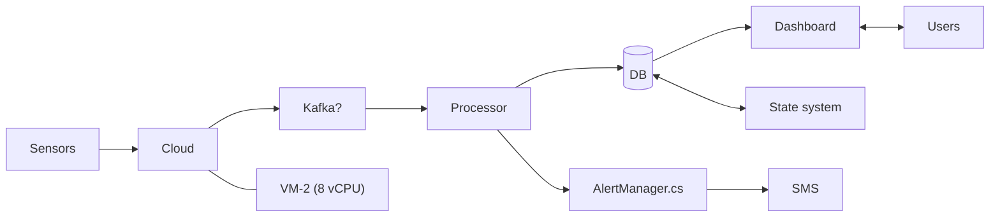
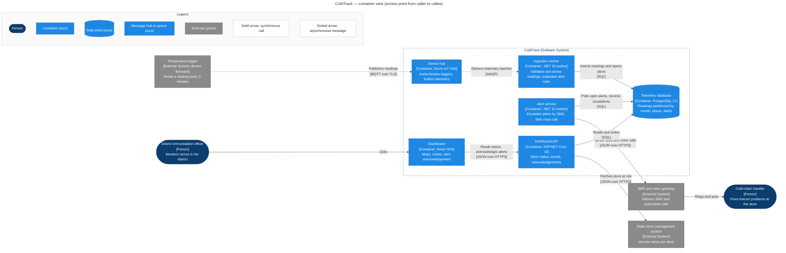
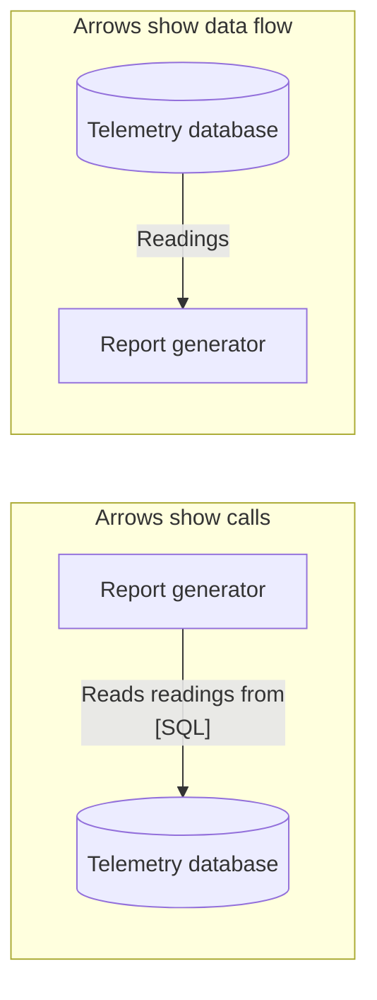
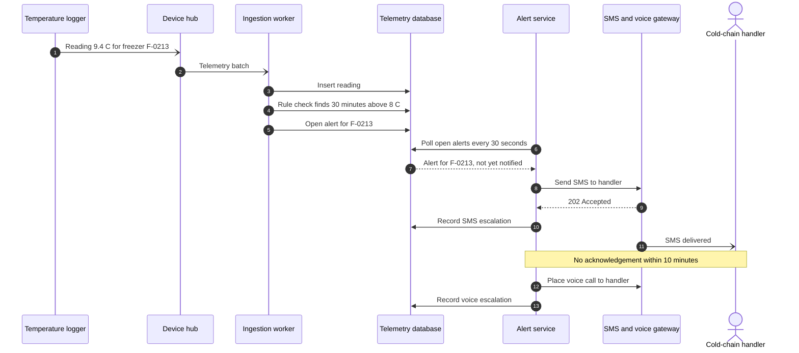

You will read far more architecture diagrams than you draw: in onboarding wikis, design reviews, vendor proposals, incident reports and interview whiteboards. Most of them were drawn in a hurry, for an audience that was in the room. This lesson gives you a method for reading any diagram critically, the habits that make your own diagrams readable without you standing next to them, and a checklist for reviewing someone else's diagram in a pull request.

## Learning objectives

By the end of this lesson you will be able to:

1. Read an unfamiliar architecture diagram in five passes: scope, notation, elements, relationships, questions.
2. Spot ambiguous arrows (dependency versus data flow, sync versus async) and ask the right clarifying question.
3. Write a legend that explains every shape, colour and line style, and add it to a Mermaid diagram.
4. Choose the level of detail and the diagram type for a given audience and question.
5. Recognise the ten most common diagram mistakes and fix them.
6. Review a diagram with a checklist, give actionable feedback, and automate the mechanical checks with a linter.

## Prerequisites

- [UML fundamentals](#/lesson/m05-uml-fundamentals): what diagrams are for and the main diagram types.
- [C4 architecture model](#/lesson/m05-c4-model): zoom levels and notation rules. This lesson applies them to any diagram, C4 or not.
- [Sequence diagrams](#/lesson/m05-sequence-diagrams): used for dynamic views.

## Explain it like I'm a beginner

### Reading a map you've never seen

Hand someone a trekking map of the Western Ghats. Before they look at a single trail, an experienced trekker checks four things: **the title** (which area is this?), **the legend** (what does a dotted line mean: footpath or district border?), **the scale** (is 1 cm one kilometre or ten?), and **the date** (was this drawn before the new dam flooded the valley?). Only then do they trace routes.

Architecture diagrams are maps of software, and the same habits apply. The **title and scope** tell you which system, and which part of it. The **legend** tells you what shapes, colours and arrows mean. The **level of detail** (the "scale") tells you whether a box is a whole system, a deployable app or a class. The **date or version** tells you whether you can trust it. Most bad diagrams fail on exactly these four, and most misreadings come from skipping them.

### Arrows are the hardest part

A box is fairly easy to understand: "Orders API" is probably an API about orders. An arrow is much harder. Does `A → B` mean "A calls B", "data flows from A to B", "A depends on B", or "A happens before B"? These are different claims, and they can point in **opposite directions** for the same interaction. When a reporting service reads from a database, "calls" points from the service to the database, but "data flows" points from the database to the service. A diagram without a legend leaves the reader guessing.

### Our example: ColdTrack

A state health department monitors vaccine storage across its districts. About 2,000 freezers and ice-lined refrigerators in district and block stores each have a **temperature logger** that sends a reading every 5 minutes over the mobile network. If a freezer stays above 8 °C for 30 minutes, the cold-chain handler at that store must get an SMS and a voice call. District immunisation officers watch a dashboard, and the system exchanges stock data with the state's existing stock management system.

Rough volume (an estimate for planning): 2,000 loggers × 288 readings a day (one every 5 minutes) ≈ 576,000 readings a day, or about 6.7 per second on average. After a power cut, loggers that buffered readings offline reconnect together, so bursts of 50 times the average are plausible. We'll read, review and redraw diagrams of this system throughout the lesson.

## First-principles explanation

### A diagram is a set of claims for an audience

Every box says "this thing exists and is separate". Every arrow says "these two interact, in this way". A diagram is a compact set of **claims**, chosen for **one audience** to answer **some questions**. Reading a diagram well means extracting those claims and checking them. Drawing one well means choosing the claims deliberately.

That framing tells you why "complete" diagrams fail. A diagram that tries to make every claim (every class, every server, every network rule) can't be read by anyone, because no reader has all of those questions at once.

### The five-pass reading method

Read any unfamiliar diagram in five passes. Each takes a minute or two.

**Pass 1 — Scope.** What system is this, which part of it, at what level, and how current? Look for a title, a boundary, a date or a link to the code. If there's no title, write one yourself in the margin ("ColdTrack, containers, as of last quarter?") and confirm it with the author.

**Pass 2 — Notation.** Find the legend. What do shapes, colours, line styles and arrow directions mean? If there's no legend, list the visual distinctions you see (two colours, solid and dotted lines, cylinders) and note them as **questions**, not assumptions.

**Pass 3 — Elements.** Make an inventory: people, our things, other people's things, data stores. Check that every box is at the **same level of abstraction**. A class name next to a Kubernetes cluster next to "Users" means the diagram mixes three zoom levels.

**Pass 4 — Relationships.** Trace the arrows, one important flow at a time: "a reading comes from the logger, goes to …, is stored in …, triggers …". For each arrow, ask: what does it mean (call, data flow, dependency)? Synchronous or asynchronous? Which protocol? Which direction is the call, and which direction does data move?

**Pass 5 — Questions.** Now think like a reviewer. What's missing (authentication, monitoring, the second region)? What happens when each element fails? Where are the trust boundaries? Which arrow carries the most traffic, and is that element sized for it? Which claims would you want to verify in the code?

You'll practise all five passes on ColdTrack in the step-by-step example.

### Arrow semantics: say which one you mean

There are four common meanings for an arrow on an architecture diagram:

| Meaning | Direction | Typical label | Good for |
|---|---|---|---|
| **Call / request** (who initiates) | caller → callee | "Reads readings from [SQL]" | Container and component views, failure analysis |
| **Data flow** (which way data moves) | source → destination | "Temperature readings" | Data pipelines, privacy reviews |
| **Dependency** (who needs whom to work) | dependent → dependency | "depends on" | Build and module diagrams |
| **Sequence** (what happens next) | earlier → later | "then" | Process and activity diagrams |

C4 recommends the first, with **intent labels** ("Sends alerts using", "Reads readings from"), because call direction tells you what fails when something is down. Whatever you choose, use **one meaning per diagram** and say which in the legend. When a reply carries important data (a webhook, a callback), draw it as a second arrow initiated by the other side.

### Legends: explain every visual distinction

A **legend** (also called a key) explains every visual choice that carries meaning. A rule of thumb: if you used two different colours, shapes or line styles, the legend must say why. A good legend covers:

- **Shapes**: person, application, data store, queue, external system.
- **Colours**: ours versus external, or new versus existing versus to-be-removed in a migration diagram.
- **Line styles**: solid for synchronous, dotted for asynchronous; thick for the main flow if you highlight one.
- **Arrow meaning**: "arrows point from caller to callee".
- **Abbreviations**: MQTT, RLS, ILR (ice-lined refrigerator).

Two more habits make a legend robust. **Don't rely on colour alone**: about one in twelve men has some form of colour vision deficiency, and diagrams get printed in black and white. Repeat the type in text inside the box (`[Container: PostgreSQL 17]`). And **keep the palette the same** across every diagram of the same system, so a reader learns it once.

In Mermaid, a simple legend is a small subgraph with one sample node per style, placed in a corner. You'll see one in the visual section. Some tools render a legend automatically from the model (Structurizr does); with hand-written Mermaid, you add it yourself.

### Levels of detail: one zoom per diagram

The single most common structural mistake is **mixing levels of abstraction**: a system, an app, a class and a virtual machine on the same canvas. Readers then can't tell whether two boxes are peers. Pick one level per diagram:

| Level | Boxes are | Typical count | Reader |
|---|---|---|---|
| Landscape / context | Whole systems and people | 5–15 | Everyone |
| Container | Deployable apps, APIs, workers, data stores | 6–20 | Architects, developers, operations, security |
| Component | Main parts inside one deployable | 5–12 | That container's developers |
| Code | Classes, tables | Generated on demand | Developers changing that code |
| Deployment | Nodes, clusters, regions, network zones | Varies | Operations, security, cost reviews |

The counts are rules of thumb, not hard limits. If a diagram needs 40 boxes, it usually means you should **zoom in** (split by area) or **zoom out** (group boxes into one higher-level element). The [C4 views lesson](#/lesson/m05-c4-views) shows a full set for one system.

### Choosing a diagram type from the question

Start from the question the reader has, then choose the diagram:

| Question | Diagram |
|---|---|
| Who uses it, and what does it connect to? | System context |
| What do we deploy, and how do the parts talk? | Container |
| Where does this rule or responsibility live? | Component |
| In what order do things happen in this flow? | Sequence (dynamic view) |
| What states can this object be in? | State machine |
| What tables exist and how do they relate? | Entity-relationship |
| Where does it run, on what, in which network zone? | Deployment |
| Where does personal data go? | Data flow (with trust boundaries) |

Many review arguments are really two people using one diagram to answer two different questions. Ask "what question is this diagram answering?" early.

### The ten most common diagram mistakes

1. **No title or scope.** The reader doesn't know which system or which part.
2. **No legend**, or colours and dotted lines whose meaning is only in the author's head.
3. **Mixed abstraction levels**: classes, containers and servers on one canvas.
4. **Unlabelled arrows**, or labels like "uses", "data", "calls" between technical elements.
5. **Ambiguous arrow direction**: no rule for whether arrows show calls or data flow.
6. **Missing technology and protocol** on container-level boxes and arrows.
7. **Generic boxes**: "Users", "Backend", "DB", "Cloud", "Microservices".
8. **Too many elements** for one reader to hold, or **crossing lines** everywhere.
9. **Undecided ideas drawn as decisions**: "Kafka?" in a box looks like architecture.
10. **Stale diagrams** with no date, owner or link to the code.

Each one is cheap to fix when the diagram is drawn and expensive to discover in an incident.

### Reviewing a diagram

A diagram review is a design review in disguise. Use a checklist so feedback is consistent and impersonal:

**Scope and audience**
- Does it have a title saying which system, which level and which version?
- Is the intended audience clear, and is the detail right for them?

**Notation**
- Is there a legend for every shape, colour and line style?
- Is the type of each element written in text, not just shown by colour?
- Is the arrow meaning stated (calls versus data flow)?

**Elements**
- Is every box at the same level of abstraction?
- Does every box have a specific name and a one-line responsibility?
- Do containers show technology?
- Are external systems clearly distinguished from ours?

**Relationships**
- Does every arrow have an intent label (and a protocol at container level)?
- Are sync and async distinguished?
- Are important responses or callbacks drawn as their own arrows?
- Is anything obviously missing (identity, monitoring, a second consumer)?

**Truth**
- Does it match the code and the deployment? Was it checked against them?
- Is it stored next to the code with an owner?

When you give feedback, make each comment **specific and actionable**: not "this is confusing" but "the arrow from Alert service to the gateway has no label; is this SMS, voice, or both, and is it synchronous?". Separate **blocking** issues (wrong claims, missing trust boundary) from **suggestions** (layout, colours). And remember that a diagram's job is to communicate: the review should improve communication, not enforce a personal style.

### Creating a diagram, in order

When it's your turn to draw:

1. **Name the audience and their questions.** "Security reviewer: where does data cross the network boundary, and how is it authenticated?"
2. **Pick the diagram type and one level of detail** from the tables above.
3. **List elements in text first.** A bullet list of boxes with names, types and responsibilities. Fix naming here; it's cheaper than moving boxes.
4. **Draw the arrows with labels as you go.** If you can't label an arrow, you don't understand the interaction yet.
5. **Add a title, a legend and a date** (or version, or commit).
6. **Read it back with the five passes**, pretending you've never seen the system.
7. **Get one person from the audience to read it** without your explanation. Their questions are your next edits.
8. **Commit it next to the code** as Mermaid or a model file, so it changes in the same pull request as the code.

### When a diagram is not the answer

Sometimes a table or a paragraph is clearer. Ten integrations with their protocols, owners and SLAs are better as a table than as ten arrows. A decision with its reasoning belongs in an [ADR](#/lesson/m02-adr). A diagram is best for **structure and flow**: where things are and how they connect.

## Visual explanation

### A diagram that fails the five passes

Here is a ColdTrack diagram as it might appear on a project wiki:



Run the passes. **Scope**: no title; is this the whole of ColdTrack or just ingestion? **Notation**: no legend; one double-headed arrow, one plain line, everything else single arrows with no stated meaning. **Elements**: "Sensors" are devices, "Cloud" is a vague place, "Kafka?" is an undecided technology, `AlertManager.cs` is a source file, "VM-2 (8 vCPU)" is infrastructure, "Users" hides at least two roles. That is at least four levels of abstraction on one canvas. **Relationships**: the arrow from DB to Dashboard suggests the database pushes to the dashboard, which is almost certainly a data-flow arrow on a diagram where other arrows are calls. Is the alert path synchronous? Does the state system write directly into our database? **Questions**: where is authentication of the loggers? What happens to readings while "Processor" is down? Who receives the voice calls?

None of this is malicious; it's a sketch made for a meeting. The problem is that it was published as documentation.

### The same system, redrawn as a container view with a legend



Read it with the five passes again:

- **Scope**: the title names the system, the level ("container view") and the arrow rule ("from caller to callee").
- **Notation**: the legend explains every shape, colour and line style. Each box also states its type in text.
- **Elements**: all boxes inside the boundary are containers; outside are people and external systems. The logger is modelled as an **external system** because the device vendor owns its firmware. If ColdTrack's team wrote the firmware, it would be a container instead, and that's worth confirming.
- **Relationships**: the logger and hub are asynchronous (MQTT, buffered), so a slow ingestion worker delays readings but doesn't lose them. The alert service **polls** the database for open alerts, which keeps it simple and independent of ingestion. The gateway → handler arrow is the one place a non-software arrow helps: it reminds everyone that the end of the alert path is a person's phone.
- **Questions you can now ask precisely**: "If the gateway is down, does the alert service retry, and does it try another channel?" "How does a logger authenticate to the hub (per-device keys or certificates)?" "Is 6.7 readings per second, with 50× bursts, fine for one ingestion worker?" Those are good review questions, and the diagram made them possible.

Is the "Kafka?" question answered? Yes, by a decision: IoT Hub buffers device telemetry already, so no separate stream is needed at this volume. That decision belongs in an ADR, linked from the diagram, not as a question mark in a box.

### The same interaction, two arrow meanings



Both diagrams are "correct" and they point in opposite directions. The left one tells an on-call engineer that the report generator breaks if the database is down. The right one tells a privacy reviewer where readings go. Mixing the two conventions on one diagram is how the "DB → Dashboard" arrow in the bad diagram happened. Pick one and state it in the title or legend.

### Dynamic view — an alert from reading to phone call



The participants use exactly the names from the container view, so you can point from each lifeline to its box. Half arrows (`-)`) are asynchronous messages, matching the dotted arrows on the static view. The diagram answers a question the container view couldn't: **how long** can a freezer be warm before someone's phone rings? Worst case, about 30 minutes for the rule, plus up to 30 seconds of polling, plus gateway delivery time, and 10 more minutes before the voice call. If the health department's requirement is "a call within 15 minutes of crossing 8 °C", this diagram shows immediately that the design doesn't meet it, before anyone writes code.

## Step-by-step example

Your team lead shares a pull request titled "Add architecture diagram" containing the bad ColdTrack diagram above, and asks for your review. Here's how to do it in about 20 minutes.

### Step 1 — read it cold, with the five passes

Don't read the PR description first. Read the diagram as a newcomer would and write down every question it raises. That list *is* your review: a newcomer will have the same questions.

### Step 2 — ask what question and audience it serves

Comment first on purpose: "Who is this for? If it's for developers and operations, a container view fits. If it's for the steering committee, a context view without technology would be better." The answer changes most of the other comments.

### Step 3 — group findings with the checklist

Using the checklist, the findings fall into groups:

- **Scope**: no title, no date, no statement of level.
- **Notation**: no legend; arrow meaning unclear (DB → Dashboard looks like data flow, the rest look like calls); one undirected line; one double-headed arrow.
- **Elements**: mixed levels (devices, "Cloud", a source file, a VM); generic names ("Users", "DB", "Processor"); undecided technology ("Kafka?").
- **Relationships**: no labels; no protocols; no sync/async distinction; missing the voice-call path and the second user role.
- **Truth**: does a separate Processor exist, or is that the ingestion worker? Check the deployment pipeline.

### Step 4 — mark what blocks and what doesn't

Blocking: mixed levels, missing legend, unlabelled arrows, the misleading DB → Dashboard arrow, the undecided "Kafka?". Suggestions: colours, layout direction (`LR` versus `TB`), wording.

### Step 5 — write actionable comments

Examples:

- "Blocking: `AlertManager.cs` is a class; on a container view, show the deployable that contains it (the alert service) and its technology."
- "Blocking: please add a legend and say whether arrows show calls or data flow. The DB → Dashboard arrow reads like the database calls the dashboard."
- "Blocking: 'Kafka?' looks like a decision. If it's open, move it to an ADR draft and remove it from the diagram."
- "Suggestion: 'Users' hides the cold-chain handler (who gets calls) and the district officer (who uses the dashboard); they have different access, so draw them separately."

### Step 6 — offer a redraw, not just criticism

Pair with the author for 15 minutes and redraw it together from a text list of elements, as in the "creating a diagram" steps. The result is the container view above. Add a CI step that parses Mermaid and runs the linter from the next section, so the mechanical issues never come back.

## Production-style C# implementation

Half of the checklist is mechanical: titles, labels, legends, orphans, typos in node ids. A linter can catch those in CI, leaving humans to review the claims. Below is a small diagram review service: a parser for the common subset of Mermaid flowchart syntax, a linter with numbered rules, and a minimal API endpoint that a PR bot or a docs pipeline can call.

```text
DiagramReview/
  Program.cs
  Review/FlowchartModel.cs   // nodes, edges, subgraphs, classes
  Review/FlowchartParser.cs  // Mermaid flowchart subset -> model
  Review/DiagramLinter.cs    // checklist rules as code
```

```csharp file=Review/FlowchartModel.cs
namespace DiagramReview.Review;

public enum LinkStyle { Solid, Dotted, Thick, Plain }

public sealed record FlowNode(string Id, string? Label, string? CssClass, string? Subgraph, int Line);

public sealed record FlowEdge(string From, string To, string? Label, LinkStyle Style, int Line);

public sealed record Finding(string Rule, string Message, int? Line);

public sealed class Flowchart
{
    private readonly Dictionary<string, FlowNode> _nodes = new(StringComparer.Ordinal);

    public string? Title { get; set; }
    public string? Direction { get; set; }
    public List<FlowEdge> Edges { get; } = new();
    public HashSet<string> ClassDefs { get; } = new(StringComparer.Ordinal);
    public List<string> UnparsedLines { get; } = new();
    public IEnumerable<FlowNode> Nodes => _nodes.Values;

    public FlowNode? Find(string id) => _nodes.TryGetValue(id, out var n) ? n : null;

    /// <summary>Adds or enriches a node. Mermaid lets a node be mentioned before or after its label is given.</summary>
    public void Upsert(string id, string? label, string? cssClass, string? subgraph, int line)
    {
        if (_nodes.TryGetValue(id, out var existing))
        {
            _nodes[id] = existing with
            {
                Label = label ?? existing.Label,
                CssClass = cssClass ?? existing.CssClass,
                Subgraph = existing.Subgraph ?? subgraph,
            };
        }
        else
        {
            _nodes[id] = new FlowNode(id, label, cssClass, subgraph, line);
        }
    }
}
```

```csharp file=Review/FlowchartParser.cs
using System.Text.RegularExpressions;

namespace DiagramReview.Review;

/// <summary>
/// Parses the subset of Mermaid flowchart syntax used for architecture diagrams:
/// front-matter title, header, nodes with shapes and :::class, labelled links, subgraph/end, classDef, class.
/// It is not a full Mermaid parser; anything else is reported as unparsed.
/// </summary>
public static partial class FlowchartParser
{
    private const string Node =
        @"(?<{0}id>[A-Za-z_][\w]*)" +
        @"(?:(?:\(\[|\[\(|\[\[|\{{\{{|\[|\(|\{{)(?:""(?<{0}q>[^""]*)""|(?<{0}u>[^\]\)\}}""]*))(?:\]\)|\)\]|\]\]|\}}\}}|\]|\)|\}}))?" +
        @"(?::::(?<{0}cls>[\w-]+))?";

    private static readonly Regex EdgeLine = new(
        "^" + string.Format(Node, "f") +
        @"\s*(?<arrow>-\.->|==>|-->|---)\s*(?:\|(?:""(?<lq>[^""]*)""|(?<lu>[^|]*))\|)?\s*" +
        string.Format(Node, "t") + @"\s*;?$",
        RegexOptions.CultureInvariant);

    private static readonly Regex NodeLine = new("^" + string.Format(Node, "n") + @"\s*;?$", RegexOptions.CultureInvariant);

    [GeneratedRegex(@"^(flowchart|graph)\s+(?<dir>TB|TD|BT|LR|RL)\s*$")]
    private static partial Regex Header();

    [GeneratedRegex(@"^subgraph\s+(?<id>[A-Za-z_][\w]*)")]
    private static partial Regex SubgraphStart();

    [GeneratedRegex(@"^classDef\s+(?<name>[\w-]+)\s")]
    private static partial Regex ClassDef();

    [GeneratedRegex(@"^class\s+(?<ids>[\w,\s]+?)\s+(?<name>[\w-]+)\s*;?$")]
    private static partial Regex ClassAssign();

    public static Flowchart Parse(string text)
    {
        var chart = new Flowchart();
        var lines = text.Replace("\r\n", "\n").Split('\n');
        var subgraphs = new Stack<string>();
        var i = 0;

        if (lines.Length > 0 && lines[0].Trim() == "---")
        {
            for (i = 1; i < lines.Length && lines[i].Trim() != "---"; i++)
            {
                var l = lines[i].Trim();
                if (l.StartsWith("title:", StringComparison.Ordinal)) chart.Title = l["title:".Length..].Trim();
            }
            i++;
        }

        for (; i < lines.Length; i++)
        {
            var line = lines[i].Trim();
            var lineNo = i + 1;
            if (line.Length == 0 || line.StartsWith("%%", StringComparison.Ordinal)) continue;

            if (Header().Match(line) is { Success: true } h) { chart.Direction = h.Groups["dir"].Value; continue; }
            if (SubgraphStart().Match(line) is { Success: true } sg) { subgraphs.Push(sg.Groups["id"].Value); continue; }
            if (line == "end") { if (subgraphs.Count > 0) subgraphs.Pop(); continue; }
            if (line.StartsWith("style ", StringComparison.Ordinal) || line.StartsWith("direction ", StringComparison.Ordinal)) continue;
            if (ClassDef().Match(line) is { Success: true } cd) { chart.ClassDefs.Add(cd.Groups["name"].Value); continue; }
            if (ClassAssign().Match(line) is { Success: true } ca)
            {
                foreach (var id in ca.Groups["ids"].Value.Split(',', StringSplitOptions.TrimEntries | StringSplitOptions.RemoveEmptyEntries))
                    chart.Upsert(id, null, ca.Groups["name"].Value, null, lineNo);
                continue;
            }

            var current = subgraphs.Count > 0 ? subgraphs.Peek() : null;

            if (EdgeLine.Match(line) is { Success: true } e)
            {
                AddNode(chart, e, "f", current, lineNo);
                AddNode(chart, e, "t", current, lineNo);
                var label = e.Groups["lq"].Success ? e.Groups["lq"].Value : e.Groups["lu"].Success ? e.Groups["lu"].Value : null;
                var style = e.Groups["arrow"].Value switch
                {
                    "-.->" => LinkStyle.Dotted,
                    "==>" => LinkStyle.Thick,
                    "---" => LinkStyle.Plain,
                    _ => LinkStyle.Solid,
                };
                chart.Edges.Add(new FlowEdge(e.Groups["fid"].Value, e.Groups["tid"].Value,
                    string.IsNullOrWhiteSpace(label) ? null : label.Trim(), style, lineNo));
                continue;
            }

            if (NodeLine.Match(line) is { Success: true } n)
            {
                AddNode(chart, n, "n", current, lineNo);
                continue;
            }

            chart.UnparsedLines.Add($"{lineNo}: {line}");
        }
        return chart;
    }

    private static void AddNode(Flowchart chart, Match m, string prefix, string? subgraph, int line)
    {
        var q = m.Groups[prefix + "q"];
        var u = m.Groups[prefix + "u"];
        var label = q.Success ? q.Value : u.Success ? u.Value : null;
        var cls = m.Groups[prefix + "cls"];
        chart.Upsert(m.Groups[prefix + "id"].Value, label, cls.Success ? cls.Value : null, subgraph, line);
    }
}
```

```csharp file=Review/DiagramLinter.cs
namespace DiagramReview.Review;

public sealed class LinterOptions
{
    public int MaxElements { get; set; } = 20;
    public string LegendSubgraphId { get; set; } = "legend";
    public HashSet<string> VagueLabels { get; } = new(StringComparer.OrdinalIgnoreCase)
    {
        "uses", "calls", "data", "connects", "connects to", "talks to", "integrates with",
    };
}

/// <summary>The mechanical half of the diagram review checklist.</summary>
public sealed class DiagramLinter(LinterOptions options)
{
    public IReadOnlyList<Finding> Lint(Flowchart chart)
    {
        var findings = new List<Finding>();
        bool InLegend(FlowNode n) => string.Equals(n.Subgraph, options.LegendSubgraphId, StringComparison.OrdinalIgnoreCase);
        var nodes = chart.Nodes.ToList();
        var content = nodes.Where(n => !InLegend(n)).ToList();
        var legend = nodes.Where(InLegend).ToList();

        if (string.IsNullOrWhiteSpace(chart.Title))
            findings.Add(new("D001", "Diagram has no title. Say which system, which level and the arrow convention.", null));

        foreach (var e in chart.Edges)
        {
            if (e.Label is null)
                findings.Add(new("D002", $"Link {e.From} -> {e.To} has no label.", e.Line));
            else if (options.VagueLabels.Contains(e.Label.Trim()) && !IsPerson(chart.Find(e.From)))
                findings.Add(new("D003", $"Link {e.From} -> {e.To} has a vague label '{e.Label}'. Say what is exchanged.", e.Line));
            if (e.Style == LinkStyle.Plain)
                findings.Add(new("D004", $"Link {e.From} --- {e.To} has no direction.", e.Line));
        }

        foreach (var n in content.Where(n => n.Label is null))
            findings.Add(new("D005", $"Node '{n.Id}' is used but never given a label. Typo in an id?", n.Line));

        if (chart.ClassDefs.Count > 0)
        {
            foreach (var n in content.Where(n => n.CssClass is null))
                findings.Add(new("D006", $"Node '{n.Id}' has no class, so its type isn't shown consistently.", n.Line));

            var legendClasses = legend.Select(n => n.CssClass).OfType<string>().ToHashSet(StringComparer.Ordinal);
            foreach (var cls in content.Select(n => n.CssClass).OfType<string>().Distinct())
                if (!legendClasses.Contains(cls))
                    findings.Add(new("D007", $"Class '{cls}' is used but has no legend entry.", null));
        }

        var connected = chart.Edges.SelectMany(e => new[] { e.From, e.To }).ToHashSet(StringComparer.Ordinal);
        foreach (var n in content.Where(n => !connected.Contains(n.Id)))
            findings.Add(new("D008", $"Node '{n.Id}' has no relationships.", n.Line));

        if (content.Count > options.MaxElements)
            findings.Add(new("D009", $"{content.Count} elements; consider splitting or zooming out (limit {options.MaxElements}).", null));

        foreach (var u in chart.UnparsedLines)
            findings.Add(new("D010", $"Could not check line {u}", null));

        return findings;
    }

    private static bool IsPerson(FlowNode? n) =>
        n?.CssClass == "person" || (n?.Label?.Contains("[Person]", StringComparison.Ordinal) ?? false);
}
```

```csharp file=Program.cs
using DiagramReview.Review;

var builder = WebApplication.CreateBuilder(args);
builder.Services.Configure<LinterOptions>(builder.Configuration.GetSection("DiagramLinter"));
builder.Services.AddSingleton(sp =>
    new DiagramLinter(sp.GetRequiredService<Microsoft.Extensions.Options.IOptions<LinterOptions>>().Value));

var app = builder.Build();

// POST the raw Mermaid text (text/plain). Returns findings that a PR bot can post as review comments.
app.MapPost("/diagrams/review", async (HttpRequest request, DiagramLinter linter) =>
{
    // Reject oversized bodies before reading them; the length check after reading covers chunked uploads.
    if (request.ContentLength > 200_000) return Results.Problem("Diagram too large.", statusCode: StatusCodes.Status413PayloadTooLarge);
    using var reader = new StreamReader(request.Body);
    var text = await reader.ReadToEndAsync();
    if (text.Length > 200_000) return Results.Problem("Diagram too large.", statusCode: StatusCodes.Status413PayloadTooLarge);

    var chart = FlowchartParser.Parse(text);
    var findings = linter.Lint(chart);
    return Results.Ok(new
    {
        title = chart.Title,
        elements = chart.Nodes.Count(),
        links = chart.Edges.Count,
        passed = findings.Count == 0,
        findings,
    });
});

app.Run();
```

How this maps to the checklist:

- **D001** (title), **D002–D004** (labels and direction), **D006–D007** (legend), **D008** (orphans) and **D009** (too many elements) are checklist items that need no judgement.
- **D005** catches a classic Mermaid trap: Mermaid silently creates a new node when you mistype an id (`ingest` versus `ingset`), so the diagram shows a mysterious extra box with no label. The linter reports any node that is referenced but never labelled.
- **D010** is honesty: the parser handles a subset, and it says which lines it couldn't check instead of pretending they passed.
- What it **can't** check is whether the claims are true, whether the level of detail suits the audience, or whether something important is missing. That's the human half of the review.

Run it against the bad ColdTrack diagram and you get findings for the missing title, eight unlabelled links, one undirected link (`C --- VM`), and the two double-headed arrows as unparsed lines (`<-->` isn't in the subset, deliberately: bidirectional arrows usually hide two interactions). Against the redrawn view it reports nothing: the "Uses" labels start at people, which rule D003 allows.

## Bad design vs good design

| Bad | Good |
|---|---|
| "Architecture" as the only title | "ColdTrack — container view (arrows point from caller to callee)" |
| Colours with no legend | Legend subgraph plus the type in text in each box |
| Devices, a VM, a `.cs` file and "Cloud" side by side | One abstraction level; deployment and code on their own diagrams |
| Unlabelled arrows, one double-headed | Intent and protocol on each arrow; two arrows for two interactions |
| "DB → Dashboard" (data-flow arrow among call arrows) | One arrow convention, stated in the title |
| "Kafka?" in a box | Decision recorded in an ADR, linked from the diagram |
| Drawn once in a slide tool, never updated | Mermaid in the repo, linted in CI, reviewed in pull requests |

:::callout type=mistake title="Double-headed arrows"
`A <--> B` almost always hides two different interactions, each started by a different side, with different protocols and failure modes (for example, "we call their API" and "they send us webhooks"). Draw two arrows, each labelled.
:::

:::callout type=tip title="Read your own diagram upside down"
Before publishing, read your diagram as if you'd never seen the system, or ask a colleague from a different team to tell you what it says without your help. Every question they ask is a missing label, legend entry or title.
:::

:::callout type=tradeoff title="Layout tools versus diagrams as code"
Drag-and-drop tools give beautiful layouts but drift from the code and are hard to review. Mermaid diagrams are reviewable text, but you control layout only roughly (direction, subgraphs, node order). For documentation that must stay correct, prefer text; for a one-off board presentation, a polished picture can be worth the effort.
:::

## Practical playground

The HLD playground below loads the **bad ColdTrack diagram** as a graph. Treat it as a pull request you're reviewing:

1. Rename every generic node to a specific container or external system, and give each a type.
2. Remove the VM node (it belongs on a deployment view) and replace "Kafka?" with the decision you'd make.
3. Label every edge with intent and protocol; mark asynchronous edges `async`.
4. Add the missing people-facing paths: the dashboard API, the voice call, the state stock system.
5. Use the playground's compare feature against your own reference, or against the container view in this lesson, and list the differences.

The platform's **HLD playground** renders and compares container-level graphs like this one; the **LLD playground** does the same for class models when you review a code-level diagram.

:::playground type=hld title="Review and fix the ColdTrack diagram"
```json
{
  "nodes": [
    { "id": "s", "type": "client", "label": "Sensors", "props": { "rps": 7 } },
    { "id": "c", "type": "api-gateway", "label": "Cloud" },
    { "id": "k", "type": "stream", "label": "Kafka?" },
    { "id": "p", "type": "worker", "label": "Processor", "props": { "instances": 1 } },
    { "id": "db", "type": "database", "label": "DB" },
    { "id": "d", "type": "app-server", "label": "Dashboard" },
    { "id": "al", "type": "worker", "label": "AlertManager.cs" },
    { "id": "g", "type": "external", "label": "SMS" },
    { "id": "vm", "type": "app-server", "label": "VM-2 (8 vCPU)" }
  ],
  "edges": [
    { "from": "s", "to": "c", "kind": "sync" },
    { "from": "c", "to": "k", "kind": "sync" },
    { "from": "k", "to": "p", "kind": "sync" },
    { "from": "p", "to": "db", "kind": "sync" },
    { "from": "db", "to": "d", "kind": "sync" },
    { "from": "p", "to": "al", "kind": "sync" },
    { "from": "al", "to": "g", "kind": "sync" },
    { "from": "c", "to": "vm", "kind": "sync" }
  ]
}
```
:::

## Exercises

:::exercise id=m05-reading-diagrams-ex1 difficulty=beginner kind=written title="Read the ColdTrack container view"
Using only the redrawn ColdTrack container view (not the prose around it), answer:

1. Which elements does ColdTrack's team own, and how can you tell?
2. Which links are asynchronous?
3. If the alert service crashes for 20 minutes, what still works, and what's delayed?
4. If the ingestion worker is slow, are readings lost? Why or why not?
5. Which container talks to the state stock system, and in which direction is the call?
6. What does the diagram **not** tell you that a security reviewer would ask? Name two things.
7. Which arrow ends at a person, and why might the author have included it?
::acceptance
- Answers cite specific elements, labels and the legend, not assumptions.
- Question 3 says readings are still stored and the dashboard works, but notifications are delayed until the alert service restarts (open alerts wait in the database).
- Question 4 explains that the hub buffers asynchronous telemetry, so readings queue rather than vanish (within the hub's retention).
- Question 6 names at least two of: device authentication method, user authentication for the dashboard, network boundaries, data retention, where personal phone numbers are stored.
::hint
Pass 2 first: what does the legend say about the dashed boundary and the dotted lines?
::hint
For failure questions, follow the arrows: who calls the failed element, and who is called by it?
::hint
A container that polls a database for work doesn't lose work when it's down; the work waits.
::hint
Security questions usually concern identity, trust boundaries and stored personal data. Which of those are labelled?
::solution
1. Everything inside the dashed **ColdTrack** boundary: device hub, ingestion worker, telemetry database, alert service, dashboard API and dashboard. The legend says blue boxes are ours, and the boundary groups them.
2. Logger → device hub and device hub → ingestion worker (dotted lines, MQTT and AMQP).
3. Readings are still ingested and stored, alerts are still *opened* by the ingestion worker, and the dashboard works. Notifications are delayed: open alerts wait in the database and are picked up when the alert service restarts and polls.
4. Not lost (within limits): the hub buffers telemetry and delivers it asynchronously, so a slow worker builds a backlog. The diagram doesn't show the hub's retention period; ask for it.
5. The **dashboard API** calls the stock system (solid arrow from API to stock system, JSON over HTTPS). ColdTrack initiates the call.
6. Examples: how loggers authenticate to the hub (per-device keys or X.509 certificates); how officers sign in to the dashboard (no identity provider is shown); network boundaries and which elements are internet-facing; where handlers' phone numbers are stored and who can read them; retention of readings.
7. Gateway → cold-chain handler ("Rings and texts"). It's not a software call, but it shows that the alert path ends at a person, which keeps the team focused on delivery to a phone, not just "message sent".
::mistakes
- Saying readings are lost when the ingestion worker is slow (ignoring the asynchronous hub).
- Assuming the dashboard calls the alert service; no arrow says so.
- Listing "everything" as a security gap instead of specific, answerable questions.
:::

:::exercise id=m05-reading-diagrams-ex2 difficulty=beginner kind=code title="Check that every style has a legend entry"
Write a legend checker for a diagram model.
::requirements
- `DiagramNode(string Id, string? CssClass, bool InLegend)`.
- `LegendCheck.Check(IReadOnlyList<DiagramNode> nodes)` returns messages in three groups, in this order:
  1. For each node **in input order** with a null class: `"node '{id}' has no class"` if it's a content node, or `"legend node '{id}' has no class"` if it's in the legend.
  2. For each class used by content nodes (in first-use order) that no legend node has: `"class '{cls}' has no legend entry"`.
  3. For each class used by legend nodes (in first-use order) that no content node uses: `"legend entry '{cls}' is not used"`.
- Each class appears at most once in groups 2 and 3. Class names are case-sensitive.
- A diagram with no nodes returns an empty list.
::acceptance
- A content class missing from the legend is reported once, even if several nodes use it.
- An unused legend entry is reported.
- Nodes without classes are reported first, in input order.
- A complete diagram returns an empty list.
::hint
Split the nodes into content nodes and legend nodes first.
::hint
Build two `HashSet<string>` of classes: one from content nodes, one from legend nodes.
::hint
For first-use order, loop over the nodes and use `Distinct()` on the class names, which keeps the first occurrence.
::hint
```csharp
var contentClasses = content.Select(n => n.CssClass).OfType<string>().Distinct().ToList();
foreach (var c in contentClasses)
    if (!legendSet.Contains(c)) messages.Add($"class '{c}' has no legend entry");
```
::starter
```csharp file=LegendCheck.cs
using System;
using System.Collections.Generic;

public sealed record DiagramNode(string Id, string? CssClass, bool InLegend);

public static class LegendCheck
{
    public static IReadOnlyList<string> Check(IReadOnlyList<DiagramNode> nodes) =>
        throw new NotImplementedException();
}
```
::tests
```csharp file=LegendCheckTests.cs
using System.Collections.Generic;
using Xunit;

public class LegendCheckTests
{
    [Fact]
    public void Complete_diagram_passes()
    {
        var nodes = new List<DiagramNode>
        {
            new("api", "container", false),
            new("db", "store", false),
            new("lc", "container", true),
            new("ls", "store", true),
        };
        Assert.Empty(LegendCheck.Check(nodes));
    }

    [Fact]
    public void Missing_legend_entry_reported_once()
    {
        var nodes = new List<DiagramNode>
        {
            new("gw", "external", false),
            new("stock", "external", false),
            new("api", "container", false),
            new("lc", "container", true),
        };
        Assert.Equal(new[] { "class 'external' has no legend entry" }, LegendCheck.Check(nodes));
    }

    [Fact]
    public void All_groups_in_order()
    {
        var nodes = new List<DiagramNode>
        {
            new("lq", "queue", true),
            new("api", "container", false),
            new("x", null, false),
            new("lnote", null, true),
            new("lp", "person", true),
            new("db", "store", false),
        };
        Assert.Equal(new[]
        {
            "node 'x' has no class",
            "legend node 'lnote' has no class",
            "class 'container' has no legend entry",
            "class 'store' has no legend entry",
            "legend entry 'queue' is not used",
            "legend entry 'person' is not used",
        }, LegendCheck.Check(nodes));
    }

    [Fact]
    public void Class_names_are_case_sensitive()
    {
        var nodes = new List<DiagramNode> { new("api", "Container", false), new("lc", "container", true) };
        Assert.Equal(new[]
        {
            "class 'Container' has no legend entry",
            "legend entry 'container' is not used",
        }, LegendCheck.Check(nodes));
    }

    [Fact]
    public void Empty_diagram_returns_nothing() => Assert.Empty(LegendCheck.Check(new List<DiagramNode>()));
}
```
::solution
Three groups, each computed with simple set operations; `Distinct()` keeps first-use order.

```csharp file=LegendCheck.cs
using System;
using System.Collections.Generic;
using System.Linq;

public sealed record DiagramNode(string Id, string? CssClass, bool InLegend);

public static class LegendCheck
{
    public static IReadOnlyList<string> Check(IReadOnlyList<DiagramNode> nodes)
    {
        var messages = new List<string>();
        foreach (var n in nodes.Where(n => n.CssClass is null))
            messages.Add(n.InLegend ? $"legend node '{n.Id}' has no class" : $"node '{n.Id}' has no class");

        var contentClasses = nodes.Where(n => !n.InLegend).Select(n => n.CssClass).OfType<string>().Distinct().ToList();
        var legendClasses = nodes.Where(n => n.InLegend).Select(n => n.CssClass).OfType<string>().Distinct().ToList();
        var legendSet = legendClasses.ToHashSet(StringComparer.Ordinal);
        var contentSet = contentClasses.ToHashSet(StringComparer.Ordinal);

        messages.AddRange(contentClasses.Where(c => !legendSet.Contains(c)).Select(c => $"class '{c}' has no legend entry"));
        messages.AddRange(legendClasses.Where(c => !contentSet.Contains(c)).Select(c => $"legend entry '{c}' is not used"));
        return messages;
    }
}
```
::mistakes
- Reporting a missing legend entry once per node instead of once per class.
- Using a case-insensitive comparer, which hides a real Mermaid bug (`Container` and `container` are different classes).
- Forgetting the unused-legend group; stale legend entries confuse readers too.
:::

:::exercise id=m05-reading-diagrams-ex3 difficulty=intermediate kind=code title="Parse Mermaid links"
Write a parser for a single Mermaid flowchart line that contains one link.
::requirements
- `ParsedLink(string From, string To, string? Label, string Arrow)`.
- `LinkParser.TryParse(string line, out ParsedLink? link)` returns `true` and the link for lines like:
  - `api --> db`
  - `api -->|"Reads and writes<br/>[SQL]"| db` (quoted label, returned without quotes)
  - `hub -.->|telemetry| ingest` (unquoted label)
  - `app["Mobile app"]:::container ==> db[("Orders DB")]` (shapes and classes on either side)
  - `a --- b;` (optional trailing semicolon)
- Arrows: `-->`, `-.->`, `==>`, `---`. Ids start with a letter or underscore, then letters, digits or underscores.
- Shapes: `[...]`, `(...)`, `{...}`, `([...])`, `[(...)]`, `[[...]]`, `{{...}}`, each containing either a quoted label or text without brackets or quotes. An optional `:::class` may follow.
- The label is trimmed; an empty or whitespace label gives `null`.
- Leading and trailing whitespace on the line is ignored.
- Return `false` (and `link = null`) for anything else: blank lines, comments (`%%`), `classDef`, `subgraph`, a link with a missing end, or unsupported arrows like `<-->`.
::acceptance
- All five example forms parse with the right ids, label and arrow.
- Labels containing `[` and `]` inside quotes parse correctly.
- `<-->`, comments, `classDef` lines and half links return false.
::hint
Build the regex from pieces: a node pattern, an arrow pattern, an optional label pattern, and the node pattern again.
::hint
Order the arrow alternatives so longer or more specific ones come first: `-\.->|==>|-->|---`.
::hint
For the shape, match an opening token, then either `"[^"]*"` or `[^\]\)\}"]*`, then a closing token. Don't try to match brackets by type; the subset doesn't need it.
::hint
Use named groups with a prefix (`fid`, `tid`) so the node pattern can appear twice in one regex.
::hint
```csharp
const string Node = @"(?<{0}id>[A-Za-z_]\w*)(?:(?:\(\[|\[\(|\[\[|\{{\{{|\[|\(|\{{)(?:""[^""]*""|[^\]\)\}}""]*)(?:\]\)|\)\]|\]\]|\}}\}}|\]|\)|\}}))?(?::::[\w-]+)?";
// string.Format(Node, "f") and string.Format(Node, "t"); note {{ and }} escape braces in Format.
```
::starter
```csharp file=LinkParser.cs
using System;

public sealed record ParsedLink(string From, string To, string? Label, string Arrow);

public static class LinkParser
{
    public static bool TryParse(string line, out ParsedLink? link) =>
        throw new NotImplementedException();
}
```
::tests
```csharp file=LinkParserTests.cs
using Xunit;

public class LinkParserTests
{
    private static ParsedLink Parse(string line)
    {
        Assert.True(LinkParser.TryParse(line, out var link), $"should parse: {line}");
        return link!;
    }

    [Fact]
    public void Plain_link() => Assert.Equal(new ParsedLink("api", "db", null, "-->"), Parse("api --> db"));

    [Fact]
    public void Quoted_label_with_brackets()
    {
        var l = Parse("    api -->|\"Reads and writes<br/>[SQL]\"| db");
        Assert.Equal("Reads and writes<br/>[SQL]", l.Label);
        Assert.Equal("db", l.To);
    }

    [Fact]
    public void Unquoted_label_and_dotted_arrow() =>
        Assert.Equal(new ParsedLink("hub", "ingest", "telemetry", "-.->"), Parse("hub -.->| telemetry |ingest"));

    [Fact]
    public void Shapes_and_classes_on_both_sides() =>
        Assert.Equal(new ParsedLink("app", "db", null, "==>"),
            Parse("app[\"Mobile app [MAUI]\"]:::container ==> db[(\"Orders DB\")]"));

    [Fact]
    public void Stadium_subroutine_and_hexagon_shapes()
    {
        Assert.Equal(new ParsedLink("p", "q", null, "-->"), Parse("p([\"Person\"]) --> q[[\"Queue\"]]"));
        Assert.Equal(new ParsedLink("x", "h", null, "-.->"), Parse("x{{\"Decision\"}}:::note -.-> h"));
    }

    [Fact]
    public void Undirected_link_with_semicolon() => Assert.Equal(new ParsedLink("a", "b", null, "---"), Parse("a --- b;"));

    [Fact]
    public void Empty_label_is_null() => Assert.Null(Parse("a -->|\"  \"| b").Label);

    [Theory]
    [InlineData("")]
    [InlineData("%% api --> db")]
    [InlineData("classDef store fill:#1e88e5")]
    [InlineData("subgraph ct[\"ColdTrack\"]")]
    [InlineData("api --> ")]
    [InlineData("api <--> db")]
    [InlineData("1api --> db")]
    public void Non_links_return_false(string line)
    {
        Assert.False(LinkParser.TryParse(line, out var link));
        Assert.Null(link);
    }
}
```
::solution
One regex, assembled from a node pattern used twice.

```csharp file=LinkParser.cs
using System;
using System.Text.RegularExpressions;

public sealed record ParsedLink(string From, string To, string? Label, string Arrow);

public static class LinkParser
{
    private const string Node =
        @"(?<{0}id>[A-Za-z_]\w*)" +
        @"(?:(?:\(\[|\[\(|\[\[|\{{\{{|\[|\(|\{{)(?:""[^""]*""|[^\]\)\}}""]*)(?:\]\)|\)\]|\]\]|\}}\}}|\]|\)|\}}))?" +
        @"(?::::[\w-]+)?";

    private static readonly Regex Link = new(
        "^" + string.Format(Node, "f") +
        @"\s*(?<arrow>-\.->|==>|-->|---)\s*(?:\|(?:""(?<lq>[^""]*)""|(?<lu>[^|]*))\|)?\s*" +
        string.Format(Node, "t") + @"\s*;?$",
        RegexOptions.CultureInvariant);

    public static bool TryParse(string line, out ParsedLink? link)
    {
        link = null;
        var m = Link.Match(line.Trim());
        if (!m.Success) return false;
        string? label = m.Groups["lq"].Success ? m.Groups["lq"].Value
                      : m.Groups["lu"].Success ? m.Groups["lu"].Value
                      : null;
        label = string.IsNullOrWhiteSpace(label) ? null : label.Trim();
        link = new ParsedLink(m.Groups["fid"].Value, m.Groups["tid"].Value, label, m.Groups["arrow"].Value);
        return true;
    }
}
```

`<-->` fails because `<` can't start the arrow group or continue an id. `classDef store fill:#1e88e5` fails because there's no arrow. `1api` fails because ids must start with a letter or underscore. The production parser earlier in this lesson uses the same node pattern, plus capture groups for labels and classes.
::alternatives
- A hand-written tokenizer is more robust for the full Mermaid grammar (chained links `a --> b --> c`, `A -- text --> B`, `&` for multiple targets). For linting your own team's diagrams, a documented subset plus "unparsed line" reporting is usually enough.
- Mermaid's own parser (in JavaScript) can be run in CI with Node.js to export the graph as JSON, avoiding a second parser altogether.
::mistakes
- Using `.*?` inside shapes, which breaks on quoted labels containing `]`.
- Forgetting to escape `{` and `}` when using `string.Format` with a regex.
- Putting `-->` before `-.->` in a regex where it could match a prefix (here it can't, but the habit of most-specific-first prevents subtle bugs).
::extensions
- Support chained links (`a --> b --> c`) by returning a list.
- Support the `A -- label --> B` form.
:::

:::exercise id=m05-reading-diagrams-ex4 difficulty=intermediate kind=hld title="Review a vendor's diagram for a property tax portal"
A vendor proposes a municipal **property tax portal** for a city corporation and submits the graph in the starter. Citizens look up their property, see dues, and pay online; tax clerks process objections; the corporation's existing GIS holds property boundaries; payments go through a payment gateway; receipts are emailed and sent by SMS.

Review it as you would in a pull request: write at least six findings (mark each **blocking** or **suggestion**), then produce a corrected container-level graph.
::acceptance
- At least six specific findings, including mixed abstraction levels, unlabelled edges, and the payment flow's missing callback.
- The corrected graph has separate citizen and clerk apps (or one app with a justified note), an API, a database, the GIS and payment gateway as `external`, and a worker for receipts fed by a queue.
- The payment gateway's result arrives as its own edge (webhook) into the API, not as a bidirectional assumption.
- No VM, firewall or region nodes on the container view.
- Every edge is labelled; asynchronous edges are `async`.
::hint
Do pass 3 (elements) first: which nodes are not containers or systems at all?
::hint
Payments: who calls whom, and how does the portal learn the payment succeeded?
::hint
Receipts don't need to block the payment confirmation. What does that suggest?
::hint
Shape: citizen app and clerk app → API; API → DB; API → GIS (property lookup); API → payment gateway (create order); payment gateway → API (webhook); API → queue → receipt worker → email/SMS provider.
::starter
```json
{
  "nodes": [
    { "id": "u", "type": "client", "label": "Users", "props": { "rps": 40 } },
    { "id": "fw", "type": "load-balancer", "label": "Firewall + WAF" },
    { "id": "vm1", "type": "app-server", "label": "VM1 (IIS)" },
    { "id": "ctrl", "type": "app-server", "label": "PaymentController.cs" },
    { "id": "db", "type": "database", "label": "Oracle/Postgres" },
    { "id": "pg", "type": "external", "label": "Payment" },
    { "id": "gis", "type": "app-server", "label": "GIS" }
  ],
  "edges": [
    { "from": "u", "to": "fw", "kind": "sync" },
    { "from": "fw", "to": "vm1", "kind": "sync" },
    { "from": "vm1", "to": "ctrl", "kind": "sync" },
    { "from": "ctrl", "to": "pg", "kind": "sync" },
    { "from": "vm1", "to": "db", "kind": "sync" },
    { "from": "db", "to": "gis", "kind": "sync" }
  ]
}
```
::solution
**Findings**

1. *Blocking*: mixed levels. "Firewall + WAF" and "VM1 (IIS)" are deployment infrastructure; `PaymentController.cs` is code. Move infrastructure to a deployment view and replace the controller with the container it belongs to.
2. *Blocking*: "Users" hides citizens and tax clerks, who have different authentication and permissions.
3. *Blocking*: "Oracle/Postgres" is an undecided technology. Decide, or record it as an open question in an ADR.
4. *Blocking*: GIS is the corporation's existing system, so it is `external`, and the database doesn't call it; the API does.
5. *Blocking*: the payment result path is missing. How does the portal know a payment succeeded? Add the gateway's webhook (or a status query) as its own edge.
6. *Blocking*: no edge labels or protocols.
7. *Suggestion*: receipts (email and SMS) are missing entirely; add them, asynchronously.
8. *Suggestion*: add a title and legend; state the arrow convention.

**Corrected graph**

```json
{
  "nodes": [
    { "id": "citizen", "type": "client", "label": "Citizen web app (React SPA)", "props": { "rps": 40 } },
    { "id": "clerk", "type": "client", "label": "Clerk app (React SPA, staff SSO)", "props": { "rps": 3 } },
    { "id": "api", "type": "app-server", "label": "Property tax API (ASP.NET Core 10)", "props": { "instances": 2 } },
    { "id": "db", "type": "database", "label": "Property tax database (PostgreSQL 17)" },
    { "id": "q", "type": "queue", "label": "Receipt jobs queue" },
    { "id": "worker", "type": "worker", "label": "Receipt worker (.NET 10)", "props": { "instances": 1 } },
    { "id": "gis", "type": "external", "label": "Corporation GIS (existing)" },
    { "id": "pg", "type": "external", "label": "Payment gateway" },
    { "id": "notify", "type": "external", "label": "Email and SMS provider" }
  ],
  "edges": [
    { "from": "citizen", "to": "api", "kind": "sync", "label": "look up property, start payment (JSON over HTTPS)" },
    { "from": "clerk", "to": "api", "kind": "sync", "label": "process objections (JSON over HTTPS)" },
    { "from": "api", "to": "db", "kind": "sync", "label": "properties, dues, payments (SQL)" },
    { "from": "api", "to": "gis", "kind": "sync", "label": "property boundary lookup (REST)" },
    { "from": "api", "to": "pg", "kind": "sync", "label": "create payment order (HTTPS)" },
    { "from": "pg", "to": "api", "kind": "sync", "label": "payment status webhook (HTTPS, signed)" },
    { "from": "api", "to": "q", "kind": "async", "label": "PaymentConfirmed (via outbox)" },
    { "from": "q", "to": "worker", "kind": "async", "label": "deliver receipt jobs" },
    { "from": "worker", "to": "notify", "kind": "sync", "label": "send receipt email and SMS" }
  ]
}
```

The corrected view answers the questions a reviewer actually has: who uses it, how payment success is learned (a signed webhook, with the API also able to query status if the webhook is late), and why receipts can't slow down payment confirmation.
::mistakes
- Fixing only the labels and keeping the VM and firewall nodes.
- Drawing the payment gateway edge as bidirectional instead of two separate interactions.
- Leaving GIS as one of "our" app servers.
:::

:::exercise id=m05-reading-diagrams-ex5 difficulty=advanced kind=code title="Compare a diagram with observed traffic"
Distributed tracing (for example OpenTelemetry) records which services actually call which. Write a report that compares the diagram's arrows with a week of observed calls.
::requirements
- `DiagramArrow(string From, string To)` using diagram node ids.
- `ObservedCall(string Caller, string Callee, long Count)` using service names from traces.
- `TrafficDrift.Compare(IReadOnlyList<DiagramArrow> diagram, IReadOnlyList<ObservedCall> observed, IReadOnlyDictionary<string, string> aliases, long minCalls)`:
  - Throw `ArgumentOutOfRangeException` if `minCalls < 1`.
  - Map each observed name through `aliases` (service name → node id); a name without an alias is used as is.
  - Add up counts per mapped `(from, to)` pair. Ignore pairs where from equals to after mapping.
  - **Undocumented**: pairs with total count ≥ `minCalls` that are not diagram arrows, as `"undocumented: {from} -> {to} ({count} calls)"`, sorted by count descending, then from, then to (ordinal).
  - Then, for each diagram arrow **in order**: total 0 gives `"missing: {from} -> {to} (no calls observed)"`; total between 1 and `minCalls - 1` gives `"rare: {from} -> {to} ({count} calls)"`; otherwise nothing.
  - Duplicate diagram arrows are reported once.
::acceptance
- Aliases map trace service names onto diagram ids before comparing.
- Traffic below the threshold isn't reported as undocumented (noise from health checks or one-off scripts).
- Missing and rare arrows appear in diagram order after the undocumented ones.
- Self-calls after mapping are ignored.
::hint
Use a `Dictionary<(string, string), long>` for totals.
::hint
Map with `aliases.TryGetValue(name, out var id) ? id : name`.
::hint
Use a `HashSet<(string, string)>` for diagram arrows, and another to skip duplicate arrows when reporting.
::hint
Sort undocumented pairs with `OrderByDescending(count).ThenBy(from, StringComparer.Ordinal).ThenBy(to, StringComparer.Ordinal)`.
::hint
Remember that asynchronous arrows through a queue show up in traces as producer → broker and broker → consumer (or with span links), not as producer → consumer. Model them on the diagram the same way, or alias accordingly.
::starter
```csharp file=TrafficDrift.cs
using System;
using System.Collections.Generic;

public sealed record DiagramArrow(string From, string To);

public sealed record ObservedCall(string Caller, string Callee, long Count);

public static class TrafficDrift
{
    public static IReadOnlyList<string> Compare(
        IReadOnlyList<DiagramArrow> diagram,
        IReadOnlyList<ObservedCall> observed,
        IReadOnlyDictionary<string, string> aliases,
        long minCalls) =>
        throw new NotImplementedException();
}
```
::tests
```csharp file=TrafficDriftTests.cs
using System;
using System.Collections.Generic;
using Xunit;

public class TrafficDriftTests
{
    private static readonly Dictionary<string, string> Aliases = new()
    {
        ["coldtrack-dashboard-api"] = "api",
        ["coldtrack-alerts"] = "alerts",
        ["postgres"] = "db",
        ["sms-voice-gw"] = "gw",
        ["state-stock"] = "stock",
    };

    private static readonly List<DiagramArrow> Diagram = new()
    {
        new("api", "db"),
        new("alerts", "db"),
        new("alerts", "gw"),
        new("api", "stock"),
    };

    [Fact]
    public void Matching_traffic_reports_nothing()
    {
        var observed = new List<ObservedCall>
        {
            new("coldtrack-dashboard-api", "postgres", 120_000),
            new("coldtrack-alerts", "postgres", 20_160),
            new("coldtrack-alerts", "sms-voice-gw", 312),
            new("coldtrack-dashboard-api", "state-stock", 900),
        };
        Assert.Empty(TrafficDrift.Compare(Diagram, observed, Aliases, 10));
    }

    [Fact]
    public void Undocumented_sorted_then_missing_and_rare_in_diagram_order()
    {
        var observed = new List<ObservedCall>
        {
            new("coldtrack-dashboard-api", "postgres", 100_000),
            new("coldtrack-dashboard-api", "sms-voice-gw", 450),
            new("coldtrack-alerts", "state-stock", 450),
            new("coldtrack-alerts", "postgres", 3),
            new("coldtrack-alerts", "postgres", 4),
            new("reporting-cron", "postgres", 2_000),
            new("coldtrack-dashboard-api", "coldtrack-dashboard-api", 500),
            new("coldtrack-dashboard-api", "geo-lookup", 5),
        };
        Assert.Equal(new[]
        {
            "undocumented: reporting-cron -> db (2000 calls)",
            "undocumented: alerts -> stock (450 calls)",
            "undocumented: api -> gw (450 calls)",
            "rare: alerts -> db (7 calls)",
            "missing: alerts -> gw (no calls observed)",
            "missing: api -> stock (no calls observed)",
        }, TrafficDrift.Compare(Diagram, observed, Aliases, 10));
    }

    [Fact]
    public void Duplicate_arrows_reported_once()
    {
        var diagram = new List<DiagramArrow> { new("a", "b"), new("a", "b") };
        Assert.Equal(new[] { "missing: a -> b (no calls observed)" },
            TrafficDrift.Compare(diagram, new List<ObservedCall>(), new Dictionary<string, string>(), 1));
    }

    [Fact]
    public void Threshold_must_be_positive() =>
        Assert.Throws<ArgumentOutOfRangeException>(() =>
            TrafficDrift.Compare(Diagram, new List<ObservedCall>(), Aliases, 0));
}
```
::solution
Aggregate first, then produce the two groups.

```csharp file=TrafficDrift.cs
using System;
using System.Collections.Generic;
using System.Linq;

public sealed record DiagramArrow(string From, string To);

public sealed record ObservedCall(string Caller, string Callee, long Count);

public static class TrafficDrift
{
    public static IReadOnlyList<string> Compare(
        IReadOnlyList<DiagramArrow> diagram,
        IReadOnlyList<ObservedCall> observed,
        IReadOnlyDictionary<string, string> aliases,
        long minCalls)
    {
        if (minCalls < 1) throw new ArgumentOutOfRangeException(nameof(minCalls));
        string Map(string name) => aliases.TryGetValue(name, out var id) ? id : name;

        var totals = new Dictionary<(string From, string To), long>();
        foreach (var c in observed)
        {
            var key = (Map(c.Caller), Map(c.Callee));
            if (key.Item1 == key.Item2) continue;
            totals[key] = totals.GetValueOrDefault(key) + c.Count;
        }

        var arrows = diagram.Select(a => (a.From, a.To)).ToHashSet();
        var messages = totals
            .Where(kv => kv.Value >= minCalls && !arrows.Contains(kv.Key))
            .OrderByDescending(kv => kv.Value)
            .ThenBy(kv => kv.Key.From, StringComparer.Ordinal)
            .ThenBy(kv => kv.Key.To, StringComparer.Ordinal)
            .Select(kv => $"undocumented: {kv.Key.From} -> {kv.Key.To} ({kv.Value} calls)")
            .ToList();

        var reported = new HashSet<(string, string)>();
        foreach (var a in diagram)
        {
            if (!reported.Add((a.From, a.To))) continue;
            var count = totals.GetValueOrDefault((a.From, a.To));
            if (count == 0) messages.Add($"missing: {a.From} -> {a.To} (no calls observed)");
            else if (count < minCalls) messages.Add($"rare: {a.From} -> {a.To} ({count} calls)");
        }
        return messages;
    }
}
```

Read the example output like a reviewer. `reporting-cron -> db` is a real container nobody drew: add it. `api -> gw` means the dashboard API is sending SMS itself, bypassing the alert service: either a shortcut to remove or a design change to document. `alerts -> gw` with no calls in a week might be fine (no alerts fired) or might mean alerts are broken; this is why "missing" needs a human. The threshold keeps a handful of `geo-lookup` calls from a debugging session out of the report.
::alternatives
- Many tracing backends can draw a **service map** automatically. It shows reality but not intent; the diagram shows intent. Comparing the two is what finds drift.
::mistakes
- Comparing raw service names with diagram ids without an alias table.
- Reporting every low-volume pair, which buries the real findings in noise.
- Treating "missing" as proof the arrow is wrong; rare paths (alerts, month-end jobs) need a longer observation window.
::extensions
- Accept the observation window and flag arrows as "missing" only if they're expected to fire within it (for example, monthly jobs need a 31-day window).
- Emit a Mermaid flowchart with undocumented edges dashed in red for the review comment.
:::

## Automated testing

Diagram quality has a mechanical part you can test and a judgement part you can't. Put the mechanical part in CI:

**1. Parse every diagram.** Run the Mermaid parser over `docs/**/*.md`; fail the build on syntax errors.

**2. Lint against the checklist.** Run the linter from this lesson over each architecture diagram. Unit-test the linter itself with known-good and known-bad diagrams:

```csharp
public class DiagramLinterTests
{
    private static IReadOnlyList<Finding> Lint(string mermaid) =>
        new DiagramLinter(new LinterOptions()).Lint(FlowchartParser.Parse(mermaid));

    [Fact]
    public void Typo_in_node_id_is_reported()
    {
        var findings = Lint("""
            ---
            title: ColdTrack ingestion
            ---
            flowchart LR
                hub[["Device hub"]] -.->|"Delivers telemetry"| ingest["Ingestion worker"]
                ingset -->|"Inserts readings"| db[("Telemetry database")]
            """);
        Assert.Contains(findings, f => f.Rule == "D005" && f.Message.Contains("'ingset'"));
    }

    [Fact]
    public void Clean_diagram_has_no_findings()
    {
        var findings = Lint("""
            ---
            title: ColdTrack ingestion (arrows show calls)
            ---
            flowchart LR
                hub[["Device hub"]] -.->|"Delivers telemetry"| ingest["Ingestion worker"]
                ingest -->|"Inserts readings"| db[("Telemetry database")]
            """);
        Assert.Empty(findings);
    }
}
```

**3. Compare with reality.** Exercise 5's drift report, run weekly against trace data, finds containers nobody drew and arrows that no longer exist. Treat its output as review input, not as an automatic failure, because rare paths are legitimate.

What you can't automate: whether the diagram suits its audience, whether its claims are true, and whether something important is missing. Keep a human review step for those, using the checklist.

## Real-world application

- **Pull request reviews.** Teams that keep diagrams in the repository review them like code: the PR template asks "does this change a container or an arrow?", and reviewers use the checklist.
- **Vendor evaluation.** Banks, hospital chains and government departments routinely receive architecture diagrams in vendor proposals (answers to a request for proposal). Reading them with the five passes quickly separates a vendor who has thought about integrations and failure from one who has drawn boxes.
- **Security and privacy reviews.** Reviewers read the container view's boundary-crossing arrows and data stores first. A legend that distinguishes "ours" from "theirs" and a label on every arrow save a meeting.
- **Incident postmortems.** A dynamic view of the failing flow, with the same names as the container view, makes the timeline understandable to people who weren't on call.
- **Interviews.** Interviewers notice when a candidate labels arrows, states sync versus async, and keeps one level of detail. It signals clear thinking.
- **This platform.** The HLD playground renders container-level graphs and compares your graph with a reference design; the LLD playground does the same for class models. Use them to practise drawing a diagram and then reviewing the differences.

## Interview questions

:::interview
::q beginner
What's the first thing you look for when you're handed an architecture diagram?
::a
The **scope** and the **legend**. Which system and which part is this, at what level of detail, and how current is it? Then what do the shapes, colours and arrows mean? Without those, I'd be guessing at every box. If there's no legend, I list the visual distinctions I see and ask the author, rather than assuming. Only then do I trace the main flows and start asking design questions.
::q beginner
Why should every arrow on an architecture diagram have a label?
::a
Because an arrow without a label only says "these two are related", which is almost never enough. A label like "Publishes readings [MQTT over TLS]" tells you what is exchanged, who initiates it, and the protocol, which in turn tells you about failure behaviour and security. Unlabelled arrows are also where hidden disagreements live: two readers can interpret the same arrow in opposite directions.
::q intermediate
Two engineers argue over a diagram: one says the arrow from the database to the reporting service is wrong, the other says it's right. How do you resolve it?
::a
They're probably using different arrow conventions: one reads arrows as calls (the reporting service calls the database, so the arrow should point at the database), the other as data flow (data moves from the database to the report). Both are valid; mixing them isn't. I'd pick one convention for the diagram (for container views, calls, because they show what breaks when something is down), state it in the title or legend, and redraw the arrow. If data flow matters for a privacy review, I'd make a separate data-flow diagram.
::q intermediate
How do you decide how much detail to put on a diagram?
::a
From the audience and their question. A steering committee needs the context: the system, its users and its neighbours, without technology. Developers need containers with technology and protocols, and a component view of the container they work on. Operations need a deployment view. I keep one level of abstraction per diagram and aim for something a person can hold at once, roughly up to 20 elements. If it gets bigger, I zoom in (split by area) or zoom out (group). Detail that doesn't answer the audience's question goes on another diagram or in text.
::q advanced
How would you keep a large organisation's architecture diagrams trustworthy?
::a
Treat them as code. Diagrams live next to the code they describe, in text formats (Mermaid, Structurizr DSL), with owners in CODEOWNERS. CI parses them and runs a linter for the mechanical checklist: titles, labels, legends, typos in ids, element counts. Conformance checks compare component views with code dependencies, and a periodic report compares container views with tracing data to find undocumented or dead arrows. Architecture reviews use a shared checklist so feedback is consistent. Finally, generate the lowest levels (code, sometimes deployment) from the source of truth, so humans only maintain the views that need judgement.
::q advanced
A vendor's proposal diagram looks polished but you suspect the design is weak. How do you find out from the diagram?
::a
Run the five passes and ask pointed questions the diagram should answer. Are levels mixed (a sign they haven't separated logical design from hosting)? Are integrations labelled with direction and protocol, and are callbacks such as payment webhooks drawn? Are there asynchronous paths for slow work, or does everything hang off synchronous calls? Where are identity and trust boundaries? Then pick the most important flow (say, a payment) and ask them to walk it as a sequence diagram using the same element names. Weak designs usually fall apart at that step: the dynamic view exposes missing elements and unhandled failures that boxes and arrows can hide.
:::

## Summary and revision

**Key takeaways**

- A diagram is a set of **claims** for an **audience**. Read and draw with both in mind.
- Read in **five passes**: scope, notation, elements, relationships, questions.
- State the **arrow convention** (calls or data flow) and stick to it; draw two arrows for two interactions instead of a double-headed one.
- A **legend** explains every shape, colour and line style. Don't rely on colour alone; repeat the type in text.
- Keep **one level of abstraction** per diagram and roughly 5 to 20 elements; zoom in or out when it grows.
- Choose the diagram type from the **question**: context, container, component, sequence, state, ER, deployment, data flow.
- The ten common mistakes: no title, no legend, mixed levels, unlabelled arrows, ambiguous direction, missing technology, generic boxes, overcrowding, undecided ideas as boxes, staleness.
- Review with a **checklist**, mark findings **blocking** or **suggestion**, make each comment specific, and offer to redraw.
- **Automate** the mechanical half (parse, lint, compare with code and traces); keep humans for truth and audience fit.

**Terminology**: legend (key), scope, abstraction level, arrow semantics, data flow diagram, dynamic view, diagram drift, linter, service map.

:::flashcards
Q: What are the five passes for reading a diagram?
A: Scope, notation (legend), elements, relationships, questions.
Q: What are two common meanings of an arrow, and why do they conflict?
A: Calls (caller → callee) and data flow (source → destination). For a read, they point in opposite directions.
Q: What must a legend explain?
A: Every shape, colour and line style that carries meaning, the arrow convention, and abbreviations.
Q: Why repeat an element's type in text when colour already shows it?
A: Colour vision deficiency and black-and-white printing; text is unambiguous.
Q: What's wrong with a double-headed arrow?
A: It usually hides two interactions started by different sides, with different protocols and failure modes.
Q: What does "mixed abstraction levels" look like?
A: Systems, containers, classes and servers on one canvas, so readers can't tell which boxes are peers.
Q: Why does a Mermaid typo in a node id matter?
A: Mermaid silently creates a new unlabelled node, so the diagram shows a phantom box and a broken flow.
Q: Which half of a diagram review can be automated?
A: The mechanical checks: syntax, titles, labels, legends, orphans, element counts, conformance with code and traces.
:::

## Knowledge check

:::quiz pass=70
::q single
A diagram shows `Reporting service → Database` on one arrow and `Database → Dashboard` on another, with no legend. What is the most useful review comment?
- [ ] "Add colours."
- [x] "Please state whether arrows show calls or data flow; these two arrows seem to use different conventions."
- [ ] "Remove the database."
- [ ] "Use a sequence diagram instead."
> The two arrows are most plausibly one call and one data flow. Stating a convention fixes the ambiguity for every arrow.
::q single
Which diagram best answers "how long can a freezer be warm before the handler's phone rings?"
- [ ] System context
- [ ] Container view
- [x] A sequence (dynamic) diagram of the alert flow
- [ ] Deployment diagram
> Timing and order are dynamic properties. The sequence diagram shows the rule window, polling interval and escalation delay.
::q multi
Which items on one diagram indicate mixed abstraction levels? Select all that apply.
- [x] `AlertManager.cs` next to "Telemetry database"
- [x] "VM-2 (8 vCPU)" next to "Ingestion worker"
- [ ] "Ingestion worker" next to "Alert service"
- [x] "Cloud" next to "Dashboard API"
> A source file is code level, a VM is deployment level, and "Cloud" is a vague place. Two workers are peers at container level.
::q single
Your linter reports `Node 'ingset' is used but never given a label`. What most likely happened?
- [ ] The diagram is too big.
- [x] A typo in a node id made Mermaid create a new, unlabelled node.
- [ ] The legend is missing.
- [ ] The node is in the wrong subgraph.
> Mermaid creates nodes on first mention, so a typo produces a phantom box instead of an error.
::q single
A vendor diagram shows `Portal <--> Payment gateway`. What should you ask?
- [ ] Nothing, bidirectional arrows are standard.
- [x] What are the two interactions (for example, create order and payment status webhook), who starts each, and over which protocol?
- [ ] Whether the gateway is in the cloud.
- [ ] Whether the portal is written in React.
> A double-headed arrow hides two interactions with different failure modes; the webhook path is often the missing design.
::q single
A container view has 45 boxes. What's the best first step?
- [ ] Use a smaller font.
- [ ] Remove the labels to save space.
- [x] Check whether the levels are mixed, then split the view by area or group elements into higher-level ones.
- [ ] Switch from Mermaid to a drawing tool.
> Large counts usually mean mixed levels or several concerns on one canvas. Zoom in or out rather than squeezing.
::q single
Which review comment is the most actionable?
- [ ] "This diagram is confusing."
- [ ] "I don't like the colours."
- [x] "Blocking: the arrow from Alert service to the gateway has no label; is it SMS, voice or both, and is it synchronous?"
- [ ] "Please redo this."
> Specific, labelled as blocking or suggestion, and phrased as a question the author can answer.
:::

## Completion criteria

You have finished this lesson when you can:

- [ ] Score at least 70 % on the knowledge check.
- [ ] Complete exercises 1 and 2 (exercise 2's tests pass).
- [ ] Complete at least two of exercises 3, 4 and 5 and compare your work with the solutions.
- [ ] Read an architecture diagram from your own organisation with the five passes and write at least five specific review comments.
- [ ] Redraw one of your team's diagrams with a title, a legend, one abstraction level and labelled arrows, and commit it as Mermaid next to the code.
