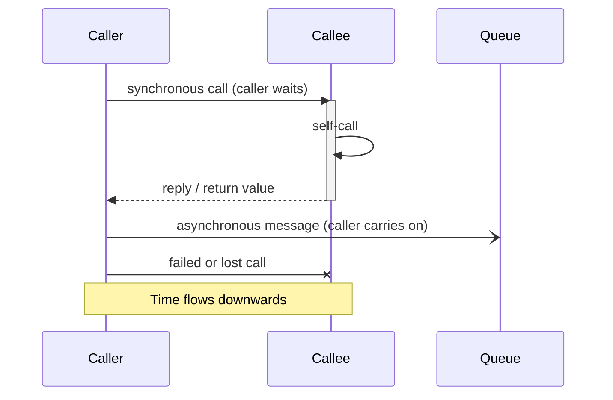
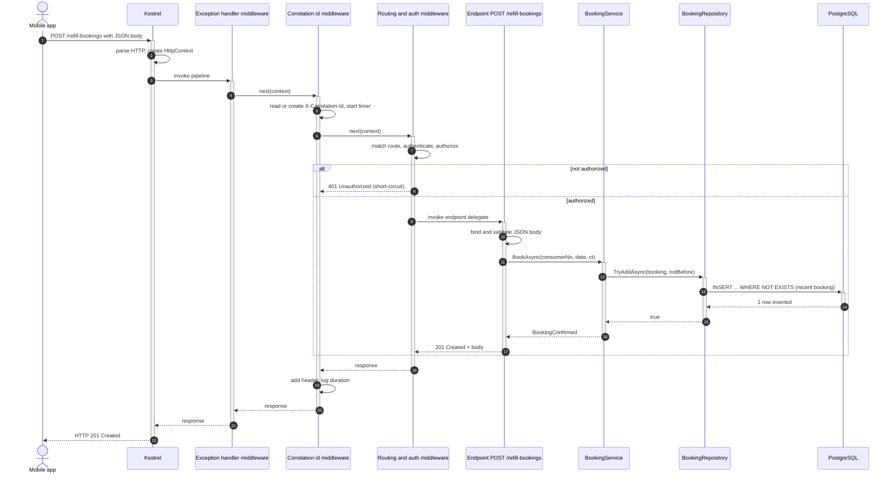
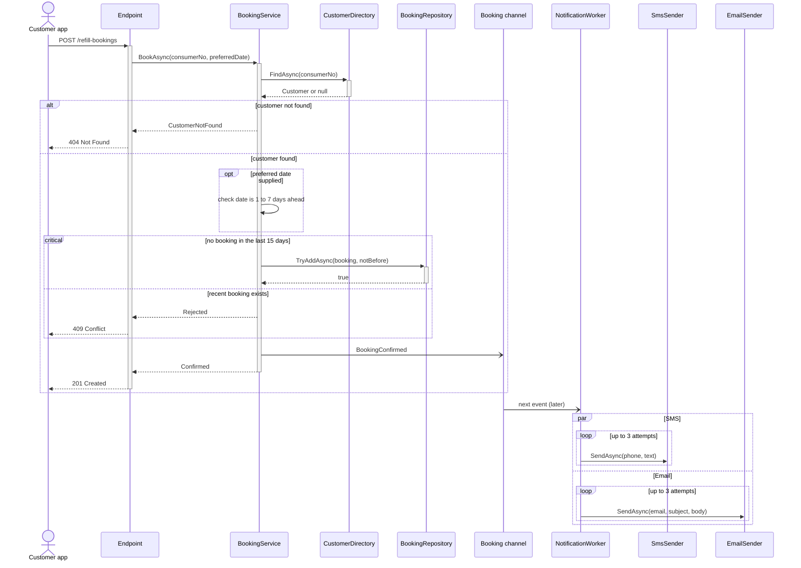
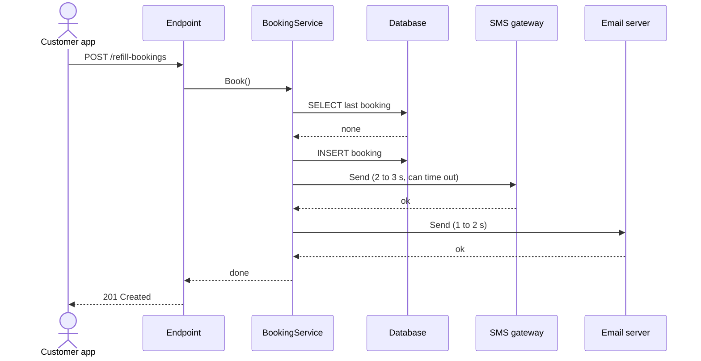
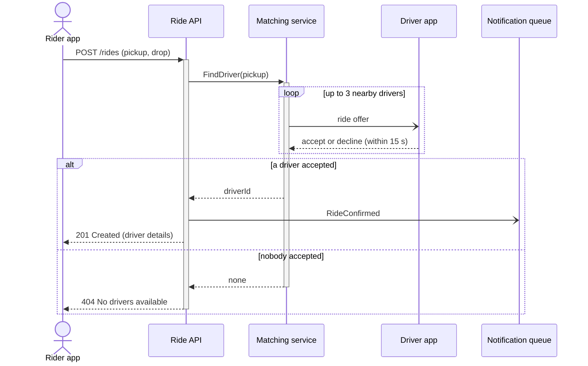
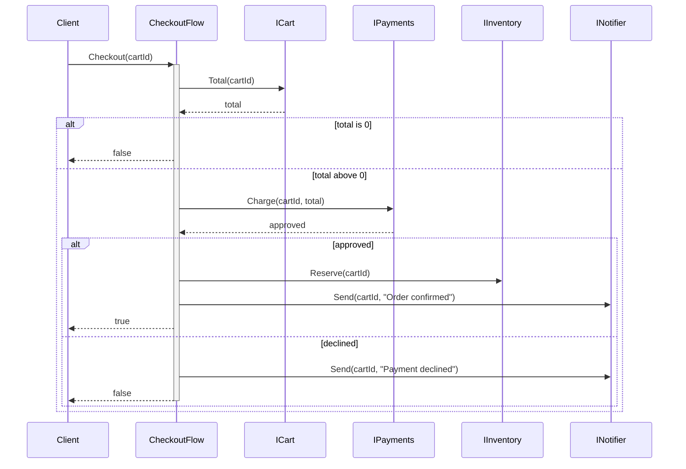
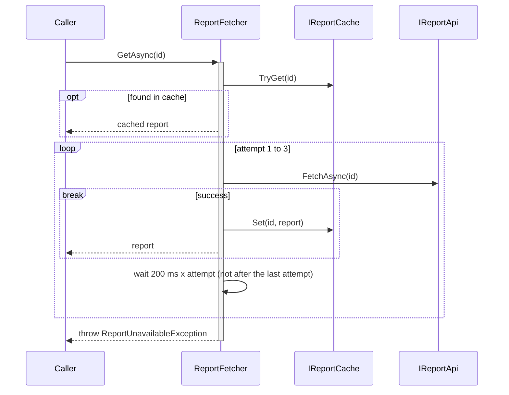
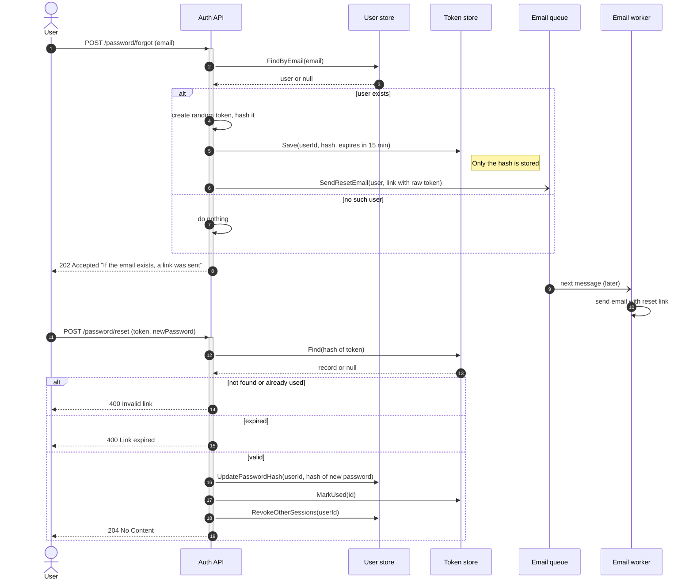
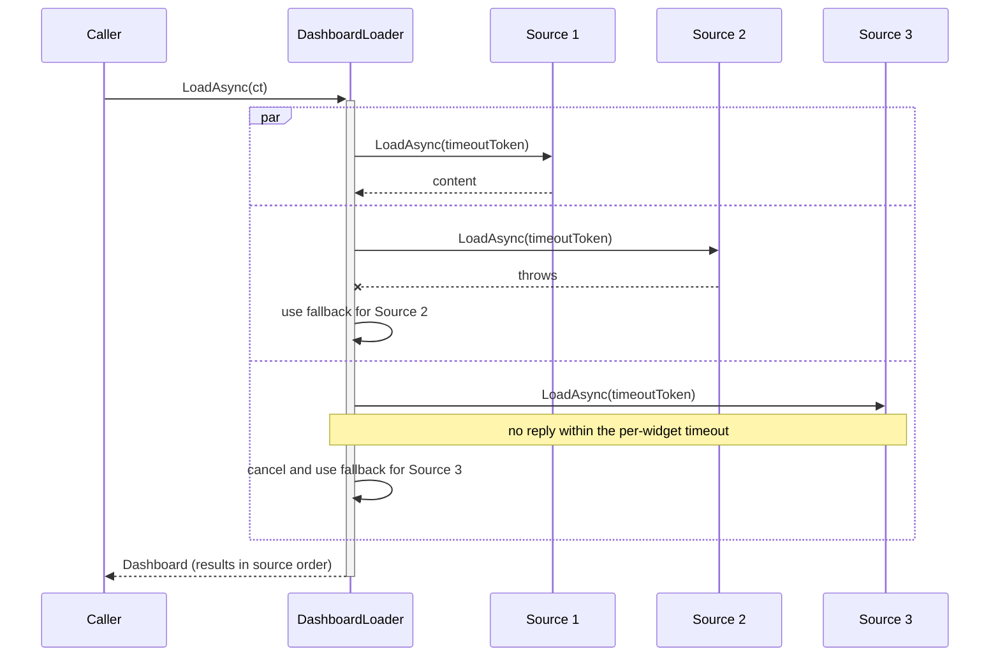

A [class diagram](#/lesson/m05-class-diagrams) shows what exists. A **sequence diagram** shows what *happens*: which object calls which, in what order, what comes back, and what happens when things go wrong. It is the diagram engineers draw most often in design reviews and system design interviews, because most bugs and most design questions are about **order and timing**.

## Learning objectives

By the end of this lesson you will be able to:

1. Read a sequence diagram: participants, lifelines, messages, returns and activation bars.
2. Tell synchronous messages from asynchronous ones, and explain why the difference matters.
3. Use the combined fragments `alt`, `opt`, `loop`, `par`, `break` and `critical` to show choices, repetition and parallel work.
4. Write sequence diagrams in Mermaid `sequenceDiagram` syntax, including activation, notes, numbering and grouping.
5. Draw an HTTP request travelling through ASP.NET Core: Kestrel, middleware, routing, endpoint, service, repository and database.
6. Translate a sequence diagram into C# (method calls, `await`, `if`, loops, `Task.WhenAll`, queues), and the other way round.

## Prerequisites

- [Classes, objects, fields, properties and methods](#/lesson/m01-classes-objects): a lifeline is usually an object.
- [UML fundamentals](#/lesson/m05-uml-fundamentals) helps, but this lesson explains everything it uses.
- Knowing roughly what a web request is helps for the ASP.NET Core part. [The request lifecycle lesson](#/lesson/m03-request-lifecycle) goes deeper.

## Explain it like I'm a beginner

### Ordering food at a restaurant

You sit down at a restaurant in Chennai and order a dosa.

1. You tell the **waiter**: "One masala dosa, please."
2. The waiter walks to the **kitchen** and passes on the order.
3. The **cook** makes the dosa.
4. The kitchen hands it to the waiter.
5. The waiter brings it to you.

Now draw it. Write the three people across the top: *You*, *Waiter*, *Kitchen*. Draw a dashed line straight down from each one; that is their **lifeline**, and time flows downwards. Each step is an **arrow** from the person speaking to the person listening, drawn lower than the previous one. That drawing is a sequence diagram.

### Phone call vs WhatsApp

When you **phone** someone, you wait on the line until they answer. You can't do anything else. That is a **synchronous** message: the caller waits for the reply.

When you send a **WhatsApp** message, you put the phone down and carry on. The reply, if any, comes later. That is an **asynchronous** message: the sender doesn't wait.

Sequence diagrams draw these differently, and the difference matters. A slow synchronous call makes the caller slow. A slow asynchronous one doesn't, but the caller can't know immediately whether it worked.

### "What if…?" boxes

Real conversations branch. "If they have dosa batter, make a dosa; *otherwise*, apologise." "*Optionally*, add extra chutney." "*Repeat* for each person at the table." "Meanwhile, *in parallel*, the drinks counter makes the coffee." Sequence diagrams draw these as labelled boxes around groups of arrows, called **fragments**: `alt`, `opt`, `loop` and `par`.

## First-principles explanation

### Participants and lifelines

Each **participant** is something that sends or receives messages: an object, a service, a database, a person. It is drawn as a box (or a stick figure for a human *actor*) at the top, with a dashed **lifeline** going down. Participants are usually ordered left to right in the order they first get involved, so arrows mostly flow left to right.

A participant can be at any level of detail, but keep one level per diagram:

- **Object level** (LLD): `:BookingService`, `:BookingRepository`. Arrows are method calls.
- **Service level** (HLD): *Mobile app*, *API*, *Payment gateway*, *PostgreSQL*. Arrows are HTTP calls, SQL queries or messages on a queue.

Mixing them ("Mobile app" calling `BookingRepository.AddAsync`) confuses readers.

### Messages

| Kind | UML drawing | Mermaid | Meaning | Typical C# |
|---|---|---|---|---|
| Synchronous call | solid line, filled arrowhead | `A->>B: Do()` | A asks B and waits | a method call, `await b.DoAsync()` |
| Reply / return | dashed line, open arrowhead | `B-->>A: result` | B answers A | `return result;` |
| Asynchronous message | solid line, open arrowhead | `A-)B: Event` | A sends and carries on | `channel.Writer.WriteAsync(e)`, publish to a broker |
| Lost / failed message | line ending in a cross | `A-xB: Call` | the message fails or is lost | an exception, a timeout |
| Self-call | arrow looping back | `A->>A: Validate()` | A calls its own method | `this.Validate()` |

The arrow's *label* is the message: a method name with arguments, an HTTP verb and path, an event name, or a short phrase. Replies often show the returned value: `201 Created`, `true`, `Booking`.

**`await` is still synchronous in a sequence diagram.** This surprises people. `await repository.AddAsync(booking)` doesn't block a thread, but the *calling method* does not continue until the result arrives. From the conversation's point of view, the caller waits. Draw it as `->>` with a `-->>` reply. Use the asynchronous arrow `-)` only for genuine fire-and-forget: queuing a message, publishing an event, starting background work whose result the caller never awaits.

### Activation bars

A thin rectangle on a lifeline shows when that participant is **active**: running code, or waiting on a call it made. In C# terms, an activation bar is a method that is currently on the call stack (or, for async code, a method that has started and not yet returned).

Activation bars make nesting visible: a service's bar stays open while it calls the repository, whose bar sits inside it. They are optional. Use them when nesting matters, and leave them out of simple diagrams.

### Combined fragments

A **fragment** is a labelled box around some messages. The label (the *operator*) says how those messages behave. Conditions, called **guards**, are written in square brackets in UML or as text after the operator in Mermaid.

| Fragment | Meaning | C# |
|---|---|---|
| `alt` / `else` | choose exactly one branch | `if / else if / else`, `switch` |
| `opt` | do this only if the condition holds | `if` with no `else` |
| `loop` | repeat while a condition holds | `for`, `foreach`, `while`, retry loops |
| `par` / `and` | branches run at the same time | `Task.WhenAll`, parallel consumers |
| `break` | do this and then leave the enclosing fragment or interaction | early `return`, `break`, `throw` |
| `critical` / `option` | this region must happen as one unit (atomically) | `lock`, a database transaction |

Fragments can nest: an `alt` inside a `loop` is common.

### Creation and destruction

A participant created part-way through (a new object, a background job) can appear lower on the diagram, at the point where it is created. In Mermaid, `create participant W` before the message that creates it. `destroy W` marks the end of its life, drawn as a cross at the bottom of the lifeline. In .NET, "destroyed" usually means "no longer referenced" or "disposed", since the garbage collector frees memory later.

### Writing sequence diagrams in Mermaid

**Start, participants and aliases.**

```text
sequenceDiagram
    actor C as Customer
    participant API as Refill API
    participant S as BookingService
    participant DB as PostgreSQL
```

`actor` draws a stick figure. `as` gives a short id for the arrows and a readable label for the box. If you don't declare participants, Mermaid creates them in order of first use. Declaring them yourself controls the left-to-right order.

**Messages.**

```text
    C->>API: POST /refill-bookings
    API->>S: BookAsync(consumerNo)
    S->>DB: INSERT INTO bookings
    DB-->>S: 1 row
    S-->>API: Confirmed
    API-->>C: 201 Created
    S-)Worker: BookingConfirmed
```

All arrow forms: `->` solid line without arrowhead, `-->` dotted without arrowhead, `->>` solid with arrowhead, `-->>` dotted with arrowhead, `-x` and `--x` with a cross, `-)` and `--)` with an open (async) arrowhead, and `<<->>` / `<<-->>` for two-way arrows (recent Mermaid versions).

**Activation.** Either explicit:

```text
    API->>S: BookAsync()
    activate S
    S-->>API: result
    deactivate S
```

or the shorthand: `+` on the message that starts the activation and `-` on the one that ends it.

```text
    API->>+S: BookAsync()
    S-->>-API: result
```

**Notes.**

```text
    Note right of S: Checks the 15-day rule
    Note over API,S: Same process, so in-memory calls
```

**Fragments.** Each opens with a keyword and closes with `end`:

```text
    alt customer found
        S->>DB: INSERT
    else not found
        S-->>API: NotFound
    end
    opt preferred date given
        S->>S: ValidateDate()
    end
    loop up to 3 attempts
        W->>SMS: Send()
    end
    par SMS
        W-)SMS: Send()
    and email
        W-)Mail: Send()
    end
    critical reserve slot atomically
        S->>DB: INSERT ... WHERE NOT EXISTS
    option conflict
        S-->>API: Rejected
    end
    break customer blocked
        S-->>API: 403
    end
```

**Extras.**

- `autonumber` on its own line numbers every message: handy for referring to "step 7" in a review.
- `rect rgb(235, 245, 255)` … `end` shades a region to draw attention to it.
- `box Server` … `end` around participant declarations groups them, for example everything inside one process. (`box` is shown here as text; it renders normally in the browser.)
- `create participant W` / `destroy W` as described above.

Common Mermaid mistakes: a `;` inside a message (Mermaid treats it as a line break), a `#` (it can start an entity code), forgetting `end` for a fragment, and activation errors such as `-` on a participant that isn't active ("Trying to inactivate an inactive participant").

### Mapping a sequence diagram to C#

| Diagram | C# |
|---|---|
| Participant `S as BookingService` | an object, usually injected: `BookingService service` |
| `API->>S: BookAsync(no)` | `var outcome = await service.BookAsync(no, ct);` |
| `S-->>API: Confirmed` | `return new BookingConfirmed(...);` |
| `S->>S: Validate()` | a private method call |
| `S-)Q: BookingConfirmed` | `await channel.Writer.WriteAsync(evt, ct);` and **no wait for the handler** |
| Activation bar | the method is executing (on the stack, or awaiting) |
| `alt` / `else` | `if / else`, `switch` |
| `opt` | `if` |
| `loop` | `for`, `foreach`, `while` |
| `par` / `and` | `await Task.WhenAll(a, b);` |
| `break` | early `return` or `throw` |
| `critical` | `lock`, or a database transaction or constraint |
| `-x` | an exception or timeout |

### How much detail?

| Audience | Show |
|---|---|
| Interview, whiteboard | 4–6 participants, the happy path, one `alt` for the main failure |
| Feature design | Every participant the change touches, main error paths, async boundaries |
| Incident review | The exact order of events that caused the bug, including timeouts and retries |

Don't draw getters, logging calls or every `if`. A diagram with 40 arrows is a printout of the code, and the code is already available.

### When a sequence diagram is unnecessary

- A single call with a single return.
- Pure calculation code with no interaction between objects.
- Workflows with many branches and little interaction. An [activity diagram](#/lesson/m05-activity-diagrams) (a flowchart) is clearer for "if this, then that" logic. A [state diagram](#/lesson/m05-state-diagrams) is clearer for lifecycles.

## Visual explanation

### Every arrow in one picture



Read it top to bottom. The solid arrow with a filled head is a call where `Caller` waits. The bar on `Callee`'s lifeline shows it is busy from the call until its dashed reply. The self-call is `Callee` running one of its own methods. The open-headed arrow to `Queue` is fire-and-forget: `Caller` continues immediately. The arrow ending in a cross shows a call that failed (in code, an exception or a timeout). The note spans two lifelines and reminds you of the one rule that makes the whole diagram work: lower means later.

### An HTTP request through ASP.NET Core



Follow the numbers:

- **1–3.** The client's request reaches **Kestrel**, ASP.NET Core's built-in web server. Kestrel parses the bytes into an `HttpContext` object (request, response, user, services) and calls the first middleware.
- **4–6.** **Middleware** components form a chain. Each one receives the context and a `next` delegate. Calling `next(context)` passes the request inward, which is why each middleware's activation bar stays open while the inner ones run. Here the correlation-id middleware tags the request before passing it on.
- **7–8.** Routing finds the matching endpoint. Authentication and authorization middleware check who the caller is. On failure, they **short-circuit**: they write a 401 and *don't call* `next`, so the endpoint never runs. That's the `alt` box.
- **9–16.** The endpoint binds the JSON body to a C# object, calls the service, which calls the repository, which runs SQL. Each reply travels back up the same path.
- **17–21.** The response travels back **out** through the middleware in reverse order. Code after `await next(context)` runs now: the correlation-id middleware adds its header and logs how long the request took.

Two lessons from this picture: **middleware order is execution order** (an exception handler must be early to catch exceptions from everything after it), and **every middleware wraps everything after it**.

## Step-by-step example

We'll draw the refill-booking feature of an LPG distributor's API, then compare it with the code. Requirements (illustrative business rules, not any real oil company's):

- A customer books a cylinder refill by consumer number.
- Unknown consumer numbers are rejected.
- A customer may book at most once every 15 days.
- The customer may optionally choose a delivery date 1–7 days ahead; otherwise delivery is in 2 days.
- After booking, the customer gets an SMS and an email. Sending these must not slow down the booking response.

### Step 1 — list the participants

Customer app, API endpoint, `BookingService`, `CustomerDirectory`, `BookingRepository`, an in-process queue, a background `NotificationWorker`, an SMS sender and an email sender.

### Step 2 — draw the happy path first

Just arrows, no fragments: request → service → find customer → save booking → queue event → 201. Then the worker: take event → send SMS → send email.

### Step 3 — add the branches

- Unknown customer: `alt` around "found / not found".
- Optional date: `opt`.
- 15-day rule: this check and the insert must be one atomic step, or two simultaneous requests could both pass. That's `critical`.
- Notifications: SMS and email are independent, so `par`. Each may fail and be retried, so a `loop` inside each.

### Step 4 — mark the async boundary

The service puts `BookingConfirmed` on a queue with `-)` and returns. The worker picks it up later. Everything below that arrow happens **after** the customer already has their 201 response.

### Step 5 — the finished diagram



Look at what the diagram makes obvious before any code exists: the customer's response does not wait for SMS or email; the 15-day check is protected against races; and a failing SMS gateway is retried but can never block a booking. Those are exactly the questions a reviewer should ask.

## Production-style C# implementation

The code below implements that diagram. Each comment names the diagram element it corresponds to.

```text
Refills.Api/
  Program.cs
  Infrastructure/
    CorrelationIdMiddleware.cs
  Refills/
    Model.cs                  // Customer, RefillBooking, outcomes, event
    CustomerDirectory.cs      // ICustomerDirectory + in-memory version
    BookingRepository.cs      // IBookingRepository + in-memory version (critical region)
    BookingChannel.cs         // the in-process queue (async boundary)
    BookingService.cs         // alt / opt / critical / async publish
    Notifications.cs          // ISmsSender, IEmailSender + logging versions
    NotificationWorker.cs     // BackgroundService: par + loop
```

```csharp file=Infrastructure/CorrelationIdMiddleware.cs
using System.Diagnostics;

namespace Refills.Api.Infrastructure;

/// <summary>Lifeline "Correlation id middleware". Code before next() runs on the way in,
/// code after next() runs on the way out.</summary>
public sealed class CorrelationIdMiddleware(RequestDelegate next, ILogger<CorrelationIdMiddleware> logger)
{
    public const string HeaderName = "X-Correlation-Id";

    public async Task InvokeAsync(HttpContext context)
    {
        var incoming = context.Request.Headers[HeaderName].ToString();
        // Accept a caller's id only if it is short and simple, to avoid log injection.
        var id = incoming.Length is > 0 and <= 64 && incoming.All(c => char.IsAsciiLetterOrDigit(c) || c == '-')
            ? incoming
            : Guid.NewGuid().ToString("N");

        context.TraceIdentifier = id;
        context.Response.OnStarting(() =>
        {
            context.Response.Headers[HeaderName] = id;
            return Task.CompletedTask;
        });

        var started = Stopwatch.GetTimestamp();
        using (logger.BeginScope(new Dictionary<string, object> { ["CorrelationId"] = id }))
        {
            await next(context);                                         // CI->>R: next(context)
            logger.LogInformation("{Method} {Path} returned {Status} in {ElapsedMs:F1} ms",
                context.Request.Method, context.Request.Path, context.Response.StatusCode,
                Stopwatch.GetElapsedTime(started).TotalMilliseconds);    // on the way out
        }
    }
}
```

```csharp file=Refills/Model.cs
namespace Refills.Api.Refills;

public sealed record Customer(string ConsumerNumber, string Name, string Phone, string Email);

public sealed record RefillBooking(Guid Id, string ConsumerNumber, DateOnly DeliveryDate, DateTimeOffset BookedAt);

/// <summary>The three possible replies from BookingService (the alt / critical branches).</summary>
public abstract record BookingOutcome;
public sealed record BookingConfirmedOutcome(RefillBooking Booking) : BookingOutcome;
public sealed record BookingRejected(string Reason) : BookingOutcome;
public sealed record CustomerNotFound(string ConsumerNumber) : BookingOutcome;

/// <summary>The asynchronous message S-)Q: BookingConfirmed.</summary>
public sealed record BookingConfirmed(Guid BookingId, string Name, string Phone, string Email, DateOnly DeliveryDate);

public sealed record BookRefillRequest(string ConsumerNumber, DateOnly? PreferredDeliveryDate);
```

```csharp file=Refills/CustomerDirectory.cs
namespace Refills.Api.Refills;

public interface ICustomerDirectory
{
    Task<Customer?> FindAsync(string consumerNumber, CancellationToken ct);
}

public sealed class InMemoryCustomerDirectory : ICustomerDirectory
{
    private readonly Dictionary<string, Customer> _customers = new(StringComparer.OrdinalIgnoreCase)
    {
        ["7700123456"] = new("7700123456", "Lakshmi Narayanan", "+91-90000-00011", "lakshmi@example.com"),
        ["7700654321"] = new("7700654321", "Farhan Sheikh", "+91-90000-00012", "farhan@example.com"),
    };

    public Task<Customer?> FindAsync(string consumerNumber, CancellationToken ct) =>
        Task.FromResult(_customers.GetValueOrDefault(consumerNumber));
}
```

```csharp file=Refills/BookingRepository.cs
namespace Refills.Api.Refills;

public interface IBookingRepository
{
    /// <summary>Adds the booking only if the customer has none at or after notBefore.
    /// Check and insert are one atomic step (the "critical" fragment).</summary>
    Task<bool> TryAddAsync(RefillBooking booking, DateTimeOffset notBefore, CancellationToken ct);
}

/// <summary>In memory, a lock makes the check-and-insert atomic. In PostgreSQL you would use
/// a single INSERT ... WHERE NOT EXISTS inside a transaction, or a constraint, so the
/// rule also holds across several API servers.</summary>
public sealed class InMemoryBookingRepository : IBookingRepository
{
    private readonly Lock _gate = new();
    private readonly List<RefillBooking> _bookings = new();

    public Task<bool> TryAddAsync(RefillBooking booking, DateTimeOffset notBefore, CancellationToken ct)
    {
        lock (_gate)
        {
            var recent = _bookings.Any(b =>
                string.Equals(b.ConsumerNumber, booking.ConsumerNumber, StringComparison.OrdinalIgnoreCase) &&
                b.BookedAt >= notBefore);
            if (recent) return Task.FromResult(false);
            _bookings.Add(booking);
            return Task.FromResult(true);
        }
    }
}
```

```csharp file=Refills/BookingChannel.cs
using System.Threading.Channels;

namespace Refills.Api.Refills;

/// <summary>The "Booking channel" lifeline: an in-process queue between the request and the worker.
/// Bounded, so a flood of bookings applies back-pressure instead of using unlimited memory.</summary>
public sealed class BookingChannel
{
    private readonly Channel<BookingConfirmed> _channel = Channel.CreateBounded<BookingConfirmed>(
        new BoundedChannelOptions(1_000) { FullMode = BoundedChannelFullMode.Wait, SingleReader = true });

    public ValueTask PublishAsync(BookingConfirmed evt, CancellationToken ct) => _channel.Writer.WriteAsync(evt, ct);
    public IAsyncEnumerable<BookingConfirmed> ReadAllAsync(CancellationToken ct) => _channel.Reader.ReadAllAsync(ct);
}
```

```csharp file=Refills/BookingService.cs
namespace Refills.Api.Refills;

public sealed class BookingService(ICustomerDirectory customers, IBookingRepository bookings,
    BookingChannel channel, TimeProvider clock)
{
    public static readonly TimeSpan MinimumGap = TimeSpan.FromDays(15);
    private static readonly TimeSpan IndiaOffset = TimeSpan.FromHours(5.5);

    public async Task<BookingOutcome> BookAsync(string consumerNumber, DateOnly? preferredDate, CancellationToken ct)
    {
        ArgumentException.ThrowIfNullOrWhiteSpace(consumerNumber);

        var customer = await customers.FindAsync(consumerNumber, ct);           // S->>Dir: FindAsync
        if (customer is null) return new CustomerNotFound(consumerNumber);       // alt: not found

        var now = clock.GetUtcNow();
        var today = DateOnly.FromDateTime(now.ToOffset(IndiaOffset).DateTime);
        var delivery = today.AddDays(2);
        if (preferredDate is { } wanted)                                         // opt: preferred date supplied
        {
            var daysAhead = wanted.DayNumber - today.DayNumber;
            if (daysAhead is < 1 or > 7)
                return new BookingRejected("Preferred delivery date must be 1 to 7 days from today.");
            delivery = wanted;
        }

        var booking = new RefillBooking(Guid.NewGuid(), customer.ConsumerNumber, delivery, now);
        if (!await bookings.TryAddAsync(booking, now - MinimumGap, ct))         // critical / option
            return new BookingRejected("A refill was already booked in the last 15 days.");

        await channel.PublishAsync(new BookingConfirmed(booking.Id, customer.Name, customer.Phone,
            customer.Email, booking.DeliveryDate), ct);                          // S-)Q: async, no wait for SMS
        return new BookingConfirmedOutcome(booking);                             // S-->>E: Confirmed
    }
}
```

```csharp file=Refills/Notifications.cs
namespace Refills.Api.Refills;

public interface ISmsSender { Task SendAsync(string phone, string text, CancellationToken ct); }
public interface IEmailSender { Task SendAsync(string to, string subject, string body, CancellationToken ct); }

public sealed class LoggingSmsSender(ILogger<LoggingSmsSender> logger) : ISmsSender
{
    public Task SendAsync(string phone, string text, CancellationToken ct)
    {
        logger.LogInformation("SMS to {Phone}: {Text}", phone, text);
        return Task.CompletedTask;
    }
}

public sealed class LoggingEmailSender(ILogger<LoggingEmailSender> logger) : IEmailSender
{
    public Task SendAsync(string to, string subject, string body, CancellationToken ct)
    {
        logger.LogInformation("Email to {To}: {Subject}", to, subject);
        return Task.CompletedTask;
    }
}
```

```csharp file=Refills/NotificationWorker.cs
namespace Refills.Api.Refills;

/// <summary>The NotificationWorker lifeline. Runs in the background for the life of the app.</summary>
public sealed class NotificationWorker(BookingChannel channel, ISmsSender sms, IEmailSender email,
    TimeProvider clock, ILogger<NotificationWorker> logger) : BackgroundService
{
    private const int MaxAttempts = 3;

    protected override async Task ExecuteAsync(CancellationToken stoppingToken)
    {
        await foreach (var evt in channel.ReadAllAsync(stoppingToken))                    // Q-)W: next event
        {
            var text = $"Dear {evt.Name}, your LPG refill is booked for {evt.DeliveryDate:dd MMM}.";
            await Task.WhenAll(                                                            // par
                WithRetryAsync("SMS", ct => sms.SendAsync(evt.Phone, text, ct), stoppingToken),
                WithRetryAsync("Email", ct => email.SendAsync(evt.Email, "Refill booked", text, ct), stoppingToken));
        }
    }

    /// <summary>loop up to 3 attempts, with a growing delay. Never throws: a failed notification
    /// must not stop the worker from handling the next booking.</summary>
    private async Task WithRetryAsync(string channelName, Func<CancellationToken, Task> send, CancellationToken ct)
    {
        for (var attempt = 1; attempt <= MaxAttempts; attempt++)
        {
            try
            {
                await send(ct);
                return;                                                                    // success: leave the loop
            }
            catch (Exception ex) when (ex is not OperationCanceledException)
            {
                logger.LogWarning(ex, "{Channel} attempt {Attempt} of {Max} failed", channelName, attempt, MaxAttempts);
                if (attempt == MaxAttempts) return;
                await Task.Delay(TimeSpan.FromMilliseconds(200 * Math.Pow(2, attempt - 1)), clock, ct);
            }
        }
    }
}
```

```csharp file=Program.cs
using Refills.Api.Infrastructure;
using Refills.Api.Refills;

var builder = WebApplication.CreateBuilder(args);

builder.Services.AddProblemDetails();
builder.Services.AddSingleton(TimeProvider.System);
builder.Services.AddSingleton<ICustomerDirectory, InMemoryCustomerDirectory>();
builder.Services.AddSingleton<IBookingRepository, InMemoryBookingRepository>();
builder.Services.AddSingleton<BookingChannel>();
builder.Services.AddSingleton<ISmsSender, LoggingSmsSender>();
builder.Services.AddSingleton<IEmailSender, LoggingEmailSender>();
builder.Services.AddSingleton<BookingService>();
builder.Services.AddHostedService<NotificationWorker>();

var app = builder.Build();

// Order here = order of the lifelines in the diagram.
app.UseExceptionHandler();                       // EH: outermost, so it catches everything inside
app.UseMiddleware<CorrelationIdMiddleware>();    // CI

app.MapPost("/refill-bookings", async (BookRefillRequest request, BookingService service, CancellationToken ct) =>
{
    var outcome = await service.BookAsync(request.ConsumerNumber, request.PreferredDeliveryDate, ct);
    return outcome switch
    {
        BookingConfirmedOutcome ok => Results.Created($"/refill-bookings/{ok.Booking.Id}", ok.Booking),
        BookingRejected r => Results.Problem(r.Reason, statusCode: StatusCodes.Status409Conflict),
        CustomerNotFound nf => Results.Problem($"Consumer {nf.ConsumerNumber} not found.", statusCode: StatusCodes.Status404NotFound),
        _ => Results.Problem(statusCode: StatusCodes.Status500InternalServerError),
    };
});

app.Run();
```

Compare code and diagram:

- **The `alt` and `critical` branches became return values** (`CustomerNotFound`, `BookingRejected`), and the endpoint turns them into 404 and 409. Expected outcomes are values; exceptions are for real failures.
- **The async arrow is a channel write.** `BookAsync` returns as soon as the event is queued. If the SMS provider takes 3 seconds, the customer doesn't feel it. The trade-off: if the process crashes after the 201 but before the worker sends the SMS, the event is lost, because a `Channel` lives in memory. A production system that must not lose notifications writes the event to the database in the same transaction as the booking (the [transactional outbox](#/lesson/m12-outbox)) or uses a durable broker.
- **`par` is `Task.WhenAll`.** SMS and email run at the same time, so the worker's total time is the slower of the two, not their sum.
- **`loop` is the retry `for`.** It is bounded (3 attempts) and has growing delays, so a broken SMS gateway can't spin forever.
- **`critical` is the repository's atomic check-and-insert.** The in-memory lock works for one server only. With two API servers, the rule must be enforced by PostgreSQL.

## Bad design vs good design

**Bad: the diagram reveals a slow, fragile design.**



Problems the diagram makes visible:

- **Synchronous notifications.** The customer waits for both SMS and email, one after the other. The latencies are written as estimates on the arrows; even at those estimates the response takes several seconds. If the SMS gateway times out, the booking request fails, even though the booking was saved.
- **Race condition.** `SELECT` then `INSERT` as two separate steps: two simultaneous requests can both see "none" and both insert. There is no `critical` region.
- **No failure paths.** No `alt` for "customer not found" or "recent booking", so nobody has decided what the API returns in those cases.

**Good:** the diagram in Step 5, and the code above. Notifications are asynchronous and retried in the background; the check-and-insert is atomic; every outcome has a branch and an HTTP status.

**Is asynchronous always better?** No. Async adds a queue, a worker, retries and a new failure mode (lost or delayed messages). It is also harder to debug, because the work happens after the request has finished. If the caller *needs* the result (a payment authorisation before showing "Paid"), keep the call synchronous and add a timeout. Make something asynchronous when the caller doesn't need to wait for it, and you have a plan for when it fails.

:::callout type=tip title="Draw the unhappy path first in reviews"
Anyone can draw the happy path. Ask "what if this call times out?" at each arrow, and add an `alt` or a `-x` for the answer. Most production incidents live in the branches nobody drew.
:::

## Practical playground

This program builds a tiny middleware pipeline out of delegates, records every call as it runs, and prints the trace as Mermaid. Run it, paste the output into any Mermaid renderer, then try the experiments.

:::playground type=csharp title="Trace a request into a sequence diagram"
```csharp file=Program.cs
using System;
using System.Collections.Generic;

public sealed class Request
{
    public string Path { get; init; } = "/";
    public string? Token { get; init; }
    public int Status { get; set; }
}

public static class Trace
{
    private static readonly List<string> Lines = new();
    private static readonly Stack<string> Active = new(new[] { "Kestrel" });   // who is currently running

    // A call from whoever is active now to `to`; `to` becomes active.
    public static void Enter(string to, string msg) { Lines.Add($"    {Active.Peek()}->>+{to}: {msg}"); Active.Push(to); }
    // The active participant replies to its caller and stops being active.
    public static void Leave(string msg) { var from = Active.Pop(); Lines.Add($"    {from}-->>-{Active.Peek()}: {msg}"); }
    public static void Self(string msg) => Lines.Add($"    {Active.Peek()}->>{Active.Peek()}: {msg}");

    public static void Print(string title)
    {
        Console.WriteLine($"%% {title}");
        Console.WriteLine("sequenceDiagram");
        foreach (var l in Lines) Console.WriteLine(l);
        Console.WriteLine();
        Lines.Clear();
    }
}

public delegate void Handler(Request request);

public static class Program
{
    // Each middleware gets the request and the next handler, like ASP.NET Core's RequestDelegate.
    static Handler Logging(Handler next) => r =>
    {
        Trace.Enter("Logging", $"GET {r.Path}");
        Trace.Self("start timer");
        next(r);
        Trace.Leave($"{r.Status}");
    };

    static Handler Auth(Handler next) => r =>
    {
        Trace.Enter("Auth", "next(context)");
        if (r.Token is null)
        {
            r.Status = 401;                     // short-circuit: next is never called
            Trace.Leave("401 Unauthorized");
            return;
        }
        next(r);
        Trace.Leave($"{r.Status}");
    };

    static void Endpoint(Request r)
    {
        Trace.Enter("Endpoint", "GET /orders/42");
        Trace.Enter("Repository", "FindAsync(42)");
        Trace.Leave("Order");
        r.Status = 200;
        Trace.Leave("200 OK");
    }

    public static void Main()
    {
        Handler pipeline = Logging(Auth(Endpoint));   // order matters: outermost first

        pipeline(new Request { Path = "/orders/42", Token = "abc" });
        Trace.Print("Request with a token");

        pipeline(new Request { Path = "/orders/42" });
        Trace.Print("Request without a token");

        // Experiments:
        // 1. Swap the order: Auth(Logging(Endpoint)). What changes in the diagrams? Which is better for logging failed logins?
        // 2. Add a Caching middleware between Auth and Endpoint that returns 200 without calling next for /orders/42.
        // 3. Make the repository throw. Where would an exception-handling middleware have to sit to catch it?
    }
}
```
:::

## Exercises

:::exercise id=m05-sequence-diagrams-ex1 difficulty=beginner kind=written title="Read a ride-booking diagram"
This is a simplified, illustrative flow for booking a ride:



Answer in sentences:

1. Which messages are asynchronous? Why is an offer to a driver asynchronous?
2. What is the longest time the rider might wait, from the diagram? Which fragment tells you?
3. Does the rider's response wait for the `RideConfirmed` notification to be delivered? How can you tell?
4. Which participant is active the longest?
5. What happens if the matching service crashes while the loop is running? Is that shown? How would you show it?
::acceptance
- Correctly identifies the `-)` messages as asynchronous and explains why.
- Gives a maximum wait of about 45 seconds (3 × 15 s) and names the `loop`.
- Explains from the arrow type that the notification is fire-and-forget.
- Names the Ride API (its activation spans the whole request).
- Notes that the failure is not shown and proposes a `-x` or an `alt` branch with a timeout.
::hint
Look at the arrowheads: filled for "wait", open for "send and carry on".
::hint
Multiply the loop's maximum repetitions by the time limit in the reply's label.
::hint
The activation bar on `API` starts at the first arrow and ends at the last reply.
::hint
A crash can be drawn as `API-xM: FindDriver` or as an `alt` branch "timeout" with its own reply to the rider.
::solution
1. `M-)D: ride offer` and `API-)N: RideConfirmed` are asynchronous. A ride offer is pushed to a phone that may be slow, offline or ignored. The matching service shouldn't hold a thread blocked waiting on one phone. It sends the offer and handles the reply when (or if) it arrives.
2. Up to about **45 seconds**: the `loop` runs at most 3 times and each driver has 15 seconds. That is a long wait for a user, which is a good design-review question in itself (send offers in parallel? show progress?).
3. **No.** `API-)N` is an open-arrow asynchronous message, and the very next arrow is the 201 to the rider. The notification is delivered later by whoever reads the queue.
4. The **Ride API**: its activation starts at `POST /rides` and ends at the final reply, and it wraps the matching service's activation.
5. It is **not shown**. Add an `alt` with a third branch, "matching timed out after 50 s", that returns `503 Service Unavailable` to the rider, or draw `API-xM: FindDriver` with a note. The API should have its own timeout so the rider is never left waiting forever.
::mistakes
- Treating `D-->>M` as a synchronous call. It is a reply (dashed), arriving in response to the offer.
- Saying the rider waits for notifications because the `RideConfirmed` arrow is drawn above the 201.
:::

:::exercise id=m05-sequence-diagrams-ex2 difficulty=beginner kind=code title="Implement exactly what the diagram says"
Implement `CheckoutFlow.Checkout` so the calls happen in exactly this order:


::requirements
- Use only the four injected interfaces. Make no extra calls.
- The tests use fakes that write each call into a shared log, and compare the log with the diagram.
::acceptance
- An approved ₹620 cart produces the log `Total`, `Charge:620`, `Reserve`, `Send:Order confirmed` and returns `true`.
- A declined cart produces `Total`, `Charge:620`, `Send:Payment declined` and returns `false`. It never reserves stock.
- An empty cart (total 0) produces only `Total` and returns `false`.
::hint
Each `alt` becomes an `if`/`else`. Each arrow from `F` becomes one method call, in the same order.
::hint
The first `alt` is a guard clause: `if (total == 0) return false;`.
::hint
Keep the result of `Charge` in a variable. The second `alt` branches on it.
::hint
```csharp
var total = cart.Total(cartId);
if (total == 0) return false;
if (!payments.Charge(cartId, total)) { notifier.Send(cartId, "Payment declined"); return false; }
```
::starter
```csharp file=CheckoutFlow.cs
using System;

public interface ICart { decimal Total(string cartId); }
public interface IPayments { bool Charge(string cartId, decimal amount); }
public interface IInventory { void Reserve(string cartId); }
public interface INotifier { void Send(string cartId, string message); }

public sealed class CheckoutFlow(ICart cart, IPayments payments, IInventory inventory, INotifier notifier)
{
    public bool Checkout(string cartId) => throw new NotImplementedException();
}
```
::tests
```csharp file=CheckoutFlowTests.cs
using System.Collections.Generic;
using Xunit;

public class CheckoutFlowTests
{
    private sealed class Fakes(decimal total, bool approve) : ICart, IPayments, IInventory, INotifier
    {
        public List<string> Log { get; } = new();
        public decimal Total(string cartId) { Log.Add("Total"); return total; }
        public bool Charge(string cartId, decimal amount) { Log.Add($"Charge:{amount}"); return approve; }
        public void Reserve(string cartId) => Log.Add("Reserve");
        public void Send(string cartId, string message) => Log.Add($"Send:{message}");
    }

    private static (bool Result, List<string> Log) Run(decimal total, bool approve)
    {
        var f = new Fakes(total, approve);
        var result = new CheckoutFlow(f, f, f, f).Checkout("cart-1");
        return (result, f.Log);
    }

    [Fact]
    public void Approved_path_matches_diagram()
    {
        var (result, log) = Run(620m, true);
        Assert.True(result);
        Assert.Equal(new List<string> { "Total", "Charge:620", "Reserve", "Send:Order confirmed" }, log);
    }

    [Fact]
    public void Declined_path_matches_diagram()
    {
        var (result, log) = Run(620m, false);
        Assert.False(result);
        Assert.Equal(new List<string> { "Total", "Charge:620", "Send:Payment declined" }, log);
    }

    [Fact]
    public void Empty_cart_stops_early()
    {
        var (result, log) = Run(0m, true);
        Assert.False(result);
        Assert.Equal(new List<string> { "Total" }, log);
    }
}
```
::solution
```csharp file=CheckoutFlow.cs
using System;

public interface ICart { decimal Total(string cartId); }
public interface IPayments { bool Charge(string cartId, decimal amount); }
public interface IInventory { void Reserve(string cartId); }
public interface INotifier { void Send(string cartId, string message); }

public sealed class CheckoutFlow(ICart cart, IPayments payments, IInventory inventory, INotifier notifier)
{
    public bool Checkout(string cartId)
    {
        var total = cart.Total(cartId);                 // F->>Cart: Total
        if (total == 0) return false;                   // alt total is 0

        var approved = payments.Charge(cartId, total);  // F->>Pay: Charge
        if (!approved)                                  // alt declined
        {
            notifier.Send(cartId, "Payment declined");
            return false;
        }

        inventory.Reserve(cartId);                      // alt approved
        notifier.Send(cartId, "Order confirmed");
        return true;
    }
}
```

The test log *is* the sequence diagram, written as data. Recording calls in a shared list is a simple, honest way to verify "this happens before that" without a mocking library.
::mistakes
- Reserving stock before charging. It looks harmless, but the diagram says payment first, and a declined payment would leave stock reserved.
- Calling `cart.Total` twice (once for the check, once for the charge). The diagram shows one call, and the second call might return a different value.
::extensions
Add a third `alt` branch: if `Reserve` throws `InvalidOperationException` (out of stock), refund the payment with a new `IPayments.Refund` call. Draw the updated diagram first.
:::

:::exercise id=m05-sequence-diagrams-ex3 difficulty=intermediate kind=code title="opt, loop and break: a report fetcher with retries"
Implement `ReportFetcher.GetAsync` to match this diagram:


::requirements
- Only `HttpRequestException` from the API counts as a retryable failure. Any other exception propagates immediately.
- Delays are 200 ms after attempt 1 and 400 ms after attempt 2, with **no** delay after attempt 3. Use the injected `delay` function, so tests run instantly.
- After 3 failures, throw `ReportUnavailableException` (provided) with the last `HttpRequestException` as `InnerException`.
::acceptance
- A cache hit makes zero API calls.
- Fail, fail, succeed: 3 API calls, delays of 200 and 400 ms, and the report is cached.
- Three failures: 3 API calls, delays of 200 and 400 ms only, then `ReportUnavailableException`.
- An `InvalidOperationException` from the API is not retried.
::hint
`opt` is an `if` that returns early. `break` inside a `loop` is a `return` from inside the loop body.
::hint
Write the loop as `for (var attempt = 1; attempt <= 3; attempt++)`, with the API call inside a `try`.
::hint
Catch only `HttpRequestException`. Remember the exception so you can attach it to the final error.
::hint
Delay only when `attempt < MaxAttempts`.
::hint
```csharp
try { var report = await api.FetchAsync(id, ct); cache.Set(id, report); return report; }
catch (HttpRequestException ex) { last = ex; if (attempt < MaxAttempts) await delay(TimeSpan.FromMilliseconds(200 * attempt), ct); }
```
::starter
```csharp file=ReportFetcher.cs
using System;
using System.Net.Http;
using System.Threading;
using System.Threading.Tasks;

public interface IReportApi { Task<string> FetchAsync(string id, CancellationToken ct); }

public interface IReportCache
{
    bool TryGet(string id, out string? report);
    void Set(string id, string report);
}

public sealed class ReportUnavailableException(string message, Exception? inner) : Exception(message, inner);

public sealed class ReportFetcher(IReportCache cache, IReportApi api, Func<TimeSpan, CancellationToken, Task> delay)
{
    public const int MaxAttempts = 3;

    public Task<string> GetAsync(string id, CancellationToken ct) => throw new NotImplementedException();
}
```
::tests
```csharp file=ReportFetcherTests.cs
using System;
using System.Collections.Generic;
using System.Net.Http;
using System.Threading;
using System.Threading.Tasks;
using Xunit;

public class ReportFetcherTests
{
    private sealed class FakeCache : IReportCache
    {
        public Dictionary<string, string> Items { get; } = new();
        public bool TryGet(string id, out string? report) => Items.TryGetValue(id, out report);
        public void Set(string id, string report) => Items[id] = report;
    }

    private sealed class ScriptedApi(params Exception?[] script) : IReportApi
    {
        public int Calls { get; private set; }
        public Task<string> FetchAsync(string id, CancellationToken ct)
        {
            var step = script[Math.Min(Calls, script.Length - 1)];
            Calls++;
            return step is null ? Task.FromResult($"report-{id}") : Task.FromException<string>(step);
        }
    }

    private static readonly List<TimeSpan> Delays = new();
    private static Task RecordDelay(TimeSpan t, CancellationToken ct) { Delays.Add(t); return Task.CompletedTask; }

    [Fact]
    public async Task Cache_hit_skips_api()
    {
        var cache = new FakeCache();
        cache.Items["r1"] = "cached";
        var api = new ScriptedApi((Exception?)null);
        Assert.Equal("cached", await new ReportFetcher(cache, api, RecordDelay).GetAsync("r1", CancellationToken.None));
        Assert.Equal(0, api.Calls);
    }

    [Fact]
    public async Task Retries_then_succeeds_and_caches()
    {
        Delays.Clear();
        var cache = new FakeCache();
        var api = new ScriptedApi(new HttpRequestException("503"), new HttpRequestException("503"), null);
        var report = await new ReportFetcher(cache, api, RecordDelay).GetAsync("r2", CancellationToken.None);
        Assert.Equal("report-r2", report);
        Assert.Equal(3, api.Calls);
        Assert.Equal(new List<TimeSpan> { TimeSpan.FromMilliseconds(200), TimeSpan.FromMilliseconds(400) }, Delays);
        Assert.Equal("report-r2", cache.Items["r2"]);
    }

    [Fact]
    public async Task Gives_up_after_three_without_final_delay()
    {
        Delays.Clear();
        var api = new ScriptedApi(new HttpRequestException("down"));
        var ex = await Assert.ThrowsAsync<ReportUnavailableException>(() =>
            new ReportFetcher(new FakeCache(), api, RecordDelay).GetAsync("r3", CancellationToken.None));
        Assert.Equal(3, api.Calls);
        Assert.Equal(2, Delays.Count);
        Assert.True(ex.InnerException is HttpRequestException);
    }

    [Fact]
    public async Task Other_errors_are_not_retried()
    {
        var api = new ScriptedApi(new InvalidOperationException("bad id"));
        await Assert.ThrowsAsync<InvalidOperationException>(() =>
            new ReportFetcher(new FakeCache(), api, RecordDelay).GetAsync("r4", CancellationToken.None));
        Assert.Equal(1, api.Calls);
    }
}
```
::solution
```csharp file=ReportFetcher.cs
using System;
using System.Net.Http;
using System.Threading;
using System.Threading.Tasks;

public interface IReportApi { Task<string> FetchAsync(string id, CancellationToken ct); }

public interface IReportCache
{
    bool TryGet(string id, out string? report);
    void Set(string id, string report);
}

public sealed class ReportUnavailableException(string message, Exception? inner) : Exception(message, inner);

public sealed class ReportFetcher(IReportCache cache, IReportApi api, Func<TimeSpan, CancellationToken, Task> delay)
{
    public const int MaxAttempts = 3;

    public async Task<string> GetAsync(string id, CancellationToken ct)
    {
        if (cache.TryGet(id, out var cached) && cached is not null) return cached;      // opt found in cache

        HttpRequestException? last = null;
        for (var attempt = 1; attempt <= MaxAttempts; attempt++)                          // loop attempt 1 to 3
        {
            try
            {
                var report = await api.FetchAsync(id, ct);
                cache.Set(id, report);                                                    // break success
                return report;
            }
            catch (HttpRequestException ex)
            {
                last = ex;
                if (attempt < MaxAttempts)
                    await delay(TimeSpan.FromMilliseconds(200 * attempt), ct);            // wait, not after the last
            }
        }

        throw new ReportUnavailableException($"Report {id} unavailable after {MaxAttempts} attempts.", last);
    }
}
```

Each fragment became one construct: `opt` is the early `if`, `loop` is the `for`, and `break` is the `return` inside the `try`. Injecting `delay` made the timing testable without waiting 600 ms per test. In real code you can pass `(t, ct) => Task.Delay(t, ct)`, or use `TimeProvider`.
::alternatives
In production you would usually use a resilience library (Polly, or `Microsoft.Extensions.Http.Resilience` for `HttpClient`) instead of a hand-written loop. The diagram stays the same. Add jitter (a small random amount) to the delays, so many clients don't retry at the same moment. See [Timeouts, retries and backoff](#/lesson/m10-timeouts-retries).
::mistakes
- Retrying on every exception, including bugs like `InvalidOperationException` that will fail the same way every time.
- Waiting after the final attempt, which adds delay for nothing.
- Losing the original error. Pass it as `InnerException` so logs show *why* the report was unavailable.
::extensions
Add a per-attempt timeout of 2 seconds using a linked `CancellationTokenSource`, and draw it on the diagram as an `alt` inside the loop.
:::

:::exercise id=m05-sequence-diagrams-ex4 difficulty=intermediate kind=written title="Draw a password-reset flow"
Draw a Mermaid sequence diagram for "forgot password" in an ASP.NET Core app:

- The user submits their email address on a form.
- The API must return the **same** response whether or not the email is registered, so attackers can't discover which emails have accounts.
- If the account exists, create a single-use token that expires in 15 minutes, store a **hash** of it, and email a link. The email is sent in the background.
- When the user opens the link and submits a new password, the API checks the token (exists, not expired, not used), updates the password hash, marks the token used, and signs out other sessions.

Use at least: one `alt`, one asynchronous message, activation on the API, and a `Note`. Then write two sentences on which arrow is the most likely to fail in production and how the diagram shows it is handled.
::acceptance
- Two phases (request link, reset password) drawn clearly.
- The "email not registered" branch returns the same 202 response as the registered branch.
- The email is sent with an asynchronous arrow.
- Token validation has an `alt` with at least two failure outcomes.
- Valid Mermaid syntax.
::hint
Participants: User (actor), Browser, Auth API, User store, Token store, Email queue, Email worker.
::hint
In the first phase the `alt` has two branches that end with the same reply. That is the security point.
::hint
In the second phase, consider `alt` branches for "token invalid or used", "token expired" and "ok".
::hint
A note such as "store SHA-256 of the token, never the raw token" belongs next to the token store.
::solution


The arrow most likely to fail is the email send (the provider may be slow or down). Because it is asynchronous through a queue, a failure doesn't change the user's 202 response, and the worker can retry. A production version should also rate-limit `/password/forgot` per IP address and per email, and the "no such user" branch should take about the same time as the other branch so response timing doesn't reveal the answer.
::mistakes
- Returning 404 for unknown emails, which tells attackers which addresses are registered.
- Storing the raw token in the database, so a database leak lets anyone reset passwords.
- Sending the email synchronously, so the response time reveals whether the account exists.
:::

:::exercise id=m05-sequence-diagrams-ex5 difficulty=advanced kind=code title="par: load dashboard widgets in parallel with timeouts"
A project dashboard shows several widgets (progress, budget, safety alerts). Each widget comes from a different source. Implement this diagram:


::requirements
- All sources start **at the same time**, not one after another.
- Each source gets its own timeout (`perWidgetTimeout`), linked to the caller's token.
- A source that throws, or times out, gives `WidgetResult(Name, "unavailable", IsFallback: true)`. The others are unaffected.
- If the **caller's** token is cancelled, `LoadAsync` throws `OperationCanceledException` instead of returning fallbacks.
- Results are returned in the same order as the sources were given.
::acceptance
- Three healthy sources give three results in order, none marked as fallback.
- All three sources have started before any of them completes (proved by a test with gated fakes).
- A throwing source and a hanging source both give fallbacks, while the healthy one returns its content.
- A pre-cancelled caller token causes an `OperationCanceledException`.
::hint
`par` means start every task first, *then* await them together. What happens if you `await` inside a `foreach`?
::hint
Write a helper `LoadOneAsync(IWidgetSource source, CancellationToken outer)` that returns a `WidgetResult` and never throws, except when the caller cancelled.
::hint
Inside the helper: `using var cts = CancellationTokenSource.CreateLinkedTokenSource(outer); cts.CancelAfter(perWidgetTimeout);`.
::hint
Catch `OperationCanceledException` `when (!outer.IsCancellationRequested)` (that's our timeout, so use a fallback). Catch other exceptions and use a fallback. After `Task.WhenAll`, call `outer.ThrowIfCancellationRequested()`.
::hint
```csharp
var tasks = _sources.Select(s => LoadOneAsync(s, ct)).ToArray();   // all started here
var results = await Task.WhenAll(tasks);                            // par ... end
```
::starter
```csharp file=DashboardLoader.cs
using System;
using System.Collections.Generic;
using System.Linq;
using System.Threading;
using System.Threading.Tasks;

public interface IWidgetSource
{
    string Name { get; }
    Task<string> LoadAsync(CancellationToken ct);
}

public sealed record WidgetResult(string Name, string Content, bool IsFallback);
public sealed record Dashboard(IReadOnlyList<WidgetResult> Widgets);

public sealed class DashboardLoader(IEnumerable<IWidgetSource> sources, TimeSpan perWidgetTimeout)
{
    public Task<Dashboard> LoadAsync(CancellationToken ct) => throw new NotImplementedException();
}
```
::tests
```csharp file=DashboardLoaderTests.cs
using System;
using System.Collections.Generic;
using System.Threading;
using System.Threading.Tasks;
using Xunit;

public class DashboardLoaderTests
{
    private sealed class Fixed(string name, string content) : IWidgetSource
    {
        public string Name => name;
        public Task<string> LoadAsync(CancellationToken ct) => Task.FromResult(content);
    }

    private sealed class Throwing(string name) : IWidgetSource
    {
        public string Name => name;
        public async Task<string> LoadAsync(CancellationToken ct) { await Task.Yield(); throw new InvalidOperationException("source down"); }
    }

    private sealed class Hanging(string name) : IWidgetSource
    {
        public string Name => name;
        public async Task<string> LoadAsync(CancellationToken ct) { await Task.Delay(Timeout.Infinite, ct); return "never"; }
    }

    private sealed class Gated(string name, Counter started) : IWidgetSource
    {
        public TaskCompletionSource<string> Gate { get; } = new(TaskCreationOptions.RunContinuationsAsynchronously);
        public string Name => name;
        public Task<string> LoadAsync(CancellationToken ct) { started.Value++; return Gate.Task; }
    }

    private sealed class Counter { public int Value; }

    private static readonly TimeSpan Short = TimeSpan.FromMilliseconds(100);

    [Fact]
    public async Task Healthy_sources_in_order()
    {
        var loader = new DashboardLoader(new IWidgetSource[] { new Fixed("Progress", "62%"), new Fixed("Budget", "Rs 4.1 cr"), new Fixed("Safety", "0 alerts") }, Short);
        var d = await loader.LoadAsync(CancellationToken.None);
        Assert.Equal(new List<string> { "62%", "Rs 4.1 cr", "0 alerts" }, new List<string> { d.Widgets[0].Content, d.Widgets[1].Content, d.Widgets[2].Content });
        Assert.All(d.Widgets, w => Assert.False(w.IsFallback));
    }

    [Fact]
    public async Task All_sources_start_before_any_finishes()
    {
        var started = new Counter();
        var a = new Gated("A", started); var b = new Gated("B", started); var c = new Gated("C", started);
        var loading = new DashboardLoader(new IWidgetSource[] { a, b, c }, TimeSpan.FromSeconds(5)).LoadAsync(CancellationToken.None);
        Assert.Equal(3, started.Value);
        a.Gate.SetResult("a"); b.Gate.SetResult("b"); c.Gate.SetResult("c");
        var d = await loading;
        Assert.Equal("c", d.Widgets[2].Content);
    }

    [Fact]
    public async Task Failures_and_timeouts_use_fallbacks()
    {
        var loader = new DashboardLoader(new IWidgetSource[] { new Fixed("Progress", "62%"), new Throwing("Budget"), new Hanging("Safety") }, Short);
        var d = await loader.LoadAsync(CancellationToken.None);
        Assert.False(d.Widgets[0].IsFallback);
        Assert.True(d.Widgets[1].IsFallback);
        Assert.True(d.Widgets[2].IsFallback);
        Assert.Equal("unavailable", d.Widgets[2].Content);
        Assert.Equal("Safety", d.Widgets[2].Name);
    }

    [Fact]
    public async Task Caller_cancellation_propagates()
    {
        using var cts = new CancellationTokenSource();
        cts.Cancel();
        var loader = new DashboardLoader(new IWidgetSource[] { new Hanging("Safety") }, TimeSpan.FromSeconds(5));
        await Assert.ThrowsAnyAsync<OperationCanceledException>(() => loader.LoadAsync(cts.Token));
    }
}
```
::solution
```csharp file=DashboardLoader.cs
using System;
using System.Collections.Generic;
using System.Linq;
using System.Threading;
using System.Threading.Tasks;

public interface IWidgetSource
{
    string Name { get; }
    Task<string> LoadAsync(CancellationToken ct);
}

public sealed record WidgetResult(string Name, string Content, bool IsFallback);
public sealed record Dashboard(IReadOnlyList<WidgetResult> Widgets);

public sealed class DashboardLoader(IEnumerable<IWidgetSource> sources, TimeSpan perWidgetTimeout)
{
    private readonly IReadOnlyList<IWidgetSource> _sources = sources.ToList();

    public async Task<Dashboard> LoadAsync(CancellationToken ct)
    {
        ct.ThrowIfCancellationRequested();
        var tasks = _sources.Select(s => LoadOneAsync(s, ct)).ToArray();   // par: every branch starts now
        var results = await Task.WhenAll(tasks);                            // end of par: wait for all
        ct.ThrowIfCancellationRequested();                                  // caller gave up: don't return fallbacks
        return new Dashboard(results);                                      // WhenAll keeps the input order
    }

    private async Task<WidgetResult> LoadOneAsync(IWidgetSource source, CancellationToken outer)
    {
        using var cts = CancellationTokenSource.CreateLinkedTokenSource(outer);
        cts.CancelAfter(perWidgetTimeout);
        try
        {
            var content = await source.LoadAsync(cts.Token);
            return new WidgetResult(source.Name, content, IsFallback: false);
        }
        catch (OperationCanceledException) when (!outer.IsCancellationRequested)
        {
            return Fallback(source);                                         // our per-widget timeout fired
        }
        catch (Exception ex) when (ex is not OperationCanceledException)
        {
            return Fallback(source);                                         // B--xL: throws
        }
    }

    private static WidgetResult Fallback(IWidgetSource source) => new(source.Name, "unavailable", IsFallback: true);
}
```

The whole `par` fragment is two lines. `Select(...).ToArray()` starts every task immediately, and `Task.WhenAll` waits for them all. The total time is roughly the *slowest* widget, capped by the timeout, instead of the sum of all widgets. The two `catch` filters separate "we timed out this one widget" (fallback) from "the caller cancelled the whole request" (propagate), which is the subtle part of the diagram.
::alternatives
If each widget can be shown independently, stream them to the browser as they arrive (Server-Sent Events, or separate HTTP calls from the page), so a slow widget never delays the others. That is drawn as several independent request/response pairs instead of one `par`.
::mistakes
- `foreach (var s in sources) results.Add(await s.LoadAsync(ct));`: sequential, not parallel, so 3 widgets of 2 seconds take 6 seconds.
- One shared timeout for all widgets, so one slow widget cancels the healthy ones.
- Swallowing the caller's cancellation and returning a dashboard full of fallbacks after the user has left.
::extensions
Limit concurrency to 4 sources at a time with `SemaphoreSlim`, for dashboards with 20 widgets. How would you draw that limit on the sequence diagram?
:::

## Automated testing

Sequence diagrams describe **order**, so test order.

**1. Record calls in a shared log** (as in exercise 2). Every fake appends to one `List<string>`. Then `Assert.Equal(expected, log)` checks the exact sequence. This catches "reserved stock before charging" bugs that per-object assertions miss.

**2. Test every fragment branch.** One test per `alt` branch, one for `opt` taken and not taken, one for a `loop` that ends early (`break`) and one that runs to its limit. Name tests after the branch: `Declined_path_matches_diagram`.

**3. Test asynchronous boundaries by what the caller does *not* wait for.** For the refill service, a test can assert that `BookAsync` returns `BookingConfirmedOutcome` and that the event is in the channel, without any SMS sender being called yet:

```csharp
public class BookingServiceTests
{
    private sealed class NoCustomers : ICustomerDirectory
    {
        public Task<Customer?> FindAsync(string no, CancellationToken ct) => Task.FromResult<Customer?>(null);
    }

    [Fact]
    public async Task Unknown_customer_takes_the_not_found_branch()
    {
        var service = new BookingService(new NoCustomers(), new InMemoryBookingRepository(), new BookingChannel(), TimeProvider.System);
        var outcome = await service.BookAsync("0000000000", null, CancellationToken.None);
        Assert.IsType<CustomerNotFound>(outcome);
    }
}
```

**4. Test the HTTP pipeline end to end.** In a real project, `WebApplicationFactory<Program>` (from `Microsoft.AspNetCore.Mvc.Testing`) runs the whole pipeline in memory. A test sends `POST /refill-bookings` and asserts the status code and the `X-Correlation-Id` header. That proves the middleware order shown in the diagram.

**5. Make time controllable.** Retries, timeouts and "15 days" all depend on time. Inject `TimeProvider` (or a delay function), and tests can run the 3-attempt loop instantly.

## Real-world application

- **Design reviews.** Before building a feature that crosses services (checkout calling payment, inventory and notifications), teams draw the sequence and ask "what if this arrow fails?" at every step.
- **System design interviews.** After the architecture diagram, interviewers often ask "walk me through what happens when a user does X". A sequence diagram is the clearest answer, especially for async parts (queues, webhooks, retries).
- **Incident reviews.** After an outage, a sequence diagram of the actual timeline ("the retry storm started at step 6") explains the failure better than paragraphs of text. See [Retry storms](#/lesson/m13-retry-storms).
- **API integration docs.** Payment gateways, identity providers (OAuth 2.0 and OpenID Connect flows) and webhook providers document their flows as sequence diagrams. Being able to read them is essential. See [OAuth 2.0 and OpenID Connect](#/lesson/m14-oauth-oidc).
- **Construction and infrastructure platforms.** Approval workflows (site engineer submits a measurement, the consultant verifies, the client approves, the bill is generated, the contractor is notified) are naturally sequence diagrams, with `alt` for rejection and async notifications.

## Interview questions

:::interview
::q beginner
What does a sequence diagram show that a class diagram doesn't?
::a
A class diagram shows structure: which classes exist and how they relate. A sequence diagram shows behaviour over time: which participants exchange which messages, in what order, what comes back, and what happens on different branches. Time flows downwards along each participant's lifeline. Use a class diagram to answer "what is there?", and a sequence diagram to answer "what happens when…?".
::q beginner
What is the difference between a synchronous and an asynchronous message on a sequence diagram?
::a
A synchronous message (solid line, filled arrowhead, `->>` in Mermaid) means the sender waits for a reply before continuing, like a method call or an awaited HTTP request. An asynchronous message (open arrowhead, `-)` in Mermaid) means the sender continues without waiting, like publishing to a queue or firing an event. In C#, an awaited `async` call is still synchronous from the diagram's point of view, because the calling method doesn't continue until the result arrives.
::q intermediate
Explain `alt`, `opt`, `loop` and `par`, with a C# equivalent for each.
::a
`alt` chooses one of several branches by condition: `if/else` or `switch`. `opt` runs its contents only if a condition holds: an `if` without `else`. `loop` repeats its contents: `for`, `foreach`, `while`, or a retry loop. `par` runs its branches concurrently: start several tasks and `await Task.WhenAll(...)`. Each fragment has a guard label describing its condition, and fragments can nest, for example an `alt` inside a `loop` for "retry until success or until a non-retryable error".
::q intermediate
Walk me through an HTTP request in ASP.NET Core as a sequence diagram.
::a
The client sends the request to Kestrel, which parses it and creates an `HttpContext`. Kestrel invokes the middleware pipeline. Each middleware runs its "before" code, then calls `next(context)`, so its activation wraps all the later ones. Typical order: exception handling, HTTPS redirection, static files, routing, CORS, authentication, authorization, then the endpoint. Any middleware can short-circuit by writing a response without calling `next` (for example, a 401 from authorization). The endpoint binds and validates input, calls application services, which call repositories and the database. The response then travels back out through the middleware in reverse order, where "after" code runs (logging duration, adding headers). Middleware order is execution order, which is why the exception handler goes first.
::q advanced
A sequence diagram shows the API sending an email synchronously after saving an order. What problems do you see, and how would you redraw it?
::a
The user's response time now includes the email provider's latency, and a provider outage makes order placement fail, or worse, the order is saved but the API returns an error, so the user retries and creates a duplicate. Redraw it with an asynchronous boundary: save the order and an outbox record in one database transaction, return 201, and have a background worker read the outbox and publish or send the email with retries and idempotency. On the diagram, the email becomes a `-)` to a queue after the transaction, with a `loop` for retries in the worker, plus a note on at-least-once delivery. Keep calls synchronous only where the user needs the result right now.
::q advanced
How do you keep sequence diagrams honest as the code changes?
::a
Store them as Mermaid in the repository next to the feature, so the same pull request changes both. Keep each diagram focused on one flow and one level (object level or service level). Turn diagrams into tests: an ordered call log with fakes for in-process flows, and `WebApplicationFactory` tests for HTTP pipelines. Use distributed tracing (OpenTelemetry) in production. A trace is effectively a sequence diagram recorded from reality, and comparing it with the design diagram reveals drift, unexpected calls and N+1 patterns. Delete diagrams nobody uses.
:::

## Summary and revision

**Key takeaways**

- A sequence diagram shows **who talks to whom, in what order**. Participants across the top, lifelines down, time flows downwards.
- **Synchronous** `->>` (caller waits, includes `await`), **reply** `-->>`, **asynchronous** `-)` (fire-and-forget), **failure** `-x`, **self-call** `A->>A`.
- **Activation bars** show when a participant is busy. Use `activate`/`deactivate`, or `+`/`-` on arrows.
- **Fragments**: `alt`/`else` (if/else), `opt` (if), `loop` (for/while), `par`/`and` (`Task.WhenAll`), `break` (early exit), `critical`/`option` (atomic region).
- Mermaid extras: `actor`, `participant X as Label`, `Note over A,B`, `autonumber`, `rect`, `box`, `create`/`destroy`. Avoid `;` and `#` in messages.
- In ASP.NET Core, **middleware wraps everything after it**; order is execution order; short-circuiting skips the rest.
- Draw the **unhappy paths**. Make work asynchronous only when the caller doesn't need the result and you have a plan for failure.

**Terminology**: participant, actor, lifeline, message, synchronous, asynchronous, reply, activation (execution specification), combined fragment, guard, interaction operand, short-circuit, middleware pipeline, fire-and-forget.

:::flashcards
Q: Which direction does time flow in a sequence diagram?
A: Downwards. Lower arrows happen later.
Q: Mermaid arrow for a synchronous call, a reply, and an async message?
A: `->>` (call), `-->>` (reply), `-)` (async, fire-and-forget).
Q: Is `await service.DoAsync()` drawn as synchronous or asynchronous?
A: Synchronous: the calling method doesn't continue until the result arrives, even though no thread is blocked.
Q: What does an activation bar mean?
A: The participant is busy: its method is running or waiting on a call it made.
Q: alt vs opt?
A: `alt` picks one of several branches (if/else); `opt` runs a single block only if the condition holds (if).
Q: Which fragment maps to Task.WhenAll?
A: `par` with `and` between the branches.
Q: What is middleware short-circuiting?
A: A middleware writes the response without calling `next`, so later middleware and the endpoint never run (e.g. a 401).
Q: Why does the exception-handling middleware go first?
A: Each middleware wraps everything after it, so only an early handler can catch exceptions thrown by later middleware and endpoints.
Q: Two characters to avoid in Mermaid message text?
A: `;` (treated as a line break) and `#` (can start an entity code).
:::

## Knowledge check

:::quiz pass=70
::q single
The API saves an order, then calls the SMS provider and waits for its reply before returning 201. How is the SMS call drawn?
- [x] `API->>SMS: Send()` followed by `SMS-->>API: ok`
- [ ] `API-)SMS: Send()`
- [ ] `SMS->>API: Send()`
- [ ] As a note
> The API waits for the reply, so it is a synchronous call with a return. If it were queued and not awaited, it would be `-)`.
::q single
A method does `await repository.AddAsync(order)` and then returns. How should that call appear?
- [ ] As an asynchronous `-)` message, because the method is `async`.
- [x] As a synchronous `->>` call with a reply, because the method doesn't continue until `AddAsync` completes.
- [ ] It shouldn't appear; async calls are hidden.
- [ ] As a `par` fragment.
> `async`/`await` frees the thread, but the conversation still waits for the result. Reserve `-)` for genuine fire-and-forget.
::q single
Which fragment best represents "retry the payment gateway up to 3 times, stop as soon as one attempt succeeds"?
- [ ] `alt`
- [ ] `par`
- [x] `loop` with a `break` (or an `alt`) for success inside it
- [ ] `opt`
> Repetition is `loop`. Leaving early on success is `break` inside it (or an `alt` that ends the interaction).
::q single
An ASP.NET Core app calls `app.UseMiddleware<CorrelationIdMiddleware>()` and then `app.UseExceptionHandler()`. An endpoint throws. What happens?
- [ ] The exception handler catches it, because handlers always run first.
- [x] The handler still catches the endpoint's exception, because it wraps the endpoint. But an exception thrown inside the correlation middleware is not caught, because that middleware sits outside the handler.
- [ ] Nothing catches it.
- [ ] The correlation middleware catches it automatically.
> Middleware wraps everything registered after it. Put the exception handler first so it also covers every other middleware.
::q single
Three independent API calls take about 300 ms, 500 ms and 400 ms (estimates). Drawn as a `par` fragment and implemented with `Task.WhenAll`, roughly how long does the whole step take?
- [ ] About 1,200 ms
- [x] About 500 ms, the slowest branch
- [ ] About 300 ms, the fastest branch
- [ ] It depends on the order of the branches
> Parallel branches overlap. The total is about the slowest one (plus a little overhead). Sequential awaits would add them up.
::q multi
A design shows `SELECT last booking` then `INSERT booking` as two separate arrows to the database, with no fragment. Which concerns are valid? (Select all that apply.)
- [x] Two simultaneous requests can both see "no recent booking" and both insert.
- [x] The check and insert should be shown (and implemented) as one atomic step, e.g. a `critical` region backed by a transaction or constraint.
- [ ] Sequence diagrams can't show database calls.
- [x] There is no branch showing what the API returns when a recent booking exists.
> The diagram reveals a race condition and a missing failure path, which are exactly the kinds of issue sequence diagrams are good at exposing.
::q single
Which Mermaid line is valid for a message?
- [ ] `API->>DB: INSERT; COMMIT`
- [x] `API->>DB: INSERT then COMMIT`
- [ ] `API->>DB INSERT`
- [ ] `API=>DB: INSERT`
> `;` acts as a line break in Mermaid, a colon must separate the arrow from its text, and `=>` isn't an arrow type.
::q single
For a 30-minute interview question "design a ride-booking flow", what is the best first sequence diagram?
- [ ] Every class and method involved, with all getters.
- [x] 4–6 participants, the happy path, and an `alt` for the most important failure (no driver found), marking async messages.
- [ ] Only the database queries.
- [ ] No diagram; just describe it.
> Match detail to the audience: structure and timing first, then go deeper on whatever the interviewer asks about.
:::

## Completion criteria

You have finished this lesson when you can:

- [ ] Score at least 70 % on the knowledge check.
- [ ] Complete exercises 1 and 2 (exercise 2's tests pass).
- [ ] Complete at least one of exercises 3–5 and compare your answer with the solution.
- [ ] Draw, from memory, an HTTP request going through Kestrel, two middleware components, an endpoint, a service and a database, including the response path.
- [ ] Write a Mermaid sequence diagram of one real flow in your own code, with at least one `alt` and one asynchronous message, and check it renders.
