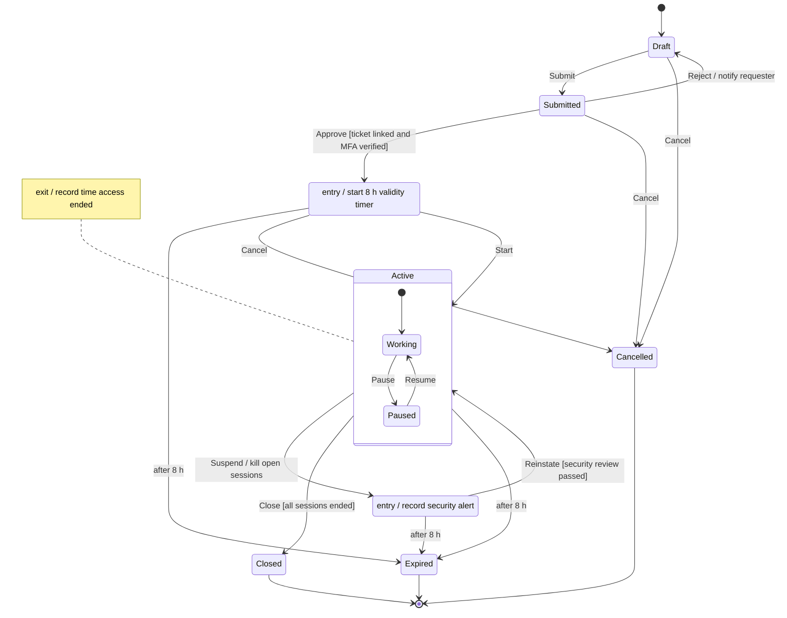
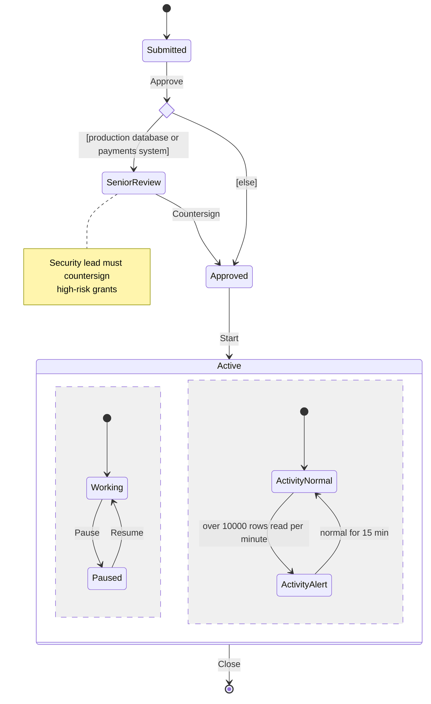
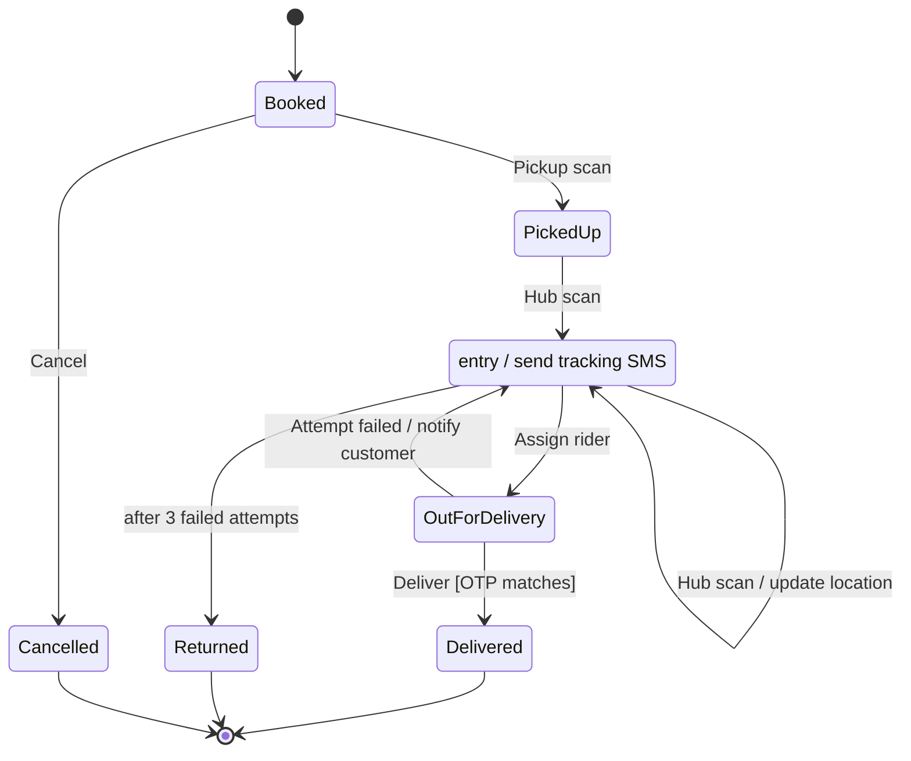
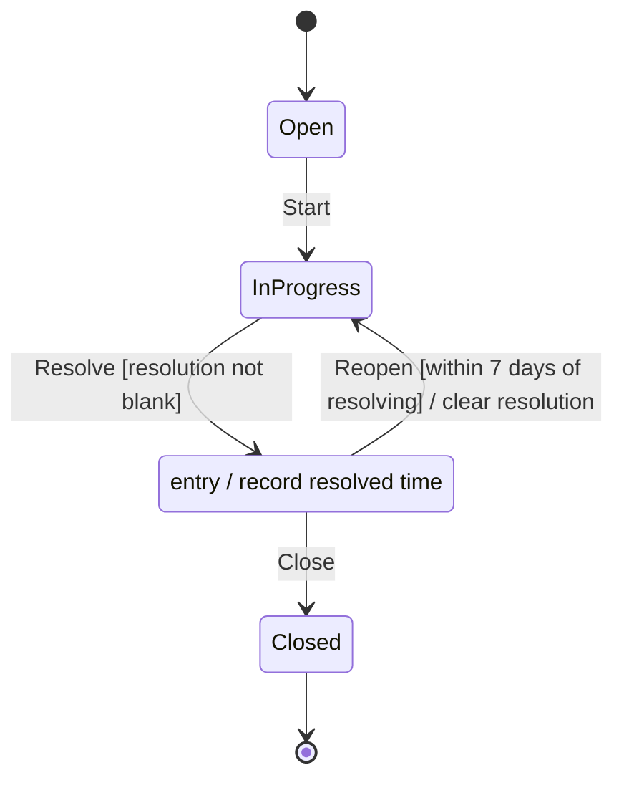
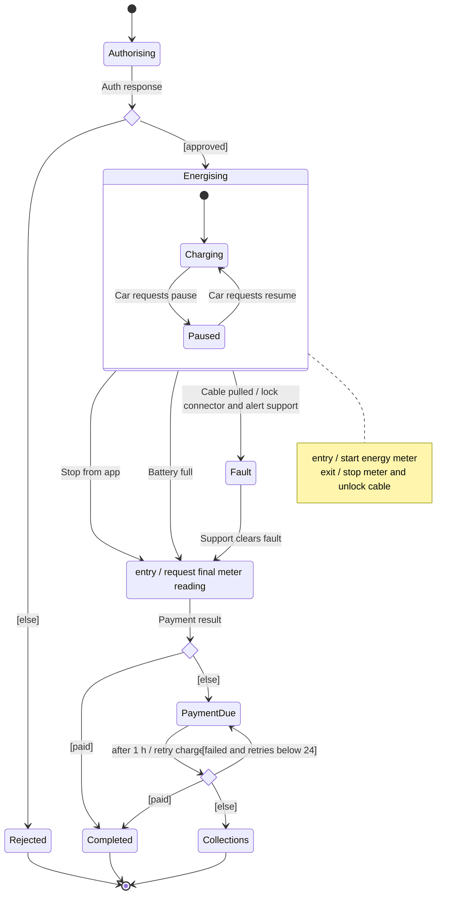
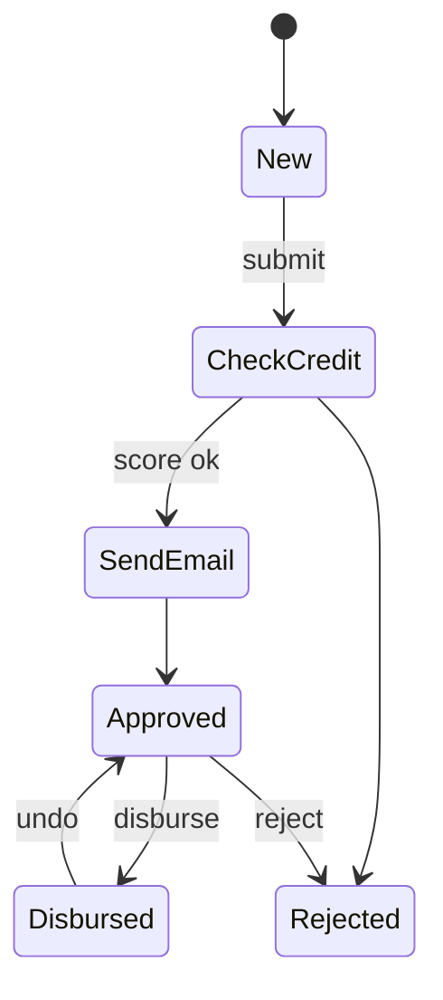
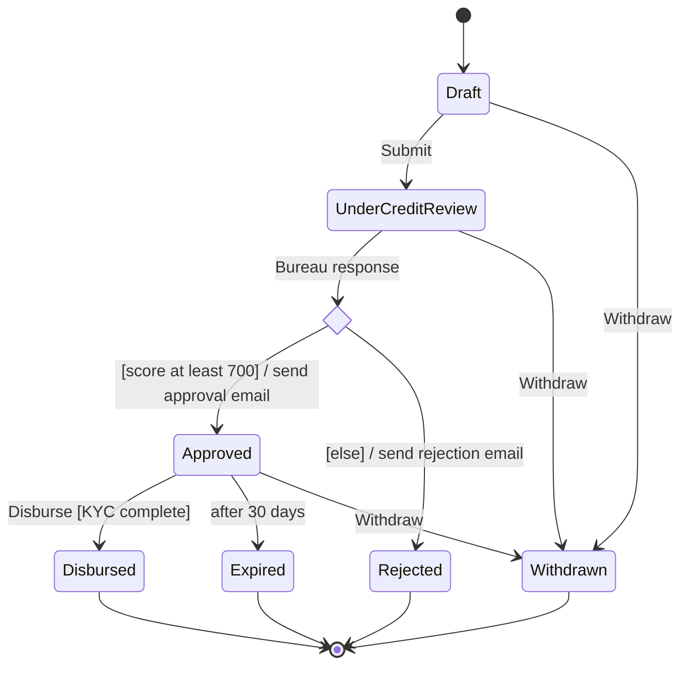

Most business bugs are not crashes. They are things that should have been impossible: an order shipped after it was cancelled, a refund paid twice, a temporary access pass used after it expired. Each of these is an object in a state where an action should not have been allowed. A state machine diagram (UML calls it a *state machine*; many people say *state diagram* or *statechart*) lists every state an object can be in and every legal way to move between them. Drawn first and enforced in code, it makes those "impossible" bugs actually impossible.

## Learning objectives

By the end of this lesson you will be able to:

1. Read and draw states, the initial and final pseudo-states, transitions, events, guards and actions.
2. Write a transition label in full UML form: `event [guard] / action`.
3. Use entry, exit and internal actions, and explain the order in which they run.
4. Use composite (nested) states, choice pseudo-states and concurrent regions to keep diagrams small.
5. Write all of these in Mermaid `stateDiagram-v2`.
6. Implement a state machine in C# that rejects illegal transitions, and test it from the diagram.

## Prerequisites

- [UML fundamentals](#/lesson/m05-uml-fundamentals).
- [Activity diagrams](#/lesson/m05-activity-diagrams) is useful: this lesson contrasts processes with lifecycles.
- [Classes, objects, fields, properties and methods](#/lesson/m01-classes-objects), including enums and private setters.

## Explain it like I'm a beginner

### A traffic light

A traffic light is always in exactly one of three states: red, green or amber. It doesn't jump from red to amber. A timer firing is the **event** that moves it from one state to the next. If you drew circles for the three colours and arrows labelled "timer" between them, you would have drawn a state machine.

### A railway ticket

A more interesting example is an Indian Railways waitlisted ticket. It starts **Waitlisted**. When others cancel, it can become **RAC** (reservation against cancellation) and then **Confirmed**. Before the chart is prepared it can be **Cancelled** by the passenger. After chart preparation, a ticket that is still waitlisted is cancelled automatically. A confirmed ticket can't go back to waitlisted. You already understand all of these rules. A state diagram just writes them down so that a program can follow them exactly.

Three words to hold on to:

- A **state** is a situation the object stays in for a while ("Confirmed").
- An **event** is something that happens at a point in time ("chart prepared", "passenger cancels").
- A **transition** is the arrow: "when this event happens in this state, and this condition holds, move to that state and do this".

### Our example: a temporary access pass to production

Think of the visitor pass you get at an office reception: you ask for it, someone approves it, it works for one day, and security can cancel it at once. Software companies do the same for their live (production) systems. At a payments company in Bengaluru, engineers have no permanent access to the production database. When they need it, say to investigate a stuck UPI refund, they request an **access grant** (often called *just-in-time access*). A simplified lifecycle:

- The engineer creates a **Draft** request and **submits** it.
- The on-call lead (never the requester themselves) **approves** it only if an incident ticket is linked and the engineer has passed multi-factor authentication (MFA). Otherwise they **reject** it back to draft.
- Once approved, the grant is valid for 8 hours, one working shift. The engineer **starts** a session. While **Active**, work can be **paused** while the incident is handed over to the next on-call engineer, and **resumed**.
- If the security system spots something unusual, such as a bulk export of customer data, the grant is **suspended** at once, whatever the engineer was doing. It can be **reinstated** after a security review.
- The grant is **closed** only when every database session has ended. If 8 hours pass first, it **expires**.

Getting this wrong has real consequences: an engineer still connected to the payments database after their access expired, or a grant marked closed while a session is still open and running queries. Auditors (and regulators such as the RBI for payment companies) ask exactly these questions. That's why this is a good place for a state machine.

## First-principles explanation

### States

A **state** is a condition during which the object satisfies some rule, performs some activity, or waits for an event. Draw it as a rounded rectangle with a name: `Submitted`, `Active`. Good state names are adjectives or past participles ("Approved", "Suspended") or "waiting" phrases ("AwaitingPayment"), never verbs. "Approve" is an event; "Approved" is a state.

Two special **pseudo-states** (they aren't real states; the object never rests in them):

- **Initial** (filled circle): where a new object starts. Exactly one arrow leaves it, with no event.
- **Final** (bullseye): the object's lifecycle is over. Nothing can leave it.

### Transitions, events, guards and actions

A **transition** is an arrow from one state to another. Its full label is:

```text
event [guard] / action
```

- **Event (trigger)**: what happens. Usually a command or a message ("Approve"), a time event ("after 8 h", or "at 23:59"), or a change event ("when rows read per minute > 10,000").
- **Guard**: a condition in square brackets that must be true **at the moment the event arrives**, or the transition doesn't fire: `[ticket linked]`.
- **Action**: what the system does *during* the transition, after the `/`: `/ notify requester`. Actions should be quick and should not fail; long work belongs inside a state.

All three parts are optional. A transition with no event (a *completion transition*) fires as soon as the source state's work is done. A transition with no guard always fires when its event arrives.

**What if an event arrives and no transition matches?** UML says the event is discarded. In business software you usually want the opposite: an illegal request ("Close a draft") should be rejected loudly, with an error the caller sees. Decide which behaviour you want, and write it down in a note on the diagram.

### Entry, exit and internal actions

Sometimes an action belongs to a **state**, not to one arrow:

- `entry / action` runs every time the object enters the state, whichever arrow it came in on. `Approved: entry / start 8 h validity timer`.
- `exit / action` runs every time it leaves, whichever arrow it leaves on. `Active: exit / record time access ended`.
- `do / activity` is ongoing work while in the state (for example, "watch the session for unusual queries"), stopped when the state is left.
- An **internal transition**, `event / action` written *inside* the state, handles an event without leaving the state, so entry and exit don't run. `Active: query run / log query`.

**Order of execution** when a transition fires from state A to state B: the exit action of A, then the transition's action, then the entry action of B. A **self-transition** (an arrow from A back to A) *does* run exit and entry again; an internal transition does not. This difference matters: a self-transition on `Approved` would restart the 8-hour timer, an internal one wouldn't.

### Composite states (nested states)

As states multiply, arrows multiply faster. The grant can be suspended whether the engineer is working or paused, so you'd need two "Suspend" arrows. With ten substates you'd need ten. A **composite state** groups substates inside a bigger state. An arrow leaving the composite state's border applies to **every** substate inside. One "Suspend" arrow from `Active` replaces many.

Rules for composite states:

- A composite state has its own **initial pseudo-state**: entering `Active` from outside goes to its initial substate (`Working`).
- Leaving a composite state exits the current substate first, then the composite: `exit Paused`, then `exit Active`.
- Entering goes the other way: `entry Active`, then `entry Working`.
- A **history** pseudo-state (`H`) makes the composite remember its last substate, so "Reinstate" can go back to `Paused` instead of `Working`. Use it only when the business really wants that; it's easy to misunderstand.

David Harel invented this nesting (his *statecharts*), and it is what makes state diagrams usable for real systems. UML adopted it.

### Choice, fork, join and concurrent regions

- A **choice** pseudo-state (a small diamond) lets one event lead to different targets depending on guards evaluated at that moment: `Submitted → ◇ → [risk high] Senior review | [else] Approved`. Like activity-diagram decisions, its guards must be complete and exclusive.
- **Concurrent regions**: a composite state can be split by dashed lines into regions that are active **at the same time**. While `Active`, one region tracks the work (`Working`/`Paused`) and another tracks activity monitoring (`Normal`/`Alert`). The object is in one substate of *each* region at once.
- **Fork** and **join** pseudo-states (bars) enter several regions at once and wait for all of them to finish, just as in activity diagrams.

Concurrent regions are powerful but hard to implement correctly. Before you use them, ask whether the second region is really a separate object with its own lifecycle (here, an `ActivityMonitor`). Often it is.

### State diagram, activity diagram or State pattern?

- An **activity diagram** models a **process** (steps across people). A **state diagram** models **one object's lifecycle** (states and events). An expense-claim *process* (employee submits, manager approves, finance pays) is an activity; the expense claim *document* has a state machine. Each status change in the activity must be a legal transition in the state machine.
- The **State pattern** ([lesson](#/lesson/m06-state)) is one way to *implement* a state machine in code, with one class per state. A transition table is another. The diagram doesn't care which you choose.

### Writing state diagrams in Mermaid

Mermaid has a dedicated syntax, `stateDiagram-v2`. Learn it piece by piece.

**Header, start and end.**

```text
stateDiagram-v2
    [*] --> Draft
    Closed --> [*]
```

`[*]` is the initial pseudo-state when it's on the left of an arrow, and a final state when it's on the right. Add `direction LR` on the next line for a left-to-right layout.

**Transitions with labels.** Everything after the colon is the label, so the full UML form fits naturally:

```text
Draft --> Submitted : Submit
Submitted --> Approved : Approve [ticket linked] / notify requester
```

**State descriptions, entry and exit actions.** A line `StateName : text` adds a line of text inside the state box. Use it for entry, exit, do and internal actions:

```text
Approved : entry / start 8 h validity timer
Suspended : exit / clear security alert banner
```

Mermaid allows these description lines only on **simple** states. On a composite state (one with braces), a single description line *replaces its title*, and two lines are a syntax error. For entry and exit actions on a composite, use a note:

```text
note left of Active : exit / record time access ended
```

**Names with spaces.** State ids can't contain spaces. Give a display name with `as`:

```text
state "Awaiting security review" as SecurityReview
```

**Composite states.** Put substates in braces, each with its own `[*]`:

```text
state Active {
    [*] --> Working
    Working --> Paused : Pause
    Paused --> Working : Resume
}
Active --> Suspended : Suspend
```

The `Active --> Suspended` arrow starts at the composite's border, so it applies to both substates. Arrows can't usually target a substate from outside in Mermaid's layout; target the composite and let its `[*]` choose.

**Choice, fork and join.**

```text
state riskCheck <<choice>>
Submitted --> riskCheck : Approve
riskCheck --> SeniorReview : [risk high]
riskCheck --> Approved : [else]

state split <<fork>>
state merge <<join>>
```

**Concurrent regions.** Separate regions inside a composite with a line containing only `--`:

```text
state Active {
    [*] --> Working
    Working --> Paused : Pause
    --
    [*] --> ActivityNormal
    ActivityNormal --> ActivityAlert : unusual query volume
}
```

**Notes and styling.**

```text
note right of Approved
    Valid for 8 hours from approval
end note
classDef danger fill:#fde2e2,stroke:#c0392b
class Suspended danger
```

**Common Mermaid errors.** Using `stateDiagram` (version 1) instead of `stateDiagram-v2` (both parse, but v2 renders better and supports more); spaces in state ids; a composite state with no `[*]` inside, so entering it has no defined substate; and mistyping a state name, which silently creates a new state. Mermaid has no history (`H`) pseudo-state, so record history with a note. And remember that description lines (`State : text`) work only on simple states, so put a composite's entry and exit actions in a note.

### Mapping a state diagram to C#

| Diagram | C# |
|---|---|
| State | an `enum` value, or a class per state (State pattern) |
| Current state | a property with a **private** setter: `public GrantState State { get; private set; }` |
| Event | a public method (`Approve(...)`), or a `Fire(trigger)` call on a generic machine |
| Transition | a row in a transition table, or a `case` in a `switch` |
| Guard | a condition checked before changing state; failure throws or returns an error |
| Transition action | code that runs between leaving and entering |
| Entry / exit action | an `OnEnter(state)` / `OnExit(state)` method called on every change |
| Composite state | a "parent" lookup: transitions defined on `Active` apply when the current state's parent is `Active` |
| Time event (`after 8 h`) | a stored deadline plus a `BackgroundService` (or scheduled job) that fires the event |
| No matching transition | `InvalidOperationException` (or a `Result` error) naming the state and event |
| Final state | a state with no outgoing rows; every event is rejected |

One rule matters more than all the others: **nothing outside the class can set the state directly.** If any code can write `grant.State = Closed`, the diagram is only a suggestion. In the database, the same rule becomes a `CHECK` constraint on the status column and an `UPDATE ... WHERE status = 'Active'` (or a version column) so that two requests can't both move the grant from the same state.

## Visual explanation

### The access grant lifecycle



Read it from the top:

- A grant starts in **Draft**. `Submit` moves it to **Submitted**. From there, `Approve` only succeeds if the guard is true: if no ticket is linked or MFA failed, the event is rejected and the grant stays Submitted. `Reject` sends it back to Draft and notifies the requester (a transition action).
- Entering **Approved** starts the validity timer (an entry action). It runs on entry, so any future arrow into Approved would restart it too.
- **Active** is a composite state. `Start` enters it, and its initial pseudo-state puts the grant in **Working**. `Pause` and `Resume` move between the substates.
- The `Suspend` arrow leaves Active's **border**, so it works from Working or Paused. Exit actions run inside-out: exit Working (or Paused), then Active's exit action records when access ended. The transition action kills any open database sessions, so a suspended grant is not just a label.
- `Reinstate` targets the composite, so the grant re-enters at Working, not Paused. If the business wanted "back to wherever it was", that would be a history state, and should be written as a note.
- `Close` has a guard that protects the audit trail: every session has ended, so nobody is still connected when the grant says "closed".
- `after 8 h` is a **time event**. It applies from Approved, Active and Suspended. A suspended grant still expires.
- **Closed**, **Expired** and **Cancelled** lead to the final state. Nothing leaves them, so a closed grant can never be reopened. To do more work, you request a new grant. That's a business rule, visible in the drawing.

Count what's *not* there, because those gaps are rules too: you can't cancel an Active grant (you must close or suspend it), and you can't approve a Draft.

### Choice and concurrent regions



This diagram shows two more advanced tools. The **choice** diamond evaluates its guards when `Approve` arrives: high-risk grants (the production database or the payments system) go to `SeniorReview`, everything else, such as read-only access to logs, is approved directly. `[else]` keeps the guards complete. Inside `Active`, the `--` line splits the state into two **concurrent regions**. At any moment the grant is in one work substate *and* one activity substate, for example "Paused and ActivityAlert". In code, that second region would usually become its own `ActivityMonitor` object, with an event "anomaly detected" that the grant reacts to by suspending itself.

## Step-by-step example

How do you get from a conversation about access grants to the diagram and code? Six steps.

### Step 1 — list the states, as adjectives

Ask "what can someone say about a grant at any moment?": it's a draft, it's submitted, approved, being worked on, paused, suspended, closed, expired, cancelled. Each is a state candidate. Merge synonyms. Drop things that are data, not states: "high risk" is an attribute that affects a guard, not a separate lifecycle.

### Step 2 — list the events, as verbs

Submit, approve, reject, start, pause, resume, suspend, reinstate, close, cancel, and one time event: 8 hours pass. Ask who or what raises each one: a person (approve), the system (expire), a monitor (anomaly alert).

### Step 3 — fill a state × event table

Before drawing, make a grid with states as rows and events as columns. In each cell, write the target state, or "not allowed". This forces you to think about every combination. A 9 × 11 grid has 99 cells; most will say "not allowed", and each of those is a decision you made deliberately rather than by accident.

| State \ Event | Submit | Approve | Start | Suspend | Close | Cancel | after 8 h |
|---|---|---|---|---|---|---|---|
| Draft | Submitted | – | – | – | – | Cancelled | – |
| Submitted | – | Approved [guard] | – | – | – | Cancelled | – |
| Approved | – | – | Active | – | – | Cancelled | Expired |
| Active (any) | – | – | – | Suspended | Closed [guard] | – | Expired |
| Suspended | – | – | – | – | – | – | Expired |

(Only some columns are shown.)

### Step 4 — find groups and draw composites

Rows that behave identically for many events are a composite state. Working and Paused both allow Suspend, Close and expiry, so they become substates of Active.

### Step 5 — add guards, actions and timers

For each allowed cell, ask "only if?" (a guard) and "and then what happens?" (an action). Decide which actions belong on a transition and which on entry or exit: the timer starts on *entry* to Approved because any route into Approved should start it.

### Step 6 — write the Mermaid, then the code and one test per arrow

The diagram goes in the repository next to the code. Then write the class so that each arrow is one allowed transition, and write a test for each arrow and a few for important "not allowed" cells (close a draft, start an expired grant).

## Production-style C# implementation

The grant becomes a class whose state can only change through its event methods. Transitions live in one table, so the code reads like the diagram. Composite states are handled with a parent lookup, entry and exit actions run on every change, and expiry is a time event fired by a background worker.

```text
AccessGrants.Api/
  Program.cs
  Domain/GrantStates.cs         // enums + parent (composite) mapping
  Domain/AccessGrant.cs         // the state machine
  Application/GrantStore.cs     // repository (in memory here)
  Application/GrantExpiryWorker.cs // fires the "after 8 h" time event
```

```csharp file=Domain/GrantStates.cs
namespace AccessGrants.Api.Domain;

public enum GrantState
{
    Draft, Submitted, Approved,
    Active,          // composite: never the current state itself
    Working, Paused, // substates of Active
    Suspended, Closed, Expired, Cancelled,
}

public enum GrantTrigger { Submit, Approve, Reject, Start, Pause, Resume, Suspend, Reinstate, Close, Cancel, Expire }

public static class GrantStates
{
    /// <summary>Composite state membership: Working and Paused are inside Active.</summary>
    public static GrantState? ParentOf(GrantState s) => s is GrantState.Working or GrantState.Paused ? GrantState.Active : null;

    /// <summary>Initial substate of each composite state.</summary>
    public static GrantState Resolve(GrantState target) => target == GrantState.Active ? GrantState.Working : target;

    public static bool IsFinal(GrantState s) => s is GrantState.Closed or GrantState.Expired or GrantState.Cancelled;

    /// <summary>"Is the grant in this state?" also answers true for the composite parent.</summary>
    public static bool IsIn(GrantState current, GrantState state) => current == state || ParentOf(current) == state;
}

public sealed record GrantEvent(DateTimeOffset At, GrantState From, GrantTrigger Trigger, GrantState To, string? Note);

public sealed class IllegalTransitionException(GrantState state, GrantTrigger trigger, string? reason = null)
    : InvalidOperationException(reason is null
        ? $"'{trigger}' is not allowed while the grant is {state}."
        : $"'{trigger}' is not allowed while the grant is {state}: {reason}.")
{
    public GrantState State { get; } = state;
    public GrantTrigger Trigger { get; } = trigger;
}
```

```csharp file=Domain/AccessGrant.cs
namespace AccessGrants.Api.Domain;

/// <summary>The access-grant state machine. Each table row is one arrow on the diagram.</summary>
public sealed class AccessGrant
{
    public static readonly TimeSpan Validity = TimeSpan.FromHours(8);

    private sealed record Transition(GrantState From, GrantTrigger Trigger, GrantState To);

    private static readonly Transition[] Table =
    [
        new(GrantState.Draft,     GrantTrigger.Submit,    GrantState.Submitted),
        new(GrantState.Draft,     GrantTrigger.Cancel,    GrantState.Cancelled),
        new(GrantState.Submitted, GrantTrigger.Approve,   GrantState.Approved),
        new(GrantState.Submitted, GrantTrigger.Reject,    GrantState.Draft),
        new(GrantState.Submitted, GrantTrigger.Cancel,    GrantState.Cancelled),
        new(GrantState.Approved,  GrantTrigger.Start,     GrantState.Active),
        new(GrantState.Approved,  GrantTrigger.Cancel,    GrantState.Cancelled),
        new(GrantState.Approved,  GrantTrigger.Expire,    GrantState.Expired),
        new(GrantState.Working,   GrantTrigger.Pause,     GrantState.Paused),
        new(GrantState.Paused,    GrantTrigger.Resume,    GrantState.Working),
        new(GrantState.Active,    GrantTrigger.Suspend,   GrantState.Suspended),   // from the composite's border
        new(GrantState.Active,    GrantTrigger.Close,     GrantState.Closed),
        new(GrantState.Active,    GrantTrigger.Expire,    GrantState.Expired),
        new(GrantState.Suspended, GrantTrigger.Reinstate, GrantState.Active),      // re-enters at Working
        new(GrantState.Suspended, GrantTrigger.Expire,    GrantState.Expired),
    ];

    private readonly TimeProvider _clock;
    private readonly List<GrantEvent> _history = new();

    public AccessGrant(Guid id, string requester, string targetSystem, TimeProvider clock)
    {
        ArgumentException.ThrowIfNullOrWhiteSpace(requester);
        ArgumentException.ThrowIfNullOrWhiteSpace(targetSystem);
        Id = id;
        Requester = requester;
        TargetSystem = targetSystem;
        _clock = clock ?? throw new ArgumentNullException(nameof(clock));
    }

    public Guid Id { get; }
    public string Requester { get; }
    public string TargetSystem { get; }
    public GrantState State { get; private set; } = GrantState.Draft;   // initial pseudo-state -> Draft
    public DateTimeOffset? ValidUntil { get; private set; }
    public DateTimeOffset? AccessEndedAt { get; private set; }
    public string? LastAlert { get; private set; }
    public IReadOnlyList<GrantEvent> History => _history;

    public bool IsIn(GrantState state) => GrantStates.IsIn(State, state);

    /// <summary>Triggers allowed from the current state, ignoring guards. Useful for UI buttons.</summary>
    public IReadOnlyList<GrantTrigger> PermittedTriggers() =>
        Table.Where(t => t.From == State || t.From == GrantStates.ParentOf(State)).Select(t => t.Trigger).Distinct().ToList();

    // ----- Events: one public method per trigger. Guards are checked before Fire. -----

    public void Submit() => Fire(GrantTrigger.Submit);

    public void Approve(string approver, bool ticketLinked, bool mfaVerified)
    {
        ArgumentException.ThrowIfNullOrWhiteSpace(approver);
        if (string.Equals(approver, Requester, StringComparison.OrdinalIgnoreCase))
            throw new IllegalTransitionException(State, GrantTrigger.Approve, "nobody can approve their own access");
        if (!ticketLinked || !mfaVerified)
            throw new IllegalTransitionException(State, GrantTrigger.Approve, "guard [ticket linked and MFA verified] is false");
        Fire(GrantTrigger.Approve, $"approved by {approver}");
    }

    public void Reject(string reason)
    {
        ArgumentException.ThrowIfNullOrWhiteSpace(reason);
        Fire(GrantTrigger.Reject, reason);   // transition action: notify requester (see note in History)
    }

    public void Start() => Fire(GrantTrigger.Start);
    public void Pause() => Fire(GrantTrigger.Pause);
    public void Resume() => Fire(GrantTrigger.Resume);

    /// <summary>The transition action "kill open sessions" belongs to the infrastructure (for example,
    /// revoking the short-lived database credentials); the domain records why.</summary>
    public void Suspend(string alert)
    {
        ArgumentException.ThrowIfNullOrWhiteSpace(alert);
        LastAlert = alert;
        Fire(GrantTrigger.Suspend, alert);
    }

    public void Reinstate(bool securityReviewPassed)
    {
        if (!securityReviewPassed)
            throw new IllegalTransitionException(State, GrantTrigger.Reinstate, "guard [security review passed] is false");
        Fire(GrantTrigger.Reinstate);
    }

    public void Close(int openSessions)
    {
        ArgumentOutOfRangeException.ThrowIfNegative(openSessions);
        if (IsIn(GrantState.Active) && openSessions > 0)
            throw new IllegalTransitionException(State, GrantTrigger.Close, $"{openSessions} session(s) still open");
        Fire(GrantTrigger.Close);
    }

    public void Cancel() => Fire(GrantTrigger.Cancel);

    /// <summary>Time event "after 8 h". Safe to call repeatedly; returns true if it expired the grant.</summary>
    public bool ExpireIfDue()
    {
        if (ValidUntil is null || _clock.GetUtcNow() < ValidUntil || GrantStates.IsFinal(State)) return false;
        Fire(GrantTrigger.Expire, $"validity ended {ValidUntil:yyyy-MM-dd HH:mm}");
        return true;
    }

    // ----- The engine -----

    private void Fire(GrantTrigger trigger, string? note = null)
    {
        // Look for a row on the current state first, then on its composite parent.
        var row = Table.FirstOrDefault(t => t.From == State && t.Trigger == trigger)
                  ?? Table.FirstOrDefault(t => t.From == GrantStates.ParentOf(State) && t.Trigger == trigger)
                  ?? throw new IllegalTransitionException(State, trigger);

        var from = State;
        var to = GrantStates.Resolve(row.To);

        // Exit actions run inside-out. Leaving the composite only if the target is outside it.
        OnExit(from);
        var fromParent = GrantStates.ParentOf(from);
        if (fromParent is not null && GrantStates.ParentOf(to) != fromParent) OnExit(fromParent.Value);

        State = to;

        // Entry actions run outside-in.
        var toParent = GrantStates.ParentOf(to);
        if (toParent is not null && toParent != fromParent) OnEnter(toParent.Value);
        OnEnter(to);

        _history.Add(new GrantEvent(_clock.GetUtcNow(), from, trigger, to, note));
    }

    private void OnEnter(GrantState state)
    {
        switch (state)
        {
            case GrantState.Approved:
                ValidUntil = _clock.GetUtcNow() + Validity;   // entry / start 8 h validity timer
                break;
            case GrantState.Active:
                AccessEndedAt = null;
                break;
        }
    }

    private void OnExit(GrantState state)
    {
        if (state == GrantState.Active) AccessEndedAt = _clock.GetUtcNow();   // exit / record time access ended
    }
}
```

```csharp file=Application/GrantStore.cs
using System.Collections.Concurrent;
using AccessGrants.Api.Domain;

namespace AccessGrants.Api.Application;

public interface IGrantStore
{
    void Add(AccessGrant grant);
    AccessGrant? Find(Guid id);
    IReadOnlyList<AccessGrant> All();
}

/// <summary>In-memory store. In PostgreSQL, saving would be
/// UPDATE access_grants SET state = @new, version = version + 1 WHERE id = @id AND version = @expected,
/// so two requests can't both move the grant out of the same state.</summary>
public sealed class InMemoryGrantStore : IGrantStore
{
    private readonly ConcurrentDictionary<Guid, AccessGrant> _items = new();
    public void Add(AccessGrant grant) => _items[grant.Id] = grant;
    public AccessGrant? Find(Guid id) => _items.GetValueOrDefault(id);
    public IReadOnlyList<AccessGrant> All() => _items.Values.ToList();
}
```

```csharp file=Application/GrantExpiryWorker.cs
using AccessGrants.Api.Domain;

namespace AccessGrants.Api.Application;

/// <summary>Fires the "after 8 h" time event. Runs every minute, so a grant expires at most
/// about a minute late; the API also calls ExpireIfDue before every action to close that gap.</summary>
public sealed class GrantExpiryWorker(IGrantStore store, TimeProvider clock, ILogger<GrantExpiryWorker> logger) : BackgroundService
{
    protected override async Task ExecuteAsync(CancellationToken stoppingToken)
    {
        using var timer = new PeriodicTimer(TimeSpan.FromMinutes(1), clock);
        while (await timer.WaitForNextTickAsync(stoppingToken))
        {
            foreach (var grant in store.All())
            {
                lock (grant)
                {
                    if (grant.ExpireIfDue())
                        logger.LogWarning("Access grant {GrantId} for {TargetSystem} expired", grant.Id, grant.TargetSystem);
                }
            }
        }
    }
}
```

```csharp file=Program.cs
using AccessGrants.Api.Application;
using AccessGrants.Api.Domain;

var builder = WebApplication.CreateBuilder(args);
builder.Services.AddSingleton(TimeProvider.System);
builder.Services.AddSingleton<IGrantStore, InMemoryGrantStore>();
builder.Services.AddHostedService<GrantExpiryWorker>();

var app = builder.Build();

app.MapPost("/access-grants", (NewGrant req, IGrantStore store, TimeProvider clock) =>
{
    var grant = new AccessGrant(Guid.NewGuid(), req.Requester, req.TargetSystem, clock);
    store.Add(grant);
    return Results.Created($"/access-grants/{grant.Id}", Describe(grant));
});

app.MapGet("/access-grants/{id:guid}", (Guid id, IGrantStore store) =>
    store.Find(id) is { } p ? Results.Ok(Describe(p)) : Results.NotFound());

// One endpoint per event keeps the API aligned with the diagram's arrows.
app.MapPost("/access-grants/{id:guid}/{action}", (Guid id, string action, GrantCommand cmd, IGrantStore store) =>
{
    if (store.Find(id) is not { } p) return Results.NotFound();
    try
    {
        lock (p)
        {
            p.ExpireIfDue();   // apply any pending time event before handling the command
            switch (action.ToLowerInvariant())
            {
                case "submit": p.Submit(); break;
                case "approve": p.Approve(cmd.By ?? "", cmd.TicketLinked, cmd.MfaVerified); break;
                case "reject": p.Reject(cmd.Reason ?? ""); break;
                case "start": p.Start(); break;
                case "pause": p.Pause(); break;
                case "resume": p.Resume(); break;
                case "suspend": p.Suspend(cmd.Reason ?? ""); break;
                case "reinstate": p.Reinstate(cmd.SecurityReviewPassed); break;
                case "close": p.Close(cmd.OpenSessions); break;
                case "cancel": p.Cancel(); break;
                default: return Results.NotFound($"Unknown action '{action}'.");
            }
        }
        return Results.Ok(Describe(p));
    }
    catch (IllegalTransitionException ex) { return Results.Problem(ex.Message, statusCode: StatusCodes.Status409Conflict); }
    catch (ArgumentException ex) { return Results.Problem(ex.Message, statusCode: StatusCodes.Status400BadRequest); }
});

app.Run();

static object Describe(AccessGrant p) => new { p.Id, p.Requester, p.TargetSystem, State = p.State.ToString(), p.ValidUntil, Allowed = p.PermittedTriggers() };

// In a real system the approver comes from the authenticated user (HttpContext.User), never from the request body.
public sealed record NewGrant(string Requester, string TargetSystem);

public sealed record GrantCommand(string? By, string? Reason, bool TicketLinked, bool MfaVerified,
    bool SecurityReviewPassed, int OpenSessions);
```

How the code mirrors the diagram:

- **The table is the diagram.** Fifteen rows, fifteen arrows (counting each `after 8 h` arrow separately). A reviewer can put them side by side and tick them off.
- **The composite is a parent lookup.** Rows on `Active` apply when the state is `Working` or `Paused`. `Resolve(Active)` returns `Working`, which is Active's initial substate.
- **Entry and exit run on every change**, whichever event caused it. Suspending from `Paused` runs exit Paused (nothing), then exit Active (records `AccessEndedAt`). Pausing doesn't exit Active, because the target is still inside it.
- **Guards are explicit and named in errors.** A failed guard throws `IllegalTransitionException` with the guard's text, which the API turns into `409 Conflict`. The caller learns exactly why.
- **Time events need infrastructure.** Nothing in .NET fires "after 8 h" for you. The `GrantExpiryWorker` checks every minute, and every command first applies any pending expiry, so an engineer can't start a session on a grant that expired 30 seconds ago but hasn't been swept yet.
- **Defence in depth for time.** A real access system doesn't rely only on the sweeper: it issues short-lived database credentials whose lifetime equals the grant's validity, so the database itself refuses a login after 8 hours even if the worker is down. The state machine is the record; the credential is the enforcement.
- **The state has a private setter.** There is no way to "just set" a grant to `Closed`.

:::callout type=tip title="Libraries"
For larger machines, a library such as **Stateless** (open source, on NuGet) gives you a fluent `Configure(state).Permit(trigger, target)` API, substates, guards, entry/exit actions and even DOT/Mermaid export. Exercise 3 asks you to build a small version of it, so you understand what such a library does before you depend on one.
:::

## Bad design vs good design

### Status as a free-for-all

```csharp
public class AccessGrant
{
    public string Status { get; set; } = "draft";      // any string, any time
    public bool IsApproved { get; set; }
    public bool IsActive { get; set; }
    public bool IsSuspended { get; set; }
    public DateTime? ExpiresAt { get; set; }
}

// Somewhere in a controller...
grant.Status = "closed";
grant.IsActive = false;
```

Why this hurts:

- **Any value, any time.** `"Closed"`, `"closed "` and `"clsoed"` are all accepted. Nothing stops "closed" being set on a draft.
- **Boolean soup.** Four flags allow 16 combinations, but only a handful make sense. `IsApproved = false, IsActive = true, IsSuspended = true` is representable, so one day it will exist in your database.
- **Rules are scattered.** The "all sessions ended" check lives in one controller. A second endpoint, a batch job or a support script forgets it.
- **Expiry is passive.** `ExpiresAt` is stored, but nothing compares it with the clock before a session starts.

### The good version

The `AccessGrant` class above: one enum, a private setter, every change through an event method, guards checked in one place, a history of every transition, and an active time event. The illegal combinations are not just "not allowed"; they can't be represented.

### Is a state machine always worth it?

No. If an object has two states and one transition (a newsletter subscription: subscribed or not), a boolean and one method is clearer. Reach for an explicit state machine when there are **three or more states with rules about which moves are legal**, when **time events** exist, or when mistakes are expensive (money, safety, compliance). A useful smell: if you see `if (status == X || status == Y)` in more than two places, the rules want to live in one table.

:::callout type=mistake title="Drawing the process instead of the states"
A common beginner diagram has states named "Check MFA", "Approve", "Send email". Those are actions, so the result is an activity diagram drawn with state-diagram symbols. Ask: "can the object *sit* in this state for a while, waiting for something?" If not, it's an action on a transition, or a step in an activity diagram.
:::

## Practical playground

Run the lifecycle of one access grant, then try to break it: close it while two sessions are still open, start it after expiry, reinstate it without a security review. Every illegal attempt prints the reason. Then add a new rule: a `Suspended` grant can also be `Cancel`led. Add one row, and watch the new path work.

:::playground type=csharp title="Drive an access grant through its lifecycle"
```csharp file=Program.cs
using System;
using System.Collections.Generic;
using System.Linq;

public enum S { Draft, Submitted, Approved, Active, Working, Paused, Suspended, Closed, Expired, Cancelled }
public enum T { Submit, Approve, Start, Pause, Resume, Suspend, Reinstate, Close, Cancel, Expire }

public sealed class Grant
{
    private static readonly (S From, T Trigger, S To)[] Table =
    {
        (S.Draft, T.Submit, S.Submitted), (S.Submitted, T.Approve, S.Approved), (S.Approved, T.Start, S.Active),
        (S.Working, T.Pause, S.Paused), (S.Paused, T.Resume, S.Working), (S.Active, T.Suspend, S.Suspended),
        (S.Suspended, T.Reinstate, S.Active), (S.Active, T.Close, S.Closed), (S.Active, T.Expire, S.Expired),
        (S.Approved, T.Expire, S.Expired), (S.Draft, T.Cancel, S.Cancelled),
    };

    public S State { get; private set; } = S.Draft;
    private static S? Parent(S s) => s is S.Working or S.Paused ? S.Active : null;

    public void Fire(T trigger, Func<bool>? guard = null, string guardText = "")
    {
        var row = Table.Where(t => t.Trigger == trigger && (t.From == State || t.From == Parent(State))).ToList();
        if (row.Count == 0) { Console.WriteLine($"  REJECTED {trigger} in {State}: no such arrow"); return; }
        if (guard is not null && !guard()) { Console.WriteLine($"  REJECTED {trigger} in {State}: guard [{guardText}] is false"); return; }
        var to = row[0].To == S.Active ? S.Working : row[0].To;
        Console.WriteLine($"  {State} --{trigger}--> {to}");
        State = to;
    }
}

public static class Program
{
    public static void Main()
    {
        var p = new Grant();
        int openSessions = 2;
        bool reviewed = false;

        p.Fire(T.Start);                                   // illegal: still a draft
        p.Fire(T.Submit);
        p.Fire(T.Approve);
        p.Fire(T.Start);
        p.Fire(T.Pause);
        p.Fire(T.Suspend);                                 // works from Paused via the composite
        p.Fire(T.Reinstate, () => reviewed, "security review passed");
        reviewed = true;
        p.Fire(T.Reinstate, () => reviewed, "security review passed");
        p.Fire(T.Close, () => openSessions == 0, "all sessions ended");
        openSessions = 0;
        p.Fire(T.Close, () => openSessions == 0, "all sessions ended");
        p.Fire(T.Resume);                                  // illegal: closed is final
        Console.WriteLine($"Final state: {p.State}");
    }
}
```
:::

## Exercises

:::exercise id=m05-state-diagrams-ex1 difficulty=beginner kind=written title="Read a shipment state diagram"
A courier company's parcel lifecycle:



Answer in full sentences:

1. Can a parcel be cancelled after pickup?
2. What happens when the rider enters the wrong OTP?
3. How many tracking SMSs does a parcel get if it passes through three hubs? Explain using the entry action and the self-transition.
4. If `InTransit --> InTransit : Hub scan` were an internal transition instead, how would your answer to question 3 change?
5. Name one rule that is missing or unclear.
::acceptance
- Correctly reads that cancellation is only possible from `Booked`.
- Explains that a false guard means the transition doesn't fire and the parcel stays in `OutForDelivery`.
- Uses entry/self-transition semantics to count SMSs (self-transitions re-run entry).
- Explains that an internal transition doesn't re-run entry.
- Identifies at least one gap (for example: who counts failed attempts, or cancellation after pickup).
::hint
Look for every arrow leaving `PickedUp` and `InTransit`. Is `Cancel` among them?
::hint
A guard that's false means "this arrow doesn't exist right now".
::hint
A self-transition leaves the state and re-enters it. What runs on entry?
::solution
1. No. `Cancel` only leaves `Booked`. After the pickup scan, there is no `Cancel` arrow, so a cancel request would be rejected (or, in pure UML, ignored).
2. The guard `[OTP matches]` is false, so the `Deliver` transition doesn't fire. The parcel stays `OutForDelivery`. The rider can retry, or the attempt fails, which takes it back to `InTransit`.
3. Entering `InTransit` from `PickedUp` sends one SMS. Each further hub scan is a **self-transition**, which exits and re-enters `InTransit`, so the entry action runs again. With three hubs: the first hub scan enters `InTransit` (1 SMS), the second and third are self-transitions (2 more). Three SMSs. A failed delivery attempt also re-enters `InTransit`, adding one more.
4. An internal transition handles the event without leaving the state, so entry doesn't run again. Only the first entry from `PickedUp` sends an SMS; later hub scans only update the location. This is usually what the business wants, and shows why the choice between self and internal transitions matters.
5. Possible gaps: "after 3 failed attempts" is written as a time event but is really a count, so something must count failed attempts (a guard such as `[attempts = 3]` on the failure arrow would be clearer). There's no way to cancel or redirect after pickup. There's no state for "lost" or "damaged". There is no `Returned` process to the sender.
::mistakes
- Saying the parcel goes to an error state when the OTP is wrong. A false guard simply blocks the arrow.
- Treating self-transitions and internal transitions as the same.
:::

:::exercise id=m05-state-diagrams-ex2 difficulty=beginner kind=code title="Implement a support-ticket state machine"
Implement this diagram exactly:


::requirements
- `SupportTicket(string title)` starts `Open`. A blank title throws `ArgumentException`.
- `Status` has a private setter. Every illegal event throws `InvalidOperationException` whose message contains the current status name.
- `Resolve(string resolution, DateTimeOffset now)`: a blank resolution throws `ArgumentException` (guard). On entry to `Resolved`, set `ResolvedAt = now`.
- `Reopen(DateTimeOffset now)`: allowed only if `now - ResolvedAt <= 7 days`, otherwise `InvalidOperationException`. The transition action clears `Resolution` and `ResolvedAt`.
- `CanReopen(DateTimeOffset now)` returns whether `Reopen` would succeed, without changing anything.
::acceptance
- Open → InProgress → Resolved → Closed works.
- Start on a closed ticket throws, and the message names `Closed`.
- Reopen exactly 7 days after resolving works; 7 days and 1 second later fails.
- After reopening, `Resolution` and `ResolvedAt` are null.
::hint
Write each event method as: check the current state, check the guard, run the action, change the state, run the entry action.
::hint
A small helper keeps errors consistent: `private void Require(TicketStatus expected, string evt)`.
::hint
The time guard is `now - ResolvedAt.Value <= TimeSpan.FromDays(7)`. Use the `now` parameter, never `DateTime.Now`, so tests control time.
::hint
```csharp
public void Reopen(DateTimeOffset now)
{
    Require(TicketStatus.Resolved, nameof(Reopen));
    if (!CanReopen(now)) throw new InvalidOperationException("...");
    Resolution = null; ResolvedAt = null;      // transition action
    Status = TicketStatus.InProgress;
}
```
::starter
```csharp file=SupportTicket.cs
using System;

public enum TicketStatus { Open, InProgress, Resolved, Closed }

public sealed class SupportTicket
{
    public SupportTicket(string title) => throw new NotImplementedException();

    public string Title { get; }
    public TicketStatus Status { get; private set; }
    public string? Resolution { get; private set; }
    public DateTimeOffset? ResolvedAt { get; private set; }

    public void Start() => throw new NotImplementedException();
    public void Resolve(string resolution, DateTimeOffset now) => throw new NotImplementedException();
    public bool CanReopen(DateTimeOffset now) => throw new NotImplementedException();
    public void Reopen(DateTimeOffset now) => throw new NotImplementedException();
    public void Close() => throw new NotImplementedException();
}
```
::tests
```csharp file=SupportTicketTests.cs
using System;
using Xunit;

public class SupportTicketTests
{
    private static readonly DateTimeOffset T0 = new(2026, 3, 1, 10, 0, 0, TimeSpan.FromHours(5.5));

    private static SupportTicket Resolved()
    {
        var t = new SupportTicket("UPI refund not received");
        t.Start();
        t.Resolve("Refund re-initiated, UTR 4321", T0);
        return t;
    }

    [Fact] public void Starts_open() => Assert.Equal(TicketStatus.Open, new SupportTicket("Login issue").Status);

    [Fact] public void Blank_title_rejected() => Assert.Throws<ArgumentException>(() => new SupportTicket(" "));

    [Fact]
    public void Happy_path()
    {
        var t = Resolved();
        Assert.Equal(TicketStatus.Resolved, t.Status);
        Assert.Equal(T0, t.ResolvedAt);
        t.Close();
        Assert.Equal(TicketStatus.Closed, t.Status);
    }

    [Fact]
    public void Illegal_event_names_current_state()
    {
        var t = Resolved();
        t.Close();
        var ex = Assert.Throws<InvalidOperationException>(() => t.Start());
        Assert.Contains("Closed", ex.Message);
    }

    [Fact]
    public void Resolve_needs_resolution()
    {
        var t = new SupportTicket("Slow page");
        t.Start();
        Assert.Throws<ArgumentException>(() => t.Resolve("", T0));
        Assert.Equal(TicketStatus.InProgress, t.Status);
    }

    [Fact]
    public void Reopen_window_is_inclusive()
    {
        var t = Resolved();
        Assert.True(t.CanReopen(T0.AddDays(7)));
        Assert.False(t.CanReopen(T0.AddDays(7).AddSeconds(1)));
        Assert.Throws<InvalidOperationException>(() => t.Reopen(T0.AddDays(8)));
        t.Reopen(T0.AddDays(7));
        Assert.Equal(TicketStatus.InProgress, t.Status);
        Assert.Null(t.Resolution);
        Assert.Null(t.ResolvedAt);
    }

    [Fact]
    public void Cannot_reopen_open_ticket()
    {
        var t = new SupportTicket("Printer");
        Assert.False(t.CanReopen(T0));
        Assert.Throws<InvalidOperationException>(() => t.Reopen(T0));
    }
}
```
::solution
```csharp file=SupportTicket.cs
using System;

public enum TicketStatus { Open, InProgress, Resolved, Closed }

public sealed class SupportTicket
{
    public static readonly TimeSpan ReopenWindow = TimeSpan.FromDays(7);

    public SupportTicket(string title)
    {
        ArgumentException.ThrowIfNullOrWhiteSpace(title);
        Title = title;
        Status = TicketStatus.Open;                       // [*] --> Open
    }

    public string Title { get; }
    public TicketStatus Status { get; private set; }
    public string? Resolution { get; private set; }
    public DateTimeOffset? ResolvedAt { get; private set; }

    public void Start()
    {
        Require(TicketStatus.Open, nameof(Start));
        Status = TicketStatus.InProgress;
    }

    public void Resolve(string resolution, DateTimeOffset now)
    {
        Require(TicketStatus.InProgress, nameof(Resolve));
        ArgumentException.ThrowIfNullOrWhiteSpace(resolution);   // guard [resolution not blank]
        Resolution = resolution;
        Status = TicketStatus.Resolved;
        ResolvedAt = now;                                         // entry / record resolved time
    }

    public bool CanReopen(DateTimeOffset now) =>
        Status == TicketStatus.Resolved && ResolvedAt is { } at && now - at <= ReopenWindow;

    public void Reopen(DateTimeOffset now)
    {
        Require(TicketStatus.Resolved, nameof(Reopen));
        if (!CanReopen(now))
            throw new InvalidOperationException($"Ticket can only be reopened within {ReopenWindow.TotalDays} days of resolving (status {Status}).");
        Resolution = null;                                        // / clear resolution
        ResolvedAt = null;
        Status = TicketStatus.InProgress;
    }

    public void Close()
    {
        Require(TicketStatus.Resolved, nameof(Close));
        Status = TicketStatus.Closed;
    }

    private void Require(TicketStatus expected, string evt)
    {
        if (Status != expected)
            throw new InvalidOperationException($"'{evt}' is not allowed while the ticket is {Status}.");
    }
}
```

Each arrow became one method that checks its source state, then its guard, then runs its action and changes state. `CanReopen` is the guard as a reusable query, which a UI can use to show or hide the Reopen button.
::mistakes
- Using `DateTime.Now` inside the class, which makes the 7-day rule untestable.
- Setting `Status` before checking the guard, leaving the ticket half-changed when the guard throws.
- Using `<` instead of `<=`, which makes "within 7 days" exclude the last second.
::extensions
Add `Reopen` from `Closed` for admins only (a second guard), and a `History` list of `(from, event, to, at)` records. Draw the updated diagram first.
:::

:::exercise id=m05-state-diagrams-ex3 difficulty=intermediate kind=code title="Build a small table-driven state machine"
Write a reusable `StateMachine<TState, TTrigger>` with a fluent configuration API, in the style of popular .NET libraries.
::requirements
- `new StateMachine<TState, TTrigger>(initial)`. `State` returns the current state.
- `Configure(state)` returns a `StateConfig` (nested class) with fluent methods that return the same config:
  - `Permit(trigger, target, guard = null)`: an external transition. Several `Permit`s for the same trigger are allowed if they have different guards.
  - `InternalTransition(trigger, action)`: handles the trigger without leaving the state.
  - `OnEntry(action)` and `OnExit(action)`. Several of each may be registered; they run in registration order.
- `Fire(trigger)`:
  - internal transition: run its action only (no exit, no entry);
  - external transition (including a self-transition): run the source's exit actions, set `State`, run the target's entry actions;
  - no transition whose guard passes: throw `InvalidOperationException`;
  - more than one transition whose guard passes: throw `InvalidOperationException` (ambiguous).
- `CanFire(trigger)` and `PermittedTriggers` (distinct triggers whose guard passes, in configuration order) don't change anything.
::acceptance
- Exit of the source runs before entry of the target.
- A self-transition runs exit and entry; an internal transition runs neither.
- A guard that returns false blocks the transition, and another `Permit` with a passing guard is used instead.
- Two passing guards throw.
- `PermittedTriggers` lists only triggers that can currently fire.
::hint
Store, per state, a list of transitions (`trigger`, `target`, `guard`, `isInternal`, `action`) plus lists of entry and exit actions.
::hint
`Configure(state)` should return the existing config if the state was already configured, so callers can configure a state in two places.
::hint
In `Fire`, filter the current state's transitions by trigger, then by guard. Check the count: zero, one, or more.
::hint
`TState` needs `where TState : notnull` to be a dictionary key. Compare with `EqualityComparer<TTrigger>.Default`.
::hint
```csharp
var matches = cfg.Transitions.Where(t => Eq(t.Trigger, trigger) && (t.Guard?.Invoke() ?? true)).ToList();
if (matches.Count == 0) throw new InvalidOperationException(...);
if (matches.Count > 1) throw new InvalidOperationException(...);
```
::starter
```csharp file=StateMachine.cs
using System;
using System.Collections.Generic;
using System.Linq;

public sealed class StateMachine<TState, TTrigger> where TState : notnull where TTrigger : notnull
{
    public StateMachine(TState initial) => throw new NotImplementedException();

    public TState State => throw new NotImplementedException();

    public StateConfig Configure(TState state) => throw new NotImplementedException();

    public bool CanFire(TTrigger trigger) => throw new NotImplementedException();

    public IReadOnlyList<TTrigger> PermittedTriggers => throw new NotImplementedException();

    public void Fire(TTrigger trigger) => throw new NotImplementedException();

    public sealed class StateConfig
    {
        public StateConfig Permit(TTrigger trigger, TState target, Func<bool>? guard = null) => throw new NotImplementedException();
        public StateConfig InternalTransition(TTrigger trigger, Action action) => throw new NotImplementedException();
        public StateConfig OnEntry(Action action) => throw new NotImplementedException();
        public StateConfig OnExit(Action action) => throw new NotImplementedException();
    }
}
```
::tests
```csharp file=StateMachineTests.cs
using System;
using System.Collections.Generic;
using Xunit;

public enum Door { Closed, Open, Locked }
public enum DoorEvent { Open, Close, Lock, Unlock, Knock }

public class StateMachineTests
{
    private static (StateMachine<Door, DoorEvent> M, List<string> Log) Build(Func<bool>? hasKey = null)
    {
        var log = new List<string>();
        var m = new StateMachine<Door, DoorEvent>(Door.Closed);
        m.Configure(Door.Closed)
            .Permit(DoorEvent.Open, Door.Open)
            .Permit(DoorEvent.Lock, Door.Locked, hasKey ?? (() => true))
            .Permit(DoorEvent.Close, Door.Closed)                  // self-transition
            .InternalTransition(DoorEvent.Knock, () => log.Add("knock"))
            .OnEntry(() => log.Add("enter Closed"))
            .OnExit(() => log.Add("exit Closed"));
        m.Configure(Door.Open)
            .Permit(DoorEvent.Close, Door.Closed)
            .OnEntry(() => log.Add("enter Open"))
            .OnExit(() => log.Add("exit Open"));
        m.Configure(Door.Locked)
            .Permit(DoorEvent.Unlock, Door.Closed)
            .OnEntry(() => log.Add("enter Locked"));
        return (m, log);
    }

    [Fact]
    public void Exit_then_entry()
    {
        var (m, log) = Build();
        m.Fire(DoorEvent.Open);
        Assert.Equal(Door.Open, m.State);
        Assert.Equal(new[] { "exit Closed", "enter Open" }, log);
    }

    [Fact]
    public void Self_transition_reenters_internal_does_not()
    {
        var (m, log) = Build();
        m.Fire(DoorEvent.Close);
        m.Fire(DoorEvent.Knock);
        Assert.Equal(new[] { "exit Closed", "enter Closed", "knock" }, log);
        Assert.Equal(Door.Closed, m.State);
    }

    [Fact]
    public void Guard_blocks_transition()
    {
        var hasKey = false;
        var (m, _) = Build(() => hasKey);
        Assert.False(m.CanFire(DoorEvent.Lock));
        Assert.Throws<InvalidOperationException>(() => m.Fire(DoorEvent.Lock));
        Assert.Equal(Door.Closed, m.State);
        hasKey = true;
        m.Fire(DoorEvent.Lock);
        Assert.Equal(Door.Locked, m.State);
    }

    [Fact]
    public void Unknown_trigger_throws()
    {
        var (m, _) = Build();
        Assert.Throws<InvalidOperationException>(() => m.Fire(DoorEvent.Unlock));
    }

    [Fact]
    public void Guards_choose_between_targets_and_ambiguity_throws()
    {
        var amount = 5_000m;
        var m = new StateMachine<string, string>("Submitted");
        m.Configure("Submitted")
            .Permit("approve", "SeniorReview", () => amount >= 1_00_000m)
            .Permit("approve", "Approved", () => amount < 1_00_000m);
        m.Fire("approve");
        Assert.Equal("Approved", m.State);

        var bad = new StateMachine<string, string>("A");
        bad.Configure("A").Permit("go", "B").Permit("go", "C");
        Assert.Throws<InvalidOperationException>(() => bad.Fire("go"));
    }

    [Fact]
    public void Permitted_triggers_respect_guards_and_order()
    {
        var (m, _) = Build(() => false);
        Assert.Equal(new[] { DoorEvent.Open, DoorEvent.Close, DoorEvent.Knock }, m.PermittedTriggers);
    }

    [Fact]
    public void Configure_twice_returns_same_config()
    {
        var m = new StateMachine<Door, DoorEvent>(Door.Closed);
        m.Configure(Door.Closed).Permit(DoorEvent.Open, Door.Open);
        m.Configure(Door.Closed).Permit(DoorEvent.Lock, Door.Locked);
        Assert.True(m.CanFire(DoorEvent.Open));
        Assert.True(m.CanFire(DoorEvent.Lock));
    }
}
```
::solution
```csharp file=StateMachine.cs
using System;
using System.Collections.Generic;
using System.Linq;

public sealed class StateMachine<TState, TTrigger> where TState : notnull where TTrigger : notnull
{
    private readonly Dictionary<TState, StateConfig> _configs = new();
    private TState _state;

    public StateMachine(TState initial) => _state = initial;

    public TState State => _state;

    public StateConfig Configure(TState state)
    {
        if (!_configs.TryGetValue(state, out var cfg))
        {
            cfg = new StateConfig();
            _configs[state] = cfg;
        }
        return cfg;
    }

    public bool CanFire(TTrigger trigger) => Matches(trigger).Count == 1;

    public IReadOnlyList<TTrigger> PermittedTriggers =>
        Current?.Transitions.Select(t => t.Trigger).Distinct().Where(CanFire).ToList() ?? new List<TTrigger>();

    public void Fire(TTrigger trigger)
    {
        var matches = Matches(trigger);
        if (matches.Count == 0)
            throw new InvalidOperationException($"No transition for '{trigger}' from {_state} (or its guard is false).");
        if (matches.Count > 1)
            throw new InvalidOperationException($"Ambiguous: {matches.Count} transitions for '{trigger}' from {_state} have passing guards.");

        var t = matches[0];
        if (t.IsInternal)
        {
            t.Action!();                                 // no exit, no entry
            return;
        }

        foreach (var exit in Current!.Exits) exit();      // exit source
        _state = t.Target!;
        foreach (var entry in Configure(_state).Entries) entry();   // enter target
    }

    private StateConfig? Current => _configs.GetValueOrDefault(_state);

    private List<TransitionDef> Matches(TTrigger trigger) =>
        Current?.Transitions
            .Where(t => EqualityComparer<TTrigger>.Default.Equals(t.Trigger, trigger) && (t.Guard?.Invoke() ?? true))
            .ToList() ?? new List<TransitionDef>();

    internal sealed record TransitionDef(TTrigger Trigger, TState? Target, Func<bool>? Guard, bool IsInternal, Action? Action);

    public sealed class StateConfig
    {
        internal List<TransitionDef> Transitions { get; } = new();
        internal List<Action> Entries { get; } = new();
        internal List<Action> Exits { get; } = new();

        public StateConfig Permit(TTrigger trigger, TState target, Func<bool>? guard = null)
        {
            Transitions.Add(new TransitionDef(trigger, target, guard, false, null));
            return this;
        }

        public StateConfig InternalTransition(TTrigger trigger, Action action)
        {
            ArgumentNullException.ThrowIfNull(action);
            Transitions.Add(new TransitionDef(trigger, default, null, true, action));
            return this;
        }

        public StateConfig OnEntry(Action action) { Entries.Add(action); return this; }

        public StateConfig OnExit(Action action) { Exits.Add(action); return this; }
    }
}
```

The machine is a dictionary from state to configuration. `Fire` finds the transitions for the trigger whose guards pass, insists on exactly one, then runs the UML order: exit, change, entry. Internal transitions short-circuit before exit. Because `CanFire` and `PermittedTriggers` reuse the same matching logic, the UI and the engine can never disagree about what is allowed.
::alternatives
Real libraries add substates (`SubstateOf`), async entry/exit actions, parameters on triggers (`Fire(approve, approverName)`), and export to DOT or Mermaid. Another design is to model each state as a class (the [State pattern](#/lesson/m06-state)), which is better when each state has a lot of distinct behaviour, not just different allowed transitions.
::mistakes
- Running entry before exit, or setting `State` before exit actions, so exit actions see the wrong state.
- Treating a self-transition like an internal one.
- Picking the first matching transition silently when two guards pass, which hides a modelling error.
::extensions
Add `SubstateOf(parent)` so a transition defined on the parent applies to its children, and a `ToMermaid()` that outputs `stateDiagram-v2` text from the configuration.
:::

:::exercise id=m05-state-diagrams-ex4 difficulty=intermediate kind=written title="Model an EV charging session"
A charging-network operator describes a session:

> "A driver plugs in and the charger starts **authorising**: we check the driver's wallet or RFID card. If authorisation fails, the session ends. If it succeeds, we start **charging**. While charging, the car can ask to pause (for example, battery temperature high) and resume. The driver can stop at any time from the app, and the session also stops automatically when the battery is full. If the cable is pulled out while charging, the session goes to **fault**. After stopping, we **bill** the session: we wait for the meter reading, calculate the amount and charge the wallet. If payment fails, the session is marked **payment due** and we retry every hour, up to 24 times."

Draw a Mermaid `stateDiagram-v2` with: at least one composite state, at least one guard, at least one entry or exit action, a time event, and a choice pseudo-state. Then list three illegal events the code must reject.
::acceptance
- States are named as conditions, not actions.
- A composite state groups the charging substates so "Stop" and "Cable pulled" are drawn once.
- Payment retry has a guard or counter and a way out after 24 attempts.
- A choice pseudo-state is used with complete guards.
- Mermaid is valid `stateDiagram-v2` syntax.
- Three illegal events are listed with reasons.
::hint
Which states can a session *sit* in? Authorising, charging, paused, billing, payment due, completed, failed, fault.
::hint
Charging and paused share "stop", "battery full" and "cable pulled". That's a composite.
::hint
"Retry every hour, up to 24 times" needs a counter. Use a choice after each failed retry: `[retries < 24]` back to PaymentDue, `[else]` to a final "written off" or "sent to collections" state.
::hint
Mermaid: `state Session { [*] --> Charging ... }` and `state retry <<choice>>`.
::solution


Notes:

- `Energising` is the composite. One `Stop from app` and one `Battery full` arrow work from both Charging and Paused, and the exit action always stops the meter, whichever way the session ends.
- The time event `after 1 h` on PaymentDue, combined with a choice that counts retries, implements "every hour, up to 24 times". The retry count is data on the session, used in the guard.
- Fault goes to Billing because energy was still delivered and must be billed.

Illegal events to reject:

1. **`Car requests resume` while `Charging`**: there is no arrow; resuming something that isn't paused should be ignored or rejected, and logged as a charger protocol issue.
2. **`Stop from app` while `Billing` or `Completed`**: the session has already stopped; the app may be showing stale data. Reply with the current state (HTTP 409).
3. **`Auth response` arriving twice**: after the first, the session has left Authorising, so the duplicate must be ignored (idempotency), not start a second charge.
::alternatives
You could split billing into its own `Payment` object with its own state machine, linked to the session. That keeps the charging session simple and lets payment retries evolve independently, at the cost of coordinating two objects.
::mistakes
- States named "Authorise", "Charge", "Bill", which are actions.
- Drawing "Stop" twice (from Charging and Paused) instead of from the composite.
- A retry loop with no exit.
:::

:::exercise id=m05-state-diagrams-ex5 difficulty=advanced kind=code title="Hierarchical state machine with correct entry and exit order"
Composite states change the order of entry and exit actions. Implement a small hierarchical state machine (states identified by strings) that gets that order right.
::requirements
- `AddState(name, parent = null, initialChild = null)`: register a state. `initialChild` is the substate entered when this state is entered as a target.
- `AddTransition(from, trigger, to)`: `from` may be a composite state. All transitions are **external**.
- `Start(state)`: enter `state` and all its ancestors outermost first, then follow `initialChild` links down to a leaf. Log each as `"enter X"`.
- `Current` is always a **leaf** state.
- `Fire(trigger)`: look for a transition on `Current`, then on its parent, grandparent, and so on (the innermost wins). If none, return `false` and change nothing. Otherwise, with source `S` (the state that owns the transition) and target `T`:
  - find the **least common ancestor** `L`: the deepest state that is a *strict* ancestor of both `S` and `T` (or the root, if none);
  - exit from `Current` upward, stopping before `L` (log `"exit X"`);
  - enter from just below `L` down to `T` (log `"enter X"`), then follow `T`'s `initialChild` chain;
  - return `true`.
- `IsIn(state)` is true if `state` is `Current` or one of its ancestors.
- `Log` lists all entry and exit records in order.
::acceptance
- Pausing from `Working` to `Paused` (both inside `Active`) logs only `exit Working`, `enter Paused`.
- Suspending from `Paused` with a transition defined on `Active` logs `exit Paused`, `exit Active`, `enter Suspended`.
- Reinstating to `Active` logs `exit Suspended`, `enter Active`, `enter Working`.
- A self-transition on a composite exits and re-enters it.
- `Start` follows initial children through several levels.
- An unhandled trigger returns `false` and leaves the log unchanged.
::hint
Store `parent` and `initialChild` per state in dictionaries. Write `Ancestors(x)`: the list from `x`'s parent up to the root.
::hint
"Strict ancestors of S" excludes S itself. That's why a self-transition on `Active` exits and re-enters `Active`: the LCA is above it.
::hint
To find `L`: walk up from `S`'s parent; the first state that is also a strict ancestor of `T` is `L`. If none, `L` is null (the root).
::hint
Entering from `L` to `T`: build the path `T, parent(T), ...` up to (not including) `L`, reverse it, enter each. Then `while (initialChild[x] is { } c) { enter c; x = c; }`.
::hint
```csharp
var x = Current;
while (x != lca) { _log.Add($"exit {x}"); x = Parent(x); }
```
(This works because `L` is an ancestor of `Current`, or null.)
::starter
```csharp file=HierarchicalMachine.cs
using System;
using System.Collections.Generic;
using System.Linq;

public sealed class HierarchicalMachine
{
    public void AddState(string name, string? parent = null, string? initialChild = null) => throw new NotImplementedException();

    public void AddTransition(string from, string trigger, string to) => throw new NotImplementedException();

    public void Start(string state) => throw new NotImplementedException();

    public string Current => throw new NotImplementedException();

    public IReadOnlyList<string> Log => throw new NotImplementedException();

    public bool Fire(string trigger) => throw new NotImplementedException();

    public bool IsIn(string state) => throw new NotImplementedException();
}
```
::tests
```csharp file=HierarchicalMachineTests.cs
using System;
using System.Linq;
using Xunit;

public class HierarchicalMachineTests
{
    private static HierarchicalMachine Grant()
    {
        var m = new HierarchicalMachine();
        m.AddState("Approved");
        m.AddState("Active", initialChild: "Working");
        m.AddState("Working", parent: "Active");
        m.AddState("Paused", parent: "Active");
        m.AddState("Suspended");
        m.AddTransition("Approved", "start", "Active");
        m.AddTransition("Working", "pause", "Paused");
        m.AddTransition("Paused", "resume", "Working");
        m.AddTransition("Active", "suspend", "Suspended");
        m.AddTransition("Suspended", "reinstate", "Active");
        m.AddTransition("Active", "refresh", "Active");
        return m;
    }

    private static string[] Since(HierarchicalMachine m, int n) => m.Log.Skip(n).ToArray();

    [Fact]
    public void Start_enters_initial_child()
    {
        var m = Grant();
        m.Start("Approved");
        Assert.True(m.Fire("start"));
        Assert.Equal("Working", m.Current);
        Assert.Equal(new[] { "enter Approved", "exit Approved", "enter Active", "enter Working" }, m.Log);
    }

    [Fact]
    public void Transition_inside_composite_does_not_exit_it()
    {
        var m = Grant();
        m.Start("Working");
        var n = m.Log.Count;
        m.Fire("pause");
        Assert.Equal(new[] { "exit Working", "enter Paused" }, Since(m, n));
        Assert.True(m.IsIn("Active"));
    }

    [Fact]
    public void Transition_from_composite_border_exits_inside_out()
    {
        var m = Grant();
        m.Start("Working");
        m.Fire("pause");
        var n = m.Log.Count;
        Assert.True(m.Fire("suspend"));
        Assert.Equal(new[] { "exit Paused", "exit Active", "enter Suspended" }, Since(m, n));
        Assert.False(m.IsIn("Active"));
    }

    [Fact]
    public void Reentering_composite_goes_to_initial_child()
    {
        var m = Grant();
        m.Start("Suspended");
        var n = m.Log.Count;
        m.Fire("reinstate");
        Assert.Equal(new[] { "exit Suspended", "enter Active", "enter Working" }, Since(m, n));
    }

    [Fact]
    public void Self_transition_on_composite_reenters_it()
    {
        var m = Grant();
        m.Start("Paused");
        Assert.Equal(new[] { "enter Active", "enter Paused" }, m.Log);
        var n = m.Log.Count;
        m.Fire("refresh");
        Assert.Equal(new[] { "exit Paused", "exit Active", "enter Active", "enter Working" }, Since(m, n));
    }

    [Fact]
    public void Deep_nesting_and_unhandled_trigger()
    {
        var m = new HierarchicalMachine();
        m.AddState("A", initialChild: "A1");
        m.AddState("A1", parent: "A", initialChild: "A1a");
        m.AddState("A1a", parent: "A1");
        m.AddState("A2", parent: "A");
        m.AddTransition("A", "go", "A2");
        m.Start("A");
        Assert.Equal(new[] { "enter A", "enter A1", "enter A1a" }, m.Log);
        Assert.Equal("A1a", m.Current);
        var n = m.Log.Count;
        Assert.False(m.Fire("nothing"));
        Assert.Equal(n, m.Log.Count);
        Assert.True(m.Fire("go"));
        // External transition from composite A to its own substate: A is exited and re-entered.
        Assert.Equal(new[] { "exit A1a", "exit A1", "exit A", "enter A", "enter A2" }, Since(m, n));
        Assert.True(m.IsIn("A"));
    }
}
```
::solution
```csharp file=HierarchicalMachine.cs
using System;
using System.Collections.Generic;
using System.Linq;

public sealed class HierarchicalMachine
{
    private readonly Dictionary<string, string?> _parent = new();
    private readonly Dictionary<string, string?> _initial = new();
    private readonly Dictionary<(string From, string Trigger), string> _transitions = new();
    private readonly List<string> _log = new();
    private string? _current;

    public void AddState(string name, string? parent = null, string? initialChild = null)
    {
        ArgumentException.ThrowIfNullOrWhiteSpace(name);
        _parent[name] = parent;
        _initial[name] = initialChild;
    }

    public void AddTransition(string from, string trigger, string to)
    {
        if (!_parent.ContainsKey(from) || !_parent.ContainsKey(to))
            throw new ArgumentException("Both states must be added first.");
        _transitions[(from, trigger)] = to;
    }

    public string Current => _current ?? throw new InvalidOperationException("Call Start first.");

    public IReadOnlyList<string> Log => _log;

    public void Start(string state)
    {
        var path = new List<string> { state };
        path.AddRange(StrictAncestors(state));
        path.Reverse();                                    // outermost first
        foreach (var s in path) _log.Add($"enter {s}");
        _current = DrillDown(state);
    }

    public bool Fire(string trigger)
    {
        // Innermost state that handles the trigger wins.
        string? source = null, target = null;
        for (string? s = Current; s is not null; s = _parent[s])
        {
            if (_transitions.TryGetValue((s, trigger), out var t)) { source = s; target = t; break; }
        }
        if (source is null || target is null) return false;

        var targetAncestors = StrictAncestors(target);
        var lca = StrictAncestors(source).FirstOrDefault(a => targetAncestors.Contains(a));

        // Exit from the current leaf up to (not including) the LCA.
        for (string? x = Current; x != lca && x is not null; x = _parent[x]) _log.Add($"exit {x}");

        // Enter from just below the LCA down to the target.
        var entry = new List<string>();
        for (string? x = target; x != lca && x is not null; x = _parent[x]) entry.Add(x);
        entry.Reverse();
        foreach (var s in entry) _log.Add($"enter {s}");

        _current = DrillDown(target);
        return true;
    }

    public bool IsIn(string state) => _current == state || (_current is not null && StrictAncestors(_current).Contains(state));

    private List<string> StrictAncestors(string state)
    {
        var list = new List<string>();
        for (var p = _parent[state]; p is not null; p = _parent[p]) list.Add(p);
        return list;
    }

    private string DrillDown(string state)
    {
        var x = state;
        while (_initial[x] is { } child)
        {
            _log.Add($"enter {child}");
            x = child;
        }
        return x;
    }
}
```

The whole algorithm rests on one idea: the least common ancestor of the transition's source and target is the part of the hierarchy that **doesn't change**. Everything below it on the current side is exited (innermost first), and everything below it on the target side is entered (outermost first). Using *strict* ancestors of the source gives UML's external-transition behaviour, so a self-transition on `Active` really leaves and re-enters it.
::alternatives
UML also defines **local** transitions, which don't exit the source composite when the target is inside it. Supporting them means using the source itself (not its parent) as the LCA candidate when the target is a descendant. Production statechart libraries also support history states, by remembering the last active child of each composite in a dictionary.
::mistakes
- Finding the transition only on the current leaf, so transitions on composite borders never fire.
- Exiting the composite for a transition between two of its own substates.
- Forgetting to drill down to the initial child, leaving `Current` on a composite state.
::extensions
Add shallow history: `AddState(name, ..., hasHistory: true)` makes re-entering the composite go to its last active child instead of `initialChild`. Write a test where `Reinstate` returns to `Paused`.
:::

:::exercise id=m05-state-diagrams-ex6 difficulty=advanced kind=written title="Review a state model and its persistence"
A colleague proposes this for loan applications:



The database table is `loan_applications(id, status text, approved bool, disbursed bool)`, and the API updates it with `UPDATE loan_applications SET status = @status WHERE id = @id`.

1. List at least five problems with the diagram.
2. List at least three problems with the persistence design, including one about concurrency.
3. Draw a corrected diagram and describe the corrected table and update statement.
::acceptance
- Identifies action-named states, an unguarded competing transition, a missing guard text, and a dangerous `undo`.
- Identifies redundant booleans, missing constraints, and the lost-update risk of the unconditional `UPDATE`.
- The corrected diagram uses condition-named states and complete guards.
- The corrected update makes the state change conditional on the expected current state (or a version).
::hint
For each state, ask: can the application *sit* there waiting?
::hint
`CheckCredit` has two arrows out, one with a label that isn't in guard form and one with no label at all. What happens when the event arrives?
::hint
What happens if two clerks click "Disburse" at the same moment with the current `UPDATE`?
::solution
**Diagram problems:**

1. `CheckCredit` and `SendEmail` are **actions**, not states. Checking credit is something that happens; the application could be `UnderCreditReview` while waiting for the bureau. Sending an email is a transition action.
2. `CheckCredit --> Rejected` has **no event or guard**, and `score ok` isn't written as a guard. As drawn, it's ambiguous which arrow fires. It should be a choice with `[score at least 700]` and `[else]`, or two guarded arrows on the same event.
3. `SendEmail --> Approved` is a completion transition from an "action state", which disappears when email becomes an action: `/ send approval email` on the arrow into Approved.
4. `Disbursed --> Approved : undo` lets money that has left the bank be "undone" by a state change. Real reversal is a new business process (recovery, reversal entry) and should be its own state, such as `ReversalRequested`, with strong guards and an audit trail.
5. **No final states**: Rejected and Disbursed should lead to `[*]` (or to Closed) so it's clear nothing else can happen.
6. No **cancel/withdraw** by the applicant, and no **expiry** of an approval offer (a time event), which most lenders need.

**Persistence problems:**

1. `status text` accepts any string. Add a `CHECK (status IN (...))` constraint or a PostgreSQL `enum` type.
2. `approved` and `disbursed` booleans duplicate the status and can contradict it (`status = 'Rejected', disbursed = true`). Remove them; derive from status.
3. `UPDATE ... SET status = @status WHERE id = @id` is a **lost update**: two requests that both read `Approved` can both "disburse", paying twice. The update must be conditional: `UPDATE loan_applications SET status = 'Disbursed', version = version + 1 WHERE id = @id AND status = 'Approved' AND version = @expected`, and the API must check the affected row count (0 means someone else moved it first, so return 409).
4. No history: add a `loan_status_history(application_id, from_status, event, to_status, at, by)` table, written in the same transaction.

**Corrected diagram:**


::mistakes
- Fixing the diagram but keeping the unconditional `UPDATE`, which still allows double disbursement.
- Keeping `undo` as a simple transition on a money-moving state.
:::

## Automated testing

A state diagram gives you a complete test plan for free.

**1. One test per arrow.** For each transition, put the object in the source state, fire the event, and assert the target state and the side effects (entry, exit, transition actions):

```csharp
public class AccessGrantTests
{
    private sealed class FakeClock(DateTimeOffset now) : TimeProvider
    {
        public DateTimeOffset Now { get; set; } = now;
        public override DateTimeOffset GetUtcNow() => Now;
    }

    private static (AccessGrant Grant, FakeClock Clock) Active()
    {
        var clock = new FakeClock(new DateTimeOffset(2026, 5, 4, 2, 30, 0, TimeSpan.Zero));
        var p = new AccessGrant(Guid.NewGuid(), "asha.k", "payments-db (production)", clock);
        p.Submit();
        p.Approve("vikram.lead", ticketLinked: true, mfaVerified: true);
        p.Start();
        return (p, clock);
    }

    [Fact]
    public void Suspend_from_paused_exits_active()
    {
        var (p, _) = Active();
        p.Pause();
        p.Suspend("Bulk export of 40,000 customer rows");
        Assert.Equal(GrantState.Suspended, p.State);
        Assert.NotNull(p.AccessEndedAt);              // Active's exit action ran
    }

    [Fact]
    public void Expires_after_eight_hours_even_when_paused()
    {
        var (p, clock) = Active();
        p.Pause();
        clock.Now += TimeSpan.FromHours(8);
        Assert.True(p.ExpireIfDue());
        Assert.Equal(GrantState.Expired, p.State);
        Assert.Throws<IllegalTransitionException>(() => p.Resume());
    }
}
```

**2. Test important "not allowed" cells.** You can't test all 99 cells of the state × event grid by hand, but you can generate them: loop over every state and every trigger, and assert that `PermittedTriggers()` matches a hand-written expected table. One data-driven test then protects the whole grid.

**3. Test guards at their boundaries.** For the 8-hour validity, test 7:59:59 after approval (still valid) and exactly 8:00:00 (expired). Use a fake `TimeProvider`, never real time.

**4. Test concurrency where the database enforces it.** An integration test against PostgreSQL can run two "disburse" updates in parallel and assert exactly one row-count of 1. That's the only kind of test that catches the lost-update bug from exercise 6.

**5. Keep diagram and code in sync.** If the transition table is data (as in `AccessGrant`), a test can generate Mermaid from it and compare it with the committed diagram, failing when they drift.

## Real-world application

- **Orders and payments.** Every serious e-commerce or payments system has an order state machine (Placed, Paid, Packed, Shipped, Delivered, Returned, Refunded) and a payment one (Created, Authorised, Captured, Failed, Refunded). Gateways like UPI or card networks send callbacks out of order and more than once, and the state machine is what makes duplicates harmless.
- **Approvals and documents.** Expense claims, access requests, purchase orders, insurance claims and leave requests all have lifecycles. The diagram becomes the status column's `CHECK` constraint, the API's endpoints, the UI's enabled buttons (`PermittedTriggers`), and the audit table.
- **Devices and protocols.** EV chargers (OCPP), TCP connections and payment terminals are specified as state machines. Reading those specifications is much easier once you know the notation.
- **Background workflows.** A long process ([activity diagram](#/lesson/m05-activity-diagrams)) often stores its progress as a state machine on its main document, moved forward by `BackgroundService` workers and time events.
- **UI.** Wizard steps, upload widgets (Idle, Uploading, Paused, Failed, Done) and form submission flows are state machines; front-end libraries such as XState use statecharts directly.

## Interview questions

:::interview
::q beginner
What is the difference between a state, an event and a transition?
::a
A **state** is a condition an object stays in for some time, such as `Approved`. An **event** is something that happens at a moment, such as "Approve clicked" or "8 hours passed". A **transition** is the rule connecting them: "in state A, when event E happens and guard G is true, do action X and move to state B". It's written on the diagram as `E [G] / X`. States are named as conditions (adjectives), events as verbs.
::q beginner
What do entry and exit actions do, and why use them instead of transition actions?
::a
An entry action runs every time the object enters a state, and an exit action every time it leaves, whichever transition is used. They avoid repeating the same action on several arrows. For example, "start the 8-hour validity timer" belongs on entry to `Approved`, so any route into Approved starts it. The order on a transition is: exit of the source, the transition's action, entry of the target.
::q intermediate
What is the difference between a self-transition and an internal transition?
::a
A self-transition is an arrow from a state back to itself. It leaves and re-enters the state, so exit and entry actions run (and timers started on entry restart). An internal transition handles the event without leaving the state, so neither runs. A parcel hub scan that should only update the location is internal; a "restart" that should reset a timer is a self-transition.
::q intermediate
How do you implement a state machine safely in an ASP.NET Core application with PostgreSQL?
::a
In the domain class: the state is a private-setter property, every change goes through an event method that checks the current state and guards, and transitions are in one table or switch. In the API: one endpoint per event, returning 409 Conflict with the reason for illegal transitions. In the database: a `CHECK` constraint or enum type on the status column, and conditional updates (`WHERE id = @id AND status = @expected` or a version column) so concurrent requests can't both perform the same transition; check the affected row count. Record every transition in a history table in the same transaction. Fire time events with a `BackgroundService` or scheduler, and re-check deadlines on each command.
::q advanced
What are composite states and why do they matter? What ordering rules apply?
::a
A composite state contains substates. A transition from the composite's border applies to all its substates, which removes duplicated arrows: "Suspend" from `Active` instead of from each of `Working` and `Paused`. Entering the composite goes to its initial substate (or to the last one, with a history pseudo-state). Exit actions run innermost first, up to the least common ancestor of source and target. Entry actions run outermost first, down to the target and its initial substates. A transition between two substates of the same composite doesn't exit the composite. Getting this order wrong means timers, locks or audit records are set up or torn down at the wrong time.
::q advanced
Two systems send events for the same payment: the gateway's webhook says "captured" and a reconciliation job says "failed", seconds apart. How would the state machine help?
::a
First, the diagram forces the question "which transitions are legal from `Captured`?" If `Captured → Failed` isn't an arrow, the late "failed" event is rejected and flagged for investigation rather than silently overwriting the truth. Second, events should carry an id so duplicates are idempotent: the same webhook delivered twice causes one transition. Third, conditional updates in the database mean that if both arrive at the same moment, exactly one wins and the other sees an unexpected state. Finally, the history table records both events, so support can see what happened. If both events can genuinely occur, add an explicit state such as `Disputed` with its own process, instead of letting the last writer win.
:::

## Summary and revision

**Key takeaways**

- A state machine diagram models **one object's lifecycle**: its states and the events that move it between them.
- Transition label: `event [guard] / action`. A false guard means the arrow doesn't fire.
- Order on a transition: exit (source), transition action, entry (target). Self-transitions re-run exit and entry; internal transitions don't.
- **Composite states** remove duplicated arrows. Exit runs inside-out; entry runs outside-in; entering a composite goes to its initial substate.
- **Choice** pseudo-states pick a target by guards; **concurrent regions** model independent sub-lifecycles (often better as separate objects).
- Mermaid: `stateDiagram-v2`, `[*]`, `A --> B : event [guard] / action`, `A : entry / ...`, `state "Name" as Id`, `state X { ... }`, `<<choice>>`, `<<fork>>`, `<<join>>`, `--` for regions, `note right of`.
- C#: private-setter state, one method per event, one transition table, guards before change, entry/exit hooks, time events from a background worker, illegal transitions rejected loudly. In PostgreSQL: a constrained status column and conditional updates.

**Terminology**: state, pseudo-state, initial, final, event (trigger), time event, change event, transition, guard, action, entry/exit/do action, internal transition, self-transition, composite state, substate, history, choice, concurrent region, statechart.

:::flashcards
Q: Full syntax of a UML transition label?
A: `event [guard] / action`, all parts optional.
Q: What runs, in order, when a transition fires from A to B?
A: A's exit action, the transition's action, B's entry action.
Q: Self-transition vs internal transition?
A: A self-transition leaves and re-enters (exit and entry run). An internal transition stays in the state (neither runs).
Q: What does an arrow from a composite state's border mean?
A: It applies to every substate inside the composite.
Q: Which substate do you enter when a transition targets a composite state?
A: Its initial substate (the one its `[*]` points to), unless a history state says otherwise.
Q: How do you write a choice pseudo-state in Mermaid?
A: `state c <<choice>>`, then guarded arrows out of `c`, for example `c --> Approved : [else]`.
Q: How do you write an entry action in Mermaid?
A: A description line: `Approved : entry / start timer`.
Q: How do you separate concurrent regions in Mermaid?
A: A line containing only `--` inside the composite state's braces.
Q: How do you stop two requests performing the same transition in PostgreSQL?
A: Conditional update: `WHERE id = @id AND status = @expected` (or a version column), then check the affected row count.
Q: How is a time event like "after 8 h" implemented in .NET?
A: Store the deadline; a BackgroundService (or scheduler) fires the event when due, and commands re-check it.
:::

## Knowledge check

:::quiz pass=70
::q single
A transition reads `Pay [amount = invoice total] / issue receipt`. A customer pays less than the invoice total. What happens?
- [ ] The transition fires and no receipt is issued.
- [x] The transition doesn't fire; the object stays in its current state.
- [ ] The object moves to an error state automatically.
- [ ] The receipt is issued but the state doesn't change.
> A false guard means the arrow doesn't exist at that moment. The design must decide whether partial payments are rejected or handled by another arrow.
::q single
An order in `Packed` is cancelled. `Packed` has `exit / release shelf slot`, the cancel arrow has `/ refund`, and `Cancelled` has `entry / email customer`. In what order do they run?
- [ ] refund, release shelf slot, email customer
- [x] release shelf slot, refund, email customer
- [ ] email customer, refund, release shelf slot
- [ ] Only refund runs.
> Exit of the source, then the transition action, then entry of the target.
::q single
`Picking` and `Packing` are substates of `InWarehouse`. An arrow `InWarehouse --> Cancelled : Cancel` exists. The order is in `Packing`. Which actions run if both states have exit actions?
- [ ] Only InWarehouse's exit
- [ ] Only Packing's exit
- [x] Packing's exit, then InWarehouse's exit
- [ ] InWarehouse's exit, then Packing's exit
> Leaving a composite exits innermost first.
::q single
Which Mermaid line correctly adds an entry action to the `Approved` state?
- [ ] `Approved --> entry : start timer`
- [x] `Approved : entry / start timer`
- [ ] `state Approved [entry / start timer]`
- [ ] `note entry of Approved : start timer`
> A `StateName : text` line adds a description inside the state, which is how entry, exit and internal actions are written.
::q single
A parcel's `InTransit` state has `entry / send SMS`. Each hub scan should update the location without sending another SMS. How should "Hub scan" be modelled?
- [ ] A self-transition on InTransit
- [x] An internal transition inside InTransit
- [ ] A transition to a new state per hub
- [ ] A choice pseudo-state
> Internal transitions don't leave the state, so the entry action doesn't run again.
::q multi
Which are good ways to enforce a state machine in an ASP.NET Core + PostgreSQL system? (Select all that apply.)
- [x] A private setter on the state property, changed only by event methods
- [x] `UPDATE ... WHERE id = @id AND status = @expected` and checking the row count
- [ ] Separate boolean columns for each state so queries are easy
- [x] Returning 409 Conflict for illegal transitions
> Booleans per state allow contradictory combinations. The other three enforce the diagram in code, database and API.
::q single
A team's state diagram has states "Validate input", "Call bank" and "Send email". What is the most likely problem?
- [ ] Too few states
- [x] They drew actions (a process) as states; this should be an activity diagram, or these should be actions on transitions.
- [ ] Mermaid can't render those names.
- [ ] They need concurrent regions.
> States are conditions an object waits in. Verb-named "states" are a sign of a process drawn with the wrong diagram.
::q single
Which situation most clearly needs an explicit state machine rather than a boolean?
- [ ] A user has opted in to marketing emails or not.
- [x] A loan application with draft, review, approved, disbursed, rejected, withdrawn and expired, with rules about which moves are legal.
- [ ] A product is visible or hidden.
- [ ] A setting is on or off.
> Three or more states with restricted transitions, guards and time events are where state machines pay off.
:::

## Completion criteria

You have finished this lesson when you can:

- [ ] Score at least 70 % on the knowledge check.
- [ ] Complete exercises 1 and 2 (exercise 2's tests pass).
- [ ] Complete exercise 3 or 5 so its tests pass.
- [ ] Explain the order of exit, transition and entry actions, including for composite states.
- [ ] Draw the state machine of one real object in your own system in Mermaid `stateDiagram-v2`, and check that its code rejects every illegal transition.
