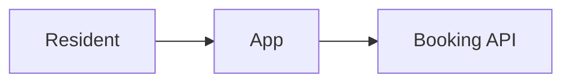
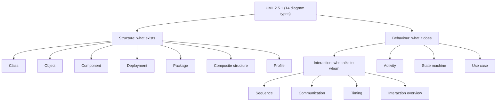
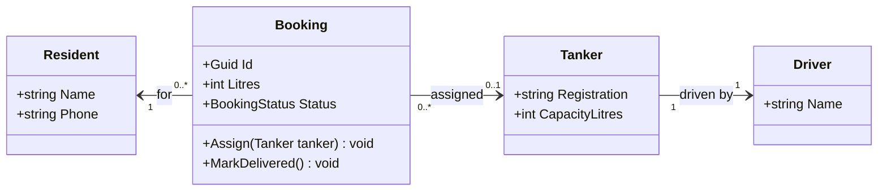
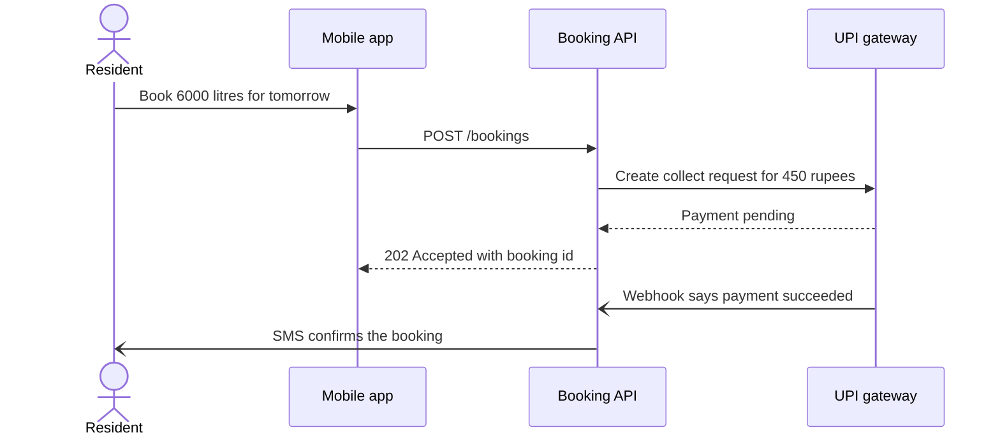
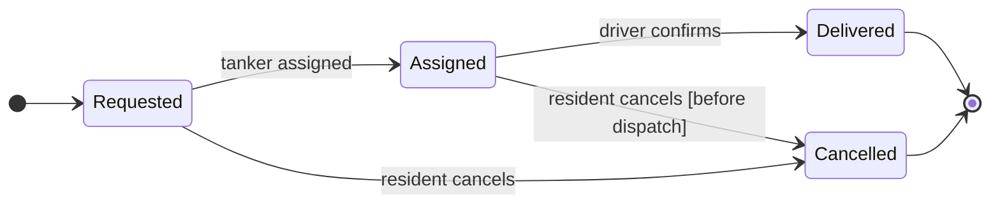
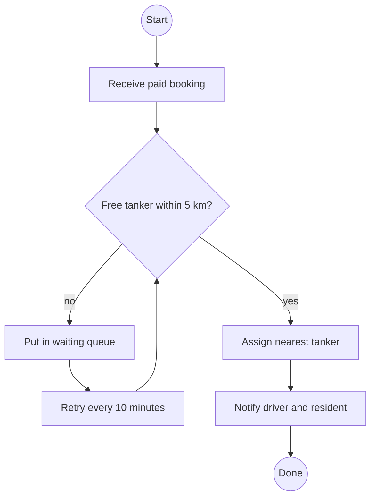
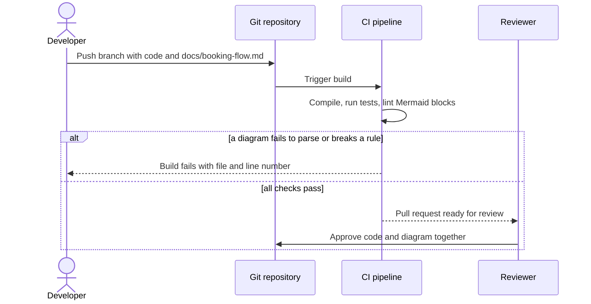
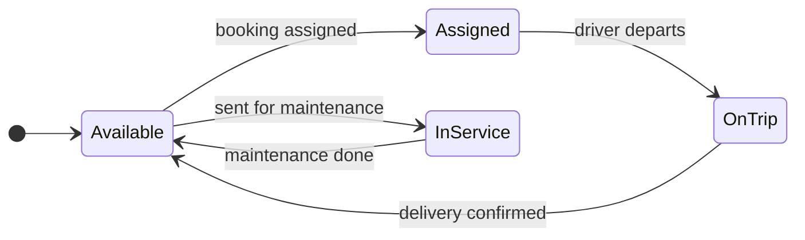

Software is invisible. You cannot walk around a running program the way you walk around a new flat before you rent it. Diagrams are how engineers make the invisible visible, so a team can agree on a design before spending weeks building it. UML is the most widely known standard set of diagram symbols. This lesson explains what it is, which parts of it are worth learning, when a diagram is the wrong tool, and how to write diagrams as plain text with Mermaid.

## Learning objectives

By the end of this lesson you will be able to:

1. Explain what UML is, who maintains it, and why a shared notation helps teams.
2. Name the three families of UML diagrams (structure, behaviour, interaction) and place the common diagrams in each.
3. Choose the right diagram for a question ("what exists?", "what happens in what order?", "what states can this be in?").
4. Tell the difference between UML as a sketch, as a blueprint and as a programming language, and pick the mode that fits your situation.
5. Recognise when a diagram helps and when it wastes time.
6. Write basic Mermaid diagrams (flowchart, class, sequence, state), fix the most common syntax errors, and keep diagrams in the repository as code.

## Prerequisites

- [Classes, objects, fields, properties and methods](#/lesson/m01-classes-objects): you should know what a class and an object are.
- [HLD versus LLD](#/lesson/m02-hld-vs-lld): helpful for seeing where each diagram fits, but not required.

No drawing tools are needed. Every diagram in this lesson is text.

## Explain it like I'm a beginner

### Maps for different journeys

Imagine you are visiting Chennai. You might carry three different maps:

- A **metro map** that shows only stations and lines. It is not to scale, but it tells you which train to take.
- A **street map** that shows roads and buildings, so you can walk from the station to the hotel.
- A **bus timetable** that shows *when* things happen, not where they are.

Nobody says one map is "the correct one". Each answers a different question, and each leaves out almost everything to answer its question well.

Software diagrams work the same way. A **class diagram** is like the street map: what exists and how it is connected. A **sequence diagram** is like the timetable: who does what, in what order. A **state diagram** is like the status board at a station: "On time", "Delayed", "Cancelled", and what moves a train from one to another.

### A shared alphabet

Before maps used standard symbols, every map-maker drew rivers, roads and railways differently. Readers had to learn each map's private language. Standard symbols fixed that.

Software had the same problem in the early 1990s. Several experts each had their own diagram notation. In 1997 three of them (Grady Booch, James Rumbaugh and Ivar Jacobson) merged their ideas, and the result was adopted as a standard by the Object Management Group (OMG). That standard is the **Unified Modeling Language (UML)**. The current version is UML 2.5.1, published in 2017.

"Language" sounds big. Think of it as an **alphabet of shapes**: a box with three parts means a class, a filled diamond means "owns", a dashed arrow means "uses". Once you know the alphabet, you can read any team's diagrams, in any company, in any country.

### Our running example: a water-tanker booking app

A city water board in Chennai wants an app so residents can book a water tanker when the piped supply fails:

- A **resident** books a tanker of 6,000 or 12,000 litres for an address.
- The **booking** is assigned to a **tanker** and its **driver**.
- The resident pays by UPI. A booking moves through statuses: *Requested*, *Assigned*, *Delivered*, *Cancelled*.
- The driver marks the delivery done; the resident gets an SMS.

We will look at this one small system through several different diagrams, and see what each shows and hides.

## First-principles explanation

### What a model is

A **model** is a simplified description of something, made to answer specific questions. A cardboard model of a bridge answers "how will it look on the river?" but not "how much load can it carry?". A structural analysis model answers the second question and looks nothing like a bridge.

A **diagram** is one *view* of a model. In UML terms, your system has one underlying model (all the classes, objects, states and interactions) and each diagram shows a slice of it. This idea matters: two diagrams of the same system must agree. If the class diagram says a booking has exactly one tanker, the sequence diagram should not show a booking talking to two.

### The three families of UML diagrams

UML 2.5.1 defines 14 diagram types. They fall into three families:

| Family | Answers | Diagrams |
|---|---|---|
| **Structure** (static) | "What exists, and how is it connected?" | Class, Object, Component, Composite structure, Package, Deployment, Profile |
| **Behaviour** (dynamic) | "What does it do, and how does it change?" | Activity, Use case, State machine |
| **Interaction** (a kind of behaviour) | "Who talks to whom, and in what order?" | Sequence, Communication, Timing, Interaction overview |

Strictly, the UML specification places interaction diagrams *inside* the behaviour family. Most books show them as a third group because they are used so often. That's what we do here: 7 + 3 + 4 = 14.

You do not need all 14. In day-to-day engineering, most teams use five or six:

| Diagram | Use it when you want to show... | Lesson |
|---|---|---|
| Class | Types, their data, and relationships | [Class diagrams](#/lesson/m05-class-diagrams) |
| Object | A snapshot of real objects at one moment | [Object diagrams](#/lesson/m05-object-diagrams) |
| Sequence | Messages between parts over time | [Sequence diagrams](#/lesson/m05-sequence-diagrams) |
| Activity | A workflow with decisions, parallel steps and roles | [Activity diagrams](#/lesson/m05-activity-diagrams) |
| State machine | The lifecycle of one thing and what moves it | [State diagrams](#/lesson/m05-state-diagrams) |
| Component | Big building blocks and their interfaces | [Component diagrams](#/lesson/m05-component-diagrams) |
| Deployment | Where the software runs: servers, containers, networks | [Deployment diagrams](#/lesson/m05-deployment-diagrams) |

The rest are rarer. **Use case** diagrams (stick figures and ovals) appear in requirements documents, though a written list of user stories usually says more. **Package** diagrams show groups of classes, similar to a component diagram at a smaller scale. **Communication**, **timing**, **interaction overview**, **composite structure** and **profile** diagrams are specialist tools you can look up when you need them.

Some very popular diagrams are **not UML** at all: entity-relationship diagrams for databases ([ER diagrams](#/lesson/m05-er-diagrams)), the C4 model for architecture ([C4 model](#/lesson/m05-c4-model)), plain box-and-arrow architecture sketches, and Gantt charts. They borrow ideas from UML but follow their own rules. That's fine. The goal is communication, not purity.

### Choosing a diagram: start from the question

Beginners often ask "which diagram should I draw?". Turn it around: **what question is the reader asking?**

| Reader's question | Diagram |
|---|---|
| "What are the main types and how do they relate?" | Class |
| "What does memory actually look like when this bug happens?" | Object |
| "What happens, step by step, when a resident books a tanker?" | Sequence |
| "What is the approval process, who does each step, and what runs in parallel?" | Activity with swimlanes |
| "Can a delivered booking still be cancelled?" | State machine |
| "Which modules depend on which, through what interfaces?" | Component |
| "Which server does the API run on, and can the database be reached from the internet?" | Deployment |
| "What tables and foreign keys do we need?" | ER diagram (not UML) |

If you cannot name the question, you probably do not need a diagram yet.

### Three ways to use UML: sketch, blueprint, programming language

Martin Fowler describes three modes in which people use UML. They differ in how complete and how formal the diagram is.

**1. UML as a sketch.** Quick, partial diagrams to think and to talk. Drawn on a whiteboard, a notebook or a few lines of Mermaid. They show only what matters for the conversation and are often thrown away afterwards. This is how most good engineers use UML today. Example: during a design discussion, you sketch four boxes to show that `Booking` should not hold a reference to `Driver` directly, only to `Tanker`.

**2. UML as a blueprint.** Detailed, complete diagrams that someone else will build from, like the full set of drawings a car factory works from. Popular in the 1990s and 2000s, especially with expensive modelling tools. Still useful in a few places: interface contracts between two companies, safety-critical systems, regulated domains, and outsourcing where the builders are not the designers. The cost is high: a blueprint must be kept correct, and it goes out of date the moment code changes without it.

**3. UML as a programming language.** Diagrams detailed enough to generate the whole program (model-driven architecture). This has a niche in embedded and automotive tooling, but it never became mainstream for business software. Code turned out to be a better language for code.

A useful middle ground today is **diagrams as code**: diagrams written as text (Mermaid, PlantUML), stored in the repository next to the code, reviewed in the same pull request, and sometimes *generated* from the code. They have the low cost of sketches and some of the trust of blueprints.

### When diagrams help

Diagrams earn their cost when:

- **Many people must agree before building.** Ten minutes on a whiteboard can save a week of rework. If two developers will build the booking API and the driver app in parallel, a sequence diagram of "assign tanker" lets each build against the same picture.
- **The structure is hard to hold in your head.** More than about seven related classes, a workflow with parallel branches, a lifecycle with ten states. Writing it down frees working memory.
- **The reader is new.** Onboarding a developer, explaining the system to an auditor, or handing over to a support team. One page of picture beats an hour of reading code.
- **A rule is about shape, not lines of code.** "The database is never reachable from the internet" is a deployment-diagram fact. "A cancelled booking can never be delivered" is a state-diagram fact.
- **You are in an interview.** LLD and HLD rounds expect a diagram before code.

### When diagrams waste time

Diagrams cost time to draw, time to read and, worst of all, time to keep correct. Skip or delete them when:

- **The code is simpler than the picture.** One class with three properties does not need a box.
- **The design will change next week.** Sketch it on paper and do not commit it.
- **Nobody will read it.** A 60-box "complete system diagram" in a wiki is admired once and never opened again.
- **It repeats what tools already show.** Your IDE can show a type hierarchy; a database tool can draw the current schema.
- **It is out of date.** A wrong diagram is worse than no diagram. People trust it and make wrong decisions.

A rough rule of thumb (an estimate from experience, not a measured number): a diagram that takes more than about 15 minutes to read probably has too much in it. Split it.

### The parts every diagram should have

Whatever the type, a good diagram has:

1. **A title** that says what it shows: "Tanker booking: assign and deliver (happy path)".
2. **A scope.** What is in, what is out. "Payments are shown as one external box."
3. **A consistent notation.** If you use UML arrows, use them correctly. If you use your own shapes, add a legend.
4. **Only the detail the reader needs.** Leave out getters, logging, framework classes.
5. **A date or a link to the code** it describes, so readers can judge whether it is current.

### Mermaid: diagrams as text

**Mermaid** is a free, open-source tool that turns text into diagrams. GitHub, GitLab, Azure DevOps wikis, Notion, many documentation sites and this platform all render it. You write this in a Markdown file:

````text

````

and the reader sees boxes and arrows. Because it is text:

- It lives in the repository, next to the code, under version control.
- A change to the design shows up in the pull request diff, so reviewers see it.
- Anyone can edit it with a text editor. No licence, no binary file.
- It can be generated by code and checked by CI.

The trade-off: you give up precise control over layout. Mermaid decides where boxes go. For a quick sketch or a document, that's usually fine. For a poster-quality architecture diagram, a drawing tool may be better.

### Mermaid basics that apply to every diagram

**1. The first line names the diagram type.** It must be the first non-comment line:

| First line | Diagram |
|---|---|
| `flowchart LR` (or `graph LR`) | Flowchart, used for activity and many architecture diagrams |
| `classDiagram` | Class diagram (also used for object diagrams) |
| `sequenceDiagram` | Sequence diagram |
| `stateDiagram-v2` | State machine diagram |
| `erDiagram` | Entity-relationship diagram (not UML) |
| `C4Context`, `C4Container`, `C4Component` | C4 diagrams (not UML) |
| `architecture-beta` | Cloud/infrastructure icons diagram (newer, not UML) |

**2. Direction.** For flowcharts, write it after the keyword: `TB` or `TD` (top to bottom), `BT`, `LR` (left to right), `RL`. In class and state diagrams, use a separate line: `direction LR`.

**3. Comments** start with `%%` on their own line: `%% Payments are out of scope here`.

**4. Ids and labels are different things.** In `Api["Booking API"]`, `Api` is the **id** you use in arrows, and `Booking API` is the **label** the reader sees. Keep ids short and simple (letters, digits, underscores). Put anything with spaces, brackets or punctuation in a quoted label.

**5. Quote labels with special characters.** `A[Load balancer (L7)]` fails, because `(` starts a new shape. `A["Load balancer (L7)"]` works. Inside a quoted label, write a double quote as `#quot;`.

**6. Avoid reserved words as ids.** In flowcharts, a node called `end` breaks the diagram, because `end` closes a subgraph. Use `done` or `End1`.

**7. Line breaks in labels.** Use `<br/>` inside a quoted label: `A["Assign tanker<br/>(nearest free)"]`.

**8. Accessibility.** Most diagram types accept `accTitle: ...` and `accDescr: ...` lines, which screen readers use. They are good practice for documentation that many people read.

### The most common Mermaid errors

| Symptom | Cause | Fix |
|---|---|---|
| "Parse error on line 1" | Missing or misspelt diagram type, e.g. `flowchar` or `stateDiagram-v3` | Check the first line |
| Error near a bracket | Unquoted label containing `(`, `[`, `{` or `:` | Quote it: `A["Pay (UPI)"]` |
| A second, empty box appears | Misspelt id in an arrow creates a new node | Use the same id everywhere |
| Generic types break a class diagram | `List<Booking>` uses angle brackets | Write `List~Booking~` |
| Sequence message is cut off or errors | A semicolon in the message text ends the statement | Rephrase without `;`, use a comma or "and" |
| Flowchart breaks after a node called `end` | `end` is a keyword | Rename the node |

The semicolon one deserves a moment. In Mermaid, `;` can end a statement, much like in C#. So the message `Api->>Db: insert booking; return id` is read as two statements, and the second one, `return id`, is not valid syntax. Write `Api->>Db: insert booking and return id` instead.

### How diagrams map to code

Every UML diagram has a C# shadow:

| Diagram | What it maps to in a .NET codebase |
|---|---|
| Class | Classes, records, interfaces, enums; properties and fields; inheritance |
| Object | Actual objects in memory: what the debugger's watch window shows |
| Sequence | Method calls between services, HTTP calls, messages on a queue |
| Activity | A workflow method or a background job: `if`, loops, `Task.WhenAll` |
| State machine | An `enum Status` plus the methods that change it, or a table-driven state machine |
| Component | Projects (`.csproj`), assemblies, modules, and the interfaces between them |
| Deployment | Docker images, IIS sites, VMs, Kubernetes pods, connection strings |

This is why diagrams and code drift apart: the code keeps changing and the picture does not. Later in this lesson you will build a small tool that checks diagrams in your repository, which is one way to reduce that drift.

## Visual explanation

### The UML family tree



Read it from the top. UML splits into structure diagrams (left), which describe things that exist even when the system is switched off, and behaviour diagrams, which describe what happens when it runs. The arrow from Behaviour to Interaction shows that, in the specification, interaction diagrams are a special kind of behaviour diagram: they focus on messages between parts. The boxes you will use most often in practice are Class, Object, Component and Deployment on the structure side, and Activity, State machine and Sequence on the behaviour side. This diagram is itself a Mermaid flowchart with a `TB` direction: each `-->` is one arrow and each `["..."]` is a quoted label.

### One system, four views

Here is the water-tanker app, seen four ways. Each diagram is deliberately small.

**What exists** (class diagram):



This class diagram answers "what are the main types and how are they connected?". A booking belongs to one resident and may be assigned to zero or one tanker; each tanker has one driver. It says nothing about the order in which things happen. The Mermaid syntax is the one from the [class diagrams lesson](#/lesson/m05-class-diagrams): `class Name { ... }` for a box, `Type name` for members, and quoted multiplicities on each end of a relationship.

**What happens, in order** (sequence diagram):



This sequence diagram answers "who talks to whom, and in what order?". Time runs downwards. Solid arrows (`->>`) are requests, dashed arrows (`-->>`) are replies, and the `-)` arrows are asynchronous messages that nobody waits for: the payment webhook arrives later, and the SMS is sent without blocking. Notice that the messages contain no semicolons. The amount is a made-up example, not a real tariff.

**What states a booking can be in** (state machine diagram):



This state diagram answers "can a delivered booking be cancelled?". The answer is visibly no: there is no arrow from `Delivered` to `Cancelled`. `[*]` marks the start and the end. Each arrow is labelled with the event that causes it, and the text in square brackets is a **guard**, a condition that must be true. The [state diagrams lesson](#/lesson/m05-state-diagrams) covers this notation fully.

**What the dispatch process looks like** (activity diagram, drawn as a Mermaid flowchart):



This activity diagram answers "what are the steps, and where are the decisions?". The diamond `{...}` is a decision; its outgoing arrows carry the conditions. The loop back from "Retry every 10 minutes" to the decision shows repetition. Mermaid has no dedicated UML activity diagram, so teams use a flowchart and follow UML's meaning. The [activity diagrams lesson](#/lesson/m05-activity-diagrams) adds forks, joins and swimlanes. Note the end node's id is `done`, not `end`, because `end` is a reserved word.

Four diagrams, one system, no contradictions. If the state diagram allowed cancelling a delivered booking but the activity diagram did not, the team would have found a real requirements question to ask the water board.

### Diagrams as code: the workflow



This sequence diagram shows why "diagrams as code" works. The diagram is a Markdown file in the same branch as the code change. The CI pipeline checks it (you will build such a checker below). The `alt` / `else` / `end` block shows two possible outcomes: a broken diagram fails the build with a precise location, while a good one reaches the reviewer, who approves the code and the picture in the same review. A self-message (`CI->>CI`) shows the pipeline doing work on its own.

## Step-by-step example

Let us apply the ideas to a real request. The water board's product owner writes:

> "Drivers keep getting assigned to tankers that are being serviced. Also, residents are cancelling after the tanker has already left. Can you fix it?"

### Step 1: name the questions

There are two separate questions:

1. "When is a tanker available for assignment?" This is about the **lifecycle of a tanker**.
2. "When may a resident cancel?" This is about the **lifecycle of a booking**.

Both are "what states, and what moves between them?" questions. So the right tool is a **state machine diagram**, not a class diagram.

### Step 2: sketch, do not blueprint

Draw it quickly in Mermaid, in the ticket or on the whiteboard:



This sketch of the **tanker** lifecycle immediately shows the bug: assignment is only valid from `Available`. A tanker in `InService` has no `booking assigned` arrow. The current code probably checks only "does this tanker have no active booking?" and forgets maintenance. For the booking side, the earlier state diagram already says cancellation is allowed only before dispatch; you add the event `driver departs` to make "dispatch" precise.

### Step 3: check the sketch against the people who know

Show the two diagrams to the product owner and a depot supervisor. They will read a state diagram in a minute. The supervisor may say: "A tanker can also break down *on a trip*." That is a missing arrow (`OnTrip --> InService : breakdown`), found before any code is written. This is the moment where diagrams pay for themselves.

### Step 4: decide whether to keep it

Will this diagram be useful in six months? The tanker lifecycle is a core rule that new developers must learn, and it changes rarely. So yes: commit it as `docs/tanker-lifecycle.md` next to the `Tanker` class. The quick "who calls whom" sketch you drew while debugging is not worth keeping; delete it.

### Step 5: make the code match the picture

Turn each arrow into a method with a guard clause, for example `Tanker.Assign()` throws if the status is not `Available`. Write one test per arrow and one per forbidden arrow ("cannot assign while in service"). Now the tests protect the diagram's rules, and a reviewer can compare the two.

## Production-style C# implementation

Diagrams in a repository drift and break like any other code. Here is a small ASP.NET Core service that does what the CI step in the workflow diagram does: it finds every Mermaid block in a Markdown document, says which UML family each diagram belongs to, and reports common problems with a file and line number. The same classes can run in a unit test over your `docs/` folder.

```text
DiagramDocs.Api/
  Program.cs                  // minimal API: POST /lint, options binding, DI
  Docs/MermaidBlock.cs        // finds ```mermaid blocks and their line numbers
  Docs/DiagramCatalogue.cs    // diagram keyword -> UML name and family
  Docs/DiagramLinter.cs       // rules: unknown type, too big, generics in class diagrams, missing title
```

```csharp file=Docs/MermaidBlock.cs
namespace DiagramDocs.Docs;

/// <summary>One Mermaid diagram found in a Markdown file. StartLine is the 1-based line of the
/// first line inside the fence, so findings can point at the exact line in the file.</summary>
public sealed record MermaidBlock(string SourceFile, int StartLine, IReadOnlyList<string> Lines)
{
    /// <summary>The first line that is not blank and not a %% comment: Mermaid's diagram type.</summary>
    public string Header => Lines.Select(l => l.Trim()).FirstOrDefault(l => l.Length > 0 && !l.StartsWith("%%")) ?? "";
}

public static class MermaidExtractor
{
    // Built from char codes so this file never contains a literal Markdown fence.
    private static readonly string Fence = new('`', 3);

    public static IReadOnlyList<MermaidBlock> Extract(string sourceFile, string markdown)
    {
        ArgumentNullException.ThrowIfNull(markdown);
        var lines = markdown.Replace("\r\n", "\n").Split('\n');
        var blocks = new List<MermaidBlock>();
        var buffer = new List<string>();
        int? openedAt = null;
        var inOtherFence = false;

        for (var i = 0; i < lines.Length; i++)
        {
            var trimmed = lines[i].Trim();
            if (openedAt is null && !inOtherFence)
            {
                if (trimmed == Fence + "mermaid") { openedAt = i + 1; buffer.Clear(); }
                else if (trimmed.StartsWith(Fence)) inOtherFence = true;   // e.g. a csharp block
            }
            else if (inOtherFence)
            {
                if (trimmed == Fence) inOtherFence = false;
            }
            else if (trimmed == Fence)
            {
                blocks.Add(new MermaidBlock(sourceFile, openedAt!.Value + 1, buffer.ToArray()));
                openedAt = null;
            }
            else buffer.Add(lines[i]);
        }
        return blocks;
    }
}
```

```csharp file=Docs/DiagramCatalogue.cs
namespace DiagramDocs.Docs;

public enum UmlFamily { Structure, Behaviour, Interaction, NotUml, Unknown }

public sealed record DiagramKind(string Keyword, string Name, UmlFamily Family);

/// <summary>Maps Mermaid's first-line keyword to the diagram it draws and its UML family.</summary>
public static class DiagramCatalogue
{
    private static readonly Dictionary<string, DiagramKind> Known = new(StringComparer.Ordinal)
    {
        ["classDiagram"] = new("classDiagram", "Class (or object) diagram", UmlFamily.Structure),
        ["sequenceDiagram"] = new("sequenceDiagram", "Sequence diagram", UmlFamily.Interaction),
        ["stateDiagram-v2"] = new("stateDiagram-v2", "State machine diagram", UmlFamily.Behaviour),
        ["stateDiagram"] = new("stateDiagram", "State machine diagram (old renderer)", UmlFamily.Behaviour),
        ["flowchart"] = new("flowchart", "Flowchart (activity, component or deployment sketch)", UmlFamily.Behaviour),
        ["graph"] = new("graph", "Flowchart (older keyword)", UmlFamily.Behaviour),
        ["erDiagram"] = new("erDiagram", "Entity-relationship diagram", UmlFamily.NotUml),
        ["C4Context"] = new("C4Context", "C4 system context", UmlFamily.NotUml),
        ["C4Container"] = new("C4Container", "C4 container", UmlFamily.NotUml),
        ["C4Component"] = new("C4Component", "C4 component", UmlFamily.NotUml),
        ["architecture-beta"] = new("architecture-beta", "Architecture (icons)", UmlFamily.NotUml),
        ["gantt"] = new("gantt", "Gantt chart", UmlFamily.NotUml),
    };

    public static DiagramKind Classify(string header)
    {
        ArgumentNullException.ThrowIfNull(header);
        var keyword = header.Split(' ', StringSplitOptions.RemoveEmptyEntries).FirstOrDefault() ?? "";
        return Known.TryGetValue(keyword, out var kind) ? kind : new DiagramKind(keyword, "Unknown", UmlFamily.Unknown);
    }
}
```

```csharp file=Docs/DiagramLinter.cs
using Microsoft.Extensions.Options;

namespace DiagramDocs.Docs;

public enum Severity { Info, Warning, Error }

public sealed record Finding(string File, int Line, Severity Severity, string Rule, string Message);

public sealed class LintOptions
{
    /// <summary>Above this many arrows a diagram is probably trying to say too much. A team choice, not a standard.</summary>
    public int MaxEdges { get; set; } = 25;
    public bool RequireAccessibleTitle { get; set; }
}

public sealed class DiagramLinter(IOptions<LintOptions> options)
{
    private static readonly string[] EdgeTokens = ["-->", "---", "-.->", "==>", "->>", "-->>", "-)", "<|--", "<|..", "*--", "o--", "..>"];

    public IReadOnlyList<Finding> Lint(string file, string markdown)
    {
        var findings = new List<Finding>();
        foreach (var block in MermaidExtractor.Extract(file, markdown))
            findings.AddRange(LintBlock(block));
        return findings;
    }

    public IEnumerable<Finding> LintBlock(MermaidBlock block)
    {
        var settings = options.Value;
        var kind = DiagramCatalogue.Classify(block.Header);

        if (kind.Family == UmlFamily.Unknown)
        {
            yield return new(block.SourceFile, block.StartLine, Severity.Error, "MD001",
                $"Unknown diagram type '{kind.Keyword}'. Check the first line (for example 'flowchart LR').");
            yield break;   // the other rules assume a known type
        }

        var edges = block.Lines.Count(l => !l.TrimStart().StartsWith("%%") && EdgeTokens.Any(l.Contains));
        if (edges > settings.MaxEdges)
            yield return new(block.SourceFile, block.StartLine, Severity.Warning, "MD002",
                $"{edges} arrows (limit {settings.MaxEdges}). Consider splitting this {kind.Name.ToLowerInvariant()}.");

        if (kind.Keyword == "classDiagram")
        {
            var depth = 0;
            for (var i = 0; i < block.Lines.Count; i++)
            {
                var line = block.Lines[i].Trim();
                if (depth > 0 && !line.StartsWith("<<") && (line.Contains('<') || line.Contains('>')))
                    yield return new(block.SourceFile, block.StartLine + i, Severity.Error, "MD003",
                        "Angle brackets in a class member. Write generics with tildes, e.g. List~Booking~.");
                depth += line.Count(c => c == '{') - line.Count(c => c == '}');
            }
        }

        if (settings.RequireAccessibleTitle && !block.Lines.Any(l => l.TrimStart().StartsWith("accTitle")))
            yield return new(block.SourceFile, block.StartLine, Severity.Info, "MD004",
                "No accTitle line. Screen-reader users will not know what this diagram shows.");
    }
}
```

```csharp file=Program.cs
using DiagramDocs.Docs;

var builder = WebApplication.CreateBuilder(args);

// "DiagramLint": { "MaxEdges": 25, "RequireAccessibleTitle": true } in appsettings.json overrides the defaults.
builder.Services.Configure<LintOptions>(builder.Configuration.GetSection("DiagramLint"));
builder.Services.AddSingleton<DiagramLinter>();

var app = builder.Build();

// POST a Markdown document as text/plain. Returns the findings as JSON.
app.MapPost("/lint", async (HttpRequest request, DiagramLinter linter, CancellationToken ct) =>
{
    // Docs files are small; refuse anything large before reading it into memory.
    if (request.ContentLength > 1_000_000) return Results.StatusCode(StatusCodes.Status413PayloadTooLarge);
    using var reader = new StreamReader(request.Body);
    var markdown = await reader.ReadToEndAsync(ct);
    var findings = linter.Lint("request.md", markdown);
    return findings.Any(f => f.Severity == Severity.Error)
        ? Results.UnprocessableEntity(findings)
        : Results.Ok(findings);
});

// Lists the diagram types the service recognises, with their UML family.
app.MapGet("/diagram-types", () => new[] { "classDiagram", "sequenceDiagram", "stateDiagram-v2", "flowchart", "erDiagram" }
    .Select(DiagramCatalogue.Classify));

app.Run();
```

Things to notice:

- **The fence string is built from character codes.** That stops this C# file from accidentally closing the Markdown code block it is shown in. Small things like this matter when docs and code live together.
- **The extractor skips other code blocks.** A C# snippet that happens to contain the word `mermaid` is not mistaken for a diagram.
- **Rules have ids (`MD001` to `MD004`)** so a team can discuss them, suppress one deliberately, or add new ones. The edge limit is a team choice in configuration, not a law of nature.
- **The service returns 422 when there are errors.** A CI step can call it, or more simply, a unit test can call `DiagramLinter` directly over every `.md` file in `docs/`.
- **It does not try to be a full Mermaid parser.** For a full syntax check, CI can also run the official Mermaid CLI (`@mermaid-js/mermaid-cli`) to render every diagram. The linter adds *team rules* the parser cannot know, such as "keep diagrams small".

## Bad design vs good design

### Bad: the wall poster

A team spends two weeks drawing "the complete system" in a desktop modelling tool: 84 classes, every property, every method, all relationships, exported as a 4 MB PNG and pasted into the wiki.

Problems:

- **Nobody can read it.** At normal zoom the text is too small; zoomed in, you lose the overall shape. Its main message is "this system is complicated".
- **It answers no particular question.** A new developer wanting to understand "how does a booking get assigned?" must hunt through 84 boxes.
- **It cannot be reviewed.** A PNG has no diff. When the code changes, nobody knows which boxes are now wrong.
- **It is out of date within a month,** and people still trust it.
- **It was expensive.** Two weeks of an engineer's time, before any of the code it describes existed.

### Good: small diagrams, one question each, next to the code

```text
docs/
  booking/README.md            -> 1 class diagram (6 boxes) + 1 sequence diagram (book and pay)
  booking/lifecycle.md         -> 1 state diagram (Booking) + 1 state diagram (Tanker)
  dispatch/assignment.md       -> 1 activity diagram (assignment with retry)
  platform/deployment.md       -> 1 deployment diagram (where it runs)
```

- Each diagram has a title and answers one question.
- Each is Mermaid text, so changes appear in pull requests.
- Each is small enough to fix in two minutes when the code changes.
- CI renders and lints them, so a broken diagram fails the build.

### Is a diagram always better than prose?

No. "The API calls the payment gateway, then saves the booking" is clearer as one sentence than as a three-box sequence diagram. A table of fields is clearer than a class box for a DTO. Use a diagram when the **shape** (branches, parallelism, many connections, a lifecycle) carries the meaning.

:::callout type=tradeoff title="Precision versus speed"
Correct UML notation helps when readers are spread across teams or companies, because everyone reads the symbols the same way. On a whiteboard inside one team, loose boxes and arrows are fine, as long as you say what an arrow means. Spend precision where misunderstandings would be expensive: interfaces between teams, money, safety, and anything legal.
:::

## Practical playground

The playground contains a cut-down version of the diagram checker. It classifies a few sample diagrams and runs simple rules over them. Try these changes:

1. Add a fourth sample that uses `List<Booking>` inside a class box, and add a rule that catches it.
2. Add a sample sequence diagram with a semicolon in a message, and a rule `SemicolonInMessage`.
3. Change `MaxEdges` to 3 and see which diagram gets a warning.

:::playground type=csharp title="Classify and lint Mermaid diagrams"
```csharp file=Program.cs
using System;
using System.Collections.Generic;
using System.Linq;

public enum Family { Structure, Behaviour, Interaction, NotUml, Unknown }

public static class Catalogue
{
    private static readonly Dictionary<string, (string Name, Family Family)> Known = new()
    {
        ["classDiagram"] = ("Class diagram", Family.Structure),
        ["sequenceDiagram"] = ("Sequence diagram", Family.Interaction),
        ["stateDiagram-v2"] = ("State machine diagram", Family.Behaviour),
        ["flowchart"] = ("Flowchart / activity", Family.Behaviour),
        ["erDiagram"] = ("ER diagram", Family.NotUml),
    };

    public static (string Name, Family Family) Classify(string diagram)
    {
        var header = diagram.Split('\n').Select(l => l.Trim()).First(l => l.Length > 0 && !l.StartsWith("%%"));
        var keyword = header.Split(' ')[0];
        return Known.TryGetValue(keyword, out var k) ? k : ("Unknown: " + keyword, Family.Unknown);
    }
}

public static class Program
{
    private const int MaxEdges = 6;

    public static void Main()
    {
        var samples = new Dictionary<string, string>
        {
            ["booking-states"] = "stateDiagram-v2\n[*] --> Requested\nRequested --> Assigned : assign\nAssigned --> Delivered : confirm\nDelivered --> [*]",
            ["book-and-pay"] = "sequenceDiagram\nApp->>Api: POST /bookings\nApi->>Pay: collect 450\nPay-->>Api: pending\nApi-->>App: 202",
            ["typo"] = "flowchar LR\nA --> B",
        };

        foreach (var (name, text) in samples)
        {
            var (kind, family) = Catalogue.Classify(text);
            var edges = text.Split('\n').Count(l => l.Contains("-->") || l.Contains("->>") || l.Contains("-->>"));
            Console.WriteLine($"{name,-15} {kind,-25} {family,-12} arrows={edges}");
            if (family == Family.Unknown) Console.WriteLine("    ERROR  first line is not a known diagram type");
            if (edges > MaxEdges) Console.WriteLine($"    WARN   more than {MaxEdges} arrows, consider splitting");
        }
    }
}
```
:::

## Exercises

:::exercise id=m05-uml-fundamentals-ex1 difficulty=beginner kind=written title="Pick the right diagram"
For each question below, name the diagram you would draw and say in one sentence why. Some questions may be best answered by a non-UML diagram or by no diagram at all.

1. "What happens, call by call, when a driver marks a delivery as complete?"
2. "Which statuses can an RTI (Right to Information) application be in, and which moves are allowed?"
3. "Which servers and containers does the tanker app run on in production, and which ports are open?"
4. "What tables do we need for bookings and payments?"
5. "During this bug, two bookings seem to share one address object. What does memory look like?"
6. "What are the five fields of the `CancelBookingRequest` DTO?"
::acceptance
- Each answer names one diagram (or "none") and gives a reason tied to the question.
- Answers 1, 2, 3 and 5 use the four different diagrams that fit best.
- Answer 4 recognises that an ER diagram is not UML but is the right tool.
- Answer 6 recognises that a diagram adds nothing over a short list or table.
::hint
Rephrase each question as "what exists?", "what order?", "what states?", "where does it run?" or "what does memory hold right now?".
::hint
"Call by call" is about order in time. "Statuses and allowed moves" is a lifecycle.
::hint
For a DTO with five fields, ask: would a picture show anything a list does not?
::hint
Structure diagrams: class, object, component, deployment. Behaviour: activity, state machine. Interaction: sequence.
::solution
1. **Sequence diagram.** The question is about the order of calls between the driver app, the API, the database and the SMS service.
2. **State machine diagram.** It is the lifecycle of one thing (an application) and the allowed transitions between its statuses.
3. **Deployment diagram.** It shows nodes (servers, containers), the artifacts deployed on them, and communication paths with ports.
4. **ER diagram** (not UML). Tables, columns and foreign keys are a database concern; a class diagram could approximate it, but ER notation is the standard tool.
5. **Object diagram.** It shows actual objects and links at one moment, which is exactly how you show two bookings pointing to the same `Address` instance.
6. **No diagram.** A bulleted list of five fields with their types is clearer and quicker. A single class box would add nothing.
::mistakes
- Answering "class diagram" for everything. Class diagrams cannot show order, states or servers.
- Drawing a class diagram for the database question without mentioning that ER diagrams are the usual tool.
- Forgetting that "no diagram" is a valid and often the best answer.
:::

:::exercise id=m05-uml-fundamentals-ex2 difficulty=beginner kind=code title="A catalogue of the 14 UML diagrams"
Build a small lookup that knows all 14 UML 2.5.1 diagram types and their family. It will be used by a documentation tool to label diagrams.
::requirements
- `UmlCatalogue.FamilyOf(string diagramName)` returns the `UmlFamily` (`Structure`, `Behaviour` or `Interaction`).
- Matching ignores case, ignores leading and trailing spaces, and accepts the name with or without the word "diagram" at the end ("Sequence", "sequence diagram" and " SEQUENCE DIAGRAM " all work).
- An empty or whitespace name throws `ArgumentException`. A null name throws `ArgumentNullException`. A name that is not a UML diagram (such as "Entity-relationship") throws `ArgumentException`.
- `UmlCatalogue.InFamily(family)` returns the names in that family: 7 structure, 3 behaviour, 4 interaction.
- Use the names: Class, Object, Component, Composite structure, Package, Deployment, Profile, Activity, Use case, State machine, Sequence, Communication, Timing, Interaction overview.
::acceptance
- "Sequence diagram" is `Interaction`; " deployment " is `Structure`; "STATE MACHINE DIAGRAM" is `Behaviour`.
- "Entity-relationship diagram" throws `ArgumentException`.
- The family counts are 7, 3 and 4.
::hint
A dictionary from name to family, created with a case-insensitive comparer, does most of the work.
::hint
Normalise the input once: trim it, then remove a trailing " diagram" if present.
::hint
`ArgumentException.ThrowIfNullOrWhiteSpace(name)` throws `ArgumentNullException` for null and `ArgumentException` for empty or whitespace, exactly what the requirements say.
::hint
```csharp
var key = name.Trim();
if (key.EndsWith(" diagram", StringComparison.OrdinalIgnoreCase)) key = key[..^" diagram".Length].TrimEnd();
```
::starter
```csharp file=UmlCatalogue.cs
using System;
using System.Collections.Generic;
using System.Linq;

public enum UmlFamily { Structure, Behaviour, Interaction }

public static class UmlCatalogue
{
    public static UmlFamily FamilyOf(string diagramName) => throw new NotImplementedException();

    public static IReadOnlyList<string> InFamily(UmlFamily family) => throw new NotImplementedException();
}
```
::tests
```csharp file=UmlCatalogueTests.cs
using System;
using Xunit;

public class UmlCatalogueTests
{
    [Fact] public void Sequence_is_interaction() => Assert.Equal(UmlFamily.Interaction, UmlCatalogue.FamilyOf("Sequence diagram"));
    [Fact] public void Trims_and_drops_suffix() => Assert.Equal(UmlFamily.Structure, UmlCatalogue.FamilyOf("  deployment "));
    [Fact] public void Ignores_case() => Assert.Equal(UmlFamily.Behaviour, UmlCatalogue.FamilyOf("STATE MACHINE DIAGRAM"));
    [Fact] public void Two_word_names_work() => Assert.Equal(UmlFamily.Interaction, UmlCatalogue.FamilyOf("interaction overview"));
    [Fact] public void Er_is_not_uml() => Assert.Throws<ArgumentException>(() => UmlCatalogue.FamilyOf("Entity-relationship diagram"));
    [Fact] public void Empty_is_rejected() => Assert.Throws<ArgumentException>(() => UmlCatalogue.FamilyOf("   "));
    [Fact] public void Null_is_rejected() => Assert.Throws<ArgumentNullException>(() => UmlCatalogue.FamilyOf(null!));

    [Fact]
    public void Family_sizes_add_up_to_fourteen()
    {
        Assert.Equal(7, UmlCatalogue.InFamily(UmlFamily.Structure).Count);
        Assert.Equal(3, UmlCatalogue.InFamily(UmlFamily.Behaviour).Count);
        Assert.Equal(4, UmlCatalogue.InFamily(UmlFamily.Interaction).Count);
        Assert.Contains("Use case", UmlCatalogue.InFamily(UmlFamily.Behaviour));
    }
}
```
::solution
```csharp file=UmlCatalogue.cs
using System;
using System.Collections.Generic;
using System.Linq;

public enum UmlFamily { Structure, Behaviour, Interaction }

public static class UmlCatalogue
{
    private const string Suffix = " diagram";

    private static readonly Dictionary<string, UmlFamily> Diagrams = new(StringComparer.OrdinalIgnoreCase)
    {
        ["Class"] = UmlFamily.Structure,
        ["Object"] = UmlFamily.Structure,
        ["Component"] = UmlFamily.Structure,
        ["Composite structure"] = UmlFamily.Structure,
        ["Package"] = UmlFamily.Structure,
        ["Deployment"] = UmlFamily.Structure,
        ["Profile"] = UmlFamily.Structure,
        ["Activity"] = UmlFamily.Behaviour,
        ["Use case"] = UmlFamily.Behaviour,
        ["State machine"] = UmlFamily.Behaviour,
        ["Sequence"] = UmlFamily.Interaction,
        ["Communication"] = UmlFamily.Interaction,
        ["Timing"] = UmlFamily.Interaction,
        ["Interaction overview"] = UmlFamily.Interaction,
    };

    public static UmlFamily FamilyOf(string diagramName)
    {
        ArgumentException.ThrowIfNullOrWhiteSpace(diagramName);
        var key = diagramName.Trim();
        if (key.EndsWith(Suffix, StringComparison.OrdinalIgnoreCase))
            key = key[..^Suffix.Length].TrimEnd();
        return Diagrams.TryGetValue(key, out var family)
            ? family
            : throw new ArgumentException($"'{diagramName}' is not one of the 14 UML diagram types.", nameof(diagramName));
    }

    public static IReadOnlyList<string> InFamily(UmlFamily family) =>
        Diagrams.Where(d => d.Value == family).Select(d => d.Key).ToArray();
}
```

The dictionary is the whole design: a single source of truth, case-insensitive by construction. Normalising the input in one place keeps the lookup simple.
::mistakes
- Comparing with `==` after `ToLower()` on only one side, so "Use Case" fails.
- Removing "diagram" anywhere in the string instead of only at the end.
- Putting "Interaction" diagrams under `Behaviour` without the separate family the requirements ask for (both views exist; follow the spec you are given).
::extensions
Add `Mermaid(string diagramName)` that returns the Mermaid keyword that best draws each diagram (`classDiagram` for class and object, `flowchart` for activity, component and deployment), or `null` when Mermaid has no reasonable equivalent (timing, profile).
:::

:::exercise id=m05-uml-fundamentals-ex3 difficulty=intermediate kind=code title="Safe ids and labels for generated flowcharts"
Your team generates Mermaid flowcharts from data (step names typed by business users). Names like `Pay bill (UPI)` or `end` break the diagram. Write the two helpers that make any text safe.
::requirements
- `MermaidText.Id(string name)`: lower-case; every run of characters that are not ASCII letters or digits becomes one `_`; leading and trailing `_` removed. If the result starts with a digit, prefix `n_`. If the result is a Mermaid keyword (`end`, `graph`, `flowchart`, `subgraph`, `style`, `class`, `classdef`, `click`, `linkstyle`, `direction`), append `_node`. If nothing is left, throw `ArgumentException`.
- `MermaidText.Label(string text)`: returns the text wrapped in double quotes, with every `"` replaced by `#quot;` and every line break (`\r\n` or `\n`) replaced by `<br/>`. Null throws `ArgumentNullException`.
::acceptance
- `Id("Pay bill (UPI)")` is `pay_bill_upi`; `Id("2nd reminder")` is `n_2nd_reminder`; `Id("End")` is `end_node`.
- `Id("  ---  ")` throws `ArgumentException`.
- `Label("Load balancer (L7)")` is `"Load balancer (L7)"` including the quotes.
- `Label("Say \"hi\"")` becomes `"Say #quot;hi#quot;"` and a two-line text joins with `<br/>`.
::hint
Do the id in stages: lower-case, replace, trim, then the two special cases. Test each stage.
::hint
A `StringBuilder` loop that tracks "was the last character an underscore?" collapses runs without regular expressions. `Regex.Replace(s, "[^a-z0-9]+", "_")` also works.
::hint
Check the digit rule with `char.IsAsciiDigit(id[0])` and the keyword rule with a `HashSet<string>`.
::hint
For the label, normalise `\r\n` to `\n` first, then replace `\n` with `<br/>`, then `"` with `#quot;`.
::hint
```csharp
var id = Regex.Replace(name.ToLowerInvariant(), "[^a-z0-9]+", "_").Trim('_');
if (id.Length == 0) throw new ArgumentException("Name has no letters or digits.", nameof(name));
```
::starter
```csharp file=MermaidText.cs
using System;
using System.Collections.Generic;
using System.Text.RegularExpressions;

public static class MermaidText
{
    public static string Id(string name) => throw new NotImplementedException();

    public static string Label(string text) => throw new NotImplementedException();
}
```
::tests
```csharp file=MermaidTextTests.cs
using System;
using Xunit;

public class MermaidTextTests
{
    [Fact] public void Spaces_and_brackets_collapse() => Assert.Equal("pay_bill_upi", MermaidText.Id("Pay bill (UPI)"));
    [Fact] public void Leading_digit_is_prefixed() => Assert.Equal("n_2nd_reminder", MermaidText.Id("2nd reminder"));
    [Fact] public void Keyword_is_suffixed() => Assert.Equal("end_node", MermaidText.Id("End"));
    [Fact] public void Other_keyword_is_suffixed() => Assert.Equal("subgraph_node", MermaidText.Id(" Subgraph "));
    [Fact] public void Nothing_left_throws() => Assert.Throws<ArgumentException>(() => MermaidText.Id("  ---  "));
    [Fact] public void Label_is_quoted() => Assert.Equal("\"Load balancer (L7)\"", MermaidText.Label("Load balancer (L7)"));
    [Fact] public void Quotes_are_escaped() => Assert.Equal("\"Say #quot;hi#quot;\"", MermaidText.Label("Say \"hi\""));
    [Fact] public void Newlines_become_br() => Assert.Equal("\"Line 1<br/>Line 2<br/>Line 3\"", MermaidText.Label("Line 1\r\nLine 2\nLine 3"));
    [Fact] public void Null_label_throws() => Assert.Throws<ArgumentNullException>(() => MermaidText.Label(null!));
}
```
::solution
```csharp file=MermaidText.cs
using System;
using System.Collections.Generic;
using System.Text.RegularExpressions;

public static class MermaidText
{
    private static readonly HashSet<string> Keywords = new(StringComparer.Ordinal)
    {
        "end", "graph", "flowchart", "subgraph", "style", "class", "classdef", "click", "linkstyle", "direction",
    };

    public static string Id(string name)
    {
        ArgumentNullException.ThrowIfNull(name);
        var id = Regex.Replace(name.ToLowerInvariant(), "[^a-z0-9]+", "_").Trim('_');
        if (id.Length == 0) throw new ArgumentException("The name has no letters or digits.", nameof(name));
        if (char.IsAsciiDigit(id[0])) id = "n_" + id;
        if (Keywords.Contains(id)) id += "_node";
        return id;
    }

    public static string Label(string text)
    {
        ArgumentNullException.ThrowIfNull(text);
        var safe = text.Replace("\r\n", "\n").Replace("\n", "<br/>").Replace("\"", "#quot;");
        return "\"" + safe + "\"";
    }
}
```

Separating **ids** (for the machine) from **labels** (for the reader) is the key idea. Once every generated node is written as `id[label]`, user text can never break the diagram's syntax.
::alternatives
You could keep a dictionary from original name to generated id to guarantee uniqueness: "Pay bill" and "Pay-bill" both become `pay_bill`, so a generator should append `_2` on a clash.
::mistakes
- Using the label as the id. Any space or bracket breaks the diagram.
- Escaping quotes with a backslash (`\"`). Mermaid does not understand that inside labels; it uses `#quot;`.
- Forgetting `\r\n` from Windows text, which leaves a stray `\r` in the label.
::extensions
Add `Node(string name)` that returns `id["label"]` in one call, and a uniqueness-aware `IdGenerator` class that remembers ids it has handed out.
:::

:::exercise id=m05-uml-fundamentals-ex4 difficulty=intermediate kind=written title="Sketch, blueprint or skip?"
For each situation, decide whether to draw a **sketch** (quick, partial, possibly thrown away), a **blueprint** (complete, maintained, others build from it), **diagrams as code** kept in the repository, or **no diagram**. Justify each decision with cost and benefit, and say who the audience is.

1. Two developers in the same team are debating whether `Booking` should reference `Driver` directly.
2. Your company and a state government's IT team must integrate: your system sends grievance updates to theirs through an API. They will build their side from your document.
3. The tanker-assignment rules (eight states, twelve transitions) that every new developer must learn.
4. A one-off data-migration script that will run once and be deleted.
5. An interview LLD round: "Design a parking lot" in 45 minutes.
::acceptance
- Every situation has a decision, an audience and a cost/benefit reason.
- Situation 2 recognises that a cross-organisation contract justifies blueprint-level precision (and an API spec such as OpenAPI).
- Situation 3 chooses a maintained diagram in the repository, with a reason about how often it is read versus changed.
- Situation 4 chooses no diagram (or a throw-away sketch) and says why.
::hint
Ask: how many people will read it, for how long, and how expensive is a misunderstanding?
::hint
Blueprints are worth their maintenance cost only when the readers cannot simply ask the writers.
::hint
A diagram that is read often and changed rarely is the best candidate to keep.
::hint
For the interview, think about time: what can you draw in five minutes that shows the most?
::solution
1. **Sketch.** Audience: two people, for ten minutes. A four-box class diagram on a whiteboard or in a chat message settles it. Keep nothing, or note the decision in the pull request.
2. **Blueprint, written as a contract.** Audience: another organisation that cannot read your code or walk to your desk. A misunderstanding costs weeks and a formal change request. Provide an OpenAPI specification plus sequence diagrams of the main flows (including errors and retries) and a state diagram of grievance statuses. Version it and keep it maintained for the life of the integration.
3. **Diagrams as code.** Audience: every new developer, for years. It is read often and changes rarely, so the maintenance cost is low compared with the benefit. Keep it as Mermaid in `docs/` next to the `Tanker` class, and ideally add tests per transition so the code cannot silently disagree. Generating it from the code's state table is even better.
4. **No diagram.** Audience: you, once. The script itself, with a good comment, is the documentation. A diagram would cost more than the script.
5. **Sketch, fast.** Audience: the interviewer, for 45 minutes. Spend about five minutes on a class diagram of the main types (ParkingLot, Level, Spot, Vehicle, Ticket) with key multiplicities, then maybe a small state diagram for a spot or a sequence diagram for "park a car". Precision matters only where it shows design judgement.
::mistakes
- Choosing a blueprint for internal, short-lived questions. The maintenance cost never pays back.
- Choosing a sketch for the cross-organisation integration, where nobody can ask follow-up questions easily.
- Saying "always diagram everything" or "never diagram"; the right answer depends on audience and lifetime.
:::

:::exercise id=m05-uml-fundamentals-ex5 difficulty=advanced kind=code title="A linter for sequence diagrams in CI"
Sequence diagrams in your docs keep breaking in three ways: semicolons in message text, messages to participants that were never declared, and `alt`/`loop` blocks with a missing `end`. Write a linter that a unit test can run over every diagram.
::requirements
- `SequenceLint.Check(string diagram)` returns a list of `LintIssue(int Line, string Code, string Message)`, sorted by line, then by code. Lines are 1-based. Blank lines and lines starting with `%%` are ignored by all rules.
- **SEQ000**: the first non-blank, non-comment line must be `sequenceDiagram`. If not, return only this issue (at that line).
- **SEQ001**: a line containing `:` whose text after the first `:` contains `;` (messages and notes).
- **SEQ002**: if the diagram declares at least one `participant` or `actor`, every message's sender and receiver must be declared. A message line looks like `Sender ARROW Receiver: text`, where ARROW is `->`, `-->`, `->>`, `-->>`, `-x`, `--x`, `-)` or `--)`, optionally followed by `+` or `-`. Report one issue per undeclared name per line.
- **SEQ003**: lines starting with `alt`, `opt`, `loop`, `par`, `critical`, `break` or `rect` open a block, and `end` closes one. An `end` with nothing open is an issue at that line. A block still open at the end is an issue at the line that opened it.
::acceptance
- A valid diagram gives no issues.
- A semicolon in a message gives SEQ001 at the right line.
- A message to an undeclared `Db` gives SEQ002 mentioning `Db`, but only when participants are declared.
- An unclosed `loop` and a stray `end` each give SEQ003 at the right lines.
- A diagram starting with `sequenceDiagrams` gives exactly one SEQ000 issue.
::hint
Split into lines once, keep the 1-based number with each line, and filter out blanks and comments up front.
::hint
Two regular expressions do the parsing: one for declarations (`^(participant|actor)\s+(\w+)`) and one for messages.
::hint
For the message regex, match the arrow with `-{1,2}(?:>>|>|x|\))`. Put the sender and receiver in groups.
::hint
For blocks, keep a `Stack<int>` of opening line numbers. Push on `alt`/`loop`/..., pop on `end`.
::hint
```csharp
static readonly Regex Message = new(@"^(\w+)\s*-{1,2}(?:>>|>|x|\))\s*[+-]?\s*(\w+)\s*:");
// groups[1] = sender, groups[2] = receiver
```
::starter
```csharp file=SequenceLint.cs
using System;
using System.Collections.Generic;
using System.Linq;
using System.Text.RegularExpressions;

public sealed record LintIssue(int Line, string Code, string Message);

public static class SequenceLint
{
    public static IReadOnlyList<LintIssue> Check(string diagram) => throw new NotImplementedException();
}
```
::tests
```csharp file=SequenceLintTests.cs
using System;
using System.Linq;
using Xunit;

public class SequenceLintTests
{
    private const string Good = "sequenceDiagram\n    participant App\n    participant Api\n    App->>Api: POST /bookings\n    loop every 10 minutes\n        Api-->>App: still waiting\n    end\n";

    [Fact] public void Valid_diagram_has_no_issues() => Assert.Empty(SequenceLint.Check(Good));

    [Fact]
    public void Semicolon_in_message()
    {
        var issue = Assert.Single(SequenceLint.Check("sequenceDiagram\nApp->>Api: save; then reply\n"));
        Assert.Equal("SEQ001", issue.Code);
        Assert.Equal(2, issue.Line);
    }

    [Fact]
    public void Semicolon_in_note_is_also_caught() =>
        Assert.Equal("SEQ001", Assert.Single(SequenceLint.Check("sequenceDiagram\nNote over App: a; b")).Code);

    [Fact]
    public void Undeclared_receiver_when_participants_declared()
    {
        var issue = Assert.Single(SequenceLint.Check("sequenceDiagram\nparticipant App\nparticipant Api\nApi->>+Db: insert row\n"));
        Assert.Equal("SEQ002", issue.Code);
        Assert.Equal(4, issue.Line);
        Assert.Contains("Db", issue.Message);
    }

    [Fact] public void Implicit_participants_are_fine() => Assert.Empty(SequenceLint.Check("sequenceDiagram\nApp->>Api: hi\nApi-->>App: ok"));

    [Fact]
    public void Unclosed_and_stray_blocks()
    {
        var issues = SequenceLint.Check("sequenceDiagram\nend\nA->>B: x\nloop retry\nA->>B: y\n");
        Assert.Equal(2, issues.Count);
        Assert.All(issues, i => Assert.Equal("SEQ003", i.Code));
        Assert.Equal(new[] { 2, 4 }, issues.Select(i => i.Line).ToArray());
    }

    [Fact]
    public void Comments_and_blank_lines_are_ignored() =>
        Assert.Empty(SequenceLint.Check("%% header comment\n\nsequenceDiagram\n%% a; b\nA->>B: fine\n"));

    [Fact]
    public void Wrong_header_stops_checking()
    {
        var issue = Assert.Single(SequenceLint.Check("sequenceDiagrams\nA->>B: a; b\n"));
        Assert.Equal("SEQ000", issue.Code);
        Assert.Equal(1, issue.Line);
    }
}
```
::solution
```csharp file=SequenceLint.cs
using System;
using System.Collections.Generic;
using System.Linq;
using System.Text.RegularExpressions;

public sealed record LintIssue(int Line, string Code, string Message);

public static class SequenceLint
{
    private static readonly Regex Declaration = new(@"^(participant|actor)\s+(\w+)");
    private static readonly Regex Message = new(@"^(\w+)\s*-{1,2}(?:>>|>|x|\))\s*[+-]?\s*(\w+)\s*:");
    private static readonly string[] Openers = ["alt", "opt", "loop", "par", "critical", "break", "rect"];

    public static IReadOnlyList<LintIssue> Check(string diagram)
    {
        ArgumentNullException.ThrowIfNull(diagram);
        var lines = diagram.Replace("\r\n", "\n").Split('\n')
            .Select((text, i) => (No: i + 1, Text: text.Trim()))
            .Where(l => l.Text.Length > 0 && !l.Text.StartsWith("%%"))
            .ToList();

        var issues = new List<LintIssue>();
        if (lines.Count == 0 || lines[0].Text != "sequenceDiagram")
        {
            var at = lines.Count == 0 ? 1 : lines[0].No;
            return [new LintIssue(at, "SEQ000", "The first line must be 'sequenceDiagram'.")];
        }

        var declared = lines.Select(l => Declaration.Match(l.Text)).Where(m => m.Success)
            .Select(m => m.Groups[2].Value).ToHashSet(StringComparer.Ordinal);
        var open = new Stack<int>();

        foreach (var (no, text) in lines.Skip(1))
        {
            var colon = text.IndexOf(':');
            if (colon >= 0 && text[(colon + 1)..].Contains(';'))
                issues.Add(new(no, "SEQ001", "Semicolon in message or note text. Mermaid treats ';' as the end of a statement."));

            var message = Message.Match(text);
            if (message.Success && declared.Count > 0)
                foreach (var name in new[] { message.Groups[1].Value, message.Groups[2].Value }.Distinct())
                    if (!declared.Contains(name))
                        issues.Add(new(no, "SEQ002", $"'{name}' is not declared as a participant or actor."));

            var firstWord = text.Split(' ', 2)[0];
            if (Openers.Contains(firstWord)) open.Push(no);
            else if (firstWord == "end")
            {
                if (open.Count == 0) issues.Add(new(no, "SEQ003", "'end' without an open alt/opt/loop/par block."));
                else open.Pop();
            }
        }

        foreach (var no in open)
            issues.Add(new(no, "SEQ003", "Block is never closed with 'end'."));

        return issues.OrderBy(i => i.Line).ThenBy(i => i.Code, StringComparer.Ordinal).ToList();
    }
}
```

The linter is deliberately not a full parser. It catches the three mistakes the team actually makes, with exact line numbers, in a few dozen lines. In CI, a test loops over every `docs/**/*.md`, extracts each sequence diagram (as the production code does), and fails if `Check` returns anything.
::alternatives
Run the official Mermaid parser in CI (Node.js with `mermaid.parse`, or the Mermaid CLI). It catches every syntax error, but not team rules like "declare all participants". Many teams run both: the official parser for syntax, a small linter for conventions.
::mistakes
- Counting `end` inside message text (such as `A->>B: end of day`) as a block close. Checking only the first word avoids this.
- Reporting undeclared participants when the author relied on implicit declaration, which Mermaid allows.
- Losing the original line numbers by filtering lines before numbering them.
::extensions
Add **SEQ004**: an `else` line outside an `alt` block. Then add a rule that warns when a diagram has more than 12 participants.
:::

## Automated testing

Diagrams are documentation, but documentation can still be tested.

**1. Lint every diagram in the repository.** A single xUnit test can walk the docs folder and fail on any error:

```csharp
public class DocsDiagramTests
{
    [Fact]
    public void All_diagrams_pass_the_linter()
    {
        var linter = new DiagramLinter(Options.Create(new LintOptions { MaxEdges = 25 }));
        var errors = Directory.EnumerateFiles("../../../../docs", "*.md", SearchOption.AllDirectories)
            .SelectMany(f => linter.Lint(f, File.ReadAllText(f)))
            .Where(f => f.Severity == Severity.Error)
            .Select(f => $"{f.File}:{f.Line} {f.Rule} {f.Message}")
            .ToList();
        Assert.True(errors.Count == 0, string.Join(Environment.NewLine, errors));
    }
}
```

The failure message lists each problem as `file:line rule message`, which most CI systems turn into clickable links.

**2. Render with the official parser.** Add a CI step that runs the Mermaid CLI over every Markdown file. It catches syntax errors the linter does not know about.

**3. Test the rules the diagrams state.** Each arrow in a state diagram can become a test ("a tanker in service cannot be assigned"). Each multiplicity in a class diagram can become a constructor check and a test. The later lessons in this module show this for each diagram type.

**4. Test the linter itself.** Each rule gets at least one test with a diagram that breaks it and one that does not, as in exercise 5.

## Real-world application

- **Design reviews and RFCs.** A design document for a new feature typically contains one or two small diagrams: a sequence diagram of the main flow and perhaps a class or state diagram. Reviewers comment on the picture before code exists.
- **Pull requests.** GitHub and Azure DevOps render Mermaid in Markdown files and in pull request descriptions, so a reviewer can see "here is the new state" next to the code change.
- **Architecture documentation.** Teams combine UML with the [C4 model](#/lesson/m05-c4-model): C4 for the big picture (systems and containers), UML class, sequence and state diagrams for the details inside one service.
- **Regulated and public-sector systems.** Banks, insurers and government departments often ask vendors for process flows (activity diagrams), data models and deployment diagrams, for example before approving where personal data is hosted. Clear, standard notation makes these easier for reviewers and auditors to assess.
- **Interviews.** LLD rounds expect class diagrams and often a sequence or state diagram. HLD rounds expect architecture and sequence diagrams. Speed and clarity matter more than perfect notation.
- **Incident reviews.** A sequence diagram of "what actually happened" during an outage, with timestamps, is often the clearest part of a post-incident report.

## Interview questions

:::interview
::q beginner
What is UML, and why would a team use it?
::a
UML (Unified Modeling Language) is a standard notation for software diagrams, maintained by the Object Management Group; the current version is 2.5.1. It defines 14 diagram types in structure, behaviour and interaction families. Teams use it so diagrams mean the same thing to every reader: a filled diamond always means composition, a dashed arrow always means dependency. That shared meaning makes design discussions, reviews and handovers faster. Most teams use only a handful of diagram types (class, sequence, activity, state, component, deployment) and use them as sketches rather than complete blueprints.
::q beginner
How do you decide which diagram to draw?
::a
Start from the reader's question. "What exists and how is it connected?" is a class (or component) diagram. "What happens in what order between these parts?" is a sequence diagram. "What steps, decisions and parallel work are in this process, and who does each?" is an activity diagram with swimlanes. "What states can this thing be in?" is a state machine. "Where does it run?" is a deployment diagram. If I cannot name the question, I probably don't need a diagram yet, and sometimes a short list or table is clearer than any picture.
::q intermediate
What is the difference between using UML as a sketch and as a blueprint? Which do you prefer?
::a
A sketch is quick and partial: it shows only what the current conversation needs and may be thrown away. A blueprint is complete and maintained so that other people can build from it without asking the author. Sketches are cheap and fast; blueprints are expensive because they must be kept in sync with the code. For most internal work I prefer sketches, plus a small set of maintained diagrams as code in the repository for core rules that many people read (lifecycles, main flows, deployment). I use blueprint-level precision when the readers cannot easily ask questions: integrations with other organisations, regulated or safety-critical parts, or outsourced work.
::q intermediate
Your team's wiki diagrams are always wrong. What would you change?
::a
Move diagrams next to the code as text (Mermaid or PlantUML), so a design change and its diagram update appear in the same pull request. Make each diagram small and focused on one question, so updating it takes minutes. Add a CI step that renders every diagram and runs a few team rules, so broken diagrams fail the build. Where possible, generate diagrams from code (for example, a state diagram from the state machine's configuration) or back each diagram rule with a test. Finally, delete diagrams nobody uses: a wrong diagram is worse than none.
::q advanced
When is a diagram harmful rather than helpful?
::a
When it is wrong and people trust it; when it is so big it communicates only "this is complex"; when it took longer to draw than the code it describes; when it duplicates what tools already show, such as an IDE's type hierarchy or a database's schema view; and when it creates a false sense of completeness, for example a blueprint that hides unresolved questions behind tidy boxes. Diagrams can also freeze a design too early: a beautiful blueprint makes people reluctant to change it, even when the code is teaching them it is wrong. The cure is small, purposeful, disposable sketches, with only a few maintained diagrams that are checked against code.
::q advanced
Mermaid is convenient, but what are its limits for UML, and how do you work around them?
::a
Mermaid does not implement all of UML. It has good support for class, sequence and state diagrams, but no native object, activity, component or deployment diagrams, and some notation is missing (for example, history states in state machines, or interaction-use references in sequence diagrams). The workarounds: use `classDiagram` with instance-style labels for object diagrams; `flowchart` with decision nodes, fork shapes and subgraphs for activity diagrams and swimlanes; flowchart subgraphs or the C4 diagrams for components and deployment; and notes to state rules the syntax cannot. Layout is automatic, so very large diagrams become hard to read; I split them. If a team needs full UML fidelity or exact layout, PlantUML or a modelling tool may be the better choice, at the cost of extra tooling.
:::

## Summary and revision

**Key takeaways**

- **UML** is a standard alphabet of diagram shapes (UML 2.5.1, maintained by the OMG). It has **14 diagram types** in three families: **structure** (what exists), **behaviour** (what it does), and **interaction** (who talks to whom, a kind of behaviour).
- Most teams use six or seven: class, object, sequence, activity, state machine, component, deployment. ER and C4 diagrams are popular but not UML.
- **Start from the question.** Each diagram answers one kind of question. If you can't name the question, don't draw.
- **Sketch, blueprint, programming language.** Sketches are the default today. Blueprints are worth their cost only when readers cannot ask the authors. Diagrams as code sit in between.
- Diagrams **help** when many people must agree, structure is hard to hold in your head, or readers are new. They **waste time** when the code is simpler, the design is changing, or nobody will read them. A wrong diagram is worse than none.
- **Mermaid** turns text into diagrams. First line = diagram type. Ids differ from labels. Quote labels with special characters. Avoid `end` as a flowchart id. Use `~T~` for generics. Never put a semicolon in a sequence-diagram message.
- Keep diagrams small, titled, next to the code, and checked in CI.

**Terminology**: model, view, UML, OMG, structure diagram, behaviour diagram, interaction diagram, sketch, blueprint, diagrams as code, Mermaid, id, label, guard.

:::flashcards
Q: What are the three families of UML diagrams?
A: Structure (what exists), behaviour (what it does and how it changes), and interaction (who talks to whom, in order). Interaction is formally a kind of behaviour.
Q: How many diagram types does UML 2.5.1 define?
A: 14: seven structure, three behaviour, four interaction.
Q: Which question does a state machine diagram answer?
A: What states one thing can be in, and which events (under which conditions) move it between them.
Q: Sketch versus blueprint?
A: A sketch is quick, partial and often thrown away, for thinking and talking. A blueprint is complete and maintained so others can build from it.
Q: Name two popular diagrams that are not UML.
A: ER (entity-relationship) diagrams and the C4 model. Also plain architecture box-and-arrow diagrams and Gantt charts.
Q: In Mermaid, what must the first line of a diagram be?
A: The diagram type, such as `flowchart LR`, `classDiagram`, `sequenceDiagram` or `stateDiagram-v2`.
Q: Why does `A[Load balancer (L7)]` fail in a Mermaid flowchart, and what is the fix?
A: The unquoted `(` starts a new shape. Quote the label: `A["Load balancer (L7)"]`.
Q: Why must sequence-diagram messages not contain semicolons?
A: Mermaid treats `;` as the end of a statement, so the rest of the message is parsed as invalid syntax.
Q: When is a diagram worse than no diagram?
A: When it is out of date and people trust it, or so large it communicates nothing but complexity.
:::

## Knowledge check

:::quiz pass=70
::q single
A product owner asks: "Once a refund is approved, can it still be rejected?" Which diagram answers this most directly?
- [ ] Class diagram
- [ ] Deployment diagram
- [x] State machine diagram
- [ ] Component diagram
> The question is about allowed transitions between statuses of one thing. A state diagram shows them as arrows; a missing arrow means "not allowed".
::q single
A new team in another company will build their half of an integration from your document, with weekly calls at most. How should you use UML?
- [ ] As a whiteboard sketch you photograph once
- [x] At blueprint precision for the contract: sequence diagrams of main and error flows, a state diagram of statuses, plus an API specification, all versioned
- [ ] Not at all, they can read your code
- [ ] As a complete class diagram of your internal domain model
> Readers who cannot easily ask questions need precise, maintained documents. They need the contract (messages, states, errors), not your internal classes.
::q single
Which Mermaid line works in a flowchart?
- [ ] `Lb[Load balancer (L7)]`
- [x] `Lb["Load balancer (L7)"]`
- [ ] `end["Finish"]`
- [ ] `Lb(Load balancer [L7])`
> Labels containing brackets must be quoted. `end` is a reserved word in flowcharts and breaks the diagram.
::q single
This sequence-diagram line fails to render: `Api->>Db: insert booking; return id`. Why?
- [ ] Sequence diagrams need `-->` for every message
- [ ] `Db` must be declared first
- [x] The semicolon ends the statement, so `return id` is parsed as invalid syntax
- [ ] Messages cannot contain spaces
> Rephrase without the semicolon, for example `insert booking and return id`.
::q multi
Which are good reasons to keep a diagram in the repository as Mermaid rather than as a PNG in a wiki? (Select all that apply.)
- [x] Changes appear in pull request diffs next to the code change
- [x] CI can render and lint it
- [ ] Mermaid always produces better layouts than drawing tools
- [x] Anyone can edit it with a text editor
> Diagrams as code are reviewable, testable and easy to edit. Layout control is actually a weakness of Mermaid compared with drawing tools.
::q single
A developer proposes drawing a full class diagram of all 90 classes before a two-day bug fix in the billing module. What is the best response?
- [ ] Agree, complete diagrams prevent bugs
- [x] Suggest a small sketch of the 4 to 6 classes involved in the bug, or none if the code is clear
- [ ] Suggest a deployment diagram instead
- [ ] Insist on a blueprint signed off by an architect
> Draw the part that answers the current question. A 90-class diagram costs more than the fix and will not be read.
::q single
In UML 2.5.1, where do sequence diagrams belong?
- [ ] Structure diagrams
- [x] Interaction diagrams, which are a kind of behaviour diagram
- [ ] They are not part of UML
- [ ] Deployment diagrams
> Sequence, communication, timing and interaction overview are the four interaction diagrams.
::q single
Mermaid has no dedicated UML activity diagram. What do teams usually use?
- [ ] `sequenceDiagram` with notes
- [x] `flowchart` with decision diamonds, fork shapes and subgraphs as swimlanes
- [ ] `erDiagram`
- [ ] `classDiagram` with arrows
> A flowchart can express actions, decisions, loops, forks/joins and lanes, following UML activity semantics.
:::

## Completion criteria

You have finished this lesson when you can:

- [ ] Score at least 70 % on the knowledge check.
- [ ] Complete exercise 1 and at least one code exercise (2, 3 or 5) with all tests passing.
- [ ] Name the three UML families and place class, object, sequence, activity, state, component and deployment diagrams in them.
- [ ] Explain sketch versus blueprint with an example of when each is right.
- [ ] Write a small valid Mermaid flowchart, class, sequence and state diagram from memory, and commit one of them next to code you own.
