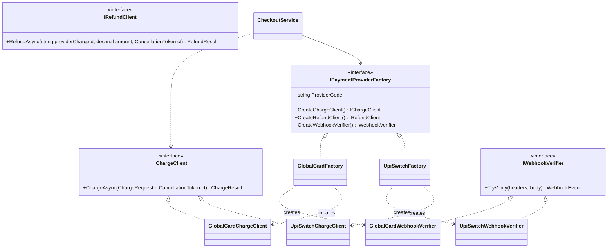
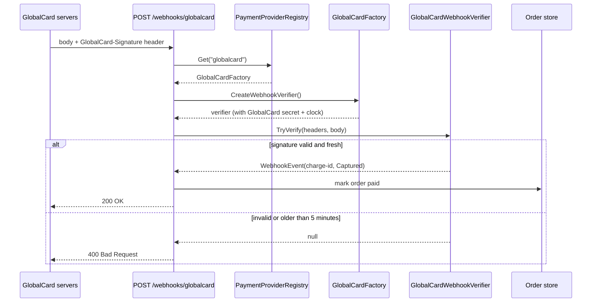
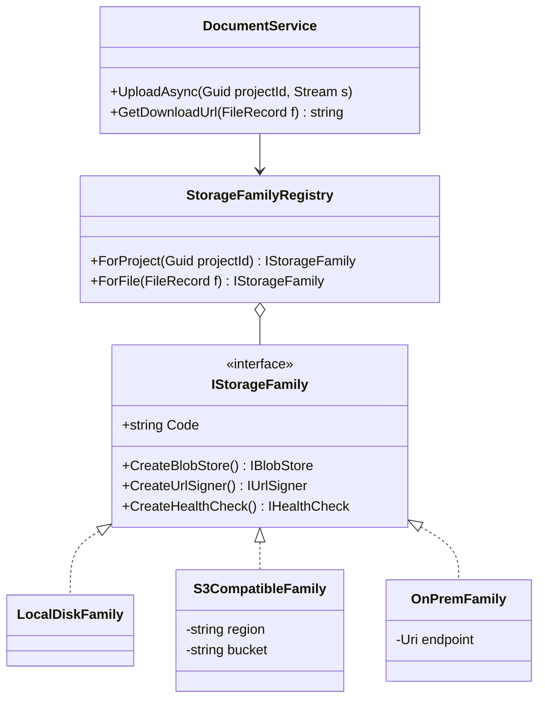

[Factory Method](#/lesson/m06-factory-method) answers "who decides which class to create?" for **one** object. Abstract Factory answers it for a **family** of objects that must be used together. Mix the wrong pieces, such as one payment gateway's charge client with another gateway's webhook verifier, and things break in ways that are hard to see in testing. This lesson shows the pattern, its modern DI-based forms, and its honest weak spot: adding a new kind of product is expensive.

## Learning objectives

By the end of this lesson you will be able to:

1. Recognise a real *product family*: several objects that only work correctly with each other.
2. Name the participants (abstract factory, concrete factory, abstract products, concrete products, client) and build them in C#.
3. Implement payment provider families in ASP.NET Core, chosen per merchant at runtime.
4. Explain when the DI container already *is* your abstract factory, so you don't need to write one.
5. Evolve a family safely when a new product (payouts) is supported by only some providers.
6. Compare Abstract Factory with Factory Method, Builder, Bridge and plain Strategy.

## Prerequisites

- [Factory Method](#/lesson/m06-factory-method): Abstract Factory is usually built from several factory methods.
- [Interfaces and abstract classes](#/lesson/m01-interfaces-abstract) and [Dependency injection](#/lesson/m03-dependency-injection).
- [Dependency Inversion Principle](#/lesson/m04-dip): the client depends only on abstract products.

## Explain it like I'm a beginner

Imagine you are fitting out a flat. You can buy kitchen fittings from Brand A or Brand B. Each brand sells a sink, a tap and a waste pipe. Brand A's tap only fits Brand A's sink. Brand B's waste pipe has a different thread from Brand A's sink. If a plumber mixes a Brand A sink with a Brand B pipe, it looks fine on day one and leaks on day ten.

The safe way is to go to *one* brand's showroom and say "give me the kitchen set". The showroom hands you a sink, a tap and a pipe that are guaranteed to fit together. You don't pick each piece yourself.

In software:

- The **showroom** is a factory object, for example `UpiSwitchFactory`.
- The **kitchen set** is a family of objects: a charge client, a refund client and a webhook verifier for the *same* payment provider.
- The **plumber** is your checkout code. It asks the factory for each piece and never names a brand.

Switching brands means handing the plumber a different showroom. The plumber's work doesn't change. That's Abstract Factory: **one object that creates a whole family of matching objects, so you can't accidentally mix families.**

## First-principles explanation

### The original problem

The GoF example was a user-interface toolkit with several "look and feel" standards (Motif and Presentation Manager at the time). An app creates windows, scroll bars and buttons. A Motif scroll bar inside a Presentation Manager window looks and behaves wrong. The app needed to create *all* its widgets from one look-and-feel, chosen once, without naming concrete widget classes throughout the code.

The solution: a `WidgetFactory` interface with `CreateWindow()`, `CreateScrollBar()` and `CreateButton()`. `MotifWidgetFactory` and `PMWidgetFactory` implement it, each returning its own matching widgets. The app receives one factory and uses it everywhere.

### The modern equivalent

Families that must match appear constantly in business systems:

| Family | Products that must match | What breaks if you mix them |
|---|---|---|
| **Payment provider** | Charge client, refund client, webhook signature verifier | A refund sent to the wrong provider; webhooks verified with another provider's secret and scheme, so real events are rejected or forged ones accepted |
| **Database provider** (ADO.NET) | Connection, command, parameter, data adapter | A PostgreSQL command can't run on a SQL Server connection |
| **File storage** | Blob store, signed-URL generator, health check | A signed URL generated for one store points to files in another |
| **Regional compliance** (India vs EU deployment) | Tax calculator, invoice numbering, data-retention policy | GST invoices with EU retention rules |

The test for a real family: **is there a rule that says "if you use this one, you must also use that one"?** If no such rule exists, you have independent strategies, not a family, and Abstract Factory is the wrong tool.

### Participants

| Role | Responsibility | In our example |
|---|---|---|
| **Abstract factory** | Interface with one creation method per product | `IPaymentProviderFactory` |
| **Concrete factory** | Creates the products of one family, sharing that family's configuration | `UpiSwitchFactory`, `GlobalCardFactory` |
| **Abstract products** | One interface per kind of product | `IChargeClient`, `IRefundClient`, `IWebhookVerifier` |
| **Concrete products** | Family-specific implementations | `UpiSwitchChargeClient`, `GlobalCardWebhookVerifier`… |
| **Client** | Uses only the abstract factory and abstract products | `CheckoutService`, the webhook endpoint |

The concrete factory is where family consistency is *enforced*. Each concrete factory holds its family's settings (base URL, API key, webhook secret, amount units) and passes them to every product it creates. No caller ever wires a product to settings by hand, so no caller can mismatch them.

### The simplest implementation

```csharp
public interface IPaymentProviderFactory
{
    IChargeClient CreateChargeClient();
    IRefundClient CreateRefundClient();
    IWebhookVerifier CreateWebhookVerifier();
}

public sealed class UpiSwitchFactory(UpiSwitchOptions o) : IPaymentProviderFactory
{
    public IChargeClient CreateChargeClient() => new UpiSwitchChargeClient(o.ApiKey);
    public IRefundClient CreateRefundClient() => new UpiSwitchRefundClient(o.ApiKey);
    public IWebhookVerifier CreateWebhookVerifier() => new UpiSwitchWebhookVerifier(o.WebhookSecret);
}
```

Each method is a factory method. The interface groups them, so that a client holding one factory gets one consistent family.

### Abstract Factory meets dependency injection

In 1994, someone had to write the code that picks a concrete factory. Today, the DI container often does it. There are two cases:

**Case 1: the family is chosen once, at startup.** For example, the app runs on local disk in development and in cloud storage in production. Then you don't need an abstract factory *interface* at all. Register the whole family in one place:

```csharp
if (builder.Environment.IsDevelopment())
{
    builder.Services.AddSingleton<IBlobStore, LocalDiskBlobStore>();
    builder.Services.AddSingleton<ISignedUrlGenerator, LocalDiskUrlGenerator>();
}
else
{
    builder.Services.AddSingleton<IBlobStore, CloudBlobStore>();
    builder.Services.AddSingleton<ISignedUrlGenerator, CloudSignedUrlGenerator>();
}
```

The container is the abstract factory, and this `if` block is the concrete-factory choice. To make it harder to mix families, wrap each block in an extension method (`services.AddLocalDiskStorage()`, `services.AddCloudStorage(config)`). The family then lives in one place.

**Case 2: the family is chosen per request, per tenant or per message.** For example, merchant M-101 uses a UPI aggregator and merchant M-202 uses a card gateway, in the same running app. Now you do need factory objects you can choose between at runtime. That is the case this lesson implements.

### Trade-offs

| You gain | You pay |
|---|---|
| Families can't be mixed by accident | More types: one factory plus one class per product per family |
| Client code never names a provider | **Adding a new kind of product** (say, payouts) means changing the factory interface *and every concrete factory* |
| Switching family is one decision in one place | Indirection: reading the code, you have to find which factory is in play |
| A fake factory gives tests a whole fake family in one object | Families that share 90 % of their code tend to grow awkward base classes |

That second "pay" row is the famous drawback. Abstract Factory makes it easy to add a new **family** (a third payment provider: one new factory, three new products, no client changes). It makes it hard to add a new **product** (every family must implement it). Before using the pattern, ask which kind of change you expect more often.

### When not to use it

- **There's no "must match" rule.** If any charge client could be used with any refund client, inject them separately as strategies.
- **There's only one family.** A factory interface with one implementation is speculation; inject the products directly.
- **The family is fixed at startup.** Use DI registration grouped in an extension method (Case 1 above).
- **The products vary on two independent axes** (provider × environment). That points to [Bridge](#/lesson/m06-bridge) or configuration, not a factory per combination.

## Visual explanation

### Class diagram



Read it as a grid. Columns are *product kinds* (charge, refund, webhook); rows are *families* (UpiSwitch, GlobalCard). Each concrete factory's "creates" arrows stay inside its own row, and that is the consistency guarantee drawn as a picture. The client (`CheckoutService`) only touches the interfaces at the top. Refund products are left out of the drawing to keep it readable; they follow the same shape. Adding a row (a new provider) touches nothing above it. Adding a column (a new product kind) touches every row.

### Sequence diagram: a webhook arrives



The provider code in the URL selects the factory, and the factory produces a verifier already wired with *that* provider's secret and signature scheme. The endpoint never touches a secret or a hashing algorithm. Notice what the selection is based on: the webhook URL, not the merchant's *current* configuration. If a merchant switched providers yesterday, late webhooks from the old provider must still be verified by the old provider's family. Getting this wrong is a classic production bug.

## Step-by-step example

### Step 1 — the naive version

```csharp
public async Task<string> Charge(Merchant m, decimal amount)
{
    if (m.Provider == "upiswitch")
    {
        var paise = (long)(amount * 100);
        return await _http.PostAsync($"https://api.upiswitch.example/v2/collect?amount={paise}&key={_upiKey}", null) ...;
    }
    else if (m.Provider == "globalcard")
        return await _http.PostAsync($"https://api.globalcard.example/charges?amount={amount:0.00}", ...) ...;
    throw new NotSupportedException();
}

public bool VerifyWebhook(string provider, string body, string signature)
{
    var secret = provider == "upiswitch" ? _upiSecret : _cardSecret;
    // ...one hashing scheme for both, which is wrong for one of them...
}

public async Task Refund(Merchant m, string chargeId, decimal amount) { if (m.Provider == ...) ... }
```

Three methods each repeat the same `if` on provider. Each must remember the provider's settings and amount units (paise versus rupees). The webhook method shares one scheme across two providers that sign differently, and refunds use the merchant's *current* provider, which may not be the one that took the original charge.

### Step 2 — list the family and its rules

Products: charge, refund, webhook verification. Rules: all three use the same provider's base URL, keys and amount units; a refund goes to the provider that captured the charge; a webhook is verified by the provider that sent it.

### Step 3 — one interface per product, one factory interface

`IChargeClient`, `IRefundClient`, `IWebhookVerifier` and `IPaymentProviderFactory` with a `ProviderCode` and three create methods.

### Step 4 — one concrete factory per provider

Each factory takes its own options class (`UpiSwitchOptions`, `GlobalCardOptions`) and passes those settings to every product it creates. Provider-specific details, such as UpiSwitch's integer paise or GlobalCard's timestamped signatures, live only inside that provider's products.

### Step 5 — a registry and per-use selection

A `PaymentProviderRegistry` holds all factories by code. Checkout picks by the merchant's configured provider. Refunds pick by the provider *stored on the original charge*. Webhooks pick by the URL.

## Production-style C# implementation

```text
Pay.Api/
  Program.cs
  Payments/Abstractions.cs
  Payments/WebhookSignatures.cs
  Payments/UpiSwitch.cs
  Payments/GlobalCard.cs
  Payments/PaymentProviderRegistry.cs
  Payments/CheckoutService.cs
```

```csharp file=Payments/Abstractions.cs
namespace Pay.Payments;

public enum PaymentStatus { Pending, Captured, Failed, Refunded }

public sealed record ChargeRequest(Guid OrderId, decimal AmountInr, string CustomerRef, string? UpiVpa = null);
public sealed record ChargeResult(string ProviderCode, string ProviderChargeId, PaymentStatus Status);
public sealed record RefundResult(string ProviderRefundId, PaymentStatus Status);
public sealed record WebhookEvent(string ProviderChargeId, PaymentStatus Status);

// Abstract products
public interface IChargeClient { Task<ChargeResult> ChargeAsync(ChargeRequest request, CancellationToken ct); }
public interface IRefundClient { Task<RefundResult> RefundAsync(string providerChargeId, decimal amountInr, CancellationToken ct); }
public interface IWebhookVerifier
{
    /// <summary>Returns the parsed event if the signature is valid, otherwise null. Never throws for bad input.</summary>
    WebhookEvent? TryVerify(IReadOnlyDictionary<string, string> headers, string body);
}

// Abstract factory
public interface IPaymentProviderFactory
{
    string ProviderCode { get; }
    IChargeClient CreateChargeClient();
    IRefundClient CreateRefundClient();
    IWebhookVerifier CreateWebhookVerifier();
}
```

```csharp file=Payments/WebhookSignatures.cs
using System.Security.Cryptography;
using System.Text;
using System.Text.Json;

namespace Pay.Payments;

internal static class WebhookSignatures
{
    public static byte[] Hmac(string secret, string payload) =>
        HMACSHA256.HashData(Encoding.UTF8.GetBytes(secret), Encoding.UTF8.GetBytes(payload));

    /// <summary>Constant-time comparison, so attackers can't learn the signature byte by byte from timing.</summary>
    public static bool HexEquals(byte[] expected, string? hex)
    {
        if (string.IsNullOrEmpty(hex) || hex.Length != expected.Length * 2) return false;
        try { return CryptographicOperations.FixedTimeEquals(expected, Convert.FromHexString(hex)); }
        catch (FormatException) { return false; }
    }

    public static WebhookEvent? ParseEvent(string body, string idField, string statusField, Func<string, PaymentStatus?> mapStatus)
    {
        try
        {
            using var doc = JsonDocument.Parse(body);
            var id = doc.RootElement.GetProperty(idField).GetString();
            var status = mapStatus(doc.RootElement.GetProperty(statusField).GetString() ?? "");
            return id is null || status is null ? null : new WebhookEvent(id, status.Value);
        }
        catch (Exception e) when (e is JsonException or KeyNotFoundException or InvalidOperationException) { return null; }
    }
}
```

```csharp file=Payments/UpiSwitch.cs
using System.Net.Http.Json;
using Microsoft.Extensions.Options;

namespace Pay.Payments;

public sealed class UpiSwitchOptions
{
    public string ApiKey { get; set; } = "";
    public string WebhookSecret { get; set; } = "";
}

/// <summary>Concrete factory: every product it creates shares UpiSwitch's settings and conventions.</summary>
public sealed class UpiSwitchFactory(IHttpClientFactory http, IOptions<UpiSwitchOptions> options) : IPaymentProviderFactory
{
    public const string Code = "upiswitch";
    public string ProviderCode => Code;
    public IChargeClient CreateChargeClient() => new UpiSwitchChargeClient(http.CreateClient(Code), options.Value);
    public IRefundClient CreateRefundClient() => new UpiSwitchRefundClient(http.CreateClient(Code), options.Value);
    public IWebhookVerifier CreateWebhookVerifier() => new UpiSwitchWebhookVerifier(options.Value.WebhookSecret);

    internal static long ToPaise(decimal inr) => decimal.ToInt64(Math.Round(inr * 100m, 0, MidpointRounding.AwayFromZero));

    internal static PaymentStatus? MapStatus(string s) => s switch
    {
        "SUCCESS" => PaymentStatus.Captured,
        "PENDING" => PaymentStatus.Pending,
        "FAILURE" or "EXPIRED" => PaymentStatus.Failed,
        "REFUNDED" => PaymentStatus.Refunded,
        _ => null,
    };
}

internal sealed class UpiSwitchChargeClient(HttpClient http, UpiSwitchOptions o) : IChargeClient
{
    private sealed record CollectResponse(string TxnId, string Status);

    public async Task<ChargeResult> ChargeAsync(ChargeRequest r, CancellationToken ct)
    {
        if (string.IsNullOrWhiteSpace(r.UpiVpa)) throw new ArgumentException("UPI charges need a VPA (for example name@bank).", nameof(r));
        using var msg = new HttpRequestMessage(HttpMethod.Post, "v2/collect")
        {
            Content = JsonContent.Create(new { orderRef = r.OrderId, amountPaise = UpiSwitchFactory.ToPaise(r.AmountInr), vpa = r.UpiVpa }),
        };
        msg.Headers.Add("X-Api-Key", o.ApiKey);
        msg.Headers.Add("Idempotency-Key", r.OrderId.ToString());   // safe to retry
        using var res = await http.SendAsync(msg, ct);
        res.EnsureSuccessStatusCode();
        var body = await res.Content.ReadFromJsonAsync<CollectResponse>(ct) ?? throw new InvalidOperationException("Empty response.");
        return new ChargeResult(UpiSwitchFactory.Code, body.TxnId, UpiSwitchFactory.MapStatus(body.Status) ?? PaymentStatus.Pending);
    }
}

internal sealed class UpiSwitchRefundClient(HttpClient http, UpiSwitchOptions o) : IRefundClient
{
    private sealed record RefundResponse(string RefundId, string Status);

    public async Task<RefundResult> RefundAsync(string providerChargeId, decimal amountInr, CancellationToken ct)
    {
        using var msg = new HttpRequestMessage(HttpMethod.Post, $"v2/transactions/{Uri.EscapeDataString(providerChargeId)}/refunds")
        {
            Content = JsonContent.Create(new { amountPaise = UpiSwitchFactory.ToPaise(amountInr) }),
        };
        msg.Headers.Add("X-Api-Key", o.ApiKey);
        using var res = await http.SendAsync(msg, ct);
        res.EnsureSuccessStatusCode();
        var body = await res.Content.ReadFromJsonAsync<RefundResponse>(ct) ?? throw new InvalidOperationException("Empty response.");
        return new RefundResult(body.RefundId, UpiSwitchFactory.MapStatus(body.Status) ?? PaymentStatus.Pending);
    }
}

/// <summary>UpiSwitch signs the raw body with HMAC-SHA256 and sends lowercase hex in X-UpiSwitch-Signature.</summary>
internal sealed class UpiSwitchWebhookVerifier(string secret) : IWebhookVerifier
{
    public WebhookEvent? TryVerify(IReadOnlyDictionary<string, string> headers, string body)
    {
        headers.TryGetValue("X-UpiSwitch-Signature", out var sig);
        if (!WebhookSignatures.HexEquals(WebhookSignatures.Hmac(secret, body), sig)) return null;
        return WebhookSignatures.ParseEvent(body, "txnId", "status", UpiSwitchFactory.MapStatus);
    }
}
```

```csharp file=Payments/GlobalCard.cs
using System.Globalization;
using System.Net.Http.Json;
using Microsoft.Extensions.Options;

namespace Pay.Payments;

public sealed class GlobalCardOptions
{
    public string SecretKey { get; set; } = "";
    public string WebhookSecret { get; set; } = "";
    public TimeSpan WebhookTolerance { get; set; } = TimeSpan.FromMinutes(5);
}

public sealed class GlobalCardFactory(IHttpClientFactory http, IOptions<GlobalCardOptions> options, TimeProvider clock)
    : IPaymentProviderFactory
{
    public const string Code = "globalcard";
    public string ProviderCode => Code;
    public IChargeClient CreateChargeClient() => new GlobalCardChargeClient(http.CreateClient(Code), options.Value);
    public IRefundClient CreateRefundClient() => new GlobalCardRefundClient(http.CreateClient(Code), options.Value);
    public IWebhookVerifier CreateWebhookVerifier() => new GlobalCardWebhookVerifier(options.Value, clock);

    internal static PaymentStatus? MapStatus(string s) => s switch
    {
        "succeeded" => PaymentStatus.Captured,
        "processing" or "requires_action" => PaymentStatus.Pending,
        "failed" or "canceled" => PaymentStatus.Failed,
        "refunded" => PaymentStatus.Refunded,
        _ => null,
    };
}

internal sealed class GlobalCardChargeClient(HttpClient http, GlobalCardOptions o) : IChargeClient
{
    private sealed record ChargeResponse(string Id, string Status);

    public async Task<ChargeResult> ChargeAsync(ChargeRequest r, CancellationToken ct)
    {
        using var msg = new HttpRequestMessage(HttpMethod.Post, "charges")
        {
            // GlobalCard wants minor units as an integer plus an ISO currency code.
            Content = JsonContent.Create(new { amount = decimal.ToInt64(Math.Round(r.AmountInr * 100m, MidpointRounding.AwayFromZero)), currency = "INR", customer = r.CustomerRef, metadata = new { orderId = r.OrderId } }),
        };
        msg.Headers.Authorization = new("Bearer", o.SecretKey);
        msg.Headers.Add("Idempotency-Key", r.OrderId.ToString());
        using var res = await http.SendAsync(msg, ct);
        res.EnsureSuccessStatusCode();
        var body = await res.Content.ReadFromJsonAsync<ChargeResponse>(ct) ?? throw new InvalidOperationException("Empty response.");
        return new ChargeResult(GlobalCardFactory.Code, body.Id, GlobalCardFactory.MapStatus(body.Status) ?? PaymentStatus.Pending);
    }
}

internal sealed class GlobalCardRefundClient(HttpClient http, GlobalCardOptions o) : IRefundClient
{
    private sealed record RefundResponse(string Id, string Status);

    public async Task<RefundResult> RefundAsync(string providerChargeId, decimal amountInr, CancellationToken ct)
    {
        using var msg = new HttpRequestMessage(HttpMethod.Post, "refunds")
        {
            Content = JsonContent.Create(new { charge = providerChargeId, amount = decimal.ToInt64(Math.Round(amountInr * 100m, MidpointRounding.AwayFromZero)) }),
        };
        msg.Headers.Authorization = new("Bearer", o.SecretKey);
        using var res = await http.SendAsync(msg, ct);
        res.EnsureSuccessStatusCode();
        var body = await res.Content.ReadFromJsonAsync<RefundResponse>(ct) ?? throw new InvalidOperationException("Empty response.");
        return new RefundResult(body.Id, GlobalCardFactory.MapStatus(body.Status) ?? PaymentStatus.Pending);
    }
}

/// <summary>Timestamped scheme: header "t=1767225600,v1=hex", signature = HMAC(secret, "{t}.{body}").
/// Rejects events older than the tolerance to stop replayed webhooks.</summary>
internal sealed class GlobalCardWebhookVerifier(GlobalCardOptions o, TimeProvider clock) : IWebhookVerifier
{
    public WebhookEvent? TryVerify(IReadOnlyDictionary<string, string> headers, string body)
    {
        if (!headers.TryGetValue("GlobalCard-Signature", out var header)) return null;
        string? t = null, v1 = null;
        foreach (var part in header.Split(','))
        {
            var kv = part.Split('=', 2);
            if (kv.Length != 2) continue;
            if (kv[0] == "t") t = kv[1]; else if (kv[0] == "v1") v1 = kv[1];
        }
        if (!long.TryParse(t, NumberStyles.None, CultureInfo.InvariantCulture, out var unix)) return null;
        var age = clock.GetUtcNow() - DateTimeOffset.FromUnixTimeSeconds(unix);
        if (age.Duration() > o.WebhookTolerance) return null;
        if (!WebhookSignatures.HexEquals(WebhookSignatures.Hmac(o.WebhookSecret, $"{t}.{body}"), v1)) return null;
        return WebhookSignatures.ParseEvent(body, "chargeId", "status", GlobalCardFactory.MapStatus);
    }
}
```

```csharp file=Payments/PaymentProviderRegistry.cs
namespace Pay.Payments;

public sealed class UnknownPaymentProviderException(string code, IEnumerable<string> known)
    : Exception($"Unknown payment provider '{code}'. Known: {string.Join(", ", known)}.");

/// <summary>Holds every concrete factory, keyed by provider code. The client picks a family here.</summary>
public sealed class PaymentProviderRegistry
{
    private readonly Dictionary<string, IPaymentProviderFactory> _byCode = new(StringComparer.OrdinalIgnoreCase);

    public PaymentProviderRegistry(IEnumerable<IPaymentProviderFactory> factories)
    {
        foreach (var f in factories)
            if (!_byCode.TryAdd(f.ProviderCode, f))
                throw new InvalidOperationException($"Provider '{f.ProviderCode}' registered twice.");
    }

    public IPaymentProviderFactory Get(string providerCode) =>
        _byCode.TryGetValue(providerCode, out var f) ? f : throw new UnknownPaymentProviderException(providerCode, _byCode.Keys.Order());

    public bool TryGet(string providerCode, out IPaymentProviderFactory factory) => _byCode.TryGetValue(providerCode, out factory!);
}
```

```csharp file=Payments/CheckoutService.cs
namespace Pay.Payments;

public interface IMerchantDirectory { string ProviderFor(string merchantId); }

/// <summary>Reads each merchant's provider from configuration: "Merchants:M-101": "upiswitch".</summary>
public sealed class ConfigMerchantDirectory(IConfiguration config) : IMerchantDirectory
{
    public string ProviderFor(string merchantId) =>
        config[$"Merchants:{merchantId}"] ?? throw new KeyNotFoundException($"Merchant {merchantId} is not configured.");
}

/// <summary>The client: knows only abstract factory and abstract products.</summary>
public sealed class CheckoutService(PaymentProviderRegistry providers, IMerchantDirectory merchants, ILogger<CheckoutService> logger)
{
    public async Task<ChargeResult> ChargeAsync(string merchantId, ChargeRequest request, CancellationToken ct)
    {
        if (request.AmountInr <= 0) throw new ArgumentOutOfRangeException(nameof(request), "Amount must be positive.");
        var factory = providers.Get(merchants.ProviderFor(merchantId));
        var result = await factory.CreateChargeClient().ChargeAsync(request, ct);
        logger.LogInformation("Order {OrderId} charged via {Provider}: {Status}", request.OrderId, result.ProviderCode, result.Status);
        return result;   // persist ProviderCode with the charge: refunds must use the same family
    }

    /// <summary>Refunds go to the provider that captured the charge, not the merchant's current provider.</summary>
    public Task<RefundResult> RefundAsync(ChargeResult original, decimal amountInr, CancellationToken ct) =>
        providers.Get(original.ProviderCode).CreateRefundClient().RefundAsync(original.ProviderChargeId, amountInr, ct);
}
```

```csharp file=Program.cs
using Microsoft.Extensions.Options;
using Pay.Payments;

var builder = WebApplication.CreateBuilder(args);

builder.Services.AddSingleton(TimeProvider.System);
builder.Services.Configure<UpiSwitchOptions>(builder.Configuration.GetSection("Providers:UpiSwitch"));
builder.Services.Configure<GlobalCardOptions>(builder.Configuration.GetSection("Providers:GlobalCard"));

builder.Services.AddHttpClient(UpiSwitchFactory.Code, c => { c.BaseAddress = new("https://api.upiswitch.example/"); c.Timeout = TimeSpan.FromSeconds(8); });
builder.Services.AddHttpClient(GlobalCardFactory.Code, c => { c.BaseAddress = new("https://api.globalcard.example/v1/"); c.Timeout = TimeSpan.FromSeconds(10); });

// One registration per family. A third provider = one more factory class and one more line.
builder.Services.AddSingleton<IPaymentProviderFactory, UpiSwitchFactory>();
builder.Services.AddSingleton<IPaymentProviderFactory, GlobalCardFactory>();
builder.Services.AddSingleton<PaymentProviderRegistry>();
builder.Services.AddSingleton<IMerchantDirectory, ConfigMerchantDirectory>();
builder.Services.AddScoped<CheckoutService>();

var app = builder.Build();

app.MapPost("/merchants/{merchantId}/charges", async (string merchantId, ChargeRequest request, CheckoutService checkout, CancellationToken ct) =>
{
    try { return Results.Ok(await checkout.ChargeAsync(merchantId, request, ct)); }
    catch (Exception ex) when (ex is UnknownPaymentProviderException or KeyNotFoundException or ArgumentException)
    { return Results.Problem(ex.Message, statusCode: StatusCodes.Status400BadRequest); }
});

// The URL decides the family. Late webhooks from a merchant's previous provider still verify correctly.
app.MapPost("/webhooks/{provider}", async (string provider, HttpRequest http, PaymentProviderRegistry providers, ILogger<Program> log, CancellationToken ct) =>
{
    if (!providers.TryGet(provider, out var factory)) return Results.NotFound();
    using var reader = new StreamReader(http.Body);
    var body = await reader.ReadToEndAsync(ct);                       // verify the exact raw bytes that were signed
    var headers = http.Headers.ToDictionary(h => h.Key, h => h.Value.ToString(), StringComparer.OrdinalIgnoreCase);

    var evt = factory.CreateWebhookVerifier().TryVerify(headers, body);
    if (evt is null) { log.LogWarning("Rejected {Provider} webhook: bad signature or stale", provider); return Results.BadRequest(); }

    log.LogInformation("{Provider} charge {ChargeId} is now {Status}", provider, evt.ProviderChargeId, evt.Status);
    // Update the order idempotently here (the same event can arrive more than once).
    return Results.Ok();
});

app.Run();
```

Design notes:

- **The factory is where consistency lives.** Each concrete factory owns its options and passes them to every product it creates. No endpoint or service ever handles a webhook secret.
- **Products are `internal`.** Outside the payments folder, nobody can `new UpiSwitchWebhookVerifier(...)` with the wrong secret. Access modifiers are part of the family guarantee.
- **Selection rules differ per use.** Charges select by the merchant's configuration, refunds by the original charge's provider, webhooks by the URL. The pattern doesn't decide these rules, but it makes each one a single line.
- **Each provider's quirks stay inside its family**: paise versus minor units, plain versus timestamped signatures, status vocabularies (`SUCCESS` versus `succeeded`).

## Bad design vs good design

**Bad: products injected separately, wired by convention.**

```csharp
builder.Services.AddKeyedSingleton<IChargeClient, UpiSwitchChargeClient>("upiswitch");
builder.Services.AddKeyedSingleton<IWebhookVerifier, UpiSwitchWebhookVerifier>("upiswitch");
builder.Services.AddKeyedSingleton<IChargeClient, GlobalCardChargeClient>("globalcard");
builder.Services.AddKeyedSingleton<IWebhookVerifier, GlobalCardWebhookVerifier>("upi-switch");   // typo
```

It *looks* family-shaped, but nothing enforces it. The typo means UpiSwitch webhooks find no verifier, and a third provider added next year might register a charge client but forget the refund client. Nothing fails until a refund is attempted in production.

**Good:** one factory per provider that must implement every product. The compiler refuses to build a factory that forgets `CreateRefundClient`. A wiring test asserts every registered factory can create all three products.

**When the "bad" version is fine:** if products really are independent (any SMS sender works with any email sender), separate keyed registrations are simpler and more flexible. Abstract Factory is for when they are *not* independent.

:::callout type=tradeoff title="Adding a new product hurts — on purpose"
When payouts arrive and you add `CreatePayoutClient()` to the interface, every factory stops compiling. That is annoying, and also useful: the compiler hands you the list of providers that need a decision. If some providers will never support payouts, don't force a fake implementation that throws. Use an optional capability (see exercise 5).
:::

## Practical playground

Two storage families, local disk and a "cloud" store, each with a blob store and a URL signer. Run it and see that each family's URL points at its own store. Then try the TODO: add an "archive" family whose signer refuses to sign (archived files need a restore first).

:::playground type=csharp title="Storage families"
```csharp file=Program.cs
using System;
using System.Collections.Generic;

public interface IBlobStore { string Save(string name, byte[] data); }
public interface IUrlSigner { string SignedUrl(string blobKey, TimeSpan validFor); }

public interface IStorageFactory
{
    string Name { get; }
    IBlobStore CreateStore();
    IUrlSigner CreateSigner();
}

public sealed class LocalDiskFactory(string root) : IStorageFactory
{
    public string Name => "local";
    public IBlobStore CreateStore() => new LocalStore(root);
    public IUrlSigner CreateSigner() => new LocalSigner();

    private sealed class LocalStore(string root) : IBlobStore
    {
        public string Save(string name, byte[] data) => $"{root}/{name}";
    }
    private sealed class LocalSigner : IUrlSigner
    {
        public string SignedUrl(string key, TimeSpan validFor) => $"http://localhost:5000/files?path={Uri.EscapeDataString(key)}";
    }
}

public sealed class CloudFactory(string bucket, string region) : IStorageFactory
{
    public string Name => "cloud";
    public IBlobStore CreateStore() => new CloudStore(bucket);
    public IUrlSigner CreateSigner() => new CloudSigner(bucket, region);

    private sealed class CloudStore(string bucket) : IBlobStore
    {
        public string Save(string name, byte[] data) => $"{DateTime.UtcNow:yyyy/MM}/{name}";
    }
    private sealed class CloudSigner(string bucket, string region) : IUrlSigner
    {
        public string SignedUrl(string key, TimeSpan validFor) =>
            $"https://{bucket}.storage.{region}.example/{key}?expires={(int)validFor.TotalSeconds}&sig=demo";
    }
}

// TODO: ArchiveFactory whose CreateSigner() returns a signer that throws InvalidOperationException("Restore first").

public static class Program
{
    public static void Main()
    {
        var families = new List<IStorageFactory> { new LocalDiskFactory("/data/uploads"), new CloudFactory("rodic-drawings", "ap-south-1") };
        foreach (var f in families)
        {
            var key = f.CreateStore().Save("bridge-gad-rev3.pdf", new byte[] { 1, 2, 3 });
            Console.WriteLine($"{f.Name,-6} {f.CreateSigner().SignedUrl(key, TimeSpan.FromMinutes(15))}");
        }
    }
}
```
:::

## Exercises

:::exercise id=m06-abstract-factory-ex1 difficulty=beginner kind=code title="Implement the second provider family"
The `UpiSwitchFactory` family is done. Implement the `GlobalCardFactory` family. Each family has three products: an amount encoder, a status mapper and a webhook signer.
::requirements
- `GlobalCardAmountEncoder.Encode(1499.50m)` returns `"149950 INR"` (minor units, a space, the currency).
- `GlobalCardStatusMapper.Map("succeeded")` is `Captured`, `"processing"` is `Pending`, `"failed"` is `Failed`; anything else is `Unknown`.
- `GlobalCardSigner.Sign(body)` returns the lowercase hex HMAC-SHA256 of `body` using the factory's secret, prefixed with `v1=`.
- `GlobalCardFactory.ProviderCode` is `"globalcard"`.
::acceptance
- All three GlobalCard products behave as specified.
- Two factories with different secrets produce different signatures for the same body.
- `UpiSwitchFactory` is unchanged.
::hint
Copy the *shape* of `UpiSwitchFactory`, not its behavior: each create method returns a new product of *your* family.
::hint
The secret is given to the factory. The factory passes it into the signer it creates. That's how the family shares configuration.
::hint
`Convert.ToHexString(HMACSHA256.HashData(key, data)).ToLowerInvariant()`
::hint
Minor units: `decimal.ToInt64(Math.Round(amount * 100m, MidpointRounding.AwayFromZero))`.
::starter
```csharp file=Providers.cs
using System;
using System.Security.Cryptography;
using System.Text;

public enum PayStatus { Unknown, Pending, Captured, Failed }

public interface IAmountEncoder { string Encode(decimal amountInr); }
public interface IStatusMapper { PayStatus Map(string providerStatus); }
public interface IWebhookSigner { string Sign(string body); }

public interface IProviderFactory
{
    string ProviderCode { get; }
    IAmountEncoder CreateAmountEncoder();
    IStatusMapper CreateStatusMapper();
    IWebhookSigner CreateSigner();
}

// ---- Family 1 (done) ----
public sealed class UpiSwitchFactory(string secret) : IProviderFactory
{
    public string ProviderCode => "upiswitch";
    public IAmountEncoder CreateAmountEncoder() => new UpiSwitchAmountEncoder();
    public IStatusMapper CreateStatusMapper() => new UpiSwitchStatusMapper();
    public IWebhookSigner CreateSigner() => new UpiSwitchSigner(secret);
}
public sealed class UpiSwitchAmountEncoder : IAmountEncoder
{
    public string Encode(decimal amountInr) => decimal.ToInt64(Math.Round(amountInr * 100m, MidpointRounding.AwayFromZero)).ToString();
}
public sealed class UpiSwitchStatusMapper : IStatusMapper
{
    public PayStatus Map(string s) => s switch { "SUCCESS" => PayStatus.Captured, "PENDING" => PayStatus.Pending, "FAILURE" => PayStatus.Failed, _ => PayStatus.Unknown };
}
public sealed class UpiSwitchSigner(string secret) : IWebhookSigner
{
    public string Sign(string body) => Convert.ToBase64String(HMACSHA256.HashData(Encoding.UTF8.GetBytes(secret), Encoding.UTF8.GetBytes(body)));
}

// ---- Family 2 (your job) ----
public sealed class GlobalCardFactory : IProviderFactory
{
    public GlobalCardFactory(string secret) { }
    public string ProviderCode => throw new NotImplementedException();
    public IAmountEncoder CreateAmountEncoder() => throw new NotImplementedException();
    public IStatusMapper CreateStatusMapper() => throw new NotImplementedException();
    public IWebhookSigner CreateSigner() => throw new NotImplementedException();
}
public sealed class GlobalCardAmountEncoder : IAmountEncoder { public string Encode(decimal amountInr) => throw new NotImplementedException(); }
public sealed class GlobalCardStatusMapper : IStatusMapper { public PayStatus Map(string s) => throw new NotImplementedException(); }
public sealed class GlobalCardSigner : IWebhookSigner
{
    public GlobalCardSigner(string secret) { }
    public string Sign(string body) => throw new NotImplementedException();
}
```
::tests
```csharp file=GlobalCardFamilyTests.cs
using Xunit;

public class GlobalCardFamilyTests
{
    private static readonly IProviderFactory F = new GlobalCardFactory("whsec_test");

    [Fact] public void Code() => Assert.Equal("globalcard", F.ProviderCode);

    [Fact] public void Encodes_minor_units_with_currency() => Assert.Equal("149950 INR", F.CreateAmountEncoder().Encode(1499.50m));

    [Theory]
    [InlineData("succeeded", PayStatus.Captured)]
    [InlineData("processing", PayStatus.Pending)]
    [InlineData("failed", PayStatus.Failed)]
    [InlineData("SUCCESS", PayStatus.Unknown)]
    public void Maps_statuses(string s, PayStatus expected) => Assert.Equal(expected, F.CreateStatusMapper().Map(s));

    [Fact]
    public void Signature_is_prefixed_lowercase_hex()
    {
        var sig = F.CreateSigner().Sign("{\"id\":1}");
        Assert.StartsWith("v1=", sig);
        Assert.Equal(3 + 64, sig.Length);
        Assert.Equal(sig.ToLowerInvariant(), sig);
    }

    [Fact]
    public void Different_secrets_give_different_signatures() =>
        Assert.NotEqual(new GlobalCardFactory("a").CreateSigner().Sign("x"), new GlobalCardFactory("b").CreateSigner().Sign("x"));

    [Fact]
    public void Families_do_not_mix() =>
        Assert.NotEqual(new UpiSwitchFactory("s").CreateSigner().Sign("x"), new GlobalCardFactory("s").CreateSigner().Sign("x"));
}
```
::solution
```csharp file=Providers.cs
using System;
using System.Security.Cryptography;
using System.Text;

public enum PayStatus { Unknown, Pending, Captured, Failed }

public interface IAmountEncoder { string Encode(decimal amountInr); }
public interface IStatusMapper { PayStatus Map(string providerStatus); }
public interface IWebhookSigner { string Sign(string body); }

public interface IProviderFactory
{
    string ProviderCode { get; }
    IAmountEncoder CreateAmountEncoder();
    IStatusMapper CreateStatusMapper();
    IWebhookSigner CreateSigner();
}

public sealed class UpiSwitchFactory(string secret) : IProviderFactory
{
    public string ProviderCode => "upiswitch";
    public IAmountEncoder CreateAmountEncoder() => new UpiSwitchAmountEncoder();
    public IStatusMapper CreateStatusMapper() => new UpiSwitchStatusMapper();
    public IWebhookSigner CreateSigner() => new UpiSwitchSigner(secret);
}
public sealed class UpiSwitchAmountEncoder : IAmountEncoder
{
    public string Encode(decimal amountInr) => decimal.ToInt64(Math.Round(amountInr * 100m, MidpointRounding.AwayFromZero)).ToString();
}
public sealed class UpiSwitchStatusMapper : IStatusMapper
{
    public PayStatus Map(string s) => s switch { "SUCCESS" => PayStatus.Captured, "PENDING" => PayStatus.Pending, "FAILURE" => PayStatus.Failed, _ => PayStatus.Unknown };
}
public sealed class UpiSwitchSigner(string secret) : IWebhookSigner
{
    public string Sign(string body) => Convert.ToBase64String(HMACSHA256.HashData(Encoding.UTF8.GetBytes(secret), Encoding.UTF8.GetBytes(body)));
}

public sealed class GlobalCardFactory(string secret) : IProviderFactory
{
    public string ProviderCode => "globalcard";
    public IAmountEncoder CreateAmountEncoder() => new GlobalCardAmountEncoder();
    public IStatusMapper CreateStatusMapper() => new GlobalCardStatusMapper();
    public IWebhookSigner CreateSigner() => new GlobalCardSigner(secret);
}

public sealed class GlobalCardAmountEncoder : IAmountEncoder
{
    public string Encode(decimal amountInr) =>
        $"{decimal.ToInt64(Math.Round(amountInr * 100m, MidpointRounding.AwayFromZero))} INR";
}

public sealed class GlobalCardStatusMapper : IStatusMapper
{
    public PayStatus Map(string s) => s switch
    {
        "succeeded" => PayStatus.Captured,
        "processing" => PayStatus.Pending,
        "failed" => PayStatus.Failed,
        _ => PayStatus.Unknown,
    };
}

public sealed class GlobalCardSigner(string secret) : IWebhookSigner
{
    public string Sign(string body) =>
        "v1=" + Convert.ToHexString(HMACSHA256.HashData(Encoding.UTF8.GetBytes(secret), Encoding.UTF8.GetBytes(body))).ToLowerInvariant();
}
```

The factory is the only place the secret meets the signer. A caller holding a `GlobalCardFactory` can't end up with a GlobalCard status mapper and an UpiSwitch signer.
::mistakes
- Making the status mapper case-insensitive "to be safe", so `SUCCESS` (another provider's word) is accepted. Each family's vocabulary is exact.
- Rounding with the default banker's rounding (`MidpointRounding.ToEven`) when the provider specifies away-from-zero. Read the provider's rules.
- Returning a shared static signer, which loses the per-factory secret.
:::

:::exercise id=m06-abstract-factory-ex2 difficulty=beginner kind=code title="Refactor scattered provider ifs into a factory"
A legacy `PaymentGatewayService` repeats `if (provider == "upiswitch") ... else if (provider == "globalcard") ...` in three methods: encoding amounts, mapping statuses, and signing webhooks. Using the two finished families provided in the starter, rewrite `PaymentGatewayService` so it takes an `IProviderFactory` and contains no provider names at all. Also implement `ProviderCatalog.For(code)`.
::requirements
- `PaymentGatewayService(IProviderFactory factory)` exposes `EncodeAmount`, `MapStatus` and `IsWebhookAuthentic(body, signature)`.
- `IsWebhookAuthentic` compares signatures with `CryptographicOperations.FixedTimeEquals` on UTF-8 bytes.
- `ProviderCatalog.For` is case-insensitive and throws `ArgumentException` for an unknown code.
::acceptance
- The same service class works for both families.
- A webhook signed by one family is rejected by a service built with the other family.
- `PaymentGatewayService` contains no string literal naming a provider.
::hint
Which object knows "which provider"? After the refactor, only the factory (and the catalogue that picks it).
::hint
Each method in the service becomes one line: create the right product from the factory and call it.
::hint
For the comparison: `CryptographicOperations.FixedTimeEquals(Encoding.UTF8.GetBytes(expected), Encoding.UTF8.GetBytes(actual))`. It returns false for different lengths.
::hint
`ProviderCatalog` can hold a `Dictionary<string, IProviderFactory>` built from the factories passed to its constructor.
::starter
```csharp file=Gateway.cs
using System;
using System.Collections.Generic;
using System.Security.Cryptography;
using System.Text;

public enum PayStatus { Unknown, Pending, Captured, Failed }
public interface IAmountEncoder { string Encode(decimal amountInr); }
public interface IStatusMapper { PayStatus Map(string providerStatus); }
public interface IWebhookSigner { string Sign(string body); }
public interface IProviderFactory
{
    string ProviderCode { get; }
    IAmountEncoder CreateAmountEncoder();
    IStatusMapper CreateStatusMapper();
    IWebhookSigner CreateSigner();
}

public sealed class UpiSwitchFactory(string secret) : IProviderFactory
{
    public string ProviderCode => "upiswitch";
    public IAmountEncoder CreateAmountEncoder() => new Enc();
    public IStatusMapper CreateStatusMapper() => new StatusMap();
    public IWebhookSigner CreateSigner() => new Sig(secret);
    private sealed class Enc : IAmountEncoder { public string Encode(decimal a) => decimal.ToInt64(Math.Round(a * 100m, MidpointRounding.AwayFromZero)).ToString(); }
    private sealed class StatusMap : IStatusMapper { public PayStatus Map(string s) => s == "SUCCESS" ? PayStatus.Captured : s == "PENDING" ? PayStatus.Pending : PayStatus.Unknown; }
    private sealed class Sig(string k) : IWebhookSigner { public string Sign(string b) => Convert.ToBase64String(HMACSHA256.HashData(Encoding.UTF8.GetBytes(k), Encoding.UTF8.GetBytes(b))); }
}

public sealed class GlobalCardFactory(string secret) : IProviderFactory
{
    public string ProviderCode => "globalcard";
    public IAmountEncoder CreateAmountEncoder() => new Enc();
    public IStatusMapper CreateStatusMapper() => new StatusMap();
    public IWebhookSigner CreateSigner() => new Sig(secret);
    private sealed class Enc : IAmountEncoder { public string Encode(decimal a) => $"{decimal.ToInt64(Math.Round(a * 100m, MidpointRounding.AwayFromZero))} INR"; }
    private sealed class StatusMap : IStatusMapper { public PayStatus Map(string s) => s == "succeeded" ? PayStatus.Captured : s == "processing" ? PayStatus.Pending : PayStatus.Unknown; }
    private sealed class Sig(string k) : IWebhookSigner { public string Sign(string b) => "v1=" + Convert.ToHexString(HMACSHA256.HashData(Encoding.UTF8.GetBytes(k), Encoding.UTF8.GetBytes(b))).ToLowerInvariant(); }
}

public sealed class PaymentGatewayService
{
    public PaymentGatewayService(IProviderFactory factory) { }
    public string EncodeAmount(decimal amountInr) => throw new NotImplementedException();
    public PayStatus MapStatus(string providerStatus) => throw new NotImplementedException();
    public bool IsWebhookAuthentic(string body, string signature) => throw new NotImplementedException();
}

public sealed class ProviderCatalog
{
    public ProviderCatalog(IEnumerable<IProviderFactory> factories) { }
    public IProviderFactory For(string code) => throw new NotImplementedException();
}
```
::tests
```csharp file=GatewayTests.cs
using System;
using Xunit;

public class GatewayTests
{
    private static readonly ProviderCatalog Catalog = new(new IProviderFactory[] { new UpiSwitchFactory("k1"), new GlobalCardFactory("k2") });

    [Fact]
    public void Same_service_works_for_both_families()
    {
        Assert.Equal("49900", new PaymentGatewayService(Catalog.For("upiswitch")).EncodeAmount(499m));
        Assert.Equal("49900 INR", new PaymentGatewayService(Catalog.For("GlobalCard")).EncodeAmount(499m));
        Assert.Equal(PayStatus.Captured, new PaymentGatewayService(Catalog.For("globalcard")).MapStatus("succeeded"));
    }

    [Fact]
    public void Accepts_own_family_signature()
    {
        var f = Catalog.For("upiswitch");
        var sig = f.CreateSigner().Sign("{\"txn\":\"T1\"}");
        Assert.True(new PaymentGatewayService(f).IsWebhookAuthentic("{\"txn\":\"T1\"}", sig));
    }

    [Fact]
    public void Rejects_other_family_signature()
    {
        var upiSig = Catalog.For("upiswitch").CreateSigner().Sign("body");
        Assert.False(new PaymentGatewayService(Catalog.For("globalcard")).IsWebhookAuthentic("body", upiSig));
    }

    [Fact]
    public void Rejects_tampered_body()
    {
        var f = Catalog.For("globalcard");
        var sig = f.CreateSigner().Sign("amount=100");
        Assert.False(new PaymentGatewayService(f).IsWebhookAuthentic("amount=900", sig));
    }

    [Fact]
    public void Unknown_provider_throws() => Assert.Throws<ArgumentException>(() => Catalog.For("paypal"));
}
```
::solution
```csharp file=Gateway.cs
using System;
using System.Collections.Generic;
using System.Security.Cryptography;
using System.Text;

public enum PayStatus { Unknown, Pending, Captured, Failed }
public interface IAmountEncoder { string Encode(decimal amountInr); }
public interface IStatusMapper { PayStatus Map(string providerStatus); }
public interface IWebhookSigner { string Sign(string body); }
public interface IProviderFactory
{
    string ProviderCode { get; }
    IAmountEncoder CreateAmountEncoder();
    IStatusMapper CreateStatusMapper();
    IWebhookSigner CreateSigner();
}

public sealed class UpiSwitchFactory(string secret) : IProviderFactory
{
    public string ProviderCode => "upiswitch";
    public IAmountEncoder CreateAmountEncoder() => new Enc();
    public IStatusMapper CreateStatusMapper() => new StatusMap();
    public IWebhookSigner CreateSigner() => new Sig(secret);
    private sealed class Enc : IAmountEncoder { public string Encode(decimal a) => decimal.ToInt64(Math.Round(a * 100m, MidpointRounding.AwayFromZero)).ToString(); }
    private sealed class StatusMap : IStatusMapper { public PayStatus Map(string s) => s == "SUCCESS" ? PayStatus.Captured : s == "PENDING" ? PayStatus.Pending : PayStatus.Unknown; }
    private sealed class Sig(string k) : IWebhookSigner { public string Sign(string b) => Convert.ToBase64String(HMACSHA256.HashData(Encoding.UTF8.GetBytes(k), Encoding.UTF8.GetBytes(b))); }
}

public sealed class GlobalCardFactory(string secret) : IProviderFactory
{
    public string ProviderCode => "globalcard";
    public IAmountEncoder CreateAmountEncoder() => new Enc();
    public IStatusMapper CreateStatusMapper() => new StatusMap();
    public IWebhookSigner CreateSigner() => new Sig(secret);
    private sealed class Enc : IAmountEncoder { public string Encode(decimal a) => $"{decimal.ToInt64(Math.Round(a * 100m, MidpointRounding.AwayFromZero))} INR"; }
    private sealed class StatusMap : IStatusMapper { public PayStatus Map(string s) => s == "succeeded" ? PayStatus.Captured : s == "processing" ? PayStatus.Pending : PayStatus.Unknown; }
    private sealed class Sig(string k) : IWebhookSigner { public string Sign(string b) => "v1=" + Convert.ToHexString(HMACSHA256.HashData(Encoding.UTF8.GetBytes(k), Encoding.UTF8.GetBytes(b))).ToLowerInvariant(); }
}

/// <summary>The client. No provider names, no secrets, no ifs.</summary>
public sealed class PaymentGatewayService(IProviderFactory factory)
{
    private readonly IAmountEncoder _encoder = factory.CreateAmountEncoder();
    private readonly IStatusMapper _mapper = factory.CreateStatusMapper();
    private readonly IWebhookSigner _signer = factory.CreateSigner();

    public string EncodeAmount(decimal amountInr) => _encoder.Encode(amountInr);

    public PayStatus MapStatus(string providerStatus) => _mapper.Map(providerStatus);

    public bool IsWebhookAuthentic(string body, string signature) =>
        CryptographicOperations.FixedTimeEquals(Encoding.UTF8.GetBytes(_signer.Sign(body)), Encoding.UTF8.GetBytes(signature ?? ""));
}

public sealed class ProviderCatalog
{
    private readonly Dictionary<string, IProviderFactory> _byCode = new(StringComparer.OrdinalIgnoreCase);

    public ProviderCatalog(IEnumerable<IProviderFactory> factories)
    {
        foreach (var f in factories) _byCode.Add(f.ProviderCode, f);
    }

    public IProviderFactory For(string code) =>
        _byCode.TryGetValue(code, out var f) ? f : throw new ArgumentException($"Unknown provider '{code}'.", nameof(code));
}
```

Before: three methods × two providers = six branches, each of which had to remember the right secret and format. After: one factory decision in the catalogue; the service has no branches. A third provider adds a factory and touches neither class.
::mistakes
- Using `==` on signature strings. Ordinary string comparison exits at the first differing character, which in principle leaks timing information.
- Keeping one `if` "just for the special case". Special cases belong inside that family's products.
- Creating products once in a static field shared by all families.
:::

:::exercise id=m06-abstract-factory-ex3 difficulty=intermediate kind=code title="Choose the family by the right key"
Merchants can switch payment providers. Implement `PaymentRouter` so that each operation picks its family by the correct key: **charges** by the merchant's *current* provider, **refunds** by the provider stored on the original charge, and **webhooks** by the provider in the webhook URL.
::requirements
- `PaymentRouter(IEnumerable<IProviderFactory> factories, IMerchantSettings settings)`.
- `ForCharge(string merchantId)`, `ForRefund(ChargeRecord original)`, `ForWebhook(string providerFromUrl)` each return an `IProviderFactory`.
- Unknown providers throw `UnknownProviderException` with the code in the message.
- A merchant with no configured provider throws `InvalidOperationException`.
::acceptance
- After merchant M-1 switches from `upiswitch` to `globalcard`, new charges use GlobalCard, but refunding an old UpiSwitch charge still uses UpiSwitch.
- A webhook for `upiswitch` uses UpiSwitch even though no merchant currently uses it.
- Errors are specific and include the bad code or merchant.
::hint
Three methods, three different *keys*. Write down the key for each before you write code.
::hint
All three end with the same lookup: code → factory. Write one private `Get(code)` and call it three times.
::hint
`ChargeRecord` stores the `ProviderCode` that took the payment. Why is that field essential?
::hint
```csharp
public IProviderFactory ForRefund(ChargeRecord original) => Get(original.ProviderCode);
```
::starter
```csharp file=Router.cs
using System;
using System.Collections.Generic;

public interface IProviderFactory { string ProviderCode { get; } }
public sealed class NamedFactory(string code) : IProviderFactory { public string ProviderCode => code; }

public interface IMerchantSettings { string? CurrentProvider(string merchantId); }

public sealed class InMemoryMerchantSettings : IMerchantSettings
{
    public Dictionary<string, string> Providers { get; } = new();
    public string? CurrentProvider(string merchantId) => Providers.TryGetValue(merchantId, out var p) ? p : null;
}

public sealed record ChargeRecord(string MerchantId, string ProviderCode, string ProviderChargeId, decimal AmountInr);

public sealed class UnknownProviderException(string code) : Exception($"Unknown payment provider '{code}'.");

public sealed class PaymentRouter
{
    public PaymentRouter(IEnumerable<IProviderFactory> factories, IMerchantSettings settings) { }
    public IProviderFactory ForCharge(string merchantId) => throw new NotImplementedException();
    public IProviderFactory ForRefund(ChargeRecord original) => throw new NotImplementedException();
    public IProviderFactory ForWebhook(string providerFromUrl) => throw new NotImplementedException();
}
```
::tests
```csharp file=RouterTests.cs
using System;
using Xunit;

public class RouterTests
{
    private static (PaymentRouter Router, InMemoryMerchantSettings Settings) Build()
    {
        var settings = new InMemoryMerchantSettings();
        settings.Providers["M-1"] = "upiswitch";
        var router = new PaymentRouter(new IProviderFactory[] { new NamedFactory("upiswitch"), new NamedFactory("globalcard") }, settings);
        return (router, settings);
    }

    [Fact]
    public void Charges_follow_current_setting_refunds_follow_original()
    {
        var (router, settings) = Build();
        var oldCharge = new ChargeRecord("M-1", router.ForCharge("M-1").ProviderCode, "T-77", 999m);
        settings.Providers["M-1"] = "globalcard";
        Assert.Equal("globalcard", router.ForCharge("M-1").ProviderCode);
        Assert.Equal("upiswitch", router.ForRefund(oldCharge).ProviderCode);
    }

    [Fact]
    public void Webhook_uses_url_provider()
    {
        var (router, settings) = Build();
        settings.Providers["M-1"] = "globalcard";
        Assert.Equal("upiswitch", router.ForWebhook("UPISWITCH").ProviderCode);
    }

    [Fact]
    public void Unknown_provider_is_specific()
    {
        var (router, _) = Build();
        var ex = Assert.Throws<UnknownProviderException>(() => router.ForWebhook("paypal"));
        Assert.Contains("paypal", ex.Message);
    }

    [Fact]
    public void Unconfigured_merchant_is_specific()
    {
        var (router, _) = Build();
        var ex = Assert.Throws<InvalidOperationException>(() => router.ForCharge("M-404"));
        Assert.Contains("M-404", ex.Message);
    }
}
```
::solution
```csharp file=Router.cs
using System;
using System.Collections.Generic;

public interface IProviderFactory { string ProviderCode { get; } }
public sealed class NamedFactory(string code) : IProviderFactory { public string ProviderCode => code; }

public interface IMerchantSettings { string? CurrentProvider(string merchantId); }

public sealed class InMemoryMerchantSettings : IMerchantSettings
{
    public Dictionary<string, string> Providers { get; } = new();
    public string? CurrentProvider(string merchantId) => Providers.TryGetValue(merchantId, out var p) ? p : null;
}

public sealed record ChargeRecord(string MerchantId, string ProviderCode, string ProviderChargeId, decimal AmountInr);

public sealed class UnknownProviderException(string code) : Exception($"Unknown payment provider '{code}'.");

public sealed class PaymentRouter
{
    private readonly Dictionary<string, IProviderFactory> _byCode = new(StringComparer.OrdinalIgnoreCase);
    private readonly IMerchantSettings _settings;

    public PaymentRouter(IEnumerable<IProviderFactory> factories, IMerchantSettings settings)
    {
        _settings = settings;
        foreach (var f in factories) _byCode.Add(f.ProviderCode, f);
    }

    /// <summary>New money movement: the merchant's provider as configured right now.</summary>
    public IProviderFactory ForCharge(string merchantId) =>
        Get(_settings.CurrentProvider(merchantId)
            ?? throw new InvalidOperationException($"Merchant {merchantId} has no payment provider configured."));

    /// <summary>Follow-up on existing money: always the family that holds that money.</summary>
    public IProviderFactory ForRefund(ChargeRecord original) => Get(original.ProviderCode);

    /// <summary>Inbound event: the family that sent it, identified by the endpoint it called.</summary>
    public IProviderFactory ForWebhook(string providerFromUrl) => Get(providerFromUrl);

    private IProviderFactory Get(string code) =>
        _byCode.TryGetValue(code, out var f) ? f : throw new UnknownProviderException(code);
}
```

The pattern made *which family* a one-line decision. This exercise shows that the decision still needs thought: the right key depends on whether you're starting something new, following up on something old, or receiving something from outside. Storing `ProviderCode` on every charge is what makes the refund rule possible; without it, the old provider is unknowable after a switch.
::mistakes
- Using the merchant's current provider for refunds. After a switch, refunds go to a provider that never saw the charge.
- Identifying the webhook's provider from a field inside the body before verifying the signature. Unverified input must not choose the verifier.
- Removing an old provider's factory from the registry the day the last merchant leaves it. Refunds and late webhooks can arrive for months.
:::

:::exercise id=m06-abstract-factory-ex4 difficulty=intermediate kind=design title="File storage families: factory or DI?"
A document-management system for infrastructure projects stores drawings and reports. Requirements:

- Development uses the local disk. Production uses an S3-compatible object store.
- Some government clients require their files to stay in a specific region or on their own on-premises storage; that is chosen **per project**.
- Each storage family has a blob store, a signed-URL generator and a health check.

Design the creation side. Decide where you would use plain DI registration and where an abstract factory, and draw the class diagram.
::acceptance
- The environment choice (dev vs prod) and the per-project choice are handled separately, with a reason for each.
- The design guarantees a signed URL is generated by the same family that stored the blob.
- The diagram shows the factory interface, at least two concrete factories and the client.
::hint
Is the dev/prod choice made once or many times while the app runs?
::hint
"Per project" means the choice changes between requests in the same process. Which case from the lesson is that?
::hint
Store the storage family code with each file's metadata, just as the payment example stores the provider code with each charge.
::hint
Health checks for every family can be registered once at startup with ASP.NET Core health checks, by iterating over all registered factories.
::solution
**Two separate decisions:**

1. **Environment (dev vs prod): plain DI.** It's decided once at startup. `services.AddDocumentStorage(builder.Environment, config)` registers the default family. No factory interface needed for this part.
2. **Per-project residency: Abstract Factory.** The family varies per request in one process, so we need factory objects to choose between.



- **Upload** picks `ForProject(projectId)` (the project's residency setting) and stores `FamilyCode` and `BlobKey` in the file's metadata row in PostgreSQL.
- **Download** picks `ForFile(record)`, using the stored `FamilyCode`, so the signed URL is always made by the family that holds the blob, even if the project's setting changes later.
- Several S3-compatible regions are *instances* of one `S3CompatibleFamily` class with different options (`ap-south-1`, `ap-south-2`), not separate classes.
- Health checks: at startup, register one ASP.NET Core health check per configured family by iterating the registry.
::alternatives
If residency were per *deployment* (one app instance per government client), the per-project factory would be unnecessary; each deployment would register its single family with DI.
::mistakes
- Writing one class per region. Regions are configuration of one family.
- Generating download URLs from the project's *current* setting rather than from where the file actually is.
:::

:::exercise id=m06-abstract-factory-ex5 difficulty=advanced kind=code title="Add payouts without breaking every family"
Product wants vendor **payouts**. UpiSwitch supports them; GlobalCard never will. Adding `CreatePayoutClient()` to `IProviderFactory` would force GlobalCard to implement a method that can only throw. Design an *optional capability* instead, and implement `PayoutService` on top of it.
::requirements
- Keep `IProviderFactory` unchanged. Add a separate interface `IPayoutCapable { IPayoutClient CreatePayoutClient(); }`.
- `UpiSwitchFactory` implements `IPayoutCapable`; `GlobalCardFactory` does not.
- `PayoutService.PayAsync(IProviderFactory factory, string vendorVpa, decimal amountInr)` returns `PayoutOutcome.Sent` with a reference, or `PayoutOutcome.NotSupported` without throwing when the family can't do payouts.
- Amounts must be positive and at most ₹1,00,000 per payout (an illustrative limit); otherwise `PayoutOutcome.Rejected`.
- `ProviderCapabilities.Describe(factory)` returns the list of capability names, for example `["charge", "payout"]`.
::acceptance
- UpiSwitch payouts return `Sent` with a non-empty reference.
- GlobalCard payouts return `NotSupported`, and no exception is thrown.
- ₹0 and ₹1,50,000 return `Rejected` before any payout client is created.
- `Describe` lists `payout` only for UpiSwitch.
::hint
The Interface Segregation Principle applies to factories too: not every family must offer every product.
::hint
Pattern-match on the factory: `if (factory is IPayoutCapable payouts) ...`.
::hint
Validate the amount first. Business rules shouldn't depend on which provider you happen to use.
::hint
```csharp
var caps = new List<string> { "charge" };
if (factory is IPayoutCapable) caps.Add("payout");
```
::starter
```csharp file=Payouts.cs
using System;
using System.Collections.Generic;
using System.Threading.Tasks;

public interface IChargeClient { Task<string> ChargeAsync(decimal amountInr); }
public interface IProviderFactory
{
    string ProviderCode { get; }
    IChargeClient CreateChargeClient();
}

public interface IPayoutClient { Task<string> SendAsync(string vendorVpa, decimal amountInr); }
public interface IPayoutCapable { IPayoutClient CreatePayoutClient(); }

public sealed class UpiSwitchFactory : IProviderFactory
{
    public string ProviderCode => "upiswitch";
    public IChargeClient CreateChargeClient() => new FakeCharge();
    private sealed class FakeCharge : IChargeClient { public Task<string> ChargeAsync(decimal a) => Task.FromResult("UPI-CHG-1"); }
    // TODO: implement IPayoutCapable
}

public sealed class GlobalCardFactory : IProviderFactory
{
    public string ProviderCode => "globalcard";
    public IChargeClient CreateChargeClient() => new FakeCharge();
    private sealed class FakeCharge : IChargeClient { public Task<string> ChargeAsync(decimal a) => Task.FromResult("GC-CHG-1"); }
}

public enum PayoutStatus { Sent, NotSupported, Rejected }
public sealed record PayoutOutcome(PayoutStatus Status, string? Reference = null, string? Reason = null);

public sealed class PayoutService
{
    public const decimal MaxPerPayout = 100_000m;
    public Task<PayoutOutcome> PayAsync(IProviderFactory factory, string vendorVpa, decimal amountInr) => throw new NotImplementedException();
}

public static class ProviderCapabilities
{
    public static IReadOnlyList<string> Describe(IProviderFactory factory) => throw new NotImplementedException();
}
```
::tests
```csharp file=PayoutTests.cs
using System.Threading.Tasks;
using Xunit;

public class PayoutTests
{
    private readonly PayoutService _svc = new();

    [Fact]
    public async Task Upi_supports_payouts()
    {
        var r = await _svc.PayAsync(new UpiSwitchFactory(), "vendor@okbank", 25_000m);
        Assert.Equal(PayoutStatus.Sent, r.Status);
        Assert.False(string.IsNullOrEmpty(r.Reference));
    }

    [Fact]
    public async Task Card_gateway_is_not_supported_without_throwing() =>
        Assert.Equal(PayoutStatus.NotSupported, (await _svc.PayAsync(new GlobalCardFactory(), "vendor@okbank", 25_000m)).Status);

    [Theory]
    [InlineData(0)]
    [InlineData(150000)]
    public async Task Invalid_amounts_rejected_for_any_family(decimal amount)
    {
        Assert.Equal(PayoutStatus.Rejected, (await _svc.PayAsync(new UpiSwitchFactory(), "v@okbank", amount)).Status);
        Assert.Equal(PayoutStatus.Rejected, (await _svc.PayAsync(new GlobalCardFactory(), "v@okbank", amount)).Status);
    }

    [Fact]
    public void Capabilities_are_described()
    {
        Assert.Equal(new[] { "charge", "payout" }, ProviderCapabilities.Describe(new UpiSwitchFactory()));
        Assert.Equal(new[] { "charge" }, ProviderCapabilities.Describe(new GlobalCardFactory()));
    }

    [Fact]
    public void Upi_factory_is_payout_capable() => Assert.IsAssignableFrom<IPayoutCapable>(new UpiSwitchFactory());
}
```
::solution
```csharp file=Payouts.cs
using System;
using System.Collections.Generic;
using System.Threading.Tasks;

public interface IChargeClient { Task<string> ChargeAsync(decimal amountInr); }
public interface IProviderFactory
{
    string ProviderCode { get; }
    IChargeClient CreateChargeClient();
}

public interface IPayoutClient { Task<string> SendAsync(string vendorVpa, decimal amountInr); }

/// <summary>Optional product: only families that really support payouts implement it.</summary>
public interface IPayoutCapable { IPayoutClient CreatePayoutClient(); }

public sealed class UpiSwitchFactory : IProviderFactory, IPayoutCapable
{
    public string ProviderCode => "upiswitch";
    public IChargeClient CreateChargeClient() => new FakeCharge();
    public IPayoutClient CreatePayoutClient() => new UpiPayoutClient();
    private sealed class FakeCharge : IChargeClient { public Task<string> ChargeAsync(decimal a) => Task.FromResult("UPI-CHG-1"); }
    private sealed class UpiPayoutClient : IPayoutClient
    {
        public Task<string> SendAsync(string vpa, decimal amountInr) => Task.FromResult($"UPI-PO-{Guid.NewGuid():N}"[..18]);
    }
}

public sealed class GlobalCardFactory : IProviderFactory
{
    public string ProviderCode => "globalcard";
    public IChargeClient CreateChargeClient() => new FakeCharge();
    private sealed class FakeCharge : IChargeClient { public Task<string> ChargeAsync(decimal a) => Task.FromResult("GC-CHG-1"); }
}

public enum PayoutStatus { Sent, NotSupported, Rejected }
public sealed record PayoutOutcome(PayoutStatus Status, string? Reference = null, string? Reason = null);

public sealed class PayoutService
{
    public const decimal MaxPerPayout = 100_000m;

    public async Task<PayoutOutcome> PayAsync(IProviderFactory factory, string vendorVpa, decimal amountInr)
    {
        // Business rules first: they don't depend on the provider.
        if (amountInr <= 0 || amountInr > MaxPerPayout)
            return new PayoutOutcome(PayoutStatus.Rejected, Reason: $"Payout must be between ₹1 and ₹{MaxPerPayout:N0}.");
        if (string.IsNullOrWhiteSpace(vendorVpa) || !vendorVpa.Contains('@'))
            return new PayoutOutcome(PayoutStatus.Rejected, Reason: "Vendor VPA is invalid.");

        if (factory is not IPayoutCapable payouts)
            return new PayoutOutcome(PayoutStatus.NotSupported, Reason: $"{factory.ProviderCode} does not support payouts.");

        var reference = await payouts.CreatePayoutClient().SendAsync(vendorVpa, amountInr);
        return new PayoutOutcome(PayoutStatus.Sent, reference);
    }
}

public static class ProviderCapabilities
{
    public static IReadOnlyList<string> Describe(IProviderFactory factory)
    {
        var caps = new List<string> { "charge" };
        if (factory is IPayoutCapable) caps.Add("payout");
        return caps;
    }
}
```

Why this is better than adding `CreatePayoutClient()` to `IProviderFactory`:

- GlobalCard isn't forced into a fake method that throws `NotSupportedException`. That would be an [LSP](#/lesson/m04-lsp) violation: callers holding an `IProviderFactory` couldn't trust its methods.
- "Not supported" is a normal, typed outcome that the UI can show ("Payouts are not available for this merchant's provider"), not an exception.
- The family guarantee still holds: the payout client comes from the same factory as the charge client.

The cost: callers must check capabilities, and the compiler no longer reminds you to decide about payouts for each new provider. Compensate with a test that lists every registered factory's capabilities and compares them with an expected table.
::alternatives
A capability *enum* (`[Flags] ProviderFeatures`) on the factory is fine for display, but you still need the separate interface to get a typed payout client. Some teams use `bool TryCreatePayoutClient(out IPayoutClient client)` on the main interface, which is simpler but adds a method every family must implement.
::mistakes
- Checking `factory.ProviderCode == "upiswitch"` instead of the capability. This brings back the provider ifs the pattern removed.
- Validating the amount only inside the UpiSwitch client. Then GlobalCard reports "not supported" for ₹1,50,000 instead of "rejected", and the rule lives in a provider class.
:::

## Automated testing

Abstract Factory gives you a convenient test double: **a fake factory is a fake family.** One object hands your client a consistent set of fakes.

```csharp
public sealed class FakeProviderFactory : IPaymentProviderFactory
{
    public string ProviderCode => "fake";
    public List<ChargeRequest> Charges { get; } = new();
    public PaymentStatus NextStatus { get; set; } = PaymentStatus.Captured;

    public IChargeClient CreateChargeClient() => new Charge(this);
    public IRefundClient CreateRefundClient() => new Refund();
    public IWebhookVerifier CreateWebhookVerifier() => new AcceptAll();

    private sealed class Charge(FakeProviderFactory f) : IChargeClient
    {
        public Task<ChargeResult> ChargeAsync(ChargeRequest r, CancellationToken ct)
        { f.Charges.Add(r); return Task.FromResult(new ChargeResult("fake", $"F-{f.Charges.Count}", f.NextStatus)); }
    }
    private sealed class Refund : IRefundClient
    {
        public Task<RefundResult> RefundAsync(string id, decimal amt, CancellationToken ct) => Task.FromResult(new RefundResult("FR-1", PaymentStatus.Refunded));
    }
    private sealed class AcceptAll : IWebhookVerifier
    {
        public WebhookEvent? TryVerify(IReadOnlyDictionary<string, string> h, string body) => new("F-1", PaymentStatus.Captured);
    }
}
```

What to test:

1. **Each concrete product** in isolation: UpiSwitch rounding to paise (₹10.005 becomes 1001 paise with away-from-zero rounding), status mapping tables, and webhook verification with known test vectors (a body, a secret and the expected signature). Verify that tampered bodies, wrong secrets, missing headers and timestamps older than 5 minutes are all rejected. Pass a fake `TimeProvider` to the GlobalCard verifier.
2. **The client with a fake family**: `CheckoutService` charges through whatever factory the registry returns and logs the provider. Refunds use the original charge's provider code.
3. **Family completeness** (a wiring test): resolve every `IPaymentProviderFactory` from the real `ServiceCollection` and call all three create methods. This catches a factory that compiles but throws for a missing option.
4. **Product HTTP clients**: test with a fake `HttpMessageHandler` that records the request, and assert the URL, the headers (`Idempotency-Key`, auth) and the amount in the provider's units. No real network is needed.

## Real-world application

- **ADO.NET** is the canonical .NET example: `DbProviderFactory` has `CreateConnection()`, `CreateCommand()`, `CreateParameter()` and more. `DbProviderFactories.GetFactory("Npgsql")` looks up a registered factory by name, which is the registry from this lesson.
- **Payment platforms** commonly isolate each gateway or bank behind a provider family (charge, refund, webhook, settlement report), because each provider has its own units, statuses and signing scheme.
- **Cloud-neutral storage and messaging layers** group a blob store, URL signer and queue client per cloud so that an app can be deployed to different clouds with one switch.
- **Multi-country SaaS** often groups country-specific services (tax engine, invoice numbering, e-invoicing integration, address validation) into a per-country family chosen by the tenant's country.
- **Test infrastructure**: an in-memory family (fake payment provider, fake storage) for integration tests is effectively a third concrete factory.

## Interview questions

:::interview
::q beginner
What problem does Abstract Factory solve?
::a
Creating *families* of related objects that must be used together, without naming their concrete classes in client code. The client receives one factory object and creates every product through it, so it can't mix products from different families, such as one payment provider's charge client with another provider's webhook verifier.
::q beginner
Who are the participants?
::a
**Abstract factory** (interface with one create method per product), **concrete factories** (one per family), **abstract products** (one interface per kind of product), **concrete products** (family-specific implementations), and the **client**, which depends only on the abstract types.
::q intermediate
What's the difference between Abstract Factory and Factory Method?
::a
Factory Method is a single overridable method, usually varied through inheritance, inside a class whose main job is something else. Abstract Factory is an object whose whole job is creating a family of products, and it's varied by passing a different factory object (composition). Abstract Factories are often *implemented with* factory methods, one per product.
::q intermediate
In ASP.NET Core, when don't you need to write an abstract factory?
::a
When the family is chosen once at startup, for example local storage in development and cloud storage in production. Then the DI container is the factory: register the family's products together, ideally inside one extension method like `AddCloudStorage()`, so they can't be mixed. You need explicit factory objects only when the family varies at runtime within one process (per tenant, per merchant, per message).
::q advanced
What's the main weakness of Abstract Factory, and how do you manage it?
::a
Adding a new kind of *product* is expensive: the factory interface changes and every concrete factory must implement the new method. Adding a new *family* is cheap. Ways to manage it: (1) choose the pattern only if new families are more likely than new products; (2) for products only some families support, use optional capability interfaces (`IPayoutCapable`) instead of methods that throw, which keeps LSP intact; (3) use default interface methods carefully, since they hide the decision; (4) add tests that enumerate every registered factory and assert the expected capability table.
::q advanced
A merchant switches from provider A to provider B. What can go wrong in a factory-based payment system, and how do you design for it?
::a
Refunds and webhooks for old charges still belong to provider A. If refunds use the merchant's current provider, they go to B, which never saw the charge. If webhooks are routed by merchant, A's late events are verified with B's scheme and rejected. Design: persist the provider code on every charge and refund; route refunds by that stored code; route webhooks by the endpoint the provider calls (or a verified provider identifier), never by unverified body fields; and keep provider A's factory registered, with its credentials, until all its money flows have settled, which can take months for disputes and chargebacks.
:::

## Summary and revision

**Key takeaways**

- Abstract Factory creates a *family* of related products through one object, so client code can't mix families.
- Use it only when a real "must match" rule exists between products. Independent variations are strategies.
- The concrete factory is where family consistency is enforced: it owns the family's configuration and passes it to every product.
- If the family is chosen once at startup, DI registration (grouped in one extension method) replaces a hand-written factory.
- New families are cheap; new products are expensive. Optional capabilities handle products that only some families support.
- A fake factory is a fake family, which is convenient for tests.

**Terminology**: product family, abstract factory, concrete factory, abstract product, concrete product, registry, capability interface, `DbProviderFactory`.

:::flashcards
Q: What is the core promise of Abstract Factory?
A: All products created through one factory belong to the same family and work together.
Q: Name the five participants.
A: Abstract factory, concrete factory, abstract products, concrete products, client.
Q: What's cheap and what's expensive to add?
A: A new family (one new factory + products) is cheap; a new product kind (change every factory) is expensive.
Q: When is the DI container already your abstract factory?
A: When the family is chosen once at startup — register the family's products together in one extension method.
Q: BCL example of Abstract Factory?
A: DbProviderFactory — CreateConnection, CreateCommand, CreateParameter for one database provider.
Q: How do you add a product only some families support?
A: A separate capability interface (e.g. IPayoutCapable) checked with `is`, rather than a method that throws.
Q: Which provider should handle a refund after a merchant switches providers?
A: The provider stored on the original charge, not the merchant's current provider.
Q: Abstract Factory vs Factory Method in one line?
A: Abstract Factory: an object creating a family (composition). Factory Method: one overridable creation method (inheritance).
:::

## Knowledge check

:::quiz pass=70
::q single
Which situation most clearly calls for Abstract Factory?
- [ ] Choosing one of five discount rules per order.
- [x] Creating a charge client, refund client and webhook verifier that must all belong to the same payment provider.
- [ ] Building an invoice with 12 optional fields.
- [ ] Ensuring there is one exchange-rate cache.
> The "must all belong to the same provider" rule is what makes it a family. The other options are Strategy, Builder and a singleton lifetime.
::q single
Your app uses local disk in development and cloud storage in production, chosen once at startup. What is the simplest correct design?
- [ ] An `IStorageFactory` interface with two implementations resolved per request.
- [x] Register the right family's services at startup, grouped in one extension method per family.
- [ ] A static `StorageFactory.Current` property.
- [ ] A Builder.
> When the choice never changes while the app runs, the DI container already acts as the factory.
::q single
You add `CreateSettlementReportClient()` to `IPaymentProviderFactory`. What is the immediate effect?
- [ ] Nothing, existing factories inherit a default.
- [x] Every concrete factory must implement it before the code compiles.
- [ ] Only clients that call it need to change.
- [ ] The DI container generates implementations.
> This is the pattern's known cost: new product kinds ripple through every family. It is also a compiler-generated to-do list.
::q single
A webhook arrives at `/webhooks/upiswitch`. The merchant in the body now uses GlobalCard. Which family should verify it?
- [x] UpiSwitch, chosen by the endpoint the provider called.
- [ ] GlobalCard, the merchant's current provider.
- [ ] Whichever verifier succeeds first.
- [ ] Neither; reject all webhooks after a switch.
> The sender decides the verifier. Trying each verifier in turn weakens security, and unverified body fields must never pick the verifier.
::q multi
Which are signs that you do NOT need Abstract Factory? (Select all that apply.)
- [x] There is only one family and no plans for another.
- [x] The products can be freely combined; no product depends on another's configuration.
- [ ] Products from different families break when mixed.
- [x] The family is fixed for the whole lifetime of the process.
> Abstract Factory earns its cost only with several families, a real "must match" rule, and runtime choice. Without the last one, DI registration is enough.
::q single
GlobalCard will never support payouts. What is the best way to model that?
- [ ] Add `CreatePayoutClient()` to the factory interface and throw `NotSupportedException` in GlobalCard.
- [x] Add a separate `IPayoutCapable` interface that only payout-capable factories implement.
- [ ] Check `ProviderCode == "upiswitch"` in the payout service.
- [ ] Create a second registry just for payouts.
> A method that always throws breaks substitutability (LSP). A capability interface makes support explicit and checkable.
::q single
Why are the concrete product classes in the implementation marked `internal`?
- [ ] For performance.
- [x] So code outside the payments module can't create a product with the wrong family's settings, bypassing the factory.
- [ ] Because DI can't resolve public classes.
- [ ] Records must be internal.
> Access modifiers reinforce the family guarantee: the factory is the only way to get a correctly configured product.
:::

## Completion criteria

You have finished this lesson when you can:

- [ ] Score at least 70 % on the knowledge check.
- [ ] Complete exercises 1 and 2. Your downloaded projects' `dotnet test` should pass.
- [ ] Complete exercise 3 or 5 and compare your answer with the solution.
- [ ] Explain, in under two minutes, when the DI container replaces an abstract factory, and why adding a product is harder than adding a family.
