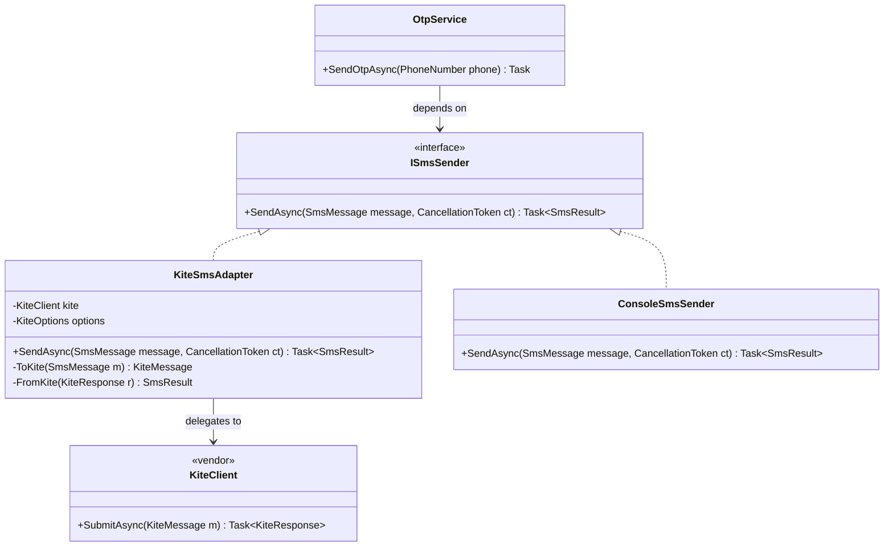
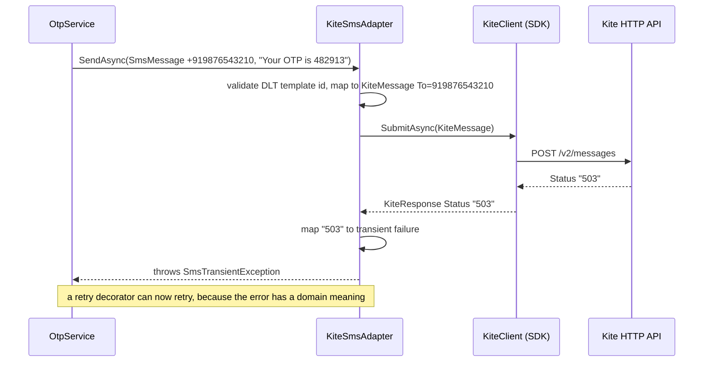
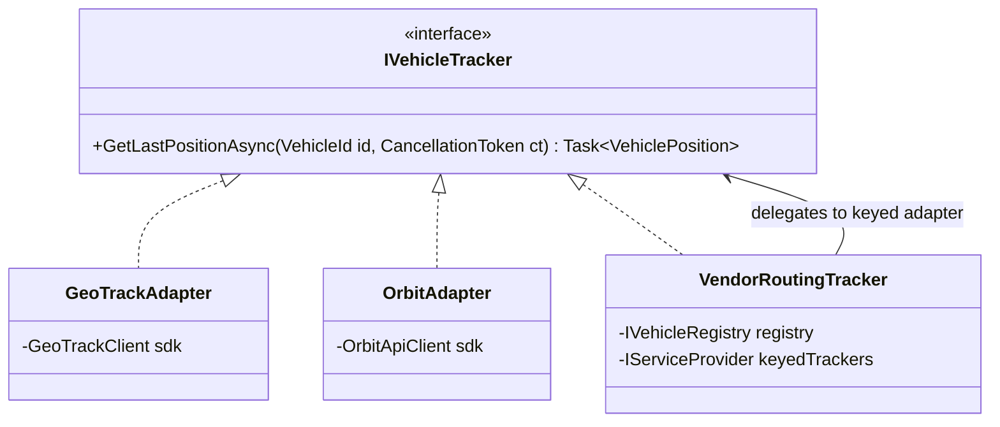

Every real application talks to code it doesn't control: an SMS provider's SDK, a payment gateway, a courier partner's SOAP service written in 2009, a parcel scale at the warehouse packing desk that speaks over a serial port. Each one has its own names, units, date formats and error codes. The Adapter pattern keeps all of that at the edge of your system, so the code in the middle stays clean and stays yours.

## Learning objectives

By the end of this lesson you will be able to:

1. Recognise the problem Adapter solves: an existing class does the right job behind the wrong interface.
2. Name the participants (target, adapter, adaptee, client) and draw the class and sequence diagrams.
3. Build object adapters in C# for an SMS SDK, a payment gateway and a legacy SOAP service, including translation of units, formats and errors.
4. Explain the difference between object adapters (composition) and class adapters (inheritance), and why C# code almost always uses the object form.
5. Adapt a callback/event-based API to `async`/`await` with `TaskCompletionSource`.
6. Test adapters with fakes of the adaptee, and register them in ASP.NET Core DI.
7. Tell Adapter apart from Facade, Decorator, Proxy and Bridge, and know when you don't need one.

## Prerequisites

- [Interfaces and abstract classes](#/lesson/m01-interfaces-abstract): the target of an adapter is an interface.
- [Dependency injection](#/lesson/m03-dependency-injection): we register adapters in DI.
- [Dependency Inversion Principle](#/lesson/m04-dip): Adapter is how you apply DIP to code you don't own.

## Explain it like I'm a beginner

You fly from Delhi to London with your laptop charger. The charger has an Indian plug. The wall sockets in your London hotel are a different shape. The charger works fine, and so does the socket. They just don't fit each other.

You don't rewire the hotel, and you don't cut the plug off your charger. You buy a small **travel adapter**: one side accepts your Indian plug, the other side fits the UK socket. Electricity passes through unchanged.

Software has the same problem all the time:

- Your app expects to call `SendAsync(phoneNumber, message)`.
- The SMS company's SDK offers `SubmitAsync(KiteMessage)`, wants phone numbers as `919876543210` without the `+`, and reports errors as strings like `"101"`.

The SDK does the right job: it sends SMS. Your app has the right expectations. Only the *shape* differs. So you write a small class, the **adapter**, that looks like what your app expects on one side and calls the SDK on the other side, translating as it goes.

- The UK socket shape your app expects is the **target** interface.
- The Indian charger (the SDK you can't change) is the **adaptee**.
- The travel adapter is the **adapter**.
- You, plugging things in, are the **client**.

The big win comes later. When the company switches to a cheaper SMS provider, you write one new adapter. Nothing else in the app changes, just as you can use the same charger in Singapore by buying a different travel adapter.

## First-principles explanation

### The original problem

The *Design Patterns* book states Adapter's intent as: "Convert the interface of a class into another interface clients expect. Adapter lets classes work together that couldn't otherwise because of incompatible interfaces."

In modern business systems, the problem shows up as **integration**:

1. **Third-party SDKs** (SMS, email, payments, maps, KYC) use their own types, units and errors. If your code calls them directly in 20 places, the vendor's model leaks into your domain. Switching vendors becomes a project instead of a task.
2. **Legacy systems** (SOAP services, old DLLs, mainframe gateways) use dated conventions: dates as `"31/03/2027"` strings, yes/no as `"Y"`/`"N"`, weights in grams sent as text, error codes in a `RetCode` field instead of exceptions.
3. **Mismatched styles**: callback- or event-based APIs where your code wants `async`/`await`, synchronous APIs where you need asynchronous ones, or the reverse.

Without an adapter, translation code spreads everywhere: `amount * 100` to get paise in one place, `amount * 100m` in another, and a forgotten one that charges customers 1 % of the price.

### What an adapter actually does

An adapter is a translator. For each call, it may translate:

| What | Example |
|---|---|
| **Names and shape** | `SendAsync(SmsMessage)` → `SubmitAsync(KiteMessage)` |
| **Data formats** | `+919876543210` → `919876543210`; `DateOnly` ↔ `"31/03/2027"` |
| **Units** | ₹1,499.50 → 149950 paise; `"1250"` grams → 1.25 kg |
| **Errors** | vendor code `"101"` → permanent failure; `"503"` → retryable exception; SOAP fault → domain exception |
| **Style** | events and callbacks → `Task`; sync → async |
| **Missing features** | the vendor has no idempotency key, so the adapter maps your order id to its merchant reference |

What an adapter should **not** do is business logic. "Send OTPs only between 8 am and 10 pm" belongs in your service, not in the Kite adapter. Otherwise the rule disappears when you switch vendors.

### The simplest implementation

```csharp
public interface ISmsSender { Task SendAsync(string e164Phone, string text); }    // target: we own it

public sealed class KiteSmsAdapter(KiteClient kite) : ISmsSender                    // adapter
{
    public Task SendAsync(string e164Phone, string text) =>
        kite.SubmitAsync(new KiteMessage { To = e164Phone.TrimStart('+'), Body = text });  // adaptee call
}
```

That's an adapter: implement the interface you want, hold the thing you have, translate in between. The production version below adds validation, error mapping and the Indian DLT template id rule, but the shape stays the same.

### Object adapter vs class adapter

There are two ways to connect the adapter to the adaptee.

**Object adapter (composition).** The adapter *holds* an adaptee instance, as above. This is the default in C#:

- It works with `sealed` adaptee classes and with interfaces.
- It exposes only the target interface. Callers can't reach around it to the vendor's methods.
- You can inject the adaptee (or a fake of it in tests).
- One adapter can wrap several adaptees, for example a primary and a fallback provider.

**Class adapter (inheritance).** The adapter *inherits* from the adaptee and implements the target interface:

```csharp
public sealed class LegacyGatewayClassAdapter : OldSmsGateway, ISmsSender   // inherits the adaptee
{
    public Task SendAsync(string e164Phone, string text)
    {
        var code = Send(e164Phone[^10..], text);   // calls inherited method directly
        return code == 0 ? Task.CompletedTask : throw new InvalidOperationException($"Gateway code {code}");
    }
}
```

In C++, where the pattern was first described, multiple inheritance made this form attractive. In C#:

- You can inherit only one class, so you can adapt only one adaptee, and the adapter can't have another base class.
- It fails if the adaptee is `sealed`, which most modern SDK classes are.
- The adapter *is an* `OldSmsGateway`, so every public vendor method leaks through it. Anyone holding the concrete type can call `Send` directly and bypass your translation.
- It ties the adapter to the adaptee's constructor, so you can't inject a fake adaptee.

Its only real advantages are slightly less code and the ability to override the adaptee's `protected virtual` members. Use it rarely, and on purpose.

### Participants

| Participant | Role | In our example |
|---|---|---|
| **Target** | The interface the client expects. You own it and design it for your domain | `ISmsSender`, `IShipmentLookup` |
| **Client** | Code that uses the target | `OtpService`, an endpoint |
| **Adaptee** | Existing class with a useful but incompatible interface. You can't (or shouldn't) change it | `KiteClient` SDK, the generated SOAP proxy |
| **Adapter** | Implements the target, delegates to the adaptee, translates both ways | `KiteSmsAdapter`, `LegacyCourierShipmentLookup` |

A key design rule: **the target interface is shaped by your needs, not the vendor's.** If `ISmsSender` has a `KiteMessage` parameter, you haven't adapted anything. You've just renamed the SDK.

### When it is useful

- You integrate a third-party or legacy component and want to keep its types out of your domain.
- You expect to switch or add providers (a second SMS vendor for failover, a new payment gateway for a new country).
- You want to unit-test business logic without calling the real service. The target interface gives you a seam for fakes.
- You need to bridge styles: events to tasks, sync to async, push to pull.

### When not to use it

- **You own both sides.** If both interfaces are yours, change one of them. An adapter between two of your own classes is usually a sign of a refactoring you avoided.
- **The vendor's interface already fits.** If an official SDK already exposes an interface close to what you need (many Azure SDK clients are mockable and well designed), a wrapper that just forwards every call adds a layer with nothing in it. Wrap when there is translation to do or a real chance of switching.
- **One call site, one vendor, no tests needed.** A small internal tool that calls one API once can call it directly. Add the adapter when the second call site or the second vendor appears.
- **You're building a huge "universal" interface.** If the target interface tries to expose every feature of every possible vendor, it becomes a leaky lowest common denominator. Keep the target small and specific to your use cases.
- **The platform already gives you the seam.** Many teams still write `IClock` / `IDateTimeProvider` adapters over `DateTime.UtcNow`. Since .NET 8 the BCL ships `TimeProvider`, an abstract class you can inject and replace in tests with `FakeTimeProvider` (package `Microsoft.Extensions.TimeProvider.Testing`). ASP.NET Core itself made this move: its own clock interface, `ISystemClock` in the authentication stack, was marked obsolete in .NET 8 in favour of `TimeProvider`. Likewise, `ILogger<T>`, `IConfiguration`, `IHttpClientFactory` and `IDistributedCache` are already abstractions you own the use of; wrapping them in your own `IMyLogger` adds a layer and no translation.

### Trade-offs

| You gain | You pay |
|---|---|
| Vendor types, units and errors stay at the edge | One more class and interface per integration |
| Switching or adding vendors touches one class | Features unique to one vendor are hidden, or need a richer interface |
| Business logic is testable with fakes | Translation code must itself be tested carefully (units, dates) |
| A natural home for mapping, error translation and logging | A poorly designed target interface just mirrors the vendor, which gives no benefit |

## Visual explanation

### Class diagram



How to read it: `OtpService` (client) depends only on `ISmsSender` (target), an interface that lives in our codebase and speaks our language (`SmsMessage`, `SmsResult`, `PhoneNumber`). `KiteSmsAdapter` implements that interface and holds a `KiteClient` (the adaptee, marked as third-party). The adapter's private `ToKite` and `FromKite` methods are where all translation lives. `ConsoleSmsSender` is not an adapter, just a development fake. It shows why the target interface matters: the client can't tell the difference.

### Sequence diagram



The client sends a message in its own terms. The adapter translates the request (strips `+`, checks India's DLT rule), calls the SDK, and then translates the *response*. A vendor status of `"503"` means nothing to `OtpService`, but `SmsTransientException` does: it tells a caller, or a [retry decorator](#/lesson/m06-decorator), that trying again is reasonable. Error translation is often the most valuable part of an adapter.

## Step-by-step example

### Step 1 — the naive version: the vendor everywhere

```csharp
public async Task<IResult> RequestOtp(string mobile, KiteClient kite)
{
    var code = Random.Shared.Next(100000, 999999).ToString();
    var resp = await kite.SubmitAsync(new KiteMessage
    {
        To = "91" + mobile, Body = $"Your OTP is {code}", SenderId = "SHOPIN", DltTemplateId = "1107169..."
    });
    if (resp.Status != "0") return Results.Problem(resp.Error);
    return Results.Ok();
}
```

Now imagine the same `KiteMessage`-building code copied into the password-reset flow, the delivery-update flow and the invoice-reminder flow. Each copy formats the number slightly differently, one forgets the DLT id, and every endpoint knows Kite's error codes.

### Step 2 — define the target in your language

Ask "what does *my* app need?" Answer: send a message to a valid phone number, with a template id (an Indian regulatory requirement for commercial SMS), and learn whether it was accepted, rejected permanently, or should be retried. That becomes `ISmsSender`, `SmsMessage`, `SmsResult` and `SmsTransientException`.

### Step 3 — write the adapter

Move every Kite-specific detail into `KiteSmsAdapter`: number formatting, sender id from configuration, status-code mapping.

### Step 4 — swap the client to the target

`OtpService` now depends on `ISmsSender`. In development, DI provides `ConsoleSmsSender`. In production it provides the Kite adapter. In tests, a fake records messages.

## Production-style C# implementation

```text
Shop.Api/
  Program.cs
  Notifications/Sms.cs                     # target interface + domain types
  Notifications/Vendors/KiteSdk.cs         # simulated third-party SDK (you can't edit this)
  Notifications/KiteSmsAdapter.cs          # adapter
  Notifications/OtpService.cs              # client
  Legacy/CourierServiceReference.cs        # simulated svcutil-generated SOAP proxy
  Legacy/ShipmentLookup.cs                 # target + adapter for the courier's legacy SOAP service
```

```csharp file=Notifications/Sms.cs
using System.Text.RegularExpressions;

namespace Shop.Notifications;

/// <summary>Value object: an Indian mobile number in E.164 form (+91 followed by 10 digits starting 6–9).</summary>
public sealed partial record PhoneNumber
{
    private PhoneNumber(string e164) => E164 = e164;
    public string E164 { get; }

    public static PhoneNumber Parse(string input)
    {
        var digits = new string((input ?? "").Where(char.IsDigit).ToArray());
        if (digits.Length == 10) digits = "91" + digits;
        if (!IndianMobile().IsMatch(digits)) throw new FormatException($"'{input}' is not a valid Indian mobile number.");
        return new PhoneNumber("+" + digits);
    }

    public override string ToString() => E164;

    [GeneratedRegex("^91[6-9][0-9]{9}$")]
    private static partial Regex IndianMobile();
}

/// <summary>TemplateId is the DLT-registered template id that Indian regulations require for commercial SMS.</summary>
public sealed record SmsMessage(PhoneNumber To, string Text, string TemplateId);

public enum SmsOutcome { Accepted, Rejected }

public sealed record SmsResult(SmsOutcome Outcome, string? ProviderMessageId, string? Reason);

/// <summary>The provider is temporarily unable to send. Retrying later is reasonable.</summary>
public sealed class SmsTransientException(string message, Exception? inner = null) : Exception(message, inner);

/// <summary>Target interface: designed for OUR needs, with no vendor types in it.</summary>
public interface ISmsSender
{
    Task<SmsResult> SendAsync(SmsMessage message, CancellationToken ct = default);
}

/// <summary>Development stand-in. Not an adapter: shows that clients can't tell implementations apart.</summary>
public sealed class ConsoleSmsSender(ILogger<ConsoleSmsSender> logger) : ISmsSender
{
    public Task<SmsResult> SendAsync(SmsMessage message, CancellationToken ct = default)
    {
        logger.LogInformation("DEV SMS to {To}: {Text}", message.To, message.Text);
        return Task.FromResult(new SmsResult(SmsOutcome.Accepted, "dev-" + Guid.NewGuid().ToString("N")[..8], null));
    }
}
```

```csharp file=Notifications/Vendors/KiteSdk.cs
// Simulates a vendor NuGet package. In a real project you cannot change this code.
namespace KiteSms.Sdk;

public sealed class KiteMessage
{
    public string To { get; set; } = "";          // "919876543210": country code, no plus sign
    public string Body { get; set; } = "";
    public string SenderId { get; set; } = "";     // 6-character header, e.g. "SHOPIN"
    public string DltTemplateId { get; set; } = "";
}

public sealed class KiteResponse
{
    public string Status { get; set; } = "";       // "0" = queued; "101" bad number; "102" template mismatch; "429"/"503" try later
    public string? MessageId { get; set; }
    public string? Error { get; set; }
}

public class KiteClient(string apiKey)
{
    public string ApiKey { get; } = apiKey;

    public virtual Task<KiteResponse> SubmitAsync(KiteMessage message) =>
        Task.FromResult(message.To.Length == 12
            ? new KiteResponse { Status = "0", MessageId = Guid.NewGuid().ToString("N") }
            : new KiteResponse { Status = "101", Error = "INVALID_DESTINATION" });
}
```

```csharp file=Notifications/KiteSmsAdapter.cs
using KiteSms.Sdk;
using Microsoft.Extensions.Options;

namespace Shop.Notifications;

public sealed class KiteOptions
{
    public string ApiKey { get; set; } = "";
    public string SenderId { get; set; } = "SHOPIN";
}

/// <summary>Object adapter: implements our ISmsSender and delegates to the Kite SDK, translating
/// formats on the way in and status codes on the way out. No business rules live here.</summary>
public sealed class KiteSmsAdapter(KiteClient kite, IOptions<KiteOptions> options, ILogger<KiteSmsAdapter> logger) : ISmsSender
{
    private readonly KiteOptions _options = options.Value;

    public async Task<SmsResult> SendAsync(SmsMessage message, CancellationToken ct = default)
    {
        ArgumentNullException.ThrowIfNull(message);
        if (string.IsNullOrWhiteSpace(message.TemplateId))
            return new SmsResult(SmsOutcome.Rejected, null, "Missing DLT template id.");

        KiteResponse response;
        try
        {
            // The SDK has no CancellationToken overload; WaitAsync stops *our* wait if the request is aborted.
            response = await kite.SubmitAsync(ToKite(message)).WaitAsync(ct);
        }
        catch (HttpRequestException ex)
        {
            throw new SmsTransientException("Kite SMS unreachable.", ex);
        }

        logger.LogDebug("Kite responded {Status} for {To}", response.Status, message.To);
        return FromKite(response);
    }

    private KiteMessage ToKite(SmsMessage m) => new()
    {
        To = m.To.E164.TrimStart('+'),
        Body = m.Text,
        SenderId = _options.SenderId,
        DltTemplateId = m.TemplateId,
    };

    private static SmsResult FromKite(KiteResponse r) => r.Status switch
    {
        "0" => new SmsResult(SmsOutcome.Accepted, r.MessageId, null),
        "101" => new SmsResult(SmsOutcome.Rejected, null, "Invalid destination number."),
        "102" => new SmsResult(SmsOutcome.Rejected, null, "Text does not match the registered DLT template."),
        "429" or "503" => throw new SmsTransientException($"Kite is throttling or unavailable (status {r.Status})."),
        _ => throw new SmsTransientException($"Unexpected Kite status '{r.Status}': {r.Error}"),
    };
}
```

```csharp file=Notifications/OtpService.cs
using System.Security.Cryptography;

namespace Shop.Notifications;

/// <summary>Client. Knows about OTPs and templates; knows nothing about Kite.</summary>
public sealed class OtpService(ISmsSender sms, ILogger<OtpService> logger)
{
    public const string OtpTemplateId = "1107160000000000001";   // placeholder DLT template id

    public async Task<bool> SendOtpAsync(PhoneNumber phone, CancellationToken ct)
    {
        var code = RandomNumberGenerator.GetInt32(0, 1_000_000).ToString("D6");
        // In production: store a hash of the code with a 5-minute expiry before sending.
        var result = await sms.SendAsync(new SmsMessage(phone, $"{code} is your login OTP. Valid for 5 minutes.", OtpTemplateId), ct);
        if (result.Outcome == SmsOutcome.Rejected)
            logger.LogWarning("OTP SMS rejected for {Phone}: {Reason}", phone, result.Reason);
        return result.Outcome == SmsOutcome.Accepted;
    }
}
```

```csharp file=Legacy/CourierServiceReference.cs
// Simulates the proxy that `dotnet-svcutil` generates from a courier partner's legacy SOAP WSDL.
// Generated code is regenerated, not edited, so it is an adaptee too.
namespace LegacyCourier.ServiceReference;

public partial class TrackConsignmentRequest
{
    public string AwbNo { get; set; } = "";              // air waybill number printed on the shipping label
    public string UserId { get; set; } = "";
    public string Pwd { get; set; } = "";
}

public partial class TrackConsignmentResponse
{
    public string RetCode { get; set; } = "";            // "000" ok, "404" unknown AWB, others: errors
    public string RetMsg { get; set; } = "";
    public string WeightGms { get; set; } = "";          // e.g. "1250" (grams, as text)
    public string BookedDt { get; set; } = "";           // "dd/MM/yyyy"
    public string StatusFlg { get; set; } = "";          // "B" booked, "T" in transit, "D" delivered, "R" returned to seller
}

public interface ICourierServiceChannel
{
    Task<TrackConsignmentResponse> TrackConsignmentAsync(TrackConsignmentRequest request);
}

/// <summary>In-memory stand-in for the real SOAP endpoint, so the sample runs anywhere.</summary>
public sealed class FakeCourierChannel : ICourierServiceChannel
{
    public Task<TrackConsignmentResponse> TrackConsignmentAsync(TrackConsignmentRequest request) =>
        Task.FromResult(request.AwbNo == "EK123456789IN"
            ? new TrackConsignmentResponse { RetCode = "000", WeightGms = "1250", BookedDt = "14/08/2026", StatusFlg = "T" }
            : new TrackConsignmentResponse { RetCode = "404", RetMsg = "AWB NOT FOUND" });
}
```

```csharp file=Legacy/ShipmentLookup.cs
using System.Globalization;
using LegacyCourier.ServiceReference;
using Microsoft.Extensions.Options;

namespace Shop.Legacy;

public enum ShipmentStatus { Booked, InTransit, Delivered, ReturnedToSeller }

/// <summary>Domain model: kilograms as decimal, real dates, a real enum.</summary>
public sealed record Shipment(string AwbNumber, decimal WeightKg, DateOnly BookedOn, ShipmentStatus Status);

public sealed class LegacySystemException(string message) : Exception(message);

/// <summary>Target interface.</summary>
public interface IShipmentLookup
{
    Task<Shipment?> FindAsync(string awbNumber, CancellationToken ct);
}

public sealed class CourierOptions
{
    public string UserId { get; set; } = "";
    public string Password { get; set; } = "";
}

/// <summary>Adapter over the generated SOAP proxy. Converts grams to kilograms, string dates to DateOnly,
/// status flags to an enum, and return codes to null or exceptions. Credentials stay here too.</summary>
public sealed class LegacyCourierShipmentLookup(ICourierServiceChannel channel, IOptions<CourierOptions> options) : IShipmentLookup
{
    private const decimal GramsPerKg = 1000m;

    public async Task<Shipment?> FindAsync(string awbNumber, CancellationToken ct)
    {
        ArgumentException.ThrowIfNullOrWhiteSpace(awbNumber);
        var request = new TrackConsignmentRequest
        {
            AwbNo = awbNumber.Trim().ToUpperInvariant(),
            UserId = options.Value.UserId,
            Pwd = options.Value.Password,
        };

        var response = await channel.TrackConsignmentAsync(request).WaitAsync(ct);

        return response.RetCode switch
        {
            "000" => Map(request.AwbNo, response),
            "404" => null,
            _ => throw new LegacySystemException($"Courier service returned {response.RetCode}: {response.RetMsg}"),
        };
    }

    private static Shipment Map(string awb, TrackConsignmentResponse r) => new(
        awb,
        decimal.Parse(r.WeightGms, NumberStyles.Integer, CultureInfo.InvariantCulture) / GramsPerKg,
        DateOnly.ParseExact(r.BookedDt, "dd/MM/yyyy", CultureInfo.InvariantCulture),
        r.StatusFlg switch
        {
            "B" => ShipmentStatus.Booked,
            "T" => ShipmentStatus.InTransit,
            "D" => ShipmentStatus.Delivered,
            "R" => ShipmentStatus.ReturnedToSeller,
            var other => throw new LegacySystemException($"Unknown courier status flag '{other}'."),
        });
}
```

```csharp file=Program.cs
using Shop.Legacy;
using Shop.Notifications;
using KiteSms.Sdk;
using LegacyCourier.ServiceReference;
using Microsoft.Extensions.Options;

var builder = WebApplication.CreateBuilder(args);

// SMS: choose the implementation by environment. Clients only ever see ISmsSender.
builder.Services.Configure<KiteOptions>(builder.Configuration.GetSection("Sms:Kite"));
if (builder.Environment.IsDevelopment())
    builder.Services.AddSingleton<ISmsSender, ConsoleSmsSender>();
else
{
    builder.Services.AddSingleton(sp => new KiteClient(sp.GetRequiredService<IOptions<KiteOptions>>().Value.ApiKey));
    builder.Services.AddSingleton<ISmsSender, KiteSmsAdapter>();
}
builder.Services.AddScoped<OtpService>();

// Legacy SOAP: the channel is the adaptee; the lookup is the adapter.
builder.Services.Configure<CourierOptions>(builder.Configuration.GetSection("Courier"));
builder.Services.AddSingleton<ICourierServiceChannel, FakeCourierChannel>();
builder.Services.AddScoped<IShipmentLookup, LegacyCourierShipmentLookup>();

var app = builder.Build();

app.MapPost("/otp", async (string mobile, OtpService otp, CancellationToken ct) =>
{
    PhoneNumber phone;
    try { phone = PhoneNumber.Parse(mobile); }
    catch (FormatException ex) { return Results.Problem(ex.Message, statusCode: StatusCodes.Status400BadRequest); }

    try { return await otp.SendOtpAsync(phone, ct) ? Results.Accepted() : Results.Problem("SMS rejected.", statusCode: 422); }
    catch (SmsTransientException) { return Results.Problem("SMS provider unavailable, try again shortly.", statusCode: 503); }
});

app.MapGet("/shipments/{awb}", async (string awb, IShipmentLookup lookup, CancellationToken ct) =>
    await lookup.FindAsync(awb, ct) is { } s ? Results.Ok(s) : Results.NotFound());

app.Run();
```

### Design notes

- **Credentials belong in the adapter**, not the client. `OtpService` doesn't know an API key exists, and the SOAP user id and password never leave `LegacyCourierShipmentLookup`.
- **Unknown codes are errors, not silent successes.** Both adapters end their `switch` with an exception for unexpected values. Vendors add codes over time, and treating `"104"` as success is how money goes missing.
- **`WaitAsync(ct)`** lets the adapter honour cancellation even when the adaptee has no token parameter. It stops *waiting*. It doesn't stop the vendor's work, which is the best you can do with such an API. It is not a timeout either: set the real one on the transport (the WCF binding's `SendTimeout`, or `HttpClient.Timeout` / a resilience handler for HTTP SDKs), otherwise a hung legacy call holds a connection open far longer than your users will wait.
- **Real SOAP in .NET 10.** The generated proxy comes from `dotnet-svcutil` and runs on the `System.ServiceModel.Http` client packages, which are supported on modern .NET. Treat the generated code exactly like a vendor SDK: never edit it, regenerate it when the WSDL changes, and keep it inside the integration project behind the adapter.
- **Log at the boundary.** The adapter is the one place that sees both the vendor's raw status and your domain result, so it is the right place for a debug log line and a metric tagged with the vendor name. When a vendor quietly changes behaviour, that metric is how you find out.
- **Adapters and resilience compose.** Because the adapter turns vendor errors into `SmsTransientException`, a retry or circuit-breaker [decorator](#/lesson/m06-decorator) around `ISmsSender` can work without knowing about Kite.

## Bad design vs good design

**Bad**: a "wrapper" that leaks the vendor.

```csharp
public interface ISmsService
{
    Task<KiteResponse> SendAsync(KiteMessage message);   // vendor types in our interface
}

public class SmsService(KiteClient kite) : ISmsService
{
    public Task<KiteResponse> SendAsync(KiteMessage message) => kite.SubmitAsync(message);
}

// Callers still do this:
var r = await sms.SendAsync(new KiteMessage { To = "91" + mobile, ... });
if (r.Status == "503") { /* retry */ }
```

This has the *shape* of an adapter but none of the benefit. Every caller still builds `KiteMessage`, formats numbers and knows Kite's status codes. Switching vendors still means editing every caller. A test still needs Kite types. This is sometimes called a *pass-through wrapper*.

**Good**: the target interface uses only your types (`SmsMessage`, `SmsResult`, `PhoneNumber`), and all translation lives inside the adapter. The test for "is this a real adapter?" is simple: **could you delete the vendor package and still compile everything except the adapter?**

**Is it worth it?** For a single call to a well-designed SDK from one place, a direct call is fine. The adapter pays off when there are several call sites, any translation (units, dates, error codes), a realistic chance of a second vendor, or a need to unit-test the callers.

:::callout type=mistake title="Don't put business rules in adapters"
"Only send promotional SMS between 9 am and 9 pm" is a business rule. If it lives in `KiteSmsAdapter`, it disappears the day you switch to another provider. Adapters translate; services decide.
:::

:::callout type=tip title="Anti-corruption layer = adapters at scale"
When a whole legacy system with its own model (customers, contracts, statuses) feeds your domain, a set of adapters plus translators forms an *anti-corruption layer*, a term from domain-driven design. Same idea, larger boundary: the legacy model never enters your domain.
:::

## Practical playground

The playground has a legacy gateway and two adapters: an object adapter and a class adapter. Run it, then try to call the vendor's `Send` method through each adapter variable. Only one of them lets you, and that is the leak.

:::playground type=csharp title="Object adapter vs class adapter"
```csharp file=Program.cs
using System;
using System.Threading.Tasks;

// Adaptee: legacy code you can't change. Expects a 10-digit number; returns 0 for success.
public class OldSmsGateway
{
    public int Send(string mobile10, string text)
    {
        Console.WriteLine($"  [legacy] SEND {mobile10}: {text}");
        return mobile10.Length == 10 ? 0 : 17;
    }
}

// Target: what our app wants.
public interface ISmsSender { Task SendAsync(string e164, string text); }

// Object adapter: composition.
public sealed class GatewayObjectAdapter(OldSmsGateway gateway) : ISmsSender
{
    public Task SendAsync(string e164, string text)
    {
        var code = gateway.Send(e164[^10..], text);
        return code == 0 ? Task.CompletedTask : Task.FromException(new InvalidOperationException($"Legacy code {code}"));
    }
}

// Class adapter: inheritance. Works only because OldSmsGateway is not sealed.
public sealed class GatewayClassAdapter : OldSmsGateway, ISmsSender
{
    public Task SendAsync(string e164, string text)
    {
        var code = Send(e164[^10..], text);
        return code == 0 ? Task.CompletedTask : Task.FromException(new InvalidOperationException($"Legacy code {code}"));
    }
}

public static class Program
{
    public static async Task Main()
    {
        ISmsSender a = new GatewayObjectAdapter(new OldSmsGateway());
        ISmsSender b = new GatewayClassAdapter();
        await a.SendAsync("+919876543210", "Your parcel is out for delivery");
        await b.SendAsync("+919876543210", "Your parcel is out for delivery");

        var leaky = new GatewayClassAdapter();
        leaky.Send("98765", "bypasses the adapter entirely");   // compiles: vendor API leaks through
        Console.WriteLine("Class adapter exposes the adaptee's methods; object adapter does not.");
    }
}
```
:::

Both adapters produce the same result through `ISmsSender`. The difference shows on the last lines: because `GatewayClassAdapter` *is an* `OldSmsGateway`, any code holding the concrete type can call `Send` with an unformatted number and skip your translation. Try the same with `GatewayObjectAdapter`. It doesn't compile, which is what you want.

## Exercises

:::exercise id=m06-adapter-ex1 difficulty=beginner kind=code title="Adapt a legacy parcel-scale driver"
In an e-commerce warehouse, every packed parcel is put on a weighing scale before the shipping label is printed, because the courier charges by weight slab. The scale vendor's driver class returns raw text frames from a serial port, such as `ST,GS,+0002450g`. Your shipping-charge code wants `IParcelScale.Read()` returning kilograms. Write `ParcelScaleAdapter`.
::requirements
- Frame format: `<stability>,<mode>,<sign><7 digits>g`. Stability `ST` means stable, `US` means unstable. Mode is `GS` (gross, box included) or `NT` (net, box weight tared off); report it as given.
- Convert grams to kilograms (`2450 g` → `2.450 kg`).
- The frame `OL` means overload: throw `ScaleOverloadException`.
- Any other malformed frame throws `FormatException`.
- Don't change `LegacyScaleDriver`.
::acceptance
- `ST,GS,+0002450g` → `2.45` kg, stable, gross.
- `US,NT,+0000125g` → `0.125` kg, not stable, net.
- A frame in the wrong unit (`+0002450kg`, `+0002450lb`) → `FormatException`.
- `OL` → `ScaleOverloadException`.
- `garbage` → `FormatException`.
::hint
The adapter implements `IParcelScale` and holds a `LegacyScaleDriver`. Every `Read()` calls `ReadFrame()` once and translates.
::hint
Handle `OL` first, then `Split(',')`. You expect exactly 3 parts.
::hint
For the weight part, check it ends with `g`, strip that one character, and parse with `int.Parse(..., NumberStyles.AllowLeadingSign, CultureInfo.InvariantCulture)`. Then divide by `1000m`.
::hint
```text
if frame == "OL" -> throw ScaleOverloadException
parts = frame.Split(',') ; require 3 parts, parts[0] in {ST, US}, parts[1] in {GS, NT}, parts[2] ends with "g"
grams = int.Parse(parts[2][..^1]) ; return new WeighingResult(grams / 1000m, parts[0] == "ST", parts[1] == "NT")
```
::starter
```csharp file=ParcelScale.cs
using System;
using System.Globalization;

// ----- Adaptee: vendor code you cannot change -----
public sealed class LegacyScaleDriver
{
    private readonly Func<string> _serialPort;
    public LegacyScaleDriver(Func<string> serialPort) { _serialPort = serialPort; }
    public string ReadFrame() => _serialPort();
}

// ----- Target: what our shipping-charge code wants -----
public sealed record WeighingResult(decimal Kilograms, bool IsStable, bool IsNet);

public interface IParcelScale
{
    WeighingResult Read();
}

public sealed class ScaleOverloadException : Exception
{
    public ScaleOverloadException() : base("Scale overload.") { }
}

// ----- Adapter -----
public sealed class ParcelScaleAdapter : IParcelScale
{
    public ParcelScaleAdapter(LegacyScaleDriver driver) => throw new NotImplementedException();
    public WeighingResult Read() => throw new NotImplementedException();
}
```
::tests
```csharp file=ParcelScaleTests.cs
using System;
using Xunit;

public class ParcelScaleTests
{
    private static IParcelScale With(string frame) => new ParcelScaleAdapter(new LegacyScaleDriver(() => frame));

    [Fact]
    public void Stable_gross_reading()
    {
        var r = With("ST,GS,+0002450g").Read();
        Assert.Equal(2.45m, r.Kilograms);
        Assert.True(r.IsStable);
        Assert.False(r.IsNet);
    }

    [Fact]
    public void Unstable_net_reading()
    {
        var r = With("US,NT,+0000125g").Read();
        Assert.Equal(0.125m, r.Kilograms);
        Assert.False(r.IsStable);
        Assert.True(r.IsNet);
    }

    [Fact]
    public void Overload_frame_throws_domain_exception() =>
        Assert.Throws<ScaleOverloadException>(() => With("OL").Read());

    [Theory]
    [InlineData("garbage")]
    [InlineData("ST,GS,+0002450lb")]
    [InlineData("XX,GS,+0002450g")]
    [InlineData("ST,GS")]
    [InlineData("ST,GS,+0002450kg")]
    public void Malformed_frames_throw_format_exception(string frame) =>
        Assert.Throws<FormatException>(() => With(frame).Read());

    [Fact]
    public void Each_read_asks_the_driver_again()
    {
        var frames = new[] { "ST,GS,+0010000g", "ST,GS,+0020000g" };
        var i = 0;
        var adapter = new ParcelScaleAdapter(new LegacyScaleDriver(() => frames[i++]));
        Assert.Equal(10m, adapter.Read().Kilograms);
        Assert.Equal(20m, adapter.Read().Kilograms);
    }
}
```
::solution
```csharp file=ParcelScale.cs
using System;
using System.Globalization;

public sealed class LegacyScaleDriver
{
    private readonly Func<string> _serialPort;
    public LegacyScaleDriver(Func<string> serialPort) { _serialPort = serialPort; }
    public string ReadFrame() => _serialPort();
}

public sealed record WeighingResult(decimal Kilograms, bool IsStable, bool IsNet);

public interface IParcelScale
{
    WeighingResult Read();
}

public sealed class ScaleOverloadException : Exception
{
    public ScaleOverloadException() : base("Scale overload.") { }
}

public sealed class ParcelScaleAdapter : IParcelScale
{
    private readonly LegacyScaleDriver _driver;

    public ParcelScaleAdapter(LegacyScaleDriver driver) => _driver = driver ?? throw new ArgumentNullException(nameof(driver));

    public WeighingResult Read()
    {
        var frame = _driver.ReadFrame()?.Trim() ?? "";
        if (frame == "OL") throw new ScaleOverloadException();

        var parts = frame.Split(',');
        if (parts.Length != 3) throw new FormatException($"Unexpected frame '{frame}'.");

        var stable = parts[0] switch { "ST" => true, "US" => false, _ => throw new FormatException($"Bad stability '{parts[0]}'.") };
        var net = parts[1] switch { "NT" => true, "GS" => false, _ => throw new FormatException($"Bad mode '{parts[1]}'.") };
        if (!parts[2].EndsWith('g')) throw new FormatException($"Bad unit in '{parts[2]}'.");

        // A "kg" or "lb" suffix leaves a letter before the "g" (or no "g" at all), so parsing fails: wrong units are rejected, not guessed.
        var grams = int.Parse(parts[2][..^1], NumberStyles.AllowLeadingSign, CultureInfo.InvariantCulture);
        return new WeighingResult(grams / 1000m, stable, net);
    }
}
```

All knowledge of the frame format is now in one class. If the warehouse buys a new scale model that speaks JSON over USB, you write a second adapter, and the shipping-charge code doesn't change.
::mistakes
- Using `double` for the weight. Charging by weight slab needs exact `decimal` values: 0.5 kg must not become 0.49999.
- Parsing with the current culture. On a machine set to a locale with different number formats, parsing can behave differently. Use `CultureInfo.InvariantCulture`.
- Returning `0 kg` for malformed frames. A silent zero ships the parcel at the cheapest slab, and the courier bills you the difference later.
- Assuming the unit. A scale switched to kilogram mode by a packer sends `+0000002kg`; reading that as 2 g is an incident waiting to happen.
::extensions
Add `ReadStableAsync(TimeSpan timeout)` that polls until a stable frame arrives. This is a small feature the vendor lacks, added in the adapter because it's about the *device*, not shipping charges.
:::

:::exercise id=m06-adapter-ex2 difficulty=beginner kind=code title="Adapt a payment gateway SDK (rupees, paise and declines)"
Your checkout uses `IPaymentGateway`, with amounts in rupees as `decimal`. The SwiftPay SDK takes amounts in **paise** as `long`, returns statuses as lowercase strings, and throws its own timeout exception. Write `SwiftPayGatewayAdapter`.
::requirements
- Only `INR` is supported. Other currencies throw `NotSupportedException`.
- Amounts must be positive with at most 2 decimal places. Otherwise throw `ArgumentException` (or a subclass).
- `MerchantRef` is the order id, so the vendor can de-duplicate retries.
- Status mapping: `captured` → `Succeeded`, `authorized` or `pending` → `Pending`, `failed` → `Declined`.
- Decline reasons: `INSUFFICIENT_FUNDS` → "Insufficient funds", `CARD_EXPIRED` → "Card expired", anything else → "Declined by bank".
- An unknown status throws `InvalidOperationException`. `SwiftPayTimeoutException` becomes `GatewayUnavailableException`, keeping the original as `InnerException`.
::acceptance
- ₹1,499.50 is sent as `149950` paise with the order id as `MerchantRef`.
- ₹10.005 is rejected before calling the SDK.
- A `failed` response with `CARD_EXPIRED` gives `Declined` with reason "Card expired".
- A vendor timeout becomes `GatewayUnavailableException`, with the inner exception preserved.
::hint
Write the translation in two private methods: one for the request (rupees → paise) and one for the response (status strings → your enum).
::hint
`amount * 100m` gives paise. If that value isn't a whole number (`paise != decimal.Truncate(paise)`), the amount had more than 2 decimal places.
::hint
Validate *before* calling the SDK, so bad input never reaches the vendor. A fake SDK in the tests counts calls.
::hint
`catch (SwiftPayTimeoutException ex) { throw new GatewayUnavailableException("SwiftPay timed out", ex); }`
::starter
```csharp file=PaymentAdapter.cs
using System;
using System.Threading;
using System.Threading.Tasks;

// ----- Vendor SDK (cannot change) -----
public sealed class SwiftChargeRequest
{
    public long AmountPaise { get; set; }
    public string Currency { get; set; } = "INR";
    public string MerchantRef { get; set; } = "";
}

public sealed class SwiftChargeResponse
{
    public string Status { get; set; } = "";     // "captured" | "authorized" | "pending" | "failed"
    public string? ErrorCode { get; set; }
    public string TxnId { get; set; } = "";
}

public interface ISwiftPayApi
{
    Task<SwiftChargeResponse> CreateChargeAsync(SwiftChargeRequest request);
}

public sealed class SwiftPayTimeoutException : Exception
{
    public SwiftPayTimeoutException() : base("SwiftPay timed out") { }
}

// ----- Our domain (target) -----
public readonly record struct Money(decimal Amount, string Currency);

public enum PaymentStatus { Succeeded, Pending, Declined }

public sealed record PaymentResult(PaymentStatus Status, string? ProviderReference, string? DeclineReason);

public sealed class GatewayUnavailableException : Exception
{
    public GatewayUnavailableException(string message, Exception inner) : base(message, inner) { }
}

public interface IPaymentGateway
{
    Task<PaymentResult> ChargeAsync(Money amount, string orderId, CancellationToken ct = default);
}

// ----- Adapter -----
public sealed class SwiftPayGatewayAdapter : IPaymentGateway
{
    public SwiftPayGatewayAdapter(ISwiftPayApi api) => throw new NotImplementedException();

    public Task<PaymentResult> ChargeAsync(Money amount, string orderId, CancellationToken ct = default) =>
        throw new NotImplementedException();
}
```
::tests
```csharp file=PaymentAdapterTests.cs
using System;
using System.Threading.Tasks;
using Xunit;

public sealed class FakeSwiftPay : ISwiftPayApi
{
    public SwiftChargeRequest? LastRequest { get; private set; }
    public int Calls { get; private set; }
    public Func<SwiftChargeResponse> Respond { get; set; } = () => new SwiftChargeResponse { Status = "captured", TxnId = "sp_1" };
    public bool Timeout { get; set; }

    public Task<SwiftChargeResponse> CreateChargeAsync(SwiftChargeRequest request)
    {
        Calls++;
        LastRequest = request;
        if (Timeout) throw new SwiftPayTimeoutException();
        return Task.FromResult(Respond());
    }
}

public class PaymentAdapterTests
{
    [Fact]
    public async Task Converts_rupees_to_paise_and_passes_order_id()
    {
        var api = new FakeSwiftPay();
        var result = await new SwiftPayGatewayAdapter(api).ChargeAsync(new Money(1499.50m, "INR"), "ORD-7781");
        Assert.Equal(149950L, api.LastRequest!.AmountPaise);
        Assert.Equal("ORD-7781", api.LastRequest.MerchantRef);
        Assert.Equal(PaymentStatus.Succeeded, result.Status);
        Assert.Equal("sp_1", result.ProviderReference);
    }

    [Fact]
    public async Task Rejects_sub_paisa_amounts_before_calling_vendor()
    {
        var api = new FakeSwiftPay();
        await Assert.ThrowsAnyAsync<ArgumentException>(() => new SwiftPayGatewayAdapter(api).ChargeAsync(new Money(10.005m, "INR"), "ORD-1"));
        Assert.Equal(0, api.Calls);
    }

    [Fact]
    public async Task Rejects_non_positive_amounts()
    {
        var api = new FakeSwiftPay();
        await Assert.ThrowsAnyAsync<ArgumentException>(() => new SwiftPayGatewayAdapter(api).ChargeAsync(new Money(0m, "INR"), "ORD-1"));
    }

    [Fact]
    public async Task Rejects_other_currencies()
    {
        var api = new FakeSwiftPay();
        await Assert.ThrowsAsync<NotSupportedException>(() => new SwiftPayGatewayAdapter(api).ChargeAsync(new Money(10m, "USD"), "ORD-1"));
    }

    [Theory]
    [InlineData("CARD_EXPIRED", "Card expired")]
    [InlineData("INSUFFICIENT_FUNDS", "Insufficient funds")]
    [InlineData("DO_NOT_HONOUR", "Declined by bank")]
    public async Task Maps_declines(string code, string reason)
    {
        var api = new FakeSwiftPay { Respond = () => new SwiftChargeResponse { Status = "failed", ErrorCode = code, TxnId = "sp_2" } };
        var result = await new SwiftPayGatewayAdapter(api).ChargeAsync(new Money(100m, "INR"), "ORD-2");
        Assert.Equal(PaymentStatus.Declined, result.Status);
        Assert.Equal(reason, result.DeclineReason);
    }

    [Theory]
    [InlineData("authorized")]
    [InlineData("pending")]
    public async Task Maps_pending_states(string status)
    {
        var api = new FakeSwiftPay { Respond = () => new SwiftChargeResponse { Status = status, TxnId = "sp_3" } };
        Assert.Equal(PaymentStatus.Pending, (await new SwiftPayGatewayAdapter(api).ChargeAsync(new Money(100m, "INR"), "ORD-3")).Status);
    }

    [Fact]
    public async Task Unknown_status_is_an_error()
    {
        var api = new FakeSwiftPay { Respond = () => new SwiftChargeResponse { Status = "refunded" } };
        await Assert.ThrowsAsync<InvalidOperationException>(() => new SwiftPayGatewayAdapter(api).ChargeAsync(new Money(100m, "INR"), "ORD-4"));
    }

    [Fact]
    public async Task Timeout_becomes_gateway_unavailable()
    {
        var api = new FakeSwiftPay { Timeout = true };
        var ex = await Assert.ThrowsAsync<GatewayUnavailableException>(() => new SwiftPayGatewayAdapter(api).ChargeAsync(new Money(100m, "INR"), "ORD-5"));
        Assert.IsType<SwiftPayTimeoutException>(ex.InnerException);
    }
}
```
::solution
```csharp file=PaymentAdapter.cs
using System;
using System.Threading;
using System.Threading.Tasks;

public sealed class SwiftChargeRequest
{
    public long AmountPaise { get; set; }
    public string Currency { get; set; } = "INR";
    public string MerchantRef { get; set; } = "";
}

public sealed class SwiftChargeResponse
{
    public string Status { get; set; } = "";
    public string? ErrorCode { get; set; }
    public string TxnId { get; set; } = "";
}

public interface ISwiftPayApi
{
    Task<SwiftChargeResponse> CreateChargeAsync(SwiftChargeRequest request);
}

public sealed class SwiftPayTimeoutException : Exception
{
    public SwiftPayTimeoutException() : base("SwiftPay timed out") { }
}

public readonly record struct Money(decimal Amount, string Currency);

public enum PaymentStatus { Succeeded, Pending, Declined }

public sealed record PaymentResult(PaymentStatus Status, string? ProviderReference, string? DeclineReason);

public sealed class GatewayUnavailableException : Exception
{
    public GatewayUnavailableException(string message, Exception inner) : base(message, inner) { }
}

public interface IPaymentGateway
{
    Task<PaymentResult> ChargeAsync(Money amount, string orderId, CancellationToken ct = default);
}

public sealed class SwiftPayGatewayAdapter : IPaymentGateway
{
    private readonly ISwiftPayApi _api;

    public SwiftPayGatewayAdapter(ISwiftPayApi api) => _api = api ?? throw new ArgumentNullException(nameof(api));

    public async Task<PaymentResult> ChargeAsync(Money amount, string orderId, CancellationToken ct = default)
    {
        var request = ToSwift(amount, orderId);   // validates before any network call
        SwiftChargeResponse response;
        try
        {
            response = await _api.CreateChargeAsync(request).WaitAsync(ct);
        }
        catch (SwiftPayTimeoutException ex)
        {
            throw new GatewayUnavailableException("SwiftPay timed out.", ex);
        }
        return FromSwift(response);
    }

    private static SwiftChargeRequest ToSwift(Money amount, string orderId)
    {
        ArgumentException.ThrowIfNullOrWhiteSpace(orderId);
        if (amount.Currency != "INR") throw new NotSupportedException($"SwiftPay adapter supports INR only, not {amount.Currency}.");
        if (amount.Amount <= 0) throw new ArgumentOutOfRangeException(nameof(amount), "Amount must be positive.");
        var paise = amount.Amount * 100m;
        if (paise != decimal.Truncate(paise)) throw new ArgumentException("Amount has more than 2 decimal places.", nameof(amount));
        return new SwiftChargeRequest { AmountPaise = (long)paise, Currency = "INR", MerchantRef = orderId };
    }

    private static PaymentResult FromSwift(SwiftChargeResponse r) => r.Status switch
    {
        "captured" => new PaymentResult(PaymentStatus.Succeeded, r.TxnId, null),
        "authorized" or "pending" => new PaymentResult(PaymentStatus.Pending, r.TxnId, null),
        "failed" => new PaymentResult(PaymentStatus.Declined, r.TxnId, r.ErrorCode switch
        {
            "INSUFFICIENT_FUNDS" => "Insufficient funds",
            "CARD_EXPIRED" => "Card expired",
            _ => "Declined by bank",
        }),
        _ => throw new InvalidOperationException($"Unknown SwiftPay status '{r.Status}'."),
    };
}
```

A paise bug is a classic integration incident: sending rupees where paise are expected charges 1 % of the price, and the reverse charges 100 times the price. Keeping the conversion in exactly one tested place is the main value of this adapter.
::mistakes
- `(long)(amount * 100)` with no check. ₹10.005 silently becomes 1000 paise.
- Treating unknown statuses as `Pending`. A new vendor status such as `refunded` would hide real problems.
- Catching `Exception` and wrapping everything as `GatewayUnavailableException`. Programming errors then look like outages.
::extensions
Add a second adapter for another gateway, and a `FailoverPaymentGateway : IPaymentGateway` that tries the second only on `GatewayUnavailableException`, never on `Declined`. Explain why retrying a decline at a different gateway is a bad idea.
:::

:::exercise id=m06-adapter-ex3 difficulty=intermediate kind=code title="Wrap a legacy SOAP seller master"
Your marketplace's seller records (shop name, agreement validity, suspension flag, GSTIN) live in the parent company's old seller-master system, which is only available as a SOAP service. `dotnet-svcutil` generated a proxy with string-typed fields. Write `SoapSellerDirectory : ISellerDirectory`, so the rest of your onboarding and payout code sees a clean `Seller` record.
::requirements
- Normalise the input seller code (trim, upper-case) before calling the service.
- `ResultCode "00"` → map the record. `"04"` → return `null`. Any other code → `SellerMasterUnavailableException`.
- A `SoapFaultException` → `SellerMasterUnavailableException`, with the fault as `InnerException`.
- Map `AgreementValidUpto` from `dd/MM/yyyy`, `SuspendedFlag` from `"Y"`/`"N"`, trim `ShopName`, and turn an empty or blank `GstinNo` into `null`.
- If the token is already cancelled, throw an `OperationCanceledException` without calling the service.
::acceptance
- `" sl-1029 "` is sent to the service as `"SL-1029"`.
- `31/03/2027` becomes `new DateOnly(2027, 3, 31)`, and `"Y"` becomes `true`.
- A blank GSTIN becomes `null`, and the shop name has no surrounding spaces.
- Code `"04"` gives `null`. Code `"99"` and SOAP faults give `SellerMasterUnavailableException`.
::hint
Split the work: normalise input → call → check result code → map record. Each step is a few lines.
::hint
Use `DateOnly.ParseExact(value, "dd/MM/yyyy", CultureInfo.InvariantCulture)`. Never use the server's current culture for wire formats.
::hint
Use `ct.ThrowIfCancellationRequested()` first, then `await _soap.GetSellerAsync(code).WaitAsync(ct)`, since the legacy proxy has no token parameter.
::hint
Wrap only the *call* in `try/catch (SoapFaultException ex)`, so mapping bugs aren't disguised as outages.
::starter
```csharp file=SellerDirectory.cs
using System;
using System.Globalization;
using System.Threading;
using System.Threading.Tasks;

// ----- "Generated" SOAP proxy types (adaptee; regenerated, never edited) -----
public sealed class SellerRecord
{
    public string SellerCode { get; set; } = "";
    public string ShopName { get; set; } = "";
    public string AgreementValidUpto { get; set; } = "";        // dd/MM/yyyy
    public string SuspendedFlag { get; set; } = "N"; // "Y" | "N"
    public string GstinNo { get; set; } = "";          // may be empty
}

public sealed class GetSellerResponse
{
    public string ResultCode { get; set; } = "";       // "00" ok, "04" not found, others: error
    public SellerRecord? Record { get; set; }
}

public interface ISellerMasterSoap
{
    Task<GetSellerResponse> GetSellerAsync(string code);
}

public sealed class SoapFaultException : Exception
{
    public SoapFaultException(string faultCode) : base("SOAP fault: " + faultCode) { FaultCode = faultCode; }
    public string FaultCode { get; }
}

// ----- Our domain (target) -----
public sealed record Seller(string SellerCode, string ShopName, DateOnly AgreementValidUntil, bool IsSuspended, string? Gstin);

public sealed class SellerMasterUnavailableException : Exception
{
    public SellerMasterUnavailableException(string message, Exception? inner = null) : base(message, inner) { }
}

public interface ISellerDirectory
{
    Task<Seller?> FindAsync(string sellerCode, CancellationToken ct = default);
}

// ----- Adapter -----
public sealed class SoapSellerDirectory : ISellerDirectory
{
    public SoapSellerDirectory(ISellerMasterSoap soap) => throw new NotImplementedException();

    public Task<Seller?> FindAsync(string sellerCode, CancellationToken ct = default) =>
        throw new NotImplementedException();
}
```
::tests
```csharp file=SellerDirectoryTests.cs
using System;
using System.Threading;
using System.Threading.Tasks;
using Xunit;

public sealed class FakeSellerMaster : ISellerMasterSoap
{
    public string? LastSellerCode { get; private set; }
    public int Calls { get; private set; }
    public Func<string, GetSellerResponse> Handler { get; set; } = _ => new GetSellerResponse { ResultCode = "04" };

    public Task<GetSellerResponse> GetSellerAsync(string code)
    {
        Calls++;
        LastSellerCode = code;
        return Task.FromResult(Handler(code));
    }
}

public class SellerDirectoryTests
{
    private static GetSellerResponse Ok() => new()
    {
        ResultCode = "00",
        Record = new SellerRecord { SellerCode = "SL-1029", ShopName = "  Sharma Home Decor Pvt Ltd ", AgreementValidUpto = "31/03/2027", SuspendedFlag = "Y", GstinNo = "  " },
    };

    [Fact]
    public async Task Maps_a_found_record()
    {
        var fake = new FakeSellerMaster { Handler = _ => Ok() };
        var c = await new SoapSellerDirectory(fake).FindAsync(" sl-1029 ");
        Assert.Equal("SL-1029", fake.LastSellerCode);
        Assert.NotNull(c);
        Assert.Equal("Sharma Home Decor Pvt Ltd", c!.ShopName);
        Assert.Equal(new DateOnly(2027, 3, 31), c.AgreementValidUntil);
        Assert.True(c.IsSuspended);
        Assert.Null(c.Gstin);
        Assert.Equal("SL-1029", c.SellerCode);
    }

    [Fact]
    public async Task Keeps_a_real_gstin()
    {
        var ok = Ok();
        ok.Record!.GstinNo = "09ABCDE1234F1Z5";
        ok.Record.SuspendedFlag = "N";
        var c = await new SoapSellerDirectory(new FakeSellerMaster { Handler = _ => ok }).FindAsync("SL-1029");
        Assert.Equal("09ABCDE1234F1Z5", c!.Gstin);
        Assert.False(c.IsSuspended);
    }

    [Fact]
    public async Task Not_found_returns_null() =>
        Assert.Null(await new SoapSellerDirectory(new FakeSellerMaster()).FindAsync("SL-0000"));

    [Fact]
    public async Task Unknown_result_code_is_unavailable()
    {
        var fake = new FakeSellerMaster { Handler = _ => new GetSellerResponse { ResultCode = "99" } };
        await Assert.ThrowsAsync<SellerMasterUnavailableException>(() => new SoapSellerDirectory(fake).FindAsync("SL-1"));
    }

    [Fact]
    public async Task Soap_fault_is_wrapped()
    {
        var fake = new FakeSellerMaster { Handler = _ => throw new SoapFaultException("Server.Busy") };
        var ex = await Assert.ThrowsAsync<SellerMasterUnavailableException>(() => new SoapSellerDirectory(fake).FindAsync("SL-1"));
        Assert.IsType<SoapFaultException>(ex.InnerException);
    }

    [Fact]
    public async Task Cancelled_token_does_not_call_service()
    {
        var fake = new FakeSellerMaster();
        using var cts = new CancellationTokenSource();
        cts.Cancel();
        await Assert.ThrowsAnyAsync<OperationCanceledException>(() => new SoapSellerDirectory(fake).FindAsync("SL-1", cts.Token));
        Assert.Equal(0, fake.Calls);
    }
}
```
::solution
```csharp file=SellerDirectory.cs
using System;
using System.Globalization;
using System.Threading;
using System.Threading.Tasks;

public sealed class SellerRecord
{
    public string SellerCode { get; set; } = "";
    public string ShopName { get; set; } = "";
    public string AgreementValidUpto { get; set; } = "";
    public string SuspendedFlag { get; set; } = "N";
    public string GstinNo { get; set; } = "";
}

public sealed class GetSellerResponse
{
    public string ResultCode { get; set; } = "";
    public SellerRecord? Record { get; set; }
}

public interface ISellerMasterSoap
{
    Task<GetSellerResponse> GetSellerAsync(string code);
}

public sealed class SoapFaultException : Exception
{
    public SoapFaultException(string faultCode) : base("SOAP fault: " + faultCode) { FaultCode = faultCode; }
    public string FaultCode { get; }
}

public sealed record Seller(string SellerCode, string ShopName, DateOnly AgreementValidUntil, bool IsSuspended, string? Gstin);

public sealed class SellerMasterUnavailableException : Exception
{
    public SellerMasterUnavailableException(string message, Exception? inner = null) : base(message, inner) { }
}

public interface ISellerDirectory
{
    Task<Seller?> FindAsync(string sellerCode, CancellationToken ct = default);
}

public sealed class SoapSellerDirectory : ISellerDirectory
{
    private readonly ISellerMasterSoap _soap;

    public SoapSellerDirectory(ISellerMasterSoap soap) => _soap = soap ?? throw new ArgumentNullException(nameof(soap));

    public async Task<Seller?> FindAsync(string sellerCode, CancellationToken ct = default)
    {
        ArgumentException.ThrowIfNullOrWhiteSpace(sellerCode);
        ct.ThrowIfCancellationRequested();
        var code = sellerCode.Trim().ToUpperInvariant();

        GetSellerResponse response;
        try
        {
            response = await _soap.GetSellerAsync(code).WaitAsync(ct);
        }
        catch (SoapFaultException ex)
        {
            throw new SellerMasterUnavailableException($"Seller master fault {ex.FaultCode}.", ex);
        }

        return response.ResultCode switch
        {
            "00" when response.Record is not null => Map(code, response.Record),
            "04" => null,
            _ => throw new SellerMasterUnavailableException($"Seller master returned code '{response.ResultCode}'."),
        };
    }

    private static Seller Map(string code, SellerRecord r) => new(
        SellerCode: string.IsNullOrWhiteSpace(r.SellerCode) ? code : r.SellerCode.Trim(),
        ShopName: r.ShopName.Trim(),
        AgreementValidUntil: DateOnly.ParseExact(r.AgreementValidUpto.Trim(), "dd/MM/yyyy", CultureInfo.InvariantCulture),
        IsSuspended: r.SuspendedFlag.Trim().Equals("Y", StringComparison.OrdinalIgnoreCase),
        Gstin: string.IsNullOrWhiteSpace(r.GstinNo) ? null : r.GstinNo.Trim());
}
```

Note the `"00" when response.Record is not null` guard. A legacy service that says "OK" but sends no record is treated as an error, not as "not found". Legacy systems do this more often than you'd hope.
::alternatives
If several legacy operations share the same result-code conventions, extract a small `SellerMasterResponseTranslator` used by multiple adapters. Keep it internal to the integration project.
::mistakes
- `DateOnly.Parse(r.AgreementValidUpto)`: on a server whose culture expects month first, `03/04/2027` becomes 4 March instead of 3 April.
- Treating `"SuspendedFlag" != "N"` as "suspended". An empty flag would suspend every seller, and a lowercase `"y"` might slip through. Decide on the rule explicitly and test it.
- Catching every exception as `SellerMasterUnavailableException`, which hides parsing bugs.
::extensions
The seller master is slow (a 2-second p95, an estimate from monitoring). Add a caching [decorator](#/lesson/m06-decorator) around `ISellerDirectory`, without touching the adapter. Choose the TTL carefully: shop names can be cached for hours, but a suspension must stop payouts quickly, so either keep the TTL to a few minutes or bypass the cache on the payout path.
:::

:::exercise id=m06-adapter-ex4 difficulty=intermediate kind=design title="Refactor: untangle a vendor SDK used in 14 places"
A parcel-delivery company's app tracks its delivery vans through the "GeoTrack" vehicle-tracking SDK, called directly from 14 places: controllers, a background job that computes idle time, the customer's "where is my parcel" endpoint, a report generator and two Razor pages. Code looks like `var pos = await geoTrack.GetLastFixAsync(imei); var lat = pos.LatE6 / 1e6;`. The company has signed with a second tracking vendor for new vehicles, so both must work side by side, chosen per vehicle. Redesign this.
::acceptance
- A target interface in the app's own terms, with no vendor types.
- One adapter per vendor, with the coordinate and unit conversion inside it.
- A way to choose the right adapter per vehicle, without `if (vendor == ...)` in the 14 call sites.
- A migration plan that lets you change the 14 call sites incrementally, not all at once.
::hint
What do the 14 call sites actually *need*? Write that down before looking at either SDK.
::hint
Maybe `IVehicleTracker.GetLastPositionAsync(VehicleId id)` returning `VehiclePosition(double Lat, double Lon, DateTimeOffset At, double SpeedKmh)`.
::hint
Who knows which vendor a vehicle uses? Probably a vehicle registry in your database. That suggests a *routing* implementation of the same interface.
::hint
Migrate with a "strangler" approach: introduce the interface and the GeoTrack adapter first, with no behaviour change, then move call sites one pull request at a time, then add the second vendor.
::solution


- **Target**: `IVehicleTracker` with `VehiclePosition` in decimal degrees, UTC time and km/h. Units are the app's, not the vendor's.
- **Adapters**: `GeoTrackAdapter` divides `LatE6` by 1,000,000 and maps the IMEI. `OrbitAdapter` converts knots to km/h and its epoch-millisecond timestamps to `DateTimeOffset`. Each maps vendor errors to `TrackerUnavailableException`, and a vehicle unknown to the vendor to `null`.
- **Routing**: `VendorRoutingTracker` also implements `IVehicleTracker`. It looks up the vehicle's vendor in `IVehicleRegistry` (cached) and calls the keyed adapter (`AddKeyedSingleton<IVehicleTracker, GeoTrackAdapter>("geotrack")`). Call sites receive the router as their `IVehicleTracker` and never see a vendor choice. Structurally, the router is a routing Proxy (same interface, picks the real implementation per call); the adapters are the Adapter pattern.
- **Migration**: (1) add the interface and `GeoTrackAdapter`, with tests comparing its output with the old inline math on recorded responses; (2) move call sites in small PRs, background job first since it's best covered by tests; (3) add the router with GeoTrack as the only vendor; (4) add `OrbitAdapter` and flip vehicles in the registry; (5) remove the GeoTrack package reference from every project except the integration project.
::mistakes
- Making the target interface return `GeoTrackPosition`, which recreates the coupling with a new name.
- Putting "which vendor?" `if` statements into each adapter or each call site.
- A big-bang rewrite of all 14 call sites in one PR, with no comparison tests.
:::

:::exercise id=m06-adapter-ex5 difficulty=advanced kind=code title="Adapt an event-based legacy scanner to async/await"
The warehouse scans signed proof-of-delivery slips and supplier invoices with a document-scanning library from 2012 that uses events:
 you call `BeginScan(requestId, documentId)`, and later it raises `ScanCompleted` or `ScanFailed` with the same `requestId`, possibly on another thread. Many requests can be in flight at once. Write `AsyncScannerAdapter : IDocumentScanner` with `Task<string> ScanAsync(documentId, ct)`.
::requirements
- Generate a unique request id per call, and complete only on events that carry *that* id.
- `ScanCompleted` → return the text. `ScanFailed` → throw `ScanFailedException` with the reason.
- Cancellation → the task ends with an `OperationCanceledException` (or subclass).
- Always unsubscribe your event handlers when the call finishes, on success, failure or cancellation, so handlers don't leak.
- Work even if the library raises the event *synchronously inside* `BeginScan`.
::acceptance
- Two concurrent scans each receive their own text, even if they complete in reverse order.
- A failure event gives `ScanFailedException` with the right reason.
- Cancelling a pending scan throws, and leaves zero subscribed handlers.
- A synchronously completing scanner works.
::hint
The bridge between "someone will call me back later" and `Task` is `TaskCompletionSource<T>`.
::hint
Subscribe *before* calling `BeginScan`, or a synchronous completion is missed and the task never finishes.
::hint
Create the TCS with `TaskCreationOptions.RunContinuationsAsynchronously`, so the scanner's event thread doesn't run your caller's continuation inline.
::hint
`using var reg = ct.Register(() => tcs.TrySetCanceled(ct));` and unsubscribe in a `finally` that runs after `await tcs.Task`.
::hint
```csharp
void OnDone(object? s, ScanCompletedEventArgs e) { if (e.RequestId == id) tcs.TrySetResult(e.Text); }
_scanner.ScanCompleted += OnDone; /* ... */
try { _scanner.BeginScan(id, documentId); return await tcs.Task; }
finally { _scanner.ScanCompleted -= OnDone; /* ... */ }
```
::starter
```csharp file=ScannerAdapter.cs
using System;
using System.Threading;
using System.Threading.Tasks;

// ----- Adaptee: legacy event-based API -----
public sealed class ScanCompletedEventArgs : EventArgs
{
    public ScanCompletedEventArgs(string requestId, string text) { RequestId = requestId; Text = text; }
    public string RequestId { get; }
    public string Text { get; }
}

public sealed class ScanFailedEventArgs : EventArgs
{
    public ScanFailedEventArgs(string requestId, string reason) { RequestId = requestId; Reason = reason; }
    public string RequestId { get; }
    public string Reason { get; }
}

public interface ILegacyScanner
{
    event EventHandler<ScanCompletedEventArgs>? ScanCompleted;
    event EventHandler<ScanFailedEventArgs>? ScanFailed;
    void BeginScan(string requestId, string documentId);
}

// ----- Target -----
public sealed class ScanFailedException : Exception
{
    public ScanFailedException(string reason) : base(reason) { Reason = reason; }
    public string Reason { get; }
}

public interface IDocumentScanner
{
    Task<string> ScanAsync(string documentId, CancellationToken ct = default);
}

// ----- Adapter -----
public sealed class AsyncScannerAdapter : IDocumentScanner
{
    public AsyncScannerAdapter(ILegacyScanner scanner) => throw new NotImplementedException();

    public Task<string> ScanAsync(string documentId, CancellationToken ct = default) => throw new NotImplementedException();
}
```
::tests
```csharp file=ScannerAdapterTests.cs
using System;
using System.Collections.Concurrent;
using System.Linq;
using System.Threading;
using System.Threading.Tasks;
using Xunit;

public sealed class FakeScanner : ILegacyScanner
{
    public event EventHandler<ScanCompletedEventArgs>? ScanCompleted;
    public event EventHandler<ScanFailedEventArgs>? ScanFailed;
    public ConcurrentDictionary<string, string> Begun { get; } = new();   // documentId -> requestId
    public string? CompleteSynchronouslyWith { get; set; }

    public int SubscriberCount =>
        (ScanCompleted?.GetInvocationList().Length ?? 0) + (ScanFailed?.GetInvocationList().Length ?? 0);

    public void BeginScan(string requestId, string documentId)
    {
        Begun[documentId] = requestId;
        if (CompleteSynchronouslyWith is { } text) ScanCompleted?.Invoke(this, new ScanCompletedEventArgs(requestId, text));
    }

    public void Complete(string documentId, string text) => ScanCompleted?.Invoke(this, new ScanCompletedEventArgs(Begun[documentId], text));
    public void Fail(string documentId, string reason) => ScanFailed?.Invoke(this, new ScanFailedEventArgs(Begun[documentId], reason));
}

public class ScannerAdapterTests
{
    private static async Task WaitBegun(FakeScanner s, int count)
    {
        for (var i = 0; i < 200 && s.Begun.Count < count; i++) await Task.Delay(5);
    }

    [Fact]
    public async Task Completes_with_text()
    {
        var fake = new FakeScanner();
        var task = new AsyncScannerAdapter(fake).ScanAsync("DOC-1");
        await WaitBegun(fake, 1);
        fake.Complete("DOC-1", "Proof of delivery, AWB EK123456789IN");
        Assert.Equal("Proof of delivery, AWB EK123456789IN", await task.WaitAsync(TimeSpan.FromSeconds(2)));
        Assert.Equal(0, fake.SubscriberCount);
    }

    [Fact]
    public async Task Concurrent_scans_are_correlated()
    {
        var fake = new FakeScanner();
        var adapter = new AsyncScannerAdapter(fake);
        var a = adapter.ScanAsync("DOC-A");
        var b = adapter.ScanAsync("DOC-B");
        await WaitBegun(fake, 2);
        fake.Complete("DOC-B", "text B");
        fake.Complete("DOC-A", "text A");
        Assert.Equal("text A", await a.WaitAsync(TimeSpan.FromSeconds(2)));
        Assert.Equal("text B", await b.WaitAsync(TimeSpan.FromSeconds(2)));
        Assert.NotEqual(fake.Begun["DOC-A"], fake.Begun["DOC-B"]);
    }

    [Fact]
    public async Task Failure_event_throws_domain_exception()
    {
        var fake = new FakeScanner();
        var task = new AsyncScannerAdapter(fake).ScanAsync("DOC-1");
        await WaitBegun(fake, 1);
        fake.Fail("DOC-1", "Paper jam");
        var ex = await Assert.ThrowsAsync<ScanFailedException>(() => task.WaitAsync(TimeSpan.FromSeconds(2)));
        Assert.Equal("Paper jam", ex.Reason);
        Assert.Equal(0, fake.SubscriberCount);
    }

    [Fact]
    public async Task Cancellation_throws_and_unsubscribes()
    {
        var fake = new FakeScanner();
        using var cts = new CancellationTokenSource();
        var task = new AsyncScannerAdapter(fake).ScanAsync("DOC-1", cts.Token);
        await WaitBegun(fake, 1);
        cts.Cancel();
        await Assert.ThrowsAnyAsync<OperationCanceledException>(() => task.WaitAsync(TimeSpan.FromSeconds(2)));
        Assert.Equal(0, fake.SubscriberCount);
    }

    [Fact]
    public async Task Synchronous_completion_is_not_missed()
    {
        var fake = new FakeScanner { CompleteSynchronouslyWith = "instant" };
        Assert.Equal("instant", await new AsyncScannerAdapter(fake).ScanAsync("DOC-1").WaitAsync(TimeSpan.FromSeconds(2)));
        Assert.Equal(0, fake.SubscriberCount);
    }
}
```
::solution
```csharp file=ScannerAdapter.cs
using System;
using System.Threading;
using System.Threading.Tasks;

public sealed class ScanCompletedEventArgs : EventArgs
{
    public ScanCompletedEventArgs(string requestId, string text) { RequestId = requestId; Text = text; }
    public string RequestId { get; }
    public string Text { get; }
}

public sealed class ScanFailedEventArgs : EventArgs
{
    public ScanFailedEventArgs(string requestId, string reason) { RequestId = requestId; Reason = reason; }
    public string RequestId { get; }
    public string Reason { get; }
}

public interface ILegacyScanner
{
    event EventHandler<ScanCompletedEventArgs>? ScanCompleted;
    event EventHandler<ScanFailedEventArgs>? ScanFailed;
    void BeginScan(string requestId, string documentId);
}

public sealed class ScanFailedException : Exception
{
    public ScanFailedException(string reason) : base(reason) { Reason = reason; }
    public string Reason { get; }
}

public interface IDocumentScanner
{
    Task<string> ScanAsync(string documentId, CancellationToken ct = default);
}

public sealed class AsyncScannerAdapter : IDocumentScanner
{
    private readonly ILegacyScanner _scanner;

    public AsyncScannerAdapter(ILegacyScanner scanner) => _scanner = scanner ?? throw new ArgumentNullException(nameof(scanner));

    public async Task<string> ScanAsync(string documentId, CancellationToken ct = default)
    {
        ArgumentException.ThrowIfNullOrWhiteSpace(documentId);
        ct.ThrowIfCancellationRequested();

        var requestId = Guid.NewGuid().ToString("N");
        var tcs = new TaskCompletionSource<string>(TaskCreationOptions.RunContinuationsAsynchronously);

        void OnCompleted(object? sender, ScanCompletedEventArgs e)
        {
            if (e.RequestId == requestId) tcs.TrySetResult(e.Text);
        }

        void OnFailed(object? sender, ScanFailedEventArgs e)
        {
            if (e.RequestId == requestId) tcs.TrySetException(new ScanFailedException(e.Reason));
        }

        _scanner.ScanCompleted += OnCompleted;   // subscribe BEFORE starting: sync completions are not lost
        _scanner.ScanFailed += OnFailed;
        try
        {
            using var registration = ct.Register(() => tcs.TrySetCanceled(ct));
            _scanner.BeginScan(requestId, documentId);
            return await tcs.Task.ConfigureAwait(false);
        }
        finally
        {
            _scanner.ScanCompleted -= OnCompleted;
            _scanner.ScanFailed -= OnFailed;
        }
    }
}
```

This is Adapter applied to *style* rather than data. `TaskCompletionSource` is the standard .NET tool for wrapping event-based (EAP) and callback-based (APM) APIs as tasks. The `TrySet...` methods make the race between "completed", "failed" and "cancelled" safe: whichever arrives first wins, and the rest are ignored.
::alternatives
If the legacy library is single-threaded or not thread-safe, put a `SemaphoreSlim(1)` inside the adapter to serialise calls. That's another legitimate adapter responsibility: hiding the adaptee's threading constraints. For streams of events rather than one result, adapt to `IAsyncEnumerable<T>` using `System.Threading.Channels`.
::mistakes
- Subscribing after `BeginScan`. The synchronous-completion test hangs.
- One shared handler with no `requestId` check, so every pending task completes with the first result.
- Never unsubscribing. Each call leaks two delegates that keep the TCS (and everything it captures) alive.
- `TrySetResult` without `RunContinuationsAsynchronously`. Your caller's code then runs on the scanner's event thread, which can deadlock some legacy libraries.
::extensions
Add a per-call timeout (`TimeSpan`) that ends the task with `TimeoutException` and unsubscribes, using `ct` combined with a linked `CancellationTokenSource`.
:::

## Automated testing

Adapters are integration code, so test them in three layers.

**1. Unit tests with a fake adaptee.** When the SDK exposes an interface (`ISwiftPayApi`, `ISellerMasterSoap`), write a small fake that records requests and returns scripted responses, as in exercises 2 and 3. When it exposes only a concrete class, subclass it if it has virtual methods (`KiteClient.SubmitAsync` is `virtual` for this reason), or put a thin interface in front of it. Test both directions of translation:

```csharp
[Fact]
public async Task Kite_503_becomes_transient_exception()
{
    var kite = new ScriptedKite(new KiteResponse { Status = "503" });
    var adapter = new KiteSmsAdapter(kite, Options.Create(new KiteOptions { SenderId = "SHOPIN" }), NullLogger<KiteSmsAdapter>.Instance);
    var msg = new SmsMessage(PhoneNumber.Parse("9876543210"), "Hi", "1107160000000000001");
    await Assert.ThrowsAsync<SmsTransientException>(() => adapter.SendAsync(msg));
    Assert.Equal("919876543210", kite.Last!.To);   // request translation checked too
}

private sealed class ScriptedKite(KiteResponse response) : KiteClient("test")
{
    public KiteMessage? Last { get; private set; }
    public override Task<KiteResponse> SubmitAsync(KiteMessage m) { Last = m; return Task.FromResult(response); }
}
```

Use `[Theory]` tables for mappings (every status code, every flag, edge-case dates). They are cheap to write and document the contract better than prose.

**2. Contract tests against recorded responses.** Save real responses from the vendor's sandbox (JSON or SOAP XML) as test files, and run the adapter's mapping over them. When the vendor changes its format, these tests fail in CI instead of in production.

**3. A few live sandbox tests**, tagged and run nightly rather than on every commit. They check credentials, endpoints and TLS, the things fakes can't.

Client code (`OtpService`, checkout) is tested with fakes of the *target* interface, never of the SDK. If a client test needs a vendor type, the adapter boundary is in the wrong place.

**Extensibility.** A new vendor means a new adapter plus one DI registration. A new capability (for example, delivery reports) means adding a method to the target interface, implementing it in each adapter, and possibly a `NotSupportedException` in adapters whose vendor can't do it. If that happens often, split the interface ([Interface Segregation](#/lesson/m04-isp)): `ISmsSender` and `ISmsDeliveryReports`.

## Real-world application

- **.NET itself.** Adapters are everywhere in the framework once you look for them:
  - `StreamReader` and `StreamWriter` adapt a byte `Stream` to a text-reading/-writing interface, translating bytes to characters through an `Encoding`. In System.IO.Pipelines, `PipeReader.Create(stream)` and `pipeReader.AsStream()` adapt in both directions between the stream and pipe models.
  - `ILoggerProvider` implementations for Serilog, NLog or OpenTelemetry adapt those libraries to `Microsoft.Extensions.Logging`, so application code only ever sees `ILogger<T>`.
  - `IConfigurationProvider` implementations adapt JSON files, environment variables, command-line arguments, Azure Key Vault or AWS Parameter Store to the one key/value shape of `IConfiguration`. Writing your own provider (for example over a PostgreSQL settings table) is a textbook object adapter.
  - ADO.NET providers such as Npgsql adapt each database's wire protocol to the common `DbConnection`/`DbCommand` interfaces.
  - `Task.Factory.FromAsync` and `TaskCompletionSource` adapt older async patterns (APM, EAP) to tasks, as in exercise 5. `IAsyncEnumerable<T>` over a `Channel<T>` adapts push-style callbacks to pull-style `await foreach`.
- **Hexagonal architecture.** "Ports and adapters" is this pattern at architecture scale: the domain defines ports (target interfaces), and infrastructure provides adapters for databases, queues and HTTP APIs. See [Hexagonal architecture](#/lesson/m02-hexagonal).
- **Payments and messaging.** Platforms that support several payment gateways or SMS vendors (common in India because of pricing, regional delivery rates and regulatory changes such as DLT) put each vendor behind an adapter and route by cost or health.
- **Shipping and logistics.** E-commerce sellers usually ship through several courier partners. Each partner has its own booking API, label format, status codes and pincode-serviceability rules; an `ICourierPartner` target with one adapter per courier lets the checkout pick the cheapest serviceable partner without knowing any of them.
- **Government and enterprise integration.** Many public-sector systems still expose SOAP or fixed-width file interfaces. Teams wrap them in adapters and often add caching and retries around them with decorators.
- **Front-end and mobile.** Map SDK wrappers let one app switch between map providers. Analytics wrappers send the same event to several analytics tools.

### Comparison with similar patterns

| Pattern | Interface relationship | Purpose |
|---|---|---|
| **Adapter** | Changes the interface: adaptee's shape → target's shape | Make an existing class usable by clients that expect something else |
| [Facade](#/lesson/m06-facade) | Defines a *new, simpler* interface over *many* classes | Hide a complex subsystem behind one easy entry point |
| [Decorator](#/lesson/m06-decorator) | Keeps the *same* interface | Add behaviour (logging, caching, retry) around an object |
| [Proxy](#/lesson/m06-proxy) | Keeps the *same* interface | Control access: lazy loading, remote calls, permissions, caching |
| Bridge | Designed up front to separate abstraction from implementation | Let two hierarchies vary independently; Adapter is retrofitted after the fact |

A quick test: if the wrapper's interface equals the wrapped object's interface, it's a Decorator or Proxy. If it differs and wraps one thing, it's an Adapter. If it wraps many things to simplify them, it's a Facade. See [Choosing between similar patterns](#/lesson/m06-pattern-comparison).

## Interview questions

:::interview
::q beginner
What is the Adapter pattern? Give a real example.
::a
Adapter converts the interface of an existing class (the adaptee) into the interface a client expects (the target), so they can work together without changing either. Example: an app defines `ISmsSender.SendAsync(SmsMessage)`. A `KiteSmsAdapter` implements it by converting the phone number format, filling vendor fields such as sender id and template id, calling the vendor SDK, and translating the vendor's status codes into the app's result types and exceptions. Switching SMS vendors then means writing a new adapter, not editing every caller.
::q beginner
What are the participants in Adapter?
::a
**Target**: the interface the client expects, owned by your application. **Client**: code that uses the target. **Adaptee**: the existing class with an incompatible interface, often third-party or legacy code that you can't change. **Adapter**: implements the target, holds (or inherits) the adaptee, and translates calls, data and errors between them.
::q intermediate
Object adapter vs class adapter: which do you use in C# and why?
::a
Almost always the object adapter, using composition. C# allows only single inheritance, many SDK classes are sealed, and a class adapter *is an* adaptee, so all the vendor's public methods leak through it and callers can bypass the translation. An object adapter can wrap sealed classes and interfaces, can hold several adaptees (primary and fallback), can receive the adaptee through DI, and can be tested with a fake adaptee. A class adapter is only useful when you need to override the adaptee's protected virtual members.
::q intermediate
How do you know whether your "adapter" actually isolates the vendor?
::a
Check the target interface: it must contain only your types, not vendor DTOs, enums or exceptions. Practical test: could you remove the vendor package reference from every project except the one containing the adapter and still compile? Also check that callers don't know vendor error codes or units, and that client tests use fakes of the target, not of the SDK. A wrapper with vendor types in its signature is a pass-through, not an adapter.
::q advanced
How would you adapt an event- or callback-based legacy API to async/await safely?
::a
Use `TaskCompletionSource<T>` with `RunContinuationsAsynchronously`. Generate a correlation id per call, subscribe handlers *before* starting the operation (in case it completes synchronously), complete the TCS only for events with your id (`TrySetResult` and `TrySetException`), and register cancellation with `ct.Register(() => tcs.TrySetCanceled(ct))`. Always unsubscribe in a `finally` to avoid leaking handlers and captured state. If the legacy component isn't thread-safe, serialise calls with a `SemaphoreSlim`. Add timeouts with a linked cancellation token. For multiple results, adapt to `IAsyncEnumerable<T>` with a channel.
::q advanced
Your adapters for two payment gateways keep growing `if (feature not supported) throw` branches. What's going on, and what do you do?
::a
The target interface has become a union of vendor features instead of a model of what *your* application needs, and it's leaking vendor capabilities. Options: split the interface by capability (`IPaymentCharger`, `IRefunds`, `IMandates` for recurring UPI) so adapters implement only what their vendor supports, and callers depend only on what they use (Interface Segregation). Expose capability checks explicitly when routing depends on them. And keep vendor-only features in a vendor-specific interface used by the few places that need them. If whole domain concepts differ between vendors, treat the integration as an anti-corruption layer with its own translation model rather than one flat interface.
:::

## Summary and revision

**Key takeaways**

- Adapter makes an existing class fit the interface your code expects: target, adapter, adaptee, client.
- Design the target interface in **your** terms. Vendor types in it mean you have only renamed the SDK.
- Adapters translate names, formats, units, errors and styles (events → tasks). They don't make business decisions.
- Prefer object adapters (composition) in C#. Class adapters leak the adaptee's API and need an unsealed base class.
- Test adapters with fake adaptees and recorded responses, and test clients with fakes of the target.
- Adapter changes an interface. Decorator and Proxy keep it. Facade simplifies many classes into one entry point.

**Terminology**: target, adaptee, adapter, object adapter, class adapter, pass-through wrapper, anti-corruption layer, ports and adapters, `TaskCompletionSource`.

:::flashcards
Q: Adapter's intent in one sentence?
A: Convert the interface of an existing class into the interface clients expect, so incompatible classes can work together without changing either.
Q: Who owns the target interface?
A: Your application. It is designed for your needs and contains only your types.
Q: Why is a class adapter rarely used in C#?
A: Single inheritance, sealed SDK classes, and it exposes all of the adaptee's public methods, so callers can bypass the translation.
Q: What kinds of translation does an adapter typically do?
A: Names/shape, data formats (dates, phone numbers), units (rupees ↔ paise), error codes → domain exceptions, and style (events/callbacks → Task).
Q: What must NOT go into an adapter?
A: Business rules (timing windows, discount logic, approval rules); they would vanish when you switch vendors.
Q: Adapter vs Decorator?
A: Adapter changes the interface; Decorator keeps the same interface and adds behaviour.
Q: Which .NET type bridges event/callback APIs to async/await?
A: TaskCompletionSource<T> (with RunContinuationsAsynchronously, correlation ids and unsubscription in finally).
Q: Quick test for a real adapter boundary?
A: Could you delete the vendor package from everything except the adapter project and still compile?
Q: Name three adapters inside .NET itself.
A: StreamReader/StreamWriter (bytes to text), ILoggerProvider implementations (Serilog/NLog to ILogger), IConfigurationProvider implementations (JSON, env vars, Key Vault to IConfiguration). Also ADO.NET providers and TaskCompletionSource.
:::

## Knowledge check

:::quiz pass=70
::q single
Your `IPaymentService` interface has the method `Task<RazorpayOrder> CreateOrderAsync(RazorpayOrderRequest r)`, and the implementation just forwards to the SDK. What's the problem?
- [ ] Nothing; this is a textbook adapter.
- [x] The interface exposes vendor types, so callers stay coupled to the vendor. It's a pass-through wrapper, not an adapter.
- [ ] It should be a class adapter instead.
- [ ] It should use a static class.
> An adapter's target interface must be in your application's terms. Otherwise, switching vendors still means changing every caller.
::q single
The vendor SDK class `QuickSmsClient` is `sealed`. Which adapter form can you use?
- [x] Object adapter (composition)
- [ ] Class adapter (inheritance)
- [ ] Neither; sealed classes can't be adapted
- [ ] Only a Facade
> You can't inherit from a sealed class, but you can hold an instance and delegate to it.
::q multi
Which responsibilities belong inside an SMS vendor adapter? (Select all that apply.)
- [x] Converting `+919876543210` to the vendor's `919876543210` format
- [x] Mapping vendor status `"503"` to a retryable domain exception
- [ ] Deciding that marketing SMS can't be sent after 9 pm
- [x] Supplying the vendor API key and sender id from configuration
> Format, error and credential handling are translation concerns. The 9 pm rule is business policy and must survive a vendor change.
::q single
A legacy SOAP service returns dates as `"03/04/2027"` meaning 3 April. Your adapter uses `DateOnly.Parse`. In production, some dates come out as 4 March. Why?
- [ ] SOAP doesn't support dates.
- [x] `Parse` uses the server's current culture, which may read the month first. Use `ParseExact` with `"dd/MM/yyyy"` and the invariant culture.
- [ ] `DateOnly` can't represent 2027.
- [ ] The service is in a different time zone.
> Wire formats must be parsed with explicit formats and the invariant culture, never with the machine's culture.
::q single
You wrap `HttpClient` calls in a class that implements the *same* `IWeatherClient` interface and adds caching. Which pattern is that?
- [ ] Adapter
- [x] Decorator (or a caching Proxy)
- [ ] Facade
- [ ] Bridge
> The interface doesn't change, and behaviour is added around it. Adapter would change the interface.
::q single
Your event-to-Task adapter sometimes hangs forever, but only with a scanner model that finishes instantly. What is the most likely bug?
- [ ] `TaskCompletionSource` isn't thread-safe.
- [x] The handlers are subscribed *after* `BeginScan`, so a synchronous completion event fires before anyone is listening.
- [ ] The cancellation token is ignored.
- [ ] The adapter should use `Task.Run`.
> Subscribe first, then start. A synchronous completion is otherwise lost and the TCS never completes.
::q single
When is adding an adapter around a third-party SDK most likely *not* worth it?
- [ ] There are 10 call sites and two vendors.
- [ ] Amounts must be converted from rupees to paise.
- [x] A small internal script calls one well-designed SDK method once, with no plans to switch.
- [ ] You need to unit-test checkout logic without the vendor.
> Adapters pay off with translation, multiple call sites, vendor changes or testability needs. A one-off call to a clean API doesn't need a layer.
::q single
A teammate proposes an `IClock` interface with a `SystemClock` adapter over `DateTime.UtcNow` so delivery-SLA code can be tested. The app targets .NET 10. What is the best advice?
- [ ] Good idea; every external dependency needs your own adapter.
- [x] Inject the built-in `TimeProvider` instead and use `FakeTimeProvider` in tests; the platform already provides the seam.
- [ ] Use ASP.NET Core's `ISystemClock`.
- [ ] Call `DateTime.Now` and run tests at fixed times.
> `TimeProvider` (since .NET 8) is the BCL's own abstraction for time and timers. ASP.NET Core's `ISystemClock` is obsolete. An extra adapter adds a layer with no translation in it.
:::


## Completion criteria

You have finished this lesson when you can:

- [ ] Score at least 70 % on the knowledge check.
- [ ] Complete exercises 1 and 2 with all tests passing.
- [ ] Complete exercise 3 or 5 and compare your solution with the reference.
- [ ] Explain, using the travel-plug analogy, the roles of target, adapter and adaptee.
- [ ] State in one sentence how Adapter differs from Decorator and from Facade.
