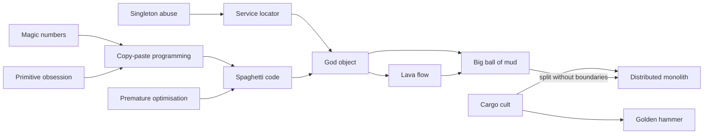
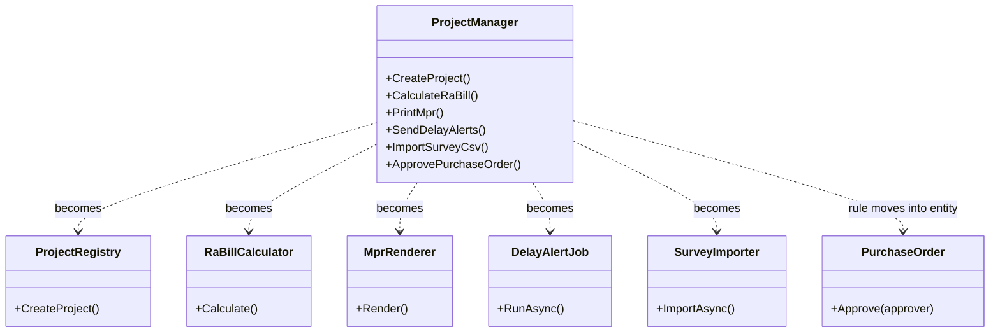
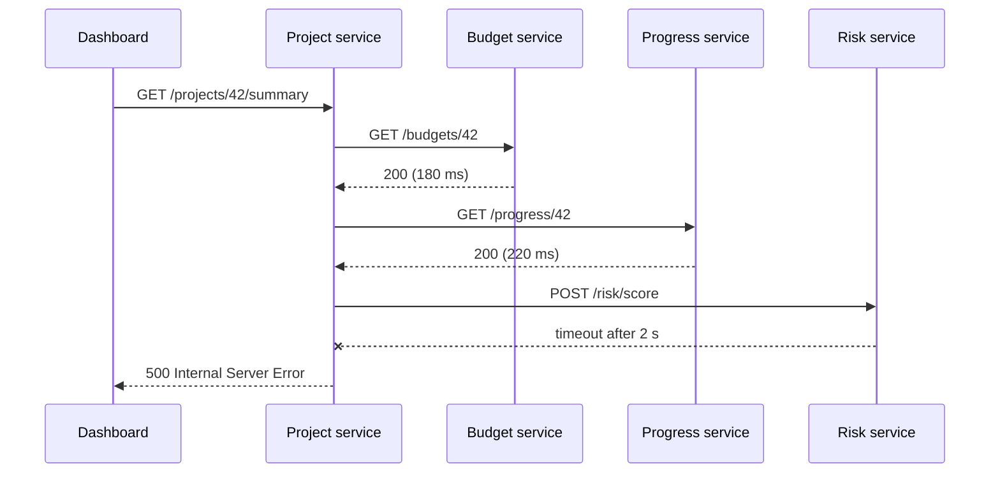

A design pattern is a proven solution to a recurring problem. An **anti-pattern** is the opposite: a common response to a recurring problem that *seems* to work, is easy to reach for, and then quietly makes things worse. Andrew Koenig coined the term in 1995. What makes something an anti-pattern rather than just a mistake is that it's *popular*, it has a *plausible justification*, and there's a *known better alternative*. This lesson is a field guide to fourteen of them.

## Learning objectives

By the end of this lesson you will be able to:

1. Define an anti-pattern and say how it differs from a bug or a code smell.
2. For each of fourteen anti-patterns, recognise the **symptom**, explain the **cause**, and apply the **fix**.
3. Refactor C# code away from magic numbers, primitive obsession, singleton abuse, service location and anemic models.
4. Say when an apparent anti-pattern is actually fine (for example, an anemic model in a CRUD app).
5. Plan the safe removal of an anti-pattern in legacy code: tests first, small steps.
6. Recognise architecture-level anti-patterns (big ball of mud, distributed monolith) and their early warning signs.

## Prerequisites

- [Single Responsibility Principle](#/lesson/m04-srp): many anti-patterns are SRP violations at different scales.
- [Code smells and technical debt](#/lesson/m04-code-smells): smells are the *symptoms*; anti-patterns are the *diagnoses*.
- [Dependency injection](#/lesson/m03-dependency-injection) and [Singleton](#/lesson/m06-singleton): needed for the singleton-abuse and service-locator sections.

## Explain it like I'm a beginner

Imagine a family where everyone dumps things in one kitchen drawer: batteries, receipts, keys, rubber bands. It started because it was *convenient*. Five years later, nobody can find anything, the drawer won't close, and nobody dares empty it in case something important is in there.

That drawer is an anti-pattern. It wasn't a stupid decision. It was the easiest thing to do each single time. The cost built up slowly and invisibly. And there's a known fix: a few labelled boxes, and the habit of putting things in the right box.

Software anti-patterns work the same way. A class that does "just one more thing" becomes a **god object**. A number typed straight into the code becomes a **magic number** that nobody can explain later. Code copied "just this once" becomes ten copies with ten slightly different bugs. Each step was reasonable. The total isn't.

So for each anti-pattern, you'll learn four things: how to **spot** it (symptom), **why** people fall into it (cause), **how to get out** (fix), and what it looks like in C# (example).

## First-principles explanation

### Anti-pattern, smell or bug?

| Term | What it is | Example |
|---|---|---|
| **Bug** | Code that produces wrong results | Rounding GST twice |
| **Code smell** | A surface sign that *might* indicate a problem | A 600-line method |
| **Anti-pattern** | A recurring, popular, wrong *solution* with a known better one | God object: putting every responsibility in one class |

Smells point you to anti-patterns. A 600-line method (smell) often means spaghetti code or a god object (anti-pattern).

### Why they happen

Almost every anti-pattern comes from one of four forces:

1. **Local convenience beats global cost.** Each shortcut saves 10 minutes today and costs hours later, to someone else.
2. **Missing feedback.** Without tests, nobody dares to delete or restructure, so mess accumulates.
3. **Copying success without context.** "Big company X uses microservices" ignores that they also have hundreds of engineers and platform teams.
4. **Deadlines without follow-up.** "We'll clean it up next sprint" — and next sprint has its own deadline.

### The catalogue

The fourteen anti-patterns, grouped by scale. Each has a symptom, a cause, a fix and an example.

---

#### 1. God object

- **Symptom:** one class with thousands of lines, dozens of dependencies, and a vague name (`ProjectManager`, `CommonService`). It's in most pull requests.
- **Cause:** "It's already got the database connection, I'll add it here." Convenience, repeated.
- **Fix:** list the actors who change it ([SRP](#/lesson/m04-srp)), extract cohesive classes one at a time behind characterization tests, and leave a thin coordinator ([see Refactoring large classes](#/lesson/m07-refactoring-large-classes)).

```csharp
// Symptom: 14 dependencies, unrelated methods.
public class ProjectManager(AppDbContext db, ISmtp smtp, IPdf pdf, IGstApi gst, ISms sms, IStorage files /* ...8 more */)
{
    public void CreateProject(...) { }
    public decimal CalculateRaBill(...) { }
    public byte[] PrintMpr(...) { }
    public void SendDelayAlerts(...) { }
    public void ImportSurveyCsv(...) { }
    // ... 60 more methods
}
```

#### 2. Anemic domain model (and when it's fine)

- **Symptom:** "entities" that are bags of public getters and setters, while all rules live in `...Service` classes. Any code can set `Status = "Approved"` directly.
- **Cause:** treating the database table as the model; frameworks that encourage public setters; habit.
- **Fix:** move rules that protect an entity's consistency *into* the entity. Make setters private, and expose intention-revealing methods (`Approve(by)`) that enforce invariants ([see Encapsulation and invariant protection](#/lesson/m07-encapsulation-invariants)).

```csharp
// Anemic: nothing stops an invalid state.
public class PurchaseOrder { public string Status { get; set; } = "Draft"; public decimal Total { get; set; } public List<Line> Lines { get; set; } = new(); }
service.Approve(po);      // the rule lives here...
po.Status = "Approved";   // ...and this line elsewhere bypasses it.
```

**When it's fine.** Fowler calls the anemic model an anti-pattern *when you claim to be doing domain modelling*. It's a perfectly good choice when there's little behaviour to protect:

- CRUD screens and admin back-offices where rules are "field required" and "max length".
- Read models, DTOs and reporting projections ([see CQRS fundamentals](#/lesson/m08-cqrs-fundamentals)).
- Simple workflows written as a **transaction script** (one procedure per use case), which Fowler also documents as a legitimate pattern.

The test: are there invariants (rules that must *always* hold) that several code paths could break? If yes, put them in the entity. If not, a plain data class is simpler and honest.

#### 3. Golden hammer

- **Symptom:** one tool for every problem. "Everything is a stored procedure." "Every feature goes through Kafka." "Every call goes through a mediator library."
- **Cause:** familiarity and past success. "If all you have is a hammer, everything looks like a nail."
- **Fix:** for each new problem, write down the requirements first, then compare at least two options. Record the decision in an [ADR](#/lesson/m02-adr).

```csharp
// Golden hammer: a message broker for an in-process, synchronous lookup.
var reply = await bus.RequestAsync<GetProjectName, ProjectNameReply>(new GetProjectName(id));   // 2 hops, a timeout and a broker for a dictionary lookup
// Simpler and correct here:
var name = projectNames.Get(id);
```

#### 4. Spaghetti code

- **Symptom:** tangled control flow. Deep nesting, flags that change meaning halfway through a method, early `return`s mixed with `goto`-like `continue`s. You can't follow one path without a debugger.
- **Cause:** patching by adding branches; no time to restructure; no tests.
- **Fix:** guard clauses, extract method, replace flag parameters with separate methods, and replace conditionals with polymorphism where variants grow.

```csharp
// Spaghetti
if (bill != null) { if (bill.Lines.Count > 0) { if (!isLocked || isAdmin) { if (mode == 2) { ... } else { if (retry) { ... } } } } }

// Guard clauses: each condition handled once, the main path is not indented.
if (bill is null) throw new ArgumentNullException(nameof(bill));
if (bill.Lines.Count == 0) return Result.Fail("Empty bill");
if (isLocked && !isAdmin) return Result.Fail("Bill is locked");
return mode == BillMode.Final ? Finalise(bill) : SaveDraft(bill, retry);
```

#### 5. Lava flow

- **Symptom:** dead or half-dead code nobody understands or dares to remove: `OldCalculatorV2`, commented-out blocks, unused feature flags, `// TODO: remove after migration (2019)`.
- **Cause:** experiments that shipped; people who left; fear of breaking something.
- **Fix:** find what's really unused (code coverage in production-like tests, IDE "find references", logs or metrics on suspected paths), delete it in small pull requests, and rely on version control to bring it back if needed. Remove feature flags as soon as rollout finishes.

```csharp
public decimal Calculate(Bill b)
{
    // var result = LegacyCalc(b);   // keep just in case
    // if (useNewEngine) ...
    return _engine.Calculate(b);
}
[Obsolete] private decimal LegacyCalc(Bill b) { /* 300 lines, no callers */ return 0; }
```

#### 6. Copy-paste programming

- **Symptom:** the same rule in several places, slightly different. A bug fix in one copy and not the others.
- **Cause:** speed; fear of changing shared code; not knowing the shared code exists.
- **Fix:** extract the *knowledge* into one place. But duplicated *code* that represents *different* rules may diverge, so don't merge it blindly ([see DRY, KISS and YAGNI](#/lesson/m04-dry-kiss-yagni)). The "rule of three" is a good trigger: refactor when the third copy appears.

```csharp
// In BillingService
var gst = Math.Round(amount * 0.18m, 2);
// In InvoicePdf
var gst = Math.Round(amount * 18 / 100, 2, MidpointRounding.AwayFromZero);   // different rounding!
// In ExportCsv
var gst = amount * 0.18m;                                                    // no rounding at all
// Fix: one GstCalculator used by all three.
```

#### 7. Magic numbers and strings

- **Symptom:** unexplained literals: `if (status == 3)`, `amount * 0.05m`, `if (role == "PMC_ADMIN")`, `Task.Delay(86400000)`.
- **Cause:** "I know what it means." The next person doesn't, and the literal gets copied.
- **Fix:** named constants for true constants (days in a week); **enums** for closed sets; **options** (configuration) for business values that may change; **value objects** for concepts.

```csharp
// Magic
if (order.Status == 3 && order.Total > 500000) RequireSecondApproval();
await Task.Delay(86400000);

// Named
if (order.Status == OrderStatus.Submitted && order.Total > _policy.SecondApprovalThreshold) RequireSecondApproval();
await Task.Delay(TimeSpan.FromDays(1));
```

#### 8. Primitive obsession

- **Symptom:** domain concepts passed around as `string`, `int` and `decimal`: `void Transfer(string from, string to, decimal amount, string currency)`. Arguments get swapped, validation is repeated everywhere.
- **Cause:** primitives are quick to type; creating a type feels like overhead.
- **Fix:** small **value objects** (often `readonly record struct`) that validate once on creation: `Money`, `Gstin`, `PinCode`, `ProjectCode`. The compiler then catches swapped arguments.

```csharp
// Primitive obsession: which string is the GSTIN? Is the amount in rupees or paise?
public void RegisterVendor(string name, string gstin, string pan, string pin, decimal creditLimit) { ... }
RegisterVendor("Shree Traders", "560001", "27ABCDE1234F1Z5", "ABCDE1234F", 500000);   // compiles; three arguments swapped

// Value objects: swapping no longer compiles.
public void RegisterVendor(string name, Gstin gstin, PinCode pin, Money creditLimit) { ... }
```

#### 9. Singleton abuse

- **Symptom:** static `Instance` properties everywhere: `Config.Instance`, `Db.Instance`, `Cache.Instance`. Tests interfere with each other; you can't run them in parallel; behaviour depends on what ran first.
- **Cause:** "We only need one" turned into "anyone can reach it from anywhere". Global mutable state with a pattern name.
- **Fix:** keep the *lifetime* (one instance) but drop the *global access*. Register it with `AddSingleton` and inject it. Replace `DateTime.Now` with an injected `TimeProvider`.

```csharp
// Abuse: hidden dependency on global, mutable state.
public decimal LateFee(Invoice i) => (DateTime.Now - i.DueDate).Days * AppSettings.Instance.DailyLateFee;

// Same single instance, visible and replaceable.
public sealed class LateFeeCalculator(TimeProvider clock, IOptions<LateFeeOptions> options) { ... }
builder.Services.AddSingleton(TimeProvider.System);
```

#### 10. Service locator

- **Symptom:** classes asking a global container for what they need: `var repo = ServiceLocator.Get<IRepo>();` or `_provider.GetService<IEmailSender>()` deep inside business code. The constructor lies about the class's dependencies.
- **Cause:** retrofitting DI into legacy code; avoiding "long constructors"; framework habits.
- **Fix:** constructor injection. A long constructor is a *useful* warning (maybe a god object). Resolving from `IServiceProvider` is fine in the **composition root**, in framework integration points (factories, middleware), and for keyed choices made at runtime — kept in one small, testable resolver ([see DI versus service locator](#/lesson/m04-di-vs-service-locator)).

```csharp
// Hidden dependencies: the test has to know to register IClock, IMailer and IInvoiceRepo globally.
public class ReminderJob
{
    public void Run()
    {
        var clock = ServiceLocator.Current.Get<IClock>();
        var invoices = ServiceLocator.Current.Get<IInvoiceRepo>();
        var mailer = ServiceLocator.Current.Get<IMailer>();
        ...
    }
}
// Honest: public sealed class ReminderJob(TimeProvider clock, IInvoiceRepo invoices, IMailer mailer)
```

#### 11. Premature optimisation

- **Symptom:** unreadable code justified by speed nobody measured: hand-rolled caches, `unsafe` code in a CRUD service, micro-optimised loops next to an N+1 query.
- **Cause:** guessing where time goes. Donald Knuth's 1974 warning is about this: programmers waste time on small efficiencies "about 97% of the time", while the critical 3% deserves attention.
- **Fix:** set a performance goal (for example "p95 under 300 ms at 200 requests per second"), measure with a profiler or BenchmarkDotNet, optimise the measured hotspot, and keep the simple version elsewhere. Not an excuse for bad *design*: choosing an index, avoiding N+1 queries and paging large results are not premature ([see N+1 queries](#/lesson/m09-n-plus-one)).

```csharp
// Premature: a hand-rolled string cache to "save allocations" in an endpoint that then makes 50 SQL round trips.
private static readonly ConcurrentDictionary<int, string> _labelCache = new();
foreach (var id in ids) { var p = await db.Projects.FindAsync(id); ... }   // the real cost: N+1 queries
```

#### 12. Cargo cult programming

- **Symptom:** rituals copied without understanding: every class gets an interface "for testability" but nothing is faked; CQRS and event sourcing in a 3-screen app; Kubernetes for one service; `ConfigureAwait(false)` sprinkled through ASP.NET Core app code "because the blog said so".
- **Cause:** imitation of successful teams or tutorials, without the problem that justified it.
- **Fix:** for each practice, ask "what problem does this solve for *us*, and how would we know it's working?" Keep it only if there's an answer.

```csharp
// Cargo cult: interface + factory + mediator for a single, never-replaced class.
public interface IProjectNameFormatter { string Format(Project p); }
public class ProjectNameFormatter : IProjectNameFormatter { public string Format(Project p) => p.Code + " " + p.Name; }
public interface IProjectNameFormatterFactory { IProjectNameFormatter Create(); }
// A static method or an extension method would do: p.DisplayName()
```

#### 13. Big ball of mud

- **Symptom:** a whole system with no recognisable structure. Any class calls any other class; the database is shared by every feature; "layers" exist in folder names only. Foote and Yoder named it in 1997 and observed it's the *most common* architecture in practice.
- **Cause:** years of local fixes, team turnover, no agreed boundaries, and no enforcement.
- **Fix:** don't rewrite it all. Draw the current dependency graph, pick module boundaries along business capabilities, enforce them (separate projects, internal types, architecture tests), and move features one by one — the strangler approach ([see Refactoring legacy code](#/lesson/m04-refactoring-legacy) and [Modular monolith](#/lesson/m02-modular-monolith)).

```csharp
// Mud: the billing endpoint reaches straight into survey and HR tables.
var hours = db.SurveyCrewAttendance.Where(...).Sum(a => a.Hours);   // billing depends on HR's table layout
var rate  = db.SurveyRates.First(...);                               // and on survey's
// Boundary: billing asks the HR module's public interface instead.
var hours = await hrModule.GetBillableHoursAsync(crewId, month, ct);
```

#### 14. Distributed monolith

- **Symptom:** "microservices" that must be deployed together; one user request triggers a synchronous chain of 5–6 service calls; services share one database; a change to one API breaks three others.
- **Cause:** splitting by technical layer (a "validation service", a "database service") or by entity rather than by business capability; adopting microservices for fashion (a cargo cult at architecture scale).
- **Fix:** merge services that always change together back into one deployable (often a [modular monolith](#/lesson/m02-modular-monolith)); give each remaining service its own data; replace synchronous chains with asynchronous events where the business allows; version APIs ([see Modular monolith versus microservices](#/lesson/m16-monolith-vs-microservices)).

```csharp
// Distributed monolith: a synchronous chain where any one failure fails the whole request.
var project  = await projectApi.GetAsync(id);            // service A
var budget   = await budgetApi.GetAsync(project.Id);     // service B, needs A's result
var progress = await progressApi.GetAsync(project.Id);   // service C
var risk     = await riskApi.ScoreAsync(budget, progress);   // service D, needs B and C
```

---

### When something that looks like an anti-pattern isn't

Context changes the verdict:

- A single-file, 300-line script that runs once is not a god object worth fixing.
- An anemic model for a CRUD admin screen is honest, not lazy.
- A static, *immutable*, stateless helper (`GstMath.Round`) is not singleton abuse.
- Resolving from `IServiceProvider` in a factory at the composition root is not a service locator in the harmful sense.
- A hand-optimised loop in a measured hotspot, with a benchmark proving it, is optimisation, not premature.

### Trade-offs of fixing anti-patterns

| Fixing gains | Fixing costs |
|---|---|
| Lower cost and risk of future change | Time now, with no new features to show |
| Faster, more reliable tests | Risk of regressions while refactoring (mitigate with tests first) |
| Easier onboarding | Possible over-correction into the opposite anti-pattern (e.g. god object → ravioli code) |

Fix anti-patterns in code that is **changed often** or **critical** (money, safety, compliance). Leave stable, rarely touched mud alone until you need to change it. That's the "boy scout rule" with a budget: improve what you touch, not everything you see.

## Visual explanation

### How anti-patterns feed each other



Read the arrows as "tends to lead to". Small, code-level habits on the left (magic numbers, primitive obsession, copying) create duplication and tangled logic. Tangled logic and hidden global access attract more and more code into a few classes, which become god objects. God objects surrounded by dead code become a big ball of mud. The most expensive arrow is the last one: splitting a big ball of mud into services *without first finding boundaries* produces a distributed monolith, which keeps all the coupling and adds network failures. The fix order follows the arrows backwards: find boundaries first, then split.

### God object, before and after



The god object on the left is split by *who changes what*. Most methods become their own focused classes. One case is different: the purchase-order approval rule doesn't become another service. It moves *into* the `PurchaseOrder` entity, because it protects the entity's own consistency. That one arrow fixes an anemic model at the same time as the god object.

### Distributed monolith at runtime



One page load depends on four services being up *at the same time*, and the latencies add up. If each service is independently available 99.5 % of the time (an illustrative figure), the chance that all four are up together is roughly 0.995⁴ ≈ 98 %, which is worse than any single service. A failure in the risk service, which the dashboard could live without, breaks the whole page. The fixes: show the summary without the risk score when it's unavailable, precompute the summary asynchronously from events, or merge services that always change together.

## Step-by-step example

Here is a small piece of procurement code that contains six anti-patterns at once. We'll fix it in safe steps.

```csharp
// BEFORE: magic numbers, primitive obsession, singleton abuse, service locator, anemic model, copy-paste.
public class PoHelper
{
    public string Approve(int poId, string userId)
    {
        var db = Db.Instance;                                     // singleton abuse
        var po = db.PurchaseOrders.Find(poId);
        if (po.Status != 1) return "ERR1";                        // magic number + magic string
        if (po.CreatedBy == userId) return "ERR2";
        var limit = userId.StartsWith("PM") ? 5000000 : 500000;   // magic numbers, role encoded in an id string
        if (po.Total > limit) return "ERR3";
        po.Status = 2;                                            // anemic: anyone can set this
        po.ApprovedOn = DateTime.Now;                             // hidden clock
        var mailer = ServiceLocator.Get<IMailer>();               // service locator
        mailer.Send(po.CreatedBy, "PO " + poId + " approved");
        db.SaveChanges();
        return "OK";
    }
}
```

### Step 1 — pin current behaviour with tests

Before changing anything, write **characterization tests** (tests that record what the code does today, right or wrong). Here: a draft PO returns "ERR1", self-approval returns "ERR2", ₹6,00,000 approved by a non-PM returns "ERR3", and the happy path returns "OK". Since `Db.Instance` and `ServiceLocator` are global, these tests are awkward to write, which is itself evidence of the problem. A common first move is to add a seam: an internal constructor that accepts the database and mailer, while the old parameterless path still uses the globals.

### Step 2 — name the magic

Replace `1` and `2` with an enum (`PoStatus.Submitted`, `PoStatus.Approved`). Replace the limits with an options class (`ApprovalPolicy` with per-role limits) because finance will change them. Replace "ERR1"... with a result type that carries a reason.

### Step 3 — make concepts types

The role hidden in `userId.StartsWith("PM")` becomes an `Approver` record with a `Role` and a limit. Amounts become `Money`. Now the compiler stops "amount in paise" and "amount in rupees" from mixing.

### Step 4 — move the rules into the entity

`PurchaseOrder.Approve(approver, now)` enforces: must be Submitted, approver isn't the creator, total within the approver's limit. The `Status` setter becomes private. Now *no other code path* can approve without these checks. That's the anemic-model fix.

### Step 5 — inject dependencies

`Db.Instance`, `DateTime.Now` and `ServiceLocator.Get` become constructor parameters: a repository, a `TimeProvider` and a mailer. The application service shrinks to: load, call `po.Approve(...)`, save, notify.

### Step 6 — delete the old path

Once callers use the new service, delete `PoHelper`. Don't leave it "just in case": that's how lava flows start.

## Production-style C# implementation

The result of the refactoring, as a small ASP.NET Core feature.

```text
Procurement.Api/
  Program.cs
  Procurement/
    ValueObjects.cs          Money, Gstin
    PurchaseOrder.cs         rich entity with invariants
    ApprovalPolicy.cs        options instead of magic numbers
    PurchaseOrderStore.cs    repository (in-memory stand-in)
    ApprovePurchaseOrder.cs  thin application service
```

```csharp file=Procurement/ValueObjects.cs
using System.Text.RegularExpressions;

namespace Procurement.Domain;

/// <summary>Rupee amount. Fixes primitive obsession: amounts can't be confused with quantities or paise.</summary>
public readonly record struct Money : IComparable<Money>
{
    public decimal Rupees { get; }

    public Money(decimal rupees)
    {
        if (rupees < 0) throw new ArgumentOutOfRangeException(nameof(rupees), "Money cannot be negative.");
        Rupees = Math.Round(rupees, 2, MidpointRounding.AwayFromZero);
    }

    public static readonly Money Zero = new(0m);
    public static Money operator +(Money a, Money b) => new(a.Rupees + b.Rupees);
    public static Money operator *(Money a, decimal factor) => new(a.Rupees * factor);
    public static bool operator >(Money a, Money b) => a.Rupees > b.Rupees;
    public static bool operator <(Money a, Money b) => a.Rupees < b.Rupees;
    public int CompareTo(Money other) => Rupees.CompareTo(other.Rupees);
    public override string ToString() => $"₹{Rupees:N2}";
}

/// <summary>GST identification number. Validates structure only (2-digit state code, PAN, entity, 'Z', check char);
/// the check-character algorithm is out of scope here.</summary>
public sealed partial record Gstin
{
    public string Value { get; }

    private Gstin(string value) => Value = value;

    public static bool TryParse(string? text, out Gstin? gstin)
    {
        var v = text?.Trim().ToUpperInvariant() ?? "";
        gstin = Pattern().IsMatch(v) ? new Gstin(v) : null;
        return gstin is not null;
    }

    public static Gstin Parse(string text) =>
        TryParse(text, out var g) ? g! : throw new FormatException($"'{text}' is not a valid GSTIN format.");

    public override string ToString() => Value;

    [GeneratedRegex("^[0-9]{2}[A-Z]{5}[0-9]{4}[A-Z][1-9A-Z]Z[0-9A-Z]$")]
    private static partial Regex Pattern();
}
```

```csharp file=Procurement/PurchaseOrder.cs
namespace Procurement.Domain;

public enum PoStatus { Draft, Submitted, Approved, Cancelled }

public sealed record PoLine(string ItemCode, decimal Quantity, Money UnitPrice)
{
    public Money Total => UnitPrice * Quantity;
}

public sealed record Approver(string UserId, string Role, Money Limit);

public sealed record DomainResult(bool Succeeded, string? Error)
{
    public static readonly DomainResult Ok = new(true, null);
    public static DomainResult Fail(string error) => new(false, error);
}

/// <summary>Rich entity: every state change goes through a method that enforces the invariants.</summary>
public sealed class PurchaseOrder
{
    private readonly List<PoLine> _lines = new();

    public PurchaseOrder(Guid id, string createdBy, Gstin vendor)
    {
        Id = id;
        CreatedBy = string.IsNullOrWhiteSpace(createdBy) ? throw new ArgumentException("Creator required.", nameof(createdBy)) : createdBy;
        Vendor = vendor;
    }

    public Guid Id { get; }
    public string CreatedBy { get; }
    public Gstin Vendor { get; }
    public PoStatus Status { get; private set; } = PoStatus.Draft;
    public string? ApprovedBy { get; private set; }
    public DateTimeOffset? ApprovedAt { get; private set; }
    public IReadOnlyList<PoLine> Lines => _lines;
    public Money Total => _lines.Aggregate(Money.Zero, (sum, l) => sum + l.Total);

    public DomainResult AddLine(PoLine line)
    {
        if (Status != PoStatus.Draft) return DomainResult.Fail("Lines can only be added to a draft order.");
        if (line.Quantity <= 0) return DomainResult.Fail("Quantity must be positive.");
        _lines.Add(line);
        return DomainResult.Ok;
    }

    public DomainResult Submit()
    {
        if (Status != PoStatus.Draft) return DomainResult.Fail($"Cannot submit an order that is {Status}.");
        if (_lines.Count == 0) return DomainResult.Fail("An order needs at least one line.");
        Status = PoStatus.Submitted;
        return DomainResult.Ok;
    }

    public DomainResult Approve(Approver approver, DateTimeOffset now)
    {
        if (Status != PoStatus.Submitted) return DomainResult.Fail($"Cannot approve an order that is {Status}.");
        if (string.Equals(approver.UserId, CreatedBy, StringComparison.OrdinalIgnoreCase)) return DomainResult.Fail("You cannot approve your own order.");
        if (Total > approver.Limit) return DomainResult.Fail($"Total {Total} exceeds {approver.Role} limit {approver.Limit}.");
        Status = PoStatus.Approved;
        ApprovedBy = approver.UserId;
        ApprovedAt = now;
        return DomainResult.Ok;
    }
}
```

```csharp file=Procurement/ApprovalPolicy.cs
using Procurement.Domain;

namespace Procurement.Application;

/// <summary>Replaces magic numbers. Finance edits these in configuration, not in code.</summary>
public sealed class ApprovalPolicyOptions
{
    public Dictionary<string, decimal> LimitsByRole { get; set; } = new(StringComparer.OrdinalIgnoreCase)
    {
        ["SiteEngineer"] = 5_00_000m,
        ["ProjectManager"] = 50_00_000m,
        ["RegionalHead"] = 5_00_00_000m,
    };
}

public interface IUserDirectory
{
    string? RoleOf(string userId);
}

public sealed class InMemoryUserDirectory(Dictionary<string, string> roles) : IUserDirectory
{
    public string? RoleOf(string userId) => roles.TryGetValue(userId, out var r) ? r : null;
}
```

```csharp file=Procurement/PurchaseOrderStore.cs
using System.Collections.Concurrent;
using Microsoft.Extensions.Logging;
using Procurement.Domain;

namespace Procurement.Application;

public interface IPurchaseOrderStore
{
    Task<PurchaseOrder?> FindAsync(Guid id, CancellationToken ct);
    Task SaveAsync(PurchaseOrder order, CancellationToken ct);
}

/// <summary>Stand-in. A PostgreSQL version would map PurchaseOrder through EF Core with private-setter support.</summary>
public sealed class InMemoryPurchaseOrderStore : IPurchaseOrderStore
{
    private readonly ConcurrentDictionary<Guid, PurchaseOrder> _orders = new();
    public Task<PurchaseOrder?> FindAsync(Guid id, CancellationToken ct) => Task.FromResult(_orders.TryGetValue(id, out var o) ? o : null);
    public Task SaveAsync(PurchaseOrder order, CancellationToken ct) { _orders[order.Id] = order; return Task.CompletedTask; }
}

public interface IApprovalNotifier
{
    Task OrderApprovedAsync(PurchaseOrder order, CancellationToken ct);
}

public sealed class LoggingApprovalNotifier(ILogger<LoggingApprovalNotifier> logger) : IApprovalNotifier
{
    public Task OrderApprovedAsync(PurchaseOrder order, CancellationToken ct)
    {
        logger.LogInformation("PO {Id} approved by {User}; notify {Creator}", order.Id, order.ApprovedBy, order.CreatedBy);
        return Task.CompletedTask;
    }
}
```

```csharp file=Procurement/ApprovePurchaseOrder.cs
using Microsoft.Extensions.Options;
using Procurement.Domain;

namespace Procurement.Application;

/// <summary>Thin application service: load, delegate to the entity, save, notify. Every dependency is visible.</summary>
public sealed class ApprovePurchaseOrder(
    IPurchaseOrderStore store,
    IUserDirectory users,
    IOptions<ApprovalPolicyOptions> policy,
    TimeProvider clock,
    IApprovalNotifier notifier)
{
    public async Task<DomainResult> HandleAsync(Guid orderId, string approverUserId, CancellationToken ct)
    {
        var order = await store.FindAsync(orderId, ct);
        if (order is null) return DomainResult.Fail("Order not found.");

        var role = users.RoleOf(approverUserId);
        if (role is null || !policy.Value.LimitsByRole.TryGetValue(role, out var limit))
            return DomainResult.Fail("You are not an approver.");

        var result = order.Approve(new Approver(approverUserId, role, new Money(limit)), clock.GetUtcNow());
        if (!result.Succeeded) return result;

        await store.SaveAsync(order, ct);
        await notifier.OrderApprovedAsync(order, ct);
        return result;
    }
}
```

```csharp file=Program.cs
using Procurement.Application;

var builder = WebApplication.CreateBuilder(args);

builder.Services.Configure<ApprovalPolicyOptions>(builder.Configuration.GetSection("Procurement:Approval"));
builder.Services.AddSingleton(TimeProvider.System);   // one instance, injected — not a static singleton
builder.Services.AddSingleton<IPurchaseOrderStore, InMemoryPurchaseOrderStore>();
builder.Services.AddSingleton<IUserDirectory>(new InMemoryUserDirectory(new Dictionary<string, string>
{
    ["anita"] = "SiteEngineer",
    ["rahul"] = "ProjectManager",
}));
builder.Services.AddSingleton<IApprovalNotifier, LoggingApprovalNotifier>();
builder.Services.AddScoped<ApprovePurchaseOrder>();

var app = builder.Build();

app.MapPost("/purchase-orders/{id:guid}/approve", async (Guid id, ApproveRequest req, ApprovePurchaseOrder handler, CancellationToken ct) =>
{
    var result = await handler.HandleAsync(id, req.ApproverUserId, ct);
    return result.Succeeded ? Results.NoContent() : Results.Problem(result.Error, statusCode: StatusCodes.Status422UnprocessableEntity);
});

app.Run();

public sealed record ApproveRequest(string ApproverUserId);
```

How each anti-pattern was removed:

| Anti-pattern | Where it went |
|---|---|
| Magic numbers/strings | `PoStatus` enum; `ApprovalPolicyOptions` from configuration; `DomainResult` with readable errors |
| Primitive obsession | `Money`, `Gstin`, `Approver` |
| Anemic model | `PurchaseOrder` methods enforce invariants; private setters |
| Singleton abuse | `TimeProvider` and the store are DI singletons, injected |
| Service locator | Every dependency is a constructor parameter of `ApprovePurchaseOrder` |
| God object | `PoHelper` replaced by an entity plus one small use-case class |

Note that `Approve` takes `now` as a parameter instead of a `TimeProvider`. Entities stay free of infrastructure; the application service supplies the time.

## Bad design vs good design

The *Step-by-step example* shows the before/after for one feature. Two broader comparisons are worth making.

**Over-correction is its own anti-pattern.** Teams that discover god objects sometimes swing to hundreds of one-method classes ("ravioli code"). Teams that discover primitive obsession wrap *every* string in a type, including free-text remarks. Teams that discover premature optimisation stop thinking about performance at all and ship N+1 queries. The goal is balance, guided by *what changes and what breaks*.

**Removing an anti-pattern without tests creates bugs.** The safest order is always: characterization tests → small refactoring step → run tests → commit. Each step should be small enough to revert in one click.

:::callout type=mistake title="The big rewrite"
Faced with a big ball of mud, teams often propose a full rewrite. Rewrites usually take far longer than planned, the old system keeps changing meanwhile, and hidden behaviour (the bugs customers rely on) gets lost. Prefer incremental replacement: route one feature at a time to new code, keep both running, and retire the old path when traffic is zero.
:::

:::callout type=tradeoff title="Debt you choose vs debt you drift into"
Taking a shortcut on purpose, with a ticket and a date to fix it, is a business decision ("deliberate technical debt"). Anti-patterns are mostly *drifted-into* debt: nobody decided, so nobody plans the repayment. Making the decision visible is half the fix.
:::

## Practical playground

The playground shows primitive obsession causing a real bug: the vendor's PIN code and GSTIN are swapped, and the compiler can't help. Run it, then change `RegisterVendor` to take the `PinCode` value object (already written) and watch the swapped call stop compiling.

:::playground type=csharp title="Primitive obsession: let the compiler catch swapped arguments"
```csharp file=Program.cs
using System;
using System.Linq;

public readonly record struct PinCode
{
    public string Value { get; }
    public PinCode(string value)
    {
        if (value is null || value.Length != 6 || !value.All(char.IsAsciiDigit) || value[0] == '0')
            throw new FormatException($"'{value}' is not a valid PIN code.");
        Value = value;
    }
    public override string ToString() => Value;
}

public static class VendorRegistry
{
    // Primitive obsession: three strings in a row.
    public static string RegisterVendor(string name, string gstin, string pinCode) =>
        $"{name} | GSTIN {gstin} | PIN {pinCode}";

    // TODO: change to RegisterVendor(string name, string gstin, PinCode pinCode)
}

public static class Program
{
    public static void Main()
    {
        // Bug: arguments swapped. It compiles and runs.
        Console.WriteLine(VendorRegistry.RegisterVendor("Shree Cement Traders", "122001", "06ABCDE1234F1Z5"));

        // Value objects validate once, at the edge.
        try { _ = new PinCode("06ABCDE1234F1Z5"); }
        catch (FormatException ex) { Console.WriteLine($"Caught early: {ex.Message}"); }

        Console.WriteLine(new PinCode("122001"));
    }
}
```
:::

## Exercises

:::exercise id=m06-anti-patterns-ex1 difficulty=beginner kind=code title="Replace magic numbers with a policy"
A delay-penalty method on a construction contract reads `return Math.Min(value * 0.005m * weeks, value * 0.10m);`. Nobody remembers what 0.005 and 0.10 mean, and different contracts use different values. Implement `DelayPenaltyCalculator` using a `PenaltyPolicy` instead of literals.

Example clause (illustrative): liquidated damages of 0.5 % of the contract value per week of delay, capped at 10 % of the contract value. Part weeks count as full weeks.
::requirements
- `PenaltyPolicy(decimal PercentPerWeek, decimal CapPercent)` with a static `Standard` policy of 0.5 % and 10 %.
- `Calculate(contractValue, daysLate)` rounds part weeks up, applies the cap, and rounds to 2 decimals.
- 0 or negative days late gives 0. Negative contract value throws `ArgumentOutOfRangeException`.
::acceptance
- ₹1,00,00,000 contract, 10 days late (2 weeks) under the standard policy: ₹1,00,000.
- 200 days late is capped at ₹10,00,000.
- A policy of 1 % per week with a 5 % cap gives ₹5,00,000 for 70 days late.
- No unexplained literals remain in the calculation.
::hint
The numbers belong to the *contract*, so they're data, not constants in the method.
::hint
Weeks: `(int)Math.Ceiling(daysLate / 7m)`.
::hint
Percentages: divide by 100 once, in one place, so 0.5 means "0.5 %".
::hint
```csharp
var raw = contractValue * policy.PercentPerWeek / 100m * weeks;
var cap = contractValue * policy.CapPercent / 100m;
return Math.Round(Math.Min(raw, cap), 2, MidpointRounding.AwayFromZero);
```
::starter
```csharp file=DelayPenalty.cs
using System;

public sealed record PenaltyPolicy(decimal PercentPerWeek, decimal CapPercent)
{
    public static readonly PenaltyPolicy Standard = new(0.5m, 10m);
}

public sealed class DelayPenaltyCalculator(PenaltyPolicy policy)
{
    public const int DaysPerWeek = 7;

    public decimal Calculate(decimal contractValue, int daysLate) => throw new NotImplementedException();
}
```
::tests
```csharp file=DelayPenaltyTests.cs
using System;
using Xunit;

public class DelayPenaltyTests
{
    private static readonly DelayPenaltyCalculator Standard = new(PenaltyPolicy.Standard);

    [Fact] public void Two_weeks_standard() => Assert.Equal(100_000m, Standard.Calculate(10_000_000m, 10));
    [Fact] public void Part_week_counts_as_full() => Assert.Equal(50_000m, Standard.Calculate(10_000_000m, 1));
    [Fact] public void Capped() => Assert.Equal(1_000_000m, Standard.Calculate(10_000_000m, 200));
    [Fact] public void Other_policy() => Assert.Equal(500_000m, new DelayPenaltyCalculator(new PenaltyPolicy(1m, 5m)).Calculate(10_000_000m, 70));
    [Fact] public void Not_late() => Assert.Equal(0m, Standard.Calculate(10_000_000m, 0));
    [Fact] public void Negative_value_rejected() => Assert.Throws<ArgumentOutOfRangeException>(() => Standard.Calculate(-1m, 5));
}
```
::solution
```csharp file=DelayPenalty.cs
using System;

public sealed record PenaltyPolicy(decimal PercentPerWeek, decimal CapPercent)
{
    public static readonly PenaltyPolicy Standard = new(0.5m, 10m);
}

public sealed class DelayPenaltyCalculator(PenaltyPolicy policy)
{
    public const int DaysPerWeek = 7;
    private const decimal PercentDivisor = 100m;

    public decimal Calculate(decimal contractValue, int daysLate)
    {
        ArgumentOutOfRangeException.ThrowIfNegative(contractValue);
        if (daysLate <= 0) return 0m;

        var weeksLate = (int)Math.Ceiling(daysLate / (decimal)DaysPerWeek);
        var raw = contractValue * policy.PercentPerWeek / PercentDivisor * weeksLate;
        var cap = contractValue * policy.CapPercent / PercentDivisor;
        return Math.Round(Math.Min(raw, cap), 2, MidpointRounding.AwayFromZero);
    }
}
```

In an ASP.NET Core app, each contract's `PenaltyPolicy` would come from the contract record in the database, because the clause is part of the contract.
::mistakes
- Replacing `0.005m` with `const decimal PointZeroZeroFive = 0.005m`. A name that repeats the value explains nothing; name the *meaning*.
- Integer division `daysLate / 7`, which rounds 10 days down to 1 week.
- Storing 0.005 in one place and "0.5 %" in another. Pick one representation and convert once.
:::

:::exercise id=m06-anti-patterns-ex2 difficulty=beginner kind=code title="A PinCode value object"
Vendor and site addresses pass PIN codes around as `string`, and the same validation is copied into five places (one of them accepts 5 digits). Implement `PinCode` as a value object.
::requirements
- Exactly 6 ASCII digits; the first digit is not 0. Surrounding spaces are trimmed.
- `PinCode.TryParse(string?, out PinCode)` returns false instead of throwing.
- `PinCode.Parse(string)` throws `FormatException` with the bad value in the message.
- Two `PinCode`s with the same digits are equal; `ToString()` returns the digits.
- `Region` returns the first digit as an int (India Post uses it for the postal region).
::acceptance
- `"122001"` and `" 122001 "` parse to equal values.
- `"012345"`, `"12345"`, `"1220O1"` (letter O) and `null` fail.
- `Parse("12345")` throws `FormatException` mentioning "12345".
::hint
A `readonly record struct` gives value equality for free.
::hint
Use `char.IsAsciiDigit`, not `char.IsDigit`, which also accepts other scripts' digits (for example Devanagari ४).
::hint
Make the constructor private and route everything through `TryParse`, so no invalid `PinCode` can exist.
::hint
```csharp
public static bool TryParse(string? text, out PinCode pin)
{
    var v = text?.Trim();
    if (v is { Length: 6 } && v[0] != '0' && v.All(char.IsAsciiDigit)) { pin = new PinCode(v); return true; }
    pin = default; return false;
}
```
::starter
```csharp file=PinCode.cs
using System;
using System.Linq;

public readonly record struct PinCode
{
    public string Value { get; }
    private PinCode(string value) => Value = value;

    public int Region => throw new NotImplementedException();

    public static bool TryParse(string? text, out PinCode pin) => throw new NotImplementedException();
    public static PinCode Parse(string text) => throw new NotImplementedException();
    public override string ToString() => throw new NotImplementedException();
}
```
::tests
```csharp file=PinCodeTests.cs
using System;
using Xunit;

public class PinCodeTests
{
    [Fact] public void Parses_and_trims() => Assert.Equal(PinCode.Parse("122001"), PinCode.Parse(" 122001 "));
    [Fact] public void ToString_is_digits() => Assert.Equal("560001", PinCode.Parse("560001").ToString());
    [Fact] public void Region_is_first_digit() => Assert.Equal(5, PinCode.Parse("560001").Region);

    [Theory]
    [InlineData("012345")]
    [InlineData("12345")]
    [InlineData("1220O1")]
    [InlineData("1234567")]
    [InlineData("")]
    public void Rejects_invalid(string text) => Assert.False(PinCode.TryParse(text, out _));

    [Fact] public void Rejects_null() => Assert.False(PinCode.TryParse(null, out _));
    [Fact] public void Rejects_non_ascii_digits() => Assert.False(PinCode.TryParse("१२२००१", out _));

    [Fact]
    public void Parse_throws_with_value()
    {
        var ex = Assert.Throws<FormatException>(() => PinCode.Parse("12345"));
        Assert.Contains("12345", ex.Message);
    }
}
```
::solution
```csharp file=PinCode.cs
using System;
using System.Linq;

public readonly record struct PinCode
{
    public string Value { get; }
    private PinCode(string value) => Value = value;

    public int Region => Value[0] - '0';

    public static bool TryParse(string? text, out PinCode pin)
    {
        var v = text?.Trim();
        if (v is { Length: 6 } && v[0] != '0' && v.All(char.IsAsciiDigit))
        {
            pin = new PinCode(v);
            return true;
        }
        pin = default;
        return false;
    }

    public static PinCode Parse(string text) =>
        TryParse(text, out var pin) ? pin : throw new FormatException($"'{text}' is not a valid 6-digit PIN code.");

    public override string ToString() => Value;
}
```

One caveat: `default(PinCode)` exists for any struct and has a null `Value`. If that matters, make it a `sealed record` class instead, or check for `default` at boundaries.
::mistakes
- `char.IsDigit`, which accepts non-ASCII digits, so "१२२००१" would pass.
- A public constructor without validation, so `new PinCode("abc")` is possible.
- Using `int` for PIN codes: it can't keep leading zeros, and PIN codes aren't numbers you do arithmetic with.
:::

:::exercise id=m06-anti-patterns-ex3 difficulty=intermediate kind=code title="From service locator to constructor injection"
`OverdueInvoiceReminder` pulls its dependencies from a static `ServiceLocator`. Its tests are flaky because they share global registrations. Rewrite it with constructor injection and test it with fakes.
::requirements
- Constructor takes `TimeProvider`, `IInvoiceSource` and `IReminderSender`.
- `RunAsync` sends one reminder per unpaid invoice that is **more than** `OverdueAfterDays` (30) days past its due date, and returns the number sent.
- Paid invoices are never reminded.
- If sending one reminder throws, the others are still sent; the failed one isn't counted.
::acceptance
- With "today" fixed at 1 March 2026: an unpaid invoice due 15 Jan (45 days) is reminded; one due 10 Feb (19 days) is not; a paid one due 1 Jan is not.
- An invoice exactly 30 days overdue is not reminded.
- A failing sender for one invoice doesn't stop the others.
::hint
Every `ServiceLocator.Get<T>()` call becomes a constructor parameter.
::hint
`clock.GetUtcNow()` replaces `DateTime.UtcNow`. In the test, a tiny `FixedClock : TimeProvider` overrides `GetUtcNow()`.
::hint
Compare dates, not times: `DateOnly.FromDateTime(clock.GetUtcNow().UtcDateTime)`, then `today.DayNumber - due.DayNumber`.
::hint
Wrap each send in `try/catch` and only count successes.
::starter
```csharp file=Reminders.cs
using System;
using System.Collections.Generic;
using System.Threading;
using System.Threading.Tasks;

public sealed record Invoice(string Number, string CustomerEmail, DateOnly DueDate, bool IsPaid);

public interface IInvoiceSource { Task<IReadOnlyList<Invoice>> GetOpenAndPaidAsync(CancellationToken ct); }
public interface IReminderSender { Task SendAsync(Invoice invoice, CancellationToken ct); }

public sealed class OverdueInvoiceReminder
{
    public const int OverdueAfterDays = 30;

    public OverdueInvoiceReminder(TimeProvider clock, IInvoiceSource invoices, IReminderSender sender) => throw new NotImplementedException();

    public Task<int> RunAsync(CancellationToken ct) => throw new NotImplementedException();
}
```
::tests
```csharp file=ReminderTests.cs
using System;
using System.Collections.Generic;
using System.Threading;
using System.Threading.Tasks;
using Xunit;

public class OverdueInvoiceReminderTests
{
    private sealed class FixedClock(DateTimeOffset now) : TimeProvider { public override DateTimeOffset GetUtcNow() => now; }

    private sealed class FakeSource(params Invoice[] invoices) : IInvoiceSource
    {
        public Task<IReadOnlyList<Invoice>> GetOpenAndPaidAsync(CancellationToken ct) => Task.FromResult<IReadOnlyList<Invoice>>(invoices);
    }

    private sealed class RecordingSender(string? failFor = null) : IReminderSender
    {
        public readonly List<string> Sent = new();
        public Task SendAsync(Invoice i, CancellationToken ct)
        {
            if (i.Number == failFor) throw new InvalidOperationException("SMTP down");
            Sent.Add(i.Number);
            return Task.CompletedTask;
        }
    }

    private static readonly FixedClock March1 = new(new DateTimeOffset(2026, 3, 1, 9, 0, 0, TimeSpan.Zero));

    [Fact]
    public async Task Reminds_only_unpaid_invoices_over_30_days()
    {
        var sender = new RecordingSender();
        var job = new OverdueInvoiceReminder(March1, new FakeSource(
            new Invoice("INV-1", "a@x.in", new DateOnly(2026, 1, 15), false),
            new Invoice("INV-2", "b@x.in", new DateOnly(2026, 2, 10), false),
            new Invoice("INV-3", "c@x.in", new DateOnly(2026, 1, 1), true)), sender);

        Assert.Equal(1, await job.RunAsync(CancellationToken.None));
        Assert.Equal("INV-1", Assert.Single(sender.Sent));
    }

    [Fact]
    public async Task Exactly_thirty_days_is_not_overdue()
    {
        var sender = new RecordingSender();
        var job = new OverdueInvoiceReminder(March1, new FakeSource(new Invoice("INV-4", "d@x.in", new DateOnly(2026, 1, 30), false)), sender);
        Assert.Equal(0, await job.RunAsync(CancellationToken.None));
    }

    [Fact]
    public async Task One_failure_does_not_stop_others()
    {
        var sender = new RecordingSender(failFor: "INV-5");
        var job = new OverdueInvoiceReminder(March1, new FakeSource(
            new Invoice("INV-5", "e@x.in", new DateOnly(2026, 1, 1), false),
            new Invoice("INV-6", "f@x.in", new DateOnly(2026, 1, 2), false)), sender);
        Assert.Equal(1, await job.RunAsync(CancellationToken.None));
        Assert.Equal("INV-6", Assert.Single(sender.Sent));
    }
}
```
::solution
```csharp file=Reminders.cs
using System;
using System.Collections.Generic;
using System.Threading;
using System.Threading.Tasks;

public sealed record Invoice(string Number, string CustomerEmail, DateOnly DueDate, bool IsPaid);

public interface IInvoiceSource { Task<IReadOnlyList<Invoice>> GetOpenAndPaidAsync(CancellationToken ct); }
public interface IReminderSender { Task SendAsync(Invoice invoice, CancellationToken ct); }

public sealed class OverdueInvoiceReminder
{
    public const int OverdueAfterDays = 30;
    private readonly TimeProvider _clock;
    private readonly IInvoiceSource _invoices;
    private readonly IReminderSender _sender;

    public OverdueInvoiceReminder(TimeProvider clock, IInvoiceSource invoices, IReminderSender sender)
    {
        _clock = clock ?? throw new ArgumentNullException(nameof(clock));
        _invoices = invoices ?? throw new ArgumentNullException(nameof(invoices));
        _sender = sender ?? throw new ArgumentNullException(nameof(sender));
    }

    public async Task<int> RunAsync(CancellationToken ct)
    {
        var today = DateOnly.FromDateTime(_clock.GetUtcNow().UtcDateTime);
        var sent = 0;
        foreach (var invoice in await _invoices.GetOpenAndPaidAsync(ct))
        {
            if (invoice.IsPaid || today.DayNumber - invoice.DueDate.DayNumber <= OverdueAfterDays) continue;
            try
            {
                await _sender.SendAsync(invoice, ct);
                sent++;
            }
            catch (Exception) when (!ct.IsCancellationRequested)
            {
                // In production: log with the invoice number and let the next run retry.
            }
        }
        return sent;
    }
}
```

The constructor now tells the truth about what the class needs, and the tests need no global setup, so they can run in parallel.
::mistakes
- Keeping a static `ServiceLocator` "for backwards compatibility" inside the class. Then it still has a hidden dependency.
- Using `DateTime.Now` (local time) for the comparison. On a server in a different time zone the boundary day shifts.
- Catching `OperationCanceledException` along with the rest, so a shutdown request is swallowed.
:::

:::exercise id=m06-anti-patterns-ex4 difficulty=intermediate kind=written title="Diagnose the distributed monolith"
A team split their project-monitoring system into seven services two years ago. Today they report:

- Releasing a new field on the progress screen needs coordinated deployments of 4 services.
- The "Projects" and "Progress" services read and write the same PostgreSQL tables.
- The dashboard endpoint makes 6 synchronous HTTP calls; p95 latency is about 2.5 s, and any one service being down returns a 500.
- There's a "Validation service" that every other service calls before saving.
- Each service has its own repository but they share a "Common.Models" NuGet package that changes weekly.

Name the anti-pattern(s), explain the cause of each symptom, and propose a prioritised 3-step plan.
::acceptance
- Identifies the distributed monolith, and at least one contributing anti-pattern (cargo cult, shared database, layer-based split, shared model package).
- Explains why each symptom follows from the cause.
- The plan is incremental and starts with the change that removes the most coupling for the least risk.
- Mentions how to tell whether the plan worked (a measurable signal).
::hint
Which services always change together? That's evidence they're one service.
::hint
A shared database and a weekly-changing shared models package are both coupling, just in different places.
::hint
A "Validation service" is a split by technical layer, not by business capability.
::hint
Consider merging before splitting differently. A modular monolith is a legitimate destination.
::solution
**Diagnosis.** A distributed monolith: services that can't be deployed or run independently. Contributing anti-patterns:

- **Split by technical layer** (the Validation service): every write path depends on it, so it's coupled to every model.
- **Shared database**: Projects and Progress are coupled through table layouts; neither can change a column alone.
- **Shared, frequently changing model package**: compile-time coupling. Every change ripples to every service.
- Likely **cargo cult** origins: microservices adopted without a team or deployment reason.

**Why the symptoms follow.** Coordinated releases come from the shared models and shared tables. 2.5 s p95 and cascading 500s come from synchronous chains, where latencies add and availabilities multiply.

**Plan.**

1. **Merge Projects and Progress** (they share tables and change together) into one service with internal modules. This removes the shared-database coupling and one hop of the dashboard chain. Fold validation rules back into the services that own each model.
2. **Make the dashboard resilient and fast:** call dependencies in parallel with timeouts, render partial results when an optional section fails, and move to a read model precomputed from events for the heaviest parts.
3. **Retire `Common.Models`:** each service owns its contracts. Share only versioned API contracts (OpenAPI), and add contract tests between consumers and providers.

**Signals of success:** the number of services touched per feature (target: 1 for most changes), independent deploy frequency, dashboard p95 latency and error rate when one dependency is down.
::mistakes
- Proposing to split into even more services. More boundaries in the wrong places add more coupling.
- Proposing a full rewrite. Incremental merges are lower risk and deliver value sooner.
:::

:::exercise id=m06-anti-patterns-ex5 difficulty=advanced kind=code title="Cure an anemic model"
A `WorkOrder` (a job for a maintenance crew on a highway stretch) is a bag of public setters, and rules live in three different services. Two production bugs: a work order was closed without any recorded hours, and a cancelled order was later "completed". Implement `WorkOrder` as a rich entity.
::requirements
States: `Open → Assigned → InProgress → Completed`, and `Cancelled` from Open or Assigned only.
- `Assign(crewId)`: only from Open; crew id required.
- `Start(at)`: only from Assigned; records the start time.
- `LogHours(hours)`: only while InProgress; hours > 0 and ≤ 24 per entry.
- `Complete(at)`: only from InProgress; requires at least one hours entry; `at` must not be before the start time.
- `Cancel(reason)`: only from Open or Assigned; reason required.
- Every illegal action returns a failed `Result` with a clear message and leaves the order unchanged. No public setters.
::acceptance
- The happy path ends in Completed with total hours recorded.
- Completing without hours fails, and the status stays InProgress.
- A cancelled order can't be started or completed.
- `LogHours(25)` and `LogHours(0)` fail.
- Completing before the start time fails.
::hint
Each rule that protects the order's consistency is an *invariant*. Put it in the method that could break it.
::hint
Check all conditions *before* changing any field, so a failed call leaves the object unchanged.
::hint
Return `Result.Fail("...")` for business rule violations; throw only for programming errors like a null argument.
::hint
```csharp
public Result Complete(DateTimeOffset at)
{
    if (Status != WorkOrderStatus.InProgress) return Result.Fail($"Cannot complete a work order that is {Status}.");
    if (_hours.Count == 0) return Result.Fail("Log hours before completing.");
    if (at < StartedAt) return Result.Fail("Completion cannot be before start.");
    Status = WorkOrderStatus.Completed; CompletedAt = at; return Result.Ok;
}
```
::starter
```csharp file=WorkOrder.cs
using System;
using System.Collections.Generic;
using System.Linq;

public enum WorkOrderStatus { Open, Assigned, InProgress, Completed, Cancelled }

public sealed record Result(bool Succeeded, string? Error)
{
    public static readonly Result Ok = new(true, null);
    public static Result Fail(string error) => new(false, error);
}

public sealed class WorkOrder
{
    public WorkOrder(string number, string chainage) => throw new NotImplementedException();

    public string Number => throw new NotImplementedException();
    public string Chainage => throw new NotImplementedException();
    public WorkOrderStatus Status => throw new NotImplementedException();
    public string? CrewId => throw new NotImplementedException();
    public DateTimeOffset? StartedAt => throw new NotImplementedException();
    public DateTimeOffset? CompletedAt => throw new NotImplementedException();
    public decimal TotalHours => throw new NotImplementedException();
    public string? CancelReason => throw new NotImplementedException();

    public Result Assign(string crewId) => throw new NotImplementedException();
    public Result Start(DateTimeOffset at) => throw new NotImplementedException();
    public Result LogHours(decimal hours) => throw new NotImplementedException();
    public Result Complete(DateTimeOffset at) => throw new NotImplementedException();
    public Result Cancel(string reason) => throw new NotImplementedException();
}
```
::tests
```csharp file=WorkOrderTests.cs
using System;
using Xunit;

public class WorkOrderTests
{
    private static readonly DateTimeOffset T0 = new(2026, 4, 1, 8, 0, 0, TimeSpan.FromHours(5.5));

    private static WorkOrder InProgress()
    {
        var w = new WorkOrder("WO-101", "km 42+300");
        Assert.True(w.Assign("CREW-7").Succeeded);
        Assert.True(w.Start(T0).Succeeded);
        return w;
    }

    [Fact]
    public void Happy_path()
    {
        var w = InProgress();
        Assert.True(w.LogHours(6m).Succeeded);
        Assert.True(w.LogHours(2.5m).Succeeded);
        Assert.True(w.Complete(T0.AddHours(9)).Succeeded);
        Assert.Equal(WorkOrderStatus.Completed, w.Status);
        Assert.Equal(8.5m, w.TotalHours);
    }

    [Fact]
    public void Cannot_complete_without_hours()
    {
        var w = InProgress();
        var r = w.Complete(T0.AddHours(1));
        Assert.False(r.Succeeded);
        Assert.Equal(WorkOrderStatus.InProgress, w.Status);
    }

    [Fact]
    public void Cancelled_order_cannot_start_or_complete()
    {
        var w = new WorkOrder("WO-102", "km 10+000");
        Assert.True(w.Cancel("duplicate").Succeeded);
        Assert.False(w.Start(T0).Succeeded);
        Assert.False(w.Complete(T0).Succeeded);
        Assert.Equal(WorkOrderStatus.Cancelled, w.Status);
    }

    [Fact]
    public void Cannot_cancel_once_in_progress() => Assert.False(InProgress().Cancel("changed mind").Succeeded);

    [Theory]
    [InlineData(0)]
    [InlineData(25)]
    [InlineData(-1)]
    public void Hours_must_be_reasonable(int hours) => Assert.False(InProgress().LogHours(hours).Succeeded);

    [Fact]
    public void Cannot_complete_before_start()
    {
        var w = InProgress();
        w.LogHours(1m);
        Assert.False(w.Complete(T0.AddMinutes(-5)).Succeeded);
    }

    [Fact] public void Assign_needs_crew() => Assert.False(new WorkOrder("WO-103", "km 1+000").Assign(" ").Succeeded);
    [Fact] public void Cancel_needs_reason() => Assert.False(new WorkOrder("WO-104", "km 1+000").Cancel("").Succeeded);
    [Fact] public void Cannot_log_hours_before_start() => Assert.False(new WorkOrder("WO-105", "km 1+000").LogHours(2m).Succeeded);
}
```
::solution
Every rule sits in the method that could break it, and each method checks everything before changing anything.

```csharp file=WorkOrder.cs
using System;
using System.Collections.Generic;
using System.Linq;

public enum WorkOrderStatus { Open, Assigned, InProgress, Completed, Cancelled }

public sealed record Result(bool Succeeded, string? Error)
{
    public static readonly Result Ok = new(true, null);
    public static Result Fail(string error) => new(false, error);
}

public sealed class WorkOrder
{
    public const decimal MaxHoursPerEntry = 24m;
    private readonly List<decimal> _hours = new();

    public WorkOrder(string number, string chainage)
    {
        ArgumentException.ThrowIfNullOrWhiteSpace(number);
        ArgumentException.ThrowIfNullOrWhiteSpace(chainage);
        Number = number;
        Chainage = chainage;
    }

    public string Number { get; }
    public string Chainage { get; }
    public WorkOrderStatus Status { get; private set; } = WorkOrderStatus.Open;
    public string? CrewId { get; private set; }
    public DateTimeOffset? StartedAt { get; private set; }
    public DateTimeOffset? CompletedAt { get; private set; }
    public decimal TotalHours => _hours.Sum();
    public string? CancelReason { get; private set; }

    public Result Assign(string crewId)
    {
        if (Status != WorkOrderStatus.Open) return Fail("assign");
        if (string.IsNullOrWhiteSpace(crewId)) return Result.Fail("A crew is required.");
        CrewId = crewId.Trim();
        Status = WorkOrderStatus.Assigned;
        return Result.Ok;
    }

    public Result Start(DateTimeOffset at)
    {
        if (Status != WorkOrderStatus.Assigned) return Fail("start");
        StartedAt = at;
        Status = WorkOrderStatus.InProgress;
        return Result.Ok;
    }

    public Result LogHours(decimal hours)
    {
        if (Status != WorkOrderStatus.InProgress) return Fail("log hours on");
        if (hours <= 0 || hours > MaxHoursPerEntry) return Result.Fail($"Hours must be between 0 and {MaxHoursPerEntry}.");
        _hours.Add(hours);
        return Result.Ok;
    }

    public Result Complete(DateTimeOffset at)
    {
        if (Status != WorkOrderStatus.InProgress) return Fail("complete");
        if (_hours.Count == 0) return Result.Fail("Log hours before completing.");
        if (at < StartedAt) return Result.Fail("Completion cannot be before the start time.");
        CompletedAt = at;
        Status = WorkOrderStatus.Completed;
        return Result.Ok;
    }

    public Result Cancel(string reason)
    {
        if (Status is not (WorkOrderStatus.Open or WorkOrderStatus.Assigned)) return Fail("cancel");
        if (string.IsNullOrWhiteSpace(reason)) return Result.Fail("A cancellation reason is required.");
        CancelReason = reason.Trim();
        Status = WorkOrderStatus.Cancelled;
        return Result.Ok;
    }

    private Result Fail(string action) => Result.Fail($"Cannot {action} a work order that is {Status}.");
}
```

The three services that used to hold these rules shrink to "load, call the method, save". Both production bugs are now impossible: there's no setter to bypass `Complete`, and `Cancelled` has no outgoing transitions.
::alternatives
With more states and transitions, the [State pattern](#/lesson/m06-state) or a transition table keeps the methods smaller. EF Core can map this entity with private setters and a backing field for `_hours`, so persistence doesn't force public setters back in.
::mistakes
- Setting `Status` first and validating afterwards, leaving a half-changed object on failure.
- Throwing exceptions for ordinary rule violations that the UI must show to users. Results are clearer for expected failures.
- Exposing `List<decimal> Hours` publicly, so callers can `Add` without the checks.
:::

## Automated testing

Tests are both the **detector** and the **safety net** for anti-patterns.

**Tests as a detector.** Difficulty writing a test is a symptom:

| Testing pain | Likely anti-pattern |
|---|---|
| Need to reset a static before each test; tests fail when run in parallel | Singleton abuse |
| Need to register things in a global container before constructing the class | Service locator |
| A unit test needs 6+ fakes | God object |
| Same assertion copy-pasted across many test files | Copy-paste programming (in the production code too) |
| Can't test a rule without a database | Anemic model with rules in data-access code, or a big ball of mud |

**Characterization tests as a safety net.** Before refactoring legacy code, record current behaviour:

```csharp
public class PoHelperCharacterizationTests
{
    // Records what the legacy code does TODAY, including odd outputs, so a refactor can't change them by accident.
    [Theory]
    [InlineData(1, "anita", "rahul", 300000, "OK")]
    [InlineData(0, "anita", "rahul", 300000, "ERR1")]     // draft
    [InlineData(1, "rahul", "rahul", 300000, "ERR2")]     // self-approval
    [InlineData(1, "anita", "suresh", 600000, "ERR3")]    // non-PM over 5 lakh
    public void Approve_behaviour(int status, string createdBy, string approver, int total, string expected)
    {
        var legacy = LegacyHarness.WithPurchaseOrder(status, createdBy, total);   // seam added in step 1
        Assert.Equal(expected, legacy.Approve(poId: 1, userId: approver));
    }
}
```

**Value-object tests** are cheap and catch a lot: valid and invalid inputs, equality, trimming and normalisation. **Entity tests** cover every legal transition and every illegal one (exercise 5). **Architecture tests** stop anti-patterns coming back. For example, a test that scans the assembly with reflection and fails if any class outside `Program.cs` references `IServiceProvider`, or if any type has a public static mutable field.

```csharp
[Fact]
public void No_public_static_mutable_fields_outside_composition_root()
{
    var offenders = typeof(PurchaseOrder).Assembly.GetTypes()
        .SelectMany(t => t.GetFields(BindingFlags.Public | BindingFlags.Static))
        .Where(f => !f.IsInitOnly && !f.IsLiteral)
        .Select(f => $"{f.DeclaringType!.Name}.{f.Name}")
        .ToList();
    Assert.Empty(offenders);
}
```

## Real-world application

- **ASP.NET Core's own guidance** discourages service-locator usage and static access to services, and recommends constructor injection ([Microsoft Learn — DI guidelines](https://learn.microsoft.com/dotnet/core/extensions/dependency-injection-guidelines)). `TimeProvider` (.NET 8+) exists largely to remove the `DateTime.Now` hidden dependency.
- **Legacy enterprise systems** — ERPs, government portals, long-lived project-management platforms — often contain several of these at once: god-object "managers", magic status codes stored as integers, and shared databases between modules. Incremental fixes (value objects at the edges, boundaries enforced module by module) are the realistic path.
- **Microservice migrations.** Many teams publicly describe consolidating services back into fewer deployables after hitting distributed-monolith problems. The common lesson is "find boundaries first, split second".
- **Code review checklists** in mature teams explicitly list magic numbers, new static state, new `GetService` calls and copy-pasted rules as items to flag.

## Interview questions

:::interview
::q beginner
What is an anti-pattern, and how is it different from a bug?
::a
A bug produces wrong behaviour. An anti-pattern is a common, plausible-looking *solution* that works at first but causes problems over time, and for which a better alternative is known. For example, a god object usually works correctly; the problem is that every change becomes slow and risky. Anti-patterns are diagnosed through symptoms (code smells, testing pain, change cost), not failing tests.
::q beginner
What are magic numbers, and how do you fix them?
::a
Unexplained literal values in code, like `status == 3` or `amount * 0.05m`. They hide meaning, get copied, and drift apart. Fix them with an enum for closed sets (statuses), a named constant for true constants, configuration via the options pattern for business values that change, and value objects for concepts. The name should describe the *meaning* ("RetentionPercent"), not repeat the value.
::q intermediate
Is an anemic domain model always an anti-pattern?
::a
No. It's an anti-pattern when the domain has real invariants that several code paths can break, because the rules end up scattered across services and any code can set fields directly. For CRUD apps, admin screens, read models, DTOs and simple transaction scripts, a plain data model is honest and simpler. The test: are there rules that must always hold? If so, enforce them in the entity's methods with private setters.
::q intermediate
What's the difference between registering a singleton in DI and the Singleton anti-pattern?
::a
The DI singleton is a *lifetime*: one instance per container, handed to classes that declare it as a constructor dependency, and replaceable in tests. The anti-pattern is *global access*: a static `Instance` property any code can reach, which hides dependencies, often holds mutable state, and makes tests interfere with each other. You can keep the single instance and drop the global access by injecting it.
::q advanced
How would you approach a big ball of mud that the business depends on daily?
::a
Not with a rewrite. First, make it observable and safe: add characterization tests around the areas that change most, and logging and metrics on key flows. Map the actual dependency graph and identify business capabilities. Choose one boundary with high change frequency, define its public interface, and move callers to it step by step, enforcing the boundary with separate projects, internal types and architecture tests. Use the strangler approach for larger pieces. Measure progress by change cost (files touched per feature, lead time) rather than by lines refactored. Prioritise areas that change often or carry risk; leave stable mud alone.
::q advanced
How do you recognise a distributed monolith, and what do you do about it?
::a
Signs: services must be deployed together, one request triggers long synchronous call chains, services share a database or a frequently changing shared models package, and a failure in one non-critical service breaks unrelated features. Causes: splitting by technical layer or by entity instead of by business capability, often driven by fashion. Remedies: merge services that always change together (a modular monolith is a fine destination), give each remaining service its own data, replace synchronous chains with asynchronous events or precomputed read models where possible, add timeouts and partial responses, and version contracts. Track the number of services touched per change and independent deployment frequency.
::q advanced
Your team is about to adopt CQRS, event sourcing and Kubernetes for a new internal tool with 20 users. How do you respond?
::a
I'd ask what problem each solves for this tool. CQRS helps when read and write models diverge significantly; event sourcing when a full audit history or temporal queries are core requirements; Kubernetes when there are many services with independent scaling needs and a platform team to run it. For a 20-user internal tool, these add cost and failure modes without benefits, so it's likely cargo cult. I'd propose a simple modular monolith on a managed platform, with an audit table if history is needed, and record in an ADR the conditions under which we'd revisit (for example, more than N services or a hard audit requirement).
:::

## Summary and revision

**Key takeaways**

- An anti-pattern is a popular, plausible solution that backfires, with a known better alternative.
- For each one, learn the symptom, the cause and the fix: god object, anemic model, golden hammer, spaghetti, lava flow, copy-paste, magic numbers/strings, primitive obsession, singleton abuse, service locator, premature optimisation, cargo cult, big ball of mud, distributed monolith.
- Context matters: anemic models suit CRUD; DI singletons are fine; locating services at the composition root is fine.
- Fix with tests first, in small steps. Don't rewrite.
- Watch for over-correction: ravioli code, wrapping every string, ignoring performance entirely.
- Architecture-level anti-patterns grow from code-level ones. Find boundaries before splitting into services.

**Terminology**: anti-pattern, code smell, invariant, value object, characterization test, composition root, transaction script, strangler, technical debt.

:::flashcards
Q: What makes something an anti-pattern rather than a mistake?
A: It's common, has a plausible justification, seems to work at first, and has a known better alternative.
Q: Symptom of singleton abuse in tests?
A: Tests interfere with each other or fail in parallel because they share static, mutable state.
Q: How do you keep a single instance without the Singleton anti-pattern?
A: Register it with AddSingleton and inject it through constructors.
Q: When is an anemic domain model acceptable?
A: CRUD screens, read models, DTOs and simple transaction scripts with no real invariants to protect.
Q: Fix for primitive obsession?
A: Small value objects (Money, Gstin, PinCode) that validate once on creation, so the compiler catches swapped arguments.
Q: Why is a long constructor not a reason to use a service locator?
A: The long constructor is an honest warning that the class does too much; a locator just hides it.
Q: What's a distributed monolith?
A: Services that must be deployed together and fail together — the coupling of a monolith plus the failure modes of a network.
Q: What should you do before refactoring legacy code?
A: Write characterization tests that pin down current behaviour.
Q: Is optimising an N+1 query "premature optimisation"?
A: No. Avoiding obviously wasteful design (N+1, missing indexes, unpaged results) is good design, not premature.
:::

## Knowledge check

:::quiz pass=70
::q single
Tests for `InvoiceService` pass when run alone but fail when the whole suite runs, because another test changed `AppConfig.Instance.GstRate`. Which anti-pattern is the root cause?
- [ ] Premature optimisation
- [x] Singleton abuse (global, mutable state)
- [ ] Lava flow
- [ ] Golden hammer
> Static mutable state shared across tests causes order-dependent failures. Inject the configuration instead.
::q single
`void Register(string name, string gstin, string pan, string pin)` is called with GSTIN and PIN swapped, and it compiles. What's the best fix?
- [ ] Add XML comments to the parameters.
- [ ] Use named arguments at every call site.
- [x] Introduce value objects such as `Gstin` and `PinCode`.
- [ ] Validate all four strings inside the method.
> Value objects make the swap a compile error and centralise validation. Comments and named arguments rely on discipline.
::q single
An admin screen edits a lookup table of material units (name, abbreviation). The model has only properties with public setters. Is this an anemic-model anti-pattern?
- [ ] Yes, all models need behaviour.
- [x] No, there are no meaningful invariants, so a simple data model is appropriate.
- [ ] Yes, it should use event sourcing.
- [ ] Only if it uses EF Core.
> The anemic model is an anti-pattern when real rules are scattered outside the entity. A lookup table has none worth protecting.
::q multi
Which are symptoms of a distributed monolith? (Select all that apply.)
- [x] Releasing one feature requires deploying four services together.
- [x] Two services read and write the same database tables.
- [ ] Each service has its own database and publishes events.
- [x] One page load makes a chain of six synchronous calls, and any failure returns a 500.
> Independent data and asynchronous events are the *cure*, not the symptom.
::q single
A developer wants to replace a readable LINQ query with a hand-written loop "for speed" in an endpoint that also runs 40 SQL queries per request. No measurements exist. What's the best response?
- [ ] Approve; loops are faster.
- [x] Measure first; the SQL round trips are almost certainly the real cost.
- [ ] Rewrite the endpoint in C++.
- [ ] Add a static cache for everything.
> Optimise measured hotspots. Forty round trips (likely an N+1 problem) will dominate any loop-versus-LINQ difference.
::q single
Which use of `IServiceProvider` is generally acceptable?
- [ ] Calling `GetService<IRepository>()` inside a domain entity's method.
- [ ] A static `ServiceLocator.Current` used throughout business classes.
- [x] A small factory at the composition root that resolves a keyed implementation chosen at runtime.
- [ ] Resolving dependencies in every controller action instead of the constructor.
> Resolution confined to the composition root or a small, testable resolver is fine. Scattering it through business code hides dependencies.
::q single
Your team finds a 4,000-line `ProjectManager` class that is changed in most pull requests. What should you do first?
- [ ] Rewrite the module from scratch over the next quarter.
- [x] Add characterization tests around the most-changed methods, then extract one cohesive class at a time.
- [ ] Split it into one class per method immediately.
- [ ] Leave it; it works.
> Safety net first, then small extractions guided by actors. A one-class-per-method split swaps one anti-pattern for another.
::q single
Which is an example of cargo cult programming?
- [ ] Using `TimeProvider` so date logic can be tested.
- [x] Adding an interface and a factory to every class "because that's how enterprise code looks", with nothing ever faked or swapped.
- [ ] Extracting duplicated GST logic into one calculator.
- [ ] Adding an index after `EXPLAIN ANALYZE` shows a sequential scan.
> A practice copied without the problem that justifies it is cargo cult. The others solve a demonstrated problem.
:::

## Completion criteria

You have finished this lesson when you can:

- [ ] Score at least 70 % on the knowledge check.
- [ ] Complete exercises 1, 2 and 3 with `dotnet test` passing.
- [ ] Complete exercise 5 and explain which invariants prevented each production bug.
- [ ] For any five of the fourteen anti-patterns, state the symptom, cause and fix from memory.
- [ ] Find two anti-patterns in a codebase you know and write a one-paragraph, incremental plan to fix one of them.
