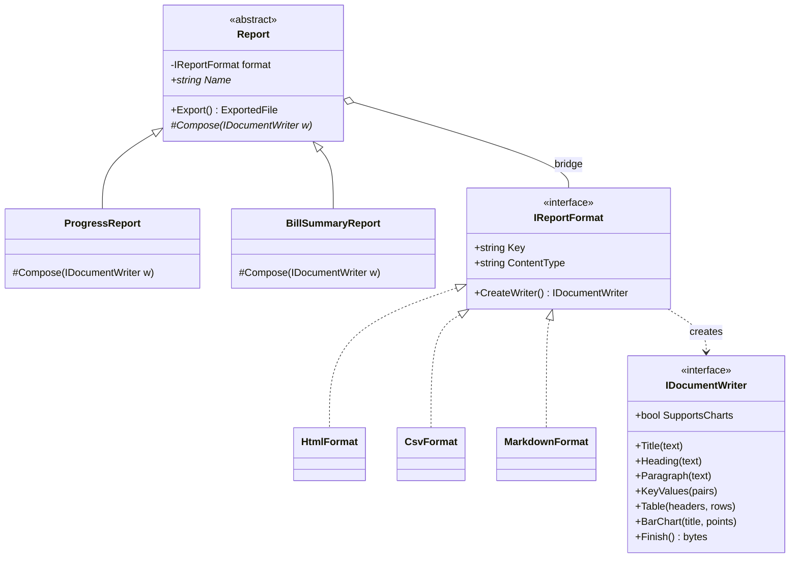
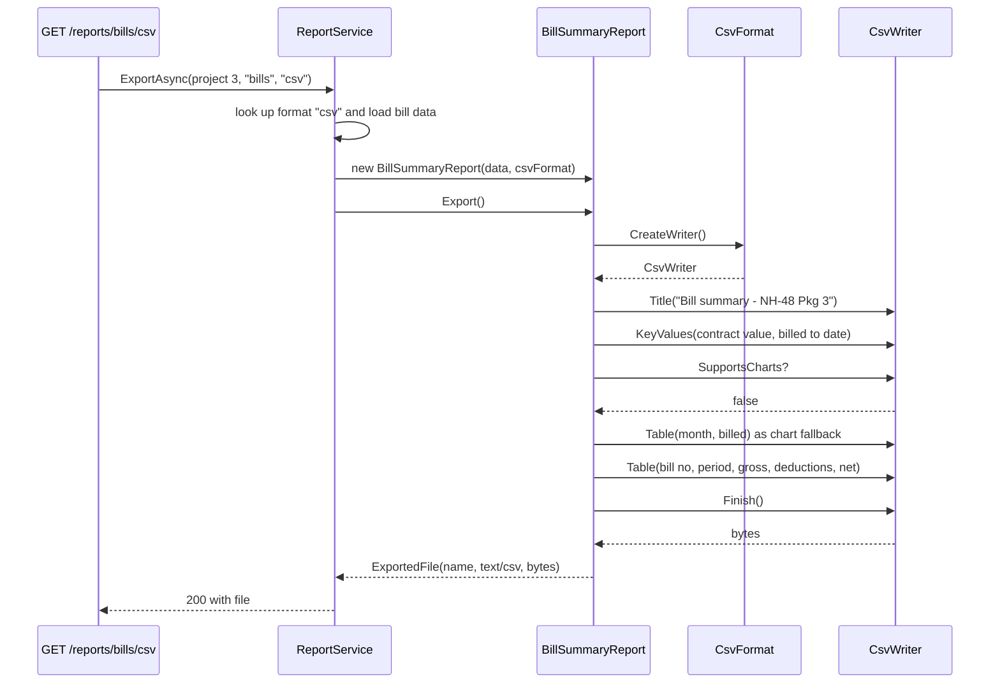

Bridge has a reputation as the hardest GoF pattern to understand, mostly because of its abstract name and the original book's vocabulary ("decouple an abstraction from its implementation"). The idea underneath is practical and common: **when something varies along two axes, don't multiply classes; connect two small hierarchies with a reference.** Once you see it, you'll recognise it in logging (`ILogger` and `ILoggerProvider`), in ADO.NET, and in every report-export and notification system.

## Learning objectives

By the end of this lesson you will be able to:

1. Recognise the "class explosion" smell: subclasses named `PdfProgressReport`, `ExcelProgressReport`, `PdfBillReport`...
2. Name the four participants (abstraction, refined abstraction, implementor, concrete implementor) and explain which axis each one covers.
3. Design the implementor interface as a set of *primitive* operations, and the abstraction as *high-level* operations built on them.
4. Build a report-export system in C# where report types and export formats vary independently, wired with ASP.NET Core DI.
5. Handle implementors with different capabilities (a CSV file can't show a chart) without leaking format checks into reports.
6. Tell Bridge apart from Adapter, Strategy and Abstract Factory, and recognise when two axes don't really exist.

## Prerequisites

- [Composition versus inheritance](#/lesson/m04-composition-inheritance): Bridge is "favour composition over inheritance" applied to two dimensions.
- [Strategy](#/lesson/m06-strategy): Bridge's implementor looks like a strategy. We'll compare them.
- [Adapter](#/lesson/m06-adapter): helpful for the comparison section.

## Explain it like I'm a beginner

Think about TV remote controls and TVs.

There are different **kinds of remote**: a basic one with power and volume, an advanced one with voice search and a programme guide, and a phone app. There are different **brands of TV**: Samsung, LG, Sony, a projector.

If every remote had to be custom-built for every TV, you'd need *3 remotes × 4 TVs = 12* different products. Add a new TV brand and you need 3 more remotes. Add a new remote style and you need 4 more.

What actually happens: every TV speaks a small set of **basic commands** ("power on", "set volume to 20", "switch to input 2"). Every remote is built on top of those basic commands. The advanced remote's "watch cricket" button just sends a sequence of basic commands. Now you need *3 remotes + 4 TVs = 7* designs, and any remote works with any TV.

- The **remote** is the *abstraction*: what the user wants to do, in high-level terms.
- The **TV** is the *implementation*: how the basic operations are actually carried out.
- The **basic command set** is the bridge between them: an interface the remote holds a reference to.

That's Bridge. The word "implementation" here doesn't mean "the class that implements an interface". It means "the platform-specific, low-level side that does the actual work". That vocabulary is the main thing that confuses people, so we'll use clearer names: **front side** (what the client asks for) and **back side** (how it gets done).

## First-principles explanation

### The original problem

The Gang of Four example is a cross-platform windowing toolkit. There are kinds of window (`Window`, `IconWindow`, `TransientWindow`) and there are platforms (X Window System, IBM Presentation Manager). With inheritance alone you get `XIconWindow`, `PMIconWindow`, `XTransientWindow`, `PMTransientWindow`... Every new window kind needs one subclass *per platform*, and every new platform needs one subclass *per window kind*. Worse, client code that creates windows has to pick a platform-specific class, so it is tied to the platform.

The fix: a `Window` hierarchy (front side) that holds a reference to a `WindowImp` hierarchy (back side). `WindowImp` offers primitive operations (`DeviceDrawLine`, `DeviceDrawText`). `IconWindow.Draw()` is written once in terms of those primitives, and works on every platform.

### Today's version of the problem

Here is a typical project-management system for an infrastructure firm:

- **Report types:** Monthly Progress Report (MPR), Bill Summary, Safety Incident Register, Material Reconciliation.
- **Export formats:** PDF, Excel, CSV, HTML.

Inheritance gives 4 × 4 = **16** classes. A fifth format (Markdown for a wiki, or JSON for a data partner) needs 4 more classes, each duplicating report logic. A fifth report needs 4 more classes, each duplicating format logic. The growth is multiplicative: M × N.

Bridge gives 4 + 4 = **8** classes. A new format is **1** class. A new report is **1** class.

| Report types × formats | Inheritance (M × N) | Bridge (M + N) |
|---|---|---|
| 2 × 2 | 4 | 4 |
| 4 × 4 | 16 | 8 |
| 6 × 5 | 30 | 11 |
| 10 × 6 | 60 | 16 |

Notice the first row: with 2 × 2 there's no saving at all. Bridge pays off when *both* axes have, or will soon have, several members.

### The simplest implementation

```csharp
// Back side: primitive operations every format can do.
public interface IWriter { void Heading(string t); void Row(params string[] cells); string Finish(); }

// Front side: high-level operations, written once in terms of the primitives.
public abstract class Report(IWriter writer)
{
    protected IWriter Writer { get; } = writer;     // <- this reference IS the bridge
    public abstract string Render();
}

public sealed class BillSummary(IWriter w, IEnumerable<(string Bill, decimal Amount)> bills) : Report(w)
{
    public override string Render()
    {
        Writer.Heading("Bill summary");
        foreach (var (bill, amount) in bills) Writer.Row(bill, amount.ToString("N2"));
        return Writer.Finish();
    }
}
```

`BillSummary` works with any `IWriter`: CSV, HTML, Markdown. Any writer works with any report.

### Participants

| Participant | Role | Report example | Notification example |
|---|---|---|---|
| **Abstraction** | The front-side base type. Holds a reference to an Implementor. Defines high-level operations. | `Report` | `Notification` |
| **Refined abstraction** | Concrete front-side variants. | `ProgressReport`, `BillSummaryReport` | `RfiOverdueNotification`, `BillApprovedNotification` |
| **Implementor** | The back-side interface: primitive operations. | `IDocumentWriter` (+ `IReportFormat` to create one) | `IMessageChannel` |
| **Concrete implementor** | Back-side variants. | `HtmlFormat`, `CsvFormat`, `MarkdownFormat` | `SmsChannel`, `EmailChannel`, `WhatsAppChannel` |

### How it works internally

There's no runtime trick. The abstraction object holds a field of the implementor interface type. When `ProgressReport.Compose` calls `writer.Table(...)`, the runtime dispatches through the interface to `HtmlWriter.Table` or `CsvWriter.Table`. Two independent virtual dispatches happen per operation: one to pick the report's `Compose` (front side), one to pick the writer's primitive (back side). That double dispatch is what lets the two hierarchies vary independently.

The design work is in the **implementor interface**. Two rules:

1. **Primitives, not features.** `Heading`, `Paragraph`, `Table`, `KeyValues` are things every format can express. `RenderMprCoverPage` is not: it's report knowledge leaking into the back side, and every new report would need every format to grow a method.
2. **The lowest common denominator, plus declared capabilities.** Some formats can do more (HTML can draw a chart; CSV can't). Put the optional feature on the interface with a capability flag (`SupportsCharts`), and let the abstraction choose a fallback. Never let a report write `if (writer is CsvWriter)`.

### What happens without it

- **Class explosion.** Sixteen classes now, twenty next quarter.
- **Duplicated logic in both directions.** HTML-escaping is copied into four HTML report classes; the MPR's section order is copied into four MPR format classes. A fix lands in some copies and not others.
- **The format can't be chosen at runtime.** With `PdfProgressReport`, the format is fixed at compile time by the class name. Choosing by `?format=csv` needs a switch over 16 classes.

### When it is useful

- Two **independent** dimensions of variation, each with **several** members now or soon.
- You want to pick the back side **at runtime** (by request, tenant, user preference or configuration).
- The back side is platform-, vendor- or technology-specific, and you want front-side code that never mentions it.
- Different teams own the two sides (the reporting team writes reports; a platform team maintains PDF and Excel output).

### When not to use it

- **Only one axis really varies.** If there are five reports and they all export only to PDF, you need a PDF helper, not a bridge. Building an `IDocumentWriter` interface "in case" is speculative generality.
- **The axes aren't independent.** If the Excel version of the MPR has entirely different content and layout from the PDF version (pivot tables, formulas, hidden sheets), there's no shared high-level logic to write once. Then separate classes per combination are honest.
- **The primitives can't be agreed.** If every new format needs new primitives, the interface churns and every implementor changes with it. Sometimes the right answer is two different interfaces (a document-style writer and a spreadsheet-style writer).
- **A library already is the bridge.** `ILogger` front side with `ILoggerProvider` back side is already done for you. Don't wrap it in another bridge.

### Trade-offs it introduces

| You gain | You pay |
|---|---|
| M + N classes instead of M × N | An extra interface whose design is hard to get right |
| Back side chosen at runtime | Lowest-common-denominator primitives can make rich formats look plain |
| Each side tested and owned separately | Capability differences must be modelled explicitly |
| Front-side code never mentions vendors or formats | More indirection when reading the code for one specific combination |

## Visual explanation

### Class diagram



How to read it: on the left, the **front side** hierarchy: `Report` and its refined abstractions. On the right, the **back side**: `IReportFormat` and its concrete formats. The single aggregation arrow labelled *bridge*, from `Report` to `IReportFormat`, is the whole pattern. Each format creates a fresh `IDocumentWriter` per export (writers hold the document being built, so they can't be shared between requests). `BarChart` is an optional primitive guarded by `SupportsCharts`.

### Sequence diagram



The service picks *which* report and *which* format; that is the only place the two axes meet. The report decides *what* goes into the document, in what order, and what to do when a capability is missing. The writer decides *how* each primitive looks in its format. Swap `csv` for `html` and only the right-hand lifelines change.

## Step-by-step example

### Step 1 — the explosion

```csharp
public class HtmlProgressReport { public string Render(ProgressData d) { /* html + MPR layout */ } }
public class CsvProgressReport  { public string Render(ProgressData d) { /* csv + MPR layout */ } }
public class HtmlBillReport     { public string Render(BillData d)     { /* html + bill layout */ } }
public class CsvBillReport      { public string Render(BillData d)     { /* csv + bill layout */ } }
```

Four classes, each mixing two concerns. HTML escaping lives in two places; the MPR's section order lives in two places.

### Step 2 — name the two axes

Ask, for each piece of code: "would this change if the *report* changed, or if the *format* changed?" Section order, which numbers appear, and labels belong to the report. Escaping, table markup and line endings belong to the format. If you can't sort code cleanly into the two piles, the axes may not be independent (see "When not to use it").

### Step 3 — design the primitives

Look at what every report *does* to a document: a title, headings, paragraphs, label/value pairs, tables. That's the implementor interface. Resist adding report-specific methods.

### Step 4 — write each report once, each format once

Reports become `Compose(IDocumentWriter w)` methods. Formats become writer classes. A small service joins them at runtime.

### Step 5 — handle unequal capabilities

HTML can draw a simple bar chart; CSV and Markdown can't. Add `BarChart` with `SupportsCharts`, and give the abstraction a helper that falls back to a table. Reports call the helper and never check the format.

## Production-style C# implementation

```text
Infra.Api/
  Program.cs
  Reporting/
    DocumentWriting.cs       implementor interfaces + ExportedFile
    Formats/HtmlFormat.cs    concrete implementors
    Formats/CsvFormat.cs
    Formats/MarkdownFormat.cs
    Reports/Report.cs        abstraction
    Reports/ProgressReport.cs
    Reports/BillSummaryReport.cs
    ReportService.cs         joins the two sides
```

```csharp file=Reporting/DocumentWriting.cs
namespace Infra.Reporting;

/// <summary>Implementor: primitive operations every output format can express.</summary>
public interface IDocumentWriter
{
    bool SupportsCharts { get; }
    void Title(string text);
    void Heading(string text);
    void Paragraph(string text);
    void KeyValues(IReadOnlyList<KeyValuePair<string, string>> pairs);
    void Table(IReadOnlyList<string> headers, IEnumerable<IReadOnlyList<string>> rows);
    /// <summary>Only call when SupportsCharts is true.</summary>
    void BarChart(string title, IReadOnlyList<KeyValuePair<string, decimal>> points);
    byte[] Finish();
}

/// <summary>A format is a stateless, shareable factory for per-document writers.</summary>
public interface IReportFormat
{
    string Key { get; }
    string ContentType { get; }
    string FileExtension { get; }
    IDocumentWriter CreateWriter();
}

public sealed record ExportedFile(string FileName, string ContentType, byte[] Content);
```

```csharp file=Reporting/Formats/HtmlFormat.cs
using System.Globalization;
using System.Net;
using System.Text;

namespace Infra.Reporting.Formats;

public sealed class HtmlFormat : IReportFormat
{
    public string Key => "html";
    public string ContentType => "text/html; charset=utf-8";
    public string FileExtension => "html";
    public IDocumentWriter CreateWriter() => new HtmlWriter();

    private sealed class HtmlWriter : IDocumentWriter
    {
        private readonly StringBuilder _sb = new("<!doctype html><html><head><meta charset=\"utf-8\"></head><body>");
        private static string E(string s) => WebUtility.HtmlEncode(s);

        public bool SupportsCharts => true;
        public void Title(string text) => _sb.Append("<h1>").Append(E(text)).Append("</h1>");
        public void Heading(string text) => _sb.Append("<h2>").Append(E(text)).Append("</h2>");
        public void Paragraph(string text) => _sb.Append("<p>").Append(E(text)).Append("</p>");

        public void KeyValues(IReadOnlyList<KeyValuePair<string, string>> pairs)
        {
            _sb.Append("<dl>");
            foreach (var (k, v) in pairs) _sb.Append("<dt>").Append(E(k)).Append("</dt><dd>").Append(E(v)).Append("</dd>");
            _sb.Append("</dl>");
        }

        public void Table(IReadOnlyList<string> headers, IEnumerable<IReadOnlyList<string>> rows)
        {
            _sb.Append("<table><thead><tr>");
            foreach (var h in headers) _sb.Append("<th>").Append(E(h)).Append("</th>");
            _sb.Append("</tr></thead><tbody>");
            foreach (var row in rows)
            {
                _sb.Append("<tr>");
                foreach (var cell in row) _sb.Append("<td>").Append(E(cell)).Append("</td>");
                _sb.Append("</tr>");
            }
            _sb.Append("</tbody></table>");
        }

        public void BarChart(string title, IReadOnlyList<KeyValuePair<string, decimal>> points)
        {
            var max = points.Count == 0 ? 1m : Math.Max(1m, points.Max(p => p.Value));
            _sb.Append("<figure><figcaption>").Append(E(title)).Append("</figcaption>");
            foreach (var (label, value) in points)
            {
                var pct = (value / max * 100m).ToString("F1", CultureInfo.InvariantCulture);
                _sb.Append("<div><span>").Append(E(label)).Append("</span><span style=\"display:inline-block;background:#4a7;width:")
                   .Append(pct).Append("%\">&nbsp;</span></div>");
            }
            _sb.Append("</figure>");
        }

        public byte[] Finish() => Encoding.UTF8.GetBytes(_sb.Append("</body></html>").ToString());
    }
}
```

```csharp file=Reporting/Formats/CsvFormat.cs
using System.Text;

namespace Infra.Reporting.Formats;

/// <summary>CSV keeps tables and key/values; prose is dropped. RFC 4180 quoting plus CSV-injection guard.</summary>
public sealed class CsvFormat : IReportFormat
{
    public string Key => "csv";
    public string ContentType => "text/csv; charset=utf-8";
    public string FileExtension => "csv";
    public IDocumentWriter CreateWriter() => new CsvWriter();

    private sealed class CsvWriter : IDocumentWriter
    {
        private readonly StringBuilder _sb = new();
        public bool SupportsCharts => false;

        public void Title(string text) => Line([text]);
        public void Heading(string text) { _sb.Append("\r\n"); Line([text]); }
        public void Paragraph(string text) { }   // prose has no place in a data file

        public void KeyValues(IReadOnlyList<KeyValuePair<string, string>> pairs)
        {
            foreach (var (k, v) in pairs) Line([k, v]);
        }

        public void Table(IReadOnlyList<string> headers, IEnumerable<IReadOnlyList<string>> rows)
        {
            Line(headers);
            foreach (var r in rows) Line(r);
        }

        public void BarChart(string title, IReadOnlyList<KeyValuePair<string, decimal>> points) =>
            throw new NotSupportedException("CSV cannot draw charts; check SupportsCharts.");

        public byte[] Finish() => new UTF8Encoding(encoderShouldEmitUTF8Identifier: true).GetPreamble()
            .Concat(Encoding.UTF8.GetBytes(_sb.ToString())).ToArray();   // BOM so Excel detects UTF-8 (₹)

        private void Line(IReadOnlyList<string> cells)
        {
            for (var i = 0; i < cells.Count; i++)
            {
                if (i > 0) _sb.Append(',');
                _sb.Append(Quote(cells[i]));
            }
            _sb.Append("\r\n");
        }

        private static string Quote(string cell)
        {
            // Cells starting with = + - @ can run as formulas in spreadsheet apps (OWASP CSV injection).
            if (cell.Length > 0 && "=+-@".Contains(cell[0]) && !decimal.TryParse(cell, out _)) cell = "'" + cell;
            return cell.IndexOfAny([',', '"', '\r', '\n']) >= 0 ? "\"" + cell.Replace("\"", "\"\"") + "\"" : cell;
        }
    }
}
```

```csharp file=Reporting/Formats/MarkdownFormat.cs
using System.Text;

namespace Infra.Reporting.Formats;

public sealed class MarkdownFormat : IReportFormat
{
    public string Key => "md";
    public string ContentType => "text/markdown; charset=utf-8";
    public string FileExtension => "md";
    public IDocumentWriter CreateWriter() => new MarkdownWriter();

    private sealed class MarkdownWriter : IDocumentWriter
    {
        private readonly StringBuilder _sb = new();
        private static string Cell(string s) => s.Replace("|", "\\|").Replace("\n", " ");

        public bool SupportsCharts => false;
        public void Title(string text) => _sb.Append("# ").Append(text).Append("\n\n");
        public void Heading(string text) => _sb.Append("## ").Append(text).Append("\n\n");
        public void Paragraph(string text) => _sb.Append(text).Append("\n\n");

        public void KeyValues(IReadOnlyList<KeyValuePair<string, string>> pairs)
        {
            foreach (var (k, v) in pairs) _sb.Append("- **").Append(k).Append(":** ").Append(v).Append('\n');
            _sb.Append('\n');
        }

        public void Table(IReadOnlyList<string> headers, IEnumerable<IReadOnlyList<string>> rows)
        {
            _sb.Append("| ").Append(string.Join(" | ", headers.Select(Cell))).Append(" |\n");
            _sb.Append('|').Append(string.Concat(headers.Select(_ => " --- |"))).Append('\n');
            foreach (var r in rows) _sb.Append("| ").Append(string.Join(" | ", r.Select(Cell))).Append(" |\n");
            _sb.Append('\n');
        }

        public void BarChart(string title, IReadOnlyList<KeyValuePair<string, decimal>> points) =>
            throw new NotSupportedException("Markdown output has no charts; check SupportsCharts.");

        public byte[] Finish() => Encoding.UTF8.GetBytes(_sb.ToString());
    }
}
```

```csharp file=Reporting/Reports/Report.cs
using System.Globalization;

namespace Infra.Reporting.Reports;

/// <summary>Abstraction: high-level report logic, written once, for any format.</summary>
public abstract class Report(IReportFormat format)
{
    public abstract string Name { get; }

    public ExportedFile Export()
    {
        var writer = format.CreateWriter();
        Compose(writer);
        return new ExportedFile($"{Name}.{format.FileExtension}", format.ContentType, writer.Finish());
    }

    protected abstract void Compose(IDocumentWriter w);

    /// <summary>Capability fallback lives in the abstraction, so no report ever checks the format type.</summary>
    protected static void ChartOrTable(IDocumentWriter w, string title, string labelHeader, string valueHeader,
        IReadOnlyList<KeyValuePair<string, decimal>> points)
    {
        if (w.SupportsCharts) { w.BarChart(title, points); return; }
        w.Heading(title);
        w.Table([labelHeader, valueHeader], points.Select(p => (IReadOnlyList<string>)new[] { p.Key, Num(p.Value) }));
    }

    protected static string Num(decimal d) => d.ToString("N2", CultureInfo.InvariantCulture);
    protected static string Crore(decimal rupees) => "INR " + (rupees / 10_000_000m).ToString("N2", CultureInfo.InvariantCulture) + " cr";
}
```

```csharp file=Reporting/Reports/ProgressReport.cs
namespace Infra.Reporting.Reports;

public sealed record ActivityProgress(string Activity, string Unit, decimal Scope, decimal DoneToDate, decimal DoneThisMonth);

public sealed record ProgressReportData(string ProjectName, string Month, decimal PhysicalPercent,
    decimal FinancialPercent, IReadOnlyList<ActivityProgress> Activities, IReadOnlyList<string> Issues);

/// <summary>Refined abstraction: Monthly Progress Report.</summary>
public sealed class ProgressReport(ProgressReportData data, IReportFormat format) : Report(format)
{
    public override string Name => $"MPR-{data.Month}";

    protected override void Compose(IDocumentWriter w)
    {
        w.Title($"Monthly Progress Report - {data.ProjectName} - {data.Month}");
        w.KeyValues(
        [
            new("Physical progress", $"{data.PhysicalPercent:F1} %"),
            new("Financial progress", $"{data.FinancialPercent:F1} %"),
        ]);

        ChartOrTable(w, "Completion by activity (%)", "Activity", "Percent",
            data.Activities.Select(a => new KeyValuePair<string, decimal>(a.Activity, a.Scope == 0 ? 0 : Math.Round(a.DoneToDate * 100 / a.Scope, 1))).ToList());

        w.Heading("Activity detail");
        w.Table(["Activity", "Unit", "Scope", "Done to date", "This month"],
            data.Activities.Select(a => (IReadOnlyList<string>)new[] { a.Activity, a.Unit, Num(a.Scope), Num(a.DoneToDate), Num(a.DoneThisMonth) }));

        if (data.Issues.Count > 0)
        {
            w.Heading("Issues and hindrances");
            foreach (var issue in data.Issues) w.Paragraph(issue);
        }
    }
}
```

```csharp file=Reporting/Reports/BillSummaryReport.cs
namespace Infra.Reporting.Reports;

public sealed record BillLine(string BillNo, string Period, decimal Gross, decimal Deductions)
{
    public decimal Net => Gross - Deductions;
}

public sealed record BillSummaryData(string ProjectName, decimal ContractValue, IReadOnlyList<BillLine> Bills);

/// <summary>Refined abstraction: running-account bill summary.</summary>
public sealed class BillSummaryReport(BillSummaryData data, IReportFormat format) : Report(format)
{
    public override string Name => "bill-summary";

    protected override void Compose(IDocumentWriter w)
    {
        var billed = data.Bills.Sum(b => b.Gross);
        w.Title($"Bill summary - {data.ProjectName}");
        w.KeyValues(
        [
            new("Contract value", Crore(data.ContractValue)),
            new("Gross billed to date", Crore(billed)),
            new("Billed %", data.ContractValue == 0 ? "0" : $"{billed * 100 / data.ContractValue:F2} %"),
        ]);

        ChartOrTable(w, "Gross billed per bill (INR)", "Bill", "Gross",
            data.Bills.Select(b => new KeyValuePair<string, decimal>(b.BillNo, b.Gross)).ToList());

        w.Heading("Bills");
        w.Table(["Bill no", "Period", "Gross", "Deductions", "Net"],
            data.Bills.Select(b => (IReadOnlyList<string>)new[] { b.BillNo, b.Period, Num(b.Gross), Num(b.Deductions), Num(b.Net) }));
    }
}
```

```csharp file=Reporting/ReportService.cs
using Infra.Reporting.Reports;

namespace Infra.Reporting;

public interface IReportDataSource
{
    Task<ProgressReportData?> GetProgressAsync(int projectId, string month, CancellationToken ct);
    Task<BillSummaryData?> GetBillsAsync(int projectId, CancellationToken ct);
}

public sealed class UnknownFormatException(string key) : Exception($"Unknown export format '{key}'.");

/// <summary>The one place where the two axes meet: pick a report and a format, then let the bridge do the rest.</summary>
public sealed class ReportService(IEnumerable<IReportFormat> formats, IReportDataSource data)
{
    private readonly Dictionary<string, IReportFormat> _formats =
        formats.ToDictionary(f => f.Key, StringComparer.OrdinalIgnoreCase);

    public IReadOnlyCollection<string> FormatKeys => _formats.Keys;

    public async Task<ExportedFile?> ExportAsync(int projectId, string reportType, string formatKey, string? month, CancellationToken ct)
    {
        if (!_formats.TryGetValue(formatKey, out var format)) throw new UnknownFormatException(formatKey);

        Report? report = reportType.ToLowerInvariant() switch
        {
            "progress" => await data.GetProgressAsync(projectId, month ?? "", ct) is { } p ? new ProgressReport(p, format) : null,
            "bills" => await data.GetBillsAsync(projectId, ct) is { } b ? new BillSummaryReport(b, format) : null,
            _ => null,
        };
        return report?.Export();
    }
}

public sealed class SampleReportDataSource : IReportDataSource
{
    public Task<ProgressReportData?> GetProgressAsync(int projectId, string month, CancellationToken ct) =>
        Task.FromResult<ProgressReportData?>(new("NH-48 Package 3", month.Length > 0 ? month : "2026-09", 41.6m, 38.2m,
        [
            new("Embankment", "cum", 1_250_000m, 610_000m, 52_000m),
            new("Subgrade", "cum", 380_000m, 95_000m, 21_500m),
            new("DBM", "cum", 96_000m, 12_000m, 4_800m),
        ],
        ["Monsoon: 9 working days lost in September.", "Utility shifting pending at km 14+200."]));

    public Task<BillSummaryData?> GetBillsAsync(int projectId, CancellationToken ct) =>
        Task.FromResult<BillSummaryData?>(new("NH-48 Package 3", 12_400_000_000m,
        [
            new("RA-14", "2026-07", 386_400_000m, 41_200_000m),
            new("RA-15", "2026-08", 312_900_000m, 33_600_000m),
            new("RA-16", "2026-09", 251_750_000m, 27_100_000m),
        ]));
}
```

```csharp file=Program.cs
using Infra.Reporting;
using Infra.Reporting.Formats;

var builder = WebApplication.CreateBuilder(args);

// Back side: register every format. Adding JSON or PDF later = one class + one line here.
builder.Services.AddSingleton<IReportFormat, HtmlFormat>();
builder.Services.AddSingleton<IReportFormat, CsvFormat>();
builder.Services.AddSingleton<IReportFormat, MarkdownFormat>();

builder.Services.AddSingleton<IReportDataSource, SampleReportDataSource>();
builder.Services.AddScoped<ReportService>();

var app = builder.Build();

// GET /projects/3/reports/bills/csv     GET /projects/3/reports/progress/html?month=2026-09
app.MapGet("/projects/{projectId:int}/reports/{type}/{format}",
    async (int projectId, string type, string format, string? month, ReportService reports, CancellationToken ct) =>
    {
        try
        {
            var file = await reports.ExportAsync(projectId, type, format, month, ct);
            return file is null ? Results.NotFound() : Results.File(file.Content, file.ContentType, file.FileName);
        }
        catch (UnknownFormatException ex)
        {
            return Results.Problem(ex.Message + " Supported: " + string.Join(", ", reports.FormatKeys), statusCode: 400);
        }
    });

app.Run();
```

Design notes:

- **Formats are singletons; writers are per export.** A writer accumulates a document, so sharing one across requests would interleave two users' reports. The format is a factory, so the shared object is stateless. This is a small [Abstract Factory](#/lesson/m06-abstract-factory) sitting on the back side of the bridge.
- **Capability fallback is in the abstraction.** `ChartOrTable` is the only place that reads `SupportsCharts`. Reports call it and stay format-agnostic.
- **Security belongs to the back side.** HTML escaping, Markdown pipe escaping and CSV injection protection each live in exactly one writer. A report author can't forget them.
- **Real PDF and Excel.** In production you'd add `PdfFormat` (for example with QuestPDF) and `XlsxFormat` (for example with ClosedXML) as further concrete implementors. They would map `Table` to real table elements and `BarChart` to a native chart. No report changes.

## Bad design vs good design

**Bad 1, the explosion:** `HtmlProgressReport`, `CsvProgressReport`, `HtmlBillReport`, `CsvBillReport`. The CSV injection fix is applied to `CsvBillReport` after a security review, and missed in `CsvProgressReport`. Six months later an activity name typed by a site user as `=HYPERLINK(...)` executes in a finance manager's spreadsheet.

**Bad 2, one god class with two switches:**

```csharp
public byte[] Export(string report, string format, object data)
{
    var sb = new StringBuilder();
    if (report == "progress") {
        if (format == "html") sb.Append("<h1>"); else if (format == "md") sb.Append("# ");
        // ... 400 lines of interleaved if (format == ...) inside if (report == ...)
    }
}
```

There are no classes to explode, but the M × N combinations still exist, hidden as nested conditionals. Every change touches the same method.

**Bad 3, leaking the back side into the front:**

```csharp
protected override void Compose(IDocumentWriter w)
{
    if (w is HtmlWriter) w.BarChart(...); else w.Table(...);   // the report now knows about formats
}
```

Adding a PDF format that *can* draw charts means editing every report. Model the capability (`SupportsCharts`) instead of testing the type.

**Good:** the implementation above. Two hierarchies, one reference, capabilities declared, security in one place per format.

**Is it worth it?** If you have two reports and one format, no. Write the HTML directly. Introduce the bridge when the *second* axis gets its second member *and* you expect more, or when users choose the format at runtime.

## Practical playground

Notification types × channels. Run it, then add a `WhatsAppChannel` with a 1,024-character limit (the limit is illustrative) and a `DailyDigestNotification`. Count how many classes you touched.

:::playground type=csharp title="Notifications x channels"
```csharp file=Program.cs
using System;
using System.Collections.Generic;

// Implementor: the channel (back side).
public interface IMessageChannel
{
    string Name { get; }
    int MaxBodyLength { get; }
    void Send(string to, string subject, string body);
}

public sealed class SmsChannel : IMessageChannel
{
    public string Name => "SMS";
    public int MaxBodyLength => 160;
    public void Send(string to, string subject, string body) => Console.WriteLine($"[SMS to {to}] {body}");
}

public sealed class EmailChannel : IMessageChannel
{
    public string Name => "Email";
    public int MaxBodyLength => 100_000;
    public void Send(string to, string subject, string body) => Console.WriteLine($"[Email to {to}] Subject: {subject}\n  {body}");
}

// Abstraction: the notification (front side). Holds the bridge reference.
public abstract class Notification(IMessageChannel channel)
{
    protected abstract string Subject { get; }
    protected abstract string Body { get; }

    public void SendTo(string recipient)
    {
        var body = Body.Length <= channel.MaxBodyLength ? Body : Body[..(channel.MaxBodyLength - 1)] + "…";
        channel.Send(recipient, Subject, body);
    }
}

public sealed class RfiOverdueNotification(IMessageChannel channel, string rfiNo, int days) : Notification(channel)
{
    protected override string Subject => $"RFI {rfiNo} overdue";
    protected override string Body =>
        $"RFI {rfiNo} for embankment layer 4 at km 12+350 has been awaiting inspection for {days} days. " +
        "Please inspect or record a reason today, or the contractor may claim an extension of time for the delay.";
}

public sealed class BillApprovedNotification(IMessageChannel channel, string billNo, decimal net) : Notification(channel)
{
    protected override string Subject => $"Bill {billNo} approved";
    protected override string Body => $"Running bill {billNo} approved for net INR {net:N2}.";
}

public static class Program
{
    public static void Main()
    {
        IMessageChannel[] channels = { new SmsChannel(), new EmailChannel() };
        foreach (var ch in channels)
        {
            new RfiOverdueNotification(ch, "RFI-0418", 3).SendTo("site.engineer");
            new BillApprovedNotification(ch, "RA-16", 224_650_000m).SendTo("contractor.accounts");
        }
        Console.WriteLine("2 notification types x 2 channels = 4 combinations from 4 classes.");
    }
}
```
:::

## Exercises

:::exercise id=m06-bridge-ex1 difficulty=beginner kind=code title="Notifications across channels"
Implement the front side of a notification bridge. `Notification.SendTo` must send the subject and body through whatever channel it was given, shortening the body when it's longer than the channel allows. Then implement two refined abstractions.
::requirements
- If `Body.Length > MaxBodyLength`, send the first `MaxBodyLength - 1` characters followed by `…` (one character), so the total is exactly `MaxBodyLength`.
- `RfiOverdueNotification` subject: `RFI {rfiNo} overdue`; body: `RFI {rfiNo} awaiting inspection for {days} day(s).`
- `BillApprovedNotification` subject: `Bill {billNo} approved`; body: `Net payable INR {net:N2}.` (use invariant culture).
- Neither notification class may reference a concrete channel.
::acceptance
- A short body arrives unchanged on both a 160-char and a large channel.
- A 300-character body on a 160-char channel arrives as exactly 160 characters ending in `…`.
- Subjects and bodies match the formats above.
::hint
The channel is passed into the base class constructor. Keep it in a private field.
::hint
`SendTo` is the high-level operation; `channel.Send` is the primitive.
::hint
Truncation: `body[..(max - 1)] + "…"`. The ellipsis is a single `char` (U+2026).
::hint
Format the amount with `net.ToString("N2", CultureInfo.InvariantCulture)` so tests don't depend on the machine's culture.
::starter
```csharp file=Notifications.cs
using System;
using System.Globalization;

public interface IMessageChannel
{
    int MaxBodyLength { get; }
    void Send(string recipient, string subject, string body);
}

public abstract class Notification
{
    protected Notification(IMessageChannel channel)
    {
        // TODO: keep the channel
    }

    public abstract string Subject { get; }
    public abstract string Body { get; }

    public void SendTo(string recipient) => throw new NotImplementedException();
}

public sealed class RfiOverdueNotification : Notification
{
    public RfiOverdueNotification(IMessageChannel channel, string rfiNo, int days) : base(channel) { }
    public override string Subject => throw new NotImplementedException();
    public override string Body => throw new NotImplementedException();
}

public sealed class BillApprovedNotification : Notification
{
    public BillApprovedNotification(IMessageChannel channel, string billNo, decimal net) : base(channel) { }
    public override string Subject => throw new NotImplementedException();
    public override string Body => throw new NotImplementedException();
}
```
::tests
```csharp file=NotificationsTests.cs
using System.Collections.Generic;
using Xunit;

public sealed class RecordingChannel(int max) : IMessageChannel
{
    public List<(string To, string Subject, string Body)> Sent { get; } = new();
    public int MaxBodyLength => max;
    public void Send(string recipient, string subject, string body) => Sent.Add((recipient, subject, body));
}

public sealed class LongNotification(IMessageChannel ch) : Notification(ch)
{
    public override string Subject => "Long";
    public override string Body => new string('x', 300);
}

public class NotificationsTests
{
    [Fact]
    public void Rfi_text_is_formatted()
    {
        var ch = new RecordingChannel(1000);
        new RfiOverdueNotification(ch, "RFI-0418", 3).SendTo("se@site");
        var m = Assert.Single(ch.Sent);
        Assert.Equal("se@site", m.To);
        Assert.Equal("RFI RFI-0418 overdue", m.Subject);
        Assert.Equal("RFI RFI-0418 awaiting inspection for 3 day(s).", m.Body);
    }

    [Fact]
    public void Bill_text_is_formatted()
    {
        var ch = new RecordingChannel(1000);
        new BillApprovedNotification(ch, "RA-16", 224650000m).SendTo("accounts");
        Assert.Equal("Bill RA-16 approved", ch.Sent[0].Subject);
        Assert.Equal("Net payable INR 224,650,000.00.", ch.Sent[0].Body);
    }

    [Fact]
    public void Short_body_unchanged_on_sms()
    {
        var sms = new RecordingChannel(160);
        new RfiOverdueNotification(sms, "RFI-1", 1).SendTo("x");
        Assert.Equal("RFI RFI-1 awaiting inspection for 1 day(s).", sms.Sent[0].Body);
    }

    [Fact]
    public void Long_body_truncated_to_channel_limit()
    {
        var sms = new RecordingChannel(160);
        new LongNotification(sms).SendTo("x");
        var body = sms.Sent[0].Body;
        Assert.Equal(160, body.Length);
        Assert.EndsWith("…", body);
    }
}
```
::solution
```csharp file=Notifications.cs
using System;
using System.Globalization;

public interface IMessageChannel
{
    int MaxBodyLength { get; }
    void Send(string recipient, string subject, string body);
}

public abstract class Notification
{
    private readonly IMessageChannel _channel;

    protected Notification(IMessageChannel channel) =>
        _channel = channel ?? throw new ArgumentNullException(nameof(channel));

    public abstract string Subject { get; }
    public abstract string Body { get; }

    public void SendTo(string recipient)
    {
        var body = Body;
        var max = _channel.MaxBodyLength;
        if (body.Length > max) body = body[..(max - 1)] + "…";
        _channel.Send(recipient, Subject, body);
    }
}

public sealed class RfiOverdueNotification : Notification
{
    private readonly string _rfiNo;
    private readonly int _days;
    public RfiOverdueNotification(IMessageChannel channel, string rfiNo, int days) : base(channel)
    {
        _rfiNo = rfiNo;
        _days = days;
    }
    public override string Subject => $"RFI {_rfiNo} overdue";
    public override string Body => $"RFI {_rfiNo} awaiting inspection for {_days} day(s).";
}

public sealed class BillApprovedNotification : Notification
{
    private readonly string _billNo;
    private readonly decimal _net;
    public BillApprovedNotification(IMessageChannel channel, string billNo, decimal net) : base(channel)
    {
        _billNo = billNo;
        _net = net;
    }
    public override string Subject => $"Bill {_billNo} approved";
    public override string Body => "Net payable INR " + _net.ToString("N2", CultureInfo.InvariantCulture) + ".";
}
```

The truncation rule lives in the abstraction, once, because it's the same for every notification. The limit comes from the implementor, because only the channel knows it. That split (policy on the front side, facts about the platform on the back side) is typical of a good bridge.
::mistakes
- Putting truncation inside each channel: then each channel must decide how to shorten text it knows nothing about.
- Truncating to `max` and *then* appending `…`, giving `max + 1` characters, which a real SMS gateway would split into two messages (and bill twice).
- Using the current culture for `N2`: on a machine set to `de-DE` you'd get `224.650.000,00`.
::extensions
SMS limits are really in *segments* and depend on encoding: 160 GSM-7 characters, but only 70 if any character needs UCS-2 (for example Hindi text or `₹`). Model `MaxBodyLength` as a method of the body, `int MaxLengthFor(string body)`, and test with a Hindi message.
:::

:::exercise id=m06-bridge-ex2 difficulty=beginner kind=written title="Count the classes, find the axes"
An HR and payroll module has these reports: Payslip, Attendance Summary, Leave Balance, Form 16 summary. Users want each as PDF, Excel and HTML. A JSON export for a partner API is planned next quarter.

1. How many report classes does pure inheritance need now, and after JSON is added?
2. How many with Bridge, now and after?
3. Which side is the abstraction and which is the implementor? Name the participants.
4. Name one piece of logic that belongs on each side.
5. Give one reason the Excel version might *not* fit the bridge.
::acceptance
- Correct counts for both designs, before and after.
- Participants named correctly.
- At least one concrete example of front-side and back-side logic.
- A plausible reason why one combination may break the shared primitives.
::hint
Inheritance: reports × formats. Bridge: reports + formats.
::hint
The side the *user* thinks about ("I want my payslip") is the abstraction. The side that depends on technology is the implementor.
::hint
Think about what a finance user expects from an Excel file that a PDF can't offer.
::solution
1. Inheritance: 4 × 3 = **12** now; 4 × 4 = **16** after JSON (4 new classes).
2. Bridge: 4 + 3 = **7** now; 4 + 4 = **8** after JSON (1 new class).
3. **Abstraction:** `HrReport`; **refined abstractions:** `Payslip`, `AttendanceSummary`, `LeaveBalance`, `Form16Summary`. **Implementor:** `IDocumentWriter` (with a format factory); **concrete implementors:** `PdfWriter`, `XlsxWriter`, `HtmlWriter`, `JsonWriter`.
4. Front side: "a payslip shows earnings, then deductions, then net pay, and masks all but the last 4 digits of the bank account". Back side: "HTML-escape every cell" or "Excel cells holding amounts get a numeric format, not text".
5. Finance may want real formulas (`=SUM(C2:C40)`), frozen header rows, one sheet per month and filters. Those aren't primitives a PDF or JSON writer can share. Options: add optional capabilities (`SupportsFormulas`), or accept that "Attendance Summary in Excel" is a separate, spreadsheet-specific export outside the bridge.

JSON is also a little suspicious: a JSON partner export is usually a *data contract* (a stable schema), not a document. It might be better as its own endpoint returning DTOs, rather than a writer that receives `Heading` and `Paragraph` calls it must ignore.
::mistakes
- Swapping the sides: treating formats as the abstraction because "they're the classes we implement".
- Forgetting that adding one JSON format under inheritance costs one class *per report*.
:::

:::exercise id=m06-bridge-ex3 difficulty=intermediate kind=code title="A safe CSV implementor"
Implement `CsvDocumentWriter`, a concrete implementor of `IDocumentWriter`, so that any report can export to CSV. The output feeds finance spreadsheets, so it must follow RFC 4180 and resist CSV injection.
::requirements
- Every line ends with `\r\n`.
- `Title(text)` writes a one-cell line.
- `Heading(text)` writes an empty line, then a one-cell line.
- `Paragraph` writes nothing.
- `Table(headers, rows)` writes the header line, then one line per row.
- A cell containing `,`, `"`, `\r` or `\n` is wrapped in double quotes, and inner `"` is doubled.
- A cell starting with `=`, `+`, `-` or `@` is prefixed with `'` **unless** it parses as a number (so `-42.50` stays a number).
- `ToText()` returns everything written so far.
::acceptance
- `Table(["Bill","Net"], [["RA-16","1,234.00"]])` produces `Bill,Net\r\nRA-16,"1,234.00"\r\n`.
- `He said "OK"` becomes `"He said ""OK"""`.
- `=HYPERLINK("x")` becomes `"'=HYPERLINK(""x"")"`.
- `-42.50` stays `-42.50`.
::hint
Write one private `Line(IReadOnlyList<string> cells)` method and route everything through it.
::hint
Handle injection *before* quoting: prefix first, then decide whether quoting is needed.
::hint
`decimal.TryParse(cell, NumberStyles.Number, CultureInfo.InvariantCulture, out _)` tells you whether a leading `-` is just a negative number.
::hint
```csharp
private static string Escape(string c)
{
    if (c.Length > 0 && "=+-@".Contains(c[0]) && !IsNumber(c)) c = "'" + c;
    return c.IndexOfAny(new[] { ',', '"', '\r', '\n' }) >= 0 ? "\"" + c.Replace("\"", "\"\"") + "\"" : c;
}
```
::starter
```csharp file=CsvDocumentWriter.cs
using System;
using System.Collections.Generic;
using System.Globalization;
using System.Text;

public interface IDocumentWriter
{
    void Title(string text);
    void Heading(string text);
    void Paragraph(string text);
    void Table(IReadOnlyList<string> headers, IEnumerable<IReadOnlyList<string>> rows);
}

public sealed class CsvDocumentWriter : IDocumentWriter
{
    public void Title(string text) => throw new NotImplementedException();
    public void Heading(string text) => throw new NotImplementedException();
    public void Paragraph(string text) => throw new NotImplementedException();
    public void Table(IReadOnlyList<string> headers, IEnumerable<IReadOnlyList<string>> rows) => throw new NotImplementedException();
    public string ToText() => throw new NotImplementedException();
}
```
::tests
```csharp file=CsvDocumentWriterTests.cs
using System.Collections.Generic;
using Xunit;

public class CsvDocumentWriterTests
{
    private static IReadOnlyList<string> R(params string[] cells) => cells;

    [Fact]
    public void Simple_table_with_comma_in_number()
    {
        var w = new CsvDocumentWriter();
        w.Table(R("Bill", "Net"), new[] { R("RA-16", "1,234.00") });
        Assert.Equal("Bill,Net\r\nRA-16,\"1,234.00\"\r\n", w.ToText());
    }

    [Fact]
    public void Quotes_are_doubled()
    {
        var w = new CsvDocumentWriter();
        w.Table(R("Remark"), new[] { R("He said \"OK\"") });
        Assert.Equal("Remark\r\n\"He said \"\"OK\"\"\"\r\n", w.ToText());
    }

    [Fact]
    public void Formula_is_neutralised()
    {
        var w = new CsvDocumentWriter();
        w.Table(R("Activity"), new[] { R("=HYPERLINK(\"x\")") });
        Assert.Equal("Activity\r\n\"'=HYPERLINK(\"\"x\"\")\"\r\n", w.ToText());
    }

    [Fact]
    public void Negative_number_is_left_alone()
    {
        var w = new CsvDocumentWriter();
        w.Table(R("Adj"), new[] { R("-42.50"), R("+7") });
        Assert.Equal("Adj\r\n-42.50\r\n+7\r\n", w.ToText());
    }

    [Fact]
    public void Title_heading_paragraph_layout()
    {
        var w = new CsvDocumentWriter();
        w.Title("Bill summary");
        w.Paragraph("This prose is dropped.");
        w.Heading("Bills");
        w.Table(R("No"), new[] { R("RA-1") });
        Assert.Equal("Bill summary\r\n\r\nBills\r\nNo\r\nRA-1\r\n", w.ToText());
    }

    [Fact]
    public void Newline_in_cell_is_quoted()
    {
        var w = new CsvDocumentWriter();
        w.Table(R("Note"), new[] { R("line1\nline2") });
        Assert.Equal("Note\r\n\"line1\nline2\"\r\n", w.ToText());
    }
}
```
::solution
```csharp file=CsvDocumentWriter.cs
using System;
using System.Collections.Generic;
using System.Globalization;
using System.Text;

public interface IDocumentWriter
{
    void Title(string text);
    void Heading(string text);
    void Paragraph(string text);
    void Table(IReadOnlyList<string> headers, IEnumerable<IReadOnlyList<string>> rows);
}

public sealed class CsvDocumentWriter : IDocumentWriter
{
    private static readonly char[] NeedsQuoting = { ',', '"', '\r', '\n' };
    private readonly StringBuilder _sb = new();

    public void Title(string text) => Line(new[] { text });

    public void Heading(string text)
    {
        _sb.Append("\r\n");
        Line(new[] { text });
    }

    public void Paragraph(string text) { }

    public void Table(IReadOnlyList<string> headers, IEnumerable<IReadOnlyList<string>> rows)
    {
        Line(headers);
        foreach (var row in rows) Line(row);
    }

    public string ToText() => _sb.ToString();

    private void Line(IReadOnlyList<string> cells)
    {
        for (var i = 0; i < cells.Count; i++)
        {
            if (i > 0) _sb.Append(',');
            _sb.Append(Escape(cells[i] ?? ""));
        }
        _sb.Append("\r\n");
    }

    private static string Escape(string cell)
    {
        if (cell.Length > 0 && "=+-@".IndexOf(cell[0]) >= 0 && !IsNumber(cell)) cell = "'" + cell;
        return cell.IndexOfAny(NeedsQuoting) >= 0 ? "\"" + cell.Replace("\"", "\"\"") + "\"" : cell;
    }

    private static bool IsNumber(string s) =>
        decimal.TryParse(s, NumberStyles.Number, CultureInfo.InvariantCulture, out _);
}
```

Because this is a back-side class, every report (MPR, bills, safety register) gets RFC 4180 quoting and injection protection the moment it exports to CSV, without any report author thinking about it.
::alternatives
Some teams prefer to strip leading formula characters, or to reject such input at the API boundary. Prefixing with `'` keeps the user's text visible and is the commonly recommended mitigation. Tab and carriage-return prefixes (`\t`, `\r`) are also listed by OWASP as risky in some spreadsheet apps; add them if your users open CSVs in desktop spreadsheets.
::mistakes
- Quoting first and then prefixing, producing `'"=..."` which some apps still evaluate.
- Treating every leading `-` as a formula, which turns negative amounts into text and breaks finance totals.
- Using `\n` line endings; RFC 4180 specifies CRLF, and some importers are strict.
:::

:::exercise id=m06-bridge-ex4 difficulty=intermediate kind=design title="Refactor an exploding report hierarchy"
A codebase has this hierarchy (each class 200–400 lines):

```text
ReportBase
├── PdfMprReport        ├── ExcelMprReport        ├── HtmlMprReport
├── PdfSafetyReport     ├── ExcelSafetyReport     ├── HtmlSafetyReport
└── PdfMaterialReport   ├── ExcelMaterialReport   └── HtmlMaterialReport
```

`ReportBase` has a `protected abstract void RenderTable(...)` that each subclass re-implements with the same format code. A `ReportController` picks a class with a 9-case `switch`. Plan a step-by-step refactoring to Bridge that can be shipped in small, safe pull requests.
::acceptance
- Target class diagram with both hierarchies and the bridge reference.
- At least four incremental steps, each leaving the system working.
- How characterization tests protect the refactor.
- How the controller chooses report and format after the change (DI).
- What happens to format-specific features that only one combination used.
::hint
Start by protecting behaviour: what output does each of the 9 classes produce today?
::hint
Extract the back side first. Format code duplicated across three classes is the easiest win.
::hint
You can introduce `IDocumentWriter` and have the *old* classes delegate to it before deleting them. That's a safe intermediate state.
::hint
Use `IEnumerable<IReportFormat>` or keyed services so the controller's switch collapses to a dictionary lookup.
::solution
**Target:** `Report` (abstract, holds `IReportFormat`) → `MprReport`, `SafetyReport`, `MaterialReport`. `IReportFormat` → `PdfFormat`, `XlsxFormat`, `HtmlFormat`, each creating an `IDocumentWriter`.

**Steps (one PR each):**

1. **Characterization tests.** For each of the 9 classes, render a fixed dataset and snapshot the output (text for HTML; extracted text and cell values for PDF and Excel, since binary files contain timestamps). These tests must pass unchanged through steps 2–5.
2. **Extract the implementor.** Create `IDocumentWriter` with primitives found in the duplicated code (`Title`, `Heading`, `Table`, `KeyValues`). Implement `HtmlDocumentWriter` by moving code out of `HtmlMprReport`. Make the three HTML classes delegate to it. Repeat for PDF and Excel. Nine classes still exist, but format code now lives in three places.
3. **Merge the front side for one report.** Create `MprReport : Report` whose `Compose(IDocumentWriter)` contains the MPR layout. Make `PdfMprReport`, `ExcelMprReport` and `HtmlMprReport` thin shells: `new MprReport(data, new PdfFormat()).Export()`. Snapshot tests still pass.
4. **Repeat for Safety and Material**, then delete the nine shells.
5. **Simplify selection.** Register formats in DI (`AddSingleton<IReportFormat, PdfFormat>()` and so on). The controller looks up the format by key and creates the report by type through a small `ReportFactory`. The 9-case switch becomes a 3-case switch plus a dictionary lookup.

**Format-specific features:** if only `ExcelMaterialReport` had frozen panes and a `SUM` formula, either add an optional capability (`SupportsFormulas`, `FreezeHeader()` as a no-op elsewhere) or keep it as a deliberate exception: a separate `MaterialReconciliationWorkbook` class outside the bridge. Write down the decision.
::mistakes
- A big-bang rewrite of all nine classes in one PR, with no snapshot tests.
- Designing the implementor interface from what *one* format can do (Excel cells) rather than what *all* reports need.
- Comparing PDF output byte-for-byte; creation dates and IDs differ on every run.
:::

:::exercise id=m06-bridge-ex5 difficulty=advanced kind=code title="Runtime bridge selection with quiet hours and fallback"
Build `NotificationDispatcher`, which picks the channel (implementor) for each notification (abstraction) **at runtime**, per recipient:

1. Try channels in the recipient's preference order.
2. Skip a channel if it isn't registered or the recipient has no address for it (`skipped-no-address`).
3. Between 22:00 and 07:00 India Standard Time (UTC+05:30), skip **intrusive** channels (SMS, WhatsApp) unless the notification is urgent (`skipped-quiet-hours`).
4. Truncate the body to the channel's limit (first `max-1` chars + `…`).
5. If a channel throws `ChannelUnavailableException`, record `failed` and try the next. Any other exception propagates.
6. Return which channel delivered (or `null`) and the list of attempts in order, formatted `"{Kind}:{outcome}"` where outcome is `sent`, `failed`, `skipped-no-address` or `skipped-quiet-hours`.
::acceptance
- At 10:00 IST, preference [Sms, Email] sends by SMS: attempts `["Sms:sent"]`.
- At 23:30 IST, a non-urgent notification skips SMS and sends by email.
- At 23:30 IST, an urgent notification goes by SMS.
- If SMS throws `ChannelUnavailableException`, email is used: `["Sms:failed", "Email:sent"]`.
- Missing address is skipped.
- If nothing works, `DeliveredVia` is null.
::hint
Separate the decision ("may I use this channel now?") from the action ("send"). A small private method per rule keeps `DispatchAsync` readable.
::hint
Convert the time once: `var ist = clock.GetUtcNow().ToOffset(TimeSpan.FromHours(5.5));` India has no daylight saving, so a fixed offset is correct here.
::hint
Quiet hours cross midnight: `hour >= 22 || hour < 7`.
::hint
Build a `Dictionary<ChannelKind, IMessageChannel>` once in the constructor from the injected channels.
::hint
```csharp
foreach (var kind in recipient.Preference)
{
    if (!_channels.TryGetValue(kind, out var ch) || !recipient.Addresses.TryGetValue(kind, out var addr)) { attempts.Add($"{kind}:skipped-no-address"); continue; }
    if (ch.IsIntrusive && quiet && !n.IsUrgent) { attempts.Add($"{kind}:skipped-quiet-hours"); continue; }
    try { await ch.SendAsync(addr, n.Subject, Fit(n.Body, ch.MaxBodyLength), ct); attempts.Add($"{kind}:sent"); return new(kind, attempts); }
    catch (ChannelUnavailableException) { attempts.Add($"{kind}:failed"); }
}
```
::starter
```csharp file=NotificationDispatcher.cs
using System;
using System.Collections.Generic;
using System.Linq;
using System.Threading;
using System.Threading.Tasks;

public enum ChannelKind { Sms, Email, WhatsApp }

public interface IMessageChannel
{
    ChannelKind Kind { get; }
    int MaxBodyLength { get; }
    bool IsIntrusive { get; }
    Task SendAsync(string address, string subject, string body, CancellationToken ct);
}

public sealed class ChannelUnavailableException(string message) : Exception(message);

public abstract class Notification
{
    public abstract string Subject { get; }
    public abstract string Body { get; }
    public virtual bool IsUrgent => false;
}

public sealed record Recipient(string Id, IReadOnlyDictionary<ChannelKind, string> Addresses, IReadOnlyList<ChannelKind> Preference);

public sealed record DeliveryResult(ChannelKind? DeliveredVia, IReadOnlyList<string> Attempts);

public sealed class NotificationDispatcher
{
    public NotificationDispatcher(IEnumerable<IMessageChannel> channels, TimeProvider clock)
    {
        // TODO
    }

    public Task<DeliveryResult> DispatchAsync(Notification notification, Recipient recipient, CancellationToken ct = default) =>
        throw new NotImplementedException();
}
```
::tests
```csharp file=NotificationDispatcherTests.cs
using System;
using System.Collections.Generic;
using System.Threading;
using System.Threading.Tasks;
using Xunit;

public sealed class FixedClock(DateTimeOffset utc) : TimeProvider
{
    public override DateTimeOffset GetUtcNow() => utc;
}

public sealed class FakeChannel(ChannelKind kind, int max, bool intrusive, bool down = false) : IMessageChannel
{
    public List<(string Address, string Body)> Sent { get; } = new();
    public ChannelKind Kind => kind;
    public int MaxBodyLength => max;
    public bool IsIntrusive => intrusive;
    public Task SendAsync(string address, string subject, string body, CancellationToken ct)
    {
        if (down) throw new ChannelUnavailableException($"{kind} gateway down");
        Sent.Add((address, body));
        return Task.CompletedTask;
    }
}

public sealed class TestNotification(string body, bool urgent = false) : Notification
{
    public override string Subject => "Test";
    public override string Body => body;
    public override bool IsUrgent => urgent;
}

public class NotificationDispatcherTests
{
    // 10:00 IST = 04:30 UTC; 23:30 IST = 18:00 UTC
    private static readonly DateTimeOffset Morning = new(2026, 10, 5, 4, 30, 0, TimeSpan.Zero);
    private static readonly DateTimeOffset Night = new(2026, 10, 5, 18, 0, 0, TimeSpan.Zero);

    private static Recipient Ravi(params ChannelKind[] pref) => new("ravi",
        new Dictionary<ChannelKind, string> { [ChannelKind.Sms] = "+919800000000", [ChannelKind.Email] = "ravi@example.com" }, pref);

    [Fact]
    public async Task Daytime_uses_first_preference()
    {
        var sms = new FakeChannel(ChannelKind.Sms, 160, true);
        var email = new FakeChannel(ChannelKind.Email, 10_000, false);
        var d = new NotificationDispatcher(new IMessageChannel[] { sms, email }, new FixedClock(Morning));
        var r = await d.DispatchAsync(new TestNotification("hello"), Ravi(ChannelKind.Sms, ChannelKind.Email));
        Assert.Equal(ChannelKind.Sms, r.DeliveredVia);
        Assert.Equal(new[] { "Sms:sent" }, r.Attempts);
    }

    [Fact]
    public async Task Quiet_hours_skip_sms_for_non_urgent()
    {
        var sms = new FakeChannel(ChannelKind.Sms, 160, true);
        var email = new FakeChannel(ChannelKind.Email, 10_000, false);
        var d = new NotificationDispatcher(new IMessageChannel[] { sms, email }, new FixedClock(Night));
        var r = await d.DispatchAsync(new TestNotification("hello"), Ravi(ChannelKind.Sms, ChannelKind.Email));
        Assert.Equal(ChannelKind.Email, r.DeliveredVia);
        Assert.Equal(new[] { "Sms:skipped-quiet-hours", "Email:sent" }, r.Attempts);
        Assert.Empty(sms.Sent);
    }

    [Fact]
    public async Task Urgent_ignores_quiet_hours()
    {
        var sms = new FakeChannel(ChannelKind.Sms, 160, true);
        var d = new NotificationDispatcher(new IMessageChannel[] { sms }, new FixedClock(Night));
        var r = await d.DispatchAsync(new TestNotification("slope failure at km 12", urgent: true), Ravi(ChannelKind.Sms));
        Assert.Equal(ChannelKind.Sms, r.DeliveredVia);
    }

    [Fact]
    public async Task Falls_back_when_channel_unavailable()
    {
        var sms = new FakeChannel(ChannelKind.Sms, 160, true, down: true);
        var email = new FakeChannel(ChannelKind.Email, 10_000, false);
        var d = new NotificationDispatcher(new IMessageChannel[] { sms, email }, new FixedClock(Morning));
        var r = await d.DispatchAsync(new TestNotification("hello"), Ravi(ChannelKind.Sms, ChannelKind.Email));
        Assert.Equal(new[] { "Sms:failed", "Email:sent" }, r.Attempts);
    }

    [Fact]
    public async Task Missing_address_is_skipped_and_nothing_delivered()
    {
        var wa = new FakeChannel(ChannelKind.WhatsApp, 1000, true);
        var d = new NotificationDispatcher(new IMessageChannel[] { wa }, new FixedClock(Morning));
        var r = await d.DispatchAsync(new TestNotification("hello"), Ravi(ChannelKind.WhatsApp));
        Assert.Null(r.DeliveredVia);
        Assert.Equal(new[] { "WhatsApp:skipped-no-address" }, r.Attempts);
    }

    [Fact]
    public async Task Body_is_truncated_to_channel_limit()
    {
        var sms = new FakeChannel(ChannelKind.Sms, 20, true);
        var d = new NotificationDispatcher(new IMessageChannel[] { sms }, new FixedClock(Morning));
        await d.DispatchAsync(new TestNotification(new string('a', 50)), Ravi(ChannelKind.Sms));
        Assert.Equal(20, sms.Sent[0].Body.Length);
        Assert.EndsWith("…", sms.Sent[0].Body);
    }

    [Fact]
    public async Task Other_exceptions_propagate()
    {
        var bad = new ThrowingChannel();
        var d = new NotificationDispatcher(new IMessageChannel[] { bad }, new FixedClock(Morning));
        await Assert.ThrowsAsync<InvalidOperationException>(() => d.DispatchAsync(new TestNotification("x"), Ravi(ChannelKind.Email)));
    }

    private sealed class ThrowingChannel : IMessageChannel
    {
        public ChannelKind Kind => ChannelKind.Email;
        public int MaxBodyLength => 100;
        public bool IsIntrusive => false;
        public Task SendAsync(string a, string s, string b, CancellationToken ct) => throw new InvalidOperationException("bug");
    }
}
```
::solution
```csharp file=NotificationDispatcher.cs
using System;
using System.Collections.Generic;
using System.Linq;
using System.Threading;
using System.Threading.Tasks;

public enum ChannelKind { Sms, Email, WhatsApp }

public interface IMessageChannel
{
    ChannelKind Kind { get; }
    int MaxBodyLength { get; }
    bool IsIntrusive { get; }
    Task SendAsync(string address, string subject, string body, CancellationToken ct);
}

public sealed class ChannelUnavailableException(string message) : Exception(message);

public abstract class Notification
{
    public abstract string Subject { get; }
    public abstract string Body { get; }
    public virtual bool IsUrgent => false;
}

public sealed record Recipient(string Id, IReadOnlyDictionary<ChannelKind, string> Addresses, IReadOnlyList<ChannelKind> Preference);

public sealed record DeliveryResult(ChannelKind? DeliveredVia, IReadOnlyList<string> Attempts);

public sealed class NotificationDispatcher
{
    private static readonly TimeSpan Ist = TimeSpan.FromHours(5.5);   // India has no DST
    private readonly Dictionary<ChannelKind, IMessageChannel> _channels;
    private readonly TimeProvider _clock;

    public NotificationDispatcher(IEnumerable<IMessageChannel> channels, TimeProvider clock)
    {
        _channels = channels.ToDictionary(c => c.Kind);
        _clock = clock ?? throw new ArgumentNullException(nameof(clock));
    }

    public async Task<DeliveryResult> DispatchAsync(Notification notification, Recipient recipient, CancellationToken ct = default)
    {
        ArgumentNullException.ThrowIfNull(notification);
        ArgumentNullException.ThrowIfNull(recipient);

        var attempts = new List<string>();
        var quiet = IsQuietHours();

        foreach (var kind in recipient.Preference)
        {
            if (!_channels.TryGetValue(kind, out var channel) || !recipient.Addresses.TryGetValue(kind, out var address))
            {
                attempts.Add($"{kind}:skipped-no-address");
                continue;
            }
            if (channel.IsIntrusive && quiet && !notification.IsUrgent)
            {
                attempts.Add($"{kind}:skipped-quiet-hours");
                continue;
            }
            try
            {
                await channel.SendAsync(address, notification.Subject, Fit(notification.Body, channel.MaxBodyLength), ct);
                attempts.Add($"{kind}:sent");
                return new DeliveryResult(kind, attempts);
            }
            catch (ChannelUnavailableException)
            {
                attempts.Add($"{kind}:failed");
            }
        }
        return new DeliveryResult(null, attempts);
    }

    private bool IsQuietHours()
    {
        var hour = _clock.GetUtcNow().ToOffset(Ist).Hour;
        return hour >= 22 || hour < 7;
    }

    private static string Fit(string body, int max) =>
        body.Length <= max ? body : body[..(max - 1)] + "…";
}
```

This is still Bridge: `Notification` (front side) never references a channel type, and `IMessageChannel` (back side) never knows which notification it carries. What changed is *who builds the bridge*: instead of fixing the channel in the constructor, the dispatcher connects them per recipient at runtime. That is the "choose the implementation at runtime" benefit the GoF book lists for Bridge.
::alternatives
- Put the fallback list in a resilience pipeline (Polly) per channel and keep the dispatcher focused on preferences and quiet hours.
- For a real platform, the dispatcher would enqueue a message per attempt (outbox + queue) rather than call gateways inline, so a slow SMS provider doesn't hold an HTTP request open. See the [Notification dispatcher case study](#/lesson/m18-notification-dispatcher).
::mistakes
- Using the server's local time. Servers usually run in UTC; 23:30 IST is 18:00 UTC.
- Catching `Exception` for fallback: a bug (`NullReferenceException`) then silently "falls back" and hides itself.
- Letting notifications decide their own channel (`if (IsUrgent) new SmsChannel()`), which welds the two hierarchies back together.
:::

## Automated testing

Bridge makes testing pleasantly *two-dimensional*: test each side once, then a few combinations.

**1. Front side with a recording implementor.** A fake `IDocumentWriter` that records calls lets you assert a report's *structure* without parsing HTML:

```csharp
sealed class RecordingWriter(bool charts = false) : IDocumentWriter
{
    public List<string> Calls { get; } = [];
    public bool SupportsCharts => charts;
    public void Title(string t) => Calls.Add($"title:{t}");
    public void Heading(string t) => Calls.Add($"h:{t}");
    public void Paragraph(string t) => Calls.Add("p");
    public void KeyValues(IReadOnlyList<KeyValuePair<string, string>> p) => Calls.Add($"kv:{p.Count}");
    public void Table(IReadOnlyList<string> h, IEnumerable<IReadOnlyList<string>> r) => Calls.Add($"table:{h.Count}x{r.Count()}");
    public void BarChart(string t, IReadOnlyList<KeyValuePair<string, decimal>> p) => Calls.Add($"chart:{t}");
    public byte[] Finish() => [];
}

[Fact]
public void Bill_summary_falls_back_to_table_when_charts_unsupported()
{
    var w = new RecordingWriter(charts: false);
    // (use a test helper or InternalsVisibleTo to call Compose, or wrap the writer in a fake IReportFormat)
    // Assert: no "chart:" call, and a "table:2x3" call follows the "h:Gross billed..." heading.
}
```

Run the same report test with `charts: true` and assert a `chart:` call instead. That pair of tests proves the capability fallback.

**2. Back side with tiny inputs.** Each format gets precise output tests: escaping (`<script>` in HTML, `|` in Markdown, `=` and `"` in CSV), empty tables, and Unicode (`₹`, Hindi text). These are the security-relevant tests, and they run once per format, not once per report.

**3. A combination matrix smoke test.** A `[Theory]` over every (report, format) pair asserting `Export()` returns non-empty content with the right content type. With 4 × 4 that's 16 fast tests that catch "this format throws on this report's primitive".

**4. Wiring.** Resolve `ReportService` from the real `ServiceCollection` and assert `FormatKeys` contains `html`, `csv` and `md`. This catches a format class written but never registered.

**Extensibility check:** add `JsonFormat`. You should need one class, one DI line, and new format-level tests. If any report test needs changing, the primitives are leaking.

## Real-world application

- **`Microsoft.Extensions.Logging`**: `ILogger` (front side, what your code calls) and `ILoggerProvider` (back side: console, Application Insights, Seq, OpenTelemetry). Any code logs to any sink.
- **ADO.NET**: `DbConnection`, `DbCommand` and `DbDataReader` are abstractions with provider implementations (Npgsql for PostgreSQL, `Microsoft.Data.SqlClient` for SQL Server). Front-side code like Dapper works with every provider.
- **Notification platforms**: notification types (OTP, order shipped, RFI overdue) × channels (SMS, email, WhatsApp, push) is the textbook M × N case. A multi-provider SMS setup is a second bridge behind the SMS channel.
- **Report exporters** in project-management, ERP and government MIS systems: report types × PDF, Excel, CSV and HTML.
- **Cross-platform UI and graphics**: .NET MAUI's handler architecture separates cross-platform controls from platform-specific native controls, which is the GoF windowing example in a modern form. SkiaSharp lets one drawing API target several back ends.
- **Storage abstractions**: an `IBlobStore` front side with Azure Blob, S3 and local disk back ends, used by several document features.

## Interview questions

:::interview
::q beginner
What problem does the Bridge pattern solve?
::a
It stops a class hierarchy from multiplying when a concept varies in two independent ways. Instead of one subclass per combination (M × N), you build two hierarchies, the abstraction (what the client wants) and the implementor (how it's carried out), and connect them with a reference. Each side can grow on its own: M + N classes, and the implementation can be chosen at runtime.
::q beginner
Name the participants with an example.
::a
**Abstraction**: `Report`, holding a reference to the implementor. **Refined abstractions**: `ProgressReport`, `BillSummaryReport`. **Implementor**: `IDocumentWriter`, primitive operations such as `Heading` and `Table`. **Concrete implementors**: `HtmlWriter`, `CsvWriter`, `PdfWriter`. The client uses the abstraction; the reference from abstraction to implementor is the bridge.
::q intermediate
How is Bridge different from Strategy? They look the same.
::a
The structure is similar, since both hold an interface reference. Differences: (1) In Bridge, **both sides are hierarchies** that vary independently; the abstraction has its own meaningful subclasses. In Strategy, the context usually isn't subclassed; only the algorithm varies. (2) Bridge's implementor provides **primitives** that the abstraction composes into higher-level behaviour; a strategy is usually one complete algorithm. (3) Bridge is a structural decision made up front to avoid M × N growth; Strategy is a behavioural choice of algorithm. A notification type that composes text and sends via any channel is Bridge; a checkout service choosing one discount algorithm is Strategy.
::q intermediate
How is Bridge different from Adapter?
::a
Intent and timing. Adapter is applied **after the fact** to make an existing class with an incompatible interface fit the interface a client expects; it's a retrofit. Bridge is designed **up front** so two dimensions can evolve independently. In practice a concrete implementor of a bridge is often also an adapter: `SmsChannel` adapts a vendor's SMS SDK to `IMessageChannel`.
::q advanced
One of your export formats can't support a feature another needs (charts, formulas). How do you keep the bridge clean?
::a
Model the capability explicitly on the implementor (`SupportsCharts`, or a separate optional interface like `IChartWriter` checked with `is`), and put the **fallback policy in the abstraction** (for example a protected `ChartOrTable` helper), so reports never check concrete format types. If a capability is used by only one combination and changes the document fundamentally (spreadsheet formulas and pivots), keep that export outside the bridge as a deliberate special case rather than bloating the primitives. Test the fallback by running the same report against writers with and without the capability.
::q advanced
How do you decide whether two axes are really independent before introducing Bridge?
::a
Sort the existing code by "what would change it". If almost every line belongs to exactly one axis (report layout vs format mechanics), they're independent. If many lines depend on both ("in Excel the MPR has a different section order and extra sheets"), they're not, and a bridge will force awkward primitives. Also check cardinality and trend: Bridge pays off when both axes have, or will soon have, at least three members. With 2 × 2, four plain classes may be simpler. Finally, consider whether the back side might change at runtime (per tenant or user); if so, that's a strong argument for Bridge.
:::

## Summary and revision

**Key takeaways**

- Bridge splits a concept that varies in two independent ways into two hierarchies connected by a reference: M + N classes instead of M × N.
- The abstraction holds high-level logic; the implementor offers primitives. Designing good primitives is the hard part.
- Model capability differences explicitly; put fallback policy in the abstraction; never check concrete implementor types.
- Security and encoding (HTML escaping, CSV injection) belong on the back side, written once per format.
- The bridge can be fixed at construction or connected at runtime per request, tenant or recipient.
- Bridge vs Strategy: two hierarchies with primitives vs one swappable algorithm. Bridge vs Adapter: designed up front vs retrofitted.
- Don't use it when only one axis varies, the axes aren't independent, or a framework already provides the split.

**Terminology**: abstraction, refined abstraction, implementor, concrete implementor, primitive operation, class explosion, capability flag, M × N.

:::flashcards
Q: What smell does Bridge fix?
A: Class explosion from two independent dimensions: one subclass per combination (M × N).
Q: Name the four participants of Bridge.
A: Abstraction, refined abstraction, implementor, concrete implementor.
Q: What kind of operations belong on the implementor interface?
A: Primitives every implementation can express (Heading, Table), not features of one abstraction.
Q: Where should "CSV can't draw charts, use a table instead" live?
A: In the abstraction, as a fallback helper driven by a capability flag on the implementor.
Q: Bridge vs Adapter?
A: Bridge is designed up front to let two sides vary; Adapter retrofits an existing incompatible interface.
Q: Give a .NET framework example of Bridge.
A: ILogger (front side) with ILoggerProvider (back side), or ADO.NET's DbConnection with provider implementations.
Q: With 4 report types and 5 formats, how many classes with inheritance vs Bridge?
A: 20 with inheritance, 9 with Bridge.
Q: Why are formats singletons but writers created per export?
A: A writer accumulates one document's state; sharing it across requests would mix documents. The format is a stateless factory.
:::

## Knowledge check

:::quiz pass=70
::q single
A system has 5 report types and 4 export formats implemented as 20 subclasses. Marketing wants a JSON export. With Bridge, how many new classes are needed?
- [ ] 5
- [x] 1
- [ ] 4
- [ ] 20
> One new concrete implementor works with every existing report. Under inheritance it would be 5 new classes.
::q single
A report class contains `if (writer is HtmlWriter) writer.BarChart(...) else writer.Table(...)`. What's the best fix?
- [ ] Remove charts entirely.
- [ ] Add a PDF check as well.
- [x] Add a capability flag on the implementor and move the fallback into a helper on the abstraction.
- [ ] Make every format throw on BarChart.
> Type checks weld the two hierarchies together. A declared capability plus one fallback helper keeps reports format-agnostic.
::q multi
Which are signs that Bridge is the WRONG choice? (Select all that apply.)
- [x] Only one export format exists and none is planned.
- [x] The Excel version of each report has completely different content and layout from the PDF version.
- [ ] Users pick the format at runtime from a dropdown.
- [x] Every new format requires adding new methods to the implementor interface.
> Bridge needs two independent axes with stable primitives. Runtime selection is a reason *for* Bridge.
::q single
Which statement best distinguishes Bridge from Strategy?
- [ ] Strategy uses interfaces; Bridge uses abstract classes.
- [x] In Bridge both sides are hierarchies and the abstraction composes the implementor's primitives; in Strategy one context swaps a complete algorithm.
- [ ] Bridge is behavioural; Strategy is structural.
- [ ] Strategy can't be selected at runtime.
> Structure is similar; intent and the two-hierarchy shape differ.
::q single
Where should CSV-injection protection (prefixing cells starting with `=`) live in a report bridge?
- [ ] In each report's Compose method.
- [ ] In the controller.
- [x] In the CSV concrete implementor.
- [ ] In the database.
> It's a property of the output format. Putting it on the back side means every report gets it automatically.
::q single
`ILogger` and `ILoggerProvider` in .NET are an example of Bridge because...
- [ ] ILogger adapts a third-party logging library.
- [x] Application code logs through one abstraction while providers (console, OpenTelemetry, files) vary independently.
- [ ] Each logger is a decorator around the previous one.
- [ ] Providers are created by a factory method.
> Front side: what code calls. Back side: where logs go. Any code works with any provider.
::q single
A dispatcher chooses SMS or email per recipient at send time, but notification classes never reference a channel type. This is...
- [x] Still Bridge, with the bridge connected at runtime.
- [ ] Not Bridge, because the channel isn't passed to the constructor.
- [ ] Chain of Responsibility only.
- [ ] Facade.
> Bridge's essence is the independent hierarchies. When and by whom the connection is made is a design choice; the GoF book explicitly lists runtime selection as a benefit.
:::

## Completion criteria

You have finished this lesson when you can:

- [ ] Score at least 70 % on the knowledge check.
- [ ] Complete exercises 1 and 3 with all tests passing.
- [ ] Complete exercise 4 and describe the refactoring steps to a colleague.
- [ ] Explain, with numbers, why 6 reports × 5 formats is 30 classes one way and 11 the other.
- [ ] Explain the difference between Bridge, Strategy and Adapter in under two minutes.
