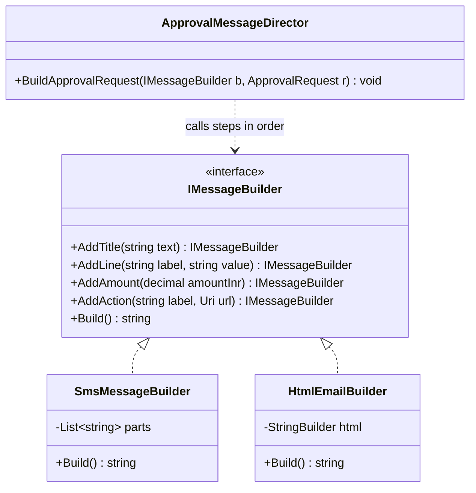
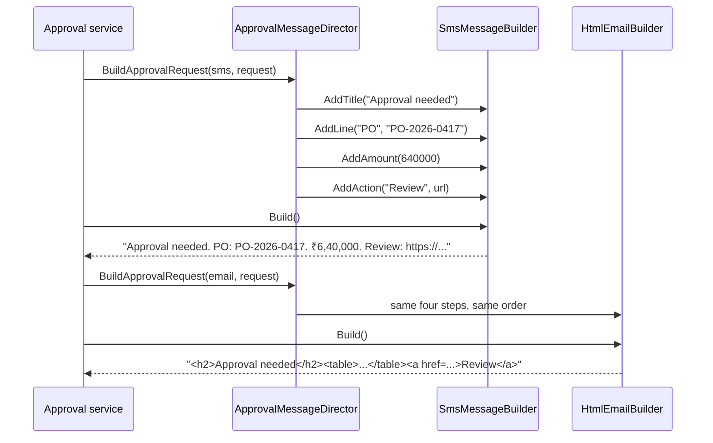

You use builders every day in .NET: `StringBuilder`, `UriBuilder`, `WebApplication.CreateBuilder(args)`, `AuthorizationPolicyBuilder`, `ConfigurationBuilder`. This lesson explains the two ideas hiding under the one name, the GoF Builder (one construction process, several output formats) and the fluent builder (a readable way to assemble a complicated object and validate it once), and when modern C# features let you skip the pattern altogether.

## Learning objectives

By the end of this lesson you will be able to:

1. Explain the two problems Builder solves: complicated construction, and one construction process producing different representations.
2. Name the GoF participants (builder, concrete builder, director, product) and implement them in C#.
3. Write a fluent builder that validates once in `Build()` and returns an immutable product.
4. Use the "configure with a lambda" builder style that ASP.NET Core uses everywhere (`AddPolicy(name, p => ...)`).
5. Write test data builders that keep unit tests short and readable.
6. Decide when a constructor, object initializer with `required`, or a record with `with` is better than a builder.

## Prerequisites

- [Constructors and object initialization](#/lesson/m01-constructors): telescoping constructors are the problem we start from.
- [Immutable objects](#/lesson/m07-immutability): builders usually produce immutable products.
- [Interfaces and abstract classes](#/lesson/m01-interfaces-abstract) and [Dependency injection](#/lesson/m03-dependency-injection).

## Explain it like I'm a beginner

Think of a tailor stitching a kurta. The tailor doesn't cut cloth the moment you walk in. First they collect everything, step by step:

- chest, length and sleeve measurements (required),
- collar style (optional, default "round"),
- number of pockets (optional, default one),
- fabric (required).

They write it all on a slip. You can change your mind about the collar while they're writing. Only when the slip is complete does the tailor check it ("you haven't chosen a fabric") and then cut and stitch. After that, the kurta is finished. You don't change its length by talking to it.

That's a builder:

- **The slip** is the builder object. You call methods on it, one per decision, in any order.
- **"Check the slip, then stitch"** is the `Build()` method. It validates everything at once and creates the finished object.
- **The kurta** is the product. Once built, it's complete and doesn't change.

Now a twist. The same tailor's assistant reads out your order to two people: the cutter, who turns it into a cutting pattern, and the billing clerk, who turns it into an invoice. The assistant reads the same steps in the same order ("chest 40, length 44, collar mandarin…"), but each listener produces something different. That's the *original* GoF Builder: **one director reading out steps, several builders producing different results.**

## First-principles explanation

### Problem 1: complicated construction

Suppose a monthly progress report request has 2 required fields and 6 optional ones. Without a builder you get a *telescoping constructor*:

```csharp
new ReportRequest("NH-48-P3", new DateOnly(2026, 9, 1), new DateOnly(2026, 9, 30),
                  "pdf", true, false, "hi", null);
```

What do `true, false` mean? Is `"hi"` the language or a title? Which `null` did you mean to set? Positional arguments of the same type are easy to swap silently. Worse, some combinations are invalid ("financials require the Finance role", "`to` must be after `from`"), and nothing checks that the *combination* makes sense until something fails later.

A builder gives every decision a name, applies defaults for the rest, and checks the whole combination once:

```csharp
var request = new ReportRequestBuilder("NH-48-P3", from, to)
    .AsPdf()
    .IncludePhotos()
    .InLanguage("hi")
    .Build();      // validates the combination, returns an immutable ReportRequest
```

### Problem 2: one process, several representations (the GoF original)

The 1994 example was a document converter. An RTF reader walks through a document and, for each piece (a paragraph, a font change), calls a builder. A `TeXBuilder` produces TeX, an `AsciiBuilder` produces plain text, and a `TextWidgetBuilder` produces an on-screen editor widget. The reader (the **director**) knows the *order of steps*. The builders know the *representation*. Adding a new output format means writing a new builder, and the reader doesn't change.

A modern equivalent: an approval request notification has the same parts in the same order (title, a few lines of details, an amount, an action link), but it must be produced as a 160-character SMS, an HTML email and a chat card. One director, three builders.

### Participants

| Role | Responsibility | In this lesson |
|---|---|---|
| **Builder** (interface) | Declares the construction steps | `IMessageBuilder` with `AddTitle`, `AddLine`, `AddAmount`, `AddAction` |
| **Concrete builder** | Implements the steps for one representation and keeps the partial result | `SmsMessageBuilder`, `HtmlEmailBuilder` |
| **Director** | Calls the steps in the right order for a particular kind of product | `ApprovalMessageDirector` |
| **Product** | The finished result | An SMS string, an HTML string |

In the **fluent builder** form there's usually no director (the calling code plays that role) and only one concrete builder per product type. The product is often a class with a non-public constructor, so the builder is the only way to make one.

### How a fluent builder works

1. Each "setter" method stores a value in the builder and returns `this`, so calls chain: `.Role("FinanceHead").Sla(...)`.
2. The builder is **mutable**; the product is **immutable**.
3. `Build()` validates the combination, copies the values (including copying lists, so later builder changes can't reach the product), and calls the product's constructor.
4. Validation errors are collected and reported **together**. An exception that lists all three problems is much kinder than three rounds of fix-and-retry.

### The "configure with a lambda" style

ASP.NET Core uses a variation everywhere:

```csharp
builder.Services.AddAuthorization(o =>
    o.AddPolicy("CanApproveLargePO", p => p.RequireRole("FinanceHead").RequireClaim("unit", "Roads")));
```

The framework creates the builder (`AuthorizationPolicyBuilder`), hands it to your lambda to configure, then calls `Build()` itself. You never see `new` or `Build()`. This style is great for *nested* builders (a workflow made of steps, each step configured by its own builder) and for library APIs where the library must control when building happens.

### Builders in .NET and ASP.NET Core

| Builder | Product | Notes |
|---|---|---|
| `StringBuilder` | `string` | Avoids allocating a new string per concatenation |
| `UriBuilder` | `Uri` | Set scheme, host, path and query separately |
| `WebApplication.CreateBuilder(args)` | `WebApplication` | Services, configuration and logging are configured, then `Build()` freezes them |
| `ConfigurationBuilder` | `IConfigurationRoot` | Add sources in order, then build |
| `AuthorizationPolicyBuilder`, `CorsPolicyBuilder` | Policies | Usually used via configure lambdas |
| `RouteHandlerBuilder` | Endpoint metadata | `.RequireAuthorization().WithName("x")` |
| `DbConnectionStringBuilder` and provider subclasses | Connection string | Escapes values correctly, avoiding string-concatenation bugs |
| `ImmutableArray.CreateBuilder<T>()` | `ImmutableArray<T>` | Mutable while building, then `ToImmutable()` or `MoveToImmutable()` |

### When C# makes a builder unnecessary

Modern C# covers many cases that once needed a builder:

```csharp
public sealed record ReportRequest
{
    public required string ProjectId { get; init; }
    public required DateOnly From { get; init; }
    public required DateOnly To { get; init; }
    public string Format { get; init; } = "pdf";
    public bool IncludePhotos { get; init; }
    public string Language { get; init; } = "en";
}

var r = new ReportRequest { ProjectId = "NH-48-P3", From = from, To = to, IncludePhotos = true };
var hindi = r with { Language = "hi" };   // copy with one change
```

- **Named values**: object initializers name every value.
- **Required values**: the `required` keyword makes the *compiler* reject a missing `ProjectId`.
- **Defaults**: property initializers.
- **Immutability**: `init` accessors.
- **Variations**: `with` expressions copy and change.

What this *doesn't* give you is **cross-field validation at construction** (you can validate in a constructor or a factory method, but `init` properties make that awkward), **building in many steps across different code** (for example, a workflow assembled from configuration and code), **conditional or repeated steps** (`.Step(...)` three times) and **several representations from one process**. Those are the cases where Builder still earns its place.

### Trade-offs

| You gain | You pay |
|---|---|
| Readable, self-documenting construction | A second class to maintain alongside the product |
| One place to validate the whole combination | Builders can drift from products: a new product field nobody added to the builder |
| Immutable products, mutable assembly | `Build()` validation happens at *runtime*; the compiler can't help (unless you use a staged builder, exercise 5) |
| Several representations from one director | The director-and-builder split is extra indirection if you only ever produce one format |

### When not to use it

- **Few fields, no cross-field rules.** Use a constructor or a record.
- **All fields required, none optional.** A constructor with named arguments (`new Money(amount: 100m, currency: "INR")`) is enough.
- **DTOs and request models.** Use `required` + `init` and validate at the API boundary (see [validation](#/lesson/m07-validation-rules)).
- **Only one representation and no complicated assembly.** The director/builder split adds nothing.

## Visual explanation

### Class diagram: GoF builder with a director



The director knows only the builder interface. It contains the *recipe*: title first, then requester, document and amount, then the action. Each concrete builder holds a partial result (a list of short parts for SMS, a `StringBuilder` of HTML for email) and turns each step into its own format. Adding a chat-card format means one new class implementing `IMessageBuilder`; the director doesn't change.

### Sequence diagram: one recipe, two products



The director is called twice with the same request and two different builders. It issues identical steps both times. The *caller* asks each builder for its result at the end, because only the caller knows what concrete type it holds. The SMS builder shortens and joins; the email builder escapes and wraps in HTML. Notice that the amount is formatted in the Indian digit grouping (₹6,40,000) by both builders, because that rule lives in one shared helper.

## Step-by-step example

We'll build the fluent half of this lesson: a definition of an approval workflow for purchase orders.

### Step 1 — the requirements

- A purchase order needs the project manager (any amount), the finance head (₹50,000 and above) and a director (₹5,00,000 and above).
- Each step has a service-level time (SLA): 24, 48 and 72 hours.
- Unapproved steps escalate to the COO.
- Rules: at least one step; step names unique; every step has a role; SLAs positive; thresholds don't decrease from one step to the next; the first step applies to every amount (threshold 0), so nothing goes unapproved.

### Step 2 — the naive version

```csharp
var wf = new ApprovalWorkflowDefinition("PurchaseOrder", new List<ApprovalStep>
{
    new("pm", "ProjectManager", 0m, TimeSpan.FromHours(24)),
    new("finance", "FinanceHead", 50_000m, TimeSpan.FromHours(48)),
    new("director", "Director", 500_000m, TimeSpan.FromHours(-72)),   // negative SLA, nobody notices
}, "COO");
wf.Steps.Add(new("intern", "", 0m, TimeSpan.Zero));                     // the list is still mutable!
```

The constructor can't easily check "thresholds don't decrease" without becoming a validation method in disguise, the list is shared and mutable after construction, and the positional record arguments are easy to misorder (is `0m` the threshold or something else?).

### Step 3 — split mutable assembly from immutable product

The product, `ApprovalWorkflowDefinition`, gets an `internal` constructor and exposes `IReadOnlyList<ApprovalStep>` backed by a copied array. The builder, `ApprovalWorkflowBuilder`, holds a mutable `List<StepBuilder>`.

### Step 4 — name every decision

`.Step("finance", s => s.Role("FinanceHead").WhenAmountAtLeast(50_000m).Sla(TimeSpan.FromHours(48)))` reads almost like the requirement. Each step gets its own small builder, configured by a lambda, exactly the ASP.NET Core style.

### Step 5 — validate once, report everything

`Build()` walks the steps, collects every problem into a list, and throws one `WorkflowValidationException` listing them all. Workflows are built at application startup, so a bad definition stops the app from starting instead of failing on the first large purchase order.

## Production-style C# implementation

```text
Approvals.Api/
  Program.cs
  Approvals/ApprovalWorkflowDefinition.cs
  Approvals/ApprovalWorkflowBuilder.cs
  Approvals/WorkflowCatalog.cs
  Approvals/Messages.cs
```

```csharp file=Approvals/ApprovalWorkflowDefinition.cs
namespace Approvals;

public sealed record ApprovalStep(string Name, string Role, decimal MinAmountInr, TimeSpan Sla);

/// <summary>Product: immutable, and only the builder can create it (internal constructor).</summary>
public sealed class ApprovalWorkflowDefinition
{
    internal ApprovalWorkflowDefinition(string documentType, ApprovalStep[] steps, string? escalationRole)
    {
        DocumentType = documentType;
        Steps = Array.AsReadOnly(steps);
        EscalationRole = escalationRole;
    }

    public string DocumentType { get; }
    public IReadOnlyList<ApprovalStep> Steps { get; }
    public string? EscalationRole { get; }

    /// <summary>The steps that apply to a given amount, in order.</summary>
    public IReadOnlyList<ApprovalStep> StepsFor(decimal amountInr) =>
        amountInr < 0 ? throw new ArgumentOutOfRangeException(nameof(amountInr)) : Steps.Where(s => amountInr >= s.MinAmountInr).ToArray();
}

public sealed class WorkflowValidationException(string documentType, IReadOnlyList<string> errors)
    : Exception($"Workflow '{documentType}' is invalid: {string.Join("; ", errors)}")
{
    public IReadOnlyList<string> Errors { get; } = errors;
}
```

```csharp file=Approvals/ApprovalWorkflowBuilder.cs
namespace Approvals;

/// <summary>Builder for one step. Configured through a lambda, ASP.NET Core style.</summary>
public sealed class StepBuilder
{
    private string? _role;
    private decimal _minAmount;
    private TimeSpan _sla = TimeSpan.FromHours(24);

    public StepBuilder Role(string role) { _role = role; return this; }
    public StepBuilder WhenAmountAtLeast(decimal amountInr) { _minAmount = amountInr; return this; }
    public StepBuilder Sla(TimeSpan sla) { _sla = sla; return this; }

    internal ApprovalStep ToStep(string name, List<string> errors)
    {
        if (string.IsNullOrWhiteSpace(_role)) errors.Add($"step '{name}' has no role");
        if (_minAmount < 0) errors.Add($"step '{name}' has a negative threshold");
        if (_sla <= TimeSpan.Zero) errors.Add($"step '{name}' needs a positive SLA");
        return new ApprovalStep(name, _role ?? "", _minAmount, _sla);
    }
}

/// <summary>Fluent builder: mutable while assembling, validates everything in Build().</summary>
public sealed class ApprovalWorkflowBuilder(string documentType)
{
    private readonly List<(string Name, StepBuilder Builder)> _steps = new();
    private string? _escalationRole;

    public ApprovalWorkflowBuilder Step(string name, Action<StepBuilder> configure)
    {
        ArgumentException.ThrowIfNullOrWhiteSpace(name);
        ArgumentNullException.ThrowIfNull(configure);
        var step = new StepBuilder();
        configure(step);
        _steps.Add((name, step));
        return this;
    }

    public ApprovalWorkflowBuilder EscalateTo(string role) { _escalationRole = role; return this; }

    public ApprovalWorkflowDefinition Build()
    {
        var errors = new List<string>();
        if (string.IsNullOrWhiteSpace(documentType)) errors.Add("document type is required");
        if (_steps.Count == 0) errors.Add("at least one step is required");

        var steps = _steps.Select(s => s.Builder.ToStep(s.Name, errors)).ToArray();   // copy: later builder changes can't leak

        foreach (var dup in steps.GroupBy(s => s.Name, StringComparer.OrdinalIgnoreCase).Where(g => g.Count() > 1))
            errors.Add($"step name '{dup.Key}' is used {dup.Count()} times");
        if (steps.Length > 0 && steps[0].MinAmountInr != 0m)
            errors.Add("the first step must apply to every amount (threshold 0)");
        for (var i = 1; i < steps.Length; i++)
            if (steps[i].MinAmountInr < steps[i - 1].MinAmountInr)
                errors.Add($"step '{steps[i].Name}' threshold is lower than step '{steps[i - 1].Name}'");
        if (_escalationRole is not null && string.IsNullOrWhiteSpace(_escalationRole))
            errors.Add("escalation role cannot be blank");

        if (errors.Count > 0) throw new WorkflowValidationException(documentType, errors);
        return new ApprovalWorkflowDefinition(documentType, steps, _escalationRole);
    }
}
```

```csharp file=Approvals/WorkflowCatalog.cs
namespace Approvals;

/// <summary>Holds every workflow, built once at startup.</summary>
public sealed class WorkflowCatalog
{
    private readonly Dictionary<string, ApprovalWorkflowDefinition> _byType;

    internal WorkflowCatalog(IEnumerable<ApprovalWorkflowDefinition> workflows) =>
        _byType = workflows.ToDictionary(w => w.DocumentType, StringComparer.OrdinalIgnoreCase);

    public bool TryGet(string documentType, out ApprovalWorkflowDefinition workflow) => _byType.TryGetValue(documentType, out workflow!);
}

/// <summary>Builder of builders, so Program.cs reads like ASP.NET Core's own AddAuthorization(o => ...).</summary>
public sealed class WorkflowCatalogBuilder
{
    private readonly List<ApprovalWorkflowBuilder> _workflows = new();

    public WorkflowCatalogBuilder Add(string documentType, Action<ApprovalWorkflowBuilder> configure)
    {
        var b = new ApprovalWorkflowBuilder(documentType);
        configure(b);
        _workflows.Add(b);
        return this;
    }

    internal WorkflowCatalog Build() => new(_workflows.Select(w => w.Build()));
}

public static class ApprovalServiceCollectionExtensions
{
    /// <summary>Builds eagerly, so an invalid workflow stops the app at startup, not on the first large PO.</summary>
    public static IServiceCollection AddApprovalWorkflows(this IServiceCollection services, Action<WorkflowCatalogBuilder> configure)
    {
        var builder = new WorkflowCatalogBuilder();
        configure(builder);
        services.AddSingleton(builder.Build());
        services.AddSingleton<ApprovalMessageDirector>();
        return services;
    }
}
```

```csharp file=Approvals/Messages.cs
using System.Globalization;
using System.Net;
using System.Text;

namespace Approvals;

public sealed record ApprovalRequest(string DocumentNumber, string RequestedBy, decimal AmountInr, Uri ReviewUrl);

/// <summary>GoF Builder interface: the construction steps.</summary>
public interface IMessageBuilder
{
    IMessageBuilder AddTitle(string text);
    IMessageBuilder AddLine(string label, string value);
    IMessageBuilder AddAmount(decimal amountInr);
    IMessageBuilder AddAction(string label, Uri url);
    string Build();
}

internal static class Inr
{
    private static readonly CultureInfo India = CultureInfo.GetCultureInfo("en-IN");
    public static string Format(decimal amount) => "₹" + amount.ToString("#,##0", India);   // ₹6,40,000
}

/// <summary>Concrete builder: short plain text, at most 160 characters.</summary>
public sealed class SmsMessageBuilder : IMessageBuilder
{
    private readonly List<string> _parts = new();
    private string? _link;
    public IMessageBuilder AddTitle(string text) { _parts.Insert(0, text); return this; }
    public IMessageBuilder AddLine(string label, string value) { _parts.Add($"{label}: {value}"); return this; }
    public IMessageBuilder AddAmount(decimal amountInr) { _parts.Add(Inr.Format(amountInr)); return this; }
    public IMessageBuilder AddAction(string label, Uri url) { _link = $"{label}: {url}"; return this; }

    public string Build()
    {
        var link = _link is null ? "" : " " + _link;
        var text = string.Join(". ", _parts) + ".";
        var room = 160 - link.Length;                          // never cut the link off
        if (text.Length > room) text = text[..Math.Max(0, room - 3)] + "...";
        return text + link;
    }
}

/// <summary>Concrete builder: HTML email body, every value encoded.</summary>
public sealed class HtmlEmailBuilder : IMessageBuilder
{
    private readonly StringBuilder _head = new();
    private readonly StringBuilder _rows = new();
    private readonly StringBuilder _footer = new();
    private static string E(string s) => WebUtility.HtmlEncode(s);

    public IMessageBuilder AddTitle(string text) { _head.Append($"<h2>{E(text)}</h2>"); return this; }
    public IMessageBuilder AddLine(string label, string value) { _rows.Append($"<tr><th>{E(label)}</th><td>{E(value)}</td></tr>"); return this; }
    public IMessageBuilder AddAmount(decimal amountInr) => AddLine("Amount", Inr.Format(amountInr));
    public IMessageBuilder AddAction(string label, Uri url) { _footer.Append($"<p><a href=\"{E(url.ToString())}\">{E(label)}</a></p>"); return this; }
    public string Build() => $"{_head}<table>{_rows}</table>{_footer}";
}

/// <summary>Director: knows the recipe (which steps, in which order), not the format.</summary>
public sealed class ApprovalMessageDirector
{
    public void BuildApprovalRequest(IMessageBuilder b, ApprovalRequest r, ApprovalStep step) => b
        .AddTitle("Approval needed")
        .AddLine("Document", r.DocumentNumber)
        .AddLine("Requested by", r.RequestedBy)
        .AddAmount(r.AmountInr)
        .AddLine("Respond within", $"{step.Sla.TotalHours:0} hours")
        .AddAction("Review", r.ReviewUrl);
}
```

```csharp file=Program.cs
using Approvals;

var builder = WebApplication.CreateBuilder(args);   // a builder for the whole app

builder.Services.AddApprovalWorkflows(w => w
    .Add("PurchaseOrder", po => po
        .Step("pm", s => s.Role("ProjectManager").Sla(TimeSpan.FromHours(24)))
        .Step("finance", s => s.Role("FinanceHead").WhenAmountAtLeast(50_000m).Sla(TimeSpan.FromHours(48)))
        .Step("director", s => s.Role("Director").WhenAmountAtLeast(5_00_000m).Sla(TimeSpan.FromHours(72)))
        .EscalateTo("COO"))
    .Add("SiteExpense", se => se
        .Step("site-engineer", s => s.Role("SiteEngineer").Sla(TimeSpan.FromHours(8)))
        .Step("pm", s => s.Role("ProjectManager").WhenAmountAtLeast(25_000m))));

var app = builder.Build();

app.MapGet("/approvals/{documentType}/route", (string documentType, decimal amount, WorkflowCatalog catalog) =>
    !catalog.TryGet(documentType, out var wf) ? Results.NotFound()
    : amount < 0 ? Results.Problem("Amount cannot be negative.", statusCode: StatusCodes.Status400BadRequest)
    : Results.Ok(wf.StepsFor(amount).Select(s => new { s.Name, s.Role, SlaHours = s.Sla.TotalHours })));

app.MapPost("/approvals/{documentType}/preview", (string documentType, string channel, ApprovalRequest request,
    WorkflowCatalog catalog, ApprovalMessageDirector director) =>
{
    if (!catalog.TryGet(documentType, out var wf)) return Results.NotFound();
    IMessageBuilder b = channel switch
    {
        "sms" => new SmsMessageBuilder(),
        "email" => new HtmlEmailBuilder(),
        _ => throw new BadHttpRequestException($"Unknown channel '{channel}'."),
    };
    var lastStep = wf.StepsFor(request.AmountInr)[^1];
    director.BuildApprovalRequest(b, request, lastStep);
    return Results.Text(b.Build(), channel == "email" ? "text/html" : "text/plain");
});

app.Run();
```

Design notes:

- **Two builder styles, side by side.** `ApprovalWorkflowBuilder` is a fluent builder that validates and freezes. `IMessageBuilder` with a director is the GoF form: one recipe, several formats.
- **Fail at startup.** `AddApprovalWorkflows` builds eagerly. If someone sets a director threshold lower than the finance threshold, the app refuses to start and the exception lists every problem. Compare that with discovering it when a ₹6 lakh order skips the director.
- **The product can't be built any other way.** `ApprovalWorkflowDefinition` has an `internal` constructor, so code outside the module must use the builder and its validation.
- **Defensive copies.** `Build()` creates new arrays, and the product wraps them read-only, so calling `.Step(...)` on the builder after `Build()` can't change a workflow that's already in use.
- **Shared formatting stays shared.** Both message builders use `Inr.Format`, so the Indian digit grouping (6,40,000 rather than 640,000) is applied consistently.

## Bad design vs good design

**Bad: a "builder" that's just setters on the product.**

```csharp
var wf = new ApprovalWorkflow();
wf.DocumentType = "PurchaseOrder";
wf.AddStep("pm", "ProjectManager", 0m);
wf.AddStep("finance", "", 50_000m);      // missing role
service.Start(wf);                         // validated? partially? never?
wf.AddStep("late", "Intern", 0m);          // mutates a workflow other requests are using
```

There is no moment at which the object is "finished", so there's no moment to validate. Every consumer has to wonder whether it's looking at a half-built object, and anyone holding a reference can change it.

**Good:** a mutable builder, one `Build()` that validates the whole combination, and an immutable product. Anyone holding an `ApprovalWorkflowDefinition` knows it's complete and valid.

**Also good, and simpler, when it fits:**

```csharp
public sealed record NotificationPreferences
{
    public required string UserId { get; init; }
    public bool Sms { get; init; } = true;
    public bool Email { get; init; } = true;
    public TimeOnly QuietFrom { get; init; } = new(22, 0);
}
```

Four fields, one required, no cross-field rules. A record with `required` and `init` is clearer than a builder. Don't build a builder for this.

:::callout type=mistake title="Builders that return a half-valid product"
A `Build()` that skips validation "because the UI already checked" moves the problem rather than solving it. The builder is the last point where you can guarantee a valid object. Validate there, even if other layers validate too.
:::

## Practical playground

The program builds a small tender notice with a fluent builder and prints validation errors for a bad one. Run it, then try the TODO: add a `.Corrigendum(string note)` step that can be called several times and appears in the output.

:::playground type=csharp title="Fluent builder with validation"
```csharp file=Program.cs
using System;
using System.Collections.Generic;
using System.Globalization;
using System.Linq;

public sealed class TenderNotice
{
    internal TenderNotice(string project, decimal estimateInr, DateOnly closesOn, IReadOnlyList<string> documents)
    { Project = project; EstimateInr = estimateInr; ClosesOn = closesOn; Documents = documents; }
    public string Project { get; }
    public decimal EstimateInr { get; }
    public DateOnly ClosesOn { get; }
    public IReadOnlyList<string> Documents { get; }
    public override string ToString() =>
        $"{Project}: estimate ₹{EstimateInr.ToString("N0", CultureInfo.GetCultureInfo("en-IN"))}, closes {ClosesOn:dd MMM yyyy}, docs: {string.Join(", ", Documents)}";
}

public sealed class TenderNoticeBuilder(DateOnly publishedOn)
{
    private string? _project;
    private decimal _estimate;
    private DateOnly? _closesOn;
    private readonly List<string> _docs = new();

    public TenderNoticeBuilder ForProject(string name) { _project = name; return this; }
    public TenderNoticeBuilder Estimate(decimal inr) { _estimate = inr; return this; }
    public TenderNoticeBuilder ClosesOn(DateOnly date) { _closesOn = date; return this; }
    public TenderNoticeBuilder Document(string name) { _docs.Add(name); return this; }

    public TenderNotice Build()
    {
        var errors = new List<string>();
        if (string.IsNullOrWhiteSpace(_project)) errors.Add("project is required");
        if (_estimate <= 0) errors.Add("estimate must be positive");
        if (_closesOn is null) errors.Add("closing date is required");
        else if (_closesOn.Value < publishedOn.AddDays(21)) errors.Add("bids must stay open at least 21 days (illustrative rule)");
        if (_docs.Count == 0) errors.Add("at least one document is required");
        if (errors.Count > 0) throw new InvalidOperationException(string.Join("; ", errors));
        return new TenderNotice(_project!, _estimate, _closesOn!.Value, _docs.ToArray());
    }
}

public static class Program
{
    public static void Main()
    {
        var published = new DateOnly(2026, 10, 1);
        var ok = new TenderNoticeBuilder(published)
            .ForProject("Bridge over Ganga at km 112")
            .Estimate(48_50_00_000m)
            .ClosesOn(new DateOnly(2026, 11, 5))
            .Document("NIT.pdf").Document("BOQ.xlsx")
            .Build();
        Console.WriteLine(ok);

        try { new TenderNoticeBuilder(published).Estimate(-1).ClosesOn(new DateOnly(2026, 10, 10)).Build(); }
        catch (InvalidOperationException ex) { Console.WriteLine("Rejected: " + ex.Message); }

        // TODO: add .Corrigendum(string note) (repeatable) and show the notes in ToString().
    }
}
```
:::

## Exercises

:::exercise id=m06-builder-ex1 difficulty=beginner kind=code title="A builder for email notifications"
Write `EmailNotificationBuilder`, which builds an immutable `EmailNotification`. Recipients and a subject are required; attachments are optional but limited.
::requirements
- Methods: `To(string)` (repeatable), `Subject(string)`, `Body(string)`, `HighPriority()`, `Attach(string fileName, long sizeBytes)` (repeatable). Each returns the builder.
- `Build()` validates and throws `ArgumentException` whose message lists **every** problem, separated by `; `:
  - `at least one recipient`, `subject is required`, `at most 5 attachments`, `attachments exceed 10 MB`.
- Recipients are de-duplicated, ignoring case.
- The product's lists can't be changed by later builder calls.
::acceptance
- A valid build produces the expected recipients, subject and priority.
- A build with no recipient and no subject reports both problems in one exception.
- Six attachments or 11 MB in total are rejected.
- Calling `To(...)` after `Build()` doesn't change the built notification.
::hint
Keep mutable state (lists, fields) in the builder; give the product only read-only views.
::hint
Each fluent method ends with `return this;`.
::hint
In `Build()`, add every problem to a `List<string> errors`, then throw once if it isn't empty.
::hint
Copy lists in `Build()`: `_to.Distinct(StringComparer.OrdinalIgnoreCase).ToArray()`. 10 MB is `10L * 1024 * 1024`.
::starter
```csharp file=EmailNotification.cs
using System;
using System.Collections.Generic;
using System.Linq;

public sealed record Attachment(string FileName, long SizeBytes);

public sealed class EmailNotification
{
    public EmailNotification(IReadOnlyList<string> to, string subject, string body, bool highPriority, IReadOnlyList<Attachment> attachments)
    { To = to; Subject = subject; Body = body; HighPriority = highPriority; Attachments = attachments; }
    public IReadOnlyList<string> To { get; }
    public string Subject { get; }
    public string Body { get; }
    public bool HighPriority { get; }
    public IReadOnlyList<Attachment> Attachments { get; }
}

public sealed class EmailNotificationBuilder
{
    public EmailNotificationBuilder To(string address) => throw new NotImplementedException();
    public EmailNotificationBuilder Subject(string subject) => throw new NotImplementedException();
    public EmailNotificationBuilder Body(string body) => throw new NotImplementedException();
    public EmailNotificationBuilder HighPriority() => throw new NotImplementedException();
    public EmailNotificationBuilder Attach(string fileName, long sizeBytes) => throw new NotImplementedException();
    public EmailNotification Build() => throw new NotImplementedException();
}
```
::tests
```csharp file=EmailNotificationBuilderTests.cs
using System;
using Xunit;

public class EmailNotificationBuilderTests
{
    [Fact]
    public void Builds_valid_notification()
    {
        var n = new EmailNotificationBuilder()
            .To("pm@site.in").To("PM@site.in").To("qs@site.in")
            .Subject("RFI-204 overdue").Body("Please respond.").HighPriority()
            .Build();
        Assert.Equal(new[] { "pm@site.in", "qs@site.in" }, n.To);
        Assert.Equal("RFI-204 overdue", n.Subject);
        Assert.True(n.HighPriority);
    }

    [Fact]
    public void Reports_all_problems_at_once()
    {
        var ex = Assert.Throws<ArgumentException>(() => new EmailNotificationBuilder().Body("x").Build());
        Assert.Contains("at least one recipient", ex.Message);
        Assert.Contains("subject is required", ex.Message);
    }

    [Fact]
    public void Limits_attachment_count()
    {
        var b = new EmailNotificationBuilder().To("a@b.in").Subject("s");
        for (var i = 0; i < 6; i++) b.Attach($"f{i}.pdf", 1000);
        Assert.Contains("at most 5 attachments", Assert.Throws<ArgumentException>(() => b.Build()).Message);
    }

    [Fact]
    public void Limits_attachment_size()
    {
        var b = new EmailNotificationBuilder().To("a@b.in").Subject("s").Attach("drawing.dwg", 11L * 1024 * 1024);
        Assert.Contains("attachments exceed 10 MB", Assert.Throws<ArgumentException>(() => b.Build()).Message);
    }

    [Fact]
    public void Product_is_isolated_from_later_builder_changes()
    {
        var b = new EmailNotificationBuilder().To("a@b.in").Subject("s");
        var n = b.Build();
        b.To("late@b.in");
        Assert.Single(n.To);
    }
}
```
::solution
```csharp file=EmailNotification.cs
using System;
using System.Collections.Generic;
using System.Linq;

public sealed record Attachment(string FileName, long SizeBytes);

public sealed class EmailNotification
{
    public EmailNotification(IReadOnlyList<string> to, string subject, string body, bool highPriority, IReadOnlyList<Attachment> attachments)
    { To = to; Subject = subject; Body = body; HighPriority = highPriority; Attachments = attachments; }
    public IReadOnlyList<string> To { get; }
    public string Subject { get; }
    public string Body { get; }
    public bool HighPriority { get; }
    public IReadOnlyList<Attachment> Attachments { get; }
}

public sealed class EmailNotificationBuilder
{
    private const int MaxAttachments = 5;
    private const long MaxTotalBytes = 10L * 1024 * 1024;

    private readonly List<string> _to = new();
    private readonly List<Attachment> _attachments = new();
    private string? _subject;
    private string _body = "";
    private bool _high;

    public EmailNotificationBuilder To(string address) { _to.Add(address.Trim()); return this; }
    public EmailNotificationBuilder Subject(string subject) { _subject = subject; return this; }
    public EmailNotificationBuilder Body(string body) { _body = body; return this; }
    public EmailNotificationBuilder HighPriority() { _high = true; return this; }
    public EmailNotificationBuilder Attach(string fileName, long sizeBytes) { _attachments.Add(new(fileName, sizeBytes)); return this; }

    public EmailNotification Build()
    {
        var errors = new List<string>();
        var to = _to.Where(a => a.Length > 0).Distinct(StringComparer.OrdinalIgnoreCase).ToArray();
        if (to.Length == 0) errors.Add("at least one recipient");
        if (string.IsNullOrWhiteSpace(_subject)) errors.Add("subject is required");
        if (_attachments.Count > MaxAttachments) errors.Add($"at most {MaxAttachments} attachments");
        if (_attachments.Sum(a => a.SizeBytes) > MaxTotalBytes) errors.Add("attachments exceed 10 MB");
        if (errors.Count > 0) throw new ArgumentException(string.Join("; ", errors));

        return new EmailNotification(to, _subject!, _body, _high, _attachments.ToArray());
    }
}
```

`Build()` is the single gate: it validates the whole combination and copies every collection. The product is complete, valid and unaffected by anything that happens to the builder afterwards.
::mistakes
- Throwing on the first problem. The caller fixes it, runs again, and meets the next one.
- Passing `_to` itself to the product, so `b.To(...)` after `Build()` silently adds a recipient to an email that's already queued.
- Validating in each setter (`Subject("")` throws). Partial states are normal while building; only the final combination matters.
:::

:::exercise id=m06-builder-ex2 difficulty=beginner kind=code title="Refactor a telescoping constructor"
A report request is created like this all over the codebase:

```csharp
new ReportRequest("NH-48-P3", from, to, "pdf", true, false, "hi", null);
```

The positional `true, false` have already caused one bug (photos were swapped with financials). Write `ReportRequestBuilder` with named steps and defaults, and validate the combination in `Build()`.
::requirements
- Constructor: `ReportRequestBuilder(string projectId, DateOnly from, DateOnly to)`, the three required values.
- Steps: `AsPdf()`, `AsExcel()`, `IncludePhotos()`, `IncludeFinancials()`, `InLanguage(string)`, `MaxRows(int)`.
- Defaults: format `pdf`, no photos, no financials, language `en`, no row limit.
- Rules (throw `InvalidOperationException`): `to` must not be before `from`; the period can't exceed 366 days; photos aren't supported in Excel; `MaxRows` must be between 1 and 100,000; language must be one of `en`, `hi`, `mr`.
::acceptance
- A request with only the required values uses all defaults.
- `IncludePhotos().AsExcel()` is rejected.
- A 400-day period is rejected.
- The resulting `ReportRequest` has the expected values.
::hint
The required values go in the builder's constructor; everything optional becomes a named method.
::hint
Store defaults in the builder's fields so that `Build()` just copies them.
::hint
Check rules that involve *two* values (photos + Excel, from + to) in `Build()`, never in the setters, because the caller may set them in either order.
::hint
`to.DayNumber - from.DayNumber` gives the period length in days.
::starter
```csharp file=ReportRequest.cs
using System;
using System.Collections.Generic;

public sealed record ReportRequest(string ProjectId, DateOnly From, DateOnly To, string Format,
    bool IncludePhotos, bool IncludeFinancials, string Language, int? MaxRows);

public sealed class ReportRequestBuilder
{
    public ReportRequestBuilder(string projectId, DateOnly from, DateOnly to) { }
    public ReportRequestBuilder AsPdf() => throw new NotImplementedException();
    public ReportRequestBuilder AsExcel() => throw new NotImplementedException();
    public ReportRequestBuilder IncludePhotos() => throw new NotImplementedException();
    public ReportRequestBuilder IncludeFinancials() => throw new NotImplementedException();
    public ReportRequestBuilder InLanguage(string language) => throw new NotImplementedException();
    public ReportRequestBuilder MaxRows(int rows) => throw new NotImplementedException();
    public ReportRequest Build() => throw new NotImplementedException();
}
```
::tests
```csharp file=ReportRequestBuilderTests.cs
using System;
using Xunit;

public class ReportRequestBuilderTests
{
    private static readonly DateOnly From = new(2026, 9, 1);
    private static readonly DateOnly To = new(2026, 9, 30);

    [Fact]
    public void Defaults()
    {
        var r = new ReportRequestBuilder("NH-48-P3", From, To).Build();
        Assert.Equal(new ReportRequest("NH-48-P3", From, To, "pdf", false, false, "en", null), r);
    }

    [Fact]
    public void Named_steps_set_values()
    {
        var r = new ReportRequestBuilder("NH-48-P3", From, To).IncludeFinancials().InLanguage("hi").MaxRows(500).Build();
        Assert.True(r.IncludeFinancials);
        Assert.False(r.IncludePhotos);
        Assert.Equal("hi", r.Language);
        Assert.Equal(500, r.MaxRows);
    }

    [Fact]
    public void Photos_not_allowed_in_excel_in_either_order()
    {
        Assert.Throws<InvalidOperationException>(() => new ReportRequestBuilder("P", From, To).IncludePhotos().AsExcel().Build());
        Assert.Throws<InvalidOperationException>(() => new ReportRequestBuilder("P", From, To).AsExcel().IncludePhotos().Build());
    }

    [Fact]
    public void Period_limits()
    {
        Assert.Throws<InvalidOperationException>(() => new ReportRequestBuilder("P", To, From).Build());
        Assert.Throws<InvalidOperationException>(() => new ReportRequestBuilder("P", From, From.AddDays(400)).Build());
    }

    [Theory]
    [InlineData(0)]
    [InlineData(100001)]
    public void Row_limit_range(int rows) =>
        Assert.Throws<InvalidOperationException>(() => new ReportRequestBuilder("P", From, To).MaxRows(rows).Build());

    [Fact]
    public void Unknown_language_rejected() =>
        Assert.Throws<InvalidOperationException>(() => new ReportRequestBuilder("P", From, To).InLanguage("fr").Build());
}
```
::solution
```csharp file=ReportRequest.cs
using System;
using System.Collections.Generic;

public sealed record ReportRequest(string ProjectId, DateOnly From, DateOnly To, string Format,
    bool IncludePhotos, bool IncludeFinancials, string Language, int? MaxRows);

public sealed class ReportRequestBuilder(string projectId, DateOnly from, DateOnly to)
{
    private static readonly HashSet<string> Languages = new(StringComparer.OrdinalIgnoreCase) { "en", "hi", "mr" };

    private string _format = "pdf";
    private bool _photos;
    private bool _financials;
    private string _language = "en";
    private int? _maxRows;

    public ReportRequestBuilder AsPdf() { _format = "pdf"; return this; }
    public ReportRequestBuilder AsExcel() { _format = "xlsx"; return this; }
    public ReportRequestBuilder IncludePhotos() { _photos = true; return this; }
    public ReportRequestBuilder IncludeFinancials() { _financials = true; return this; }
    public ReportRequestBuilder InLanguage(string language) { _language = language; return this; }
    public ReportRequestBuilder MaxRows(int rows) { _maxRows = rows; return this; }

    public ReportRequest Build()
    {
        var errors = new List<string>();
        if (string.IsNullOrWhiteSpace(projectId)) errors.Add("project is required");
        if (to < from) errors.Add("'to' is before 'from'");
        else if (to.DayNumber - from.DayNumber > 366) errors.Add("period cannot exceed 366 days");
        if (_photos && _format == "xlsx") errors.Add("photos are not supported in Excel");
        if (_maxRows is < 1 or > 100_000) errors.Add("max rows must be between 1 and 100,000");
        if (!Languages.Contains(_language)) errors.Add($"language '{_language}' is not supported");
        if (errors.Count > 0) throw new InvalidOperationException(string.Join("; ", errors));

        return new ReportRequest(projectId, from, to, _format, _photos, _financials, _language.ToLowerInvariant(), _maxRows);
    }
}
```

Call sites change from `new ReportRequest("NH-48-P3", from, to, "pdf", true, false, "hi", null)` to `new ReportRequestBuilder("NH-48-P3", from, to).IncludePhotos().InLanguage("hi").Build()`. The swapped-boolean bug can't happen any more, because each flag has a name.

**Refactoring tip:** don't change all call sites at once. Add the builder, make the old constructor `[Obsolete("Use ReportRequestBuilder")]`, and move callers over in small pull requests while the compiler warnings show you what remains.
::alternatives
If the only problem were unreadable arguments, named arguments (`IncludePhotos: true`) or an object initializer with `required` would fix it with no new class. The builder is justified here by the *cross-field rules* (photos + Excel, period length).
::mistakes
- Checking "photos not in Excel" inside `AsExcel()`, which fails or passes depending on the order the caller used.
- Making `MaxRows` default to `0` and treating 0 as "no limit". Use `null` for "not set"; magic values cause bugs.
:::

:::exercise id=m06-builder-ex3 difficulty=intermediate kind=code title="One director, two builders"
Implement the GoF form: a `PaymentFailedDirector` that produces a "payment failed" notification through any `INoticeBuilder`, and two builders, one for SMS (plain text, at most 160 characters) and one for HTML email.
::requirements
- `INoticeBuilder`: `Heading(string)`, `Fact(string label, string value)`, `Money(decimal)`, `Link(string label, string url)`, `Result()`.
- The director's recipe: heading `Payment failed`, facts `Invoice` and `Reason`, the amount, then a link `Retry payment`.
- SMS: parts joined with `. `, ending with `.`, then a space and the link as `<label>: <url>`. If it's too long, shorten the *text* (ending it with `...`), never the link.
- HTML: `<h3>` heading, a `<ul>` of `<li><b>label</b>: value</li>` (amount appears as `Amount`), and `<a href="url">label</a>`. Every value is HTML-encoded.
- Money is formatted as `₹` plus the en-IN grouping with two decimals, for example `₹1,25,000.00`.
::acceptance
- The SMS for a short reason matches the expected text exactly.
- A very long reason still yields an SMS of at most 160 characters that ends with the full link.
- The HTML encodes `<script>` in the reason.
- The director doesn't mention SMS or HTML anywhere.
::hint
The director only calls builder methods in order. All formatting is in the builders.
::hint
In the SMS builder, collect text parts in a `List<string>` and keep the link separately, so you can measure the link first and give the text whatever space is left.
::hint
`WebUtility.HtmlEncode` encodes `<`, `>`, `&` and `"`.
::hint
Money: `"₹" + amount.ToString("#,##0.00", CultureInfo.GetCultureInfo("en-IN"))`.
::starter
```csharp file=Notices.cs
using System;
using System.Collections.Generic;
using System.Globalization;
using System.Net;
using System.Text;

public sealed record FailedPayment(string InvoiceNumber, string Reason, decimal AmountInr, string RetryUrl);

public interface INoticeBuilder
{
    INoticeBuilder Heading(string text);
    INoticeBuilder Fact(string label, string value);
    INoticeBuilder Money(decimal amountInr);
    INoticeBuilder Link(string label, string url);
    string Result();
}

public sealed class SmsNoticeBuilder : INoticeBuilder
{
    public INoticeBuilder Heading(string text) => throw new NotImplementedException();
    public INoticeBuilder Fact(string label, string value) => throw new NotImplementedException();
    public INoticeBuilder Money(decimal amountInr) => throw new NotImplementedException();
    public INoticeBuilder Link(string label, string url) => throw new NotImplementedException();
    public string Result() => throw new NotImplementedException();
}

public sealed class HtmlNoticeBuilder : INoticeBuilder
{
    public INoticeBuilder Heading(string text) => throw new NotImplementedException();
    public INoticeBuilder Fact(string label, string value) => throw new NotImplementedException();
    public INoticeBuilder Money(decimal amountInr) => throw new NotImplementedException();
    public INoticeBuilder Link(string label, string url) => throw new NotImplementedException();
    public string Result() => throw new NotImplementedException();
}

public sealed class PaymentFailedDirector
{
    public void Construct(INoticeBuilder builder, FailedPayment payment) => throw new NotImplementedException();
}
```
::tests
```csharp file=NoticeTests.cs
using Xunit;

public class NoticeTests
{
    private static readonly FailedPayment P = new("INV-2026-0911", "Card declined", 125000m, "https://pay.example/r/9F2");

    private static string Make(INoticeBuilder b, FailedPayment p)
    {
        new PaymentFailedDirector().Construct(b, p);
        return b.Result();
    }

    [Fact]
    public void Sms_exact_text() =>
        Assert.Equal("Payment failed. Invoice: INV-2026-0911. Reason: Card declined. ₹1,25,000.00. Retry payment: https://pay.example/r/9F2",
                     Make(new SmsNoticeBuilder(), P));

    [Fact]
    public void Long_sms_keeps_link()
    {
        var sms = Make(new SmsNoticeBuilder(), P with { Reason = new string('x', 300) });
        Assert.True(sms.Length <= 160);
        Assert.EndsWith("Retry payment: https://pay.example/r/9F2", sms);
        Assert.Contains("...", sms);
    }

    [Fact]
    public void Html_structure()
    {
        var html = Make(new HtmlNoticeBuilder(), P);
        Assert.StartsWith("<h3>Payment failed</h3><ul>", html);
        Assert.Contains("<li><b>Amount</b>: ₹1,25,000.00</li>", html);
        Assert.EndsWith("</ul><a href=\"https://pay.example/r/9F2\">Retry payment</a>", html);
    }

    [Fact]
    public void Html_encodes_values() =>
        Assert.Contains("&lt;script&gt;", Make(new HtmlNoticeBuilder(), P with { Reason = "<script>alert(1)</script>" }));
}
```
::solution
```csharp file=Notices.cs
using System;
using System.Collections.Generic;
using System.Globalization;
using System.Net;
using System.Text;

public sealed record FailedPayment(string InvoiceNumber, string Reason, decimal AmountInr, string RetryUrl);

public interface INoticeBuilder
{
    INoticeBuilder Heading(string text);
    INoticeBuilder Fact(string label, string value);
    INoticeBuilder Money(decimal amountInr);
    INoticeBuilder Link(string label, string url);
    string Result();
}

internal static class Rupees
{
    private static readonly CultureInfo India = CultureInfo.GetCultureInfo("en-IN");
    public static string Format(decimal amount) => "₹" + amount.ToString("#,##0.00", India);
}

public sealed class SmsNoticeBuilder : INoticeBuilder
{
    private const int Max = 160;
    private readonly List<string> _parts = new();
    private string _link = "";

    public INoticeBuilder Heading(string text) { _parts.Add(text); return this; }
    public INoticeBuilder Fact(string label, string value) { _parts.Add($"{label}: {value}"); return this; }
    public INoticeBuilder Money(decimal amountInr) { _parts.Add(Rupees.Format(amountInr)); return this; }
    public INoticeBuilder Link(string label, string url) { _link = $" {label}: {url}"; return this; }

    public string Result()
    {
        var text = string.Join(". ", _parts) + ".";
        var room = Max - _link.Length;
        if (text.Length > room) text = text[..Math.Max(0, room - 3)] + "...";
        return text + _link;
    }
}

public sealed class HtmlNoticeBuilder : INoticeBuilder
{
    private readonly StringBuilder _heading = new();
    private readonly StringBuilder _items = new();
    private readonly StringBuilder _link = new();
    private static string E(string s) => WebUtility.HtmlEncode(s);

    public INoticeBuilder Heading(string text) { _heading.Append($"<h3>{E(text)}</h3>"); return this; }
    public INoticeBuilder Fact(string label, string value) { _items.Append($"<li><b>{E(label)}</b>: {E(value)}</li>"); return this; }
    public INoticeBuilder Money(decimal amountInr) => Fact("Amount", Rupees.Format(amountInr));
    public INoticeBuilder Link(string label, string url) { _link.Append($"<a href=\"{E(url)}\">{E(label)}</a>"); return this; }
    public string Result() => $"{_heading}<ul>{_items}</ul>{_link}";
}

/// <summary>The recipe. Knows the order of parts, nothing about formats.</summary>
public sealed class PaymentFailedDirector
{
    public void Construct(INoticeBuilder builder, FailedPayment payment) => builder
        .Heading("Payment failed")
        .Fact("Invoice", payment.InvoiceNumber)
        .Fact("Reason", payment.Reason)
        .Money(payment.AmountInr)
        .Link("Retry payment", payment.RetryUrl);
}
```

The test helper calls `Result()` on the builder, not on the director, because only the caller knows which concrete builder (and so which product type) it has. If you later add WhatsApp, you write `WhatsAppNoticeBuilder`; the director and every other notice recipe stay unchanged. If you later add a second recipe (say, "payment succeeded"), you write a second director method, and all three formats support it immediately.
::alternatives
If you only ever produce one format, skip the director: a method that formats an SMS directly is simpler. The director/builder split pays off when recipes × formats grows, for example 8 notice types × 3 channels.
::mistakes
- Truncating the final string, which cuts off the retry link, the most important part of the SMS.
- Formatting money in the director. Then every builder gets the same format, even where a channel needs a different one.
- Forgetting HTML encoding of values that come from users or upstream systems.
:::

:::exercise id=m06-builder-ex4 difficulty=intermediate kind=written title="Builder, record, or constructor?"
For each type, choose the construction approach: **constructor**, **record with `required`/`init`**, **fluent builder**, **builder with director**, or **static factory method**. Justify each in one or two sentences.

1. `Money(decimal Amount, string Currency)`: two required values, always both.
2. `CreateUserRequest`: an API request DTO with 3 required and 5 optional fields, validated by the API layer.
3. A bill-of-quantities (BOQ) export that must produce PDF, Excel and an e-procurement XML format with the same sections in the same order.
4. An HTTP retry policy with retries, back-off, jitter, a timeout and a circuit breaker, where some combinations are invalid (jitter without back-off).
5. `Percentage.FromBasisPoints(1250)`: a value created from different units.
6. A test-only `Invoice` that needs 15 fields set to valid values, but each test cares about one or two.
::acceptance
- Each item has a choice and a reason tied to required/optional fields, cross-field rules, multiple representations or readability.
- At least one item explicitly rejects a builder as overkill.
- Item 6 names the test data builder idea.
::hint
Ask: how many optional values? Are there rules between values? Is there more than one output format? Who reads the code?
::hint
Two required values and no options rarely need anything more than a constructor.
::hint
"Same sections, same order, different formats" is the GoF Builder's original problem.
::hint
For item 6: what would make each test show only the fields it cares about?
::solution
1. **Constructor** (or a positional record). Both values are required and there are no options. `new Money(1499.50m, "INR")` is already clear. A builder would be ceremony.
2. **Record with `required` and `init`.** The compiler enforces the required fields, initializers name every value, and validation belongs at the API boundary (validation filters, data annotations or FluentValidation). A builder adds nothing for a DTO.
3. **Builder with a director.** The director walks the BOQ sections in order; `PdfBoqBuilder`, `ExcelBoqBuilder` and `EProcurementXmlBuilder` produce each format. A new format is a new builder; a section-order change is one edit in the director.
4. **Fluent builder.** Many optional settings, cross-field rules checked in `Build()`, and a readable chain. This is how resilience libraries such as Polly's `ResiliencePipelineBuilder` are designed.
5. **Static factory method.** A named constructor makes the unit explicit (`FromBasisPoints`, `FromPercent`) and can validate. No builder needed.
6. **Test data builder.** `new InvoiceBuilder().WithAmount(0).Build()` starts from a valid default invoice and changes only what the test is about. Tests become short and resistant to new required fields: add the default in one place, not in 200 tests.
::mistakes
- Choosing a builder for every type "for consistency". Consistency in ceremony isn't a goal.
- Calling item 3 a factory. The problem is *assembling one complex output in steps*, not choosing a class.
:::

:::exercise id=m06-builder-ex5 difficulty=advanced kind=code title="A staged builder the compiler checks"
A normal fluent builder can only report a missing required value at runtime. Build a **staged builder** for a tender notice, where each required step returns a *different interface*, so `Build()` simply doesn't exist until the required steps have been called.

Stages: `TenderNoticeBuilder.Start(DateOnly publishedOn)` → `IProjectStage.ForProject(string name, decimal estimateInr)` → `IDeadlineStage.BidsCloseOn(DateOnly date)` → `IOptionalStage`, which has `PreBidMeeting(DateOnly)`, `Document(string)` (repeatable) and `Build()`.
::requirements
- `IProjectStage` and `IDeadlineStage` have exactly one method each, and neither has `Build`.
- Runtime rules in `Build()` (throw `InvalidOperationException`): bids close at least 21 days after publishing (an illustrative rule); the pre-bid meeting, if set, is after publishing and at least 7 days before closing; at least one document; estimate positive.
- The earnest money deposit (EMD) is computed as 2 % of the estimate, rounded **up** to the nearest ₹1,000 (illustrative rule).
- The product, `TenderNotice`, is immutable.
::acceptance
- A valid chain builds a notice with the right EMD (2 % of ₹48,50,00,000 is ₹97,00,000).
- A closing date 10 days after publishing is rejected.
- A pre-bid meeting 3 days before closing is rejected.
- Reflection confirms that `IProjectStage` and `IDeadlineStage` expose no `Build` method.
::hint
One class can implement all the stage interfaces. Each method returns `this`, typed as the *next* interface.
::hint
`Start` is a static method returning `IProjectStage`, so callers can't skip ahead.
::hint
Rounding up to ₹1,000: `Math.Ceiling(value / 1000m) * 1000m`.
::hint
```csharp
public sealed class TenderNoticeBuilder : IProjectStage, IDeadlineStage, IOptionalStage
{
    public static IProjectStage Start(DateOnly publishedOn) => new TenderNoticeBuilder(publishedOn);
    public IDeadlineStage ForProject(string name, decimal estimateInr) { ...; return this; }
    ...
}
```
::starter
```csharp file=TenderNotice.cs
using System;
using System.Collections.Generic;

public sealed class TenderNotice
{
    internal TenderNotice(string project, decimal estimateInr, decimal emdInr, DateOnly publishedOn, DateOnly closesOn,
        DateOnly? preBidMeeting, IReadOnlyList<string> documents)
    {
        Project = project; EstimateInr = estimateInr; EmdInr = emdInr; PublishedOn = publishedOn;
        ClosesOn = closesOn; PreBidMeeting = preBidMeeting; Documents = documents;
    }
    public string Project { get; }
    public decimal EstimateInr { get; }
    public decimal EmdInr { get; }
    public DateOnly PublishedOn { get; }
    public DateOnly ClosesOn { get; }
    public DateOnly? PreBidMeeting { get; }
    public IReadOnlyList<string> Documents { get; }
}

public interface IProjectStage { IDeadlineStage ForProject(string name, decimal estimateInr); }
public interface IDeadlineStage { IOptionalStage BidsCloseOn(DateOnly date); }
public interface IOptionalStage
{
    IOptionalStage PreBidMeeting(DateOnly date);
    IOptionalStage Document(string fileName);
    TenderNotice Build();
}

public sealed class TenderNoticeBuilder
{
    public static IProjectStage Start(DateOnly publishedOn) => throw new NotImplementedException();
}
```
::tests
```csharp file=TenderNoticeTests.cs
using System;
using System.Linq;
using Xunit;

public class TenderNoticeTests
{
    private static readonly DateOnly Published = new(2026, 10, 1);

    [Fact]
    public void Valid_chain_builds_with_emd()
    {
        var n = TenderNoticeBuilder.Start(Published)
            .ForProject("Bridge over Ganga at km 112", 48_50_00_000m)
            .BidsCloseOn(new DateOnly(2026, 11, 5))
            .PreBidMeeting(new DateOnly(2026, 10, 15))
            .Document("NIT.pdf").Document("BOQ.xlsx")
            .Build();
        Assert.Equal(97_00_000m, n.EmdInr);
        Assert.Equal(2, n.Documents.Count);
        Assert.Equal(new DateOnly(2026, 10, 15), n.PreBidMeeting);
    }

    [Fact]
    public void Emd_rounds_up_to_thousand() =>
        Assert.Equal(21_000m, TenderNoticeBuilder.Start(Published).ForProject("Culvert", 10_25_000m)
            .BidsCloseOn(Published.AddDays(30)).Document("NIT.pdf").Build().EmdInr);

    [Fact]
    public void Short_bid_window_rejected() =>
        Assert.Throws<InvalidOperationException>(() => TenderNoticeBuilder.Start(Published).ForProject("X", 1_00_000m)
            .BidsCloseOn(Published.AddDays(10)).Document("NIT.pdf").Build());

    [Fact]
    public void Pre_bid_too_close_to_closing_rejected() =>
        Assert.Throws<InvalidOperationException>(() => TenderNoticeBuilder.Start(Published).ForProject("X", 1_00_000m)
            .BidsCloseOn(Published.AddDays(30)).PreBidMeeting(Published.AddDays(27)).Document("NIT.pdf").Build());

    [Fact]
    public void Documents_required() =>
        Assert.Throws<InvalidOperationException>(() => TenderNoticeBuilder.Start(Published).ForProject("X", 1_00_000m)
            .BidsCloseOn(Published.AddDays(30)).Build());

    [Fact]
    public void Early_stages_have_no_build_method()
    {
        Assert.DoesNotContain(typeof(IProjectStage).GetMethods(), m => m.Name == "Build");
        Assert.DoesNotContain(typeof(IDeadlineStage).GetMethods(), m => m.Name == "Build");
        Assert.Single(typeof(IProjectStage).GetMethods());
        Assert.Single(typeof(IDeadlineStage).GetMethods());
    }
}
```
::solution
```csharp file=TenderNotice.cs
using System;
using System.Collections.Generic;

public sealed class TenderNotice
{
    internal TenderNotice(string project, decimal estimateInr, decimal emdInr, DateOnly publishedOn, DateOnly closesOn,
        DateOnly? preBidMeeting, IReadOnlyList<string> documents)
    {
        Project = project; EstimateInr = estimateInr; EmdInr = emdInr; PublishedOn = publishedOn;
        ClosesOn = closesOn; PreBidMeeting = preBidMeeting; Documents = documents;
    }
    public string Project { get; }
    public decimal EstimateInr { get; }
    public decimal EmdInr { get; }
    public DateOnly PublishedOn { get; }
    public DateOnly ClosesOn { get; }
    public DateOnly? PreBidMeeting { get; }
    public IReadOnlyList<string> Documents { get; }
}

public interface IProjectStage { IDeadlineStage ForProject(string name, decimal estimateInr); }
public interface IDeadlineStage { IOptionalStage BidsCloseOn(DateOnly date); }
public interface IOptionalStage
{
    IOptionalStage PreBidMeeting(DateOnly date);
    IOptionalStage Document(string fileName);
    TenderNotice Build();
}

/// <summary>Staged builder: the type system enforces the order of required steps.</summary>
public sealed class TenderNoticeBuilder : IProjectStage, IDeadlineStage, IOptionalStage
{
    private const int MinBidDays = 21;
    private const int PreBidLeadDays = 7;
    private const decimal EmdRate = 0.02m;

    private readonly DateOnly _publishedOn;
    private readonly List<string> _documents = new();
    private string _project = "";
    private decimal _estimate;
    private DateOnly _closesOn;
    private DateOnly? _preBid;

    private TenderNoticeBuilder(DateOnly publishedOn) => _publishedOn = publishedOn;

    public static IProjectStage Start(DateOnly publishedOn) => new TenderNoticeBuilder(publishedOn);

    public IDeadlineStage ForProject(string name, decimal estimateInr) { _project = name; _estimate = estimateInr; return this; }
    public IOptionalStage BidsCloseOn(DateOnly date) { _closesOn = date; return this; }
    public IOptionalStage PreBidMeeting(DateOnly date) { _preBid = date; return this; }
    public IOptionalStage Document(string fileName) { _documents.Add(fileName); return this; }

    public TenderNotice Build()
    {
        var errors = new List<string>();
        if (string.IsNullOrWhiteSpace(_project)) errors.Add("project name is required");
        if (_estimate <= 0) errors.Add("estimate must be positive");
        if (_closesOn < _publishedOn.AddDays(MinBidDays)) errors.Add($"bids must stay open at least {MinBidDays} days");
        if (_preBid is { } pb && (pb <= _publishedOn || pb > _closesOn.AddDays(-PreBidLeadDays)))
            errors.Add($"pre-bid meeting must be after publishing and at least {PreBidLeadDays} days before closing");
        if (_documents.Count == 0) errors.Add("at least one document is required");
        if (errors.Count > 0) throw new InvalidOperationException(string.Join("; ", errors));

        var emd = Math.Ceiling(_estimate * EmdRate / 1000m) * 1000m;
        return new TenderNotice(_project, _estimate, emd, _publishedOn, _closesOn, _preBid, _documents.ToArray());
    }
}
```

How it works: one private class implements three interfaces, and each step returns `this` typed as the next stage. Callers only ever see the interface types, so `TenderNoticeBuilder.Start(d).Build()` doesn't compile: `IProjectStage` has no `Build`. Required-ness is now checked by the compiler, and `Build()` only validates cross-field rules (dates, EMD), which the type system can't express.

The trade-off: more interfaces, a fixed order for required steps, and a harder-to-extend API (adding a required step changes the chain for every caller). Staged builders suit public APIs and high-risk objects such as tender notices, payments or legal documents. For internal code, a plain fluent builder with runtime validation is usually enough.
::alternatives
C#'s `required` members give compile-time checking of required values with far less code, if you can live without fluent steps and ordered stages. For most internal types, `required` beats a staged builder.
::mistakes
- Exposing the concrete `TenderNoticeBuilder` type to callers, which lets them call any method in any order and bypasses the stages.
- Rounding EMD with `Math.Round`, which rounds ₹20,500 down to ₹20,000. The rule says *up*.
- Putting the 21-day rule in `BidsCloseOn`, where it can't see a publish date supplied later in another design.
:::

## Automated testing

Builders affect testing in two directions: you test the builder, and you use builders to write better tests.

**1. Testing a builder.** Focus on `Build()`:

- Every validation rule, both alone and combined (do you report *all* errors?).
- Defaults: a minimal valid chain produces the documented defaults.
- Order independence: `.IncludePhotos().AsExcel()` and `.AsExcel().IncludePhotos()` behave the same.
- Isolation: changing the builder after `Build()` doesn't change the product.
- For a director and builders: one exact-output test per builder with a fixed input, plus edge cases (encoding, truncation).

**2. Test data builders.** Tests that build domain objects by hand become long and fragile: add one required field to `PurchaseOrder` and 200 tests break. A test data builder starts from a *valid default* and lets each test change only what it cares about:

```csharp
public sealed class PurchaseOrderBuilder
{
    private string _unit = "Roads";
    private decimal _amount = 10_000m;
    private readonly List<(string Item, decimal Qty, decimal Rate)> _lines = new() { ("Cement OPC 53, bag", 100m, 100m) };
    private bool _submitted;

    public PurchaseOrderBuilder ForUnit(string unit) { _unit = unit; return this; }
    public PurchaseOrderBuilder WithAmount(decimal amount) { _amount = amount; return this; }
    public PurchaseOrderBuilder Submitted() { _submitted = true; return this; }

    public PurchaseOrder Build()
    {
        var po = new PurchaseOrder(Guid.NewGuid(), _unit, _lines.ToList(), _amount);
        if (_submitted) po.Submit();
        return po;
    }
}

[Fact]
public void Large_order_needs_director()
{
    var po = new PurchaseOrderBuilder().WithAmount(6_40_000m).Submitted().Build();
    var steps = workflow.StepsFor(po.Amount);
    Assert.Contains(steps, s => s.Role == "Director");
}
```

The test reads like the requirement ("a large submitted order needs a director") and says nothing about lines, units or IDs it doesn't care about.

**3. Startup validation test.** If your app builds definitions at startup (like `AddApprovalWorkflows`), add a test that builds the real `ServiceCollection` and resolves `WorkflowCatalog`. A broken workflow definition then fails CI instead of production startup.

## Real-world application

- **ASP.NET Core hosting**: `WebApplication.CreateBuilder(args)` returns a builder for services, configuration, logging and the host; `Build()` freezes the service collection, which is why registering services after `Build()` throws.
- **Policies**: authorization (`AuthorizationPolicyBuilder`), CORS (`CorsPolicyBuilder`), rate limiting and output caching all use builders, usually through configure lambdas.
- **Resilience**: retry, timeout and circuit-breaker pipelines (for example `ResiliencePipelineBuilder` in Polly v8) are assembled with fluent builders and validated on build.
- **Data access**: `DbConnectionStringBuilder` subclasses escape values correctly, avoiding connection-string injection and quoting bugs. EF Core's `ModelBuilder` and `EntityTypeBuilder<T>` configure the model fluently.
- **Documents and messages**: report, invoice and notification generators commonly use a director with per-format builders: one recipe, several outputs (PDF, Excel, email, SMS).
- **Domain configuration**: workflow, approval-matrix and pricing-rule definitions are often built from code or configuration at startup with fluent builders, so invalid definitions fail fast.

## Interview questions

:::interview
::q beginner
What problem does the Builder pattern solve?
::a
Two related problems. (1) Constructing a complex object with many optional parts, without telescoping constructors: a builder names each step, applies defaults, and validates the whole combination in `Build()`, returning a complete (often immutable) object. (2) In the GoF form, separating the construction *process* from the *representation*, so the same director can produce different products (HTML, SMS, PDF) through different builders.
::q beginner
Give some examples of builders in .NET.
::a
`StringBuilder`, `UriBuilder`, `WebApplication.CreateBuilder`, `ConfigurationBuilder`, `HostApplicationBuilder`, `AuthorizationPolicyBuilder`, `DbConnectionStringBuilder` and its provider subclasses, `ImmutableArray<T>.Builder`, EF Core's `ModelBuilder`, and endpoint configuration with `RouteHandlerBuilder` (`.RequireAuthorization().WithName(...)`).
::q intermediate
What's the role of the Director, and when do you leave it out?
::a
The director encodes the *recipe*: which builder steps to call, in which order, for a particular product. It knows nothing about the output format. It's useful when the same recipe must produce several representations, or when several recipes share builders. Leave it out when there's a single representation; then the calling code (or a configure lambda) plays the director, which is the typical fluent-builder case.
::q intermediate
When would you use a record with `required` and `init` instead of a builder?
::a
When the object has named fields, some required, with defaults for the rest, and no complex cross-field rules: DTOs, options classes and request models. The compiler enforces required members, initializers name values, `init` gives immutability and `with` gives variations. Use a builder when you need cross-field validation at construction, multi-step or conditional assembly (repeated steps, nested builders), or several representations from one process.
::q advanced
How do you make a builder enforce required steps at compile time?
::a
With a staged (step) builder: each required step returns a different interface that exposes only the next step, and only the final stage exposes optional steps and `Build()`. One class implements all stage interfaces, and a static `Start()` returns the first stage. The compiler then rejects calling `Build()` too early. The costs are more interfaces, a fixed order for required steps, and harder evolution. Alternatives are C# `required` members, or runtime validation with good error messages, which is often enough internally.
::q advanced
Your configuration-driven approval workflows are built per request from database rows. They're slow and occasionally invalid in production. How would you redesign?
::a
Build once, not per request: load the definitions at startup or on change, build them through the builder (validating everything and collecting all errors), and cache the immutable products in a singleton catalog. Reload on a change notification or a timer, building the new version completely before swapping it in atomically (replace the reference), so requests never see a half-built catalog. If a reload fails validation, keep serving the last good version and raise an alert. Add a CI test that builds all definitions shipped with the code, and validate admin edits through the same builder before saving them, so invalid rows never reach the database.
:::

## Summary and revision

**Key takeaways**

- Builder separates *assembling* an object (mutable, step by step) from *having* it (complete, often immutable).
- `Build()` is the single gate: validate the whole combination, report every problem at once, copy collections.
- The GoF form adds a director: one recipe, several concrete builders, several representations.
- ASP.NET Core favours builders configured through lambdas (`AddPolicy(name, p => ...)`), which also nest well.
- Test data builders keep tests short and resistant to new required fields.
- For DTOs and simple values, prefer constructors, records with `required`/`init`, or static factory methods. A builder for four fields is ceremony.

**Terminology**: builder, concrete builder, director, product, fluent interface, telescoping constructor, configure lambda, staged builder, test data builder, defensive copy.

:::flashcards
Q: What are the GoF Builder participants?
A: Builder (interface), concrete builder, director, product.
Q: What is a telescoping constructor?
A: A constructor with many positional parameters (often several overloads) where values of the same type are easy to swap and hard to read.
Q: Why does Build() copy lists into the product?
A: So later calls on the builder cannot change an object that has already been built (and may be in use).
Q: Where should a rule like "photos are not allowed in Excel" be checked?
A: In Build(), because it involves two values that may be set in any order.
Q: What does the Director know, and what doesn't it know?
A: It knows the recipe (which steps, in which order); it doesn't know the output format.
Q: How does a staged builder enforce required steps?
A: Each required step returns a different interface exposing only the next step; Build() exists only on the last stage.
Q: When is a record with required/init better than a builder?
A: For named fields with defaults and no complex cross-field rules — DTOs, options, requests.
Q: What is a test data builder?
A: A builder that starts from a valid default object so each test sets only the fields it cares about.
:::

## Knowledge check

:::quiz pass=70
::q single
A constructor call reads `new Shipment("BLR", "DEL", 12.5m, true, false, true, null, 3)`. A bug was caused by swapping two booleans. What is the most direct improvement?
- [ ] Add more overloads.
- [x] Use named steps (a builder) or named members (object initializer / named arguments), so each value is labelled.
- [ ] Make the class a singleton.
- [ ] Use an Abstract Factory.
> The defect is positional, unlabelled arguments. A builder or named members make each value self-describing. A builder is the better choice if cross-field rules also exist.
::q single
In the GoF Builder, who calls `Build()` (or `GetResult()`) on the concrete builder?
- [ ] The director, which returns the product.
- [x] The client, because only it knows which concrete builder, and therefore which product type, it has.
- [ ] The product itself.
- [ ] The DI container.
> The director works against the builder interface, which may produce different product types. The client created the concrete builder, so it retrieves the result.
::q single
A builder validates `Subject` inside `Subject("")` and throws immediately. What's the problem?
- [ ] There's no problem; fail fast is always best.
- [x] Partial states are normal during building; cross-field rules can't be checked per setter, and callers get errors one at a time.
- [ ] Setters can't throw in C#.
- [ ] It makes the product mutable.
> Validate the final combination in `Build()` and report every problem together. Per-setter checks are fine only for arguments that are invalid in any context (such as `null`).
::q multi
Which are good reasons to use a builder? (Select all that apply.)
- [x] Many optional parts with rules between them.
- [x] One construction process must produce several representations (HTML, SMS, PDF).
- [ ] A type with two required fields and no options.
- [x] Assembly happens in several steps, some repeated (adding several approval steps).
> Two required fields need only a constructor. The other three are Builder's sweet spot.
::q single
After `var wf = builder.Build();`, someone calls `builder.Step("late", ...)`. In a correct design, what happens to `wf`?
- [x] Nothing; `wf` holds copies and is immutable.
- [ ] `wf` gains the new step.
- [ ] `wf` throws on next use.
- [ ] The builder throws because it was already built.
> `Build()` must copy collections into the product. Some builders also forbid reuse after `Build()`, but the product must never change either way.
::q single
Why does the lesson build approval workflows at application startup instead of per request?
- [ ] Builders can only run at startup.
- [x] An invalid definition fails immediately with all errors listed, and requests reuse the immutable, validated result.
- [ ] Per-request building is impossible with DI.
- [ ] To make the workflows mutable.
> Fail fast plus build once: validation cost is paid once, and no request ever sees an invalid workflow.
::q single
Which is the best fit for a staged builder?
- [ ] An internal options class with three settings.
- [x] A public API for creating tender notices, where forgetting a required step has serious consequences.
- [ ] A DTO bound from JSON.
- [ ] A `StringBuilder` replacement.
> Staged builders cost extra interfaces and flexibility. They pay off where compile-time safety for required steps matters, such as public or high-risk APIs.
:::

## Completion criteria

You have finished this lesson when you can:

- [ ] Score at least 70 % on the knowledge check.
- [ ] Complete exercises 1 and 2. Your downloaded projects' `dotnet test` should pass.
- [ ] Complete exercise 3 or 5 and compare your answer with the solution.
- [ ] Explain, in under two minutes, the difference between the GoF Builder with a director and a fluent builder, and when a record with `required` is the better choice.
