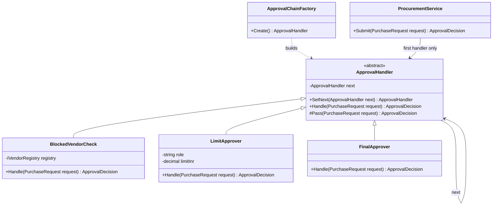
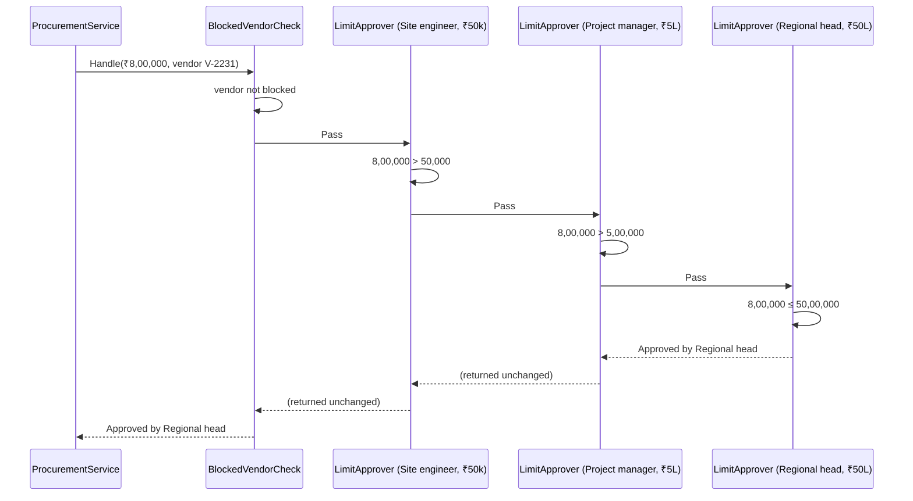
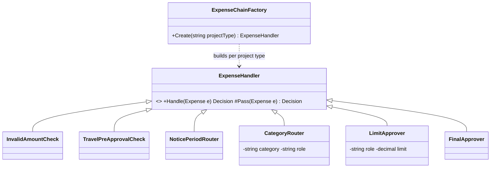

Every ASP.NET Core request you have ever served travelled through a Chain of Responsibility. Exception handling, HTTPS redirection, authentication, authorisation and routing are a line of handlers, and each one either deals with the request or passes it on. The same shape appears in purchase approvals ("who is allowed to sign off ₹8 lakh?"), in `HttpClient` handlers that add headers and retries, and in validation rules that stop at the first serious problem.

## Learning objectives

By the end of this lesson you will be able to:

1. Explain the problem Chain of Responsibility solves: a sender that shouldn't need to know which of several objects will handle its request.
2. Name the participants (handler, concrete handlers, client) and the two variants: "first handler wins" and "every handler contributes".
3. Build an amount-based approval chain in C# whose limits come from configuration.
4. Write ASP.NET Core middleware and `DelegatingHandler`s, and explain why their order matters.
5. Build a validation chain that runs cheap checks first and short-circuits.
6. Test each handler alone and the assembled chain, and tell this pattern apart from Decorator, Pipeline and Observer.

## Prerequisites

- [Interfaces and abstract classes](#/lesson/m01-interfaces-abstract).
- [Kestrel, middleware, routing, controllers and minimal APIs](#/lesson/m03-kestrel-middleware-routing): you have seen `app.Use...` calls.
- [Dependency injection](#/lesson/m03-dependency-injection): handlers are registered and resolved from DI.

## Explain it like I'm a beginner

Think of a complaint at a bank branch. You speak to the counter clerk. If the clerk can sort it out, done. If not, the clerk passes it to the branch manager. If the branch manager can't, it goes to the regional office. You, the customer, only ever talked to the first person. You didn't need to know who would finally decide.

A company's purchase approvals work the same way:

| Amount | Who can approve |
|---|---|
| up to ₹50,000 | Site engineer |
| up to ₹5,00,000 | Project manager |
| up to ₹50,00,000 | Regional head |
| above that | Director |

A request for ₹8,00,000 starts at the site engineer, who says "too big for me" and passes it on. The project manager passes it on too. The regional head approves it. The person raising the request just submits it. The chain decides.

- Each person in the line is a **handler**.
- "Handle it or pass it to the next one" is the **chain**.
- The person who submits the request is the **client**.

There is a second flavour, and you already know it from airports. At security, **every** checkpoint does its bit: ID check, then bag scan, then body scan, then boarding-pass scan. Any checkpoint can stop you. If none does, you reach the gate. ASP.NET Core middleware works like this airport line.

## First-principles explanation

### What it is

Chain of Responsibility avoids coupling the sender of a request to its receiver by giving more than one object a chance to handle the request. The receiving objects are chained, and the request is passed along the chain until an object handles it.

### The original problem

The Gang of Four example was context-sensitive help in a GUI. When a user presses F1 on a button, the help shown should come from the most specific object that has help: the button, else the dialog containing it, else the application. The button can't know in advance which ancestor has help text. Linking widgets into a chain, where each one either answers or forwards to its parent, solved it without the button knowing about dialogs or applications.

### The two variants

| | "First handler wins" (classic GoF) | "Every handler contributes" (pipeline) |
|---|---|---|
| Who handles? | Exactly one handler, the first that can | Each handler does its part, then calls the next |
| Can stop early? | Yes, by handling | Yes, by not calling `next` (short-circuit) |
| Work after the next handler? | Usually no | Often yes (logging the response, timing) |
| .NET examples | Approval limits, help lookup, exception filters choosing a handler | ASP.NET Core middleware, `HttpClient` `DelegatingHandler`, validation chains |

Both are called Chain of Responsibility in practice. The second is so common in .NET that it has its own name in this course: [Pipeline and middleware](#/lesson/m06-pipeline).

### How it works internally

There are two ways to wire a chain.

**Linked objects.** Each handler holds a reference to the next one:

```csharp
public abstract class Handler
{
    private Handler? _next;
    public Handler SetNext(Handler next) { _next = next; return next; }
    public virtual Result Handle(Request r) => _next is null ? Result.Unhandled : _next.Handle(r);
}
```

`DelegatingHandler` in `System.Net.Http` uses exactly this shape, with the `InnerHandler` property as the link.

**Composed delegates.** Each handler is a function that receives "the rest of the chain" as a delegate. ASP.NET Core builds middleware this way. At startup it takes the list of registered middleware and wraps them **from last to first**:

```text
app = Endpoint
app = Authorization(next: app)
app = Authentication(next: app)
app = ExceptionHandler(next: app)
```

The result is one `RequestDelegate` that, when called, runs ExceptionHandler → Authentication → Authorization → Endpoint. Each call to `await next(context)` runs everything further down the chain, and the code after that `await` runs on the way back out. That's why middleware order in `Program.cs` matters so much: `UseAuthentication()` after `UseAuthorization()` means authorisation checks a user who hasn't been identified yet.

### When it is useful

- Several objects might handle a request, and **which one** depends on runtime data (amount, user, content).
- You want to add, remove or reorder steps **without editing** the sender or the other steps.
- Cross-cutting steps (logging, auth, retries, correlation IDs) should wrap **every** request the same way.
- Validation has several independent rules, some cheap and some expensive, and you want to stop early.

### When it is unnecessary or harmful

- There is **one** handler, or the choice is a simple lookup by key. A dictionary or a `switch` is clearer and faster.
- The request **must** be handled, and silently falling off the end of the chain would be dangerous. You need an explicit end-of-chain behaviour (reject, or a default handler), or a different design.
- Steps have **hidden dependencies on order** that nobody wrote down. Chains make order easy to change, which also makes order easy to break.
- Very long chains for every request add latency and make stack traces deep. Each middleware layer is cheap, but 40 layers of logging and enrichment add up.

### Trade-offs

| You gain | You pay |
|---|---|
| Sender is decoupled from whoever handles the request | "Who handled this?" is not visible in the calling code; log it |
| Handlers can be added, removed, reordered by configuration | Order becomes a hidden contract; a wrong order is a silent bug |
| Each handler is small and testable alone | No guarantee anyone handles the request unless you add a terminal handler |
| Natural place for cross-cutting concerns | Debugging means stepping through several layers |

## Visual explanation

### Class diagram



How to read it: every handler extends `ApprovalHandler`, which holds a reference to the **next** handler (the arrow from the class to itself). `BlockedVendorCheck` can stop the chain by rejecting. `LimitApprover` is one reusable class configured with a role and a limit, so "site engineer ₹50,000" and "project manager ₹5,00,000" are two instances, not two classes. `FinalApprover` sits at the end so the chain never falls off without a decision. `ProcurementService` (the client) knows only the **first** handler. `ApprovalChainFactory` builds the chain from configuration.

### Sequence diagram



The request enters at the first handler and moves along until one handler can decide. The decision then travels back up the call stack unchanged. If the vendor had been blocked, `BlockedVendorCheck` would have returned `Rejected` immediately and no approver would have been asked: that is **short-circuiting**. The service never mentions engineers, managers or limits.

## Step-by-step example

### Step 1 — the naive version

```csharp
public ApprovalDecision Approve(PurchaseRequest r)
{
    if (_blockedVendors.Contains(r.VendorId)) return Rejected("Vendor blocked");
    if (r.AmountInr <= 50_000) return Approved("Site engineer");
    if (r.AmountInr <= 5_00_000) return Approved("Project manager");
    if (r.AmountInr <= 50_00_000) return Approved("Regional head");
    return Approved("Director");
}
```

Honestly, with five fixed rules this is fine. The trouble starts when finance asks for changes:

- Limits differ per project type: an EPC project gives project managers ₹10 lakh.
- Emergency procurement during monsoon damage gets a separate fast-track approver.
- IT purchases above ₹2 lakh must go via the IT head, whatever the amount.
- Limits must change without redeploying.

The method turns into nested conditions that nobody dares to touch.

### Step 2 — one abstract handler

An `ApprovalHandler` base class with `Handle()` and a protected `Pass()` that forwards to the next handler, or returns "no approver found" at the end.

### Step 3 — reusable concrete handlers

`LimitApprover(role, limit)` approves if the amount is within its limit, otherwise passes. `BlockedVendorCheck` rejects or passes. `CategoryRouter("IT", "IT head", 2_00_000)` approves IT requests above a threshold. Each is a few lines.

### Step 4 — build the chain from configuration

Limits move to `appsettings.json`. A factory reads them, sorts by limit, and links the handlers. Changing a limit is a configuration change.

### Step 5 — recognise the same shape in the framework

Then we'll write an ASP.NET Core middleware that adds a correlation ID to every request, and a `DelegatingHandler` that adds the same ID to every outgoing `HttpClient` call, so one ID follows a request through your API and into the vendor-registry service it calls.

## Production-style C# implementation

```text
Procurement.Api/
  Program.cs
  appsettings.json            (Approvals:Limits)
  Approvals/
    PurchaseRequest.cs
    ApprovalHandlers.cs
    ApprovalChainFactory.cs
  Web/
    CorrelationIdMiddleware.cs
    MaintenanceModeMiddleware.cs
  Outbound/
    CorrelationIdHandler.cs
    VendorRegistryClient.cs
```

### The approval chain

```csharp file=Approvals/PurchaseRequest.cs
namespace Procurement.Approvals;

public sealed record PurchaseRequest(Guid Id, string ProjectCode, string Category, string VendorId, decimal AmountInr, string RaisedBy);

public enum ApprovalOutcome { Approved, Rejected, NoApprover }

public sealed record ApprovalDecision(ApprovalOutcome Outcome, string DecidedBy, string Reason)
{
    public static ApprovalDecision Approve(string by, string reason) => new(ApprovalOutcome.Approved, by, reason);
    public static ApprovalDecision Reject(string by, string reason) => new(ApprovalOutcome.Rejected, by, reason);
    public static readonly ApprovalDecision Unhandled = new(ApprovalOutcome.NoApprover, "none", "No handler in the chain could decide.");
}
```

```csharp file=Approvals/ApprovalHandlers.cs
using System.Globalization;

namespace Procurement.Approvals;

/// <summary>Handler base. Each handler decides or passes the request to the next one.</summary>
public abstract class ApprovalHandler
{
    private ApprovalHandler? _next;

    /// <summary>Links the next handler and returns it, so calls can be chained: a.SetNext(b).SetNext(c).</summary>
    public ApprovalHandler SetNext(ApprovalHandler next)
    {
        _next = next ?? throw new ArgumentNullException(nameof(next));
        return next;
    }

    public abstract Task<ApprovalDecision> HandleAsync(PurchaseRequest request, CancellationToken ct);

    protected Task<ApprovalDecision> PassAsync(PurchaseRequest request, CancellationToken ct) =>
        _next is null ? Task.FromResult(ApprovalDecision.Unhandled) : _next.HandleAsync(request, ct);

    protected static string Inr(decimal amount) => amount.ToString("N0", CultureInfo.GetCultureInfo("en-IN"));
}

public interface IVendorRegistry
{
    Task<bool> IsBlockedAsync(string vendorId, CancellationToken ct);
}

/// <summary>Short-circuits: a blocked vendor is rejected before any approver sees the request.</summary>
public sealed class BlockedVendorCheck(IVendorRegistry registry) : ApprovalHandler
{
    public override async Task<ApprovalDecision> HandleAsync(PurchaseRequest request, CancellationToken ct) =>
        await registry.IsBlockedAsync(request.VendorId, ct)
            ? ApprovalDecision.Reject("Vendor check", $"Vendor {request.VendorId} is blocked.")
            : await PassAsync(request, ct);
}

/// <summary>Routes one category above a threshold to a specialist, whatever the amount band.</summary>
public sealed class CategoryApprover(string category, decimal thresholdInr, string role) : ApprovalHandler
{
    public override Task<ApprovalDecision> HandleAsync(PurchaseRequest request, CancellationToken ct) =>
        string.Equals(request.Category, category, StringComparison.OrdinalIgnoreCase) && request.AmountInr > thresholdInr
            ? Task.FromResult(ApprovalDecision.Approve(role, $"{category} purchase above ₹{Inr(thresholdInr)}"))
            : PassAsync(request, ct);
}

/// <summary>One class, many instances: each configured with a role and a limit.</summary>
public sealed class LimitApprover(string role, decimal limitInr) : ApprovalHandler
{
    public string Role { get; } = role;
    public decimal LimitInr { get; } = limitInr;

    public override Task<ApprovalDecision> HandleAsync(PurchaseRequest request, CancellationToken ct) =>
        request.AmountInr <= LimitInr
            ? Task.FromResult(ApprovalDecision.Approve(Role, $"Within limit of ₹{Inr(LimitInr)}"))
            : PassAsync(request, ct);
}

/// <summary>Terminal handler: the chain never ends without a decision.</summary>
public sealed class FinalApprover(string role) : ApprovalHandler
{
    public override Task<ApprovalDecision> HandleAsync(PurchaseRequest request, CancellationToken ct) =>
        Task.FromResult(ApprovalDecision.Approve(role, "Above all delegated limits"));
}
```

```csharp file=Approvals/ApprovalChainFactory.cs
using Microsoft.Extensions.Options;

namespace Procurement.Approvals;

public sealed class ApprovalLimitOptions
{
    // Empty by default on purpose: the configuration binder APPENDS to pre-filled lists,
    // so defaults here would be duplicated by appsettings.json entries.
    public List<LimitEntry> Limits { get; set; } = [];

    public static IReadOnlyList<LimitEntry> DevelopmentDefaults { get; } =
    [
        new() { Role = "Site engineer", LimitInr = 50_000m },
        new() { Role = "Project manager", LimitInr = 5_00_000m },
        new() { Role = "Regional head", LimitInr = 50_00_000m },
    ];
    public string FinalApproverRole { get; set; } = "Director";
    public string ItHeadRole { get; set; } = "IT head";
    public decimal ItThresholdInr { get; set; } = 2_00_000m;

    public sealed class LimitEntry
    {
        public string Role { get; set; } = "";
        public decimal LimitInr { get; set; }
    }
}

/// <summary>Builds the chain from configuration. Order: vendor check → category routing → limits (ascending) → final.</summary>
public sealed class ApprovalChainFactory(IVendorRegistry registry, IOptionsMonitor<ApprovalLimitOptions> options)
{
    public ApprovalHandler Create()
    {
        var o = options.CurrentValue;
        if (o.Limits.Count == 0) throw new InvalidOperationException("At least one approval limit must be configured.");

        var first = new BlockedVendorCheck(registry);
        var tail = first.SetNext(new CategoryApprover("IT", o.ItThresholdInr, o.ItHeadRole));
        foreach (var limit in o.Limits.OrderBy(l => l.LimitInr))
            tail = tail.SetNext(new LimitApprover(limit.Role, limit.LimitInr));
        tail.SetNext(new FinalApprover(o.FinalApproverRole));
        return first;
    }
}
```

Sorting by limit is a safety measure. If someone writes the configuration in the wrong order (regional head before site engineer), the regional head would approve a ₹10,000 request that a site engineer should handle. The factory makes the order a rule instead of a hope.

### ASP.NET Core middleware: the framework's own chain

```csharp file=Web/CorrelationIdMiddleware.cs
using System.Diagnostics;
using Microsoft.Extensions.Logging;

namespace Procurement.Web;

/// <summary>"Every handler contributes": adds a correlation ID, then ALWAYS calls the next middleware.</summary>
public sealed class CorrelationIdMiddleware(RequestDelegate next, ILogger<CorrelationIdMiddleware> logger)
{
    public const string HeaderName = "X-Correlation-Id";

    public async Task InvokeAsync(HttpContext context)
    {
        var incoming = context.Request.Headers[HeaderName].ToString();
        var id = IsSafe(incoming) ? incoming : Activity.Current?.TraceId.ToString() ?? Guid.NewGuid().ToString("N");

        context.Items[HeaderName] = id;
        context.Response.OnStarting(() =>
        {
            context.Response.Headers[HeaderName] = id;   // set before headers are sent
            return Task.CompletedTask;
        });

        using (logger.BeginScope(new Dictionary<string, object> { ["CorrelationId"] = id }))
        {
            await next(context);                          // the rest of the chain runs here
        }
    }

    // Don't trust client input blindly: limit length and characters (it ends up in logs and headers).
    private static bool IsSafe(string value) =>
        value.Length is > 0 and <= 64 && value.All(c => char.IsAsciiLetterOrDigit(c) || c == '-');
}
```

```csharp file=Web/MaintenanceModeMiddleware.cs
using Microsoft.Extensions.Options;

namespace Procurement.Web;

public sealed class MaintenanceOptions
{
    public bool Enabled { get; set; }
    public string Message { get; set; } = "Scheduled maintenance. Please try again after 02:00 IST.";
}

/// <summary>Short-circuits: when enabled, answers 503 and does NOT call the next middleware.</summary>
public sealed class MaintenanceModeMiddleware(RequestDelegate next, IOptionsMonitor<MaintenanceOptions> options)
{
    public async Task InvokeAsync(HttpContext context)
    {
        var o = options.CurrentValue;
        if (o.Enabled && !context.Request.Path.StartsWithSegments("/health"))
        {
            context.Response.StatusCode = StatusCodes.Status503ServiceUnavailable;
            context.Response.Headers.RetryAfter = "1800";
            await context.Response.WriteAsJsonAsync(new { error = o.Message });
            return;                                       // chain stops here
        }
        await next(context);
    }
}
```

### HttpClient: a chain of `DelegatingHandler`s

Outgoing requests have their own chain. Each `DelegatingHandler` gets the request, can change it, calls `base.SendAsync` (the next handler), and can inspect the response on the way back. The last link is the handler that actually talks to the network.

```csharp file=Outbound/CorrelationIdHandler.cs
using Procurement.Web;

namespace Procurement.Outbound;

/// <summary>Copies the current request's correlation ID to every outgoing call.</summary>
public sealed class CorrelationIdHandler(IHttpContextAccessor accessor) : DelegatingHandler
{
    protected override Task<HttpResponseMessage> SendAsync(HttpRequestMessage request, CancellationToken cancellationToken)
    {
        if (accessor.HttpContext?.Items[CorrelationIdMiddleware.HeaderName] is string id
            && !request.Headers.Contains(CorrelationIdMiddleware.HeaderName))
        {
            request.Headers.Add(CorrelationIdMiddleware.HeaderName, id);
        }
        return base.SendAsync(request, cancellationToken);   // next link in the chain
    }
}
```

```csharp file=Outbound/VendorRegistryClient.cs
using System.Net;
using Procurement.Approvals;

namespace Procurement.Outbound;

/// <summary>Typed HttpClient for the vendor-registry service. Its handler chain is configured in Program.cs.</summary>
public sealed class VendorRegistryClient(HttpClient http) : IVendorRegistry
{
    private sealed record VendorStatus(string VendorId, bool Blocked);

    public async Task<bool> IsBlockedAsync(string vendorId, CancellationToken ct)
    {
        using var response = await http.GetAsync($"vendors/{Uri.EscapeDataString(vendorId)}/status", ct);
        if (response.StatusCode == HttpStatusCode.NotFound) return true;      // unknown vendor: treat as blocked
        response.EnsureSuccessStatusCode();
        var status = await response.Content.ReadFromJsonAsync<VendorStatus>(ct);
        return status?.Blocked ?? true;                                        // fail closed
    }
}
```

```csharp file=Program.cs
using Procurement.Approvals;
using Procurement.Outbound;
using Procurement.Web;

var builder = WebApplication.CreateBuilder(args);

builder.Services.Configure<ApprovalLimitOptions>(builder.Configuration.GetSection("Approvals"));
if (builder.Environment.IsDevelopment())
    builder.Services.PostConfigure<ApprovalLimitOptions>(o => { if (o.Limits.Count == 0) o.Limits.AddRange(ApprovalLimitOptions.DevelopmentDefaults); });
builder.Services.Configure<MaintenanceOptions>(builder.Configuration.GetSection("Maintenance"));
builder.Services.AddHttpContextAccessor();

// Outgoing chain: CorrelationIdHandler → (primary handler that does the network I/O)
builder.Services.AddTransient<CorrelationIdHandler>();
builder.Services.AddHttpClient<IVendorRegistry, VendorRegistryClient>(c =>
    {
        c.BaseAddress = new Uri(builder.Configuration["VendorRegistry:BaseUrl"] ?? "https://vendors.internal.example/");
        c.Timeout = TimeSpan.FromSeconds(5);
    })
    .AddHttpMessageHandler<CorrelationIdHandler>();

builder.Services.AddSingleton<ApprovalChainFactory>();

var app = builder.Build();

// Incoming chain. ORDER MATTERS: each line wraps everything registered after it.
app.UseExceptionHandler("/error");               // 1. outermost: catches failures from everything below
app.UseMiddleware<CorrelationIdMiddleware>();    // 2. every log line below carries the ID
app.UseMiddleware<MaintenanceModeMiddleware>();  // 3. may short-circuit with 503
// app.UseAuthentication(); app.UseAuthorization();   (4–5 in a real app, before endpoints)

app.MapGet("/error", () => Results.Problem("Something went wrong.", statusCode: 500));
app.MapGet("/health", () => Results.Ok("healthy"));

app.MapPost("/purchase-requests", async (PurchaseRequest request, ApprovalChainFactory chains, CancellationToken ct) =>
{
    if (request.AmountInr <= 0) return Results.Problem("Amount must be positive.", statusCode: 400);
    var decision = await chains.Create().HandleAsync(request, ct);
    return decision.Outcome switch
    {
        ApprovalOutcome.Approved => Results.Ok(decision),
        ApprovalOutcome.Rejected => Results.UnprocessableEntity(decision),
        _ => Results.Problem(decision.Reason, statusCode: 500),
    };
});

app.Run();
```

**Why build the chain per request?** `Create()` reads `IOptionsMonitor.CurrentValue`, so a limit changed in configuration takes effect on the next request without a restart. Building six small objects costs microseconds. If profiling ever showed it mattered, you could cache the chain and rebuild it in an `OnChange` callback.

**Why does the vendor check "fail closed"?** If the registry says "not found", or returns garbage, the safe answer for a payment approval is "treat as blocked". A chain that defaults to "pass" when a check is unsure lets bad requests through exactly when systems are unhealthy.

:::callout type=warning title="Middleware order is a contract"
`UseExceptionHandler` must come first, or exceptions thrown by earlier middleware are not caught. `UseAuthentication` must come before `UseAuthorization`. `UseCors` must come before endpoints and before middleware that writes responses. Static files often come early so they skip authentication. When you add middleware, write a comment saying *why* it sits where it does, and add an integration test that would fail if it moved.
:::

## Bad design vs good design

**Bad: a chain that can fall off the end.** Without `FinalApprover`, a ₹2 crore request returns `NoApprover`. If the caller treats "not rejected" as approved, money moves without a signature. Always end a chain with an explicit terminal handler: approve by the top authority, reject, or throw.

**Bad: handlers that know about each other.** `LimitApprover` checking `if (next is DirectorApprover)` couples the chain back together. A handler should know only "do I handle this?" and "pass it on".

**Bad: a handler that both handles and passes, by accident.** In the "first handler wins" variant, approving *and then* calling `PassAsync` could produce two approvals and two notifications. Decide the variant and stick to it.

**Bad: forgetting to call `next` in middleware.** A logging middleware that writes a line and returns without `await next(context)` silently turns every request into an empty 200 response.

**Good:** small, reusable handlers configured by data; a factory that enforces order; a terminal handler; logging of who decided.

**Is it worth it?** For five fixed amount bands that never change, the `if` ladder is clearer. Introduce the chain when bands become configurable, per-project or per-category, or when new kinds of checks keep arriving.

:::callout type=tradeoff title="Sequential sign-off is not 'first handler wins'"
Many organisations require **every** level up to the limit to sign: a ₹8 lakh request needs the site engineer, then the project manager, then the regional head. That's a multi-step workflow with waiting and state between steps, not a single synchronous chain. Model it as a [state machine](#/lesson/m06-state) whose next approver is computed by a chain like this one.
:::

## Practical playground

Run the playground, then try:

1. Submit ₹4,99,999 and ₹5,00,001. Which roles approve?
2. Remove the `FinalApprover` and submit ₹2 crore. What comes back?
3. Swap the order of the project manager and regional head links. Submit ₹60,000 and notice who approves now.

:::playground type=csharp title="Approval chain"
```csharp file=Program.cs
using System;
using System.Globalization;

public sealed record PurchaseRequest(string Category, decimal AmountInr, bool VendorBlocked);

public abstract class Approver
{
    private Approver? _next;
    public Approver SetNext(Approver next) { _next = next; return next; }
    public abstract string Handle(PurchaseRequest r);
    protected string Pass(PurchaseRequest r) => _next?.Handle(r) ?? "NO APPROVER (chain fell off the end!)";
}

public sealed class VendorCheck : Approver
{
    public override string Handle(PurchaseRequest r) => r.VendorBlocked ? "Rejected: vendor blocked" : Pass(r);
}

public sealed class LimitApprover(string role, decimal limit) : Approver
{
    public override string Handle(PurchaseRequest r)
    {
        Console.WriteLine($"    {role} looks at it (limit {limit.ToString("N0", CultureInfo.GetCultureInfo("en-IN"))})");
        return r.AmountInr <= limit ? $"Approved by {role}" : Pass(r);
    }
}

public sealed class FinalApprover(string role) : Approver
{
    public override string Handle(PurchaseRequest r) => $"Approved by {role} (above all limits)";
}

public static class Program
{
    public static void Main()
    {
        var chain = new VendorCheck();
        chain.SetNext(new LimitApprover("Site engineer", 50_000m))
             .SetNext(new LimitApprover("Project manager", 5_00_000m))
             .SetNext(new LimitApprover("Regional head", 50_00_000m))
             .SetNext(new FinalApprover("Director"));

        foreach (var r in new[]
        {
            new PurchaseRequest("Cement", 32_000m, false),
            new PurchaseRequest("Steel", 8_00_000m, false),
            new PurchaseRequest("Machinery", 2_00_00_000m, false),
            new PurchaseRequest("Diesel", 10_000m, true),
        })
        {
            Console.WriteLine($"{r.Category} ₹{r.AmountInr.ToString("N0", CultureInfo.GetCultureInfo("en-IN"))}:");
            Console.WriteLine("  => " + chain.Handle(r));
        }
    }
}
```
:::

## Exercises

:::exercise id=m06-chain-of-responsibility-ex1 difficulty=beginner kind=code title="Leave approval by number of days"
Implement a chain for leave approval: team lead up to 3 days, manager up to 10 days, HR head for anything longer. Requests with 0 or fewer days are rejected by a validation handler at the front.
::acceptance
- 2 days → `Team lead`; 3 days → `Team lead`; 4 days → `Manager`; 15 days → `HR head`.
- 0 days → `Rejected`.
- `Build()` returns the first handler of a correctly linked chain.
::hint
Each handler either returns a name or calls the next handler.
::hint
`SetNext` should return the handler you passed in, so you can write `a.SetNext(b).SetNext(c)`.
::hint
The HR head is the terminal handler: it always decides, so it never needs a `next`.
::hint
```csharp
public override string Handle(int days) => days <= _maxDays ? _role : Next(days);
```
::starter
```csharp file=LeaveChain.cs
using System;

public abstract class LeaveHandler
{
    private LeaveHandler? _next;
    public LeaveHandler SetNext(LeaveHandler next) => throw new NotImplementedException();
    public abstract string Handle(int days);
    protected string Next(int days) => throw new NotImplementedException();
}

public sealed class ValidDaysCheck : LeaveHandler
{
    public override string Handle(int days) => throw new NotImplementedException();
}

public sealed class DayLimitApprover(string role, int maxDays) : LeaveHandler
{
    public override string Handle(int days) => throw new NotImplementedException();
}

public sealed class HrHead : LeaveHandler
{
    public override string Handle(int days) => throw new NotImplementedException();
}

public static class LeaveChain
{
    public static LeaveHandler Build() => throw new NotImplementedException();
}
```
::tests
```csharp file=LeaveChainTests.cs
using Xunit;

public class LeaveChainTests
{
    [Theory]
    [InlineData(2, "Team lead")]
    [InlineData(3, "Team lead")]
    [InlineData(4, "Manager")]
    [InlineData(10, "Manager")]
    [InlineData(15, "HR head")]
    public void Routes_by_days(int days, string expected) => Assert.Equal(expected, LeaveChain.Build().Handle(days));

    [Theory]
    [InlineData(0)]
    [InlineData(-2)]
    public void Invalid_days_rejected(int days) => Assert.Equal("Rejected", LeaveChain.Build().Handle(days));

    [Fact]
    public void SetNext_returns_the_argument()
    {
        var a = new ValidDaysCheck();
        var b = new HrHead();
        Assert.Same(b, a.SetNext(b));
    }
}
```
::solution
```csharp file=LeaveChain.cs
using System;

public abstract class LeaveHandler
{
    private LeaveHandler? _next;

    public LeaveHandler SetNext(LeaveHandler next)
    {
        _next = next ?? throw new ArgumentNullException(nameof(next));
        return next;
    }

    public abstract string Handle(int days);

    protected string Next(int days) =>
        _next?.Handle(days) ?? throw new InvalidOperationException("Chain ended without a decision.");
}

public sealed class ValidDaysCheck : LeaveHandler
{
    public override string Handle(int days) => days <= 0 ? "Rejected" : Next(days);
}

public sealed class DayLimitApprover(string role, int maxDays) : LeaveHandler
{
    public override string Handle(int days) => days <= maxDays ? role : Next(days);
}

public sealed class HrHead : LeaveHandler
{
    public override string Handle(int days) => "HR head";
}

public static class LeaveChain
{
    public static LeaveHandler Build()
    {
        var first = new ValidDaysCheck();
        first.SetNext(new DayLimitApprover("Team lead", 3))
             .SetNext(new DayLimitApprover("Manager", 10))
             .SetNext(new HrHead());
        return first;
    }
}
```
Throwing in `Next` when there is no next handler makes "fell off the end" a loud bug instead of a silent wrong answer.
::mistakes
- Using `<` instead of `<=`, so a 3-day request goes to the manager.
- Returning `null` at the end of the chain, which callers may treat as success.
- `SetNext` returning `this`, which links every handler to the first one.
:::

:::exercise id=m06-chain-of-responsibility-ex2 difficulty=beginner kind=code title="Build a middleware pipeline from delegates"
Recreate how ASP.NET Core composes middleware. Implement `PipelineBuilder.Use` and `Build`, where each middleware receives the context and a `next` delegate.
::requirements
- `Use(Func<RequestContext, Func<Task>, Task> middleware)` adds a middleware and returns the builder.
- `Build(Func<RequestContext, Task> terminal)` returns one `Func<RequestContext, Task>` that runs middleware in the order they were added, then the terminal.
- A middleware that doesn't call `next()` short-circuits the rest.
::acceptance
- Two middleware A and B produce the log `A in, B in, endpoint, B out, A out`.
- A short-circuiting middleware prevents later middleware and the endpoint from running.
- With no middleware, `Build` returns the terminal itself.
::hint
Wrap from the **last** middleware to the first. Why?
::hint
Start with `var app = terminal;`. For each middleware in reverse, create a new function that calls the middleware with `() => previousApp(ctx)` as `next`.
::hint
Capture loop variables carefully: copy `app` into a local before creating the lambda.
::hint
```csharp
for (var i = _middleware.Count - 1; i >= 0; i--)
{
    var mw = _middleware[i];
    var next = app;
    app = ctx => mw(ctx, () => next(ctx));
}
```
::starter
```csharp file=PipelineBuilder.cs
using System;
using System.Collections.Generic;
using System.Threading.Tasks;

public sealed class RequestContext
{
    public List<string> Log { get; } = new();
    public int StatusCode { get; set; } = 200;
}

public sealed class PipelineBuilder
{
    private readonly List<Func<RequestContext, Func<Task>, Task>> _middleware = new();

    public PipelineBuilder Use(Func<RequestContext, Func<Task>, Task> middleware) => throw new NotImplementedException();

    public Func<RequestContext, Task> Build(Func<RequestContext, Task> terminal) => throw new NotImplementedException();
}
```
::tests
```csharp file=PipelineBuilderTests.cs
using System.Collections.Generic;
using System.Threading.Tasks;
using Xunit;

public class PipelineBuilderTests
{
    private static Task Endpoint(RequestContext c) { c.Log.Add("endpoint"); return Task.CompletedTask; }

    [Fact]
    public async Task Runs_in_order_and_unwinds_in_reverse()
    {
        var app = new PipelineBuilder()
            .Use(async (c, next) => { c.Log.Add("A in"); await next(); c.Log.Add("A out"); })
            .Use(async (c, next) => { c.Log.Add("B in"); await next(); c.Log.Add("B out"); })
            .Build(Endpoint);
        var ctx = new RequestContext();
        await app(ctx);
        Assert.Equal(new List<string> { "A in", "B in", "endpoint", "B out", "A out" }, ctx.Log);
    }

    [Fact]
    public async Task Short_circuit_stops_the_rest()
    {
        var app = new PipelineBuilder()
            .Use((c, next) => { c.StatusCode = 503; c.Log.Add("maintenance"); return Task.CompletedTask; })
            .Use(async (c, next) => { c.Log.Add("never"); await next(); })
            .Build(Endpoint);
        var ctx = new RequestContext();
        await app(ctx);
        Assert.Equal(503, ctx.StatusCode);
        Assert.Equal(new List<string> { "maintenance" }, ctx.Log);
    }

    [Fact]
    public async Task No_middleware_runs_terminal()
    {
        var ctx = new RequestContext();
        await new PipelineBuilder().Build(Endpoint)(ctx);
        Assert.Equal(new List<string> { "endpoint" }, ctx.Log);
    }
}
```
::solution
```csharp file=PipelineBuilder.cs
using System;
using System.Collections.Generic;
using System.Threading.Tasks;

public sealed class RequestContext
{
    public List<string> Log { get; } = new();
    public int StatusCode { get; set; } = 200;
}

public sealed class PipelineBuilder
{
    private readonly List<Func<RequestContext, Func<Task>, Task>> _middleware = new();

    public PipelineBuilder Use(Func<RequestContext, Func<Task>, Task> middleware)
    {
        _middleware.Add(middleware ?? throw new ArgumentNullException(nameof(middleware)));
        return this;
    }

    public Func<RequestContext, Task> Build(Func<RequestContext, Task> terminal)
    {
        var app = terminal;
        for (var i = _middleware.Count - 1; i >= 0; i--)
        {
            var middleware = _middleware[i];
            var next = app;                                   // capture the chain built so far
            app = ctx => middleware(ctx, () => next(ctx));
        }
        return app;
    }
}
```
Building in reverse is the key idea: to create A, you must already have "everything after A". ASP.NET Core's `ApplicationBuilder.Build()` does the same thing with `RequestDelegate`.
::mistakes
- Looping forwards, which runs middleware in reverse order.
- Writing `app = ctx => middleware(ctx, () => app(ctx));`, which captures the variable `app` itself and recurses forever.
:::

:::exercise id=m06-chain-of-responsibility-ex3 difficulty=intermediate kind=code title="DelegatingHandler chain for outgoing calls"
A GST e-invoicing portal sometimes returns `503 Service Unavailable`. Write two `DelegatingHandler`s and test them without any network: one adds an `X-Api-Key` header, one retries **GET** requests on 503.
::requirements
- `ApiKeyHandler(string apiKey)` adds the `X-Api-Key` header to every request.
- `RetryOn503Handler(int maxRetries)` resends a GET up to `maxRetries` extra times while the response is 503. Non-GET requests are never retried (they may not be safe to repeat). Dispose responses you discard.
- The chain is `ApiKeyHandler → RetryOn503Handler → inner handler`.
::acceptance
- Every request reaching the inner handler carries the API key.
- A GET that gets 503, 503, 200 returns 200 after 3 attempts with `maxRetries: 2`.
- A GET that always gets 503 returns 503 after 1 + maxRetries attempts.
- A POST that gets 503 is attempted exactly once.
::hint
A `DelegatingHandler` calls `base.SendAsync(request, ct)` to pass the request to the next handler.
::hint
For tests, write a fake `HttpMessageHandler` that returns status codes from a queue and records each request.
::hint
In the retry handler, loop: send, if status is 503 and method is GET and retries remain, dispose the response and try again.
::hint
Link the chain by setting `InnerHandler`: `new ApiKeyHandler(key) { InnerHandler = new RetryOn503Handler(2) { InnerHandler = fake } }`, then `new HttpClient(chain)`.
::hint
```csharp
var response = await base.SendAsync(request, ct);
for (var i = 0; i < _maxRetries && response.StatusCode == HttpStatusCode.ServiceUnavailable && request.Method == HttpMethod.Get; i++)
{
    response.Dispose();
    response = await base.SendAsync(request, ct);
}
return response;
```
::starter
```csharp file=OutboundHandlers.cs
using System;
using System.Net;
using System.Net.Http;
using System.Threading;
using System.Threading.Tasks;

public sealed class ApiKeyHandler(string apiKey) : DelegatingHandler
{
    protected override Task<HttpResponseMessage> SendAsync(HttpRequestMessage request, CancellationToken cancellationToken) =>
        throw new NotImplementedException();
}

public sealed class RetryOn503Handler(int maxRetries) : DelegatingHandler
{
    protected override Task<HttpResponseMessage> SendAsync(HttpRequestMessage request, CancellationToken cancellationToken) =>
        throw new NotImplementedException();
}
```
::tests
```csharp file=OutboundHandlersTests.cs
using System.Collections.Generic;
using System.Linq;
using System.Net;
using System.Net.Http;
using System.Threading;
using System.Threading.Tasks;
using Xunit;

public class OutboundHandlersTests
{
    private sealed class FakeServer(params HttpStatusCode[] codes) : HttpMessageHandler
    {
        private readonly Queue<HttpStatusCode> _codes = new(codes);
        public List<HttpRequestMessage> Requests { get; } = new();
        protected override Task<HttpResponseMessage> SendAsync(HttpRequestMessage request, CancellationToken ct)
        {
            Requests.Add(request);
            var code = _codes.Count > 1 ? _codes.Dequeue() : _codes.Peek();
            return Task.FromResult(new HttpResponseMessage(code));
        }
    }

    private static HttpClient Client(FakeServer fake, int retries = 2) =>
        new(new ApiKeyHandler("k-123") { InnerHandler = new RetryOn503Handler(retries) { InnerHandler = fake } })
        { BaseAddress = new System.Uri("https://einvoice.test/") };

    [Fact]
    public async Task Adds_api_key()
    {
        var fake = new FakeServer(HttpStatusCode.OK);
        await Client(fake).GetAsync("irn/123");
        Assert.Equal("k-123", fake.Requests[0].Headers.GetValues("X-Api-Key").Single());
    }

    [Fact]
    public async Task Retries_get_until_success()
    {
        var fake = new FakeServer(HttpStatusCode.ServiceUnavailable, HttpStatusCode.ServiceUnavailable, HttpStatusCode.OK);
        var response = await Client(fake).GetAsync("irn/123");
        Assert.Equal(HttpStatusCode.OK, response.StatusCode);
        Assert.Equal(3, fake.Requests.Count);
    }

    [Fact]
    public async Task Gives_up_after_max_retries()
    {
        var fake = new FakeServer(HttpStatusCode.ServiceUnavailable);
        var response = await Client(fake, retries: 2).GetAsync("irn/123");
        Assert.Equal(HttpStatusCode.ServiceUnavailable, response.StatusCode);
        Assert.Equal(3, fake.Requests.Count);
    }

    [Fact]
    public async Task Post_is_not_retried()
    {
        var fake = new FakeServer(HttpStatusCode.ServiceUnavailable);
        var response = await Client(fake).PostAsync("irn", new StringContent("{}"));
        Assert.Equal(HttpStatusCode.ServiceUnavailable, response.StatusCode);
        Assert.Single(fake.Requests);
    }
}
```
::solution
```csharp file=OutboundHandlers.cs
using System;
using System.Net;
using System.Net.Http;
using System.Threading;
using System.Threading.Tasks;

public sealed class ApiKeyHandler(string apiKey) : DelegatingHandler
{
    protected override Task<HttpResponseMessage> SendAsync(HttpRequestMessage request, CancellationToken cancellationToken)
    {
        request.Headers.Remove("X-Api-Key");
        request.Headers.Add("X-Api-Key", apiKey);
        return base.SendAsync(request, cancellationToken);
    }
}

public sealed class RetryOn503Handler(int maxRetries) : DelegatingHandler
{
    protected override async Task<HttpResponseMessage> SendAsync(HttpRequestMessage request, CancellationToken cancellationToken)
    {
        var response = await base.SendAsync(request, cancellationToken);
        for (var retry = 0;
             retry < maxRetries && request.Method == HttpMethod.Get && response.StatusCode == HttpStatusCode.ServiceUnavailable;
             retry++)
        {
            response.Dispose();                                  // free the connection before retrying
            response = await base.SendAsync(request, cancellationToken);
        }
        return response;
    }
}
```
In an ASP.NET Core app you register these with `AddHttpClient<T>().AddHttpMessageHandler<ApiKeyHandler>().AddHttpMessageHandler<RetryOn503Handler>()`; handlers run in the order they're added. For real systems prefer the standard resilience handler (`AddStandardResilienceHandler()` from `Microsoft.Extensions.Http.Resilience`), which adds retries with backoff and jitter, timeouts and a circuit breaker, all as links in this same chain.
::mistakes
- Retrying POST, which can create duplicate e-invoices.
- Not disposing the discarded 503 responses, which can exhaust connections under load.
- Retrying immediately in a tight loop; real retry handlers wait with exponential backoff and jitter.
:::

:::exercise id=m06-chain-of-responsibility-ex4 difficulty=intermediate kind=design title="Refactor nested approval ifs into a configurable chain"
You inherit this expense-approval method:

```csharp
public string Approve(Expense e, Employee raisedBy)
{
    if (e.Amount <= 0) return "Rejected: invalid";
    if (e.Category == "Travel" && e.Amount > 25_000 && !e.HasPreApproval) return "Rejected: no pre-approval";
    if (raisedBy.IsOnNoticePeriod) return "HR";
    if (e.ProjectType == "EPC")
    {
        if (e.Amount <= 1_00_000) return "Project manager";
        if (e.Amount <= 10_00_000) return "Regional head";
        return "Director";
    }
    if (e.Amount <= 50_000) return "Project manager";
    if (e.Amount <= 5_00_000) return "Regional head";
    return "Director";
}
```

Finance wants limits per project type in configuration, a new rule "software subscriptions always go to the IT head", and an audit line saying which rule decided. Redesign it.
::acceptance
- Each rule is a separate handler; you list them in order and explain why that order.
- Limits per project type come from configuration; adding a project type needs no code change.
- The chain always ends with a decision.
- Every decision records which handler made it.
- You note one risk of the new design and how a test guards against it.
::hint
Sort the rules into rejections, special routing, and amount bands.
::hint
Rejections first (cheap and final), then routing rules that override amount (notice period, software → IT head), then amount bands.
::hint
The amount bands differ only by data. One `LimitApprover` class, many instances built from `Approvals:ProjectTypes:EPC:Limits` and so on.
::hint
Include the handler's name in the decision (`DecidedBy`) and log it in the chain's base class so no handler can forget.
::solution
**Order and reasons**

1. `InvalidAmountCheck` → reject. Cheapest, and nothing else makes sense for invalid input.
2. `TravelPreApprovalCheck` → reject. A policy violation should not reach any approver.
3. `NoticePeriodRouter` → HR. Overrides amount bands.
4. `CategoryRouter("Software", "IT head")` → IT head. Overrides amount bands.
5. `LimitApprover` × N, built from the project type's configured limits, ascending.
6. `FinalApprover("Director")`, the terminal handler.



Configuration:

```json
{ "Approvals": { "ProjectTypes": {
    "Default": [ { "Role": "Project manager", "Limit": 50000 },  { "Role": "Regional head", "Limit": 500000 } ],
    "EPC":     [ { "Role": "Project manager", "Limit": 100000 }, { "Role": "Regional head", "Limit": 1000000 } ] } } }
```

`ExpenseChainFactory.Create(projectType)` falls back to `Default` for unknown types. The base class sets `DecidedBy = GetType().Name` (or the configured role) and logs it, giving the audit line for free.

**Risk**: order is now data assembled by the factory, so a refactor could move `NoticePeriodRouter` after the limits and quietly change behaviour. Guard it with table-driven tests that run the *old* method and the *new* chain over the same 50 sample expenses (a characterisation test) and assert identical results before the old code is deleted.
::mistakes
- Making one class per role (`ProjectManagerApprover`, `RegionalHeadApprover`), which turns configuration into code again.
- Putting routing rules after the amount bands, where they can never fire.
- Letting the factory accept limits in any order without sorting or validating them.
:::

:::exercise id=m06-chain-of-responsibility-ex5 difficulty=advanced kind=code title="Validation chain: cheap checks first, stop early"
A vendor-onboarding API validates registrations: required fields, GSTIN format, PAN matching the GSTIN, and a slow call to check the GSTIN is active (about 400 ms, an estimate based on a typical external API). Implement `ValidationChain.ValidateAsync`, which runs rules in order, collects errors, and stops early when a rule says so.
::requirements
- Each rule returns a `RuleResult` with zero or more errors and a `Stop` flag.
- Run rules in the given order. Add each rule's errors to the result.
- If a rule returns `Stop = true`, run no further rules.
- After the chain, `IsValid` is true only if there are no errors.
- Implement the four rules: `RequiredFieldsRule` (stops if anything is missing), `GstinFormatRule` (15 characters, pattern `^[0-9]{2}[A-Z]{5}[0-9]{4}[A-Z][1-9A-Z]Z[0-9A-Z]$`, stops on failure), `PanMatchesGstinRule` (characters 3–12 of the GSTIN must equal the PAN; doesn't stop), `ActiveGstinRule` (calls `IGstinDirectory.IsActiveAsync`).
::acceptance
- A registration missing its name returns only the "required" error, and the directory is never called.
- A malformed GSTIN returns the format error, and the directory is never called.
- A PAN mismatch and an inactive GSTIN return both errors (the mismatch doesn't stop the chain).
- A valid registration calls the directory exactly once and is valid.
::hint
The chain is a loop over rules with an early `break`.
::hint
Put the expensive rule last, so earlier rules with `Stop = true` protect it.
::hint
GSTIN layout: 2-digit state code, 10-character PAN, entity number, `Z`, check character. So the PAN is `gstin.Substring(2, 10)`.
::hint
Use `Regex` with `RegexOptions.CultureInvariant`; normalise input with `Trim().ToUpperInvariant()` first.
::hint
```csharp
foreach (var rule in _rules)
{
    var r = await rule.CheckAsync(reg, ct);
    errors.AddRange(r.Errors);
    if (r.Stop) break;
}
```
::starter
```csharp file=VendorValidation.cs
using System;
using System.Collections.Generic;
using System.Linq;
using System.Text.RegularExpressions;
using System.Threading;
using System.Threading.Tasks;

public sealed record VendorRegistration(string? Name, string? Gstin, string? Pan);

public sealed record RuleResult(IReadOnlyList<string> Errors, bool Stop)
{
    public static readonly RuleResult Ok = new(Array.Empty<string>(), false);
}

public sealed record ValidationResult(IReadOnlyList<string> Errors)
{
    public bool IsValid => Errors.Count == 0;
}

public interface IValidationRule
{
    Task<RuleResult> CheckAsync(VendorRegistration r, CancellationToken ct);
}

public interface IGstinDirectory
{
    Task<bool> IsActiveAsync(string gstin, CancellationToken ct);
}

public sealed class ValidationChain(IEnumerable<IValidationRule> rules)
{
    private readonly IReadOnlyList<IValidationRule> _rules = rules.ToList();
    public Task<ValidationResult> ValidateAsync(VendorRegistration r, CancellationToken ct) => throw new NotImplementedException();
}

public sealed class RequiredFieldsRule : IValidationRule
{
    public Task<RuleResult> CheckAsync(VendorRegistration r, CancellationToken ct) => throw new NotImplementedException();
}

public sealed class GstinFormatRule : IValidationRule
{
    public Task<RuleResult> CheckAsync(VendorRegistration r, CancellationToken ct) => throw new NotImplementedException();
}

public sealed class PanMatchesGstinRule : IValidationRule
{
    public Task<RuleResult> CheckAsync(VendorRegistration r, CancellationToken ct) => throw new NotImplementedException();
}

public sealed class ActiveGstinRule(IGstinDirectory directory) : IValidationRule
{
    public Task<RuleResult> CheckAsync(VendorRegistration r, CancellationToken ct) => throw new NotImplementedException();
}
```
::tests
```csharp file=VendorValidationTests.cs
using System.Threading;
using System.Threading.Tasks;
using Xunit;

public class VendorValidationTests
{
    private sealed class FakeDirectory(bool active) : IGstinDirectory
    {
        public int Calls;
        public Task<bool> IsActiveAsync(string gstin, CancellationToken ct) { Calls++; return Task.FromResult(active); }
    }

    private static (ValidationChain Chain, FakeDirectory Dir) Build(bool active = true)
    {
        var dir = new FakeDirectory(active);
        var chain = new ValidationChain(new IValidationRule[]
            { new RequiredFieldsRule(), new GstinFormatRule(), new PanMatchesGstinRule(), new ActiveGstinRule(dir) });
        return (chain, dir);
    }

    private const string Gstin = "06ABCDE1234F1Z5";
    private const string Pan = "ABCDE1234F";

    [Fact]
    public async Task Missing_field_stops_before_directory()
    {
        var (chain, dir) = Build();
        var result = await chain.ValidateAsync(new VendorRegistration("", Gstin, Pan), CancellationToken.None);
        Assert.False(result.IsValid);
        Assert.Single(result.Errors);
        Assert.Equal(0, dir.Calls);
    }

    [Fact]
    public async Task Bad_format_stops_before_directory()
    {
        var (chain, dir) = Build();
        var result = await chain.ValidateAsync(new VendorRegistration("Shree Infra", "06ABCDE1234", Pan), CancellationToken.None);
        Assert.Single(result.Errors);
        Assert.Contains("format", result.Errors[0]);
        Assert.Equal(0, dir.Calls);
    }

    [Fact]
    public async Task Pan_mismatch_and_inactive_are_both_reported()
    {
        var (chain, dir) = Build(active: false);
        var result = await chain.ValidateAsync(new VendorRegistration("Shree Infra", Gstin, "ZZZZZ9999Z"), CancellationToken.None);
        Assert.Equal(2, result.Errors.Count);
        Assert.Equal(1, dir.Calls);
    }

    [Fact]
    public async Task Valid_registration_passes()
    {
        var (chain, dir) = Build();
        var result = await chain.ValidateAsync(new VendorRegistration("Shree Infra", " 06abcde1234f1z5 ", Pan), CancellationToken.None);
        Assert.True(result.IsValid);
        Assert.Equal(1, dir.Calls);
    }
}
```
::solution
```csharp file=VendorValidation.cs
using System;
using System.Collections.Generic;
using System.Linq;
using System.Text.RegularExpressions;
using System.Threading;
using System.Threading.Tasks;

public sealed record VendorRegistration(string? Name, string? Gstin, string? Pan);

public sealed record RuleResult(IReadOnlyList<string> Errors, bool Stop)
{
    public static readonly RuleResult Ok = new(Array.Empty<string>(), false);
}

public sealed record ValidationResult(IReadOnlyList<string> Errors)
{
    public bool IsValid => Errors.Count == 0;
}

public interface IValidationRule
{
    Task<RuleResult> CheckAsync(VendorRegistration r, CancellationToken ct);
}

public interface IGstinDirectory
{
    Task<bool> IsActiveAsync(string gstin, CancellationToken ct);
}

public sealed class ValidationChain(IEnumerable<IValidationRule> rules)
{
    private readonly IReadOnlyList<IValidationRule> _rules = rules.ToList();

    public async Task<ValidationResult> ValidateAsync(VendorRegistration r, CancellationToken ct)
    {
        var errors = new List<string>();
        foreach (var rule in _rules)
        {
            var result = await rule.CheckAsync(r, ct);
            errors.AddRange(result.Errors);
            if (result.Stop) break;
        }
        return new ValidationResult(errors);
    }
}

internal static class Norm
{
    public static string Up(string? s) => (s ?? "").Trim().ToUpperInvariant();
}

public sealed class RequiredFieldsRule : IValidationRule
{
    public Task<RuleResult> CheckAsync(VendorRegistration r, CancellationToken ct)
    {
        var missing = new List<string>();
        if (string.IsNullOrWhiteSpace(r.Name)) missing.Add("Name is required.");
        if (string.IsNullOrWhiteSpace(r.Gstin)) missing.Add("GSTIN is required.");
        if (string.IsNullOrWhiteSpace(r.Pan)) missing.Add("PAN is required.");
        return Task.FromResult(missing.Count == 0 ? RuleResult.Ok : new RuleResult(missing, Stop: true));
    }
}

public sealed class GstinFormatRule : IValidationRule
{
    private static readonly Regex Pattern = new("^[0-9]{2}[A-Z]{5}[0-9]{4}[A-Z][1-9A-Z]Z[0-9A-Z]$",
        RegexOptions.CultureInvariant | RegexOptions.Compiled);

    public Task<RuleResult> CheckAsync(VendorRegistration r, CancellationToken ct) =>
        Task.FromResult(Pattern.IsMatch(Norm.Up(r.Gstin))
            ? RuleResult.Ok
            : new RuleResult(new[] { "GSTIN format is invalid." }, Stop: true));
}

public sealed class PanMatchesGstinRule : IValidationRule
{
    public Task<RuleResult> CheckAsync(VendorRegistration r, CancellationToken ct) =>
        Task.FromResult(Norm.Up(r.Gstin).Substring(2, 10) == Norm.Up(r.Pan)
            ? RuleResult.Ok
            : new RuleResult(new[] { "PAN does not match the GSTIN." }, Stop: false));
}

public sealed class ActiveGstinRule(IGstinDirectory directory) : IValidationRule
{
    public async Task<RuleResult> CheckAsync(VendorRegistration r, CancellationToken ct) =>
        await directory.IsActiveAsync(Norm.Up(r.Gstin), ct)
            ? RuleResult.Ok
            : new RuleResult(new[] { "GSTIN is not active." }, Stop: false);
}
```
The `Stop` flags encode dependencies between rules: `PanMatchesGstinRule` can safely call `Substring(2, 10)` only because `GstinFormatRule` stops the chain on a malformed GSTIN. That dependency is now explicit in the rule order and covered by tests. Ordering also saves money: with, say, 30 % of submissions failing basic checks (an illustrative figure), 30 % of the slow directory calls are never made.
::alternatives
FluentValidation offers the same idea with `RuleFor(...).Cascade(CascadeMode.Stop)` and dependent rules. For small rule sets, a single validator method returning a list of errors is perfectly adequate; the chain earns its keep when rules come from different modules or need DI dependencies.
::mistakes
- Putting the external call first "because it's the most important", which pays 400 ms for requests a regex would reject.
- Stopping on every error, which forces users to fix and resubmit one problem at a time.
- Comparing without normalising case and spaces, which rejects valid input.
:::

## Automated testing

**1. Each handler alone.** A handler has two behaviours: handle, or pass. Test both, using a fake "next" handler that records whether it was called.

```csharp
private sealed class RecordingNext : ApprovalHandler
{
    public bool Called { get; private set; }
    public override Task<ApprovalDecision> HandleAsync(PurchaseRequest r, CancellationToken ct)
    {
        Called = true;
        return Task.FromResult(ApprovalDecision.Approve("next", "test"));
    }
}

[Fact]
public async Task LimitApprover_passes_when_over_limit()
{
    var next = new RecordingNext();
    var engineer = new LimitApprover("Site engineer", 50_000m);
    engineer.SetNext(next);
    await engineer.HandleAsync(Request(amount: 50_001m), CancellationToken.None);
    Assert.True(next.Called);
}
```

**2. The assembled chain, table-driven.** Build the real chain from a known options object and run boundary values through it: ₹50,000 and ₹50,001; ₹5,00,000 and ₹5,00,001; an IT purchase of ₹2,00,001; a blocked vendor of ₹10. Boundaries are where off-by-one bugs (`<` vs `<=`) live.

**3. The factory's ordering.** Pass limits in a scrambled order and assert that ₹10,000 still goes to the site engineer. Pass an empty list and assert the factory refuses to build a chain.

**4. Middleware with `TestServer` or a `DefaultHttpContext`.** For unit tests, create `new DefaultHttpContext()`, call `middleware.InvokeAsync(context)` with a `next` delegate that records it was called, and assert headers and status codes. For order-sensitive behaviour (exception handler wraps everything, maintenance mode stops before endpoints), use `WebApplicationFactory<Program>` integration tests that send real requests through the real pipeline.

**5. `DelegatingHandler`s with a fake inner handler** (exercise 3). No network, no mocking library, and fast.

**Extensibility check.** Add a new handler type (for example, an `EmergencyProcurementApprover` for monsoon damage works) in a test: insert it into the chain built by a test factory and assert that existing boundary tests still pass and the new case is handled. If existing handlers needed edits, the chain has leaked knowledge between links.

## Real-world application

- **ASP.NET Core middleware**: exception handling, HSTS, HTTPS redirection, static files, routing, CORS, authentication, authorisation, rate limiting, output caching. Each is a link; order is documented by Microsoft for good reasons.
- **`HttpClient` pipelines**: `IHttpClientFactory` builds a chain of `DelegatingHandler`s per named client: logging, auth tokens, correlation IDs, and the standard resilience handler (retries, circuit breaker, timeouts).
- **MVC filters and endpoint filters**: authorisation, resource, action, exception and result filters form chains around controller actions; `IEndpointFilter` does the same for minimal APIs.
- **Approvals**: purchase, expense, leave and change-request approvals in ERPs route by amount, category and role, typically with limits held in configuration tables.
- **Logging and exception handling**: `ILoggerProvider`s and `IExceptionHandler` registrations (ASP.NET Core 8+) are tried in order; an exception handler returns `true` to say "handled", otherwise the next one is tried. That's the classic "first handler wins" variant.

## Interview questions

:::interview
::q beginner
What is Chain of Responsibility?
::a
A request is passed along a chain of handler objects. Each handler either handles it or passes it to the next. The sender only knows the first handler, so you can add, remove or reorder handlers without changing the sender.
::q beginner
How is ASP.NET Core middleware an example of this pattern?
::a
Each middleware receives the `HttpContext` and a `next` delegate. It can do work, call `await next(context)` to run the rest of the pipeline, do more work afterwards, or not call `next` at all to short-circuit (for example, returning 401 or 503). The pipeline is built at startup by wrapping middleware from last to first.
::q intermediate
Why does middleware order matter? Give two concrete examples.
::a
Each middleware only sees what earlier middleware set up, and only wraps what comes after it. `UseExceptionHandler` must be early so it catches exceptions from everything after it. `UseAuthentication` must come before `UseAuthorization`, otherwise authorisation evaluates an anonymous user. Similarly, `UseCors` must run before endpoints write responses, and static files placed before authentication are served without login.
::q intermediate
What is a `DelegatingHandler`, and how do you test one?
::a
It's a link in `HttpClient`'s outgoing chain. It overrides `SendAsync`, can modify the request, calls `base.SendAsync` to pass it on through the `InnerHandler`, and can inspect or replace the response. You register it with `AddHttpClient(...).AddHttpMessageHandler<T>()`. To test, set its `InnerHandler` to a fake `HttpMessageHandler` that returns canned responses, wrap it in an `HttpClient`, and assert on the requests the fake received.
::q advanced
Chain of Responsibility vs Decorator: aren't they the same?
::a
Structurally they look alike: each object wraps the next and forwards calls. The intent differs. A **decorator** always forwards and adds behaviour; every decorator runs, and the wrapped object always gets the call. A **chain** lets each link decide whether to handle the request and stop, or pass it on; in the classic form exactly one handler handles it. ASP.NET Core middleware sits between them: most middleware behave like decorators (logging, correlation IDs), while some short-circuit (authorisation failures, maintenance mode). Naming it correctly helps reviewers ask the right question: "is it OK if this link stops the request?"
::q advanced
A purchase-approval chain is in production. A ₹3 crore order was approved by nobody, and money was released. How could that happen and how do you prevent it?
::a
Likely the chain fell off the end: no handler matched (perhaps a new project type had no configured limits), the chain returned a default like `null` or `NoApprover`, and the caller treated "not rejected" as approved. Prevent it with: a terminal handler that always decides (top authority or explicit reject); a factory that refuses to build a chain without limits; callers that only release funds on an explicit `Approved`; failing closed when a dependency is unavailable; tests for every project type at boundary amounts; and an audit log of the deciding handler so gaps are visible.
:::

## Summary and revision

**Key takeaways**

- Chain of Responsibility sends a request along a line of handlers; each either handles it or passes it on. The sender knows only the first link.
- Two variants: "first handler wins" (approvals, exception handlers) and "every handler contributes, any can stop" (middleware, `DelegatingHandler`, validation).
- Make handlers small and data-driven (one `LimitApprover` class, many configured instances), let a factory enforce order, and always end with a terminal handler.
- In ASP.NET Core, middleware order is a contract. Comment it and test it.
- Order validation rules from cheap to expensive and stop early when later rules depend on earlier ones.

**Terminology**: handler, successor (next), client, short-circuit, terminal handler, middleware, `RequestDelegate`, `DelegatingHandler`, `InnerHandler`, fail closed.

:::flashcards
Q: What are the participants of Chain of Responsibility?
A: Handler (interface or base with a link to the next), concrete handlers, and the client that sends to the first handler.
Q: What does "short-circuit" mean in a middleware pipeline?
A: A middleware responds without calling next, so later middleware and the endpoint never run.
Q: Why must a chain usually end with a terminal handler?
A: Otherwise a request can fall off the end with no decision, which callers may misread as success.
Q: How does ASP.NET Core build the middleware pipeline?
A: It wraps middleware from last to first into one RequestDelegate; each call to next runs the rest of the chain.
Q: How does a DelegatingHandler pass the request on?
A: By calling base.SendAsync(request, ct), which invokes its InnerHandler.
Q: Chain vs Decorator in one line?
A: A decorator always forwards and adds behaviour; a chain link may handle the request and stop.
Q: Why put cheap validation rules before expensive ones?
A: Early rules can stop the chain, so slow or costly checks only run on plausible input.
:::

## Knowledge check

:::quiz pass=70
::q single
In `Program.cs`, a teammate moved `app.UseAuthorization()` above `app.UseAuthentication()`. Endpoints with `[Authorize]` now return 401 for logged-in users. Why?
- [ ] Authorization middleware is disabled when placed first.
- [x] Authorization runs before the user has been authenticated, so it sees an anonymous user.
- [ ] Authentication cookies expire when middleware is reordered.
- [ ] Middleware order doesn't matter; it must be another bug.
> Each middleware only sees what earlier ones set up. Authentication must populate `HttpContext.User` before authorization checks it.
::q single
An approval chain has limits ₹50,000, ₹5,00,000 and ₹50,00,000 but no terminal handler. A ₹2 crore request arrives. What happens?
- [ ] The highest approver approves it automatically.
- [x] It falls off the end with no decision, and behaviour depends on what the caller does with "no approver".
- [ ] The chain loops back to the first handler.
- [ ] A compile error prevents this.
> Always add an explicit terminal handler and make callers act only on an explicit approval.
::q multi
Which are Chain of Responsibility in .NET? (Select all that apply.)
- [x] ASP.NET Core middleware.
- [x] `DelegatingHandler`s configured with `AddHttpMessageHandler`.
- [x] Multiple `IExceptionHandler` registrations tried in order until one returns true.
- [ ] `IOptions<T>` binding.
> Options binding reads configuration into an object; nothing is passed along a chain of handlers.
::q single
A logging middleware writes "request started" and then returns without calling `next`. What do clients see?
- [ ] Normal responses, with extra logs.
- [x] Empty 200 responses for every request, because the pipeline stops at the logging middleware.
- [ ] A 500 error.
- [ ] A 404 error.
> Not calling `next` short-circuits the pipeline. With nothing written, the default status code is 200.
::q single
A `RetryOn503Handler` retries every request, including POST `/invoices`. What is the risk?
- [ ] None; retries always improve reliability.
- [x] A POST that actually succeeded on the server but returned 503 to the client could be repeated, creating duplicate invoices.
- [ ] POST requests can't be sent through DelegatingHandlers.
- [ ] HttpClient will throw on retried POSTs.
> Retry only idempotent requests, or send an idempotency key the server uses to detect duplicates.
::q single
Vendor validation calls a slow external GSTIN check (≈400 ms, estimated) and three fast local checks. Where should the slow check go?
- [ ] First, because it is the most authoritative.
- [x] Last, after fast checks that stop the chain on malformed input.
- [ ] In parallel with everything, always.
- [ ] Nowhere; skip it.
> Cheap, stopping checks protect the expensive one from obviously bad input, saving time and API cost.
::q single
Which statement best distinguishes Chain of Responsibility from Observer?
- [ ] They are the same pattern.
- [x] A chain passes one request along links that may stop it; Observer broadcasts an event to all subscribers, none of which can stop the others from receiving it.
- [ ] Observer is only for UI code.
- [ ] A chain always has exactly two handlers.
> Observer is one-to-many notification. A chain is one request moving through handlers in order, often with exactly one handler deciding.
:::

## Completion criteria

You have finished this lesson when you can:

- [ ] Score at least 70 % on the knowledge check.
- [ ] Complete exercises 1 and 2 with all tests passing.
- [ ] Complete exercise 3 or 5, and explain why only GET is retried and why the slow rule runs last.
- [ ] Defend the handler order in exercise 4.
- [ ] Draw your application's middleware order from memory and explain why each item is where it is.
