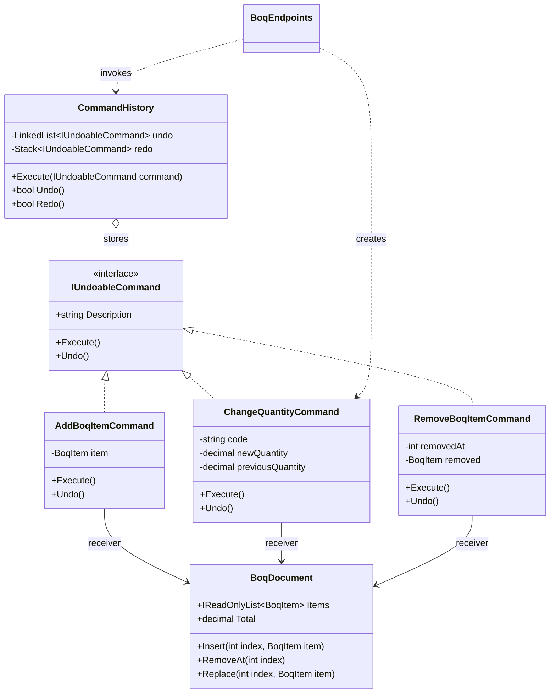
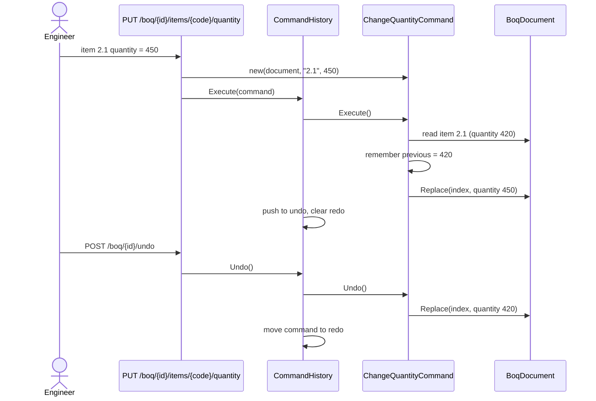
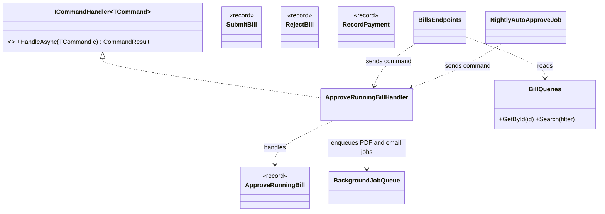

Most code performs a request the moment it is made: a button click calls a method, and the method runs. The Command pattern adds one step in between. It wraps the request in an **object**. Once a request is an object, you can put it in a list (undo history), in a queue (background job), in a log (audit), or send it to a handler somewhere else (CQRS).

## Learning objectives

By the end of this lesson you will be able to:

1. Explain the problem Command solves and name its participants: command, receiver, invoker and client.
2. Build undo/redo for a document editor with a bounded history.
3. Combine commands into an all-or-nothing macro command.
4. Model write operations in ASP.NET Core as CQRS command records with dedicated handlers.
5. Queue commands as background jobs with retries, and explain why queued commands must be data, not closures.
6. Decide when Command is overkill, and tell it apart from Strategy, Memento and Mediator.

## Prerequisites

- [Interfaces and abstract classes](#/lesson/m01-interfaces-abstract): every command implements a shared interface.
- [Dependency injection](#/lesson/m03-dependency-injection): handlers are resolved from the container.
- [Background services and hosted workers](#/lesson/m03-background-services): the job queue runs in a `BackgroundService`.

## Explain it like I'm a beginner

Think of a restaurant. You tell the waiter "one masala dosa, less oil". The waiter does not run into the kitchen and cook it. He writes it on an **order slip** and puts it on the kitchen rail.

That slip is powerful because it is a *thing*, not a moment:

- The kitchen can work through the slips **in order** (a queue).
- If the restaurant is busy, slips **wait** without anyone forgetting them.
- If you change your mind, the waiter can **cancel** the slip.
- At the end of the day the manager can **count** the slips (an audit log).

The waiter does not need to know how to cook a dosa. The cook does not need to know which table asked. The slip connects them.

In software, the slip is a **command object**. It holds everything needed to do one job ("change the quantity of item 2.1 to 450 cubic metres"). Some other piece of code decides **when** to run it, and some other piece knows **how** to do the work.

- The order slip is the **command**.
- The cook, who actually does the work, is the **receiver**.
- The kitchen rail, which decides when slips get processed, is the **invoker**.
- The waiter, who writes the slip, is the **client**.

## First-principles explanation

### What it is

Command encapsulates a request as an object. That lets you parameterise code with requests, queue or log them, and support undoable operations. The object carries the action and the data the action needs.

### The original problem

The Gang of Four example was a GUI toolkit. A menu item or toolbar button must "do something when clicked", but the toolkit authors can't know what: open a file, paste text, print. If each button held a hard-coded call, the toolkit would depend on every application. The fix was to give each button a `Command` object with an `Execute()` method. The button (invoker) only knows the interface. Each application supplies its own commands. Because commands are objects, the same toolkit could keep a history list and offer **Undo**.

### How it works internally

There's nothing hidden. A command is an object that has:

1. **Data**: the parameters of the request (which item, which new value).
2. **A reference to the receiver**, or a way to find it (the document, the repository).
3. **`Execute()`**, and optionally **`Undo()`**, which needs the command to remember what it changed.

An invoker holds commands and calls `Execute()` at a time it chooses: immediately, later from a queue, or again on redo. In C#, a delegate (`Action`, `Func<Task>`) is the simplest possible command. It has `Execute` (invoke) but no `Undo`, no name and no serialisable data.

### Four jobs commands do in real systems

| Job | What the command object enables | .NET example |
|---|---|---|
| Undo / redo | Store executed commands; call `Undo()` in reverse order | Editors, form designers, BOQ and drawing tools |
| Queueing / deferral | Run later, on another thread or machine | `Channel<T>` + `BackgroundService`, Hangfire, broker messages |
| Logging / audit / replay | Persist what was requested, by whom, when | Audit tables, command logs |
| Decoupling sender from handler | The sender builds a request; a handler elsewhere executes it | CQRS commands with `ICommandHandler<TCommand>` |

### GoF style vs CQRS style

There are two shapes, and mixing them up causes confusion:

- **GoF style: the command does the work.** `ChangeQuantityCommand.Execute()` updates the document itself. Good for undo/redo, where each command must also know how to reverse itself.
- **CQRS style: the command is just data; a handler does the work.** `ApproveRunningBill` is a `record` with an ID and an amount. `ApproveRunningBillHandler` loads the bill, applies rules and saves. This suits web APIs, because the data part can be serialised, validated, logged and queued, while the handler gets dependencies from DI.

Both are the Command pattern: a request turned into an object, separated from the code that decides when to run it.

### When it is useful

- You need **undo/redo** or a **history** of user actions.
- Work must be **deferred, queued, retried or scheduled**.
- You need an **audit trail** of requested changes.
- Many entry points (API, CLI, message consumer) must trigger the **same operation** with the same validation.

### When it is unnecessary

- A simple CRUD endpoint with no undo, no queue and one caller. A service method is clearer.
- You are wrapping every method in a command "for consistency". Ten files for one `UPDATE` statement is ceremony, not design.
- Undo would be easier by **restoring a snapshot** (Memento) than by writing an inverse for every operation, for example when a single action changes 40 fields.

### Trade-offs

| You gain | You pay |
|---|---|
| Requests become data: storable, queueable, loggable | One more class per operation |
| Undo/redo with clear inverse logic | Every undoable command must capture enough state to reverse itself |
| Senders don't know the receivers | Following "what happens on submit?" means finding the handler |
| Retries and scheduling come almost free | Queued commands need idempotency and versioning of their data shape |

## Visual explanation

### Class diagram



How to read it: `BoqEndpoints` is the **client**. It creates command objects but never edits the document itself. `CommandHistory` is the **invoker**. It runs commands and keeps two collections: commands that can be undone and commands that can be redone. `BoqDocument` (a bill of quantities for a road project) is the **receiver** that knows how to change items. Each concrete command holds the data it needs plus what it must remember for `Undo()`, such as `previousQuantity` or the index where an item was removed.

### Sequence diagram



The client builds a command and hands it to the invoker. The command captures the old value **at execution time**, not at construction time, because the document might have changed in between. When the engineer presses undo, the history pops the latest command and asks it to reverse itself. The history knows nothing about quantities. Adding a new kind of edit never changes `CommandHistory`.

## Step-by-step example

A site engineer edits a bill of quantities (BOQ) for a 12 km road package: earthwork, granular sub-base, bituminous layers. Each item has a code, unit, rate and quantity. They want undo and redo, like in a spreadsheet.

### Step 1 — the naive version

```csharp
public void ChangeQuantity(string code, decimal qty) { var i = _doc.IndexOf(code); _doc.Items[i] = _doc.Items[i] with { Quantity = qty }; }
public void Undo() { /* ??? we don't know what the last action was, or the old value */ }
```

Undo is impossible because the method forgot what it did. A common hack is a `switch` over a string "last action" plus a pile of "old value" fields. That breaks after the second kind of action.

### Step 2 — one interface for all edits

```csharp
public interface IUndoableCommand
{
    string Description { get; }   // shown in the UI: "Change 2.1 quantity to 450"
    void Execute();
    void Undo();
}
```

### Step 3 — one class per edit, remembering what it changed

`ChangeQuantityCommand` stores the new value it was given, and in `Execute()` it saves the previous value before overwriting. `RemoveBoqItemCommand` saves the removed item and its position, so `Undo()` puts it back in the same row.

### Step 4 — an invoker with two stacks

Executing a command pushes it onto the undo stack and **clears the redo stack**, because redoing an old branch after a new edit would apply changes to a document that no longer looks the way they expect. Undo moves a command from the undo stack to the redo stack; redo moves it back. We cap history at 100 entries so memory stays bounded.

### Step 5 — the web version: commands as data

In an API, the CQRS style fits better: `ApproveRunningBill(billId, approvedBy, amount)` is a record, a handler applies the rules, and slow follow-up work (rendering the payment certificate PDF) is queued as a background job command.

## Production-style C# implementation

```text
SiteOps.Api/
  Program.cs
  Boq/
    BoqDocument.cs
    UndoableCommands.cs
    CommandHistory.cs
    BoqSessions.cs
  Billing/
    CommandContracts.cs
    RunningBill.cs
    ApproveRunningBillHandler.cs
  Jobs/
    BackgroundJobs.cs
```

### Part 1 — undo/redo (GoF style)

```csharp file=Boq/BoqDocument.cs
namespace SiteOps.Boq;

public sealed record BoqItem(string Code, string Description, string Unit, decimal Rate, decimal Quantity)
{
    public decimal Amount => Math.Round(Rate * Quantity, 2);
}

/// <summary>Receiver: knows how to change items. Knows nothing about undo.</summary>
public sealed class BoqDocument(string projectCode)
{
    private readonly List<BoqItem> _items = [];

    public string ProjectCode { get; } = projectCode;
    public IReadOnlyList<BoqItem> Items => _items;
    public int Count => _items.Count;
    public decimal Total => _items.Sum(i => i.Amount);

    public int IndexOf(string code) =>
        _items.FindIndex(i => string.Equals(i.Code, code, StringComparison.OrdinalIgnoreCase));

    public void Insert(int index, BoqItem item)
    {
        if (IndexOf(item.Code) >= 0) throw new InvalidOperationException($"Item {item.Code} already exists.");
        if (item.Quantity < 0 || item.Rate < 0) throw new ArgumentException("Rate and quantity must be non-negative.");
        _items.Insert(index, item);
    }

    public void RemoveAt(int index) => _items.RemoveAt(index);

    public void Replace(int index, BoqItem item)
    {
        if (item.Quantity < 0) throw new ArgumentException("Quantity must be non-negative.");
        _items[index] = item;
    }

    public int RequireIndex(string code)
    {
        var i = IndexOf(code);
        return i >= 0 ? i : throw new KeyNotFoundException($"BOQ item {code} not found.");
    }
}
```

```csharp file=Boq/UndoableCommands.cs
namespace SiteOps.Boq;

public interface IUndoableCommand
{
    string Description { get; }
    void Execute();
    void Undo();
}

public sealed class AddBoqItemCommand(BoqDocument document, BoqItem item) : IUndoableCommand
{
    public string Description => $"Add {item.Code} ({item.Description})";
    public void Execute() => document.Insert(document.Count, item);
    public void Undo() => document.RemoveAt(document.RequireIndex(item.Code));
}

public sealed class ChangeQuantityCommand(BoqDocument document, string code, decimal newQuantity) : IUndoableCommand
{
    private decimal? _previous;   // captured at Execute time, not construction time

    public string Description => $"Change {code} quantity to {newQuantity}";

    public void Execute()
    {
        var i = document.RequireIndex(code);
        var current = document.Items[i];
        _previous = current.Quantity;
        document.Replace(i, current with { Quantity = newQuantity });
    }

    public void Undo()
    {
        if (_previous is not decimal previous) throw new InvalidOperationException("Command was never executed.");
        var i = document.RequireIndex(code);
        document.Replace(i, document.Items[i] with { Quantity = previous });
    }
}

public sealed class RemoveBoqItemCommand(BoqDocument document, string code) : IUndoableCommand
{
    private (int Index, BoqItem Item)? _removed;

    public string Description => $"Remove {code}";

    public void Execute()
    {
        var i = document.RequireIndex(code);
        _removed = (i, document.Items[i]);
        document.RemoveAt(i);
    }

    public void Undo()
    {
        if (_removed is not { } r) throw new InvalidOperationException("Command was never executed.");
        document.Insert(r.Index, r.Item);   // back in the same row
    }
}
```

```csharp file=Boq/CommandHistory.cs
namespace SiteOps.Boq;

/// <summary>Invoker. Executes commands and keeps a bounded undo history plus a redo stack.</summary>
public sealed class CommandHistory(int capacity = 100)
{
    private readonly LinkedList<IUndoableCommand> _undo = new();   // newest at the end; oldest dropped first
    private readonly Stack<IUndoableCommand> _redo = new();

    public bool CanUndo => _undo.Count > 0;
    public bool CanRedo => _redo.Count > 0;
    public IEnumerable<string> UndoDescriptions => _undo.Reverse().Select(c => c.Description);

    public void Execute(IUndoableCommand command)
    {
        ArgumentNullException.ThrowIfNull(command);
        command.Execute();               // if this throws, history is unchanged
        _undo.AddLast(command);
        _redo.Clear();                   // a new edit invalidates the redo branch
        if (_undo.Count > capacity) _undo.RemoveFirst();
    }

    public bool Undo()
    {
        if (_undo.Last is not { } node) return false;
        node.Value.Undo();
        _undo.RemoveLast();
        _redo.Push(node.Value);
        return true;
    }

    public bool Redo()
    {
        if (!_redo.TryPeek(out var command)) return false;
        command.Execute();
        _redo.Pop();
        _undo.AddLast(command);
        return true;
    }
}
```

In a web API, each open document needs its own history. This in-memory store is fine for a single server. With several servers behind a load balancer, keep history in the database or use sticky sessions.

```csharp file=Boq/BoqSessions.cs
using System.Collections.Concurrent;

namespace SiteOps.Boq;

public sealed class BoqSession(BoqDocument document)
{
    public BoqDocument Document { get; } = document;
    public CommandHistory History { get; } = new(capacity: 100);
    public object Gate { get; } = new();   // one edit at a time per document
}

public sealed class BoqSessions
{
    private readonly ConcurrentDictionary<string, BoqSession> _sessions = new(StringComparer.OrdinalIgnoreCase);
    public BoqSession GetOrOpen(string projectCode) => _sessions.GetOrAdd(projectCode, c => new BoqSession(new BoqDocument(c)));
}
```

### Part 2 — CQRS commands and handlers

```csharp file=Billing/CommandContracts.cs
namespace SiteOps.Billing;

/// <summary>Marker for a request that changes state and returns TResult.</summary>
public interface ICommand<TResult>;

public interface ICommandHandler<in TCommand, TResult> where TCommand : ICommand<TResult>
{
    Task<TResult> HandleAsync(TCommand command, CancellationToken ct);
}

public sealed record CommandResult(bool Succeeded, string? Error = null)
{
    public static readonly CommandResult Ok = new(true);
    public static CommandResult Fail(string error) => new(false, error);
}

/// <summary>The command: plain, serialisable data. No behaviour, no dependencies.</summary>
public sealed record ApproveRunningBill(Guid BillId, string ApprovedBy, decimal CertifiedAmountInr) : ICommand<CommandResult>;
```

```csharp file=Billing/RunningBill.cs
using System.Collections.Concurrent;

namespace SiteOps.Billing;

public enum BillStatus { Submitted, Approved, Rejected }

public sealed class RunningBill(Guid id, string contractor, decimal claimedAmountInr)
{
    public Guid Id { get; } = id;
    public string Contractor { get; } = contractor;
    public decimal ClaimedAmountInr { get; } = claimedAmountInr;
    public BillStatus Status { get; private set; } = BillStatus.Submitted;
    public decimal? CertifiedAmountInr { get; private set; }
    public string? ApprovedBy { get; private set; }
    public DateTimeOffset? ApprovedAt { get; private set; }

    public void Approve(string by, decimal certified, DateTimeOffset at)
    {
        if (Status != BillStatus.Submitted) throw new InvalidOperationException($"Bill is already {Status}.");
        if (certified <= 0 || certified > ClaimedAmountInr)
            throw new ArgumentOutOfRangeException(nameof(certified), "Certified amount must be > 0 and <= claimed amount.");
        Status = BillStatus.Approved; CertifiedAmountInr = certified; ApprovedBy = by; ApprovedAt = at;
    }
}

public interface IRunningBillStore
{
    Task<RunningBill?> FindAsync(Guid id, CancellationToken ct);
    Task SaveAsync(RunningBill bill, CancellationToken ct);
}

public sealed class InMemoryRunningBillStore : IRunningBillStore
{
    private readonly ConcurrentDictionary<Guid, RunningBill> _bills = new();
    public Task<RunningBill?> FindAsync(Guid id, CancellationToken ct) => Task.FromResult(_bills.GetValueOrDefault(id));
    public Task SaveAsync(RunningBill bill, CancellationToken ct) { _bills[bill.Id] = bill; return Task.CompletedTask; }
}
```

```csharp file=Billing/ApproveRunningBillHandler.cs
using Microsoft.Extensions.Logging;
using SiteOps.Jobs;

namespace SiteOps.Billing;

public sealed class ApproveRunningBillHandler(
    IRunningBillStore store, BackgroundJobQueue jobs, TimeProvider clock, ILogger<ApproveRunningBillHandler> logger)
    : ICommandHandler<ApproveRunningBill, CommandResult>
{
    public async Task<CommandResult> HandleAsync(ApproveRunningBill command, CancellationToken ct)
    {
        if (string.IsNullOrWhiteSpace(command.ApprovedBy)) return CommandResult.Fail("ApprovedBy is required.");

        var bill = await store.FindAsync(command.BillId, ct);
        if (bill is null) return CommandResult.Fail($"Bill {command.BillId} not found.");

        try { bill.Approve(command.ApprovedBy, command.CertifiedAmountInr, clock.GetUtcNow()); }
        catch (Exception ex) when (ex is InvalidOperationException or ArgumentOutOfRangeException)
        {
            return CommandResult.Fail(ex.Message);
        }

        await store.SaveAsync(bill, ct);
        logger.LogInformation("Bill {BillId} approved by {User} for {Amount} INR", bill.Id, command.ApprovedBy, command.CertifiedAmountInr);

        // Follow-up work as another command, run later by a worker.
        await jobs.EnqueueAsync(new GeneratePaymentCertificateJob(bill.Id), ct);
        return CommandResult.Ok;
    }
}
```

### Part 3 — background jobs: commands in a queue

```csharp file=Jobs/BackgroundJobs.cs
using System.Threading.Channels;
using Microsoft.Extensions.Logging;

namespace SiteOps.Jobs;

/// <summary>A queued command. It must be plain data so it could be serialised to a durable queue later.</summary>
public interface IBackgroundJob
{
    string Name { get; }
    Task ExecuteAsync(IServiceProvider services, CancellationToken ct);
}

public interface ICertificateRenderer
{
    Task RenderAsync(Guid billId, CancellationToken ct);
}

public sealed class LoggingCertificateRenderer(ILogger<LoggingCertificateRenderer> logger) : ICertificateRenderer
{
    public Task RenderAsync(Guid billId, CancellationToken ct)
    {
        logger.LogInformation("Rendered payment certificate PDF for bill {BillId}", billId);
        return Task.CompletedTask;
    }
}

public sealed record GeneratePaymentCertificateJob(Guid BillId) : IBackgroundJob
{
    public string Name => $"certificate:{BillId}";
    public Task ExecuteAsync(IServiceProvider services, CancellationToken ct) =>
        services.GetRequiredService<ICertificateRenderer>().RenderAsync(BillId, ct);
}

public sealed class BackgroundJobQueue
{
    private readonly Channel<IBackgroundJob> _channel = Channel.CreateBounded<IBackgroundJob>(
        new BoundedChannelOptions(500) { FullMode = BoundedChannelFullMode.Wait, SingleReader = true });

    public ValueTask EnqueueAsync(IBackgroundJob job, CancellationToken ct) => _channel.Writer.WriteAsync(job, ct);
    public IAsyncEnumerable<IBackgroundJob> DequeueAllAsync(CancellationToken ct) => _channel.Reader.ReadAllAsync(ct);
}

/// <summary>Invoker for jobs: runs each in its own DI scope with up to 3 attempts.</summary>
public sealed class BackgroundJobWorker(BackgroundJobQueue queue, IServiceScopeFactory scopes, TimeProvider clock, ILogger<BackgroundJobWorker> logger)
    : BackgroundService
{
    private const int MaxAttempts = 3;

    protected override async Task ExecuteAsync(CancellationToken stoppingToken)
    {
        try
        {
            await foreach (var job in queue.DequeueAllAsync(stoppingToken))
                await RunWithRetryAsync(job, stoppingToken);
        }
        catch (OperationCanceledException) when (stoppingToken.IsCancellationRequested) { }
    }

    private async Task RunWithRetryAsync(IBackgroundJob job, CancellationToken ct)
    {
        for (var attempt = 1; attempt <= MaxAttempts; attempt++)
        {
            try
            {
                await using var scope = scopes.CreateAsyncScope();
                await job.ExecuteAsync(scope.ServiceProvider, ct);
                return;
            }
            catch (Exception ex) when (ex is not OperationCanceledException)
            {
                logger.LogWarning(ex, "Job {Job} failed (attempt {Attempt}/{Max})", job.Name, attempt, MaxAttempts);
                if (attempt == MaxAttempts) { logger.LogError("Job {Job} moved to dead letters", job.Name); return; }
                await Task.Delay(TimeSpan.FromSeconds(Math.Pow(2, attempt)), clock, ct);   // 2 s, 4 s
            }
        }
    }
}
```

```csharp file=Program.cs
using SiteOps.Billing;
using SiteOps.Boq;
using SiteOps.Jobs;

var builder = WebApplication.CreateBuilder(args);

builder.Services.AddSingleton(TimeProvider.System);
builder.Services.AddSingleton<BoqSessions>();

builder.Services.AddSingleton<IRunningBillStore, InMemoryRunningBillStore>();
builder.Services.AddScoped<ICommandHandler<ApproveRunningBill, CommandResult>, ApproveRunningBillHandler>();

builder.Services.AddSingleton<BackgroundJobQueue>();
builder.Services.AddSingleton<ICertificateRenderer, LoggingCertificateRenderer>();
builder.Services.AddHostedService<BackgroundJobWorker>();

var app = builder.Build();

// --- Undo/redo endpoints: the endpoint is the client, CommandHistory is the invoker ---
IResult Run(BoqSessions sessions, string project, Func<BoqDocument, IUndoableCommand> make)
{
    var s = sessions.GetOrOpen(project);
    lock (s.Gate)
    {
        try { s.History.Execute(make(s.Document)); }
        catch (Exception ex) when (ex is KeyNotFoundException or InvalidOperationException or ArgumentException)
        { return Results.Problem(ex.Message, statusCode: 400); }
        return Results.Ok(new { s.Document.Total, items = s.Document.Items });
    }
}

app.MapPost("/boq/{project}/items", (string project, BoqItem item, BoqSessions sessions) =>
    Run(sessions, project, d => new AddBoqItemCommand(d, item)));

app.MapPut("/boq/{project}/items/{code}/quantity", (string project, string code, decimal quantity, BoqSessions sessions) =>
    Run(sessions, project, d => new ChangeQuantityCommand(d, code, quantity)));

app.MapDelete("/boq/{project}/items/{code}", (string project, string code, BoqSessions sessions) =>
    Run(sessions, project, d => new RemoveBoqItemCommand(d, code)));

app.MapPost("/boq/{project}/undo", (string project, BoqSessions sessions) =>
{
    var s = sessions.GetOrOpen(project);
    lock (s.Gate) return s.History.Undo() ? Results.Ok(new { s.Document.Total }) : Results.Conflict("Nothing to undo.");
});

app.MapPost("/boq/{project}/redo", (string project, BoqSessions sessions) =>
{
    var s = sessions.GetOrOpen(project);
    lock (s.Gate) return s.History.Redo() ? Results.Ok(new { s.Document.Total }) : Results.Conflict("Nothing to redo.");
});

// --- CQRS command endpoint: build the command, hand it to its handler ---
app.MapPost("/bills/{billId:guid}/approve", async (Guid billId, ApproveRequest body,
    ICommandHandler<ApproveRunningBill, CommandResult> handler, CancellationToken ct) =>
{
    var result = await handler.HandleAsync(new ApproveRunningBill(billId, body.ApprovedBy, body.CertifiedAmountInr), ct);
    return result.Succeeded ? Results.NoContent() : Results.Problem(result.Error, statusCode: 422);
});

app.Run();

public sealed record ApproveRequest(string ApprovedBy, decimal CertifiedAmountInr);
```

**Why is the job a record holding only `BillId`?** Because a queued command may be serialised (to a database, Redis or a broker) and executed minutes later, maybe on another machine. If it captured a `DbContext`, an `HttpContext` or a lambda, none of that would survive serialisation, and some would already be disposed. The job carries **data**; it gets its dependencies from the worker's fresh DI scope when it runs.

:::callout type=warning title="Closures are not durable commands"
`queue.Enqueue(() => _db.Bills.Find(id))` looks like a command, but it captures the request's scoped `_db`. By the time the worker runs it, the request has ended and the `DbContext` is disposed. In-memory closures also vanish on restart. Queue a record with IDs, and resolve services inside the job.
:::

## Bad design vs good design

**Bad**: a controller action with 200 lines that validates, loads, applies rules, saves, renders a PDF and emails it, all inline. The same logic is copy-pasted into a CLI tool used for bulk approvals at year end, and the copies have drifted: the CLI forgot the "certified ≤ claimed" check.

**Good**: an `ApproveRunningBill` command handled by one handler. The API, the CLI and a message consumer all build the same record and call the same handler. The PDF is a queued job with retries. The rule exists once.

**Also bad (over-engineering)**: a generic `ICommandBus` with reflection-based dispatch, a pipeline of six behaviours and a command for `GetUserNameById`. Reads are queries, not commands. If a direct handler injection (as above) works, you don't need a bus.

**For undo, is Command always right?** No. If one user action changes many fields at once (for example, "apply the revised schedule of rates" touching 300 items), writing a precise inverse is error-prone. Taking a snapshot before the action and restoring it ([Memento](#/lesson/m06-memento)) is simpler. Many editors combine both: commands for small edits, snapshots for big ones.

## Practical playground

Run the playground, then try these:

1. Undo twice, then add a new item, then call `Redo()`. Why does it print `False`?
2. Implement `Undo` for `ChangeRateCommand` (it currently throws).
3. Make `ChangeQuantityCommand` capture the previous value in the constructor instead of in `Execute`. Change the quantity twice, undo twice, and watch the result go wrong.

:::playground type=csharp title="BOQ undo/redo"
```csharp file=Program.cs
using System;
using System.Collections.Generic;
using System.Linq;

public sealed record BoqItem(string Code, decimal Rate, decimal Quantity) { public decimal Amount => Rate * Quantity; }

public interface IUndoableCommand { string Description { get; } void Execute(); void Undo(); }

public sealed class Boq
{
    public List<BoqItem> Items { get; } = new();
    public int IndexOf(string code) => Items.FindIndex(i => i.Code == code);
    public decimal Total => Items.Sum(i => i.Amount);
}

public sealed class AddItem(Boq boq, BoqItem item) : IUndoableCommand
{
    public string Description => "Add " + item.Code;
    public void Execute() => boq.Items.Add(item);
    public void Undo() => boq.Items.RemoveAt(boq.IndexOf(item.Code));
}

public sealed class ChangeQuantityCommand(Boq boq, string code, decimal qty) : IUndoableCommand
{
    private decimal _previous;
    public string Description => $"{code} qty -> {qty}";
    public void Execute() { var i = boq.IndexOf(code); _previous = boq.Items[i].Quantity; boq.Items[i] = boq.Items[i] with { Quantity = qty }; }
    public void Undo() { var i = boq.IndexOf(code); boq.Items[i] = boq.Items[i] with { Quantity = _previous }; }
}

public sealed class ChangeRateCommand(Boq boq, string code, decimal rate) : IUndoableCommand
{
    private decimal _previous;
    public string Description => $"{code} rate -> {rate}";
    public void Execute() { var i = boq.IndexOf(code); _previous = boq.Items[i].Rate; boq.Items[i] = boq.Items[i] with { Rate = rate }; }
    public void Undo() => throw new NotImplementedException("TODO: restore _previous");
}

public sealed class History
{
    private readonly Stack<IUndoableCommand> _undo = new(), _redo = new();
    public void Execute(IUndoableCommand c) { c.Execute(); _undo.Push(c); _redo.Clear(); }
    public bool Undo() { if (_undo.Count == 0) return false; var c = _undo.Pop(); c.Undo(); _redo.Push(c); return true; }
    public bool Redo() { if (_redo.Count == 0) return false; var c = _redo.Pop(); c.Execute(); _undo.Push(c); return true; }
}

public static class Program
{
    public static void Main()
    {
        var boq = new Boq();
        var h = new History();
        h.Execute(new AddItem(boq, new BoqItem("2.1 Earthwork (m3)", 185m, 420m)));
        h.Execute(new AddItem(boq, new BoqItem("4.3 GSB (m3)", 1650m, 96m)));
        h.Execute(new ChangeQuantityCommand(boq, "2.1 Earthwork (m3)", 450m));
        Console.WriteLine($"Total after edits: {boq.Total:N2}");
        h.Undo();
        Console.WriteLine($"After undo:        {boq.Total:N2}");
        h.Redo();
        Console.WriteLine($"After redo:        {boq.Total:N2}");
        h.Undo(); h.Undo();
        h.Execute(new AddItem(boq, new BoqItem("5.1 DBM (m3)", 9800m, 12m)));
        Console.WriteLine($"Redo possible after a new edit? {h.Redo()}");
    }
}
```
:::

## Exercises

:::exercise id=m06-command-ex1 difficulty=beginner kind=code title="An undoable rate change"
Implement `ChangeRateCommand` for a BOQ. It sets a new rate on an item and can restore the old one.
::requirements
- Capture the previous rate in `Execute()`, not in the constructor.
- `Undo()` before `Execute()` throws `InvalidOperationException`.
- An unknown item code throws `KeyNotFoundException` from `Execute()` and leaves the document unchanged.
::acceptance
- Item "2.1" at ₹185 changed to ₹192 shows ₹192; after `Undo()` it shows ₹185.
- Two commands on the same item, undone in reverse order, restore ₹185.
- `Description` reads `Change 2.1 rate to 192`.
::hint
What does `Undo()` need to know that the constructor arguments don't tell it?
::hint
Store the old rate in a nullable field (`decimal?`) so you can detect "never executed".
::hint
Records support `with`: `item with { Rate = newRate }` creates a copy with one property changed.
::hint
```csharp
var i = doc.RequireIndex(code);
_previous = doc.Items[i].Rate;
doc.Replace(i, doc.Items[i] with { Rate = newRate });
```
::starter
```csharp file=ChangeRateCommand.cs
using System;
using System.Collections.Generic;

public sealed record BoqItem(string Code, decimal Rate, decimal Quantity);

public sealed class BoqDocument
{
    public List<BoqItem> Items { get; } = new();
    public int RequireIndex(string code)
    {
        var i = Items.FindIndex(x => x.Code == code);
        return i >= 0 ? i : throw new KeyNotFoundException(code);
    }
    public void Replace(int index, BoqItem item) => Items[index] = item;
}

public interface IUndoableCommand { string Description { get; } void Execute(); void Undo(); }

public sealed class ChangeRateCommand(BoqDocument doc, string code, decimal newRate) : IUndoableCommand
{
    public string Description => throw new NotImplementedException();
    public void Execute() => throw new NotImplementedException();
    public void Undo() => throw new NotImplementedException();
}
```
::tests
```csharp file=ChangeRateCommandTests.cs
using System;
using System.Collections.Generic;
using Xunit;

public class ChangeRateCommandTests
{
    private static BoqDocument Doc()
    {
        var d = new BoqDocument();
        d.Items.Add(new BoqItem("2.1", 185m, 420m));
        return d;
    }

    [Fact]
    public void Execute_then_undo_restores_rate()
    {
        var d = Doc();
        var c = new ChangeRateCommand(d, "2.1", 192m);
        c.Execute();
        Assert.Equal(192m, d.Items[0].Rate);
        c.Undo();
        Assert.Equal(185m, d.Items[0].Rate);
    }

    [Fact]
    public void Two_commands_undone_in_reverse_restore_original()
    {
        var d = Doc();
        var a = new ChangeRateCommand(d, "2.1", 192m);
        var b = new ChangeRateCommand(d, "2.1", 200m);
        a.Execute(); b.Execute();
        b.Undo(); a.Undo();
        Assert.Equal(185m, d.Items[0].Rate);
    }

    [Fact]
    public void Undo_before_execute_throws() =>
        Assert.Throws<InvalidOperationException>(() => new ChangeRateCommand(Doc(), "2.1", 1m).Undo());

    [Fact]
    public void Unknown_code_throws_and_changes_nothing()
    {
        var d = Doc();
        Assert.Throws<KeyNotFoundException>(() => new ChangeRateCommand(d, "9.9", 1m).Execute());
        Assert.Equal(185m, d.Items[0].Rate);
    }

    [Fact]
    public void Description_is_readable() =>
        Assert.Equal("Change 2.1 rate to 192", new ChangeRateCommand(Doc(), "2.1", 192m).Description);
}
```
::solution
```csharp file=ChangeRateCommand.cs
using System;
using System.Collections.Generic;

public sealed record BoqItem(string Code, decimal Rate, decimal Quantity);

public sealed class BoqDocument
{
    public List<BoqItem> Items { get; } = new();
    public int RequireIndex(string code)
    {
        var i = Items.FindIndex(x => x.Code == code);
        return i >= 0 ? i : throw new KeyNotFoundException(code);
    }
    public void Replace(int index, BoqItem item) => Items[index] = item;
}

public interface IUndoableCommand { string Description { get; } void Execute(); void Undo(); }

public sealed class ChangeRateCommand(BoqDocument doc, string code, decimal newRate) : IUndoableCommand
{
    private decimal? _previous;

    public string Description => $"Change {code} rate to {newRate}";

    public void Execute()
    {
        var i = doc.RequireIndex(code);       // throws before anything changes
        _previous = doc.Items[i].Rate;
        doc.Replace(i, doc.Items[i] with { Rate = newRate });
    }

    public void Undo()
    {
        if (_previous is not decimal previous) throw new InvalidOperationException("Not executed yet.");
        var i = doc.RequireIndex(code);
        doc.Replace(i, doc.Items[i] with { Rate = previous });
    }
}
```
Capturing at `Execute()` time is what makes the second test pass: command `b` remembers ₹192 (the value when *it* ran), not ₹185.
::mistakes
- Capturing the previous value in the constructor. If another command runs between construction and execution, undo restores a stale value.
- Undo replacing the whole item with a stored copy, which also reverts unrelated changes (for example, a quantity edit made later).
::extensions
Add `ChangeRateCommand.TryMerge(IUndoableCommand next)` so that three quick rate edits on the same item collapse into one undo step.
:::

:::exercise id=m06-command-ex2 difficulty=beginner kind=code title="Undo/redo history with a cap"
Implement `CommandHistory`: the invoker that runs commands and supports undo and redo, keeping at most `capacity` undo steps.
::requirements
- `Execute` runs the command, records it, and clears the redo stack. If the command throws, nothing is recorded.
- `Undo`/`Redo` return `false` when there is nothing to do.
- When the history exceeds `capacity`, the oldest entry is discarded.
::acceptance
- Execute A, B; Undo → B undone; Redo → B re-executed.
- Execute A, B; Undo; Execute C; Redo returns false.
- With capacity 2, executing A, B, C then undoing three times returns true, true, false.
- A command that throws in `Execute` is not undoable.
::hint
You need two collections. Which ends do you add and remove from?
::hint
The redo side is a plain `Stack<T>`. The undo side must drop its oldest item, so a `LinkedList<T>` (add/remove at both ends) works well.
::hint
Call `command.Execute()` first, and only record it if that line didn't throw.
::hint
```csharp
command.Execute();
_undo.AddLast(command);
_redo.Clear();
if (_undo.Count > _capacity) _undo.RemoveFirst();
```
::starter
```csharp file=CommandHistory.cs
using System;
using System.Collections.Generic;

public interface IUndoableCommand { void Execute(); void Undo(); }

public sealed class CommandHistory
{
    private readonly int _capacity;
    private readonly LinkedList<IUndoableCommand> _undo = new();
    private readonly Stack<IUndoableCommand> _redo = new();

    public CommandHistory(int capacity)
    {
        if (capacity < 1) throw new ArgumentOutOfRangeException(nameof(capacity));
        _capacity = capacity;
    }

    public int UndoCount => _undo.Count;

    public void Execute(IUndoableCommand command) => throw new NotImplementedException();
    public bool Undo() => throw new NotImplementedException();
    public bool Redo() => throw new NotImplementedException();
}
```
::tests
```csharp file=CommandHistoryTests.cs
using System;
using System.Collections.Generic;
using Xunit;

public class CommandHistoryTests
{
    private sealed class Rec(string name, List<string> log, bool fail = false) : IUndoableCommand
    {
        public void Execute() { if (fail) throw new InvalidOperationException(); log.Add("do " + name); }
        public void Undo() => log.Add("undo " + name);
    }

    [Fact]
    public void Undo_then_redo()
    {
        var log = new List<string>();
        var h = new CommandHistory(10);
        h.Execute(new Rec("A", log)); h.Execute(new Rec("B", log));
        Assert.True(h.Undo());
        Assert.True(h.Redo());
        Assert.Equal(new List<string> { "do A", "do B", "undo B", "do B" }, log);
    }

    [Fact]
    public void New_command_clears_redo()
    {
        var log = new List<string>();
        var h = new CommandHistory(10);
        h.Execute(new Rec("A", log)); h.Execute(new Rec("B", log));
        h.Undo();
        h.Execute(new Rec("C", log));
        Assert.False(h.Redo());
    }

    [Fact]
    public void Capacity_drops_oldest()
    {
        var log = new List<string>();
        var h = new CommandHistory(2);
        h.Execute(new Rec("A", log)); h.Execute(new Rec("B", log)); h.Execute(new Rec("C", log));
        Assert.True(h.Undo()); Assert.True(h.Undo()); Assert.False(h.Undo());
        Assert.Equal("undo B", log[^1]);
    }

    [Fact]
    public void Failed_command_is_not_recorded()
    {
        var log = new List<string>();
        var h = new CommandHistory(5);
        Assert.Throws<InvalidOperationException>(() => h.Execute(new Rec("X", log, fail: true)));
        Assert.Equal(0, h.UndoCount);
        Assert.False(h.Undo());
    }

    [Fact]
    public void Empty_history_returns_false()
    {
        var h = new CommandHistory(3);
        Assert.False(h.Undo());
        Assert.False(h.Redo());
    }
}
```
::solution
```csharp file=CommandHistory.cs
using System;
using System.Collections.Generic;

public interface IUndoableCommand { void Execute(); void Undo(); }

public sealed class CommandHistory
{
    private readonly int _capacity;
    private readonly LinkedList<IUndoableCommand> _undo = new();
    private readonly Stack<IUndoableCommand> _redo = new();

    public CommandHistory(int capacity)
    {
        if (capacity < 1) throw new ArgumentOutOfRangeException(nameof(capacity));
        _capacity = capacity;
    }

    public int UndoCount => _undo.Count;

    public void Execute(IUndoableCommand command)
    {
        ArgumentNullException.ThrowIfNull(command);
        command.Execute();
        _undo.AddLast(command);
        _redo.Clear();
        if (_undo.Count > _capacity) _undo.RemoveFirst();
    }

    public bool Undo()
    {
        if (_undo.Last is not { } node) return false;
        node.Value.Undo();
        _undo.RemoveLast();
        _redo.Push(node.Value);
        return true;
    }

    public bool Redo()
    {
        if (!_redo.TryPeek(out var command)) return false;
        command.Execute();
        _redo.Pop();
        _undo.AddLast(command);
        return true;
    }
}
```
`Undo` calls `node.Value.Undo()` *before* moving the node. If undo throws, the history still reflects reality: the command is still applied and still at the top of the undo stack.
::mistakes
- Forgetting to clear redo on a new command, which lets users "redo" onto a document that has moved on.
- Using `Stack<T>` for the undo side and rebuilding it to drop the oldest item, which is O(n) on every execute.
- Re-adding redone commands without respecting the capacity limit (a small leak over a long session).
:::

:::exercise id=m06-command-ex3 difficulty=intermediate kind=code title="All-or-nothing macro command"
Applying a revised schedule of rates changes many BOQ items at once. Implement `MacroCommand`, a command made of other commands (a Composite of commands), so the whole revision is one undo step.
::requirements
- `Execute()` runs children in order. If child *k* throws, undo children *k−1 … 1* in reverse order, then rethrow the original exception.
- `Undo()` undoes all children in reverse order.
- `Description` is `"Macro: "` followed by child descriptions joined with `"; "`.
::acceptance
- Children [A, B, C] execute as A, B, C and undo as C, B, A.
- If B throws during execute, the log reads `do A`, `undo A`, and the exception from B reaches the caller.
- An empty macro is valid and does nothing.
::hint
Keep track of which children actually ran.
::hint
A local `List<IUndoableCommand>` or a counter of executed children is enough.
::hint
In the `catch`, loop backwards over the executed children calling `Undo()`, then use `throw;` to keep the original stack trace.
::hint
```csharp
var done = new List<IUndoableCommand>();
try { foreach (var c in _children) { c.Execute(); done.Add(c); } }
catch { for (var i = done.Count - 1; i >= 0; i--) done[i].Undo(); throw; }
```
::starter
```csharp file=MacroCommand.cs
using System;
using System.Collections.Generic;
using System.Linq;

public interface IUndoableCommand { string Description { get; } void Execute(); void Undo(); }

public sealed class MacroCommand(IEnumerable<IUndoableCommand> children) : IUndoableCommand
{
    private readonly IReadOnlyList<IUndoableCommand> _children = children.ToList();

    public string Description => throw new NotImplementedException();
    public void Execute() => throw new NotImplementedException();
    public void Undo() => throw new NotImplementedException();
}
```
::tests
```csharp file=MacroCommandTests.cs
using System;
using System.Collections.Generic;
using Xunit;

public class MacroCommandTests
{
    private sealed class Rec(string name, List<string> log, bool fail = false) : IUndoableCommand
    {
        public string Description => name;
        public void Execute() { if (fail) throw new InvalidOperationException(name + " failed"); log.Add("do " + name); }
        public void Undo() => log.Add("undo " + name);
    }

    [Fact]
    public void Executes_in_order_and_undoes_in_reverse()
    {
        var log = new List<string>();
        var m = new MacroCommand(new IUndoableCommand[] { new Rec("A", log), new Rec("B", log), new Rec("C", log) });
        m.Execute();
        m.Undo();
        Assert.Equal(new List<string> { "do A", "do B", "do C", "undo C", "undo B", "undo A" }, log);
    }

    [Fact]
    public void Failure_rolls_back_executed_children_and_rethrows()
    {
        var log = new List<string>();
        var m = new MacroCommand(new IUndoableCommand[] { new Rec("A", log), new Rec("B", log, fail: true), new Rec("C", log) });
        var ex = Assert.Throws<InvalidOperationException>(() => m.Execute());
        Assert.Equal("B failed", ex.Message);
        Assert.Equal(new List<string> { "do A", "undo A" }, log);
    }

    [Fact]
    public void Description_lists_children()
    {
        var log = new List<string>();
        var m = new MacroCommand(new IUndoableCommand[] { new Rec("rate 2.1", log), new Rec("rate 4.3", log) });
        Assert.Equal("Macro: rate 2.1; rate 4.3", m.Description);
    }

    [Fact]
    public void Empty_macro_is_fine()
    {
        var m = new MacroCommand(Array.Empty<IUndoableCommand>());
        m.Execute();
        m.Undo();
        Assert.Equal("Macro: ", m.Description);
    }
}
```
::solution
```csharp file=MacroCommand.cs
using System;
using System.Collections.Generic;
using System.Linq;

public interface IUndoableCommand { string Description { get; } void Execute(); void Undo(); }

public sealed class MacroCommand(IEnumerable<IUndoableCommand> children) : IUndoableCommand
{
    private readonly IReadOnlyList<IUndoableCommand> _children = children.ToList();

    public string Description => "Macro: " + string.Join("; ", _children.Select(c => c.Description));

    public void Execute()
    {
        var executed = 0;
        try
        {
            foreach (var child in _children)
            {
                child.Execute();
                executed++;
            }
        }
        catch
        {
            for (var i = executed - 1; i >= 0; i--) _children[i].Undo();
            throw;
        }
    }

    public void Undo()
    {
        for (var i = _children.Count - 1; i >= 0; i--) _children[i].Undo();
    }
}
```
This is Command combined with [Composite](#/lesson/m06-composite): a macro *is* a command, so `CommandHistory` treats it as one entry. The rollback is "compensation" in miniature, the same idea [sagas](#/lesson/m12-sagas) use across services.
::mistakes
- Using `throw ex;`, which resets the stack trace.
- Undoing *all* children on failure, including those that never ran.
- Ignoring the case where a compensating `Undo()` itself throws. In production, log it and surface a "document may be inconsistent" error rather than hiding it.
:::

:::exercise id=m06-command-ex4 difficulty=intermediate kind=design title="Refactor fat controller actions into CQRS commands"
A contractor-billing API has a `BillsController` with these actions, each 80–200 lines long: `Submit`, `Approve`, `Reject`, `RecordPayment`, `GetById`, `Search`. A nightly console job also approves bills under ₹50,000 automatically by copying the `Approve` logic. Redesign it with commands and handlers.
::acceptance
- Each state-changing action becomes a command record plus one handler. Reads are not commands.
- The API and the nightly job share the same `ApproveRunningBill` handler.
- Slow side effects (PDF certificate, email to contractor) are queued jobs with retry.
- You state where validation lives (shape checks vs business rules).
- You explain one case where you would NOT introduce a command bus.
::hint
Start by sorting the six actions into "changes state" and "only reads".
::hint
The nightly job is just another client. What does it need to build to reuse the approval rules?
::hint
Shape validation (required fields, positive amount) can sit on the command or in an endpoint filter. Business rules (status must be Submitted, certified ≤ claimed) belong in the entity or handler.
::hint
Sketch: `SubmitBill`, `ApproveRunningBill`, `RejectBill`, `RecordPayment` → `ICommandHandler<TCommand, CommandResult>`; `GetBillById`, `SearchBills` → a query service; `GeneratePaymentCertificateJob` and `EmailContractorJob` → `BackgroundJobQueue`.
::solution


- **Commands**: `SubmitBill`, `ApproveRunningBill`, `RejectBill`, `RecordPayment`, each with one handler. `GetById` and `Search` go to a `BillQueries` class that can use a lightweight read model or raw SQL, because reads don't need the entity's rules.
- **Shared rules**: the nightly job builds `ApproveRunningBill(billId, "system:auto", claimed)` and calls the same handler, so the ₹50,000 rule is the only thing the job adds.
- **Validation**: shape checks at the edge (endpoint filter or a small validator per command); business rules in `RunningBill.Approve`.
- **Side effects**: `GeneratePaymentCertificateJob` and `EmailContractorJob` are records on the job queue; for durability, store them in an outbox table in the same transaction as the approval.
- **No bus when**: there are four commands and each has exactly one handler. Injecting `ICommandHandler<ApproveRunningBill, CommandResult>` directly is explicit, type-safe and easy to navigate. Consider a mediator only when you need cross-cutting behaviours (logging, transactions, authorisation) on dozens of commands.
::mistakes
- Turning `GetById` into a command "for symmetry".
- Letting the nightly job call the repository directly, which bypasses the rules again.
- Putting `HttpContext.User` inside the command handler. Pass `ApprovedBy` as data so the job and the API both work.
:::

:::exercise id=m06-command-ex5 difficulty=advanced kind=code title="Idempotent job runner with retries and dead letters"
Queued commands get delivered twice (a worker crashes after running a job but before acknowledging it), and some fail transiently. Implement `JobRunner.RunAsync` so that each job runs at most once successfully, retries transient failures, and parks permanent failures.
::requirements
- Each job has an `IdempotencyKey`. If a job with the same key already **succeeded**, skip it and return `JobOutcome.Duplicate`.
- Try a job up to `maxAttempts` times. Between attempts, call the injected `Func<int, Task> delay` with the attempt number (tests pass a no-op).
- After the last failed attempt, add the job to `DeadLetters` and return `JobOutcome.DeadLettered`.
- A job that throws `PermanentJobException` is dead-lettered immediately, without retries.
- Return `JobOutcome.Succeeded` on success and record the key.
::acceptance
- A job that fails twice then succeeds (maxAttempts 3) returns `Succeeded` after 3 attempts and 2 delays.
- The same key submitted again returns `Duplicate` and does not run the job.
- A job that always fails returns `DeadLettered` after exactly 3 attempts.
- A `PermanentJobException` gives 1 attempt and `DeadLettered`.
- A key whose job was dead-lettered may be retried later (it did not succeed).
::hint
You need two pieces of memory: keys that succeeded, and jobs that were parked.
::hint
A `HashSet<string>` for succeeded keys and a `List<IJob>` for dead letters are enough in-memory. In production these would be database tables.
::hint
Structure: check duplicate → `for` attempt 1..max → try run, record, return → catch permanent → dead-letter → catch other → if last attempt dead-letter, else delay.
::hint
Record the key **after** the job succeeds, not before, or a crash mid-job would make the retry look like a duplicate.
::hint
```csharp
catch (PermanentJobException) { _deadLetters.Add(job); return JobOutcome.DeadLettered; }
catch (Exception) when (attempt < _maxAttempts) { await _delay(attempt); }
catch (Exception) { _deadLetters.Add(job); return JobOutcome.DeadLettered; }
```
::starter
```csharp file=JobRunner.cs
using System;
using System.Collections.Generic;
using System.Threading;
using System.Threading.Tasks;

public interface IJob
{
    string IdempotencyKey { get; }
    Task ExecuteAsync(CancellationToken ct);
}

public sealed class PermanentJobException(string message) : Exception(message);

public enum JobOutcome { Succeeded, Duplicate, DeadLettered }

public sealed class JobRunner
{
    private readonly int _maxAttempts;
    private readonly Func<int, Task> _delay;
    private readonly HashSet<string> _succeeded = new();
    private readonly List<IJob> _deadLetters = new();

    public JobRunner(int maxAttempts, Func<int, Task> delay)
    {
        if (maxAttempts < 1) throw new ArgumentOutOfRangeException(nameof(maxAttempts));
        _maxAttempts = maxAttempts;
        _delay = delay;
    }

    public IReadOnlyList<IJob> DeadLetters => _deadLetters;

    public Task<JobOutcome> RunAsync(IJob job, CancellationToken ct) => throw new NotImplementedException();
}
```
::tests
```csharp file=JobRunnerTests.cs
using System;
using System.Threading;
using System.Threading.Tasks;
using Xunit;

public class JobRunnerTests
{
    private sealed class FlakyJob(string key, int failuresBeforeSuccess, bool permanent = false) : IJob
    {
        public int Attempts { get; private set; }
        public string IdempotencyKey => key;
        public Task ExecuteAsync(CancellationToken ct)
        {
            Attempts++;
            if (permanent) throw new PermanentJobException("bad PDF template");
            if (Attempts <= failuresBeforeSuccess) throw new TimeoutException("gateway timeout");
            return Task.CompletedTask;
        }
    }

    [Fact]
    public async Task Retries_until_success()
    {
        var delays = 0;
        var runner = new JobRunner(3, _ => { delays++; return Task.CompletedTask; });
        var job = new FlakyJob("cert:42", failuresBeforeSuccess: 2);
        Assert.Equal(JobOutcome.Succeeded, await runner.RunAsync(job, CancellationToken.None));
        Assert.Equal(3, job.Attempts);
        Assert.Equal(2, delays);
    }

    [Fact]
    public async Task Duplicate_key_is_skipped()
    {
        var runner = new JobRunner(3, _ => Task.CompletedTask);
        await runner.RunAsync(new FlakyJob("cert:7", 0), CancellationToken.None);
        var again = new FlakyJob("cert:7", 0);
        Assert.Equal(JobOutcome.Duplicate, await runner.RunAsync(again, CancellationToken.None));
        Assert.Equal(0, again.Attempts);
    }

    [Fact]
    public async Task Always_failing_job_is_dead_lettered_after_max_attempts()
    {
        var runner = new JobRunner(3, _ => Task.CompletedTask);
        var job = new FlakyJob("cert:9", failuresBeforeSuccess: 99);
        Assert.Equal(JobOutcome.DeadLettered, await runner.RunAsync(job, CancellationToken.None));
        Assert.Equal(3, job.Attempts);
        Assert.Single(runner.DeadLetters);
    }

    [Fact]
    public async Task Permanent_failure_is_not_retried()
    {
        var runner = new JobRunner(5, _ => Task.CompletedTask);
        var job = new FlakyJob("cert:10", 0, permanent: true);
        Assert.Equal(JobOutcome.DeadLettered, await runner.RunAsync(job, CancellationToken.None));
        Assert.Equal(1, job.Attempts);
    }

    [Fact]
    public async Task Dead_lettered_key_can_be_retried_later()
    {
        var runner = new JobRunner(1, _ => Task.CompletedTask);
        await runner.RunAsync(new FlakyJob("cert:11", 5), CancellationToken.None);
        var fixedJob = new FlakyJob("cert:11", 0);
        Assert.Equal(JobOutcome.Succeeded, await runner.RunAsync(fixedJob, CancellationToken.None));
    }
}
```
::solution
```csharp file=JobRunner.cs
using System;
using System.Collections.Generic;
using System.Threading;
using System.Threading.Tasks;

public interface IJob
{
    string IdempotencyKey { get; }
    Task ExecuteAsync(CancellationToken ct);
}

public sealed class PermanentJobException(string message) : Exception(message);

public enum JobOutcome { Succeeded, Duplicate, DeadLettered }

public sealed class JobRunner
{
    private readonly int _maxAttempts;
    private readonly Func<int, Task> _delay;
    private readonly HashSet<string> _succeeded = new();
    private readonly List<IJob> _deadLetters = new();

    public JobRunner(int maxAttempts, Func<int, Task> delay)
    {
        if (maxAttempts < 1) throw new ArgumentOutOfRangeException(nameof(maxAttempts));
        _maxAttempts = maxAttempts;
        _delay = delay;
    }

    public IReadOnlyList<IJob> DeadLetters => _deadLetters;

    public async Task<JobOutcome> RunAsync(IJob job, CancellationToken ct)
    {
        ArgumentNullException.ThrowIfNull(job);
        if (_succeeded.Contains(job.IdempotencyKey)) return JobOutcome.Duplicate;

        for (var attempt = 1; ; attempt++)
        {
            ct.ThrowIfCancellationRequested();
            try
            {
                await job.ExecuteAsync(ct);
                _succeeded.Add(job.IdempotencyKey);     // only after success
                return JobOutcome.Succeeded;
            }
            catch (PermanentJobException)
            {
                _deadLetters.Add(job);
                return JobOutcome.DeadLettered;
            }
            catch (Exception ex) when (ex is not OperationCanceledException && attempt < _maxAttempts)
            {
                await _delay(attempt);
            }
            catch (Exception ex) when (ex is not OperationCanceledException)
            {
                _deadLetters.Add(job);
                return JobOutcome.DeadLettered;
            }
        }
    }
}
```
**In production** the succeeded-keys set is a table with a unique index on the key, written in the **same transaction** as the job's own database change. Otherwise a crash between "job done" and "key recorded" still runs the job twice. External side effects (an SMS) can't join that transaction, so pass the idempotency key to the provider if it supports one, and accept that "exactly once" is really "at least once plus deduplication".
::alternatives
Hangfire and Quartz.NET provide durable job storage, retries and dashboards. Broker-based queues (RabbitMQ, Azure Service Bus) provide redelivery and dead-letter queues natively. The idempotency check remains your job either way.
::mistakes
- Recording the idempotency key before running the job.
- Retrying validation errors or "bill not found" forever. Classify failures as transient or permanent.
- Using `Thread.Sleep` for backoff inside an async worker, which blocks a thread-pool thread.
:::

## Automated testing

Command makes testing pleasant because each piece is small.

**1. Each command: execute and undo are inverses.** The most valuable test for any undoable command is a round trip: snapshot the receiver, execute, undo, and compare.

```csharp
[Theory]
[InlineData("2.1", 450)]
[InlineData("4.3", 0)]
public void ChangeQuantity_round_trip_restores_document(string code, decimal qty)
{
    var doc = SampleBoq();                                    // a helper that builds 3 items
    var before = doc.Items.ToList();
    var cmd = new ChangeQuantityCommand(doc, code, qty);
    cmd.Execute();
    cmd.Undo();
    Assert.Equal(before, doc.Items.ToList());                  // records compare by value
}
```

Run the same round-trip test for every command type. If you add `ChangeRateCommand` and forget to restore something, this test catches it.

**2. The invoker with fake commands.** `CommandHistory` doesn't care what commands do, so test it with a recording fake (as in exercise 2): order of execute/undo/redo, capacity, failure handling.

**3. Handlers with in-memory fakes.** For `ApproveRunningBillHandler`, use `InMemoryRunningBillStore`, a real `BackgroundJobQueue`, and a fixed `TimeProvider`. Assert three things: the bill's state, the returned `CommandResult`, and that exactly one `GeneratePaymentCertificateJob` was enqueued. Then test the failure paths: unknown bill, already approved, certified amount above claimed. None of these needs a web server.

**4. Serialisation of queued commands.** If jobs go to a durable queue, add a test that serialises each job type with `System.Text.Json` and deserialises it back to an equal record. This catches someone adding a non-serialisable field (a service, a lambda) to a job.

**Extensibility check.** Adding a new undoable edit (say, `RenameItemCommand`) should need only the new class, its round-trip test and one line in an endpoint. If you find yourself editing `CommandHistory`, the abstraction has leaked.

## Real-world application

- **Editors**: text editors, spreadsheets, CAD and BIM tools keep undo stacks of commands, and often merge rapid small edits (typing) into one step.
- **ASP.NET Core APIs with CQRS**: write endpoints build a command record and call its handler. Libraries such as MediatR popularised this; plain DI injection of `ICommandHandler<T, TResult>` works just as well for small systems.
- **Background processing**: `Channel<T>` + `BackgroundService` for in-process queues; Hangfire, Quartz.NET or broker messages when jobs must survive restarts. Each queued item is a command.
- **Payments**: a system like a UPI payment service sends each payment request with a unique reference so that a retried request is recognised as a duplicate, which is the same idempotency-key idea as exercise 5.
- **Infrastructure project management**: measurement-book entries and BOQ revisions are natural commands. Storing them as an append-only log gives an audit trail of who changed which quantity and when, which contract auditors often ask for.

## Interview questions

:::interview
::q beginner
What is the Command pattern and what are its participants?
::a
It turns a request into an object. **Command**: an interface like `Execute()` (and optionally `Undo()`). **Concrete command**: holds the parameters and calls the receiver. **Receiver**: the object that does the real work. **Invoker**: decides when to run commands (a button, a history, a queue). **Client**: creates commands and gives them to the invoker.
::q beginner
How would you implement undo and redo?
::a
Each command implements `Execute` and `Undo` and captures the state it needs to reverse itself when it executes. An invoker keeps an undo stack and a redo stack. Execute pushes to undo and clears redo. Undo pops from undo, calls `Undo()`, pushes to redo. Redo does the reverse. Cap the history size. For actions that change a lot of state, store a snapshot (Memento) instead of writing an inverse.
::q intermediate
What is the difference between a GoF command and a CQRS command?
::a
A GoF command usually contains its own behaviour (`Execute` calls the receiver), which suits undo/redo. A CQRS command is plain data (a record such as `ApproveRunningBill`) with a separate handler that has dependencies injected. The data part can be validated, logged, serialised and queued. Both separate "what is requested" from "when and how it is executed".
::q intermediate
Why shouldn't you queue closures or objects holding a `DbContext` as background jobs?
::a
A closure captures variables from the request, often scoped services that are disposed when the request ends. It also can't be serialised, so it can't survive a restart or move to another machine. Queue a data-only record (IDs and values) and resolve dependencies inside the job from a new DI scope.
::q advanced
A payment-approval command is retried by the queue after a timeout, and the contractor gets paid twice. How do you design against this?
::a
Assume at-least-once delivery. Give each command an idempotency key (for example the bill ID plus an approval version). In the handler, insert the key into a "processed commands" table with a unique constraint **in the same transaction** as the state change; a duplicate insert fails and the handler returns the earlier result. Make the domain operation itself guarded (a bill in `Approved` status can't be approved again). For external payment calls, pass the key to the payment provider so its side is also deduplicated. Monitor duplicates as a metric.
::q advanced
When is Command the wrong choice?
::a
For simple CRUD with one caller, no undo and no queue, a service method is clearer. For reads, use queries, not commands. For undo of large state changes, snapshots (Memento) are simpler and safer than hand-written inverses. And a generic command bus with reflection and many pipeline behaviours can hide control flow; for a handful of commands, inject handlers directly.
:::

## Summary and revision

**Key takeaways**

- Command turns a request into an object: data plus (optionally) behaviour. That object can be stored, queued, logged, retried and undone.
- GoF style puts `Execute`/`Undo` on the command (good for editors). CQRS style makes the command a record and puts behaviour in a handler (good for APIs).
- Undoable commands capture the old state at execution time. The invoker keeps undo and redo stacks and clears redo on every new command.
- Queued commands must be serialisable data. Resolve services when the job runs, retry transient failures, park permanent ones, and use idempotency keys.
- Don't wrap plain CRUD or reads in commands; don't build a bus you don't need.

**Terminology**: command, receiver, invoker, client, undo stack, redo stack, macro command, CQRS, command handler, background job, idempotency key, dead-letter queue.

:::flashcards
Q: Name the five participants of Command.
A: Command interface, concrete command, receiver, invoker, client.
Q: When should an undoable command capture the previous value?
A: In Execute(), so it reflects the state at the moment it ran, not when it was constructed.
Q: Why clear the redo stack when a new command executes?
A: The redo commands were based on a document state that no longer exists.
Q: GoF command vs CQRS command?
A: GoF: command has Execute/Undo behaviour. CQRS: command is plain data; a separate handler with injected dependencies does the work.
Q: What must a queued background job contain?
A: Serialisable data only (IDs, values). Services are resolved from a new DI scope when it runs.
Q: What is an idempotency key for?
A: Detecting a repeated delivery of the same command so its effect happens only once.
Q: When is Memento better than Command for undo?
A: When one action changes a lot of state and writing an exact inverse would be error-prone.
:::

## Knowledge check

:::quiz pass=70
::q single
An engineer changes item 2.1's quantity from 420 to 450, then from 450 to 480, using two `ChangeQuantityCommand`s that each captured the previous quantity **in the constructor**. Both were constructed before either ran. After ONE undo, what is the quantity?
- [ ] 450
- [x] 420
- [ ] 480
- [ ] 0
> Both commands were constructed when the quantity was 420, so both "previous" values are 420. The first undo jumps straight to 420 instead of 450. Capture state in `Execute()`.
::q single
In a web API, which is the best shape for "approve running bill"?
- [ ] A static method `BillHelper.Approve(HttpContext ctx)`.
- [x] A record `ApproveRunningBill(BillId, ApprovedBy, Amount)` handled by `ApproveRunningBillHandler` with injected dependencies.
- [ ] A lambda stored in a static list.
- [ ] A command with an `Undo()` that un-approves the bill.
> Data-only commands can be validated, logged and reused by other entry points. Financial approvals are reversed by new business actions (a reversal entry), not by "undo".
::q multi
Which belong inside a queued background job object? (Select all that apply.)
- [x] The bill ID.
- [x] An idempotency key.
- [ ] The request's `DbContext`.
- [ ] A reference to `HttpContext`.
> Jobs must be serialisable and must not depend on request-scoped objects that are disposed when the request ends.
::q single
A PDF job fails because the template file is missing. What should the runner do?
- [ ] Retry forever with exponential backoff.
- [x] Classify it as permanent and dead-letter it immediately, with an alert.
- [ ] Silently drop it.
- [ ] Mark the bill as unapproved.
> Retrying a permanent failure wastes resources and delays alerting. Dead-letter it so someone fixes the template and replays it.
::q single
Your team has 4 write operations, each with exactly one caller (the API). Someone proposes a reflection-based command bus with 6 pipeline behaviours. What is the best response?
- [ ] Adopt it; buses are always better.
- [x] Inject the handlers directly for now; add a mediator if cross-cutting needs on many commands appear.
- [ ] Replace commands with stored procedures.
- [ ] Put all logic back in controllers.
> Patterns have costs. Direct injection is explicit and type-safe; the bus adds indirection without a current benefit.
::q single
A "replace schedule of rates" action changes 300 BOQ items at once. How should undo work?
- [ ] One `ChangeRateCommand` per item pushed separately, so undo needs 300 clicks.
- [x] A single undo step: a macro command of the 300 changes, or a snapshot of the document taken before the action.
- [ ] Undo is impossible for bulk actions.
- [ ] Re-import the original Excel file.
> Users expect one action to be one undo step. A macro command or Memento both achieve this; the snapshot is often simpler for bulk changes.
::q single
A worker runs a job, then crashes before recording its idempotency key. The queue redelivers the job. What happens and why?
- [ ] It is skipped because the queue knows it ran.
- [x] It runs again, because the key was never recorded; the fix is to record the key in the same transaction as the job's own change.
- [ ] It deadlocks.
- [ ] It is dead-lettered automatically.
> "Exactly once" needs the effect and the deduplication record to commit together. Otherwise you get at-least-once delivery.
:::

## Completion criteria

You have finished this lesson when you can:

- [ ] Score at least 70 % on the knowledge check.
- [ ] Complete exercises 1 and 2 with all tests passing.
- [ ] Complete exercise 3 or 5 and explain why the idempotency key is recorded only after success.
- [ ] Produce the command/query split for exercise 4 and defend where validation lives.
- [ ] Explain the difference between a GoF command and a CQRS command in under a minute.
