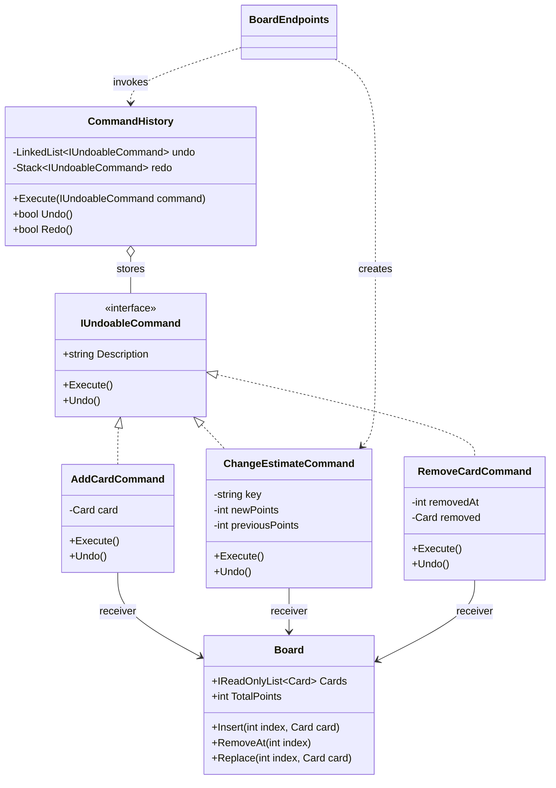
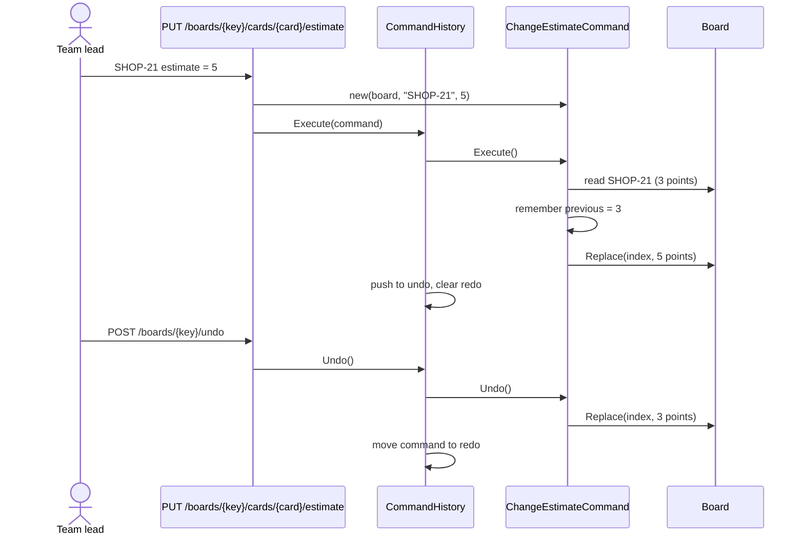
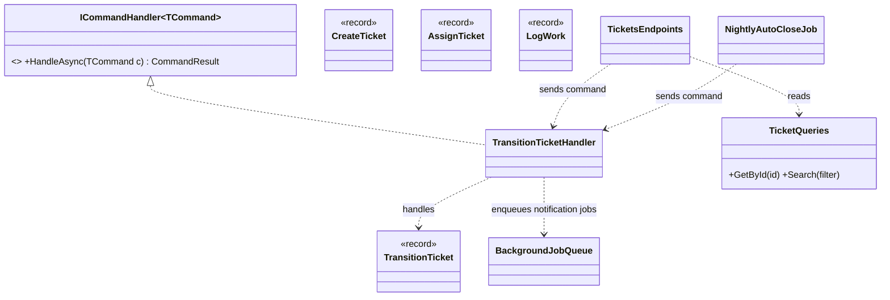

Most code performs a request the moment it is made: a button click calls a method, and the method runs. The Command pattern adds one step in between. It wraps the request in an **object**. Once a request is an object, you can put it in a list (undo history), in a queue (background job), in a log (audit), or send it to a handler somewhere else (CQRS).

## Learning objectives

By the end of this lesson you will be able to:

1. Explain the problem Command solves and name its participants: command, receiver, invoker and client.
2. Build undo/redo for a task board (Jira/Trello style) with a bounded history.
3. Combine commands into an all-or-nothing macro command.
4. Model write operations in ASP.NET Core as CQRS command records with dedicated handlers.
5. Queue commands as background jobs with retries, and explain why queued commands must be data, not closures.
6. Recognise Command in everyday .NET code (`DbCommand`, `ICommand` in WPF/MAUI, mediator request handlers, `Channel<T>` queues, Hangfire jobs).
7. Decide when Command is overkill, and tell it apart from Strategy, Memento and Mediator.

## Prerequisites

- [Interfaces and abstract classes](#/lesson/m01-interfaces-abstract): every command implements a shared interface.
- [Dependency injection](#/lesson/m03-dependency-injection): handlers are resolved from the container.
- [Background services and hosted workers](#/lesson/m03-background-services): the job queue runs in a `BackgroundService`.

## Explain it like I'm a beginner

Think of a restaurant. You tell the waiter "one masala dosa, less oil". The waiter does not run into the kitchen and cook it. He writes it on an **order slip** and puts it on the kitchen rail.

That slip is powerful because it is a *thing*, not a moment:

- The kitchen can work through the slips **in order** (a queue).
- If the restaurant is busy, slips **wait** without anyone forgetting them.
- If you change your mind, the waiter can **cancel** the slip.
- At the end of the day the manager can **count** the slips (an audit log).

The waiter does not need to know how to cook a dosa. The cook does not need to know which table asked. The slip connects them.

In software, the slip is a **command object**. It holds everything needed to do one job ("change the estimate of card SHOP-21 to 5 points"). Some other piece of code decides **when** to run it, and some other piece knows **how** to do the work.

- The order slip is the **command**.
- The cook, who actually does the work, is the **receiver**.
- The kitchen rail, which decides when slips get processed, is the **invoker**.
- The waiter, who writes the slip, is the **client**.

You already use this every day. When you drag a card on a Trello or Jira board and press Ctrl+Z, the app undoes exactly that move. It can only do that because the move was recorded as an object that knows how to reverse itself.

## First-principles explanation

### What it is

Command encapsulates a request as an object. That lets you parameterise code with requests, queue or log them, and support undoable operations. The object carries the action and the data the action needs.

### The original problem

The Gang of Four example was a GUI toolkit. A menu item or toolbar button must "do something when clicked", but the toolkit authors can't know what: open a file, paste text, print. If each button held a hard-coded call, the toolkit would depend on every application. The fix was to give each button a `Command` object with an `Execute()` method. The button (invoker) only knows the interface. Each application supplies its own commands. Because commands are objects, the same toolkit could keep a history list and offer **Undo**.

### How it works internally

There's nothing hidden. A command is an object that has:

1. **Data**: the parameters of the request (which card, which new value).
2. **A reference to the receiver**, or a way to find it (the board, the repository).
3. **`Execute()`**, and optionally **`Undo()`**, which needs the command to remember what it changed.

An invoker holds commands and calls `Execute()` at a time it chooses: immediately, later from a queue, or again on redo. In C#, a delegate (`Action`, `Func<Task>`) is the simplest possible command. It has `Execute` (invoke) but no `Undo`, no name and no serialisable data.

### Four jobs commands do in real systems

| Job | What the command object enables | .NET example |
|---|---|---|
| Undo / redo | Store executed commands; call `Undo()` in reverse order | Editors, form designers, task boards, drawing tools |
| Queueing / deferral | Run later, on another thread or machine | `Channel<T>` + `BackgroundService`, Hangfire, broker messages |
| Logging / audit / replay | Persist what was requested, by whom, when | Audit tables, command logs, a ticket's "History" tab |
| Decoupling sender from handler | The sender builds a request; a handler elsewhere executes it | CQRS commands with `ICommandHandler<TCommand, TResult>` |

### Where you already meet Command in .NET

- **ADO.NET `DbCommand`** (`NpgsqlCommand`, `SqlCommand`): SQL text plus parameters packaged as an object, executed later with `ExecuteNonQueryAsync()`. The connection is the receiver.
- **`System.Windows.Input.ICommand`** in WPF and .NET MAUI: `Execute(object?)` and `CanExecute(object?)`, bound to buttons. This is the GoF GUI example almost exactly. You won't write it in a web API, but it shows the shape.
- **Mediator-style request handlers** (MediatR's `IRequest<T>` / `IRequestHandler<T, TResult>`, Wolverine, or a hand-rolled `ICommandHandler<T, TResult>`): the CQRS form, where the command is a record and a handler does the work. MediatR moved to a commercial licence in 2025 for newer versions, which is one more reason to start with plain DI as shown below.
- **`Channel<T>` + `BackgroundService`**: an in-process queue of job objects, the pattern Microsoft documents for queued background tasks.
- **Hangfire** `BackgroundJob.Enqueue<IReportSender>(s => s.SendAsync(sprintId))`: it looks like a lambda, but Hangfire stores only the type, method name and serialised arguments in its database. It is a command turned into data, which is why captured local services do not survive into the job.
- **Messages on a broker** (RabbitMQ, Azure Service Bus) named in the imperative, such as `SendSprintReport`, are commands sent across processes.

### GoF style vs CQRS style

There are two shapes, and mixing them up causes confusion:

- **GoF style: the command does the work.** `ChangeEstimateCommand.Execute()` updates the board itself. Good for undo/redo, where each command must also know how to reverse itself.
- **CQRS style: the command is just data; a handler does the work.** `CompleteSprint` is a `record` with a sprint ID and the user who completed it. `CompleteSprintHandler` loads the sprint, applies the rules and saves. This suits web APIs, because the data part can be serialised, validated, logged and queued, while the handler gets dependencies from DI.

Both are the Command pattern: a request turned into an object, separated from the code that decides when to run it.

### When it is useful

- You need **undo/redo** or a **history** of user actions.
- Work must be **deferred, queued, retried or scheduled**.
- You need an **audit trail** of requested changes.
- Many entry points (API, CLI, message consumer, nightly job) must trigger the **same operation** with the same validation.

### When NOT to use it

- A simple CRUD endpoint with no undo, no queue and one caller. A service method is clearer.
- You are wrapping every method in a command "for consistency". Ten files for one `UPDATE` statement is ceremony, not design.
- Reads. `GetCardById` is a query; it changes nothing, so there is nothing to undo, queue or audit.
- Undo would be easier by **restoring a snapshot** (Memento) than by writing an inverse for every operation, for example when a single action changes 40 fields.
- Real-time collaborative editing (several people typing in the same document). Per-user undo stacks of simple commands break when edits interleave; such tools use operational transformation or CRDTs, which are a different design.

### Trade-offs

| You gain | You pay |
|---|---|
| Requests become data: storable, queueable, loggable | One more class per operation |
| Undo/redo with clear inverse logic | Every undoable command must capture enough state to reverse itself |
| Senders don't know the receivers | Following "what happens on submit?" means finding the handler |
| Retries and scheduling come almost free | Queued commands need idempotency and versioning of their data shape |

## Visual explanation

### Class diagram



How to read it: `BoardEndpoints` is the **client**. It creates command objects but never edits the board itself. `CommandHistory` is the **invoker**. It runs commands and keeps two collections: commands that can be undone and commands that can be redone. `Board` (a sprint board with cards such as "SHOP-21 Checkout page") is the **receiver** that knows how to change cards. Each concrete command holds the data it needs plus what it must remember for `Undo()`, such as `previousPoints` or the position a card was removed from.

### Sequence diagram



The client builds a command and hands it to the invoker. The command captures the old value **at execution time**, not at construction time, because the board might have changed in between. When the team lead presses undo, the history pops the latest command and asks it to reverse itself. The history knows nothing about story points. Adding a new kind of edit never changes `CommandHistory`.

## Step-by-step example

A product team plans a two-week sprint for an online store on a task board: cards like "SHOP-21 Checkout page" (3 points), "SHOP-22 Retry failed UPI payments" (5 points) and "SHOP-23 Order-confirmation email" (2 points). Each card has a key, a title, a column (To do, In progress, Review, Done) and an estimate in story points. During sprint planning the team lead changes estimates and moves cards quickly, and wants undo and redo like in a spreadsheet.

### Step 1 — the naive version

```csharp
public void ChangeEstimate(string key, int points) { var i = _board.IndexOf(key); _board.Cards[i] = _board.Cards[i] with { Points = points }; }
public void Undo() { /* ??? we don't know what the last action was, or the old value */ }
```

Undo is impossible because the method forgot what it did. A common hack is a `switch` over a string "last action" plus a pile of "old value" fields. That breaks after the second kind of action.

### Step 2 — one interface for all edits

```csharp
public interface IUndoableCommand
{
    string Description { get; }   // shown in the UI: "Change SHOP-21 estimate to 5"
    void Execute();
    void Undo();
}
```

### Step 3 — one class per edit, remembering what it changed

`ChangeEstimateCommand` stores the new value it was given, and in `Execute()` it saves the previous value before overwriting. `RemoveCardCommand` saves the removed card and its position, so `Undo()` puts it back in the same place.

### Step 4 — an invoker with two stacks

Executing a command pushes it onto the undo stack and **clears the redo stack**, because redoing an old branch after a new edit would apply changes to a board that no longer looks the way they expect. Undo moves a command from the undo stack to the redo stack; redo moves it back. We cap history at 100 entries so memory stays bounded.

### Step 5 — the web version: commands as data

In an API, the CQRS style fits better: `CompleteSprint(sprintId, completedBy)` is a record, a handler applies the rules, and slow follow-up work (emailing the sprint report to 12 team members and stakeholders) is queued as a background job command.

## Production-style C# implementation

```text
Kanban.Api/
  Program.cs
  Boards/
    Board.cs
    UndoableCommands.cs
    CommandHistory.cs
    BoardSessions.cs
  Sprints/
    CommandContracts.cs
    Sprint.cs
    CompleteSprintHandler.cs
  Jobs/
    BackgroundJobs.cs
```

### Part 1 — undo/redo (GoF style)

```csharp file=Boards/Board.cs
namespace Kanban.Boards;

public sealed record Card(string Key, string Title, string Column, int Points);

/// <summary>Receiver: knows how to change cards. Knows nothing about undo.</summary>
public sealed class Board(string boardKey)
{
    private readonly List<Card> _cards = [];

    public string BoardKey { get; } = boardKey;
    public IReadOnlyList<Card> Cards => _cards;
    public int Count => _cards.Count;
    public int TotalPoints => _cards.Sum(c => c.Points);

    public int IndexOf(string key) =>
        _cards.FindIndex(c => string.Equals(c.Key, key, StringComparison.OrdinalIgnoreCase));

    public void Insert(int index, Card card)
    {
        if (IndexOf(card.Key) >= 0) throw new InvalidOperationException($"Card {card.Key} already exists.");
        if (card.Points < 0) throw new ArgumentException("Story points must be non-negative.");
        _cards.Insert(index, card);
    }

    public void RemoveAt(int index) => _cards.RemoveAt(index);

    public void Replace(int index, Card card)
    {
        if (card.Points < 0) throw new ArgumentException("Story points must be non-negative.");
        _cards[index] = card;
    }

    public int RequireIndex(string key)
    {
        var i = IndexOf(key);
        return i >= 0 ? i : throw new KeyNotFoundException($"Card {key} not found.");
    }
}
```

```csharp file=Boards/UndoableCommands.cs
namespace Kanban.Boards;

public interface IUndoableCommand
{
    string Description { get; }
    void Execute();
    void Undo();
}

public sealed class AddCardCommand(Board board, Card card) : IUndoableCommand
{
    public string Description => $"Add {card.Key} ({card.Title})";
    public void Execute() => board.Insert(board.Count, card);
    public void Undo() => board.RemoveAt(board.RequireIndex(card.Key));
}

public sealed class ChangeEstimateCommand(Board board, string key, int newPoints) : IUndoableCommand
{
    private int? _previous;   // captured at Execute time, not construction time

    public string Description => $"Change {key} estimate to {newPoints}";

    public void Execute()
    {
        var i = board.RequireIndex(key);
        var current = board.Cards[i];
        _previous = current.Points;
        board.Replace(i, current with { Points = newPoints });
    }

    public void Undo()
    {
        if (_previous is not int previous) throw new InvalidOperationException("Command was never executed.");
        var i = board.RequireIndex(key);
        board.Replace(i, board.Cards[i] with { Points = previous });
    }
}

public sealed class RemoveCardCommand(Board board, string key) : IUndoableCommand
{
    private (int Index, Card Card)? _removed;

    public string Description => $"Remove {key}";

    public void Execute()
    {
        var i = board.RequireIndex(key);
        _removed = (i, board.Cards[i]);
        board.RemoveAt(i);
    }

    public void Undo()
    {
        if (_removed is not { } r) throw new InvalidOperationException("Command was never executed.");
        board.Insert(r.Index, r.Card);   // back in the same position
    }
}
```

```csharp file=Boards/CommandHistory.cs
namespace Kanban.Boards;

/// <summary>Invoker. Executes commands and keeps a bounded undo history plus a redo stack.</summary>
public sealed class CommandHistory(int capacity = 100)
{
    private readonly LinkedList<IUndoableCommand> _undo = new();   // newest at the end; oldest dropped first
    private readonly Stack<IUndoableCommand> _redo = new();

    public bool CanUndo => _undo.Count > 0;
    public bool CanRedo => _redo.Count > 0;
    public IEnumerable<string> UndoDescriptions => _undo.Reverse().Select(c => c.Description);

    public void Execute(IUndoableCommand command)
    {
        ArgumentNullException.ThrowIfNull(command);
        command.Execute();               // if this throws, history is unchanged
        _undo.AddLast(command);
        _redo.Clear();                   // a new edit invalidates the redo branch
        if (_undo.Count > capacity) _undo.RemoveFirst();
    }

    public bool Undo()
    {
        if (_undo.Last is not { } node) return false;
        node.Value.Undo();
        _undo.RemoveLast();
        _redo.Push(node.Value);
        return true;
    }

    public bool Redo()
    {
        if (!_redo.TryPeek(out var command)) return false;
        command.Execute();
        _redo.Pop();
        _undo.AddLast(command);
        if (_undo.Count > capacity) _undo.RemoveFirst();
        return true;
    }
}
```

In a web API, each open board needs its own history. This in-memory store is fine for a single server and a single editor. Two things change in production:

- **Several servers** behind a load balancer: keep the history in the database (an append-only table of executed commands) or use sticky sessions.
- **Several people on one board**: give each user their own undo stack, and make `Undo()` check that the card still holds the value *this* command set. If a teammate has since changed SHOP-21 from 5 to 8, blindly restoring 3 would silently wipe their edit; reject the undo with a "card changed since" message instead.

```csharp file=Boards/BoardSessions.cs
using System.Collections.Concurrent;

namespace Kanban.Boards;

public sealed class BoardSession(Board board)
{
    public Board Board { get; } = board;
    public CommandHistory History { get; } = new(capacity: 100);
    public object Gate { get; } = new();   // one edit at a time per board
}

public sealed class BoardSessions
{
    private readonly ConcurrentDictionary<string, BoardSession> _sessions = new(StringComparer.OrdinalIgnoreCase);
    public BoardSession GetOrOpen(string boardKey) => _sessions.GetOrAdd(boardKey, k => new BoardSession(new Board(k)));
}
```

### Part 2 — CQRS commands and handlers

```csharp file=Sprints/CommandContracts.cs
namespace Kanban.Sprints;

/// <summary>Marker for a request that changes state and returns TResult.</summary>
public interface ICommand<TResult>;

public interface ICommandHandler<in TCommand, TResult> where TCommand : ICommand<TResult>
{
    Task<TResult> HandleAsync(TCommand command, CancellationToken ct);
}

public sealed record CommandResult(bool Succeeded, string? Error = null)
{
    public static readonly CommandResult Ok = new(true);
    public static CommandResult Fail(string error) => new(false, error);
}

/// <summary>The command: plain, serialisable data. No behaviour, no dependencies.</summary>
public sealed record CompleteSprint(Guid SprintId, string CompletedBy) : ICommand<CommandResult>;
```

```csharp file=Sprints/Sprint.cs
using System.Collections.Concurrent;

namespace Kanban.Sprints;

public enum SprintStatus { Planned, Active, Completed }

public sealed class Sprint(Guid id, string name, int committedPoints, int donePoints)
{
    public Guid Id { get; } = id;
    public string Name { get; } = name;
    public int CommittedPoints { get; } = committedPoints;
    public int DonePoints { get; } = donePoints;
    public SprintStatus Status { get; private set; } = SprintStatus.Active;
    public string? CompletedBy { get; private set; }
    public DateTimeOffset? CompletedAt { get; private set; }

    public void Complete(string by, DateTimeOffset at)
    {
        if (Status != SprintStatus.Active) throw new InvalidOperationException($"Sprint is {Status}, not Active.");
        Status = SprintStatus.Completed; CompletedBy = by; CompletedAt = at;
    }
}

public interface ISprintStore
{
    Task<Sprint?> FindAsync(Guid id, CancellationToken ct);
    Task SaveAsync(Sprint sprint, CancellationToken ct);
}

public sealed class InMemorySprintStore : ISprintStore
{
    private readonly ConcurrentDictionary<Guid, Sprint> _sprints = new();
    public Task<Sprint?> FindAsync(Guid id, CancellationToken ct) => Task.FromResult(_sprints.GetValueOrDefault(id));
    public Task SaveAsync(Sprint sprint, CancellationToken ct) { _sprints[sprint.Id] = sprint; return Task.CompletedTask; }
}
```

```csharp file=Sprints/CompleteSprintHandler.cs
using Microsoft.Extensions.Logging;
using Kanban.Jobs;

namespace Kanban.Sprints;

public sealed class CompleteSprintHandler(
    ISprintStore store, BackgroundJobQueue jobs, TimeProvider clock, ILogger<CompleteSprintHandler> logger)
    : ICommandHandler<CompleteSprint, CommandResult>
{
    public async Task<CommandResult> HandleAsync(CompleteSprint command, CancellationToken ct)
    {
        if (string.IsNullOrWhiteSpace(command.CompletedBy)) return CommandResult.Fail("CompletedBy is required.");

        var sprint = await store.FindAsync(command.SprintId, ct);
        if (sprint is null) return CommandResult.Fail($"Sprint {command.SprintId} not found.");

        try { sprint.Complete(command.CompletedBy, clock.GetUtcNow()); }
        catch (InvalidOperationException ex)
        {
            return CommandResult.Fail(ex.Message);
        }

        await store.SaveAsync(sprint, ct);
        logger.LogInformation("Sprint {SprintId} completed by {User}: {Done}/{Committed} points",
            sprint.Id, command.CompletedBy, sprint.DonePoints, sprint.CommittedPoints);

        // Follow-up work as another command, run later by a worker.
        await jobs.EnqueueAsync(new SendSprintReportJob(sprint.Id), ct);
        return CommandResult.Ok;
    }
}
```

One gap a reviewer would flag: if the process crashes after `SaveAsync` but before `EnqueueAsync`, the sprint is completed and the report is never sent. With a real database, write the job into an **outbox table in the same transaction** as the sprint update, and let a relay move it to the queue (see [Transactional outbox](#/lesson/m12-outbox)).

### Part 3 — background jobs: commands in a queue

```csharp file=Jobs/BackgroundJobs.cs
using System.Threading.Channels;
using Microsoft.Extensions.DependencyInjection;
using Microsoft.Extensions.Logging;

namespace Kanban.Jobs;

/// <summary>A queued command. It must be plain data so it could be serialised to a durable queue later.</summary>
public interface IBackgroundJob
{
    string Name { get; }
    Task ExecuteAsync(IServiceProvider services, CancellationToken ct);
}

public interface ISprintReportSender
{
    Task SendAsync(Guid sprintId, CancellationToken ct);
}

public sealed class LoggingSprintReportSender(ILogger<LoggingSprintReportSender> logger) : ISprintReportSender
{
    public Task SendAsync(Guid sprintId, CancellationToken ct)
    {
        logger.LogInformation("Emailed sprint report for sprint {SprintId}", sprintId);
        return Task.CompletedTask;
    }
}

public sealed record SendSprintReportJob(Guid SprintId) : IBackgroundJob
{
    public string Name => $"sprint-report:{SprintId}";
    public Task ExecuteAsync(IServiceProvider services, CancellationToken ct) =>
        services.GetRequiredService<ISprintReportSender>().SendAsync(SprintId, ct);
}

public sealed class BackgroundJobQueue
{
    // Bounded: when 500 jobs are waiting, producers wait too (back-pressure) instead of eating memory.
    private readonly Channel<IBackgroundJob> _channel = Channel.CreateBounded<IBackgroundJob>(
        new BoundedChannelOptions(500) { FullMode = BoundedChannelFullMode.Wait, SingleReader = true });

    public ValueTask EnqueueAsync(IBackgroundJob job, CancellationToken ct) => _channel.Writer.WriteAsync(job, ct);
    public IAsyncEnumerable<IBackgroundJob> DequeueAllAsync(CancellationToken ct) => _channel.Reader.ReadAllAsync(ct);
}

/// <summary>Invoker for jobs: runs each in its own DI scope with up to 3 attempts.</summary>
public sealed class BackgroundJobWorker(BackgroundJobQueue queue, IServiceScopeFactory scopes, TimeProvider clock, ILogger<BackgroundJobWorker> logger)
    : BackgroundService
{
    private const int MaxAttempts = 3;

    protected override async Task ExecuteAsync(CancellationToken stoppingToken)
    {
        try
        {
            await foreach (var job in queue.DequeueAllAsync(stoppingToken))
                await RunWithRetryAsync(job, stoppingToken);
        }
        catch (OperationCanceledException) when (stoppingToken.IsCancellationRequested) { }
    }

    private async Task RunWithRetryAsync(IBackgroundJob job, CancellationToken ct)
    {
        for (var attempt = 1; attempt <= MaxAttempts; attempt++)
        {
            try
            {
                await using var scope = scopes.CreateAsyncScope();
                await job.ExecuteAsync(scope.ServiceProvider, ct);
                return;
            }
            catch (Exception ex) when (ex is not OperationCanceledException)
            {
                logger.LogWarning(ex, "Job {Job} failed (attempt {Attempt}/{Max})", job.Name, attempt, MaxAttempts);
                if (attempt == MaxAttempts)
                {
                    // In production, write the job to a dead-letter table so it can be inspected and replayed.
                    logger.LogError("Job {Job} gave up after {Max} attempts", job.Name, MaxAttempts);
                    return;
                }
                await Task.Delay(TimeSpan.FromSeconds(Math.Pow(2, attempt)), clock, ct);   // 2 s, 4 s
            }
        }
    }
}
```

The `Channel<T>` queue lives in process memory. Jobs still waiting when the app restarts or a deployment recycles the pod are **lost**. That is acceptable for "nice to have" work such as a sprint report you could resend by hand; it is not acceptable for "charge the customer". For those, use a durable store (an outbox table, Hangfire, or a broker queue).

```csharp file=Program.cs
using Kanban.Boards;
using Kanban.Jobs;
using Kanban.Sprints;

var builder = WebApplication.CreateBuilder(args);

builder.Services.AddSingleton(TimeProvider.System);
builder.Services.AddSingleton<BoardSessions>();

builder.Services.AddSingleton<ISprintStore, InMemorySprintStore>();
builder.Services.AddScoped<ICommandHandler<CompleteSprint, CommandResult>, CompleteSprintHandler>();

builder.Services.AddSingleton<BackgroundJobQueue>();
builder.Services.AddSingleton<ISprintReportSender, LoggingSprintReportSender>();
builder.Services.AddHostedService<BackgroundJobWorker>();

var app = builder.Build();

// --- Undo/redo endpoints: the endpoint is the client, CommandHistory is the invoker ---
IResult Run(BoardSessions sessions, string boardKey, Func<Board, IUndoableCommand> make)
{
    var s = sessions.GetOrOpen(boardKey);
    lock (s.Gate)
    {
        try { s.History.Execute(make(s.Board)); }
        catch (Exception ex) when (ex is KeyNotFoundException or InvalidOperationException or ArgumentException)
        { return Results.Problem(ex.Message, statusCode: 400); }
        return Results.Ok(new { s.Board.TotalPoints, cards = s.Board.Cards });
    }
}

app.MapPost("/boards/{boardKey}/cards", (string boardKey, Card card, BoardSessions sessions) =>
    Run(sessions, boardKey, b => new AddCardCommand(b, card)));

app.MapPut("/boards/{boardKey}/cards/{cardKey}/estimate", (string boardKey, string cardKey, int points, BoardSessions sessions) =>
    Run(sessions, boardKey, b => new ChangeEstimateCommand(b, cardKey, points)));

app.MapDelete("/boards/{boardKey}/cards/{cardKey}", (string boardKey, string cardKey, BoardSessions sessions) =>
    Run(sessions, boardKey, b => new RemoveCardCommand(b, cardKey)));

app.MapPost("/boards/{boardKey}/undo", (string boardKey, BoardSessions sessions) =>
{
    var s = sessions.GetOrOpen(boardKey);
    lock (s.Gate) return s.History.Undo() ? Results.Ok(new { s.Board.TotalPoints }) : Results.Conflict("Nothing to undo.");
});

app.MapPost("/boards/{boardKey}/redo", (string boardKey, BoardSessions sessions) =>
{
    var s = sessions.GetOrOpen(boardKey);
    lock (s.Gate) return s.History.Redo() ? Results.Ok(new { s.Board.TotalPoints }) : Results.Conflict("Nothing to redo.");
});

// --- CQRS command endpoint: build the command, hand it to its handler ---
app.MapPost("/sprints/{sprintId:guid}/complete", async (Guid sprintId, CompleteSprintRequest body,
    ICommandHandler<CompleteSprint, CommandResult> handler, CancellationToken ct) =>
{
    var result = await handler.HandleAsync(new CompleteSprint(sprintId, body.CompletedBy), ct);
    return result.Succeeded ? Results.NoContent() : Results.Problem(result.Error, statusCode: 422);
});

app.Run();

public sealed record CompleteSprintRequest(string CompletedBy);
```

In a real API, `CompletedBy` would come from the authenticated user (`HttpContext.User`) in the endpoint, not from the request body; the point is that the endpoint copies it **into the command as data**, so the handler never touches `HttpContext` and a background job can send the same command with `"system:auto-close"`.

**Why is the job a record holding only `SprintId`?** Because a queued command may be serialised (to a database, Redis or a broker) and executed minutes later, maybe on another machine. If it captured a `DbContext`, an `HttpContext` or a lambda, none of that would survive serialisation, and some would already be disposed. The job carries **data**; it gets its dependencies from the worker's fresh DI scope when it runs.

:::callout type=warning title="Closures are not durable commands"
`queue.Enqueue(() => _db.Sprints.Find(id))` looks like a command, but it captures the request's scoped `_db`. By the time the worker runs it, the request has ended and the `DbContext` is disposed. In-memory closures also vanish on restart. Queue a record with IDs, and resolve services inside the job.
:::

## Bad design vs good design

**Bad**: a `TicketsController.Transition` action with 200 lines that validates, loads the ticket, checks the workflow rules, saves, emails the watchers and posts to the team's chat channel, all inline. The same logic is copy-pasted into a nightly console job that auto-closes tickets resolved more than 14 days ago, and the copies have drifted: the nightly job forgot the "a resolution is required before Done" rule, so hundreds of tickets end up closed with no resolution.

**Good**: a `TransitionTicket` command handled by one handler. The API, the nightly job and a message consumer all build the same record and call the same handler. Notifications are queued jobs with retries. The rule exists once.

**Also bad (over-engineering)**: a generic `ICommandBus` with reflection-based dispatch, a pipeline of six behaviours and a command for `GetUserNameById`. Reads are queries, not commands. If direct handler injection (as above) works, you don't need a bus.

**For undo, is Command always right?** No. If one user action changes many fields at once (for example, "apply the sprint template" touching 300 cards), writing a precise inverse is error-prone. Taking a snapshot before the action and restoring it (Memento) is simpler. Many editors combine both: commands for small edits, snapshots for big ones.

**And for business actions others have seen, undo is the wrong word.** Once the sprint report email has gone to 12 people, "undo complete sprint" cannot unsend it. Such actions are reversed by a **new** command (`ReopenSprint`) that is itself recorded, never by deleting history.

## Practical playground

Run the playground, then try these:

1. Undo twice, then add a new card, then call `Redo()`. Why does it print `False`?
2. Implement `Undo` for `MoveCardCommand` (it currently throws), then move SHOP-22 to "Done" and undo it.
3. Make `ChangeEstimateCommand` capture the previous value in the constructor instead of in `Execute`. Change the estimate twice, undo twice, and watch the result go wrong.

:::playground type=csharp title="Task board undo/redo"
```csharp file=Program.cs
using System;
using System.Collections.Generic;
using System.Linq;

public sealed record Card(string Key, string Column, int Points);

public interface IUndoableCommand { string Description { get; } void Execute(); void Undo(); }

public sealed class Board
{
    public List<Card> Cards { get; } = new();
    public int IndexOf(string key) => Cards.FindIndex(c => c.Key == key);
    public int TotalPoints => Cards.Sum(c => c.Points);
}

public sealed class AddCard(Board board, Card card) : IUndoableCommand
{
    public string Description => "Add " + card.Key;
    public void Execute() => board.Cards.Add(card);
    public void Undo() => board.Cards.RemoveAt(board.IndexOf(card.Key));
}

public sealed class ChangeEstimateCommand(Board board, string key, int points) : IUndoableCommand
{
    private int _previous;
    public string Description => $"{key} estimate -> {points}";
    public void Execute() { var i = board.IndexOf(key); _previous = board.Cards[i].Points; board.Cards[i] = board.Cards[i] with { Points = points }; }
    public void Undo() { var i = board.IndexOf(key); board.Cards[i] = board.Cards[i] with { Points = _previous }; }
}

public sealed class MoveCardCommand(Board board, string key, string toColumn) : IUndoableCommand
{
    private string _previous = "";
    public string Description => $"Move {key} to {toColumn}";
    public void Execute() { var i = board.IndexOf(key); _previous = board.Cards[i].Column; board.Cards[i] = board.Cards[i] with { Column = toColumn }; }
    public void Undo() => throw new NotImplementedException("TODO: restore _previous");
}

public sealed class History
{
    private readonly Stack<IUndoableCommand> _undo = new(), _redo = new();
    public void Execute(IUndoableCommand c) { c.Execute(); _undo.Push(c); _redo.Clear(); }
    public bool Undo() { if (_undo.Count == 0) return false; var c = _undo.Pop(); c.Undo(); _redo.Push(c); return true; }
    public bool Redo() { if (_redo.Count == 0) return false; var c = _redo.Pop(); c.Execute(); _undo.Push(c); return true; }
}

public static class Program
{
    public static void Main()
    {
        var board = new Board();
        var h = new History();
        h.Execute(new AddCard(board, new Card("SHOP-21 Checkout page", "To do", 3)));
        h.Execute(new AddCard(board, new Card("SHOP-22 Retry failed UPI payments", "To do", 5)));
        h.Execute(new ChangeEstimateCommand(board, "SHOP-21 Checkout page", 8));
        Console.WriteLine($"Sprint points after edits: {board.TotalPoints}");   // 13
        h.Undo();
        Console.WriteLine($"After undo:                {board.TotalPoints}");   // 8
        h.Redo();
        Console.WriteLine($"After redo:                {board.TotalPoints}");   // 13
        h.Undo(); h.Undo();
        h.Execute(new AddCard(board, new Card("SHOP-23 Order-confirmation email", "To do", 2)));
        Console.WriteLine($"Redo possible after a new edit? {h.Redo()}");
    }
}
```
:::

## Exercises

:::exercise id=m06-command-ex1 difficulty=beginner kind=code title="An undoable card move"
Implement `MoveCardCommand` for a task board. It moves a card to a new column and can move it back.
::requirements
- Capture the previous column in `Execute()`, not in the constructor.
- `Undo()` before `Execute()` throws `InvalidOperationException`.
- An unknown card key throws `KeyNotFoundException` from `Execute()` and leaves the board unchanged.
- Moving must not change any other field of the card (its estimate stays the same).
::acceptance
- Card "SHOP-21" in "To do" moved to "In progress" shows "In progress"; after `Undo()` it shows "To do".
- Two commands on the same card ("In progress", then "Review"), undone in reverse order, restore "To do".
- `Description` reads `Move SHOP-21 to In progress`.
::hint
What does `Undo()` need to know that the constructor arguments don't tell it?
::hint
Store the old column in a nullable field (`string?`) so you can detect "never executed".
::hint
Records support `with`: `card with { Column = toColumn }` creates a copy with one property changed and keeps the rest.
::hint
```csharp
var i = board.RequireIndex(key);
_previous = board.Cards[i].Column;
board.Replace(i, board.Cards[i] with { Column = toColumn });
```
::starter
```csharp file=MoveCardCommand.cs
using System;
using System.Collections.Generic;

public sealed record Card(string Key, string Column, int Points);

public sealed class Board
{
    public List<Card> Cards { get; } = new();
    public int RequireIndex(string key)
    {
        var i = Cards.FindIndex(c => c.Key == key);
        return i >= 0 ? i : throw new KeyNotFoundException(key);
    }
    public void Replace(int index, Card card) => Cards[index] = card;
}

public interface IUndoableCommand { string Description { get; } void Execute(); void Undo(); }

public sealed class MoveCardCommand(Board board, string key, string toColumn) : IUndoableCommand
{
    public string Description => throw new NotImplementedException();
    public void Execute() => throw new NotImplementedException();
    public void Undo() => throw new NotImplementedException();
}
```
::tests
```csharp file=MoveCardCommandTests.cs
using System;
using System.Collections.Generic;
using Xunit;

public class MoveCardCommandTests
{
    private static Board NewBoard()
    {
        var b = new Board();
        b.Cards.Add(new Card("SHOP-21", "To do", 3));
        return b;
    }

    [Fact]
    public void Execute_then_undo_restores_column()
    {
        var b = NewBoard();
        var c = new MoveCardCommand(b, "SHOP-21", "In progress");
        c.Execute();
        Assert.Equal("In progress", b.Cards[0].Column);
        c.Undo();
        Assert.Equal("To do", b.Cards[0].Column);
    }

    [Fact]
    public void Two_commands_undone_in_reverse_restore_original()
    {
        var b = NewBoard();
        var a = new MoveCardCommand(b, "SHOP-21", "In progress");
        var r = new MoveCardCommand(b, "SHOP-21", "Review");
        a.Execute(); r.Execute();
        r.Undo(); a.Undo();
        Assert.Equal("To do", b.Cards[0].Column);
    }

    [Fact]
    public void Move_keeps_the_estimate()
    {
        var b = NewBoard();
        new MoveCardCommand(b, "SHOP-21", "Done").Execute();
        Assert.Equal(3, b.Cards[0].Points);
    }

    [Fact]
    public void Undo_before_execute_throws() =>
        Assert.Throws<InvalidOperationException>(() => new MoveCardCommand(NewBoard(), "SHOP-21", "Done").Undo());

    [Fact]
    public void Unknown_key_throws_and_changes_nothing()
    {
        var b = NewBoard();
        Assert.Throws<KeyNotFoundException>(() => new MoveCardCommand(b, "SHOP-99", "Done").Execute());
        Assert.Equal("To do", b.Cards[0].Column);
    }

    [Fact]
    public void Description_is_readable() =>
        Assert.Equal("Move SHOP-21 to In progress", new MoveCardCommand(NewBoard(), "SHOP-21", "In progress").Description);
}
```
::solution
```csharp file=MoveCardCommand.cs
using System;
using System.Collections.Generic;

public sealed record Card(string Key, string Column, int Points);

public sealed class Board
{
    public List<Card> Cards { get; } = new();
    public int RequireIndex(string key)
    {
        var i = Cards.FindIndex(c => c.Key == key);
        return i >= 0 ? i : throw new KeyNotFoundException(key);
    }
    public void Replace(int index, Card card) => Cards[index] = card;
}

public interface IUndoableCommand { string Description { get; } void Execute(); void Undo(); }

public sealed class MoveCardCommand(Board board, string key, string toColumn) : IUndoableCommand
{
    private string? _previous;

    public string Description => $"Move {key} to {toColumn}";

    public void Execute()
    {
        var i = board.RequireIndex(key);          // throws before anything changes
        _previous = board.Cards[i].Column;
        board.Replace(i, board.Cards[i] with { Column = toColumn });
    }

    public void Undo()
    {
        if (_previous is not { } previous) throw new InvalidOperationException("Not executed yet.");
        var i = board.RequireIndex(key);
        board.Replace(i, board.Cards[i] with { Column = previous });
    }
}
```
Capturing at `Execute()` time is what makes the second test pass: command `r` remembers "In progress" (the column when *it* ran), not "To do".
::mistakes
- Capturing the previous column in the constructor. If another command runs between construction and execution, undo restores a stale value.
- Undo replacing the whole card with a stored copy, which also reverts unrelated changes (for example, an estimate edit made after the move).
::extensions
Add `MoveCardCommand.TryMerge(IUndoableCommand next)` so that dragging a card through three columns in a few seconds collapses into one undo step.
:::

:::exercise id=m06-command-ex2 difficulty=beginner kind=code title="Undo/redo history with a cap"
Implement `CommandHistory`: the invoker that runs commands and supports undo and redo, keeping at most `capacity` undo steps.
::requirements
- `Execute` runs the command, records it, and clears the redo stack. If the command throws, nothing is recorded.
- `Undo`/`Redo` return `false` when there is nothing to do.
- When the history exceeds `capacity`, the oldest entry is discarded.
::acceptance
- Execute A, B; Undo → B undone; Redo → B re-executed.
- Execute A, B; Undo; Execute C; Redo returns false.
- With capacity 2, executing A, B, C then undoing three times returns true, true, false.
- A command that throws in `Execute` is not undoable.
::hint
You need two collections. Which ends do you add and remove from?
::hint
The redo side is a plain `Stack<T>`. The undo side must drop its oldest item, so a `LinkedList<T>` (add/remove at both ends) works well.
::hint
Call `command.Execute()` first, and only record it if that line didn't throw.
::hint
```csharp
command.Execute();
_undo.AddLast(command);
_redo.Clear();
if (_undo.Count > _capacity) _undo.RemoveFirst();
```
::starter
```csharp file=CommandHistory.cs
using System;
using System.Collections.Generic;

public interface IUndoableCommand { void Execute(); void Undo(); }

public sealed class CommandHistory
{
    private readonly int _capacity;
    private readonly LinkedList<IUndoableCommand> _undo = new();
    private readonly Stack<IUndoableCommand> _redo = new();

    public CommandHistory(int capacity)
    {
        if (capacity < 1) throw new ArgumentOutOfRangeException(nameof(capacity));
        _capacity = capacity;
    }

    public int UndoCount => _undo.Count;

    public void Execute(IUndoableCommand command) => throw new NotImplementedException();
    public bool Undo() => throw new NotImplementedException();
    public bool Redo() => throw new NotImplementedException();
}
```
::tests
```csharp file=CommandHistoryTests.cs
using System;
using System.Collections.Generic;
using Xunit;

public class CommandHistoryTests
{
    private sealed class Rec(string name, List<string> log, bool fail = false) : IUndoableCommand
    {
        public void Execute() { if (fail) throw new InvalidOperationException(); log.Add("do " + name); }
        public void Undo() => log.Add("undo " + name);
    }

    [Fact]
    public void Undo_then_redo()
    {
        var log = new List<string>();
        var h = new CommandHistory(10);
        h.Execute(new Rec("A", log)); h.Execute(new Rec("B", log));
        Assert.True(h.Undo());
        Assert.True(h.Redo());
        Assert.Equal(new List<string> { "do A", "do B", "undo B", "do B" }, log);
    }

    [Fact]
    public void New_command_clears_redo()
    {
        var log = new List<string>();
        var h = new CommandHistory(10);
        h.Execute(new Rec("A", log)); h.Execute(new Rec("B", log));
        h.Undo();
        h.Execute(new Rec("C", log));
        Assert.False(h.Redo());
    }

    [Fact]
    public void Capacity_drops_oldest()
    {
        var log = new List<string>();
        var h = new CommandHistory(2);
        h.Execute(new Rec("A", log)); h.Execute(new Rec("B", log)); h.Execute(new Rec("C", log));
        Assert.True(h.Undo()); Assert.True(h.Undo()); Assert.False(h.Undo());
        Assert.Equal("undo B", log[^1]);
    }

    [Fact]
    public void Failed_command_is_not_recorded()
    {
        var log = new List<string>();
        var h = new CommandHistory(5);
        Assert.Throws<InvalidOperationException>(() => h.Execute(new Rec("X", log, fail: true)));
        Assert.Equal(0, h.UndoCount);
        Assert.False(h.Undo());
    }

    [Fact]
    public void Empty_history_returns_false()
    {
        var h = new CommandHistory(3);
        Assert.False(h.Undo());
        Assert.False(h.Redo());
    }
}
```
::solution
```csharp file=CommandHistory.cs
using System;
using System.Collections.Generic;

public interface IUndoableCommand { void Execute(); void Undo(); }

public sealed class CommandHistory
{
    private readonly int _capacity;
    private readonly LinkedList<IUndoableCommand> _undo = new();
    private readonly Stack<IUndoableCommand> _redo = new();

    public CommandHistory(int capacity)
    {
        if (capacity < 1) throw new ArgumentOutOfRangeException(nameof(capacity));
        _capacity = capacity;
    }

    public int UndoCount => _undo.Count;

    public void Execute(IUndoableCommand command)
    {
        ArgumentNullException.ThrowIfNull(command);
        command.Execute();
        _undo.AddLast(command);
        _redo.Clear();
        if (_undo.Count > _capacity) _undo.RemoveFirst();
    }

    public bool Undo()
    {
        if (_undo.Last is not { } node) return false;
        node.Value.Undo();
        _undo.RemoveLast();
        _redo.Push(node.Value);
        return true;
    }

    public bool Redo()
    {
        if (!_redo.TryPeek(out var command)) return false;
        command.Execute();
        _redo.Pop();
        _undo.AddLast(command);
        if (_undo.Count > _capacity) _undo.RemoveFirst();
        return true;
    }
}
```
`Undo` calls `node.Value.Undo()` *before* moving the node. If undo throws, the history still reflects reality: the command is still applied and still at the top of the undo stack.
::mistakes
- Forgetting to clear redo on a new command, which lets users "redo" onto a board that has moved on.
- Using `Stack<T>` for the undo side and rebuilding it to drop the oldest item, which is O(n) on every execute.
- Re-adding redone commands without respecting the capacity limit (a small leak over a long session).
:::

:::exercise id=m06-command-ex3 difficulty=intermediate kind=code title="All-or-nothing macro command"
At the end of a sprint, "carry over unfinished work" moves every unfinished card to the next sprint at once. Implement `MacroCommand`, a command made of other commands (a Composite of commands), so the whole carry-over is one undo step.
::requirements
- `Execute()` runs children in order. If child *k* throws, undo children *k−1 … 1* in reverse order, then rethrow the original exception.
- `Undo()` undoes all children in reverse order.
- `Description` is `"Macro: "` followed by child descriptions joined with `"; "`.
::acceptance
- Children [A, B, C] execute as A, B, C and undo as C, B, A.
- If B throws during execute, the log reads `do A`, `undo A`, and the exception from B reaches the caller.
- An empty macro is valid and does nothing.
::hint
Keep track of which children actually ran.
::hint
A local `List<IUndoableCommand>` or a counter of executed children is enough.
::hint
In the `catch`, loop backwards over the executed children calling `Undo()`, then use `throw;` to keep the original stack trace.
::hint
```csharp
var done = new List<IUndoableCommand>();
try { foreach (var c in _children) { c.Execute(); done.Add(c); } }
catch { for (var i = done.Count - 1; i >= 0; i--) done[i].Undo(); throw; }
```
::starter
```csharp file=MacroCommand.cs
using System;
using System.Collections.Generic;
using System.Linq;

public interface IUndoableCommand { string Description { get; } void Execute(); void Undo(); }

public sealed class MacroCommand(IEnumerable<IUndoableCommand> children) : IUndoableCommand
{
    private readonly IReadOnlyList<IUndoableCommand> _children = children.ToList();

    public string Description => throw new NotImplementedException();
    public void Execute() => throw new NotImplementedException();
    public void Undo() => throw new NotImplementedException();
}
```
::tests
```csharp file=MacroCommandTests.cs
using System;
using System.Collections.Generic;
using Xunit;

public class MacroCommandTests
{
    private sealed class Rec(string name, List<string> log, bool fail = false) : IUndoableCommand
    {
        public string Description => name;
        public void Execute() { if (fail) throw new InvalidOperationException(name + " failed"); log.Add("do " + name); }
        public void Undo() => log.Add("undo " + name);
    }

    [Fact]
    public void Executes_in_order_and_undoes_in_reverse()
    {
        var log = new List<string>();
        var m = new MacroCommand(new IUndoableCommand[] { new Rec("A", log), new Rec("B", log), new Rec("C", log) });
        m.Execute();
        m.Undo();
        Assert.Equal(new List<string> { "do A", "do B", "do C", "undo C", "undo B", "undo A" }, log);
    }

    [Fact]
    public void Failure_rolls_back_executed_children_and_rethrows()
    {
        var log = new List<string>();
        var m = new MacroCommand(new IUndoableCommand[] { new Rec("A", log), new Rec("B", log, fail: true), new Rec("C", log) });
        var ex = Assert.Throws<InvalidOperationException>(() => m.Execute());
        Assert.Equal("B failed", ex.Message);
        Assert.Equal(new List<string> { "do A", "undo A" }, log);
    }

    [Fact]
    public void Description_lists_children()
    {
        var log = new List<string>();
        var m = new MacroCommand(new IUndoableCommand[] { new Rec("move SHOP-21", log), new Rec("move SHOP-22", log) });
        Assert.Equal("Macro: move SHOP-21; move SHOP-22", m.Description);
    }

    [Fact]
    public void Empty_macro_is_fine()
    {
        var m = new MacroCommand(Array.Empty<IUndoableCommand>());
        m.Execute();
        m.Undo();
        Assert.Equal("Macro: ", m.Description);
    }
}
```
::solution
```csharp file=MacroCommand.cs
using System;
using System.Collections.Generic;
using System.Linq;

public interface IUndoableCommand { string Description { get; } void Execute(); void Undo(); }

public sealed class MacroCommand(IEnumerable<IUndoableCommand> children) : IUndoableCommand
{
    private readonly IReadOnlyList<IUndoableCommand> _children = children.ToList();

    public string Description => "Macro: " + string.Join("; ", _children.Select(c => c.Description));

    public void Execute()
    {
        var executed = 0;
        try
        {
            foreach (var child in _children)
            {
                child.Execute();
                executed++;
            }
        }
        catch
        {
            for (var i = executed - 1; i >= 0; i--) _children[i].Undo();
            throw;
        }
    }

    public void Undo()
    {
        for (var i = _children.Count - 1; i >= 0; i--) _children[i].Undo();
    }
}
```
This is Command combined with [Composite](#/lesson/m06-composite): a macro *is* a command, so `CommandHistory` treats it as one entry. The rollback is "compensation" in miniature, the same idea [sagas](#/lesson/m12-sagas) use across services.
::mistakes
- Using `throw ex;`, which resets the stack trace.
- Undoing *all* children on failure, including those that never ran.
- Ignoring the case where a compensating `Undo()` itself throws. In production, log it and surface a "board may be inconsistent, please reload" error rather than hiding it.
:::

:::exercise id=m06-command-ex4 difficulty=intermediate kind=design title="Refactor fat controller actions into CQRS commands"
An issue-tracker API (Jira-style) has a `TicketsController` with these actions, each 80–200 lines long: `Create`, `Assign`, `Transition` (move between statuses), `LogWork`, `GetById`, `Search`. A nightly console job also closes tickets that have been "Resolved" for more than 14 days by copying the `Transition` logic. Redesign it with commands and handlers.
::acceptance
- Each state-changing action becomes a command record plus one handler. Reads are not commands.
- The API and the nightly job share the same `TransitionTicket` handler.
- Slow side effects (email to watchers, chat-channel notification) are queued jobs with retry.
- You state where validation lives (shape checks vs business rules).
- You explain one case where you would NOT introduce a command bus.
::hint
Start by sorting the six actions into "changes state" and "only reads".
::hint
The nightly job is just another client. What does it need to build to reuse the workflow rules?
::hint
Shape validation (required fields, non-empty ticket key, hours logged > 0) can sit on the command or in an endpoint filter. Business rules (Resolved → Closed is allowed, Open → Closed is not; a resolution is required before Closed) belong in the entity or handler.
::hint
Sketch: `CreateTicket`, `AssignTicket`, `TransitionTicket`, `LogWork` → `ICommandHandler<TCommand, CommandResult>`; `GetTicketById`, `SearchTickets` → a query service; `NotifyWatchersJob` and `PostToChannelJob` → `BackgroundJobQueue`.
::solution


- **Commands**: `CreateTicket`, `AssignTicket`, `TransitionTicket`, `LogWork`, each with one handler. `GetById` and `Search` go to a `TicketQueries` class that can use a lightweight read model or raw SQL (for example a PostgreSQL full-text index), because reads don't need the entity's rules.
- **Shared rules**: the nightly job builds `TransitionTicket(ticketId, "Closed", "system:auto-close")` for each ticket resolved more than 14 days ago and calls the same handler, so the 14-day filter is the only thing the job adds. The workflow and "resolution required" rules run exactly as they do for a person.
- **Validation**: shape checks at the edge (endpoint filter or a small validator per command); business rules in `Ticket.TransitionTo` (the allowed-transitions table lives there).
- **Side effects**: `NotifyWatchersJob` and `PostToChannelJob` are records on the job queue; for durability, store them in an outbox table in the same transaction as the status change. If the nightly job closes 3,000 tickets, batch the notifications into a digest rather than sending 3,000 emails.
- **No bus when**: there are four commands and each has exactly one handler. Injecting `ICommandHandler<TransitionTicket, CommandResult>` directly is explicit, type-safe and easy to navigate. Consider a mediator only when you need cross-cutting behaviours (logging, transactions, authorisation) on dozens of commands.
::mistakes
- Turning `GetById` into a command "for symmetry".
- Letting the nightly job update the `tickets` table directly, which bypasses the workflow rules again.
- Putting `HttpContext.User` inside the command handler. Pass `PerformedBy` as data so the job and the API both work.
:::

:::exercise id=m06-command-ex5 difficulty=advanced kind=code title="Idempotent job runner with retries and dead letters"
Queued commands get delivered twice (a worker crashes after running a job but before acknowledging it), and some fail transiently. Teams have complained about receiving the same sprint report email twice. Implement `JobRunner.RunAsync` so that each job runs at most once successfully, retries transient failures, and parks permanent failures.
::requirements
- Each job has an `IdempotencyKey`. If a job with the same key already **succeeded**, skip it and return `JobOutcome.Duplicate`.
- Try a job up to `maxAttempts` times. Between attempts, call the injected `Func<int, Task> delay` with the attempt number (tests pass a no-op).
- After the last failed attempt, add the job to `DeadLetters` and return `JobOutcome.DeadLettered`.
- A job that throws `PermanentJobException` is dead-lettered immediately, without retries.
- Return `JobOutcome.Succeeded` on success and record the key.
::acceptance
- A job that fails twice then succeeds (maxAttempts 3) returns `Succeeded` after 3 attempts and 2 delays.
- The same key submitted again returns `Duplicate` and does not run the job.
- A job that always fails returns `DeadLettered` after exactly 3 attempts.
- A `PermanentJobException` gives 1 attempt and `DeadLettered`.
- A key whose job was dead-lettered may be retried later (it did not succeed).
::hint
You need two pieces of memory: keys that succeeded, and jobs that were parked.
::hint
A `HashSet<string>` for succeeded keys and a `List<IJob>` for dead letters are enough in-memory. In production these would be database tables.
::hint
Structure: check duplicate → `for` attempt 1..max → try run, record, return → catch permanent → dead-letter → catch other → if last attempt dead-letter, else delay.
::hint
Record the key **after** the job succeeds, not before, or a crash mid-job would make the retry look like a duplicate.
::hint
```csharp
catch (PermanentJobException) { _deadLetters.Add(job); return JobOutcome.DeadLettered; }
catch (Exception) when (attempt < _maxAttempts) { await _delay(attempt); }
catch (Exception) { _deadLetters.Add(job); return JobOutcome.DeadLettered; }
```
::starter
```csharp file=JobRunner.cs
using System;
using System.Collections.Generic;
using System.Threading;
using System.Threading.Tasks;

public interface IJob
{
    string IdempotencyKey { get; }
    Task ExecuteAsync(CancellationToken ct);
}

public sealed class PermanentJobException(string message) : Exception(message);

public enum JobOutcome { Succeeded, Duplicate, DeadLettered }

public sealed class JobRunner
{
    private readonly int _maxAttempts;
    private readonly Func<int, Task> _delay;
    private readonly HashSet<string> _succeeded = new();
    private readonly List<IJob> _deadLetters = new();

    public JobRunner(int maxAttempts, Func<int, Task> delay)
    {
        if (maxAttempts < 1) throw new ArgumentOutOfRangeException(nameof(maxAttempts));
        _maxAttempts = maxAttempts;
        _delay = delay;
    }

    public IReadOnlyList<IJob> DeadLetters => _deadLetters;

    public Task<JobOutcome> RunAsync(IJob job, CancellationToken ct) => throw new NotImplementedException();
}
```
::tests
```csharp file=JobRunnerTests.cs
using System;
using System.Threading;
using System.Threading.Tasks;
using Xunit;

public class JobRunnerTests
{
    private sealed class FlakyJob(string key, int failuresBeforeSuccess, bool permanent = false) : IJob
    {
        public int Attempts { get; private set; }
        public string IdempotencyKey => key;
        public Task ExecuteAsync(CancellationToken ct)
        {
            Attempts++;
            if (permanent) throw new PermanentJobException("email template 'sprint-report' not found");
            if (Attempts <= failuresBeforeSuccess) throw new TimeoutException("SMTP timeout");
            return Task.CompletedTask;
        }
    }

    [Fact]
    public async Task Retries_until_success()
    {
        var delays = 0;
        var runner = new JobRunner(3, _ => { delays++; return Task.CompletedTask; });
        var job = new FlakyJob("sprint-report:42", failuresBeforeSuccess: 2);
        Assert.Equal(JobOutcome.Succeeded, await runner.RunAsync(job, CancellationToken.None));
        Assert.Equal(3, job.Attempts);
        Assert.Equal(2, delays);
    }

    [Fact]
    public async Task Duplicate_key_is_skipped()
    {
        var runner = new JobRunner(3, _ => Task.CompletedTask);
        await runner.RunAsync(new FlakyJob("sprint-report:7", 0), CancellationToken.None);
        var again = new FlakyJob("sprint-report:7", 0);
        Assert.Equal(JobOutcome.Duplicate, await runner.RunAsync(again, CancellationToken.None));
        Assert.Equal(0, again.Attempts);
    }

    [Fact]
    public async Task Always_failing_job_is_dead_lettered_after_max_attempts()
    {
        var runner = new JobRunner(3, _ => Task.CompletedTask);
        var job = new FlakyJob("sprint-report:9", failuresBeforeSuccess: 99);
        Assert.Equal(JobOutcome.DeadLettered, await runner.RunAsync(job, CancellationToken.None));
        Assert.Equal(3, job.Attempts);
        Assert.Single(runner.DeadLetters);
    }

    [Fact]
    public async Task Permanent_failure_is_not_retried()
    {
        var runner = new JobRunner(5, _ => Task.CompletedTask);
        var job = new FlakyJob("sprint-report:10", 0, permanent: true);
        Assert.Equal(JobOutcome.DeadLettered, await runner.RunAsync(job, CancellationToken.None));
        Assert.Equal(1, job.Attempts);
    }

    [Fact]
    public async Task Dead_lettered_key_can_be_retried_later()
    {
        var runner = new JobRunner(1, _ => Task.CompletedTask);
        await runner.RunAsync(new FlakyJob("sprint-report:11", 5), CancellationToken.None);
        var fixedJob = new FlakyJob("sprint-report:11", 0);
        Assert.Equal(JobOutcome.Succeeded, await runner.RunAsync(fixedJob, CancellationToken.None));
    }
}
```
::solution
```csharp file=JobRunner.cs
using System;
using System.Collections.Generic;
using System.Threading;
using System.Threading.Tasks;

public interface IJob
{
    string IdempotencyKey { get; }
    Task ExecuteAsync(CancellationToken ct);
}

public sealed class PermanentJobException(string message) : Exception(message);

public enum JobOutcome { Succeeded, Duplicate, DeadLettered }

public sealed class JobRunner
{
    private readonly int _maxAttempts;
    private readonly Func<int, Task> _delay;
    private readonly HashSet<string> _succeeded = new();
    private readonly List<IJob> _deadLetters = new();

    public JobRunner(int maxAttempts, Func<int, Task> delay)
    {
        if (maxAttempts < 1) throw new ArgumentOutOfRangeException(nameof(maxAttempts));
        _maxAttempts = maxAttempts;
        _delay = delay;
    }

    public IReadOnlyList<IJob> DeadLetters => _deadLetters;

    public async Task<JobOutcome> RunAsync(IJob job, CancellationToken ct)
    {
        ArgumentNullException.ThrowIfNull(job);
        if (_succeeded.Contains(job.IdempotencyKey)) return JobOutcome.Duplicate;

        for (var attempt = 1; ; attempt++)
        {
            ct.ThrowIfCancellationRequested();
            try
            {
                await job.ExecuteAsync(ct);
                _succeeded.Add(job.IdempotencyKey);     // only after success
                return JobOutcome.Succeeded;
            }
            catch (PermanentJobException)
            {
                _deadLetters.Add(job);
                return JobOutcome.DeadLettered;
            }
            catch (Exception ex) when (ex is not OperationCanceledException && attempt < _maxAttempts)
            {
                await _delay(attempt);
            }
            catch (Exception ex) when (ex is not OperationCanceledException)
            {
                _deadLetters.Add(job);
                return JobOutcome.DeadLettered;
            }
        }
    }
}
```
**In production** the succeeded-keys set is a table with a unique index on the key (in PostgreSQL, `INSERT ... ON CONFLICT (key) DO NOTHING` tells you whether you were first), written in the **same transaction** as the job's own database change. Otherwise a crash between "job done" and "key recorded" still runs the job twice. External side effects (an email, an SMS) can't join that transaction, so pass the idempotency key to the provider if it supports one, and accept that "exactly once" is really "at least once plus deduplication".
::alternatives
Hangfire and Quartz.NET provide durable job storage, retries and dashboards. Broker-based queues (RabbitMQ, Azure Service Bus) provide redelivery and dead-letter queues natively. The idempotency check remains your job either way.
::mistakes
- Recording the idempotency key before running the job.
- Retrying validation errors or "sprint not found" forever. Classify failures as transient or permanent.
- Using `Thread.Sleep` for backoff inside an async worker, which blocks a thread-pool thread.
- Retrying with a fixed delay and no jitter, so 500 failed jobs all retry in the same second when the mail server comes back.
:::

## Automated testing

Command makes testing pleasant because each piece is small.

**1. Each command: execute and undo are inverses.** The most valuable test for any undoable command is a round trip: snapshot the receiver, execute, undo, and compare.

```csharp
[Theory]
[InlineData("SHOP-21", 8)]
[InlineData("SHOP-22", 0)]
public void ChangeEstimate_round_trip_restores_board(string key, int points)
{
    var board = SampleBoard();                                // a helper that builds 3 cards
    var before = board.Cards.ToList();
    var cmd = new ChangeEstimateCommand(board, key, points);
    cmd.Execute();
    cmd.Undo();
    Assert.Equal(before, board.Cards.ToList());               // records compare by value
}
```

Run the same round-trip test for every command type. If you add `MoveCardCommand` and forget to restore something, this test catches it.

**2. The invoker with fake commands.** `CommandHistory` doesn't care what commands do, so test it with a recording fake (as in exercise 2): order of execute/undo/redo, capacity, failure handling.

**3. Handlers with in-memory fakes.** For `CompleteSprintHandler`, use `InMemorySprintStore`, a real `BackgroundJobQueue`, and a fixed `TimeProvider` (`FakeTimeProvider` from `Microsoft.Extensions.TimeProvider.Testing`, or a tiny subclass of `TimeProvider`). Assert three things: the sprint's state, the returned `CommandResult`, and that exactly one `SendSprintReportJob` was enqueued. Then test the failure paths: unknown sprint, sprint already completed, missing `CompletedBy`. None of these needs a web server.

**4. Serialisation of queued commands.** If jobs go to a durable queue, add a test that serialises each job type with `System.Text.Json` and deserialises it back to an equal record. This catches someone adding a non-serialisable field (a service, a lambda) to a job. Keep one serialised sample per job version in the test project, so a renamed property that would break jobs already sitting in the queue fails the build.

**Extensibility check.** Adding a new undoable edit (say, `RenameCardCommand`) should need only the new class, its round-trip test and one line in an endpoint. If you find yourself editing `CommandHistory`, the abstraction has leaked.

## Real-world application

- **Editors and boards**: text editors, spreadsheets, design tools and task boards keep undo stacks of commands, and often merge rapid small edits (typing, dragging) into one step.
- **ASP.NET Core APIs with CQRS**: write endpoints build a command record and call its handler. Libraries such as MediatR and Wolverine popularised this; plain DI injection of `ICommandHandler<T, TResult>` works just as well for small systems and keeps "go to definition" working.
- **Background processing**: `Channel<T>` + `BackgroundService` for in-process queues; Hangfire, Quartz.NET or broker messages when jobs must survive restarts. Each queued item is a command.
- **Payments**: a system like a UPI payment service sends each payment request with a unique reference so that a retried request is recognised as a duplicate, which is the same idempotency-key idea as exercise 5.
- **Audit and history**: an issue tracker's "History" tab ("Priya changed Story Points from 3 to 5, 10:42") is an append-only log of executed commands. Storing who, what, old value, new value and when gives you the audit trail that security reviews and enterprise customers ask for.

**When not to reach for it**: a settings page that saves 6 fields with one `UPDATE`, a read endpoint, or an internal tool with one caller and no undo. A method on a service is the honest design there; add command objects when undo, queueing, retries, audit or several callers actually appear.

## Interview questions

:::interview
::q beginner
What is the Command pattern and what are its participants?
::a
It turns a request into an object. **Command**: an interface like `Execute()` (and optionally `Undo()`). **Concrete command**: holds the parameters and calls the receiver. **Receiver**: the object that does the real work. **Invoker**: decides when to run commands (a button, a history, a queue). **Client**: creates commands and gives them to the invoker.
::q beginner
How would you implement undo and redo?
::a
Each command implements `Execute` and `Undo` and captures the state it needs to reverse itself when it executes. An invoker keeps an undo stack and a redo stack. Execute pushes to undo and clears redo. Undo pops from undo, calls `Undo()`, pushes to redo. Redo does the reverse. Cap the history size. For actions that change a lot of state, store a snapshot (Memento) instead of writing an inverse.
::q intermediate
What is the difference between a GoF command and a CQRS command?
::a
A GoF command usually contains its own behaviour (`Execute` calls the receiver), which suits undo/redo. A CQRS command is plain data (a record such as `CompleteSprint`) with a separate handler that has dependencies injected. The data part can be validated, logged, serialised and queued. Both separate "what is requested" from "when and how it is executed".
::q intermediate
Why shouldn't you queue closures or objects holding a `DbContext` as background jobs?
::a
A closure captures variables from the request, often scoped services that are disposed when the request ends. It also can't be serialised, so it can't survive a restart or move to another machine. Queue a data-only record (IDs and values) and resolve dependencies inside the job from a new DI scope.
::q advanced
A "renew subscription and charge the card" command for a SaaS workspace is retried by the queue after a timeout, and the customer is charged twice. How do you design against this?
::a
Assume at-least-once delivery. Give each command an idempotency key (for example the subscription ID plus the billing period, `sub_81:2026-11`). In the handler, insert the key into a "processed commands" table with a unique constraint **in the same transaction** as the state change; a duplicate insert fails and the handler returns the earlier result. Make the domain operation itself guarded (an invoice for a period that is already `Paid` can't be charged again). For the external charge, pass the key to the payment provider as its idempotency key so its side is also deduplicated. Monitor duplicates as a metric.
::q advanced
When is Command the wrong choice?
::a
For simple CRUD with one caller, no undo and no queue, a service method is clearer. For reads, use queries, not commands. For undo of large state changes, snapshots (Memento) are simpler and safer than hand-written inverses. For real-time multi-user editing, per-user command stacks break down and you need operational transformation or CRDTs. And a generic command bus with reflection and many pipeline behaviours can hide control flow; for a handful of commands, inject handlers directly.
:::

## Summary and revision

**Key takeaways**

- Command turns a request into an object: data plus (optionally) behaviour. That object can be stored, queued, logged, retried and undone.
- GoF style puts `Execute`/`Undo` on the command (good for editors and boards). CQRS style makes the command a record and puts behaviour in a handler (good for APIs).
- Undoable commands capture the old state at execution time. The invoker keeps undo and redo stacks and clears redo on every new command.
- Queued commands must be serialisable data. Resolve services when the job runs, retry transient failures, park permanent ones, and use idempotency keys. In-memory `Channel<T>` queues lose work on restart.
- You meet Command in .NET as `DbCommand`, WPF/MAUI `ICommand`, mediator request handlers, `Channel<T>` job queues and Hangfire jobs.
- Don't wrap plain CRUD or reads in commands; don't build a bus you don't need.

**Terminology**: command, receiver, invoker, client, undo stack, redo stack, macro command, CQRS, command handler, background job, idempotency key, dead-letter queue.

:::flashcards
Q: Name the five participants of Command.
A: Command interface, concrete command, receiver, invoker, client.
Q: When should an undoable command capture the previous value?
A: In Execute(), so it reflects the state at the moment it ran, not when it was constructed.
Q: Why clear the redo stack when a new command executes?
A: The redo commands were based on a board state that no longer exists.
Q: GoF command vs CQRS command?
A: GoF: command has Execute/Undo behaviour. CQRS: command is plain data; a separate handler with injected dependencies does the work.
Q: What must a queued background job contain?
A: Serialisable data only (IDs, values). Services are resolved from a new DI scope when it runs.
Q: What is an idempotency key for?
A: Detecting a repeated delivery of the same command so its effect happens only once.
Q: When is Memento better than Command for undo?
A: When one action changes a lot of state and writing an exact inverse would be error-prone.
Q: Name two places Command appears in .NET.
A: ADO.NET DbCommand (SQL plus parameters, executed later); WPF/MAUI ICommand bound to buttons; also mediator request handlers and Channel-based job queues.
:::

## Knowledge check

:::quiz pass=70
::q single
A team lead changes card SHOP-21's estimate from 3 to 5, then from 5 to 8, using two `ChangeEstimateCommand`s that each captured the previous estimate **in the constructor**. Both were constructed before either ran. After ONE undo, what is the estimate?
- [ ] 5
- [x] 3
- [ ] 8
- [ ] 0
> Both commands were constructed when the estimate was 3, so both "previous" values are 3. The first undo jumps straight to 3 instead of 5. Capture state in `Execute()`.
::q single
In a web API, which is the best shape for "complete sprint"?
- [ ] A static method `SprintHelper.Complete(HttpContext ctx)`.
- [x] A record `CompleteSprint(SprintId, CompletedBy)` handled by `CompleteSprintHandler` with injected dependencies.
- [ ] A lambda stored in a static list.
- [ ] A command with an `Undo()` that silently reopens the sprint and deletes the history entry.
> Data-only commands can be validated, logged and reused by other entry points. Business actions that others have already seen (the report email went out) are reversed by a new, recorded action such as `ReopenSprint`, not by "undo".
::q multi
Which belong inside a queued background job object? (Select all that apply.)
- [x] The sprint ID.
- [x] An idempotency key.
- [ ] The request's `DbContext`.
- [ ] A reference to `HttpContext`.
> Jobs must be serialisable and must not depend on request-scoped objects that are disposed when the request ends.
::q single
A sprint-report email job fails because the email template file is missing. What should the runner do?
- [ ] Retry forever with exponential backoff.
- [x] Classify it as permanent and dead-letter it immediately, with an alert.
- [ ] Silently drop it.
- [ ] Mark the sprint as active again.
> Retrying a permanent failure wastes resources and delays alerting. Dead-letter it so someone fixes the template and replays it.
::q single
Your team has 4 write operations, each with exactly one caller (the API). Someone proposes a reflection-based command bus with 6 pipeline behaviours. What is the best response?
- [ ] Adopt it; buses are always better.
- [x] Inject the handlers directly for now; add a mediator if cross-cutting needs on many commands appear.
- [ ] Replace commands with stored procedures.
- [ ] Put all logic back in controllers.
> Patterns have costs. Direct injection is explicit and type-safe; the bus adds indirection without a current benefit.
::q single
"Carry over unfinished work" moves 40 cards to the next sprint at once. How should undo work?
- [ ] One `MoveCardCommand` per card pushed separately, so undo needs 40 clicks.
- [x] A single undo step: a macro command of the 40 moves, or a snapshot of the affected cards taken before the action.
- [ ] Undo is impossible for bulk actions.
- [ ] Ask the user to move the cards back by hand.
> Users expect one action to be one undo step. A macro command or Memento both achieve this; the snapshot is often simpler for bulk changes.
::q single
A worker runs a job, then crashes before recording its idempotency key. The queue redelivers the job. What happens and why?
- [ ] It is skipped because the queue knows it ran.
- [x] It runs again, because the key was never recorded; the fix is to record the key in the same transaction as the job's own change.
- [ ] It deadlocks.
- [ ] It is dead-lettered automatically.
> "Exactly once" needs the effect and the deduplication record to commit together. Otherwise you get at-least-once delivery.
::q single
Your API queues sprint-report jobs in an in-memory `Channel<T>`. During a deployment, 30 jobs are waiting. What happens to them, and when is that acceptable?
- [ ] They are written to disk automatically and resume after restart.
- [x] They are lost when the process stops; acceptable only for work you can afford to redo by hand, otherwise use a durable outbox, Hangfire or a broker.
- [ ] The new version picks them up from the old process's memory.
- [ ] Kestrel delays shutdown until every job is done, however long that takes.
> A channel is process memory. The host gives hosted services a limited shutdown timeout, then stops. Durable work needs durable storage.
:::

## Completion criteria

You have finished this lesson when you can:

- [ ] Score at least 70 % on the knowledge check.
- [ ] Complete exercises 1 and 2 with all tests passing.
- [ ] Complete exercise 3 or 5 and explain why the idempotency key is recorded only after success.
- [ ] Produce the command/query split for exercise 4 and defend where validation lives.
- [ ] Explain the difference between a GoF command and a CQRS command in under a minute, and name two places Command appears in .NET.
