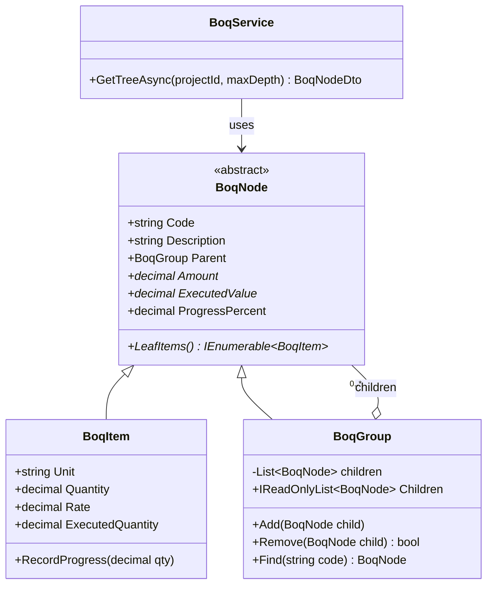
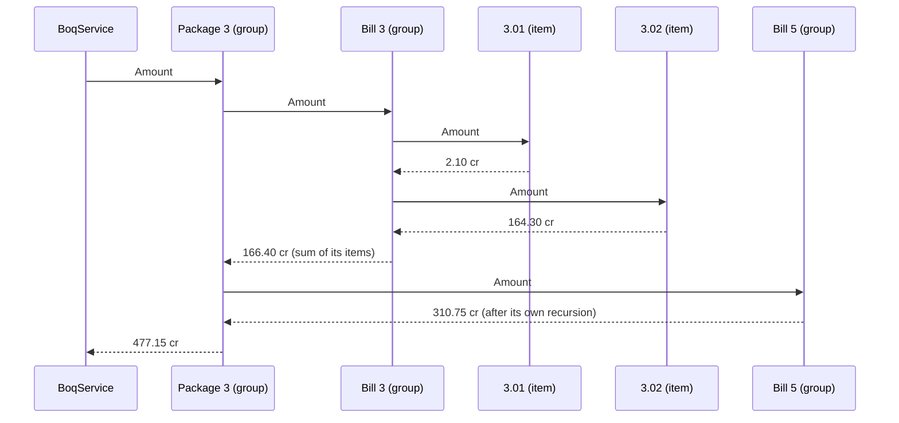
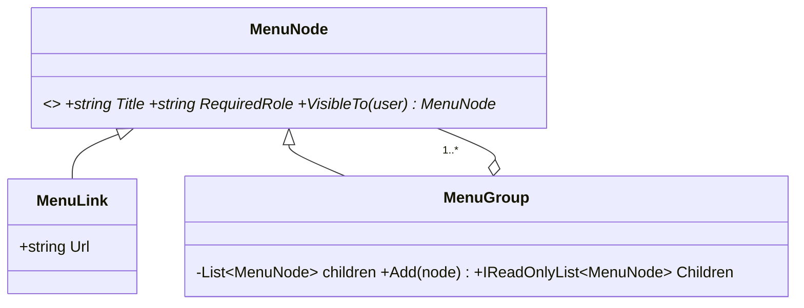

Trees are everywhere in business software: folders and files, departments and employees, menus and sub-menus, and in infrastructure work, the **Bill of Quantities (BOQ)**, where a ₹1,240 crore highway contract breaks down into bills, sub-heads and thousands of priced line items. Composite is the pattern that lets one piece of code handle the whole tree, whatever its depth.

## Learning objectives

By the end of this lesson you will be able to:

1. Recognise the problem Composite solves: client code full of "is this a group or a single item?" checks.
2. Name the participants (component, leaf, composite, client) and draw them.
3. Build a BOQ cost-breakdown tree in C# that rolls up amounts and progress at any level.
4. Choose between the **safety** and **transparency** designs for child-management methods, and defend the choice.
5. Load a tree from PostgreSQL rows (adjacency list) safely, rejecting cycles and orphans.
6. Serve a tree from an ASP.NET Core endpoint with depth limits.
7. Tell Composite apart from Decorator, Visitor and Iterator, and know when a flat list is better.

## Prerequisites

- [Encapsulation, abstraction, inheritance and polymorphism](#/lesson/m01-oop-pillars): Composite relies on one abstract type with several implementations.
- [Collections and generics](#/lesson/m01-collections-generics): children live in a `List<T>`.
- [Liskov Substitution Principle](#/lesson/m04-lsp): the safety vs transparency debate is really an LSP debate.

## Explain it like I'm a beginner

Imagine you're a quantity surveyor on a 4-lane highway project. The client asks: *"What is the total contract value?"* Then: *"What is the value of Bill 3, Earthwork?"* Then: *"What is the value of item 3.02, embankment with approved soil?"*

The contract document is a tree:

```text
Package 3 — NH-48 widening                    ₹1,240.00 cr
├── Bill 1 — General                           ₹   18.50 cr
├── Bill 3 — Earthwork                         ₹  212.40 cr
│   ├── 3.01 Clearing and grubbing  (item)     ₹    2.10 cr
│   ├── 3.02 Embankment             (item)     ₹  164.30 cr
│   └── 3.03 Subgrade               (item)     ₹   46.00 cr
└── Bill 5 — Bituminous works                  ...
```

Here is the key observation: **you answer all three questions the same way.** You ask the thing for its amount. A single line item knows its own amount (quantity × rate). A bill asks each of its children for their amounts and adds them up. The whole package does the same with its bills. Nobody needs to know in advance how deep the tree goes.

That is the **Composite** idea: single things (leaves) and groups of things (composites) share one interface (the component), so you can treat a group exactly like a single item. A group simply passes the question down to its children and combines the answers.

Analogy: an Indian Army chain of command. A general gives an order to a division. The division passes it to its brigades, the brigades to battalions, down to individual soldiers who actually do it. The general doesn't need to know how many levels there are or how many soldiers are in each. Every unit understands the same order.

## First-principles explanation

### The original problem

The Gang of Four introduced Composite with a drawing editor. Users build pictures out of lines, rectangles and text, then group them. A group can be moved, drawn or deleted as one unit, and groups can contain groups. Without the pattern, every operation (draw, move, delete, compute bounds) needs code like:

```csharp
if (shape is Line l) DrawLine(l);
else if (shape is Text t) DrawText(t);
else if (shape is Group g) foreach (var child in g.Items) /* ...and recurse, with the same if/else again */;
```

That type-check-and-recurse logic gets copied into every operation and every caller. Add a new shape type, and every copy needs a new branch.

**The problem in one line:** clients must treat individual objects and groups of objects uniformly, in a part-whole hierarchy of any depth.

### The simplest implementation

```csharp
public abstract class Node { public abstract decimal Amount { get; } }

public sealed class Item(decimal qty, decimal rate) : Node
{
    public override decimal Amount => qty * rate;
}

public sealed class Group : Node
{
    public List<Node> Children { get; } = [];
    public override decimal Amount => Children.Sum(c => c.Amount);   // recursion happens here
}
```

That is a working Composite in ten lines. The recursion isn't written by the client: it happens naturally because `Group.Amount` calls `Amount` on children that may themselves be groups.

### Participants

| Participant | Role | BOQ example |
|---|---|---|
| **Component** | Common interface for leaves and composites. Declares the operations the client uses. | `BoqNode` (Code, Description, Amount, ExecutedValue) |
| **Leaf** | A node with no children. Does the real work. | `BoqItem` (unit, quantity, rate) |
| **Composite** | A node with children. Implements operations by delegating to children and combining results. Manages its children. | `BoqGroup` (bill, sub-head, package) |
| **Client** | Works only with Component. | `BoqService`, the API endpoint, a report |

### How it works internally

Each composite holds a list of references to components. When you call `root.Amount`, the runtime calls `BoqGroup.Amount` through virtual dispatch, which loops over its children and calls `Amount` on each. For a leaf, that returns a number. For a group, it recurses. The call stack grows by one frame per level of depth.

Some concrete numbers help. A real highway BOQ might have about 4,000 items in a tree 5 levels deep (package → bill → sub-head → group → item). Computing `root.Amount` visits each of the roughly 4,400 nodes once: microseconds of work on modern hardware, and nothing to worry about. Recursion depth is 5, far from the default 1 MB thread stack limit, which typically holds thousands of frames. Depth only becomes a concern for pathological or user-generated trees (think 10,000-level nested comments), where you switch to an explicit stack (see [Iterator](#/lesson/m06-iterator)).

What *can* become slow is recomputing aggregates over and over. If a dashboard reads `ProgressPercent` for 400 nodes, and each read walks its whole subtree, the total work is roughly *nodes × average subtree size*. That is still small for 4,000 items, but for 500,000 nodes you'd cache aggregates and invalidate them on change (exercise 5).

### Safety vs transparency: where do `Add` and `Remove` go?

This is the one real design decision in Composite.

**Transparency design:** declare `Add(child)`, `Remove(child)` and `Children` on the **Component**. The client can treat every node identically, even when building the tree. But a leaf can't have children, so `BoqItem.Add` must throw `NotSupportedException` or silently do nothing. Calling `Add` on a leaf compiles fine and fails at runtime. That is a Liskov Substitution violation: a leaf can't be used everywhere a component can.

**Safety design:** declare child management only on **Composite**. Calling `item.Add(...)` doesn't compile. The cost: code that builds or edits the tree must know it holds a group (`if (node is BoqGroup g) g.Add(x)`).

| | Transparency | Safety |
|---|---|---|
| Child management on | Component | Composite only |
| Wrong use caught at | Runtime (exception) | Compile time |
| Client code for building trees | Uniform | Needs a type check or a typed reference |
| LSP | Leaf breaks the contract | Respected |
| Typical in | UI toolkits where "any element may have children" (for example, an HTML DOM where most elements can contain children) | Business models: BOQ, org charts, file systems |

Modern C# guidance generally favours **safety**: put the *read* operations everyone needs (amount, render, search, maybe a read-only `Children` that is empty for leaves) on the component, and keep *mutation* on the composite. Pattern matching (`node is BoqGroup g`) makes the occasional type check cheap and readable. Use transparency when almost every node type can have children and the leaves are the exception.

### What happens without it

Without Composite, you usually see one of three things:

1. **Fixed-depth code:** `foreach bill → foreach subhead → foreach item`. It works until a client's BOQ has an extra level, and then items silently disappear from totals.
2. **Type switches everywhere:** each report, export and validation has its own `if (node.Type == "ITEM") ... else ...` recursion.
3. **Duplicated totals:** the database stores a `total_amount` column on every group row, updated by triggers or application code, which drifts out of sync with the items.

### When it is useful

- The data is naturally a **part-whole hierarchy** of variable depth.
- Clients want to **ask the same question** of a part and of the whole (total, render, validate, find).
- New node types are added from time to time, but the set of operations is fairly stable.

### When not to use it

- **The hierarchy is fixed and shallow.** "Country → State" with exactly two levels is simpler as two classes with a normal one-to-many relationship.
- **Leaves and groups have almost nothing in common.** If the only shared operation is `Name`, a shared interface buys you little, and you'll be type-checking everywhere anyway.
- **The real job is a query.** "Total value of all earthwork items across 60 projects" is a `SUM ... GROUP BY` in PostgreSQL, not a tree walk in memory over 60 loaded trees.
- **The structure is a graph, not a tree.** If a node can have two parents (a shared sub-assembly used in two products), you need a DAG with explicit sharing rules, or you'll double-count. That's a different model; Composite assumes each child has one parent.

### Trade-offs it introduces

| You gain | You pay |
|---|---|
| One way to ask any node any question | The component interface can bloat with operations that only make sense for some nodes |
| Arbitrary depth for free | Hard to restrict structure ("bills may only contain sub-heads") without extra validation |
| New node types without changing clients | Recursion makes performance less visible; aggregates may need caching |
| Natural fit for JSON and UI trees | Persistence is awkward: relational tables are flat |

## Visual explanation

### Class diagram



How to read it: `BoqItem` and `BoqGroup` both inherit from the abstract `BoqNode` (solid line, hollow triangle). The important arrow is the one from `BoqGroup` back to `BoqNode` with multiplicity `0..*`: a group holds any number of *nodes*, not items. That single back-reference to the base type is what makes the structure recursive. A group can contain items, other groups, or a mix. `Add` and `Remove` appear only on `BoqGroup`: this is the **safety** design. Members marked `*` are abstract.

### Sequence diagram



The service asks only the root. The root asks each child, and each group repeats the same step until it reaches items, which answer directly. Results flow back up and are added at each level. The service never sees the depth. (Numbers are illustrative and the tree is trimmed for space.)

## Step-by-step example

### Step 1 — the fixed-depth version

```csharp
decimal Total(Project p)
{
    decimal total = 0;
    foreach (var bill in p.Bills)
        foreach (var head in bill.SubHeads)
            foreach (var item in head.Items)
                total += item.Quantity * item.Rate;
    return total;
}
```

This works for a 3-level BOQ. A new client's BOQ adds a "group" level under sub-heads for the bridge works. Items under groups don't appear in the total, and nothing fails loudly. It's a silent financial error, the worst kind.

### Step 2 — find the common question

Bills, sub-heads, groups and items can all answer "what is your amount?", "how much has been executed?", and "what's your code?". That becomes the component, `BoqNode`.

### Step 3 — split leaves from composites

`BoqItem` holds quantity and rate and computes its own amount. `BoqGroup` holds children and sums them. Bills and sub-heads are not separate classes; they are groups at different depths. You only create a new class when the *behaviour* differs, not the label.

### Step 4 — protect the tree's shape

A tree must have no cycles (a group can't contain its own ancestor) and each node has exactly one parent. Enforce both in `BoqGroup.Add` so no caller can break them.

### Step 5 — load it, serve it

Rows in PostgreSQL become nodes, nodes are attached to parents, and the API returns a DTO tree with rolled-up amounts and an optional depth limit so mobile clients can fetch only the top levels.

## Production-style C# implementation

```text
Infra.Api/
  Program.cs
  Boq/
    BoqNode.cs          component, leaf, composite
    BoqTreeBuilder.cs   rows -> tree, with validation
    BoqDtos.cs          JSON shape + mapper
    BoqRepository.cs    data access (in-memory here; SQL shown below)
    BoqService.cs       application service
```

```csharp file=Boq/BoqNode.cs
namespace Infra.Boq;

/// <summary>Component: what clients may ask of ANY node in a BOQ tree.</summary>
public abstract class BoqNode
{
    protected BoqNode(string code, string description)
    {
        ArgumentException.ThrowIfNullOrWhiteSpace(code);
        Code = code;
        Description = description;
    }

    public string Code { get; }
    public string Description { get; }
    public BoqGroup? Parent { get; internal set; }

    /// <summary>Contract value in rupees.</summary>
    public abstract decimal Amount { get; }
    /// <summary>Value of work executed so far, in rupees.</summary>
    public abstract decimal ExecutedValue { get; }
    public abstract IEnumerable<BoqItem> LeafItems();

    public decimal ProgressPercent => Amount == 0 ? 0 : Math.Round(ExecutedValue * 100m / Amount, 2);
    public int Depth => Parent is null ? 0 : Parent.Depth + 1;
}

/// <summary>Leaf: a priced line item.</summary>
public sealed class BoqItem : BoqNode
{
    public BoqItem(string code, string description, string unit, decimal quantity, decimal rate, decimal executedQuantity = 0)
        : base(code, description)
    {
        if (quantity < 0) throw new ArgumentOutOfRangeException(nameof(quantity));
        if (rate < 0) throw new ArgumentOutOfRangeException(nameof(rate));
        Unit = unit;
        Quantity = quantity;
        Rate = rate;
        RecordProgress(executedQuantity);
    }

    public string Unit { get; }
    public decimal Quantity { get; }
    public decimal Rate { get; }
    public decimal ExecutedQuantity { get; private set; }

    public override decimal Amount => Math.Round(Quantity * Rate, 2);
    // Executed beyond the contract quantity is a variation; value it, but flag it elsewhere.
    public override decimal ExecutedValue => Math.Round(ExecutedQuantity * Rate, 2);
    public bool IsOverExecuted => ExecutedQuantity > Quantity;

    public override IEnumerable<BoqItem> LeafItems() { yield return this; }

    public void RecordProgress(decimal executedQuantity)
    {
        if (executedQuantity < 0) throw new ArgumentOutOfRangeException(nameof(executedQuantity));
        ExecutedQuantity = executedQuantity;
    }
}

/// <summary>Composite: a bill, sub-head or group. Child management lives HERE only (safety design).</summary>
public sealed class BoqGroup(string code, string description) : BoqNode(code, description)
{
    private readonly List<BoqNode> _children = [];

    public IReadOnlyList<BoqNode> Children => _children;

    public override decimal Amount => _children.Sum(c => c.Amount);
    public override decimal ExecutedValue => _children.Sum(c => c.ExecutedValue);
    public override IEnumerable<BoqItem> LeafItems() => _children.SelectMany(c => c.LeafItems());

    public void Add(BoqNode child)
    {
        ArgumentNullException.ThrowIfNull(child);
        if (child.Parent is not null)
            throw new InvalidOperationException($"'{child.Code}' already belongs to '{child.Parent.Code}'.");
        for (BoqNode? n = this; n is not null; n = n.Parent)
            if (ReferenceEquals(n, child))
                throw new InvalidOperationException($"Adding '{child.Code}' under '{Code}' would create a cycle.");
        if (_children.Any(c => c.Code == child.Code))
            throw new InvalidOperationException($"'{Code}' already has a child with code '{child.Code}'.");

        _children.Add(child);
        child.Parent = this;
    }

    public bool Remove(BoqNode child)
    {
        if (!_children.Remove(child)) return false;
        child.Parent = null;
        return true;
    }

    /// <summary>Depth-first search by code. O(n) in the subtree size.</summary>
    public BoqNode? Find(string code)
    {
        if (Code == code) return this;
        foreach (var c in _children)
        {
            if (c.Code == code) return c;
            if (c is BoqGroup g && g.Find(code) is { } hit) return hit;
        }
        return null;
    }
}
```

```csharp file=Boq/BoqTreeBuilder.cs
namespace Infra.Boq;

/// <summary>One row of the boq_nodes table (adjacency list). Unit is null for groups.</summary>
public sealed record BoqRow(long Id, long? ParentId, string Code, string Description,
    string? Unit = null, decimal? Quantity = null, decimal? Rate = null, decimal ExecutedQuantity = 0);

public sealed class InvalidBoqException(string message) : Exception(message);

public static class BoqTreeBuilder
{
    /// <summary>Builds exactly one root. Rejects orphans, cycles, items with children and multiple roots.</summary>
    public static BoqGroup Build(IReadOnlyCollection<BoqRow> rows)
    {
        var nodes = new Dictionary<long, BoqNode>(rows.Count);
        foreach (var r in rows)
        {
            BoqNode node = r.Unit is null
                ? new BoqGroup(r.Code, r.Description)
                : new BoqItem(r.Code, r.Description, r.Unit, r.Quantity ?? 0, r.Rate ?? 0, r.ExecutedQuantity);
            if (!nodes.TryAdd(r.Id, node)) throw new InvalidBoqException($"Duplicate id {r.Id}.");
        }

        BoqGroup? root = null;
        foreach (var r in rows)
        {
            var node = nodes[r.Id];
            if (r.ParentId is null)
            {
                if (root is not null) throw new InvalidBoqException("More than one root row.");
                root = node as BoqGroup ?? throw new InvalidBoqException($"Root '{r.Code}' must be a group.");
                continue;
            }
            if (!nodes.TryGetValue(r.ParentId.Value, out var parent))
                throw new InvalidBoqException($"'{r.Code}' points to missing parent {r.ParentId}.");
            if (parent is not BoqGroup group)
                throw new InvalidBoqException($"Item '{parent.Code}' cannot have children.");
            try { group.Add(node); }
            catch (InvalidOperationException ex) { throw new InvalidBoqException(ex.Message); }
        }

        if (root is null) throw new InvalidBoqException("No root row (possible cycle).");
        // Defensive: with the guards in Add this can't fail today, but it is one cheap O(n) walk.
        var reachable = 1 + CountDescendants(root);
        if (reachable != nodes.Count) throw new InvalidBoqException($"{nodes.Count - reachable} row(s) are not reachable from the root.");
        return root;
    }

    private static int CountDescendants(BoqGroup g) =>
        g.Children.Sum(c => 1 + (c is BoqGroup cg ? CountDescendants(cg) : 0));
}
```

```csharp file=Boq/BoqDtos.cs
namespace Infra.Boq;

public sealed record BoqNodeDto(
    string Code,
    string Description,
    string Kind,
    decimal Amount,
    decimal ExecutedValue,
    decimal ProgressPercent,
    string? Unit,
    decimal? Quantity,
    decimal? Rate,
    bool HasMoreChildren,
    IReadOnlyList<BoqNodeDto> Children);

public static class BoqMapper
{
    /// <summary>maxDepth 0 returns only the node; children beyond the limit are summarised by HasMoreChildren.</summary>
    public static BoqNodeDto ToDto(BoqNode node, int maxDepth) => node switch
    {
        BoqItem i => new(i.Code, i.Description, "item", i.Amount, i.ExecutedValue, i.ProgressPercent,
                         i.Unit, i.Quantity, i.Rate, false, []),
        BoqGroup g => new(g.Code, g.Description, "group", g.Amount, g.ExecutedValue, g.ProgressPercent,
                          null, null, null,
                          HasMoreChildren: maxDepth == 0 && g.Children.Count > 0,
                          Children: maxDepth == 0 ? [] : g.Children.Select(c => ToDto(c, maxDepth - 1)).ToList()),
        _ => throw new NotSupportedException(node.GetType().Name),
    };
}
```

```csharp file=Boq/BoqRepository.cs
namespace Infra.Boq;

public interface IBoqRepository
{
    Task<IReadOnlyCollection<BoqRow>> GetRowsAsync(int projectId, CancellationToken ct);
}

/// <summary>Stand-in for the PostgreSQL repository so the sample runs anywhere.</summary>
public sealed class InMemoryBoqRepository : IBoqRepository
{
    private static readonly BoqRow[] Package3 =
    [
        new(1, null, "PKG3", "NH-48 widening, Package 3"),
        new(10, 1, "B3", "Bill 3 - Earthwork"),
        new(11, 10, "3.01", "Clearing and grubbing", "ha", 42m, 500_000m, 42m),
        new(12, 10, "3.02", "Embankment with approved soil", "cum", 1_250_000m, 1_314.40m, 610_000m),
        new(13, 10, "3.03", "Subgrade", "cum", 380_000m, 1_210.50m, 95_000m),
        new(20, 1, "B5", "Bill 5 - Bituminous works"),
        new(21, 20, "5.01", "Dense bituminous macadam", "cum", 96_000m, 9_850m, 12_000m),
        new(22, 20, "5.02", "Bituminous concrete", "cum", 48_000m, 11_420m, 0m),
    ];

    public Task<IReadOnlyCollection<BoqRow>> GetRowsAsync(int projectId, CancellationToken ct) =>
        Task.FromResult<IReadOnlyCollection<BoqRow>>(projectId == 3 ? Package3 : []);
}
```

```csharp file=Boq/BoqService.cs
namespace Infra.Boq;

public sealed class BoqService(IBoqRepository repository, ILogger<BoqService> logger)
{
    public async Task<BoqNodeDto?> GetTreeAsync(int projectId, int maxDepth, string? fromCode, CancellationToken ct)
    {
        var rows = await repository.GetRowsAsync(projectId, ct);
        if (rows.Count == 0) return null;

        var root = BoqTreeBuilder.Build(rows);
        BoqNode? start = fromCode is null ? root : root.Find(fromCode);
        if (start is null) return null;

        var overExecuted = start.LeafItems().Count(i => i.IsOverExecuted);
        if (overExecuted > 0)
            logger.LogWarning("Project {ProjectId}: {Count} item(s) under {Code} exceed contract quantity", projectId, overExecuted, start.Code);

        return BoqMapper.ToDto(start, Math.Clamp(maxDepth, 0, 10));
    }
}
```

```csharp file=Program.cs
using Infra.Boq;

var builder = WebApplication.CreateBuilder(args);
builder.Services.AddSingleton<IBoqRepository, InMemoryBoqRepository>();
builder.Services.AddScoped<BoqService>();

var app = builder.Build();

// GET /projects/3/boq?depth=1            -> package + bills, with rolled-up totals
// GET /projects/3/boq?from=B3&depth=5    -> Bill 3 subtree
app.MapGet("/projects/{projectId:int}/boq", async (int projectId, int? depth, string? from, BoqService boq, CancellationToken ct) =>
{
    try
    {
        var tree = await boq.GetTreeAsync(projectId, depth ?? 2, from, ct);
        return tree is null ? Results.NotFound() : Results.Ok(tree);
    }
    catch (InvalidBoqException ex)
    {
        // Corrupt hierarchy is a data problem, not a client error.
        return Results.Problem(ex.Message, statusCode: StatusCodes.Status500InternalServerError, title: "BOQ data is inconsistent");
    }
});

app.Run();
```

### Loading a subtree from PostgreSQL

The repository above is in memory so the sample runs anywhere. In production the adjacency list lives in a table, and a recursive CTE fetches one project's tree (or one bill's subtree) in a single round trip:

```sql
CREATE TABLE boq_nodes (
    id                bigint PRIMARY KEY,
    project_id        int    NOT NULL,
    parent_id         bigint REFERENCES boq_nodes(id),
    code              text   NOT NULL,
    description       text   NOT NULL,
    unit              text,              -- NULL means group
    quantity          numeric(18,3),
    rate              numeric(18,2),
    executed_quantity numeric(18,3) NOT NULL DEFAULT 0,
    UNIQUE (project_id, parent_id, code)
);
CREATE INDEX ON boq_nodes (parent_id);

WITH RECURSIVE subtree AS (
    SELECT * FROM boq_nodes WHERE project_id = 3 AND code = 'B3'
    UNION ALL
    SELECT n.* FROM boq_nodes n JOIN subtree s ON n.parent_id = s.id
)
SELECT id, parent_id, code, description, unit, quantity, rate, executed_quantity FROM subtree;
```

Notice that the database stores **no totals**. Group amounts are always derived from items, so they can't drift. If you need fast totals for thousands of projects (a portfolio dashboard), compute them with SQL aggregation or a materialised view refreshed on a schedule, not by loading every tree into memory. For very deep or frequently queried hierarchies, the `ltree` extension stores a path such as `PKG3.B3.3_02` and makes "all descendants of B3" an indexed query.

Also note: when the builder starts from a subtree, the top row has a `parent_id` that isn't in the result set. Clear it (or treat the requested node as the root) before calling `Build`.

## Bad design vs good design

**Bad 1, fixed depth:** the triple `foreach` from Step 1. Silent data loss when depth changes.

**Bad 2, a "type" column driving switches everywhere:**

```csharp
decimal Amount(BoqRowEntity n) => n.Type switch
{
    "ITEM" => n.Quantity!.Value * n.Rate!.Value,
    "GROUP" or "BILL" or "SUBHEAD" => n.Children.Sum(Amount),
    _ => throw new InvalidOperationException()
};
// ...and the same switch again in Executed(), Render(), Validate(), Export()...
```

Five operations, five switches. Adding a "provisional sum" node type (a lump sum with no quantity) means editing all five.

**Bad 3, the transparency trap:** `BoqItem.Add(child)` exists and throws. A junior developer's import script calls `Add` on whatever node the parent code points to. It works on test data, then fails in production at row 3,812 of a 4,000-row import, halfway through a transaction.

**Good:** the implementation above. One component type, one leaf type (plus, later, `ProvisionalSumItem`), one composite type, validation at `Add`, totals derived, never stored. Adding `ProvisionalSumItem : BoqNode` touches no other class.

**Is it worth it?** For a two-level "category → product" menu with ten entries, no. Use two lists. Composite pays off when depth varies, when it's driven by data, or when several operations need the whole tree.

## Practical playground

A file and folder tree. Run it, then add a `ShortcutEntry` leaf with size 1 KB and see that `FolderEntry` needs no change. Then try to add a folder to itself and see the guard fire.

:::playground type=csharp title="Folders and files as a Composite"
```csharp file=Program.cs
using System;
using System.Collections.Generic;
using System.Linq;

public abstract class Entry(string name)
{
    public string Name { get; } = name;
    public abstract long SizeBytes { get; }
    public abstract void Print(string indent = "");
}

public sealed class FileEntry(string name, long sizeBytes) : Entry(name)
{
    public override long SizeBytes => sizeBytes;
    public override void Print(string indent = "") => Console.WriteLine($"{indent}{Name}  ({SizeBytes / 1024.0:F1} KB)");
}

public sealed class FolderEntry(string name) : Entry(name)
{
    private readonly List<Entry> _children = new();
    public FolderEntry Add(Entry e)
    {
        if (ReferenceEquals(e, this)) throw new InvalidOperationException("A folder cannot contain itself.");
        _children.Add(e);
        return this;
    }
    public override long SizeBytes => _children.Sum(c => c.SizeBytes);
    public override void Print(string indent = "")
    {
        Console.WriteLine($"{indent}{Name}/  ({SizeBytes / 1024.0 / 1024.0:F2} MB)");
        foreach (var c in _children) c.Print(indent + "  ");
    }
}

public static class Program
{
    public static void Main()
    {
        var drawings = new FolderEntry("Drawings")
            .Add(new FileEntry("GAD-Bridge-P14.pdf", 8_400_000))
            .Add(new FileEntry("Plan-Profile-km12-14.pdf", 3_150_000));
        var reports = new FolderEntry("Reports")
            .Add(new FileEntry("MPR-2026-09.docx", 640_000))
            .Add(new FolderEntry("Photos").Add(new FileEntry("site-001.jpg", 2_300_000)));
        var root = new FolderEntry("NH48-PKG3").Add(drawings).Add(reports);

        root.Print();
        Console.WriteLine($"Total: {root.SizeBytes:N0} bytes");
    }
}
```
:::

## Exercises

:::exercise id=m06-composite-ex1 difficulty=beginner kind=code title="Folder size and file count"
Complete `FileNode` and `FolderNode` so that any node can report its total size and how many files it contains, at any depth.
::requirements
- `FileNode.SizeBytes` is its own size; `FileCount` is 1.
- `FolderNode.SizeBytes` is the sum of its children; `FileCount` counts files in all sub-folders.
- An empty folder has size 0 and 0 files.
- `FolderNode.Add` returns the folder so calls can be chained.
::acceptance
- A folder with files of 100 and 250 bytes reports 350 bytes and 2 files.
- A folder nested three levels deep is counted correctly.
- An empty folder reports 0 and 0.
::hint
The client test only calls `SizeBytes` and `FileCount` on `FsNode`. Each subclass must answer for itself.
::hint
A folder's answer is "ask my children and combine".
::hint
`_children.Sum(c => c.SizeBytes)` recurses automatically when a child is a folder.
::hint
```csharp
public override long SizeBytes => _children.Sum(c => c.SizeBytes);
public override int FileCount => _children.Sum(c => c.FileCount);
```
::starter
```csharp file=FsNodes.cs
using System;
using System.Collections.Generic;
using System.Linq;

public abstract class FsNode
{
    protected FsNode(string name) => Name = name;
    public string Name { get; }
    public abstract long SizeBytes { get; }
    public abstract int FileCount { get; }
}

public sealed class FileNode : FsNode
{
    private readonly long _size;
    public FileNode(string name, long sizeBytes) : base(name) => _size = sizeBytes;
    public override long SizeBytes => throw new NotImplementedException();
    public override int FileCount => throw new NotImplementedException();
}

public sealed class FolderNode : FsNode
{
    private readonly List<FsNode> _children = new();
    public FolderNode(string name) : base(name) { }
    public IReadOnlyList<FsNode> Children => _children;
    public FolderNode Add(FsNode child) => throw new NotImplementedException();
    public override long SizeBytes => throw new NotImplementedException();
    public override int FileCount => throw new NotImplementedException();
}
```
::tests
```csharp file=FsNodesTests.cs
using Xunit;

public class FsNodesTests
{
    [Fact]
    public void Flat_folder()
    {
        var f = new FolderNode("Reports").Add(new FileNode("a.pdf", 100)).Add(new FileNode("b.pdf", 250));
        Assert.Equal(350L, f.SizeBytes);
        Assert.Equal(2, f.FileCount);
    }

    [Fact]
    public void Nested_folders()
    {
        var deep = new FolderNode("2026-09").Add(new FileNode("site-001.jpg", 2_000));
        var photos = new FolderNode("Photos").Add(deep).Add(new FileNode("cover.jpg", 500));
        var root = new FolderNode("PKG3").Add(photos).Add(new FileNode("MPR.docx", 1_000));
        Assert.Equal(3_500L, root.SizeBytes);
        Assert.Equal(3, root.FileCount);
    }

    [Fact]
    public void Empty_folder()
    {
        var f = new FolderNode("Empty");
        Assert.Equal(0L, f.SizeBytes);
        Assert.Equal(0, f.FileCount);
    }

    [Fact]
    public void Single_file()
    {
        FsNode n = new FileNode("x.dwg", 42);
        Assert.Equal(42L, n.SizeBytes);
        Assert.Equal(1, n.FileCount);
    }
}
```
::solution
Each class answers for itself; folders delegate to children.

```csharp file=FsNodes.cs
using System;
using System.Collections.Generic;
using System.Linq;

public abstract class FsNode
{
    protected FsNode(string name) => Name = name;
    public string Name { get; }
    public abstract long SizeBytes { get; }
    public abstract int FileCount { get; }
}

public sealed class FileNode : FsNode
{
    private readonly long _size;
    public FileNode(string name, long sizeBytes) : base(name) => _size = sizeBytes;
    public override long SizeBytes => _size;
    public override int FileCount => 1;
}

public sealed class FolderNode : FsNode
{
    private readonly List<FsNode> _children = new();
    public FolderNode(string name) : base(name) { }
    public IReadOnlyList<FsNode> Children => _children;

    public FolderNode Add(FsNode child)
    {
        ArgumentNullException.ThrowIfNull(child);
        if (ReferenceEquals(child, this)) throw new InvalidOperationException("A folder cannot contain itself.");
        _children.Add(child);
        return this;
    }

    public override long SizeBytes => _children.Sum(c => c.SizeBytes);
    public override int FileCount => _children.Sum(c => c.FileCount);
}
```
::mistakes
- Counting folders as files (`FileCount => 1 + ...` on folders).
- Writing a `GetSize(FsNode n)` helper with `if (n is FolderNode)`: it works, but it's exactly the type switch Composite removes.
- Storing a `_totalSize` field on folders and forgetting to update it when children change.
:::

:::exercise id=m06-composite-ex2 difficulty=beginner kind=written title="Safety or transparency?"
For each tree, choose the **safety** design (child management only on the composite) or the **transparency** design (child management on the component), and justify it in two or three sentences.

1. A BOQ where only groups may contain children, and items come from a rate schedule.
2. A UI layout engine where panels, cards, tabs and stack layouts can all contain children, and only `Text` and `Image` cannot.
3. An organisation chart where any employee can become a manager when someone is assigned to report to them.
::acceptance
- Each answer picks one design and refers to how often "leaf receives Add" would happen.
- At least one answer mentions LSP or compile-time vs runtime failure.
- Item 3 notices that "leaf" vs "composite" is not a fixed type there.
::hint
Ask: how many node types are leaves, and how costly is a runtime `NotSupportedException`?
::hint
For item 3, does an employee *become* a different class when they get a report?
::hint
Sometimes the best answer is "one class that can have zero children", which avoids the leaf/composite split entirely.
::solution
1. **Safety.** Items never have children, and imports and edits must fail at compile time rather than at row 3,812 of a batch. Code that adds children already knows it holds a group.
2. **Transparency** (or close to it). Most node types are containers; putting `Children`/`Add` on the base `Element` keeps layout code uniform. `Text` and `Image` can expose an empty, read-only children list, and `Add` throws. This is close to how the browser DOM behaves, where most elements accept children.
3. **Neither split, really.** An employee doesn't change type when they gain a report. Use a single `Employee` class with a `DirectReports` list that may be empty. Every node is "a composite with zero or more children". Leaf vs composite is a *state*, not a type. Operations like "headcount" still recurse uniformly.
::mistakes
- Picking transparency "because it's more uniform" without considering where runtime failures would land.
- Creating `Manager : Employee` and having to change an object's class at runtime when someone gets promoted.
:::

:::exercise id=m06-composite-ex3 difficulty=intermediate kind=code title="Build a cost tree from flat rows, safely"
Cost breakdown data arrives as flat rows `(Id, ParentId, Name, Amount)` exported from a spreadsheet. Groups have `Amount = null`; items have an amount. Implement `CostTree.Build(rows)` that returns the single root and rejects bad data with `InvalidTreeException`.
::requirements
- Exactly one root (`ParentId == null`).
- Every `ParentId` must exist.
- Items (rows with an amount) can't have children.
- Cycles are rejected, including a cycle that is detached from the root (`5 → 6 → 5`).
- `Total` on any node rolls up its subtree.
::acceptance
- A valid 3-level tree builds and the root total is correct.
- Missing parent, two roots, an item with a child and a detached cycle each throw `InvalidTreeException`.
- Rows can arrive in any order (child before parent).
::hint
Do it in two passes: first create every node, then attach children. That makes order irrelevant.
::hint
Use a `Dictionary<int, CostNode>` keyed by `Id`.
::hint
A detached cycle has no row with `ParentId == null`, so its nodes are never reached from the root. After building, count nodes reachable from the root and compare with the row count.
::hint
`CostGroup.Add` can also refuse to add an ancestor of itself: walk up the `Parent` chain.
::hint
```csharp
var reachable = Count(root);       // 1 + all descendants
if (reachable != rows.Count) throw new InvalidTreeException("unreachable rows (cycle?)");
```
::starter
```csharp file=CostTree.cs
using System;
using System.Collections.Generic;
using System.Linq;

public sealed record CostRow(int Id, int? ParentId, string Name, decimal? Amount);

public sealed class InvalidTreeException(string message) : Exception(message);

public abstract class CostNode
{
    protected CostNode(string name) => Name = name;
    public string Name { get; }
    public CostGroup? Parent { get; internal set; }
    public abstract decimal Total { get; }
}

public sealed class CostItem : CostNode
{
    private readonly decimal _amount;
    public CostItem(string name, decimal amount) : base(name) => _amount = amount;
    public override decimal Total => _amount;
}

public sealed class CostGroup : CostNode
{
    private readonly List<CostNode> _children = new();
    public CostGroup(string name) : base(name) { }
    public IReadOnlyList<CostNode> Children => _children;
    public override decimal Total => _children.Sum(c => c.Total);

    public void Add(CostNode child)
    {
        _children.Add(child);
        child.Parent = this;
    }
}

public static class CostTree
{
    public static CostGroup Build(IReadOnlyCollection<CostRow> rows) => throw new NotImplementedException();
}
```
::tests
```csharp file=CostTreeTests.cs
using System.Linq;
using Xunit;

public class CostTreeTests
{
    private static readonly CostRow[] Valid =
    {
        new(3, 2, "Embankment", 1_643_000m),   // child before parent on purpose
        new(1, null, "Package 3", null),
        new(2, 1, "Earthwork", null),
        new(4, 2, "Subgrade", 460_000m),
        new(5, 1, "Road furniture", 75_500m),
    };

    [Fact]
    public void Builds_and_rolls_up()
    {
        var root = CostTree.Build(Valid);
        Assert.Equal("Package 3", root.Name);
        Assert.Equal(2_178_500m, root.Total);
        var earthwork = (CostGroup)root.Children.Single(c => c.Name == "Earthwork");
        Assert.Equal(2_103_000m, earthwork.Total);
        Assert.Same(root, earthwork.Parent);
    }

    [Fact]
    public void Missing_parent_rejected() =>
        Assert.Throws<InvalidTreeException>(() => CostTree.Build(new[] { new CostRow(1, null, "R", null), new CostRow(2, 99, "X", 10m) }));

    [Fact]
    public void Two_roots_rejected() =>
        Assert.Throws<InvalidTreeException>(() => CostTree.Build(new[] { new CostRow(1, null, "A", null), new CostRow(2, null, "B", null) }));

    [Fact]
    public void Item_with_child_rejected() =>
        Assert.Throws<InvalidTreeException>(() => CostTree.Build(new[]
        {
            new CostRow(1, null, "R", null), new CostRow(2, 1, "Item", 10m), new CostRow(3, 2, "Child", 5m)
        }));

    [Fact]
    public void Detached_cycle_rejected() =>
        Assert.Throws<InvalidTreeException>(() => CostTree.Build(new[]
        {
            new CostRow(1, null, "R", null), new CostRow(5, 6, "A", null), new CostRow(6, 5, "B", null)
        }));

    [Fact]
    public void Duplicate_id_rejected() =>
        Assert.Throws<InvalidTreeException>(() => CostTree.Build(new[] { new CostRow(1, null, "R", null), new CostRow(1, null, "R2", null) }));
}
```
::solution
Two passes plus a reachability check. `CostGroup.Add` also guards against attaching an ancestor, which catches cycles that pass through the root.

```csharp file=CostTree.cs
using System;
using System.Collections.Generic;
using System.Linq;

public sealed record CostRow(int Id, int? ParentId, string Name, decimal? Amount);

public sealed class InvalidTreeException(string message) : Exception(message);

public abstract class CostNode
{
    protected CostNode(string name) => Name = name;
    public string Name { get; }
    public CostGroup? Parent { get; internal set; }
    public abstract decimal Total { get; }
}

public sealed class CostItem : CostNode
{
    private readonly decimal _amount;
    public CostItem(string name, decimal amount) : base(name) => _amount = amount;
    public override decimal Total => _amount;
}

public sealed class CostGroup : CostNode
{
    private readonly List<CostNode> _children = new();
    public CostGroup(string name) : base(name) { }
    public IReadOnlyList<CostNode> Children => _children;
    public override decimal Total => _children.Sum(c => c.Total);

    public void Add(CostNode child)
    {
        if (child.Parent is not null) throw new InvalidTreeException($"'{child.Name}' already has a parent.");
        for (CostNode? n = this; n is not null; n = n.Parent)
            if (ReferenceEquals(n, child)) throw new InvalidTreeException($"Cycle at '{child.Name}'.");
        _children.Add(child);
        child.Parent = this;
    }
}

public static class CostTree
{
    public static CostGroup Build(IReadOnlyCollection<CostRow> rows)
    {
        var nodes = new Dictionary<int, CostNode>();
        foreach (var r in rows)
        {
            CostNode node = r.Amount is { } amt ? new CostItem(r.Name, amt) : new CostGroup(r.Name);
            if (!nodes.TryAdd(r.Id, node)) throw new InvalidTreeException($"Duplicate id {r.Id}.");
        }

        CostGroup? root = null;
        foreach (var r in rows)
        {
            var node = nodes[r.Id];
            if (r.ParentId is null)
            {
                if (root is not null) throw new InvalidTreeException("More than one root.");
                root = node as CostGroup ?? throw new InvalidTreeException("Root must be a group.");
                continue;
            }
            if (!nodes.TryGetValue(r.ParentId.Value, out var parent))
                throw new InvalidTreeException($"Row {r.Id} has missing parent {r.ParentId}.");
            if (parent is not CostGroup g)
                throw new InvalidTreeException($"Item '{parent.Name}' cannot have children.");
            g.Add(node);
        }

        if (root is null) throw new InvalidTreeException("No root.");
        if (Count(root) != nodes.Count) throw new InvalidTreeException("Some rows are not reachable from the root (cycle?).");
        return root;
    }

    private static int Count(CostNode n) => 1 + (n is CostGroup g ? g.Children.Sum(Count) : 0);
}
```

Trace the detached cycle `5 → 6 → 5`: attaching 5 under 6 is fine, then attaching 6 under 5 is caught by `Add`, because 6 is already an ancestor of 5. With the one-parent rule and the ancestor check in `Add`, every row must eventually lead to the root, so the reachability check can't fail today. Keep it anyway: it's one O(n) walk, and it protects you if someone later "optimises" the guard out of `Add` or adds a bulk-attach method.
::alternatives
Let PostgreSQL enforce more: a `CHECK (id <> parent_id)` constraint, a foreign key on `parent_id`, and a unique partial index `WHERE parent_id IS NULL` per project (one root). Cycles across several rows still need application checks or a trigger. With `ltree` paths, a node's path can't contain itself, which rules out cycles by construction.
::mistakes
- Attaching in one pass and assuming parents come first. Spreadsheet exports are rarely ordered.
- Recursing to detect cycles without a visited set and hitting `StackOverflowException`, which can't be caught in .NET and kills the process.
- Treating `Amount = 0` as "group". Use `null` for groups; zero is a valid item amount.
:::

:::exercise id=m06-composite-ex4 difficulty=intermediate kind=design title="Refactor a three-level menu into a Composite"
A Razor layout renders the side menu of a project management portal with this code:

```csharp
foreach (var section in menu.Sections)
{
    if (!user.IsInRole(section.Role)) continue;
    Html.Header(section.Title);
    foreach (var group in section.Groups)
    {
        if (!user.IsInRole(group.Role)) continue;
        Html.SubHeader(group.Title);
        foreach (var link in group.Links)
            if (user.IsInRole(link.Role)) Html.Link(link.Title, link.Url);
    }
}
```

Product now wants: (a) links directly under a section, (b) a fourth level for the "Reports" area, (c) hide any group that ends up with no visible links. Redesign with Composite. Give the class diagram, the method that filters by permission, and how rendering works.
::acceptance
- One component type with `Title`, `RequiredRole` and an operation to produce a filtered copy for a user.
- Groups with no visible children after filtering are removed.
- Arbitrary depth; links can appear at any level.
- Rendering doesn't need to know the depth.
- Mentions where the menu definition comes from (config or database) and caching per role set.
::hint
Separate *filtering* from *rendering*. Filtering returns a new, smaller tree; rendering just walks it.
::hint
`MenuNode? VisibleTo(ClaimsPrincipal user)` returns `null` if the node should disappear.
::hint
For a group: filter children recursively, drop nulls, and return `null` if none remain.
::hint
Rendering can be a recursive Razor partial or a View Component that renders a node and then its children.
::solution


```csharp
public abstract record MenuNode(string Title, string? RequiredRole)
{
    protected bool Allowed(ClaimsPrincipal u) => RequiredRole is null || u.IsInRole(RequiredRole);
    public abstract MenuNode? VisibleTo(ClaimsPrincipal user);
}
public sealed record MenuLink(string Title, string Url, string? RequiredRole = null) : MenuNode(Title, RequiredRole)
{
    public override MenuNode? VisibleTo(ClaimsPrincipal u) => Allowed(u) ? this : null;
}
public sealed record MenuGroup(string Title, IReadOnlyList<MenuNode> Children, string? RequiredRole = null) : MenuNode(Title, RequiredRole)
{
    public override MenuNode? VisibleTo(ClaimsPrincipal u)
    {
        if (!Allowed(u)) return null;
        var visible = Children.Select(c => c.VisibleTo(u)).OfType<MenuNode>().ToList();
        return visible.Count == 0 ? null : this with { Children = visible };
    }
}
```

Rendering: a `_MenuNode.cshtml` partial that renders a link, or a group header followed by `<partial name="_MenuNode" model="child" />` for each child. Depth is handled by recursion, so the "Reports" fourth level needs no code change.

The menu definition is loaded once (from `appsettings.json` or a table) into an immutable tree, a singleton. The filtered tree depends only on the user's roles, so cache it per sorted role set (for example key `menu:Engineer,QS`). With 6 roles there are at most a few dozen combinations in practice.
::alternatives
If the menu is tiny and fixed, keeping the loops but adding the empty-group rule is fine. Composite pays off here because of (a) and (b): mixed levels and variable depth.
::mistakes
- Filtering during rendering, which makes "hide empty groups" require look-ahead.
- Mutating the shared singleton tree when filtering for one user, so the next user sees a pruned menu.
:::

:::exercise id=m06-composite-ex5 difficulty=advanced kind=code title="Cached roll-ups with targeted invalidation"
A portfolio of 300 projects has about 1.2 million BOQ items in memory in a reporting service, and a dashboard reads `ExecutedValue` for hundreds of groups every few seconds. Recomputing whole subtrees on every read is too slow. Implement caching in `WorkGroup`:

- `WorkGroup.Amount` and `WorkGroup.ExecutedValue` are cached after the first computation.
- `WorkItem.RecordExecuted(qty)` updates the item and **invalidates only the item's ancestors**, not siblings or cousins.
- Adding a child to a group also invalidates that group and its ancestors.
- `WorkGroup.Recomputations` counts how many times that group actually recomputed (for tests).
::acceptance
- Reading the root twice recomputes each group once.
- After updating an item under group A, the next root read recomputes the root and A, but not sibling group B.
- Values after an update are correct.
- Adding a child invalidates the right groups.
::hint
Each node needs a reference to its parent so an item can walk upwards.
::hint
Use a nullable cached field, for example `decimal? _cachedExecuted`. `null` means "dirty".
::hint
`Invalidate()` on a group sets its caches to null and calls `Parent?.Invalidate()`. Stop early if it's already dirty: its ancestors must already be dirty too.
::hint
Count a recomputation once per cache refill, not once per property read: compute both `Amount` and `ExecutedValue` in one pass and store both.
::hint
```csharp
private void EnsureComputed()
{
    if (_amount is not null) return;
    Recomputations++;
    decimal a = 0, e = 0;
    foreach (var c in _children) { a += c.Amount; e += c.ExecutedValue; }
    _amount = a; _executed = e;
}
```
::starter
```csharp file=WorkTree.cs
using System;
using System.Collections.Generic;

public abstract class WorkNode
{
    protected WorkNode(string code) => Code = code;
    public string Code { get; }
    public WorkGroup? Parent { get; internal set; }
    public abstract decimal Amount { get; }
    public abstract decimal ExecutedValue { get; }
}

public sealed class WorkItem : WorkNode
{
    public WorkItem(string code, decimal quantity, decimal rate) : base(code)
    {
        Quantity = quantity;
        Rate = rate;
    }
    public decimal Quantity { get; }
    public decimal Rate { get; }
    public decimal ExecutedQuantity { get; private set; }
    public override decimal Amount => Quantity * Rate;
    public override decimal ExecutedValue => ExecutedQuantity * Rate;

    public void RecordExecuted(decimal quantity) => throw new NotImplementedException();
}

public sealed class WorkGroup : WorkNode
{
    private readonly List<WorkNode> _children = new();
    public WorkGroup(string code) : base(code) { }
    public IReadOnlyList<WorkNode> Children => _children;
    public int Recomputations { get; private set; }

    public void Add(WorkNode child) => throw new NotImplementedException();
    public override decimal Amount => throw new NotImplementedException();
    public override decimal ExecutedValue => throw new NotImplementedException();
}
```
::tests
```csharp file=WorkTreeTests.cs
using Xunit;

public class WorkTreeTests
{
    private readonly WorkGroup _root = new("PKG");
    private readonly WorkGroup _a = new("A");
    private readonly WorkGroup _b = new("B");
    private readonly WorkItem _a1 = new("A1", 100m, 50m);   // 5,000
    private readonly WorkItem _b1 = new("B1", 10m, 300m);   // 3,000

    public WorkTreeTests()
    {
        _a.Add(_a1);
        _b.Add(_b1);
        _root.Add(_a);
        _root.Add(_b);
    }

    [Fact]
    public void Values_roll_up()
    {
        Assert.Equal(8_000m, _root.Amount);
        Assert.Equal(0m, _root.ExecutedValue);
    }

    [Fact]
    public void Repeated_reads_use_cache()
    {
        _ = _root.Amount; _ = _root.ExecutedValue; _ = _root.Amount;
        Assert.Equal(1, _root.Recomputations);
        Assert.Equal(1, _a.Recomputations);
        Assert.Equal(1, _b.Recomputations);
    }

    [Fact]
    public void Update_invalidates_only_ancestors()
    {
        _ = _root.ExecutedValue;
        _a1.RecordExecuted(40m);
        Assert.Equal(2_000m, _root.ExecutedValue);
        Assert.Equal(2, _root.Recomputations);
        Assert.Equal(2, _a.Recomputations);
        Assert.Equal(1, _b.Recomputations);
    }

    [Fact]
    public void Adding_child_invalidates_ancestors()
    {
        _ = _root.Amount;
        _b.Add(new WorkItem("B2", 1m, 1_000m));
        Assert.Equal(9_000m, _root.Amount);
        Assert.Equal(2, _b.Recomputations);
        Assert.Equal(1, _a.Recomputations);
    }

    [Fact]
    public void Negative_quantity_rejected() =>
        Assert.Throws<System.ArgumentOutOfRangeException>(() => _a1.RecordExecuted(-1m));
}
```
::solution
Groups cache both totals together and invalidate upwards; items trigger invalidation when they change.

```csharp file=WorkTree.cs
using System;
using System.Collections.Generic;

public abstract class WorkNode
{
    protected WorkNode(string code) => Code = code;
    public string Code { get; }
    public WorkGroup? Parent { get; internal set; }
    public abstract decimal Amount { get; }
    public abstract decimal ExecutedValue { get; }
}

public sealed class WorkItem : WorkNode
{
    public WorkItem(string code, decimal quantity, decimal rate) : base(code)
    {
        Quantity = quantity;
        Rate = rate;
    }
    public decimal Quantity { get; }
    public decimal Rate { get; }
    public decimal ExecutedQuantity { get; private set; }
    public override decimal Amount => Quantity * Rate;
    public override decimal ExecutedValue => ExecutedQuantity * Rate;

    public void RecordExecuted(decimal quantity)
    {
        if (quantity < 0) throw new ArgumentOutOfRangeException(nameof(quantity));
        if (quantity == ExecutedQuantity) return;
        ExecutedQuantity = quantity;
        Parent?.Invalidate();
    }
}

public sealed class WorkGroup : WorkNode
{
    private readonly List<WorkNode> _children = new();
    private decimal? _amount;
    private decimal? _executed;

    public WorkGroup(string code) : base(code) { }
    public IReadOnlyList<WorkNode> Children => _children;
    public int Recomputations { get; private set; }

    public void Add(WorkNode child)
    {
        ArgumentNullException.ThrowIfNull(child);
        if (child.Parent is not null) throw new InvalidOperationException($"'{child.Code}' already has a parent.");
        for (WorkNode? n = this; n is not null; n = n.Parent)
            if (ReferenceEquals(n, child)) throw new InvalidOperationException("Cycle.");
        _children.Add(child);
        child.Parent = this;
        Invalidate();
    }

    public override decimal Amount { get { EnsureComputed(); return _amount!.Value; } }
    public override decimal ExecutedValue { get { EnsureComputed(); return _executed!.Value; } }

    internal void Invalidate()
    {
        // Walk up; stop when a group is already dirty (its ancestors must be dirty too).
        for (var g = this; g is not null && g._amount is not null; g = g.Parent)
        {
            g._amount = null;
            g._executed = null;
        }
    }

    private void EnsureComputed()
    {
        if (_amount is not null) return;
        Recomputations++;
        decimal amount = 0, executed = 0;
        foreach (var c in _children)
        {
            amount += c.Amount;
            executed += c.ExecutedValue;
        }
        _amount = amount;
        _executed = executed;
    }
}
```

Why is it safe to stop at the first dirty group? The invariant is: *if a group is dirty, every ancestor is dirty too.* An ancestor can only become clean by recomputing, and recomputing reads every child, which cleans the dirty child first. So when the upward walk meets a dirty group, the rest of the path is already dirty, and walking further is wasted work.

Cost: an update is O(depth), about 5 steps for a BOQ. A read after updates recomputes only the dirty path plus the direct children of each dirty group, instead of the whole subtree.
::alternatives
- **Push deltas instead of invalidating:** on update, add `(newValue - oldValue)` to every ancestor's cached total. O(depth) and no recomputation at read time, but one bug in the delta logic (a missed update path, a double-applied event) silently corrupts totals until restart. Invalidation is safer because the truth is always recomputed from items.
- **Let the database do it:** a materialised view of totals per group, refreshed every few minutes, is often good enough for dashboards and needs no in-memory tree at all.
::mistakes
- Invalidating the whole tree on every update, which defeats the cache.
- Caching on items as well, which adds invalidation work for something already O(1).
- Forgetting thread safety: this design assumes single-threaded updates (or a lock around updates and reads). A reporting service with concurrent writers should use an immutable tree that is rebuilt and swapped, or a lock per tree.
:::

## Automated testing

**1. Leaves alone.** `BoqItem` is plain arithmetic: test amount, executed value and `IsOverExecuted` with `[Theory]` rows, including zero quantity and rounding (₹1,314.40 × 1,250,000 = ₹1,643,000,000.00 exactly; use `decimal`, never `double`, for money).

**2. Composites with tiny trees.** Two or three nodes are enough to prove roll-up, `Find`, and the guards:

```csharp
[Fact]
public void Group_cannot_contain_its_ancestor()
{
    var pkg = new BoqGroup("PKG3", "Package");
    var bill = new BoqGroup("B3", "Earthwork");
    pkg.Add(bill);
    Assert.Throws<InvalidOperationException>(() => bill.Add(pkg));
}

[Fact]
public void Moving_a_node_requires_removing_it_first()
{
    var a = new BoqGroup("A", "A"); var b = new BoqGroup("B", "B");
    var item = new BoqItem("1", "Item", "cum", 10, 100);
    a.Add(item);
    Assert.Throws<InvalidOperationException>(() => b.Add(item));
    a.Remove(item); b.Add(item);
    Assert.Equal(1_000m, b.Amount);
}
```

**3. The builder with bad data.** Each rejection path (duplicate id, missing parent, two roots, item with children, detached cycle) deserves its own test. These are the bugs real spreadsheets and old databases produce.

**4. A property-style check.** For a randomly generated tree, `root.Amount` must equal `root.LeafItems().Sum(i => i.Amount)`. A few hundred random trees with a fixed seed catch off-by-one-level mistakes that example-based tests miss.

**5. The API.** Use `WebApplicationFactory<Program>` (from `Microsoft.AspNetCore.Mvc.Testing`) to call `/projects/3/boq?depth=1` and check that the bills appear with totals and `hasMoreChildren: true`.

**Extensibility check:** add a `ProvisionalSumItem` leaf (a lump-sum amount with no quantity). If any test outside its own file needs to change, the component abstraction is leaking.

## Real-world application

- **File systems and cloud storage**: folder sizes, recursive permissions and recursive delete are Composite operations.
- **UI frameworks**: WPF, MAUI and Blazor render trees, and the browser DOM, are element trees where a container renders itself and then its children.
- **Organisation charts and approval hierarchies**: headcount, salary cost (₹ per month) and "who is the approver above me" all walk the tree.
- **BOQ, WBS and cost breakdown structures** in infrastructure and construction projects: totals, progress and earned value roll up from items to bills to packages. A work breakdown structure (WBS) in project scheduling tools is the same shape.
- **Expression trees**: `System.Linq.Expressions` represents `a + b * c` as a tree of nodes, each able to be compiled or visited; the [Interpreter](#/lesson/m06-interpreter) pattern builds on this.
- **Product configurators and bills of materials** in manufacturing, with care for shared sub-assemblies (which turn the tree into a graph).

## Interview questions

:::interview
::q beginner
What problem does Composite solve?
::a
It lets clients treat individual objects and groups of objects the same way, in a hierarchy of any depth. A leaf implements an operation directly; a composite implements it by delegating to its children and combining the results. Clients stop writing "if group, loop and recurse, else do the thing" in every operation.
::q beginner
What are the participants?
::a
**Component**: the common interface or abstract class. **Leaf**: a node with no children that does the real work. **Composite**: a node holding child components, implementing operations by delegating to them, and managing children. **Client**: works only with Component.
::q intermediate
Explain the safety vs transparency trade-off.
::a
Transparency puts `Add`/`Remove`/`Children` on the component, so all nodes look identical, but leaves must throw or ignore those calls, failing at runtime and breaking LSP. Safety puts child management only on the composite, so misuse fails at compile time, but builder code needs to know it holds a composite. In business models (BOQ, org charts, file systems) safety is usually better; in UI toolkits where nearly everything is a container, transparency is common.
::q intermediate
How would you store a Composite tree in PostgreSQL and load one subtree?
::a
Common options: an adjacency list (`parent_id` column) queried with `WITH RECURSIVE`; the `ltree` extension storing materialised paths with GiST indexes for "descendants of X"; or a closure table storing every ancestor–descendant pair for fast queries at the cost of more writes. Load rows in one query, build nodes in a dictionary, attach in a second pass, and validate (one root, no orphans, no cycles). Don't store derived totals on group rows unless you have a clear refresh strategy.
::q advanced
A dashboard over 1.2 million BOQ items is slow because each group's totals are recomputed on every read. What are your options?
::a
(1) Cache aggregates in groups and invalidate upwards on change: O(depth) per update, recompute only dirty paths. (2) Push deltas up the tree on change: no recomputation, but delta bugs corrupt totals silently. (3) Move aggregation to the database: SQL `SUM` over a recursive CTE or `ltree` descendants, or a materialised view refreshed every few minutes, which is often enough for dashboards. (4) Use an immutable tree rebuilt in the background and atomically swapped, giving lock-free reads. Pick based on update frequency, staleness tolerance and concurrency. For a dashboard, (3) or (4) is usually simplest.
::q advanced
How do Composite, Decorator and Visitor relate?
::a
Decorator and Composite both use recursive composition, but a decorator wraps exactly **one** component to add behaviour, while a composite holds **many** children to represent part-whole structure. Visitor is often used *with* Composite: when you keep adding new operations (export to Excel, validate against a rate schedule, compute GST) and don't want to grow the component interface each time, a visitor walks the tree and holds each operation in its own class. Composite makes adding node types easy; Visitor makes adding operations easy; you trade one for the other.
:::

## Summary and revision

**Key takeaways**

- Composite lets leaves and groups share one interface, so whole-tree operations are written once.
- A composite implements operations by delegating to children; recursion follows from the structure.
- Prefer the **safety** design (child management on composites only) for business trees; use transparency when nearly every node is a container.
- Guard the tree in `Add`: one parent per node, no cycles, unique codes if needed.
- Store hierarchies flat (adjacency list, `ltree`, closure table); build and validate in two passes; never trust row order.
- Derive totals instead of storing them; cache with upward invalidation when reads dominate.
- Don't use Composite for fixed shallow hierarchies, graphs with shared children, or questions better answered by a SQL aggregate.

**Terminology**: component, leaf, composite, client, part-whole hierarchy, safety design, transparency design, adjacency list, recursive CTE, `ltree`, closure table, roll-up.

:::flashcards
Q: What are the four participants of Composite?
A: Component, Leaf, Composite and Client.
Q: In the safety design, where do Add and Remove live?
A: Only on the Composite, so calling them on a leaf doesn't compile.
Q: Why does the transparency design tend to violate LSP?
A: Leaves inherit Add/Remove but must throw or ignore them, so a leaf can't be used everywhere a component can.
Q: How do you load a tree from an adjacency list when rows may be in any order?
A: Two passes: create all nodes in a dictionary keyed by id, then attach each node to its parent; finally validate one root and reachability.
Q: Composite vs Decorator?
A: Both compose recursively; Decorator wraps one component to add behaviour, Composite holds many children to model part-whole.
Q: Why not store group totals in the database?
A: They are derived data and drift out of sync with items; derive them, or refresh a materialised view on a schedule.
Q: Which PostgreSQL feature loads a whole subtree in one query?
A: A recursive CTE (WITH RECURSIVE), or ltree descendant queries.
Q: When is Composite overkill?
A: Fixed, shallow hierarchies (two known levels) or when leaves and groups share almost no operations.
:::

## Knowledge check

:::quiz pass=70
::q single
A BOQ report totals items with three nested `foreach` loops (bill → sub-head → item). A new contract adds a "group" level under some sub-heads. What happens?
- [ ] The code throws an exception.
- [x] Items under the new level are silently left out of the totals.
- [ ] The compiler reports an error.
- [ ] Totals are doubled.
> Fixed-depth loops only see the levels they were written for. Composite's recursion handles any depth.
::q single
In which situation is the transparency design (Add on the component) most reasonable?
- [ ] A BOQ where only groups can contain children.
- [x] A UI toolkit where nearly every element type can contain children.
- [ ] An accounting ledger with exactly two levels.
- [ ] A file system where files never contain anything.
> When almost every node is a container, putting child management on the base keeps code uniform, and the few leaves can reject it.
::q multi
Which checks belong in a tree builder that reads adjacency-list rows? (Select all that apply.)
- [x] Exactly one root.
- [x] Every parent id exists.
- [x] Leaves don't have children.
- [x] All rows are reachable from the root.
- [ ] Rows are sorted by parent id.
> Order shouldn't matter: a two-pass build handles any order. The other checks catch orphans, structural errors and detached cycles.
::q single
A component library uses the same sub-assembly (a "standard pier cap") in 40 bridges. Modelled as a Composite tree where each bridge `Add`s the same object, what goes wrong?
- [ ] Nothing, Composite supports shared children.
- [x] A node can have only one parent, so the second `Add` fails, or if allowed, totals and parent navigation become wrong.
- [ ] The tree uses too much memory.
- [ ] Recursion becomes infinite.
> Composite assumes a tree. Shared parts make it a DAG: either copy the sub-assembly per bridge or model sharing explicitly (and see [Flyweight](#/lesson/m06-flyweight) for sharing immutable data).
::q single
Each read of a group's `ExecutedValue` walks its whole subtree. A dashboard reads 500 groups every 5 seconds on a 1-million-item portfolio. Which change is MOST targeted?
- [ ] Convert recursion to loops.
- [x] Cache group totals and invalidate only the ancestors of a changed item.
- [ ] Store totals in every group row and update them in the API.
- [ ] Switch from `decimal` to `double`.
> Upward invalidation makes updates O(depth) and reads cheap. Storing totals in rows reintroduces drift. `double` is wrong for money and doesn't fix the algorithm.
::q single
You keep adding new *operations* over a stable set of node types (export to Excel, GST calculation, rate validation). Which pattern pairs with Composite to stop the component interface growing?
- [ ] Decorator
- [ ] Bridge
- [x] Visitor
- [ ] Proxy
> Visitor moves each operation into its own class that walks the tree, at the cost of making new node types harder to add.
::q single
An organisation chart has `Employee` and `Manager : Employee` classes. Someone gets their first direct report. What's the cleanest model?
- [ ] Delete the Employee object and create a Manager with the same id.
- [ ] Use the transparency design so Employee.Add throws.
- [x] A single `Employee` class with a possibly-empty `DirectReports` list.
- [ ] Use a Decorator to add management behaviour at runtime.
> Leaf vs composite is a state here, not a type. One class with zero or more children keeps operations uniform.
:::

## Completion criteria

You have finished this lesson when you can:

- [ ] Score at least 70 % on the knowledge check.
- [ ] Complete exercises 1 and 3 with all tests passing.
- [ ] Complete exercise 4 or 5 and compare with the solution.
- [ ] Explain safety vs transparency, with one example where each is right.
- [ ] Load a tree from flat rows and name three kinds of bad data your builder rejects.
