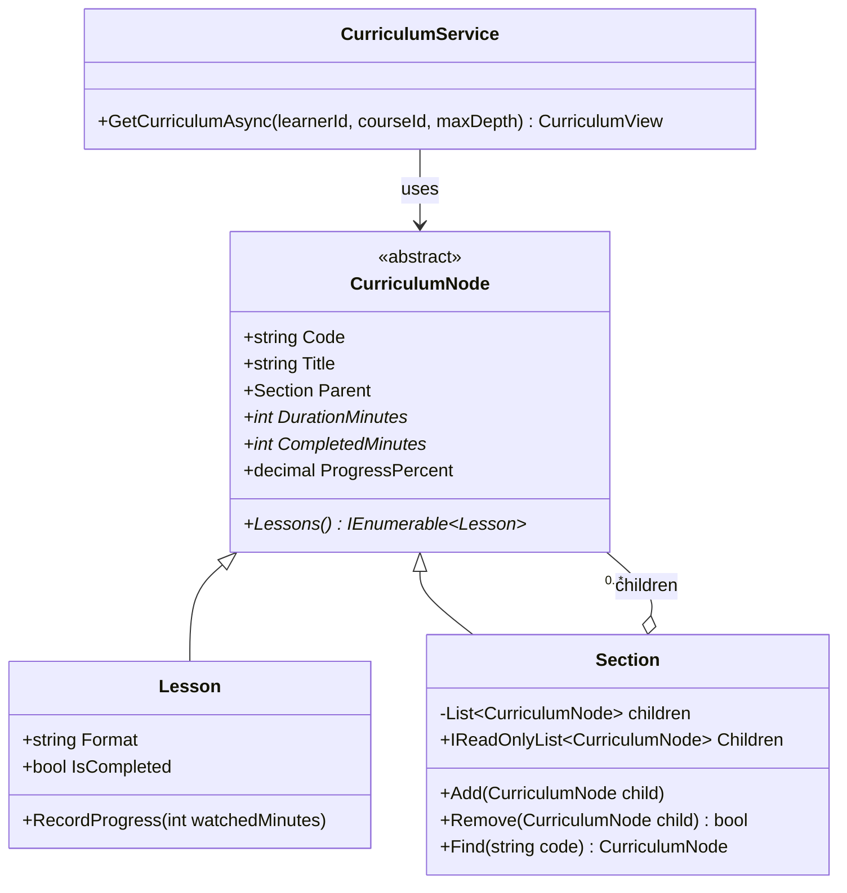
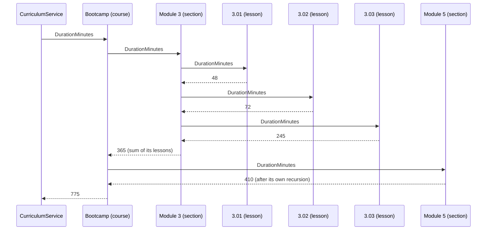
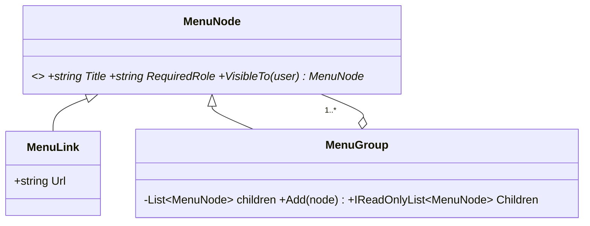

Trees are everywhere in business software: folders and files, departments and employees, menus and sub-menus, product categories, and the curriculum of an online course, where a 38-hour bootcamp breaks down into modules, sections and hundreds of individual video lessons, quizzes and projects. Composite is the pattern that lets one piece of code handle the whole tree, whatever its depth.

## Learning objectives

By the end of this lesson you will be able to:

1. Recognise the problem Composite solves: client code full of "is this a group or a single item?" checks.
2. Name the participants (component, leaf, composite, client) and draw them.
3. Build a course-curriculum tree in C# that rolls up duration and a learner's progress at any level.
4. Choose between the **safety** and **transparency** designs for child-management methods, and defend the choice.
5. Load a tree from PostgreSQL rows (adjacency list) safely, rejecting cycles and orphans.
6. Serve a tree from an ASP.NET Core endpoint with depth limits.
7. Spot Composite inside .NET itself (`CompositeFileProvider`, `CompositeChangeToken`, configuration sections, render trees).
8. Tell Composite apart from Decorator, Visitor and Iterator, and know when a flat list is better.

## Prerequisites

- [Encapsulation, abstraction, inheritance and polymorphism](#/lesson/m01-oop-pillars): Composite relies on one abstract type with several implementations.
- [Collections and generics](#/lesson/m01-collections-generics): children live in a `List<T>`.
- [Liskov Substitution Principle](#/lesson/m04-lsp): the safety vs transparency debate is really an LSP debate.

## Explain it like I'm a beginner

Imagine you're building the course page of an online learning platform, something like Udemy or Coursera. A learner looks at a course and wants to know: *"How long is the whole course?"* Then: *"How long is Module 3?"* Then: *"How long is lesson 3.02?"* And the progress bar asks: *"How much of it have I finished?"*

The course is a tree:

```text
ASP.NET Core Backend Bootcamp (course)           38 h 20 min
├── Module 1 — C# refresher                        4 h 10 min
├── Module 3 — Building APIs                       6 h 05 min
│   ├── 3.01 Minimal APIs            (video)           48 min
│   ├── 3.02 Routing and binding     (video)       1 h 12 min
│   └── 3.03 Build a to-do API       (project)     4 h 05 min
├── Module 5 — PostgreSQL with EF Core             6 h 50 min
└── ...
```

Here is the key observation: **you answer all these questions the same way.** You ask the thing for its duration. A single lesson knows its own length. A module asks each of its children for their durations and adds them up. The whole course does the same with its modules. Nobody needs to know in advance how deep the tree goes: one course has sections inside modules, another puts lessons straight under modules, and the same code handles both.

That is the **Composite** idea: single things (leaves) and groups of things (composites) share one interface (the component), so you can treat a group exactly like a single item. A group simply passes the question down to its children and combines the answers.

Analogy: an army chain of command. A general gives an order to a division. The division passes it to its brigades, the brigades to battalions, down to individual soldiers who actually do it. The general doesn't need to know how many levels there are or how many soldiers are in each. Every unit understands the same order.

## First-principles explanation

### The original problem

The Gang of Four introduced Composite with a drawing editor. Users build pictures out of lines, rectangles and text, then group them. A group can be moved, drawn or deleted as one unit, and groups can contain groups. Without the pattern, every operation (draw, move, delete, compute bounds) needs code like:

```csharp
if (shape is Line l) DrawLine(l);
else if (shape is Text t) DrawText(t);
else if (shape is Group g) foreach (var child in g.Items) /* ...and recurse, with the same if/else again */;
```

That type-check-and-recurse logic gets copied into every operation and every caller. Add a new shape type, and every copy needs a new branch.

**The problem in one line:** clients must treat individual objects and groups of objects uniformly, in a part-whole hierarchy of any depth.

### The simplest implementation

```csharp
public abstract class Node { public abstract int Minutes { get; } }

public sealed class Lesson(int minutes) : Node
{
    public override int Minutes => minutes;
}

public sealed class Group : Node
{
    public List<Node> Children { get; } = [];
    public override int Minutes => Children.Sum(c => c.Minutes);   // recursion happens here
}
```

That is a working Composite in ten lines. The recursion isn't written by the client: it happens naturally because `Group.Minutes` calls `Minutes` on children that may themselves be groups.

A composite doesn't have to *sum*. It decides how to combine its children. A course **bundle** ("Full-stack path": three courses with list prices ₹1,499, ₹1,999 and ₹2,499) may report its price as a fixed bundle price of ₹3,999 instead of the ₹5,997 total, while still reporting duration as the plain sum. Each operation on the composite is its own rule.

### Participants

| Participant | Role | Course example |
|---|---|---|
| **Component** | Common interface for leaves and composites. Declares the operations the client uses. | `CurriculumNode` (Code, Title, DurationMinutes, CompletedMinutes) |
| **Leaf** | A node with no children. Does the real work. | `Lesson` (format, duration, minutes completed) |
| **Composite** | A node with children. Implements operations by delegating to children and combining results. Manages its children. | `Section` (course, module, sub-section) |
| **Client** | Works only with Component. | `CurriculumService`, the API endpoint, the course page |

### How it works internally

Each composite holds a list of references to components. When you call `root.DurationMinutes`, the runtime calls `Section.DurationMinutes` through virtual dispatch, which loops over its children and calls `DurationMinutes` on each. For a leaf, that returns a number. For a group, it recurses. The call stack grows by one frame per level of depth.

Some concrete numbers help (estimates, not benchmarks). A large catalog category on a learning platform might hold about 4,000 lessons in a tree 5 levels deep (category → course → module → section → lesson). Computing the root's total visits each of the roughly 4,400 nodes once: microseconds of work on modern hardware, and nothing to worry about. Recursion depth is 5, far from the default thread stack size (1 MB on Windows, 8 MB on most Linux distributions), which holds thousands of frames. Depth only becomes a concern for pathological or user-generated trees (think a 10,000-level chain of nested comment replies), where you switch to an explicit `Stack<T>` loop instead of recursion.

What *can* become slow is recomputing aggregates over and over. If a dashboard reads `ProgressPercent` for 400 nodes, and each read walks its whole subtree, the total work is roughly *nodes × average subtree size*. That is still small for 4,000 lessons, but for 500,000 nodes you'd cache aggregates and invalidate them on change (exercise 5).

### Safety vs transparency: where do `Add` and `Remove` go?

This is the one real design decision in Composite.

**Transparency design:** declare `Add(child)`, `Remove(child)` and `Children` on the **Component**. The client can treat every node identically, even when building the tree. But a leaf can't have children, so `Lesson.Add` must throw `NotSupportedException` or silently do nothing. Calling `Add` on a leaf compiles fine and fails at runtime. That is a Liskov Substitution violation: a leaf can't be used everywhere a component can.

**Safety design:** declare child management only on **Composite**. Calling `lesson.Add(...)` doesn't compile. The cost: code that builds or edits the tree must know it holds a group (`if (node is Section s) s.Add(x)`).

| | Transparency | Safety |
|---|---|---|
| Child management on | Component | Composite only |
| Wrong use caught at | Runtime (exception) | Compile time |
| Client code for building trees | Uniform | Needs a type check or a typed reference |
| LSP | Leaf breaks the contract | Respected |
| Typical in | UI toolkits where "any element may have children" (for example, an HTML DOM where most elements can contain children) | Business models: curricula, org charts, file systems |

Modern C# guidance generally favours **safety**: put the *read* operations everyone needs (duration, render, search, maybe a read-only `Children` that is empty for leaves) on the component, and keep *mutation* on the composite. Pattern matching (`node is Section s`) makes the occasional type check cheap and readable. Use transparency when almost every node type can have children and the leaves are the exception.

### What happens without it

Without Composite, you usually see one of three things:

1. **Fixed-depth code:** `foreach module → foreach section → foreach lesson`. It works until an instructor publishes a course with lessons directly under a module, or with an extra "part" level, and then lessons silently disappear from totals.
2. **Type switches everywhere:** each report, export and validation has its own `if (node.Type == "LESSON") ... else ...` recursion.
3. **Duplicated totals:** the database stores a `total_minutes` column on every module row, updated by triggers or application code, which drifts out of sync when an instructor re-uploads a video.

### When it is useful

- The data is naturally a **part-whole hierarchy** of variable depth.
- Clients want to **ask the same question** of a part and of the whole (total, render, validate, find).
- New node types are added from time to time, but the set of operations is fairly stable.

### When not to use it

- **The hierarchy is fixed and shallow.** "Country → State" with exactly two levels is simpler as two classes with a normal one-to-many relationship.
- **Leaves and groups have almost nothing in common.** If the only shared operation is `Name`, a shared interface buys you little, and you'll be type-checking everywhere anyway.
- **The real job is a query.** "Total minutes watched across all 40,000 courses this month" is a `SUM ... GROUP BY` in PostgreSQL, not a tree walk in memory over 40,000 loaded trees.
- **The structure is a graph, not a tree.** If a node can have two parents (one "SQL Basics" course sold inside twelve different bundles), you need a DAG with explicit sharing rules, or you'll double-count and break parent navigation. Composite assumes each child has one parent.

### Trade-offs it introduces

| You gain | You pay |
|---|---|
| One way to ask any node any question | The component interface can bloat with operations that only make sense for some nodes |
| Arbitrary depth for free | Hard to restrict structure ("courses may only contain modules") without extra validation |
| New node types without changing clients | Recursion makes performance less visible; aggregates may need caching |
| Natural fit for JSON and UI trees | Persistence is awkward: relational tables are flat |

## Visual explanation

### Class diagram



How to read it: `Lesson` and `Section` both inherit from the abstract `CurriculumNode` (solid line, hollow triangle). The important arrow is the one from `Section` back to `CurriculumNode` with multiplicity `0..*`: a section holds any number of *nodes*, not lessons. That single back-reference to the base type is what makes the structure recursive. A section can contain lessons, other sections, or a mix. `Add` and `Remove` appear only on `Section`: this is the **safety** design. Members marked `*` are abstract.

### Sequence diagram



The service asks only the root. The root asks each child, and each section repeats the same step until it reaches lessons, which answer directly. Results flow back up and are added at each level. The service never sees the depth. (The tree is trimmed to two modules for space, so the course total here is 775 minutes, not the full 38 h 20 min.)

## Step-by-step example

### Step 1 — the fixed-depth version

```csharp
int TotalMinutes(Course c)
{
    int total = 0;
    foreach (var module in c.Modules)
        foreach (var section in module.Sections)
            foreach (var lesson in section.Lessons)
                total += lesson.Minutes;
    return total;
}
```

This works for courses that always use module → section → lesson. Then an instructor publishes a short course with lessons directly under each module, and another adds a "part" level above modules. Lessons outside the expected shape don't appear in the total, the course page says "4 h" for a 6-hour course, and the completion certificate is issued at the wrong point. Nothing fails loudly. It's a silent data error, the worst kind.

### Step 2 — find the common question

Courses, modules, sections and lessons can all answer "how long are you?", "how much has this learner completed?", and "what's your code?". That becomes the component, `CurriculumNode`.

### Step 3 — split leaves from composites

`Lesson` holds a duration and the learner's progress and answers for itself. `Section` holds children and sums them. Courses and modules are not separate classes; they are sections at different depths. You only create a new class when the *behaviour* differs, not the label.

### Step 4 — protect the tree's shape

A tree must have no cycles (a section can't contain its own ancestor) and each node has exactly one parent. Enforce both in `Section.Add` so no caller can break them.

### Step 5 — load it, serve it

Rows in PostgreSQL become nodes, nodes are attached to parents in display order, and the API returns a DTO tree with rolled-up durations, the learner's progress, the lesson to "continue with", and an optional depth limit so the mobile app can fetch only the module list first.

## Production-style C# implementation

```text
Learning.Api/
  Program.cs
  Catalog/
    CurriculumNode.cs          component, leaf, composite
    CurriculumTreeBuilder.cs   rows -> tree, with validation
    CurriculumDtos.cs          JSON shape + mapper
    CurriculumRepository.cs    data access (in-memory here; SQL shown below)
    CurriculumService.cs       application service
```

```csharp file=Catalog/CurriculumNode.cs
namespace Learning.Catalog;

/// <summary>Component: what clients may ask of ANY node in a course curriculum.</summary>
public abstract class CurriculumNode
{
    protected CurriculumNode(string code, string title)
    {
        ArgumentException.ThrowIfNullOrWhiteSpace(code);
        Code = code;
        Title = title;
    }

    public string Code { get; }
    public string Title { get; }
    public Section? Parent { get; internal set; }

    /// <summary>Total running time in minutes.</summary>
    public abstract int DurationMinutes { get; }
    /// <summary>Minutes this learner has completed.</summary>
    public abstract int CompletedMinutes { get; }
    /// <summary>All lessons under this node, in display order.</summary>
    public abstract IEnumerable<Lesson> Lessons();

    public decimal ProgressPercent =>
        DurationMinutes == 0 ? 0 : Math.Round(CompletedMinutes * 100m / DurationMinutes, 1);
    public int Depth => Parent is null ? 0 : Parent.Depth + 1;
}

/// <summary>Leaf: a video, reading, quiz or project.</summary>
public sealed class Lesson : CurriculumNode
{
    public Lesson(string code, string title, string format, int durationMinutes, int completedMinutes = 0)
        : base(code, title)
    {
        ArgumentOutOfRangeException.ThrowIfNegative(durationMinutes);
        Format = format;
        DurationMinutes = durationMinutes;
        RecordProgress(completedMinutes);
    }

    public string Format { get; }
    public override int DurationMinutes { get; }
    public override int CompletedMinutes => _completed;
    public bool IsCompleted => _completed >= DurationMinutes;

    private int _completed;

    public override IEnumerable<Lesson> Lessons() { yield return this; }

    /// <summary>
    /// The player reports the furthest point watched. Keep the maximum, capped at the lesson length,
    /// so rewatching or a duplicated progress event never counts twice.
    /// </summary>
    public void RecordProgress(int watchedMinutes)
    {
        ArgumentOutOfRangeException.ThrowIfNegative(watchedMinutes);
        _completed = Math.Max(_completed, Math.Min(watchedMinutes, DurationMinutes));
    }
}

/// <summary>Composite: a course, module or section. Child management lives HERE only (safety design).</summary>
public sealed class Section(string code, string title) : CurriculumNode(code, title)
{
    private readonly List<CurriculumNode> _children = [];

    public IReadOnlyList<CurriculumNode> Children => _children;

    public override int DurationMinutes => _children.Sum(c => c.DurationMinutes);
    public override int CompletedMinutes => _children.Sum(c => c.CompletedMinutes);
    public override IEnumerable<Lesson> Lessons() => _children.SelectMany(c => c.Lessons());

    public void Add(CurriculumNode child)
    {
        ArgumentNullException.ThrowIfNull(child);
        if (child.Parent is not null)
            throw new InvalidOperationException($"'{child.Code}' already belongs to '{child.Parent.Code}'.");
        for (CurriculumNode? n = this; n is not null; n = n.Parent)
            if (ReferenceEquals(n, child))
                throw new InvalidOperationException($"Adding '{child.Code}' under '{Code}' would create a cycle.");
        if (_children.Any(c => c.Code == child.Code))
            throw new InvalidOperationException($"'{Code}' already has a child with code '{child.Code}'.");

        _children.Add(child);
        child.Parent = this;
    }

    public bool Remove(CurriculumNode child)
    {
        if (!_children.Remove(child)) return false;
        child.Parent = null;
        return true;
    }

    /// <summary>Depth-first search by code. O(n) in the subtree size.</summary>
    public CurriculumNode? Find(string code)
    {
        if (Code == code) return this;
        foreach (var c in _children)
        {
            if (c.Code == code) return c;
            if (c is Section s && s.Find(code) is { } hit) return hit;
        }
        return null;
    }
}
```

```csharp file=Catalog/CurriculumTreeBuilder.cs
namespace Learning.Catalog;

/// <summary>One row of the curriculum query (adjacency list + this learner's progress). Format is null for sections.</summary>
public sealed record CurriculumRow(long Id, long? ParentId, string Code, string Title,
    string? Format = null, int? DurationMinutes = null, int CompletedMinutes = 0);

public sealed class InvalidCurriculumException(string message) : Exception(message);

public static class CurriculumTreeBuilder
{
    /// <summary>
    /// Builds exactly one root. Rejects orphans, cycles, lessons with children and multiple roots.
    /// Children are attached in row order, so the query must return rows ordered by position.
    /// </summary>
    public static Section Build(IReadOnlyCollection<CurriculumRow> rows)
    {
        var nodes = new Dictionary<long, CurriculumNode>(rows.Count);
        foreach (var r in rows)
        {
            CurriculumNode node = r.Format is null
                ? new Section(r.Code, r.Title)
                : new Lesson(r.Code, r.Title, r.Format, r.DurationMinutes ?? 0, r.CompletedMinutes);
            if (!nodes.TryAdd(r.Id, node)) throw new InvalidCurriculumException($"Duplicate id {r.Id}.");
        }

        Section? root = null;
        foreach (var r in rows)
        {
            var node = nodes[r.Id];
            if (r.ParentId is null)
            {
                if (root is not null) throw new InvalidCurriculumException("More than one root row.");
                root = node as Section ?? throw new InvalidCurriculumException($"Root '{r.Code}' must be a section.");
                continue;
            }
            if (!nodes.TryGetValue(r.ParentId.Value, out var parent))
                throw new InvalidCurriculumException($"'{r.Code}' points to missing parent {r.ParentId}.");
            if (parent is not Section section)
                throw new InvalidCurriculumException($"Lesson '{parent.Code}' cannot have children.");
            try { section.Add(node); }
            catch (InvalidOperationException ex) { throw new InvalidCurriculumException(ex.Message); }
        }

        if (root is null) throw new InvalidCurriculumException("No root row (possible cycle).");
        // Defensive: with the guards in Add this can't fail today, but it is one cheap O(n) walk.
        var reachable = 1 + CountDescendants(root);
        if (reachable != nodes.Count)
            throw new InvalidCurriculumException($"{nodes.Count - reachable} row(s) are not reachable from the root.");
        return root;
    }

    private static int CountDescendants(Section s) =>
        s.Children.Sum(c => 1 + (c is Section cs ? CountDescendants(cs) : 0));
}
```

```csharp file=Catalog/CurriculumDtos.cs
namespace Learning.Catalog;

public sealed record CurriculumNodeDto(
    string Code,
    string Title,
    string Kind,
    string? Format,
    int DurationMinutes,
    int CompletedMinutes,
    decimal ProgressPercent,
    bool HasMoreChildren,
    IReadOnlyList<CurriculumNodeDto> Children);

/// <summary>What the course page needs: the (possibly trimmed) tree and where to resume.</summary>
public sealed record CurriculumView(CurriculumNodeDto Tree, string? ContinueWithCode);

public static class CurriculumMapper
{
    /// <summary>maxDepth 0 returns only the node; children beyond the limit are summarised by HasMoreChildren.</summary>
    public static CurriculumNodeDto ToDto(CurriculumNode node, int maxDepth) => node switch
    {
        Lesson l => new(l.Code, l.Title, "lesson", l.Format, l.DurationMinutes, l.CompletedMinutes,
                        l.ProgressPercent, false, []),
        Section s => new(s.Code, s.Title, "section", null, s.DurationMinutes, s.CompletedMinutes,
                         s.ProgressPercent,
                         HasMoreChildren: maxDepth == 0 && s.Children.Count > 0,
                         Children: maxDepth == 0 ? [] : s.Children.Select(c => ToDto(c, maxDepth - 1)).ToList()),
        _ => throw new NotSupportedException(node.GetType().Name),
    };
}
```

```csharp file=Catalog/CurriculumRepository.cs
namespace Learning.Catalog;

public interface ICurriculumRepository
{
    Task<IReadOnlyCollection<CurriculumRow>> GetRowsAsync(long learnerId, int courseId, CancellationToken ct);
}

/// <summary>Stand-in for the PostgreSQL repository so the sample runs anywhere.</summary>
public sealed class InMemoryCurriculumRepository : ICurriculumRepository
{
    // Course 101, trimmed to two modules. Completed minutes are for one learner.
    private static readonly CurriculumRow[] Bootcamp =
    [
        new(1, null, "BOOTCAMP", "ASP.NET Core Backend Bootcamp"),
        new(10, 1, "M3", "Module 3 - Building APIs"),
        new(11, 10, "3.01", "Minimal APIs", "video", 48, 48),
        new(12, 10, "3.02", "Routing and model binding", "video", 72, 30),
        new(13, 10, "3.03", "Project: build a to-do API", "project", 245, 0),
        new(20, 1, "M5", "Module 5 - PostgreSQL with EF Core"),
        new(21, 20, "5.01", "Relational modelling", "video", 95, 0),
        new(22, 20, "5.02", "Migrations", "video", 60, 0),
        new(23, 20, "5.03", "Project: the orders database", "project", 255, 0),
    ];

    public Task<IReadOnlyCollection<CurriculumRow>> GetRowsAsync(long learnerId, int courseId, CancellationToken ct) =>
        Task.FromResult<IReadOnlyCollection<CurriculumRow>>(courseId == 101 ? Bootcamp : []);
}
```

```csharp file=Catalog/CurriculumService.cs
namespace Learning.Catalog;

public sealed class CurriculumService(ICurriculumRepository repository)
{
    public async Task<CurriculumView?> GetCurriculumAsync(
        long learnerId, int courseId, int maxDepth, string? fromCode, CancellationToken ct)
    {
        var rows = await repository.GetRowsAsync(learnerId, courseId, ct);
        if (rows.Count == 0) return null;

        var root = CurriculumTreeBuilder.Build(rows);
        CurriculumNode? start = fromCode is null ? root : root.Find(fromCode);
        if (start is null) return null;

        // "Continue where you left off": the first unfinished lesson in display order, across the whole course.
        var next = root.Lessons().FirstOrDefault(l => !l.IsCompleted);

        // Clamp depth: protects payload size, and keeps us far below System.Text.Json's default MaxDepth of 64.
        return new CurriculumView(CurriculumMapper.ToDto(start, Math.Clamp(maxDepth, 0, 10)), next?.Code);
    }
}
```

```csharp file=Program.cs
using System.Security.Claims;
using Learning.Catalog;

var builder = WebApplication.CreateBuilder(args);
builder.Services.AddSingleton<ICurriculumRepository, InMemoryCurriculumRepository>();
builder.Services.AddScoped<CurriculumService>();

var app = builder.Build();

// GET /courses/101/curriculum?depth=1           -> course + modules, with rolled-up minutes and progress
// GET /courses/101/curriculum?from=M3&depth=5   -> Module 3 subtree
app.MapGet("/courses/{courseId:int}/curriculum",
    async (int courseId, int? depth, string? from, ClaimsPrincipal user, CurriculumService curriculum, CancellationToken ct) =>
{
    // The learner comes from the signed-in user, never from the URL, so nobody can read another learner's progress.
    // (Authentication is omitted in this sample; anonymous callers fall back to learner 0 with no progress.)
    long learnerId = long.TryParse(user.FindFirst(ClaimTypes.NameIdentifier)?.Value, out var id) ? id : 0;
    try
    {
        var view = await curriculum.GetCurriculumAsync(learnerId, courseId, depth ?? 2, from, ct);
        return view is null ? Results.NotFound() : Results.Ok(view);
    }
    catch (InvalidCurriculumException ex)
    {
        // A corrupt hierarchy is a data problem, not a client error.
        return Results.Problem(ex.Message, statusCode: StatusCodes.Status500InternalServerError,
            title: "Curriculum data is inconsistent");
    }
});

app.Run();
```

The response for `?depth=1` shows the course at 775 minutes with 78 completed (10.1 %), Module 3 at 365 minutes (21.4 %), Module 5 at 410 minutes (0 %), and `continueWithCode: "3.02"`, because 3.01 is finished and 3.02 is only 30 of 72 minutes in.

### Loading a subtree from PostgreSQL

The repository above is in memory so the sample runs anywhere. In production the adjacency list lives in a table, a separate table holds each learner's progress, and a recursive CTE fetches one course's tree (or one module's subtree) in a single round trip:

```sql
CREATE TABLE curriculum_nodes (
    id               bigint PRIMARY KEY,
    course_id        int    NOT NULL,
    parent_id        bigint REFERENCES curriculum_nodes(id),
    code             text   NOT NULL,
    title            text   NOT NULL,
    format           text,                                  -- NULL means section
    duration_minutes int    CHECK (duration_minutes >= 0),
    position         int    NOT NULL DEFAULT 0,             -- display order among siblings
    CHECK (id <> parent_id),
    UNIQUE (course_id, code)
);
CREATE INDEX ON curriculum_nodes (parent_id);

CREATE TABLE lesson_progress (
    learner_id        bigint NOT NULL,
    lesson_id         bigint NOT NULL REFERENCES curriculum_nodes(id),
    completed_minutes int    NOT NULL DEFAULT 0,
    PRIMARY KEY (learner_id, lesson_id)
);

WITH RECURSIVE subtree AS (
    SELECT * FROM curriculum_nodes WHERE course_id = 101 AND code = 'M3'
    UNION ALL
    SELECT n.* FROM curriculum_nodes n JOIN subtree s ON n.parent_id = s.id
)
SELECT s.id, s.parent_id, s.code, s.title, s.format, s.duration_minutes,
       COALESCE(p.completed_minutes, 0) AS completed_minutes
FROM subtree s
LEFT JOIN lesson_progress p ON p.lesson_id = s.id AND p.learner_id = 42
ORDER BY s.position;
```

Notice that the database stores **no totals**. Section durations are always derived from lessons, so they can't drift when an instructor replaces a video. If you need fast totals across thousands of courses (an instructor revenue or watch-time dashboard), compute them with SQL aggregation or a materialised view refreshed on a schedule, not by loading every tree into memory. For very deep or frequently queried hierarchies, the `ltree` extension stores a path such as `BOOTCAMP.M3.L3_02` and makes "all descendants of M3" an indexed query.

Three practical details. First, **order matters**: a curriculum is an ordered tree, so the query sorts by `position` and the builder attaches children in row order (the builder only needs parents to exist, not to come first). Second, when the builder starts from a subtree, the top row has a `parent_id` that isn't in the result set: clear it (or treat the requested node as the root) before calling `Build`. Third, the tree is per learner because it carries progress. The *structure* is the same for everyone, so a busy platform caches the structure per course and overlays each learner's progress map, rather than re-reading the whole curriculum per request.

## Bad design vs good design

**Bad 1, fixed depth:** the triple `foreach` from Step 1. Silent data loss when depth changes.

**Bad 2, a "type" column driving switches everywhere:**

```csharp
int Minutes(CurriculumRowEntity n) => n.Type switch
{
    "LESSON" => n.DurationMinutes!.Value,
    "COURSE" or "MODULE" or "SECTION" => n.Children.Sum(Minutes),
    _ => throw new InvalidOperationException()
};
// ...and the same switch again in Completed(), Render(), Validate(), ExportToScorm()...
```

Five operations, five switches. Adding a "live session" node type (a scheduled class with a planned length but no video) means editing all five.

**Bad 3, the transparency trap:** `Lesson.Add(child)` exists and throws. A junior developer's catalog-migration script calls `Add` on whatever node the parent code points to. It works on test data, then fails in production at row 3,812 of a 4,000-row import, halfway through a transaction.

**Good:** the implementation above. One component type, one leaf type (plus, later, `LiveSession`), one composite type, validation at `Add`, totals derived, never stored. Adding `LiveSession : CurriculumNode` touches no other class.

**Is it worth it?** For a two-level "category → product" menu with ten entries, no. Use two lists. Composite pays off when depth varies, when it's driven by data, or when several operations need the whole tree.

## Practical playground

A course's asset folder (videos, slides, downloads) as a file and folder tree. Run it, then add a `ShortcutEntry` leaf with size 1 KB and see that `FolderEntry` needs no change. Then try to add a folder to itself and see the guard fire.

:::playground type=csharp title="Folders and files as a Composite"
```csharp file=Program.cs
using System;
using System.Collections.Generic;
using System.Linq;

public abstract class Entry(string name)
{
    public string Name { get; } = name;
    public abstract long SizeBytes { get; }
    public abstract void Print(string indent = "");
}

public sealed class FileEntry(string name, long sizeBytes) : Entry(name)
{
    public override long SizeBytes => sizeBytes;
    public override void Print(string indent = "") => Console.WriteLine($"{indent}{Name}  ({SizeBytes / 1024.0:F1} KB)");
}

public sealed class FolderEntry(string name) : Entry(name)
{
    private readonly List<Entry> _children = new();
    public FolderEntry Add(Entry e)
    {
        if (ReferenceEquals(e, this)) throw new InvalidOperationException("A folder cannot contain itself.");
        _children.Add(e);
        return this;
    }
    public override long SizeBytes => _children.Sum(c => c.SizeBytes);
    public override void Print(string indent = "")
    {
        Console.WriteLine($"{indent}{Name}/  ({SizeBytes / 1024.0 / 1024.0:F2} MB)");
        foreach (var c in _children) c.Print(indent + "  ");
    }
}

public static class Program
{
    public static void Main()
    {
        var slides = new FolderEntry("Slides")
            .Add(new FileEntry("03-01-minimal-apis.pdf", 8_400_000))
            .Add(new FileEntry("03-02-routing.pdf", 3_150_000));
        var downloads = new FolderEntry("Downloads")
            .Add(new FileEntry("cheat-sheet.docx", 640_000))
            .Add(new FolderEntry("Starter-code").Add(new FileEntry("todo-api.zip", 2_300_000)));
        var root = new FolderEntry("dotnet-bootcamp").Add(slides).Add(downloads);

        root.Print();
        Console.WriteLine($"Total: {root.SizeBytes:N0} bytes");
    }
}
```
:::

## Exercises

:::exercise id=m06-composite-ex1 difficulty=beginner kind=code title="Folder size and file count"
Complete `FileNode` and `FolderNode` so that any node can report its total size and how many files it contains, at any depth.
::requirements
- `FileNode.SizeBytes` is its own size; `FileCount` is 1.
- `FolderNode.SizeBytes` is the sum of its children; `FileCount` counts files in all sub-folders.
- An empty folder has size 0 and 0 files.
- `FolderNode.Add` returns the folder so calls can be chained.
::acceptance
- A folder with files of 100 and 250 bytes reports 350 bytes and 2 files.
- A folder nested three levels deep is counted correctly.
- An empty folder reports 0 and 0.
::hint
The client test only calls `SizeBytes` and `FileCount` on `FsNode`. Each subclass must answer for itself.
::hint
A folder's answer is "ask my children and combine".
::hint
`_children.Sum(c => c.SizeBytes)` recurses automatically when a child is a folder.
::hint
```csharp
public override long SizeBytes => _children.Sum(c => c.SizeBytes);
public override int FileCount => _children.Sum(c => c.FileCount);
```
::starter
```csharp file=FsNodes.cs
using System;
using System.Collections.Generic;
using System.Linq;

public abstract class FsNode
{
    protected FsNode(string name) => Name = name;
    public string Name { get; }
    public abstract long SizeBytes { get; }
    public abstract int FileCount { get; }
}

public sealed class FileNode : FsNode
{
    private readonly long _size;
    public FileNode(string name, long sizeBytes) : base(name) => _size = sizeBytes;
    public override long SizeBytes => throw new NotImplementedException();
    public override int FileCount => throw new NotImplementedException();
}

public sealed class FolderNode : FsNode
{
    private readonly List<FsNode> _children = new();
    public FolderNode(string name) : base(name) { }
    public IReadOnlyList<FsNode> Children => _children;
    public FolderNode Add(FsNode child) => throw new NotImplementedException();
    public override long SizeBytes => throw new NotImplementedException();
    public override int FileCount => throw new NotImplementedException();
}
```
::tests
```csharp file=FsNodesTests.cs
using Xunit;

public class FsNodesTests
{
    [Fact]
    public void Flat_folder()
    {
        var f = new FolderNode("Slides").Add(new FileNode("a.pdf", 100)).Add(new FileNode("b.pdf", 250));
        Assert.Equal(350L, f.SizeBytes);
        Assert.Equal(2, f.FileCount);
    }

    [Fact]
    public void Nested_folders()
    {
        var deep = new FolderNode("2026-10").Add(new FileNode("IMG_001.jpg", 2_000));
        var photos = new FolderNode("Photos").Add(deep).Add(new FileNode("cover.jpg", 500));
        var root = new FolderNode("Documents").Add(photos).Add(new FileNode("resume.docx", 1_000));
        Assert.Equal(3_500L, root.SizeBytes);
        Assert.Equal(3, root.FileCount);
    }

    [Fact]
    public void Empty_folder()
    {
        var f = new FolderNode("Empty");
        Assert.Equal(0L, f.SizeBytes);
        Assert.Equal(0, f.FileCount);
    }

    [Fact]
    public void Single_file()
    {
        FsNode n = new FileNode("notes.txt", 42);
        Assert.Equal(42L, n.SizeBytes);
        Assert.Equal(1, n.FileCount);
    }
}
```
::solution
Each class answers for itself; folders delegate to children.

```csharp file=FsNodes.cs
using System;
using System.Collections.Generic;
using System.Linq;

public abstract class FsNode
{
    protected FsNode(string name) => Name = name;
    public string Name { get; }
    public abstract long SizeBytes { get; }
    public abstract int FileCount { get; }
}

public sealed class FileNode : FsNode
{
    private readonly long _size;
    public FileNode(string name, long sizeBytes) : base(name) => _size = sizeBytes;
    public override long SizeBytes => _size;
    public override int FileCount => 1;
}

public sealed class FolderNode : FsNode
{
    private readonly List<FsNode> _children = new();
    public FolderNode(string name) : base(name) { }
    public IReadOnlyList<FsNode> Children => _children;

    public FolderNode Add(FsNode child)
    {
        ArgumentNullException.ThrowIfNull(child);
        if (ReferenceEquals(child, this)) throw new InvalidOperationException("A folder cannot contain itself.");
        _children.Add(child);
        return this;
    }

    public override long SizeBytes => _children.Sum(c => c.SizeBytes);
    public override int FileCount => _children.Sum(c => c.FileCount);
}
```
::mistakes
- Counting folders as files (`FileCount => 1 + ...` on folders).
- Writing a `GetSize(FsNode n)` helper with `if (n is FolderNode)`: it works, but it's exactly the type switch Composite removes.
- Storing a `_totalSize` field on folders and forgetting to update it when children change.
:::

:::exercise id=m06-composite-ex2 difficulty=beginner kind=written title="Safety or transparency?"
For each tree, choose the **safety** design (child management only on the composite) or the **transparency** design (child management on the component), and justify it in two or three sentences.

1. A course curriculum where only sections may contain children, and lessons are created by the video-upload pipeline.
2. A UI layout engine where panels, cards, tabs and stack layouts can all contain children, and only `Text` and `Image` cannot.
3. An organisation chart where any employee can become a manager when someone is assigned to report to them.
::acceptance
- Each answer picks one design and refers to how often "leaf receives Add" would happen.
- At least one answer mentions LSP or compile-time vs runtime failure.
- Item 3 notices that "leaf" vs "composite" is not a fixed type there.
::hint
Ask: how many node types are leaves, and how costly is a runtime `NotSupportedException`?
::hint
For item 3, does an employee *become* a different class when they get a report?
::hint
Sometimes the best answer is "one class that can have zero children", which avoids the leaf/composite split entirely.
::solution
1. **Safety.** Lessons never have children, and imports and edits must fail at compile time rather than at row 3,812 of a catalog migration. Code that adds children already knows it holds a section.
2. **Transparency** (or close to it). Most node types are containers; putting `Children`/`Add` on the base `Element` keeps layout code uniform. `Text` and `Image` can expose an empty, read-only children list, and `Add` throws. This is close to how the browser DOM behaves, where most elements accept children.
3. **Neither split, really.** An employee doesn't change type when they gain a report. Use a single `Employee` class with a `DirectReports` list that may be empty. Every node is "a composite with zero or more children". Leaf vs composite is a *state*, not a type. Operations like "headcount" still recurse uniformly.
::mistakes
- Picking transparency "because it's more uniform" without considering where runtime failures would land.
- Creating `Manager : Employee` and having to change an object's class at runtime when someone gets promoted.
:::

:::exercise id=m06-composite-ex3 difficulty=intermediate kind=code title="Build a course outline from flat rows, safely"
Instructors upload a course outline as a spreadsheet, which arrives as flat rows `(Id, ParentId, Title, Minutes)`. Sections have `Minutes = null`; lessons have a length in minutes (0 is valid, for example a downloadable cheat sheet). Implement `OutlineTree.Build(rows)` that returns the single root and rejects bad data with `InvalidTreeException`.
::requirements
- Exactly one root (`ParentId == null`).
- Every `ParentId` must exist.
- Lessons (rows with minutes) can't have children.
- Cycles are rejected, including a cycle that is detached from the root (`5 → 6 → 5`).
- `TotalMinutes` on any node rolls up its subtree.
::acceptance
- A valid 3-level outline builds and the root total is correct (125 minutes in the tests).
- Missing parent, two roots, a lesson with a child, a detached cycle and a duplicate id each throw `InvalidTreeException`.
- Rows can arrive in any order (child before parent).
::hint
Do it in two passes: first create every node, then attach children. That makes order irrelevant.
::hint
Use a `Dictionary<int, OutlineNode>` keyed by `Id`.
::hint
A detached cycle has no row with `ParentId == null`, so its nodes are never reached from the root. After building, count nodes reachable from the root and compare with the row count.
::hint
`OutlineSection.Add` can also refuse to add an ancestor of itself: walk up the `Parent` chain.
::hint
```csharp
var reachable = Count(root);       // 1 + all descendants
if (reachable != rows.Count) throw new InvalidTreeException("unreachable rows (cycle?)");
```
::starter
```csharp file=OutlineTree.cs
using System;
using System.Collections.Generic;
using System.Linq;

public sealed record OutlineRow(int Id, int? ParentId, string Title, int? Minutes);

public sealed class InvalidTreeException(string message) : Exception(message);

public abstract class OutlineNode
{
    protected OutlineNode(string title) => Title = title;
    public string Title { get; }
    public OutlineSection? Parent { get; internal set; }
    public abstract int TotalMinutes { get; }
}

public sealed class OutlineLesson : OutlineNode
{
    private readonly int _minutes;
    public OutlineLesson(string title, int minutes) : base(title) => _minutes = minutes;
    public override int TotalMinutes => _minutes;
}

public sealed class OutlineSection : OutlineNode
{
    private readonly List<OutlineNode> _children = new();
    public OutlineSection(string title) : base(title) { }
    public IReadOnlyList<OutlineNode> Children => _children;
    public override int TotalMinutes => _children.Sum(c => c.TotalMinutes);

    public void Add(OutlineNode child)
    {
        _children.Add(child);
        child.Parent = this;
    }
}

public static class OutlineTree
{
    public static OutlineSection Build(IReadOnlyCollection<OutlineRow> rows) => throw new NotImplementedException();
}
```
::tests
```csharp file=OutlineTreeTests.cs
using System.Linq;
using Xunit;

public class OutlineTreeTests
{
    private static readonly OutlineRow[] Valid =
    {
        new(3, 2, "Minimal APIs", 48),         // child before parent on purpose
        new(1, null, "Backend Bootcamp", null),
        new(2, 1, "Building APIs", null),
        new(4, 2, "Routing and model binding", 72),
        new(5, 1, "Welcome", 5),
    };

    [Fact]
    public void Builds_and_rolls_up()
    {
        var root = OutlineTree.Build(Valid);
        Assert.Equal("Backend Bootcamp", root.Title);
        Assert.Equal(125, root.TotalMinutes);
        var module = (OutlineSection)root.Children.Single(c => c.Title == "Building APIs");
        Assert.Equal(120, module.TotalMinutes);
        Assert.Same(root, module.Parent);
    }

    [Fact]
    public void Zero_minute_lesson_is_a_lesson_not_a_section() =>
        Assert.IsType<OutlineLesson>(OutlineTree.Build(new[]
        {
            new OutlineRow(1, null, "R", null), new OutlineRow(2, 1, "Cheat sheet", 0)
        }).Children.Single());

    [Fact]
    public void Missing_parent_rejected() =>
        Assert.Throws<InvalidTreeException>(() => OutlineTree.Build(new[] { new OutlineRow(1, null, "R", null), new OutlineRow(2, 99, "X", 10) }));

    [Fact]
    public void Two_roots_rejected() =>
        Assert.Throws<InvalidTreeException>(() => OutlineTree.Build(new[] { new OutlineRow(1, null, "A", null), new OutlineRow(2, null, "B", null) }));

    [Fact]
    public void Lesson_with_child_rejected() =>
        Assert.Throws<InvalidTreeException>(() => OutlineTree.Build(new[]
        {
            new OutlineRow(1, null, "R", null), new OutlineRow(2, 1, "Lesson", 10), new OutlineRow(3, 2, "Child", 5)
        }));

    [Fact]
    public void Detached_cycle_rejected() =>
        Assert.Throws<InvalidTreeException>(() => OutlineTree.Build(new[]
        {
            new OutlineRow(1, null, "R", null), new OutlineRow(5, 6, "A", null), new OutlineRow(6, 5, "B", null)
        }));

    [Fact]
    public void Duplicate_id_rejected() =>
        Assert.Throws<InvalidTreeException>(() => OutlineTree.Build(new[] { new OutlineRow(1, null, "R", null), new OutlineRow(1, null, "R2", null) }));
}
```
::solution
Two passes plus a reachability check. `OutlineSection.Add` also guards against attaching an ancestor, which catches cycles that pass through the root.

```csharp file=OutlineTree.cs
using System;
using System.Collections.Generic;
using System.Linq;

public sealed record OutlineRow(int Id, int? ParentId, string Title, int? Minutes);

public sealed class InvalidTreeException(string message) : Exception(message);

public abstract class OutlineNode
{
    protected OutlineNode(string title) => Title = title;
    public string Title { get; }
    public OutlineSection? Parent { get; internal set; }
    public abstract int TotalMinutes { get; }
}

public sealed class OutlineLesson : OutlineNode
{
    private readonly int _minutes;
    public OutlineLesson(string title, int minutes) : base(title) => _minutes = minutes;
    public override int TotalMinutes => _minutes;
}

public sealed class OutlineSection : OutlineNode
{
    private readonly List<OutlineNode> _children = new();
    public OutlineSection(string title) : base(title) { }
    public IReadOnlyList<OutlineNode> Children => _children;
    public override int TotalMinutes => _children.Sum(c => c.TotalMinutes);

    public void Add(OutlineNode child)
    {
        if (child.Parent is not null) throw new InvalidTreeException($"'{child.Title}' already has a parent.");
        for (OutlineNode? n = this; n is not null; n = n.Parent)
            if (ReferenceEquals(n, child)) throw new InvalidTreeException($"Cycle at '{child.Title}'.");
        _children.Add(child);
        child.Parent = this;
    }
}

public static class OutlineTree
{
    public static OutlineSection Build(IReadOnlyCollection<OutlineRow> rows)
    {
        var nodes = new Dictionary<int, OutlineNode>();
        foreach (var r in rows)
        {
            OutlineNode node = r.Minutes is { } min ? new OutlineLesson(r.Title, min) : new OutlineSection(r.Title);
            if (!nodes.TryAdd(r.Id, node)) throw new InvalidTreeException($"Duplicate id {r.Id}.");
        }

        OutlineSection? root = null;
        foreach (var r in rows)
        {
            var node = nodes[r.Id];
            if (r.ParentId is null)
            {
                if (root is not null) throw new InvalidTreeException("More than one root.");
                root = node as OutlineSection ?? throw new InvalidTreeException("Root must be a section.");
                continue;
            }
            if (!nodes.TryGetValue(r.ParentId.Value, out var parent))
                throw new InvalidTreeException($"Row {r.Id} has missing parent {r.ParentId}.");
            if (parent is not OutlineSection s)
                throw new InvalidTreeException($"Lesson '{parent.Title}' cannot have children.");
            s.Add(node);
        }

        if (root is null) throw new InvalidTreeException("No root.");
        if (Count(root) != nodes.Count) throw new InvalidTreeException("Some rows are not reachable from the root (cycle?).");
        return root;
    }

    private static int Count(OutlineNode n) => 1 + (n is OutlineSection s ? s.Children.Sum(Count) : 0);
}
```

Trace the detached cycle `5 → 6 → 5`: attaching 5 under 6 is fine, then attaching 6 under 5 is caught by `Add`, because 6 is already an ancestor of 5. With the one-parent rule and the ancestor check in `Add`, every row must eventually lead to the root, so the reachability check can't fail today. Keep it anyway: it's one O(n) walk, and it protects you if someone later "optimises" the guard out of `Add` or adds a bulk-attach method.

In production, report *all* problems in the uploaded spreadsheet at once (collect errors with row numbers) rather than throwing on the first, so the instructor can fix the file in one go. Throwing is fine for this exercise.
::alternatives
Let PostgreSQL enforce more: a `CHECK (id <> parent_id)` constraint, a foreign key on `parent_id`, and a unique partial index `ON curriculum_nodes (course_id) WHERE parent_id IS NULL` (one root per course). Cycles across several rows still need application checks or a trigger. With `ltree` paths, a node's path can't contain itself, which rules out cycles by design.
::mistakes
- Attaching in one pass and assuming parents come first. Spreadsheet exports are rarely ordered.
- Recursing to detect cycles without a visited set and hitting `StackOverflowException`, which can't be caught in .NET and kills the process.
- Treating `Minutes = 0` as "section". Use `null` for sections; zero is a valid lesson length.
:::

:::exercise id=m06-composite-ex4 difficulty=intermediate kind=design title="Refactor a three-level menu into a Composite"
A Razor layout renders the side menu of an online-learning platform's admin portal (used by instructors, support staff and admins) with this code:

```csharp
foreach (var section in menu.Sections)
{
    if (!user.IsInRole(section.Role)) continue;
    Html.Header(section.Title);
    foreach (var group in section.Groups)
    {
        if (!user.IsInRole(group.Role)) continue;
        Html.SubHeader(group.Title);
        foreach (var link in group.Links)
            if (user.IsInRole(link.Role)) Html.Link(link.Title, link.Url);
    }
}
```

Product now wants: (a) links directly under a section, (b) a fourth level for the "Reports" area (Reports → Revenue → By course → Refunds), (c) hide any group that ends up with no visible links. Redesign with Composite. Give the class diagram, the method that filters by permission, and how rendering works.
::acceptance
- One component type with `Title`, `RequiredRole` and an operation to produce a filtered copy for a user.
- Groups with no visible children after filtering are removed.
- Arbitrary depth; links can appear at any level.
- Rendering doesn't need to know the depth.
- Mentions where the menu definition comes from (config or database) and caching per role set.
::hint
Separate *filtering* from *rendering*. Filtering returns a new, smaller tree; rendering just walks it.
::hint
`MenuNode? VisibleTo(ClaimsPrincipal user)` returns `null` if the node should disappear.
::hint
For a group: filter children recursively, drop nulls, and return `null` if none remain.
::hint
Rendering can be a recursive Razor partial or a View Component that renders a node and then its children.
::solution


```csharp
public abstract record MenuNode(string Title, string? RequiredRole)
{
    protected bool Allowed(ClaimsPrincipal u) => RequiredRole is null || u.IsInRole(RequiredRole);
    public abstract MenuNode? VisibleTo(ClaimsPrincipal user);
}
public sealed record MenuLink(string Title, string Url, string? RequiredRole = null) : MenuNode(Title, RequiredRole)
{
    public override MenuNode? VisibleTo(ClaimsPrincipal u) => Allowed(u) ? this : null;
}
public sealed record MenuGroup(string Title, IReadOnlyList<MenuNode> Children, string? RequiredRole = null) : MenuNode(Title, RequiredRole)
{
    public override MenuNode? VisibleTo(ClaimsPrincipal u)
    {
        if (!Allowed(u)) return null;
        var visible = Children.Select(c => c.VisibleTo(u)).OfType<MenuNode>().ToList();
        return visible.Count == 0 ? null : this with { Children = visible };
    }
}
```

Rendering: a `_MenuNode.cshtml` partial that renders a link, or a group header followed by `<partial name="_MenuNode" model="child" />` for each child. Depth is handled by recursion, so the "Reports" fourth level needs no code change.

The menu definition is loaded once (from `appsettings.json` or a table) into an immutable tree, a singleton. The filtered tree depends only on the user's roles, so cache it per sorted role set (for example key `menu:Instructor,Support`). With 6 roles there are at most a few dozen combinations in practice.

Hiding a menu link is a convenience, not security: every page and API behind those links must still enforce its own authorization policy.
::alternatives
If the menu is tiny and fixed, keeping the loops but adding the empty-group rule is fine. Composite pays off here because of (a) and (b): mixed levels and variable depth.
::mistakes
- Filtering during rendering, which makes "hide empty groups" require look-ahead.
- Mutating the shared singleton tree when filtering for one user, so the next user sees a pruned menu.
- Treating a hidden link as access control and leaving the endpoint itself unprotected.
:::

:::exercise id=m06-composite-ex5 difficulty=advanced kind=code title="Cached roll-ups with targeted invalidation"
A corporate-training platform assigns learning tracks to employees of 300 client companies. Its reporting service keeps about 1.2 million track nodes in memory, and HR dashboards read completion figures for hundreds of groups every few seconds. Each lesson node knows its length in minutes, how many learners it is assigned to, and how many have completed it. **Assigned minutes** = minutes × learners; **completed minutes** = minutes × learners who completed. Recomputing whole subtrees on every read is too slow. Implement caching in `TrackGroup`:

- `TrackGroup.AssignedMinutes` and `TrackGroup.CompletedMinutes` are cached after the first computation.
- `TrackLesson.RecordCompletions(learners)` updates the lesson and **invalidates only the lesson's ancestors**, not siblings or cousins.
- Adding a child to a group also invalidates that group and its ancestors.
- `TrackGroup.Recomputations` counts how many times that group actually recomputed (for tests).
::acceptance
- Reading the root twice recomputes each group once.
- After updating a lesson under group A, the next root read recomputes the root and A, but not sibling group B.
- Values after an update are correct.
- Adding a child invalidates the right groups.
- A negative completion count, or more completions than assigned learners, is rejected.
::hint
Each node needs a reference to its parent so a lesson can walk upwards.
::hint
Use a nullable cached field, for example `int? _cachedCompleted`. `null` means "dirty".
::hint
`Invalidate()` on a group sets its caches to null and calls `Parent?.Invalidate()`. Stop early if it's already dirty: its ancestors must already be dirty too.
::hint
Count a recomputation once per cache refill, not once per property read: compute both totals in one pass and store both.
::hint
```csharp
private void EnsureComputed()
{
    if (_assigned is not null) return;
    Recomputations++;
    int a = 0, c = 0;
    foreach (var child in _children) { a += child.AssignedMinutes; c += child.CompletedMinutes; }
    _assigned = a; _completed = c;
}
```
::starter
```csharp file=TrainingTree.cs
using System;
using System.Collections.Generic;

public abstract class TrackNode
{
    protected TrackNode(string code) => Code = code;
    public string Code { get; }
    public TrackGroup? Parent { get; internal set; }
    public abstract int AssignedMinutes { get; }
    public abstract int CompletedMinutes { get; }
}

public sealed class TrackLesson : TrackNode
{
    public TrackLesson(string code, int learners, int minutes) : base(code)
    {
        Learners = learners;
        Minutes = minutes;
    }
    public int Learners { get; }
    public int Minutes { get; }
    public int CompletedLearners { get; private set; }
    public override int AssignedMinutes => Learners * Minutes;
    public override int CompletedMinutes => CompletedLearners * Minutes;

    public void RecordCompletions(int learners) => throw new NotImplementedException();
}

public sealed class TrackGroup : TrackNode
{
    private readonly List<TrackNode> _children = new();
    public TrackGroup(string code) : base(code) { }
    public IReadOnlyList<TrackNode> Children => _children;
    public int Recomputations { get; private set; }

    public void Add(TrackNode child) => throw new NotImplementedException();
    public override int AssignedMinutes => throw new NotImplementedException();
    public override int CompletedMinutes => throw new NotImplementedException();
}
```
::tests
```csharp file=TrainingTreeTests.cs
using Xunit;

public class TrainingTreeTests
{
    private readonly TrackGroup _root = new("ONBOARDING");
    private readonly TrackGroup _a = new("A");
    private readonly TrackGroup _b = new("B");
    private readonly TrackLesson _a1 = new("A1", 100, 50);   // 100 learners x 50 min = 5,000
    private readonly TrackLesson _b1 = new("B1", 10, 300);   // 10 learners x 300 min = 3,000

    public TrainingTreeTests()
    {
        _a.Add(_a1);
        _b.Add(_b1);
        _root.Add(_a);
        _root.Add(_b);
    }

    [Fact]
    public void Values_roll_up()
    {
        Assert.Equal(8_000, _root.AssignedMinutes);
        Assert.Equal(0, _root.CompletedMinutes);
    }

    [Fact]
    public void Repeated_reads_use_cache()
    {
        _ = _root.AssignedMinutes; _ = _root.CompletedMinutes; _ = _root.AssignedMinutes;
        Assert.Equal(1, _root.Recomputations);
        Assert.Equal(1, _a.Recomputations);
        Assert.Equal(1, _b.Recomputations);
    }

    [Fact]
    public void Update_invalidates_only_ancestors()
    {
        _ = _root.CompletedMinutes;
        _a1.RecordCompletions(40);                       // 40 learners x 50 min
        Assert.Equal(2_000, _root.CompletedMinutes);
        Assert.Equal(2, _root.Recomputations);
        Assert.Equal(2, _a.Recomputations);
        Assert.Equal(1, _b.Recomputations);
    }

    [Fact]
    public void Adding_child_invalidates_ancestors()
    {
        _ = _root.AssignedMinutes;
        _b.Add(new TrackLesson("B2", 20, 50));           // +1,000
        Assert.Equal(9_000, _root.AssignedMinutes);
        Assert.Equal(2, _b.Recomputations);
        Assert.Equal(1, _a.Recomputations);
    }

    [Fact]
    public void Negative_completions_rejected() =>
        Assert.Throws<System.ArgumentOutOfRangeException>(() => _a1.RecordCompletions(-1));

    [Fact]
    public void More_completions_than_learners_rejected() =>
        Assert.Throws<System.ArgumentOutOfRangeException>(() => _a1.RecordCompletions(101));
}
```
::solution
Groups cache both totals together and invalidate upwards; lessons trigger invalidation when they change.

```csharp file=TrainingTree.cs
using System;
using System.Collections.Generic;

public abstract class TrackNode
{
    protected TrackNode(string code) => Code = code;
    public string Code { get; }
    public TrackGroup? Parent { get; internal set; }
    public abstract int AssignedMinutes { get; }
    public abstract int CompletedMinutes { get; }
}

public sealed class TrackLesson : TrackNode
{
    public TrackLesson(string code, int learners, int minutes) : base(code)
    {
        Learners = learners;
        Minutes = minutes;
    }
    public int Learners { get; }
    public int Minutes { get; }
    public int CompletedLearners { get; private set; }
    public override int AssignedMinutes => Learners * Minutes;
    public override int CompletedMinutes => CompletedLearners * Minutes;

    public void RecordCompletions(int learners)
    {
        ArgumentOutOfRangeException.ThrowIfNegative(learners);
        ArgumentOutOfRangeException.ThrowIfGreaterThan(learners, Learners);
        if (learners == CompletedLearners) return;
        CompletedLearners = learners;
        Parent?.Invalidate();
    }
}

public sealed class TrackGroup : TrackNode
{
    private readonly List<TrackNode> _children = new();
    private int? _assigned;
    private int? _completed;

    public TrackGroup(string code) : base(code) { }
    public IReadOnlyList<TrackNode> Children => _children;
    public int Recomputations { get; private set; }

    public void Add(TrackNode child)
    {
        ArgumentNullException.ThrowIfNull(child);
        if (child.Parent is not null) throw new InvalidOperationException($"'{child.Code}' already has a parent.");
        for (TrackNode? n = this; n is not null; n = n.Parent)
            if (ReferenceEquals(n, child)) throw new InvalidOperationException("Cycle.");
        _children.Add(child);
        child.Parent = this;
        Invalidate();
    }

    public override int AssignedMinutes { get { EnsureComputed(); return _assigned!.Value; } }
    public override int CompletedMinutes { get { EnsureComputed(); return _completed!.Value; } }

    internal void Invalidate()
    {
        // Walk up; stop when a group is already dirty (its ancestors must be dirty too).
        for (var g = this; g is not null && g._assigned is not null; g = g.Parent)
        {
            g._assigned = null;
            g._completed = null;
        }
    }

    private void EnsureComputed()
    {
        if (_assigned is not null) return;
        Recomputations++;
        int assigned = 0, completed = 0;
        foreach (var c in _children)
        {
            assigned += c.AssignedMinutes;
            completed += c.CompletedMinutes;
        }
        _assigned = assigned;
        _completed = completed;
    }
}
```

Why is it safe to stop at the first dirty group? The invariant is: *if a group is dirty, every ancestor is dirty too.* An ancestor can only become clean by recomputing, and recomputing reads every child, which cleans the dirty child first. So when the upward walk meets a dirty group, the rest of the path is already dirty, and walking further is wasted work.

Cost: an update is O(depth), about 5 steps for a typical track (company → department → track → module → lesson). A read after updates recomputes only the dirty path plus the direct children of each dirty group, instead of the whole subtree.

At real scale, watch the arithmetic: 50,000 learners × a 600-minute track is 30 million learner-minutes for one lesson group, and a company-wide root can exceed `int.MaxValue` (about 2.1 billion). Production code would use `long`.
::alternatives
- **Push deltas instead of invalidating:** on update, add `(newValue - oldValue)` to every ancestor's cached total. O(depth) and no recomputation at read time, but one bug in the delta logic (a missed update path, a double-applied event) silently corrupts totals until restart. Invalidation is safer because the truth is always recomputed from lessons.
- **Let the database do it:** a materialised view of totals per group, refreshed every few minutes, is often good enough for HR dashboards and needs no in-memory tree at all.
::mistakes
- Invalidating the whole tree on every update, which defeats the cache.
- Caching on lessons as well, which adds invalidation work for something already O(1).
- Forgetting thread safety: this design assumes single-threaded updates (or a lock around updates and reads). A reporting service with concurrent writers should use an immutable tree that is rebuilt and swapped, or a lock per tree.
:::

## Automated testing

**1. Leaves alone.** `Lesson` is plain arithmetic: test progress, `IsCompleted` and the "keep the furthest point" rule with `[Theory]` rows, including a 0-minute lesson, a progress event larger than the lesson length (capped), a smaller event after a larger one (ignored), and rounding (30 of 72 minutes is 41.7 %; compute the percentage with `decimal` so rounding is predictable).

**2. Composites with tiny trees.** Two or three nodes are enough to prove roll-up, `Find`, and the guards:

```csharp
[Fact]
public void Section_cannot_contain_its_ancestor()
{
    var course = new Section("BOOTCAMP", "Backend Bootcamp");
    var module = new Section("M3", "Building APIs");
    course.Add(module);
    Assert.Throws<InvalidOperationException>(() => module.Add(course));
}

[Fact]
public void Moving_a_lesson_requires_removing_it_first()
{
    var m3 = new Section("M3", "Building APIs"); var m5 = new Section("M5", "PostgreSQL");
    var lesson = new Lesson("x.01", "Intro", "video", 10);
    m3.Add(lesson);
    Assert.Throws<InvalidOperationException>(() => m5.Add(lesson));
    m3.Remove(lesson); m5.Add(lesson);
    Assert.Equal(10, m5.DurationMinutes);
}
```

**3. The builder with bad data.** Each rejection path (duplicate id, missing parent, two roots, lesson with children, detached cycle) deserves its own test. These are the bugs real spreadsheets and old databases produce.

**4. A property-style check.** For a randomly generated tree, `root.DurationMinutes` must equal `root.Lessons().Sum(l => l.DurationMinutes)`, and `root.CompletedMinutes` can never exceed `root.DurationMinutes`. A few hundred random trees with a fixed seed catch off-by-one-level mistakes that example-based tests miss.

**5. The API.** Use `WebApplicationFactory<Program>` (from `Microsoft.AspNetCore.Mvc.Testing`) to call `/courses/101/curriculum?depth=1` and check that both modules appear with totals (365 and 410 minutes), `hasMoreChildren: true`, and `continueWithCode: "3.02"`.

**Extensibility check:** add a `LiveSession` leaf (a scheduled class with a planned length and no video). If any test outside its own file needs to change, the component abstraction is leaking.

## Real-world application

- **File systems and cloud storage**: folder sizes, recursive permissions and recursive delete are Composite operations (see the [file system LLD case](#/lesson/m18-file-system)).
- **UI frameworks**: WPF, MAUI and Blazor render trees, and the browser DOM, are element trees where a container renders itself and then its children.
- **Organisation charts and approval hierarchies**: headcount, salary cost (₹ per month) and "who is the approver above me" all walk the tree.
- **Course catalogs and learning platforms**: duration, progress and price roll up from lessons to modules to courses to bundles and learning paths.
- **E-commerce category trees and menus**: "Electronics → Phones → Android", with product counts per category; restaurant menus on food-delivery apps with combo meals made of items.
- **Work-tracking tools** (Jira-style): epics → stories → sub-tasks, with story points and completion rolling up.
- **Expression trees**: `System.Linq.Expressions` represents `a + b * c` as a tree of nodes, each able to be compiled or visited; EF Core translates such trees to SQL.

### Where .NET itself uses Composite

You use Composite in ASP.NET Core every day without naming it:

- **`CompositeFileProvider`** (`Microsoft.Extensions.FileProviders`) implements `IFileProvider` by asking a list of other providers in turn. `app.Environment.WebRootFileProvider` can be replaced with a composite of the physical `wwwroot` and an embedded-resource provider, and static-file middleware never knows.
- **`CompositeChangeToken`** (`Microsoft.Extensions.Primitives`) implements `IChangeToken` over several tokens: "something changed" if any child changed. Options reloading and caching use it to watch several files at once.
- **Configuration**: `IConfiguration` is a tree. `config.GetSection("Logging:LogLevel")` returns an `IConfigurationSection` which is itself an `IConfiguration`, so code that reads configuration works the same on the root or any section.
- **Razor components**: a Blazor component renders its own markup and its child components through the same rendering contract.

Each is a composite: the group implements the same interface as one member and combines the answers.

## Interview questions

:::interview
::q beginner
What problem does Composite solve?
::a
It lets clients treat individual objects and groups of objects the same way, in a hierarchy of any depth. A leaf implements an operation directly; a composite implements it by delegating to its children and combining the results. Clients stop writing "if group, loop and recurse, else do the thing" in every operation. Example: a course page asks any node of the curriculum for its duration, whether it's a single lesson or a whole module.
::q beginner
What are the participants?
::a
**Component**: the common interface or abstract class. **Leaf**: a node with no children that does the real work. **Composite**: a node holding child components, implementing operations by delegating to them, and managing children. **Client**: works only with Component.
::q intermediate
Explain the safety vs transparency trade-off.
::a
Transparency puts `Add`/`Remove`/`Children` on the component, so all nodes look identical, but leaves must throw or ignore those calls, failing at runtime and breaking LSP. Safety puts child management only on the composite, so misuse fails at compile time, but builder code needs to know it holds a composite. In business models (curricula, org charts, file systems) safety is usually better; in UI toolkits where nearly everything is a container, transparency is common.
::q intermediate
How would you store a Composite tree in PostgreSQL and load one subtree?
::a
Common options: an adjacency list (`parent_id` column) queried with `WITH RECURSIVE`; the `ltree` extension storing materialised paths with GiST indexes for "descendants of X"; or a closure table storing every ancestor–descendant pair for fast queries at the cost of more writes. Load rows in one query (ordered by a `position` column if sibling order matters), build nodes in a dictionary, attach in a second pass, and validate (one root, no orphans, no cycles). Don't store derived totals on group rows unless you have a clear refresh strategy.
::q advanced
An HR dashboard over 1.2 million training-track nodes is slow because each group's totals are recomputed on every read. What are your options?
::a
(1) Cache aggregates in groups and invalidate upwards on change: O(depth) per update, recompute only dirty paths. (2) Push deltas up the tree on change: no recomputation, but delta bugs corrupt totals silently. (3) Move aggregation to the database: SQL `SUM` over a recursive CTE or `ltree` descendants, or a materialised view refreshed every few minutes, which is often enough for dashboards. (4) Use an immutable tree rebuilt in the background and atomically swapped, giving lock-free reads. Pick based on update frequency, staleness tolerance and concurrency. For a dashboard, (3) or (4) is usually simplest.
::q advanced
How do Composite, Decorator and Visitor relate?
::a
Decorator and Composite both use recursive composition, but a decorator wraps exactly **one** component to add behaviour, while a composite holds **many** children to represent part-whole structure. Visitor is often used *with* Composite: when you keep adding new operations (export to SCORM, check certificate eligibility, compute GST on a bundle) and don't want to grow the component interface each time, a visitor walks the tree and holds each operation in its own class. In modern C#, a `switch` expression over a closed set of sealed node types often does the same job with less ceremony. Composite makes adding node types easy; Visitor makes adding operations easy; you trade one for the other.
:::

## Summary and revision

**Key takeaways**

- Composite lets leaves and groups share one interface, so whole-tree operations are written once.
- A composite implements operations by delegating to children and combining the results (sum, max, a bundle price rule); recursion follows from the structure.
- Prefer the **safety** design (child management on composites only) for business trees; use transparency when nearly every node is a container.
- Guard the tree in `Add`: one parent per node, no cycles, unique codes if needed.
- Store hierarchies flat (adjacency list, `ltree`, closure table); build and validate in two passes; never trust row order, but do keep sibling order with a `position` column.
- Derive totals instead of storing them; cache with upward invalidation when reads dominate.
- .NET uses the pattern itself: `CompositeFileProvider`, `CompositeChangeToken`, configuration sections.
- Don't use Composite for fixed shallow hierarchies, graphs with shared children, or questions better answered by a SQL aggregate.

**Terminology**: component, leaf, composite, client, part-whole hierarchy, safety design, transparency design, adjacency list, recursive CTE, `ltree`, closure table, roll-up.

:::flashcards
Q: What are the four participants of Composite?
A: Component, Leaf, Composite and Client.
Q: In the safety design, where do Add and Remove live?
A: Only on the Composite, so calling them on a leaf doesn't compile.
Q: Why does the transparency design tend to violate LSP?
A: Leaves inherit Add/Remove but must throw or ignore them, so a leaf can't be used everywhere a component can.
Q: How do you load a tree from an adjacency list when rows may be in any order?
A: Two passes: create all nodes in a dictionary keyed by id, then attach each node to its parent; finally validate one root and reachability.
Q: Composite vs Decorator?
A: Both compose recursively; Decorator wraps one component to add behaviour, Composite holds many children to model part-whole.
Q: Why not store module totals in the database?
A: They are derived data and drift out of sync with lessons; derive them, or refresh a materialised view on a schedule.
Q: Which PostgreSQL feature loads a whole subtree in one query?
A: A recursive CTE (WITH RECURSIVE), or ltree descendant queries.
Q: Name two Composites built into .NET.
A: CompositeFileProvider (several IFileProviders behind one) and CompositeChangeToken (several IChangeTokens behind one); configuration sections are another.
Q: When is Composite overkill?
A: Fixed, shallow hierarchies (two known levels) or when leaves and groups share almost no operations.
:::

## Knowledge check

:::quiz pass=70
::q single
A course page totals lesson minutes with three nested `foreach` loops (module → section → lesson). A new course puts some lessons directly under modules and adds a "part" level above modules. What happens?
- [ ] The code throws an exception.
- [x] Lessons outside the expected shape are silently left out of the totals.
- [ ] The compiler reports an error.
- [ ] Totals are doubled.
> Fixed-depth loops only see the levels they were written for. Composite's recursion handles any depth.
::q single
In which situation is the transparency design (Add on the component) most reasonable?
- [ ] A course curriculum where only sections can contain children.
- [x] A UI toolkit where nearly every element type can contain children.
- [ ] An accounting ledger with exactly two levels.
- [ ] A file system where files never contain anything.
> When almost every node is a container, putting child management on the base keeps code uniform, and the few leaves can reject it.
::q multi
Which checks belong in a tree builder that reads adjacency-list rows? (Select all that apply.)
- [x] Exactly one root.
- [x] Every parent id exists.
- [x] Leaves don't have children.
- [x] All rows are reachable from the root.
- [ ] Rows are sorted by parent id.
> Order shouldn't matter: a two-pass build handles any order. The other checks catch orphans, structural errors and detached cycles.
::q single
The same "SQL Basics" course is sold inside 12 different bundles. Modelled as a Composite tree where each bundle `Add`s the same course object, what goes wrong?
- [ ] Nothing, Composite supports shared children.
- [x] A node can have only one parent, so the second `Add` fails, or if allowed, totals across bundles and parent navigation become wrong.
- [ ] The tree uses too much memory.
- [ ] Recursion becomes infinite.
> Composite assumes a tree. Shared parts make it a DAG: either reference the course by id from each bundle, or model sharing explicitly (Flyweight is the pattern for sharing immutable data).
::q single
Each read of a group's `CompletedMinutes` walks its whole subtree. A dashboard reads 500 groups every 5 seconds over a 1-million-node training catalog. Which change is MOST targeted?
- [ ] Convert recursion to loops.
- [x] Cache group totals and invalidate only the ancestors of a changed lesson.
- [ ] Store totals in every group row and update them in the API.
- [ ] Switch from `int` to `double`.
> Upward invalidation makes updates O(depth) and reads cheap. Storing totals in rows reintroduces drift. Changing the number type doesn't fix the algorithm.
::q single
You keep adding new *operations* over a stable set of node types (export to SCORM, certificate eligibility, GST on bundles). Which pattern pairs with Composite to stop the component interface growing?
- [ ] Decorator
- [ ] Strategy
- [x] Visitor
- [ ] Proxy
> Visitor moves each operation into its own class that walks the tree, at the cost of making new node types harder to add.
::q single
Your ASP.NET Core app must serve static files from `wwwroot` and from resources embedded in a plugin assembly, through the same static-file middleware. Which built-in type applies Composite here?
- [ ] `PhysicalFileProvider`
- [x] `CompositeFileProvider`
- [ ] `IOptionsMonitor<T>`
- [ ] `DelegatingHandler`
> `CompositeFileProvider` implements `IFileProvider` over a list of providers, so the middleware asks one provider and the composite asks each member in turn. `DelegatingHandler` is a Decorator/chain, not a Composite.
::q single
An organisation chart has `Employee` and `Manager : Employee` classes. Someone gets their first direct report. What's the cleanest model?
- [ ] Delete the Employee object and create a Manager with the same id.
- [ ] Use the transparency design so Employee.Add throws.
- [x] A single `Employee` class with a possibly-empty `DirectReports` list.
- [ ] Use a Decorator to add management behaviour at runtime.
> Leaf vs composite is a state here, not a type. One class with zero or more children keeps operations uniform.
:::

## Completion criteria

You have finished this lesson when you can:

- [ ] Score at least 70 % on the knowledge check.
- [ ] Complete exercises 1 and 3 with all tests passing.
- [ ] Complete exercise 4 or 5 and compare with the solution.
- [ ] Explain safety vs transparency, with one example where each is right.
- [ ] Load a tree from flat rows and name three kinds of bad data your builder rejects.
- [ ] Name one place where ASP.NET Core uses Composite internally.
