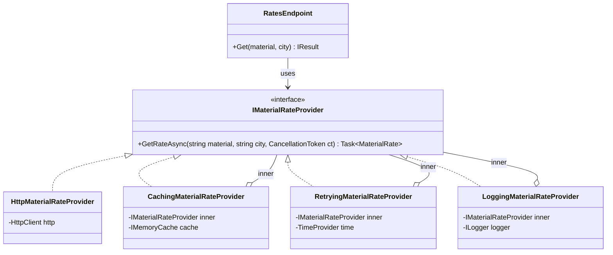
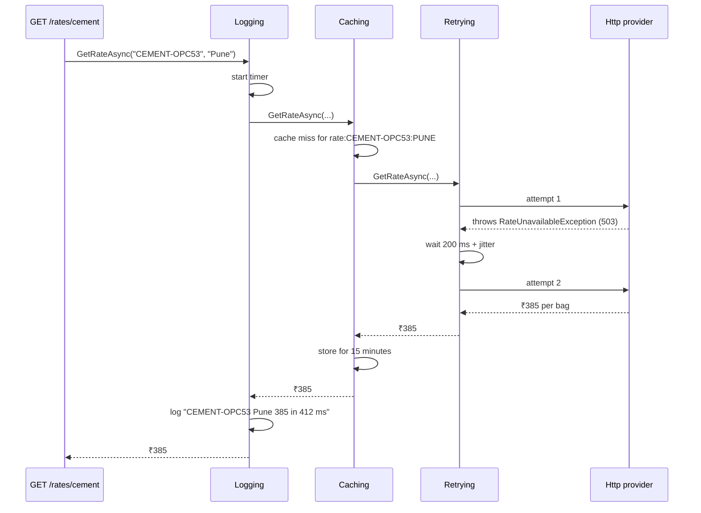

Decorator is how you add "and also" to a class without touching it. Fetch the rate *and also* cache it. Save the order *and also* log how long it took. Call the API *and also* retry on a 503. You don't add these features by editing the class or subclassing it. You wrap it in another object that has the same interface, does its extra bit, and passes the call through. .NET uses this idea everywhere: streams, `HttpClient` handlers, and logging providers all rely on it.

## Learning objectives

By the end of this lesson you will be able to:

1. Explain the problem Decorator solves: cross-cutting behaviour that would otherwise cause subclass explosion or bloated classes.
2. Name the participants (component, concrete component, decorator, concrete decorators) and draw the class and sequence diagrams.
3. Write caching, logging and retry decorators around a service in C#, and reason about the order of the wrappers.
4. Use `DelegatingHandler` to decorate `HttpClient` calls, and recognise stream decorators (`GZipStream`, `BufferedStream`, `CryptoStream`).
5. Register decorator chains in ASP.NET Core DI without Scrutor, including a reusable `Decorate<TService, TDecorator>()` extension.
6. Test each decorator in isolation with fakes, and test the assembled chain.
7. Tell Decorator apart from Proxy, Adapter, Chain of Responsibility and middleware, and know when a decorator is overkill.

## Prerequisites

- [Interfaces and abstract classes](#/lesson/m01-interfaces-abstract): decorators and the thing they wrap share an interface.
- [Dependency injection](#/lesson/m03-dependency-injection) and [service lifetimes](#/lesson/m03-service-lifetimes): we compose decorators in the container, and lifetimes matter.
- [Composition versus inheritance](#/lesson/m04-composition-inheritance): Decorator is the textbook case for composition.

## Explain it like I'm a beginner

Order a cutting chai at a tea stall in Pune. The base is tea with milk: ₹15. Then you say "add ginger" (+₹5), "add elaichi" (+₹5), "extra strong" (+₹3). The chaiwala doesn't brew a separate kind of tea called `GingerElaichiExtraStrongChai`. He starts with the base and **adds layers**. Each layer does its own small thing, and the cup you hold is still "a chai". You drink it exactly the same way.

Now imagine the stall had to print a separate menu item for every combination: ginger chai, elaichi chai, ginger-elaichi chai, ginger-elaichi-strong chai... With 4 add-ons that's 16 menu items. With 6, it's 64. That's the **subclass explosion** problem.

Decorator says: keep one base thing, and build add-ons that each **wrap** whatever they are given and still behave like the base thing.

In code:

- "A chai" is an **interface**: `IMaterialRateProvider` with `GetRateAsync(...)`.
- The base tea is the **concrete component**: `HttpMaterialRateProvider`, which really calls the rates API.
- Each add-on is a **decorator**: `CachingMaterialRateProvider`, `LoggingMaterialRateProvider`, `RetryingMaterialRateProvider`. Each one *implements* the same interface and *holds* another `IMaterialRateProvider` inside it.

```text
Logging( Caching( Retrying( Http ) ) )
```

When the app calls `GetRateAsync`, the call travels inward through each layer and the answer travels back out. The calling code can't tell how many layers there are, just as you can't tell from the cup how many add-ons went in.

Two more things to know:

1. **Order matters.** Sugar before or after the milk makes no difference to chai, but in software, "cache outside retry" and "retry outside cache" behave differently. We'll see why.
2. **Layers are reusable.** The same logging decorator can wrap the real rates provider in production and a fake one in a demo.

## First-principles explanation

### The original problem

The *Design Patterns* book describes Decorator as: "Attach additional responsibilities to an object dynamically. Decorators provide a flexible alternative to subclassing for extending functionality."

Suppose `HttpMaterialRateProvider` fetches today's cement and steel rates for a city from a market-rates API. Over a few months, people ask for:

- **caching** (the rates change once a day, and the API charges per call),
- **logging** with timings,
- **retries** for occasional 503s,
- **metrics** for dashboards,
- later, a **circuit breaker**.

You have three ways to add these:

1. **Edit the class.** It grows to 300 lines, with caching, retries and logging tangled through the one method that matters. Every change risks breaking the HTTP logic, and you can't turn caching off for one caller.
2. **Subclass.** `CachingHttpRateProvider`, `LoggingCachingHttpRateProvider`, `RetryingLoggingCachingHttpRateProvider`... With *n* optional behaviours you need up to 2ⁿ classes. Worse, the behaviours are welded to *HTTP*. A second provider (a CSV import) needs its own set of subclasses.
3. **Wrap.** Each behaviour is a small class that implements `IMaterialRateProvider`, takes an `IMaterialRateProvider` in its constructor, and adds its behaviour around the call. Five behaviours means five classes, combinable in any order, around any provider.

Option 3 is Decorator.

### How it works internally

There is no magic, only two facts about C#:

1. A decorator **is an** `IMaterialRateProvider` (it implements the interface), so anything that accepts the interface accepts the decorator.
2. A decorator **has an** `IMaterialRateProvider` (a constructor parameter, usually called `inner`). It calls `inner.GetRateAsync(...)` at the right moment.

Each decorator does work **before** the inner call (check cache, start timer), **instead of** it (return a cached value, short-circuit when a circuit is open), **after** it (store in cache, log the elapsed time), or **around failures** (catch, wait, retry). Because each wrapper only knows "some inner provider", you can stack them in any order.

The cost at runtime is one extra virtual call per layer, nanoseconds next to a network call of tens of milliseconds. The real costs are elsewhere: more types, a call stack that's harder to follow when debugging, and the need to wire the chain correctly.

### The simplest implementation

```csharp
public sealed class LoggingRateProvider(IMaterialRateProvider inner, ILogger<LoggingRateProvider> log) : IMaterialRateProvider
{
    public async Task<MaterialRate?> GetRateAsync(string material, string city, CancellationToken ct)
    {
        log.LogInformation("Fetching {Material} rate for {City}", material, city);   // before
        var rate = await inner.GetRateAsync(material, city, ct);                      // delegate
        log.LogInformation("Got {Rate}", rate?.PricePerUnit);                          // after
        return rate;
    }
}
```

Implement the interface, hold an inner instance, call it, and add something before or after. Everything else in this lesson is refinement: error handling, order, DI wiring and testing.

### Participants

| Participant | Role | In our example |
|---|---|---|
| **Component** | The interface clients use | `IMaterialRateProvider` |
| **Concrete component** | The real work | `HttpMaterialRateProvider` |
| **Decorator** (optional base) | Holds an inner component and forwards calls by default | Not needed for a one-method interface; useful when the interface has many methods |
| **Concrete decorators** | Each adds one responsibility | `CachingMaterialRateProvider`, `RetryingMaterialRateProvider`, `LoggingMaterialRateProvider` |
| **Client** | Uses the component interface and has no idea it's decorated | The `/rates` endpoint |

The GoF book includes an abstract `Decorator` base class that forwards every method. In C#, that base pays off only when the interface has many members and each decorator overrides just one or two. For small interfaces, implement the interface directly. It's clearer.

### Where .NET already uses Decorator

- **Streams.** `GZipStream`, `BufferedStream`, `CryptoStream` and `SslStream` are all `Stream`s that wrap another `Stream`: `new GZipStream(new BufferedStream(File.Create(path)), CompressionLevel.Optimal)`. Each layer adds compression, buffering, encryption or TLS, and the code writing to the outermost stream doesn't know.
- **`HttpClient` handlers.** A `DelegatingHandler` *is an* `HttpMessageHandler` and *has an* `InnerHandler`. `IHttpClientFactory` chains them: your auth handler → logging handler → resilience handler → `SocketsHttpHandler`.
- **Logging.** `ILogger` implementations are often composed with filtering and scoping layers.
- **Request pipelines.** MediatR-style "pipeline behaviours" (validation, transactions around a command handler) are decorators around handlers.

### When it is useful

- You need **optional, combinable** behaviours (cache, log, retry, metrics, authorise, validate) around a service.
- The behaviours are **cross-cutting**: the same logging decorator could wrap several implementations.
- You **can't or shouldn't change** the original class (third-party, generated, or already well tested).
- You want to switch behaviours by **configuration or environment** (no cache in tests, extra tracing in staging).

### When not to use it

- **There's one behaviour and it's core to the class.** If a repository *must* always validate, put validation in the repository. Decorators are for optional or orthogonal concerns.
- **The framework already does it.** HTTP retries and timeouts belong in the HTTP pipeline (`AddStandardResilienceHandler`, or your own `DelegatingHandler`), not in a hand-written decorator around every typed client. Request logging belongs in ASP.NET Core middleware and OpenTelemetry, not in a decorator on every service.
- **The interface is wide.** Decorating an interface with 25 methods means 25 forwarding methods per decorator. Either split the interface ([ISP](#/lesson/m04-isp)) or reconsider.
- **The decorator needs the internals.** If caching needs to know which *rows* changed inside the repository, a decorator outside can't see them. That logic belongs inside, or in an explicit event.
- **Ordering is subtle and nobody will remember it.** Five decorators in a specific order, wired in a far-away `Program.cs`, can confuse a team. Document the chain and test it.

### Trade-offs

| You gain | You pay |
|---|---|
| Add or remove behaviours without touching the core class | More small classes, and call stacks are deeper in the debugger |
| Combine behaviours freely, without 2ⁿ subclasses | Order is significant, and wrong order is a silent bug |
| Each behaviour is tested alone | Wiring in DI needs care (factories, lifetimes) |
| Reuse one decorator across several implementations | Wide interfaces mean lots of forwarding code |
| Follows the Open/Closed Principle and SRP | Object identity: `decorated is HttpMaterialRateProvider` is now false |

## Visual explanation

### Class diagram



How to read it: every class implements `IMaterialRateProvider` (dotted lines with hollow triangles). The three decorators *also* hold an `IMaterialRateProvider` (hollow diamonds labelled `inner`). That combination of "is one and has one" is the signature of Decorator. Notice that the decorators point at the **interface**, not at `HttpMaterialRateProvider`. That is what lets them stack on each other in any order. The endpoint depends only on the interface and never learns how many layers are inside.

### Sequence diagram



Follow one request inward and back out. Logging is outermost, so it times everything, including the retry wait. Caching sits *outside* Retrying, so a cache hit never triggers retries, and a successful retried value is cached once. If the next request comes within 15 minutes, the Caching layer returns immediately and Retrying and Http aren't called at all. Swap Caching and Retrying and you'd retry around the cache lookup, which is pointless. The diagram is the best tool for reasoning about order: draw it before wiring the chain.

## Step-by-step example

### Step 1 — the naive version: everything in one class

```csharp
public async Task<MaterialRate?> GetRateAsync(string material, string city, CancellationToken ct)
{
    var key = $"rate:{material}:{city}";
    if (_cache.TryGetValue(key, out MaterialRate? hit)) { _log.LogInformation("hit"); return hit; }
    var sw = Stopwatch.StartNew();
    for (var attempt = 1; ; attempt++)
    {
        try
        {
            var rate = await _http.GetFromJsonAsync<MaterialRate>($"v1/rates/{material}?city={city}", ct);
            _cache.Set(key, rate, TimeSpan.FromMinutes(15));
            _log.LogInformation("ok in {Ms}", sw.ElapsedMilliseconds);
            return rate;
        }
        catch (HttpRequestException) when (attempt < 3) { await Task.Delay(200 * attempt, ct); }
    }
}
```

The HTTP call, the one line that matters, is buried. You can't test retries without HTTP, can't disable caching for an admin "refresh" screen, and can't reuse the retry logic for the CSV-based provider.

### Step 2 — identify the layers

Read the method and label each line: *caching*, *timing/logging*, *retry*, *real work*. Each label becomes one class.

### Step 3 — one decorator per concern

Move each concern into its own class implementing `IMaterialRateProvider`. The HTTP class keeps only the HTTP call and the translation of status codes into domain exceptions.

### Step 4 — compose in DI

Register the real provider, then wrap it: Retry, then Cache, then Logging. The endpoint code doesn't change at all.

## Production-style C# implementation

```text
Infra.Api/
  Program.cs
  Rates/MaterialRates.cs                  # component interface + types
  Rates/HttpMaterialRateProvider.cs       # concrete component
  Rates/Decorators/CachingMaterialRateProvider.cs
  Rates/Decorators/RetryingMaterialRateProvider.cs
  Rates/Decorators/LoggingMaterialRateProvider.cs
  Http/ApiKeyHandler.cs                   # DelegatingHandler: a decorator for HttpClient
  DependencyInjection/DecoratorExtensions.cs
```

```csharp file=Rates/MaterialRates.cs
namespace Infra.Rates;

public sealed record MaterialRate(string MaterialCode, string City, decimal PricePerUnit, string Unit, DateOnly AsOf);

/// <summary>The rate service is temporarily unavailable; retrying may help.</summary>
public sealed class RateUnavailableException(string message, Exception? inner = null) : Exception(message, inner);

/// <summary>Component interface. Every decorator implements it AND wraps it.</summary>
public interface IMaterialRateProvider
{
    /// <returns>The rate, or null if the material/city combination is unknown.</returns>
    Task<MaterialRate?> GetRateAsync(string materialCode, string city, CancellationToken ct = default);
}
```

```csharp file=Rates/HttpMaterialRateProvider.cs
using System.Net;
using System.Net.Http.Json;

namespace Infra.Rates;

/// <summary>Concrete component: only the HTTP call and status-code translation. No caching, retries or logging.</summary>
public sealed class HttpMaterialRateProvider(HttpClient http) : IMaterialRateProvider
{
    public async Task<MaterialRate?> GetRateAsync(string materialCode, string city, CancellationToken ct = default)
    {
        var url = $"v1/rates/{Uri.EscapeDataString(materialCode)}?city={Uri.EscapeDataString(city)}";
        HttpResponseMessage response;
        try
        {
            response = await http.GetAsync(url, ct);
        }
        catch (HttpRequestException ex)
        {
            throw new RateUnavailableException("Rate service unreachable.", ex);
        }

        using (response)
        {
            if (response.StatusCode == HttpStatusCode.NotFound) return null;
            if (response.StatusCode is HttpStatusCode.TooManyRequests || (int)response.StatusCode >= 500)
                throw new RateUnavailableException($"Rate service returned {(int)response.StatusCode}.");
            response.EnsureSuccessStatusCode();
            return await response.Content.ReadFromJsonAsync<MaterialRate>(ct);
        }
    }
}
```

```csharp file=Rates/Decorators/CachingMaterialRateProvider.cs
using Microsoft.Extensions.Caching.Memory;
using Microsoft.Extensions.Options;

namespace Infra.Rates.Decorators;

public sealed class RateCacheOptions
{
    public TimeSpan TimeToLive { get; set; } = TimeSpan.FromMinutes(15);
}

/// <summary>Cache-aside decorator. Unknown materials (null) are not cached, so typos don't stick.</summary>
public sealed class CachingMaterialRateProvider(IMaterialRateProvider inner, IMemoryCache cache, IOptions<RateCacheOptions> options)
    : IMaterialRateProvider
{
    public async Task<MaterialRate?> GetRateAsync(string materialCode, string city, CancellationToken ct = default)
    {
        var key = $"rate:{materialCode.ToUpperInvariant()}:{city.ToUpperInvariant()}";
        if (cache.TryGetValue(key, out MaterialRate? cached)) return cached;

        var rate = await inner.GetRateAsync(materialCode, city, ct);
        if (rate is not null) cache.Set(key, rate, options.Value.TimeToLive);
        return rate;
    }
}
```

```csharp file=Rates/Decorators/RetryingMaterialRateProvider.cs
using Microsoft.Extensions.Options;

namespace Infra.Rates.Decorators;

public sealed class RateRetryOptions
{
    public int MaxAttempts { get; set; } = 3;
    public TimeSpan BaseDelay { get; set; } = TimeSpan.FromMilliseconds(200);
}

/// <summary>Retries only RateUnavailableException (transient), with exponential backoff and jitter.
/// Reads are idempotent, so retrying is safe here; never wrap non-idempotent writes like this.</summary>
public sealed class RetryingMaterialRateProvider(
    IMaterialRateProvider inner, IOptions<RateRetryOptions> options, TimeProvider time, ILogger<RetryingMaterialRateProvider> logger)
    : IMaterialRateProvider
{
    private readonly RateRetryOptions _o = options.Value;

    public async Task<MaterialRate?> GetRateAsync(string materialCode, string city, CancellationToken ct = default)
    {
        for (var attempt = 1; ; attempt++)
        {
            try
            {
                return await inner.GetRateAsync(materialCode, city, ct);
            }
            catch (RateUnavailableException ex) when (attempt < _o.MaxAttempts && !ct.IsCancellationRequested)
            {
                var delay = Backoff(attempt);
                logger.LogWarning(ex, "Rate lookup attempt {Attempt} failed; retrying in {DelayMs} ms", attempt, (int)delay.TotalMilliseconds);
                await Task.Delay(delay, time, ct);
            }
        }
    }

    // 200 ms, 400 ms, 800 ms ... plus up to 50 % random jitter so many clients don't retry in lockstep.
    private TimeSpan Backoff(int attempt) =>
        _o.BaseDelay * Math.Pow(2, attempt - 1) * (1 + Random.Shared.NextDouble() * 0.5);
}
```

```csharp file=Rates/Decorators/LoggingMaterialRateProvider.cs
using System.Diagnostics;

namespace Infra.Rates.Decorators;

/// <summary>Outermost decorator: logs every call, including cache hits, with its duration.</summary>
public sealed class LoggingMaterialRateProvider(IMaterialRateProvider inner, ILogger<LoggingMaterialRateProvider> logger)
    : IMaterialRateProvider
{
    public async Task<MaterialRate?> GetRateAsync(string materialCode, string city, CancellationToken ct = default)
    {
        var start = Stopwatch.GetTimestamp();
        try
        {
            var rate = await inner.GetRateAsync(materialCode, city, ct);
            logger.LogInformation("Rate {Material}/{City} = {Price} in {ElapsedMs:F0} ms",
                materialCode, city, rate?.PricePerUnit, Stopwatch.GetElapsedTime(start).TotalMilliseconds);
            return rate;
        }
        catch (Exception ex) when (ex is not OperationCanceledException)
        {
            logger.LogError(ex, "Rate {Material}/{City} failed after {ElapsedMs:F0} ms",
                materialCode, city, Stopwatch.GetElapsedTime(start).TotalMilliseconds);
            throw;   // never swallow: a logging decorator must not change behaviour
        }
    }
}
```

```csharp file=Http/ApiKeyHandler.cs
using Microsoft.Extensions.Options;

namespace Infra.Http;

public sealed class RateApiOptions
{
    public string BaseUrl { get; set; } = "https://rates.example.com/";
    public string ApiKey { get; set; } = "";
}

/// <summary>A decorator for HttpClient: same "send a request" contract, plus an API-key header.</summary>
public sealed class ApiKeyHandler(IOptions<RateApiOptions> options) : DelegatingHandler
{
    protected override Task<HttpResponseMessage> SendAsync(HttpRequestMessage request, CancellationToken cancellationToken)
    {
        if (!request.Headers.Contains("X-Api-Key"))
            request.Headers.TryAddWithoutValidation("X-Api-Key", options.Value.ApiKey);
        return base.SendAsync(request, cancellationToken);
    }
}
```

```csharp file=DependencyInjection/DecoratorExtensions.cs
using Microsoft.Extensions.DependencyInjection;

namespace Infra.DependencyInjection;

public static class DecoratorExtensions
{
    /// <summary>
    /// Wraps the most recent non-keyed registration of <typeparamref name="TService"/> with
    /// <typeparamref name="TDecorator"/>, keeping its lifetime. Call it once per layer, innermost first.
    /// The decorator's other constructor parameters are resolved from the container.
    /// </summary>
    public static IServiceCollection Decorate<TService, TDecorator>(this IServiceCollection services)
        where TService : class
        where TDecorator : class, TService
    {
        var index = -1;
        for (var i = services.Count - 1; i >= 0; i--)
        {
            if (services[i].ServiceType == typeof(TService) && !services[i].IsKeyedService) { index = i; break; }
        }
        if (index < 0)
            throw new InvalidOperationException($"Register {typeof(TService).Name} before decorating it with {typeof(TDecorator).Name}.");

        var inner = services[index];
        Func<IServiceProvider, object> createInner = inner switch
        {
            { ImplementationInstance: { } instance } => _ => instance,
            { ImplementationFactory: { } factory } => factory,
            { ImplementationType: { } type } => sp => ActivatorUtilities.CreateInstance(sp, type),
            _ => throw new InvalidOperationException($"Unsupported registration for {typeof(TService).Name}."),
        };

        services[index] = ServiceDescriptor.Describe(
            typeof(TService),
            sp => ActivatorUtilities.CreateInstance<TDecorator>(sp, (TService)createInner(sp)),
            inner.Lifetime);
        return services;
    }
}
```

```csharp file=Program.cs
using Infra.DependencyInjection;
using Infra.Http;
using Infra.Rates;
using Infra.Rates.Decorators;
using Microsoft.Extensions.Options;

var builder = WebApplication.CreateBuilder(args);

builder.Services.AddMemoryCache();
builder.Services.AddSingleton(TimeProvider.System);
builder.Services.Configure<RateApiOptions>(builder.Configuration.GetSection("Rates:Api"));
builder.Services.Configure<RateCacheOptions>(builder.Configuration.GetSection("Rates:Cache"));
builder.Services.Configure<RateRetryOptions>(builder.Configuration.GetSection("Rates:Retry"));

// 1. Concrete component: a typed HttpClient, itself decorated by a DelegatingHandler.
builder.Services.AddTransient<ApiKeyHandler>();
builder.Services.AddHttpClient<IMaterialRateProvider, HttpMaterialRateProvider>((sp, c) =>
{
    c.BaseAddress = new Uri(sp.GetRequiredService<IOptions<RateApiOptions>>().Value.BaseUrl);
    c.Timeout = TimeSpan.FromSeconds(5);
}).AddHttpMessageHandler<ApiKeyHandler>();

// 2. Decorators, innermost first. Resulting chain: Logging(Caching(Retrying(Http))).
builder.Services.Decorate<IMaterialRateProvider, RetryingMaterialRateProvider>();
builder.Services.Decorate<IMaterialRateProvider, CachingMaterialRateProvider>();
builder.Services.Decorate<IMaterialRateProvider, LoggingMaterialRateProvider>();

var app = builder.Build();

app.MapGet("/rates/{material}", async (string material, string city, IMaterialRateProvider rates, CancellationToken ct) =>
{
    try
    {
        var rate = await rates.GetRateAsync(material, city, ct);
        return rate is null ? Results.NotFound() : Results.Ok(rate);
    }
    catch (RateUnavailableException)
    {
        return Results.Problem("Material rates are temporarily unavailable.", statusCode: StatusCodes.Status503ServiceUnavailable);
    }
});

app.Run();
```

### Registering decorators without Scrutor

The popular Scrutor library provides `services.Decorate<TService, TDecorator>()`. You don't need it for this. There are two built-in-only options:

**Option A: an explicit factory.** It's the most readable for a single chain:

```csharp
builder.Services.AddScoped<SqlProjectRepository>();
builder.Services.AddScoped<IProjectRepository>(sp =>
    new LoggingProjectRepository(
        new CachingProjectRepository(
            sp.GetRequiredService<SqlProjectRepository>(),
            sp.GetRequiredService<IMemoryCache>()),
        sp.GetRequiredService<ILogger<LoggingProjectRepository>>()));
```

The nesting *is* the diagram: read from the inside out. The downside is that adding a constructor parameter to any decorator means editing this factory.

**Option B: the `Decorate` extension above** (about 30 lines). It finds the last registration of the service, replaces it with a factory that builds the original and passes it to `ActivatorUtilities.CreateInstance<TDecorator>`, and keeps the original lifetime. `ActivatorUtilities` fills the remaining constructor parameters (`IMemoryCache`, `ILogger<T>`, options) from the container.

Caveats for either option:

- **Lifetimes.** The decorator gets the *inner's* lifetime. A singleton decorator around a scoped inner would capture it (a captive dependency). Keep stateful caches in a singleton `IMemoryCache`, not in decorator fields, so transient or scoped decorators lose nothing.
- **Disposal.** The container disposes the object the factory returns (the outermost decorator). An inner object created by `ActivatorUtilities` inside the factory isn't tracked. If the inner owns resources, have the decorator dispose it, or register the inner as its own service and resolve it.
- **Keyed and open-generic services** need separate handling. The extension skips keyed registrations on purpose.

### Stream decorators in one picture

```csharp
await using var file   = File.Create("boq-export.csv.gz");                     // concrete component
await using var gzip   = new GZipStream(file, CompressionLevel.SmallestSize);  // decorator: compression
await using var buffer = new BufferedStream(gzip, 64 * 1024);                   // decorator: buffering
await using var writer = new StreamWriter(buffer);                              // adapter: Stream -> text
await writer.WriteLineAsync("code,description,qty,rate");
```

`GZipStream` and `BufferedStream` are decorators: they *are* `Stream`s and *wrap* a `Stream`. `StreamWriter` is different. It's an *adapter* that turns a byte stream into a text-writing interface. Disposing the outer layer flushes and disposes the inner ones, in order. This one snippet shows Decorator and [Adapter](#/lesson/m06-adapter) side by side.

## Bad design vs good design

**Bad: subclassing for each combination.**

```csharp
public class HttpRateProvider { public virtual Task<MaterialRate?> GetRateAsync(...) { ... } }
public class CachingHttpRateProvider : HttpRateProvider { public override async Task<MaterialRate?> GetRateAsync(...) { /* cache, then base */ } }
public class LoggingCachingHttpRateProvider : CachingHttpRateProvider { /* log, then base */ }
public class RetryingLoggingCachingHttpRateProvider : LoggingCachingHttpRateProvider { /* retry, then base */ }
// and the CSV provider needs CachingCsvRateProvider, LoggingCachingCsvRateProvider, ...
```

Problems:

- The behaviours are fused to `HttpRateProvider` and can't be reused for the CSV provider.
- The order is frozen by the inheritance chain.
- You can't get "logging without caching" without yet another class.
- Testing caching requires a real HTTP stack, because the cache lives in a subclass of it.

**Also bad: a decorator that changes behaviour.**

```csharp
catch (Exception ex) { _log.LogError(ex, "failed"); return null; }   // swallows errors: callers now see "not found"
```

A logging decorator that turns failures into `null` changes the contract. The endpoint returns 404 for an outage. Decorators may add behaviour, but they must keep the component's contract: same results, same exceptions, unless changing them *is* the decorator's documented purpose (as with retries).

**Good:** the implementation above. Each concern lives in one class, the core class only does HTTP, the chain is composed in one place, and each layer can be tested with a fake inner provider.

**Is it worth it?** If you need only one concern (say, caching) on one service, a single decorator is still cheap and clean. But for HTTP-level concerns (retries, timeouts, circuit breakers), prefer the HTTP pipeline. `DelegatingHandler`s and Microsoft's resilience handlers already exist for that, and they apply to every call through the client.

:::callout type=tradeoff title="Order is behaviour"
`Cache(Retry(Http))` retries only on cache misses. `Retry(Cache(Http))` also "retries" cache lookups (harmless but pointless). `Logging` outermost logs cache hits; innermost, it logs only real HTTP calls. A circuit breaker should sit *inside* the cache, so cached values are still served while the breaker is open. Decide the order from the sequence diagram, write it in a comment, and test it.
:::

:::callout type=mistake title="Retrying non-idempotent calls"
A retry decorator around `CreatePaymentAsync` can charge a customer twice if the first attempt succeeded but its response was lost. Retry only idempotent operations, or use idempotency keys ([see the lesson](#/lesson/m10-idempotency)).
:::

## Practical playground

Run the program and read the console output from top to bottom. It shows how the call travels through the layers. Then swap the order of `Retrying` and `Logging` in `Main` and predict the new output before running it again.

:::playground type=csharp title="Watch a decorator chain run"
```csharp file=Program.cs
using System;
using System.Threading.Tasks;

public interface IMessageSender { Task SendAsync(string to, string text); }

// Concrete component that fails twice, then succeeds.
public sealed class FlakySmsSender : IMessageSender
{
    private int _calls;
    public Task SendAsync(string to, string text)
    {
        _calls++;
        Console.WriteLine($"      [sms] attempt {_calls} to {to}");
        return _calls < 3 ? Task.FromException(new TimeoutException("gateway timeout")) : Task.CompletedTask;
    }
}

public sealed class RetryingSender(IMessageSender inner, int maxAttempts) : IMessageSender
{
    public async Task SendAsync(string to, string text)
    {
        for (var attempt = 1; ; attempt++)
        {
            try { await inner.SendAsync(to, text); return; }
            catch (TimeoutException) when (attempt < maxAttempts) { Console.WriteLine($"    [retry] attempt {attempt} failed, retrying"); }
        }
    }
}

public sealed class LoggingSender(IMessageSender inner) : IMessageSender
{
    public async Task SendAsync(string to, string text)
    {
        Console.WriteLine($"  [log] -> SendAsync({to})");
        try { await inner.SendAsync(to, text); Console.WriteLine("  [log] <- ok"); }
        catch (Exception ex) { Console.WriteLine($"  [log] <- failed: {ex.Message}"); throw; }
    }
}

public static class Program
{
    public static async Task Main()
    {
        IMessageSender sender = new LoggingSender(new RetryingSender(new FlakySmsSender(), maxAttempts: 3));
        Console.WriteLine("Chain: Logging(Retrying(Flaky))");
        await sender.SendAsync("+919876543210", "Concrete pour at 06:00 tomorrow");
    }
}
```
:::

With Logging outside Retrying, you see one "->" and one "<- ok", and the two failed attempts are hidden inside the retry layer. Swap them (`new RetryingSender(new LoggingSender(new FlakySmsSender()), 3)`) and logging now records *each attempt*, including two failures. Neither order is wrong. They answer different questions ("did the operation succeed?" versus "how often does the gateway fail?"), which is why order is a design decision.

## Exercises

:::exercise id=m06-decorator-ex1 difficulty=beginner kind=code title="A logging decorator that doesn't change behaviour"
Write `LoggingGstRateService`, a decorator for `IGstRateService` that logs each lookup. The tests provide a simple in-memory logger.
::requirements
- On success, log one `Information` entry that contains the HSN code and the returned rate, and return the inner value unchanged.
- On failure, log one `Error` entry carrying the exception, then rethrow the **same** exception object.
- Call the inner service exactly once per call.
::acceptance
- `GetRateAsync("7308")` returns 18 from the inner service and logs an Information message containing "7308" and "18".
- When the inner service throws, the same exception instance reaches the caller, and the Error entry carries it.
- The inner service is called exactly once per lookup.
::hint
The decorator implements `IGstRateService` and receives an `IGstRateService` in its constructor. What do you do before, after and on failure?
::hint
Use `try { var rate = await _inner.GetRateAsync(...); log; return rate; } catch (Exception ex) { log; throw; }`.
::hint
`throw;` rethrows the same exception and keeps its stack trace. `throw ex;` resets the stack trace and is a common mistake.
::hint
Use structured logging: `_logger.LogInformation("GST rate for HSN {Hsn} is {Rate}%", hsn, rate);`
::starter
```csharp file=LoggingGstRateService.cs
using System;
using System.Threading;
using System.Threading.Tasks;
using Microsoft.Extensions.Logging;

public interface IGstRateService
{
    Task<decimal> GetRateAsync(string hsnCode, CancellationToken ct = default);
}

public sealed class LoggingGstRateService : IGstRateService
{
    public LoggingGstRateService(IGstRateService inner, ILogger<LoggingGstRateService> logger) =>
        throw new NotImplementedException();

    public Task<decimal> GetRateAsync(string hsnCode, CancellationToken ct = default) =>
        throw new NotImplementedException();
}
```
::tests
```csharp file=LoggingGstRateServiceTests.cs
using System;
using System.Collections.Generic;
using System.Linq;
using System.Threading;
using System.Threading.Tasks;
using Microsoft.Extensions.Logging;
using Xunit;

public sealed class ListLogger<T> : ILogger<T>
{
    public List<(LogLevel Level, string Message, Exception? Exception)> Entries { get; } = new();
    public IDisposable? BeginScope<TState>(TState state) where TState : notnull => null;
    public bool IsEnabled(LogLevel logLevel) => true;
    public void Log<TState>(LogLevel logLevel, EventId eventId, TState state, Exception? exception, Func<TState, Exception?, string> formatter) =>
        Entries.Add((logLevel, formatter(state, exception), exception));
}

public sealed class FakeGst : IGstRateService
{
    public int Calls { get; private set; }
    public Exception? Throw { get; set; }
    public Task<decimal> GetRateAsync(string hsnCode, CancellationToken ct = default)
    {
        Calls++;
        return Throw is null ? Task.FromResult(18m) : Task.FromException<decimal>(Throw);
    }
}

public class LoggingGstRateServiceTests
{
    [Fact]
    public async Task Logs_success_and_returns_inner_value()
    {
        var inner = new FakeGst();
        var log = new ListLogger<LoggingGstRateService>();
        var rate = await new LoggingGstRateService(inner, log).GetRateAsync("7308");
        Assert.Equal(18m, rate);
        var entry = Assert.Single(log.Entries);
        Assert.Equal(LogLevel.Information, entry.Level);
        Assert.Contains("7308", entry.Message);
        Assert.Contains("18", entry.Message);
    }

    [Fact]
    public async Task Logs_error_and_rethrows_same_exception()
    {
        var boom = new InvalidOperationException("GST portal down");
        var inner = new FakeGst { Throw = boom };
        var log = new ListLogger<LoggingGstRateService>();
        var thrown = await Assert.ThrowsAsync<InvalidOperationException>(() => new LoggingGstRateService(inner, log).GetRateAsync("7308"));
        Assert.Same(boom, thrown);
        var entry = Assert.Single(log.Entries);
        Assert.Equal(LogLevel.Error, entry.Level);
        Assert.Same(boom, entry.Exception);
    }

    [Fact]
    public async Task Calls_inner_exactly_once()
    {
        var inner = new FakeGst();
        var svc = new LoggingGstRateService(inner, new ListLogger<LoggingGstRateService>());
        await svc.GetRateAsync("2523");
        await svc.GetRateAsync("7214");
        Assert.Equal(2, inner.Calls);
    }
}
```
::solution
```csharp file=LoggingGstRateService.cs
using System;
using System.Threading;
using System.Threading.Tasks;
using Microsoft.Extensions.Logging;

public interface IGstRateService
{
    Task<decimal> GetRateAsync(string hsnCode, CancellationToken ct = default);
}

public sealed class LoggingGstRateService : IGstRateService
{
    private readonly IGstRateService _inner;
    private readonly ILogger<LoggingGstRateService> _logger;

    public LoggingGstRateService(IGstRateService inner, ILogger<LoggingGstRateService> logger)
    {
        _inner = inner ?? throw new ArgumentNullException(nameof(inner));
        _logger = logger ?? throw new ArgumentNullException(nameof(logger));
    }

    public async Task<decimal> GetRateAsync(string hsnCode, CancellationToken ct = default)
    {
        try
        {
            var rate = await _inner.GetRateAsync(hsnCode, ct);
            _logger.LogInformation("GST rate for HSN {Hsn} is {Rate}%", hsnCode, rate);
            return rate;
        }
        catch (Exception ex)
        {
            _logger.LogError(ex, "GST rate lookup failed for HSN {Hsn}", hsnCode);
            throw;
        }
    }
}
```

The decorator is invisible to callers: same results, same exceptions. The only observable difference is the log entries, which is exactly its purpose.
::mistakes
- `throw ex;` loses the original stack trace.
- `return 0m;` in the `catch`. GST at 0 % on a failure is a very expensive bug.
- String interpolation in log messages (`$"... {hsn}"`), which loses structured logging fields.
::extensions
Add the elapsed time using `Stopwatch.GetTimestamp()` and `Stopwatch.GetElapsedTime(start)`, and skip the Error log for `OperationCanceledException` (a client disconnecting isn't a server error).
:::

:::exercise id=m06-decorator-ex2 difficulty=beginner kind=code title="A caching repository decorator with invalidation"
Write `CachingProjectRepository`, a decorator for `IProjectRepository` that caches `GetByIdAsync` results in `IMemoryCache` and invalidates on update.
::requirements
- Cache key `project:{id}`, with an absolute expiry of the given TTL (default 5 minutes).
- Don't cache `null` (unknown project), so a project created later isn't hidden.
- `UpdateAsync` calls the inner repository first, and removes the cache entry **only if** the update succeeded.
::acceptance
- Two `GetByIdAsync(42)` calls hit the inner repository once.
- Two lookups of an unknown id hit the inner repository twice.
- After `UpdateAsync`, the next `GetByIdAsync` returns the updated project from the inner repository.
- If the inner `UpdateAsync` throws, the exception propagates and the old cached value is still served.
::hint
Reads: `if (cache.TryGetValue(key, out Project? p)) return p;`, otherwise load, and if not null, `Set` with the TTL.
::hint
Writes: `await inner.UpdateAsync(...)`, then `cache.Remove(key)`. If the first line throws, the second never runs, which is what you want.
::hint
Why not update the cache with the new value instead of removing it? Think about what the database might change: triggers, computed columns, concurrency tokens.
::hint
`cache.Set(key, project, ttl)` with a `TimeSpan` sets an absolute expiry relative to now.
::starter
```csharp file=CachingProjectRepository.cs
using System;
using System.Threading;
using System.Threading.Tasks;
using Microsoft.Extensions.Caching.Memory;

public sealed record Project(int Id, string Name, decimal PhysicalProgressPercent);

public interface IProjectRepository
{
    Task<Project?> GetByIdAsync(int id, CancellationToken ct = default);
    Task UpdateAsync(Project project, CancellationToken ct = default);
}

public sealed class CachingProjectRepository : IProjectRepository
{
    public CachingProjectRepository(IProjectRepository inner, IMemoryCache cache, TimeSpan? ttl = null) =>
        throw new NotImplementedException();

    public Task<Project?> GetByIdAsync(int id, CancellationToken ct = default) => throw new NotImplementedException();
    public Task UpdateAsync(Project project, CancellationToken ct = default) => throw new NotImplementedException();
}
```
::tests
```csharp file=CachingProjectRepositoryTests.cs
using System;
using System.Collections.Generic;
using System.Threading;
using System.Threading.Tasks;
using Microsoft.Extensions.Caching.Memory;
using Xunit;

public sealed class InMemoryRepo : IProjectRepository
{
    public Dictionary<int, Project> Rows { get; } = new() { [42] = new Project(42, "NH-44 Package 3", 61.5m) };
    public int Gets { get; private set; }
    public bool FailUpdates { get; set; }

    public Task<Project?> GetByIdAsync(int id, CancellationToken ct = default)
    {
        Gets++;
        return Task.FromResult(Rows.TryGetValue(id, out var p) ? p : null);
    }

    public Task UpdateAsync(Project project, CancellationToken ct = default)
    {
        if (FailUpdates) throw new InvalidOperationException("deadlock");
        Rows[project.Id] = project;
        return Task.CompletedTask;
    }
}

public class CachingProjectRepositoryTests
{
    private static (CachingProjectRepository Sut, InMemoryRepo Inner) Create()
    {
        var inner = new InMemoryRepo();
        return (new CachingProjectRepository(inner, new MemoryCache(new MemoryCacheOptions())), inner);
    }

    [Fact]
    public async Task Second_read_is_served_from_cache()
    {
        var (sut, inner) = Create();
        var a = await sut.GetByIdAsync(42);
        var b = await sut.GetByIdAsync(42);
        Assert.Equal(1, inner.Gets);
        Assert.Equal(a, b);
    }

    [Fact]
    public async Task Null_is_not_cached()
    {
        var (sut, inner) = Create();
        Assert.Null(await sut.GetByIdAsync(7));
        Assert.Null(await sut.GetByIdAsync(7));
        Assert.Equal(2, inner.Gets);
    }

    [Fact]
    public async Task Update_invalidates()
    {
        var (sut, inner) = Create();
        await sut.GetByIdAsync(42);
        await sut.UpdateAsync(new Project(42, "NH-44 Package 3", 64.0m));
        var after = await sut.GetByIdAsync(42);
        Assert.Equal(64.0m, after!.PhysicalProgressPercent);
        Assert.Equal(2, inner.Gets);
    }

    [Fact]
    public async Task Failed_update_keeps_cache()
    {
        var (sut, inner) = Create();
        await sut.GetByIdAsync(42);
        inner.FailUpdates = true;
        await Assert.ThrowsAsync<InvalidOperationException>(() => sut.UpdateAsync(new Project(42, "x", 99m)));
        var still = await sut.GetByIdAsync(42);
        Assert.Equal(61.5m, still!.PhysicalProgressPercent);
        Assert.Equal(1, inner.Gets);
    }

    [Fact]
    public async Task Different_ids_are_cached_separately()
    {
        var (sut, inner) = Create();
        inner.Rows[43] = new Project(43, "Bridge at Km 18", 20m);
        await sut.GetByIdAsync(42);
        await sut.GetByIdAsync(43);
        await sut.GetByIdAsync(42);
        Assert.Equal(2, inner.Gets);
    }
}
```
::solution
```csharp file=CachingProjectRepository.cs
using System;
using System.Threading;
using System.Threading.Tasks;
using Microsoft.Extensions.Caching.Memory;

public sealed record Project(int Id, string Name, decimal PhysicalProgressPercent);

public interface IProjectRepository
{
    Task<Project?> GetByIdAsync(int id, CancellationToken ct = default);
    Task UpdateAsync(Project project, CancellationToken ct = default);
}

public sealed class CachingProjectRepository : IProjectRepository
{
    private readonly IProjectRepository _inner;
    private readonly IMemoryCache _cache;
    private readonly TimeSpan _ttl;

    public CachingProjectRepository(IProjectRepository inner, IMemoryCache cache, TimeSpan? ttl = null)
    {
        _inner = inner ?? throw new ArgumentNullException(nameof(inner));
        _cache = cache ?? throw new ArgumentNullException(nameof(cache));
        _ttl = ttl ?? TimeSpan.FromMinutes(5);
    }

    private static string Key(int id) => $"project:{id}";

    public async Task<Project?> GetByIdAsync(int id, CancellationToken ct = default)
    {
        if (_cache.TryGetValue(Key(id), out Project? cached)) return cached;
        var project = await _inner.GetByIdAsync(id, ct);
        if (project is not null) _cache.Set(Key(id), project, _ttl);
        return project;
    }

    public async Task UpdateAsync(Project project, CancellationToken ct = default)
    {
        ArgumentNullException.ThrowIfNull(project);
        await _inner.UpdateAsync(project, ct);   // if this throws, the cache stays as it was
        _cache.Remove(Key(project.Id));
    }
}
```

Removing instead of overwriting is the safer default: the next read gets exactly what the database stored, including anything triggers or defaults changed. This is the cache-aside pattern described in the [caching patterns lesson](#/lesson/m12-cache-patterns).
::mistakes
- Removing the key *before* the update. A concurrent read can then re-cache the old value between the remove and the write.
- Caching `null` with the same TTL, so a newly created project is "not found" for 5 minutes.
- Building the key from `project.Name` or another mutable field.
::extensions
With several API instances, an in-memory cache can't be invalidated across servers. Explain how you'd switch to `HybridCache` or Redis with the *same* decorator interface, and what TTL you'd accept as the staleness bound.
:::

:::exercise id=m06-decorator-ex3 difficulty=intermediate kind=code title="Decorate HttpClient with DelegatingHandlers"
Write two `DelegatingHandler`s: `CorrelationIdHandler`, which adds an `X-Correlation-ID` header if it's missing, and `RetryOn503Handler`, which retries idempotent requests on `503 Service Unavailable`.
::requirements
- `CorrelationIdHandler(Func<string> idFactory)` adds the header from the factory unless the request already has one. An existing value is never overwritten.
- `RetryOn503Handler(int maxRetries, TimeSpan delay)` retries only `GET`, `HEAD`, `PUT`, `DELETE` and `OPTIONS` (idempotent methods), never `POST`.
- After the last retry, return the final response, even if it is still a 503.
- Dispose every response you discard before retrying, to free connections.
::acceptance
- A GET that receives 503, 503, 200 returns 200 after 3 attempts.
- A GET that keeps receiving 503 with `maxRetries: 2` returns 503 after 3 attempts.
- A POST receiving 503 is sent once.
- Every attempt carries the correlation header, and a caller-supplied header is preserved.
- The two discarded 503 responses are disposed; the returned response is not.
::hint
A `DelegatingHandler` overrides `SendAsync` and calls `base.SendAsync(request, ct)` to reach its inner handler. That is the "delegate to inner" step of Decorator.
::hint
Use `HttpMethod` comparisons: `request.Method == HttpMethod.Get || ...`. Note that `HttpMethod.Post` isn't idempotent.
::hint
The retry loop is: send; while the status is 503 and retries remain, dispose the response, wait, send again.
::hint
In tests, chain handlers by setting `InnerHandler`, and wrap the outermost one in `new HttpMessageInvoker(handler)`.
::starter
```csharp file=Handlers.cs
using System;
using System.Net;
using System.Net.Http;
using System.Threading;
using System.Threading.Tasks;

public sealed class CorrelationIdHandler : DelegatingHandler
{
    public const string HeaderName = "X-Correlation-ID";

    public CorrelationIdHandler(Func<string> idFactory) => throw new NotImplementedException();

    protected override Task<HttpResponseMessage> SendAsync(HttpRequestMessage request, CancellationToken cancellationToken) =>
        throw new NotImplementedException();
}

public sealed class RetryOn503Handler : DelegatingHandler
{
    public RetryOn503Handler(int maxRetries, TimeSpan delay) => throw new NotImplementedException();

    protected override Task<HttpResponseMessage> SendAsync(HttpRequestMessage request, CancellationToken cancellationToken) =>
        throw new NotImplementedException();
}
```
::tests
```csharp file=HandlersTests.cs
using System;
using System.Collections.Generic;
using System.Linq;
using System.Net;
using System.Net.Http;
using System.Threading;
using System.Threading.Tasks;
using Xunit;

public sealed class TrackedResponse : HttpResponseMessage
{
    public TrackedResponse(HttpStatusCode code) : base(code) { }
    public bool Disposed { get; private set; }
    protected override void Dispose(bool disposing) { Disposed = true; base.Dispose(disposing); }
}

public sealed class ScriptedHandler : HttpMessageHandler
{
    private readonly Queue<HttpStatusCode> _codes;
    public ScriptedHandler(params HttpStatusCode[] codes) { _codes = new Queue<HttpStatusCode>(codes); }
    public List<string?> SeenCorrelationIds { get; } = new();
    public List<TrackedResponse> Responses { get; } = new();

    protected override Task<HttpResponseMessage> SendAsync(HttpRequestMessage request, CancellationToken cancellationToken)
    {
        SeenCorrelationIds.Add(request.Headers.TryGetValues(CorrelationIdHandler.HeaderName, out var v) ? v.Single() : null);
        var r = new TrackedResponse(_codes.Count > 1 ? _codes.Dequeue() : _codes.Peek());
        Responses.Add(r);
        return Task.FromResult<HttpResponseMessage>(r);
    }
}

public class HandlersTests
{
    private static HttpMessageInvoker Chain(ScriptedHandler stub, int retries = 2) =>
        new(new CorrelationIdHandler(() => "corr-123")
        {
            InnerHandler = new RetryOn503Handler(retries, TimeSpan.Zero) { InnerHandler = stub },
        });

    private static HttpRequestMessage Req(HttpMethod m) => new(m, "https://rates.example.com/v1/rates/STEEL");

    [Fact]
    public async Task Get_retries_until_success()
    {
        var stub = new ScriptedHandler(HttpStatusCode.ServiceUnavailable, HttpStatusCode.ServiceUnavailable, HttpStatusCode.OK);
        var response = await Chain(stub).SendAsync(Req(HttpMethod.Get), CancellationToken.None);
        Assert.Equal(HttpStatusCode.OK, response.StatusCode);
        Assert.Equal(3, stub.Responses.Count);
    }

    [Fact]
    public async Task Gives_up_after_max_retries_and_returns_last_response()
    {
        var stub = new ScriptedHandler(HttpStatusCode.ServiceUnavailable);
        var response = await Chain(stub, retries: 2).SendAsync(Req(HttpMethod.Get), CancellationToken.None);
        Assert.Equal(HttpStatusCode.ServiceUnavailable, response.StatusCode);
        Assert.Equal(3, stub.Responses.Count);
    }

    [Fact]
    public async Task Post_is_not_retried()
    {
        var stub = new ScriptedHandler(HttpStatusCode.ServiceUnavailable, HttpStatusCode.OK);
        var response = await Chain(stub).SendAsync(Req(HttpMethod.Post), CancellationToken.None);
        Assert.Equal(HttpStatusCode.ServiceUnavailable, response.StatusCode);
        Assert.Single(stub.Responses);
    }

    [Fact]
    public async Task Every_attempt_has_correlation_id()
    {
        var stub = new ScriptedHandler(HttpStatusCode.ServiceUnavailable, HttpStatusCode.OK);
        await Chain(stub).SendAsync(Req(HttpMethod.Get), CancellationToken.None);
        Assert.Equal(new List<string?> { "corr-123", "corr-123" }, stub.SeenCorrelationIds);
    }

    [Fact]
    public async Task Existing_correlation_id_is_preserved()
    {
        var stub = new ScriptedHandler(HttpStatusCode.OK);
        var req = Req(HttpMethod.Get);
        req.Headers.Add(CorrelationIdHandler.HeaderName, "from-caller");
        await Chain(stub).SendAsync(req, CancellationToken.None);
        Assert.Equal("from-caller", stub.SeenCorrelationIds.Single());
    }

    [Fact]
    public async Task Discarded_responses_are_disposed()
    {
        var stub = new ScriptedHandler(HttpStatusCode.ServiceUnavailable, HttpStatusCode.ServiceUnavailable, HttpStatusCode.OK);
        await Chain(stub).SendAsync(Req(HttpMethod.Get), CancellationToken.None);
        Assert.True(stub.Responses[0].Disposed);
        Assert.True(stub.Responses[1].Disposed);
        Assert.False(stub.Responses[2].Disposed);
    }
}
```
::solution
```csharp file=Handlers.cs
using System;
using System.Net;
using System.Net.Http;
using System.Threading;
using System.Threading.Tasks;

public sealed class CorrelationIdHandler : DelegatingHandler
{
    public const string HeaderName = "X-Correlation-ID";
    private readonly Func<string> _idFactory;

    public CorrelationIdHandler(Func<string> idFactory) => _idFactory = idFactory ?? throw new ArgumentNullException(nameof(idFactory));

    protected override Task<HttpResponseMessage> SendAsync(HttpRequestMessage request, CancellationToken cancellationToken)
    {
        if (!request.Headers.Contains(HeaderName))
            request.Headers.TryAddWithoutValidation(HeaderName, _idFactory());
        return base.SendAsync(request, cancellationToken);
    }
}

public sealed class RetryOn503Handler : DelegatingHandler
{
    private readonly int _maxRetries;
    private readonly TimeSpan _delay;

    public RetryOn503Handler(int maxRetries, TimeSpan delay)
    {
        ArgumentOutOfRangeException.ThrowIfNegative(maxRetries);
        _maxRetries = maxRetries;
        _delay = delay;
    }

    protected override async Task<HttpResponseMessage> SendAsync(HttpRequestMessage request, CancellationToken cancellationToken)
    {
        var response = await base.SendAsync(request, cancellationToken);
        if (!IsIdempotent(request.Method)) return response;

        for (var retry = 0; retry < _maxRetries && response.StatusCode == HttpStatusCode.ServiceUnavailable; retry++)
        {
            response.Dispose();   // release the connection before trying again
            await Task.Delay(_delay, cancellationToken);
            response = await base.SendAsync(request, cancellationToken);
        }
        return response;
    }

    private static bool IsIdempotent(HttpMethod m) =>
        m == HttpMethod.Get || m == HttpMethod.Head || m == HttpMethod.Put || m == HttpMethod.Delete || m == HttpMethod.Options;
}
```

Register them with `services.AddTransient<CorrelationIdHandler>(...)` and `.AddHttpMessageHandler<...>()` on a named or typed client. Handlers registered first are outermost. For production retries, Microsoft's `AddStandardResilienceHandler` (from the `Microsoft.Extensions.Http.Resilience` package) adds retries with jitter, timeouts and a circuit breaker. Writing one yourself shows what that package does underneath.
::mistakes
- Retrying POST. If the first request reached the server, you may create two orders.
- Not disposing discarded responses. Under load this ties up connections in the pool.
- Overwriting a caller's correlation id, which breaks end-to-end tracing ([see the lesson](#/lesson/m10-correlation)).
- Resending a request whose content stream was already read. For requests with bodies, buffer the content or rebuild the request.
::extensions
Honour the `Retry-After` header when the server sends one, capped at 10 seconds.
:::

:::exercise id=m06-decorator-ex4 difficulty=intermediate kind=design title="Refactor: pull cross-cutting code out of a repository"
This repository is 280 lines long. Here is a representative method:

```csharp
public async Task<IReadOnlyList<MeasurementBookEntry>> GetEntriesAsync(int contractId, CancellationToken ct)
{
    if (!_user.HasPermission("mb.read", contractId)) throw new ForbiddenException();
    var key = $"mb:{contractId}";
    if (_cache.TryGetValue(key, out IReadOnlyList<MeasurementBookEntry>? hit)) { _metrics.Hit(); return hit!; }
    var sw = Stopwatch.StartNew();
    for (var i = 0; ; i++)
    {
        try
        {
            var rows = await _db.QueryAsync<MeasurementBookEntry>("SELECT ... WHERE contract_id = @id", new { id = contractId });
            _cache.Set(key, rows, TimeSpan.FromMinutes(2));
            _log.LogInformation("MB {Contract} {Count} rows {Ms}ms", contractId, rows.Count, sw.ElapsedMilliseconds);
            return rows;
        }
        catch (NpgsqlException ex) when (ex.IsTransient && i < 2) { await Task.Delay(100, ct); }
    }
}
```

All 9 methods repeat this structure. Redesign it with decorators. Give the decorator chain and its order, explain each placement, show the DI registration, and describe what's tested where.
::acceptance
- The core repository contains only SQL and mapping.
- Each concern (authorisation, caching, metrics, logging, retries) is in its own class, or in a better-suited mechanism.
- The order is justified from the request flow, including where authorisation must sit relative to caching.
- The plan names what *not* to turn into a decorator, and why.
::hint
List the concerns you see. Then ask, for each one: is it per *method*, or per *operation type* (reads versus writes)?
::hint
Authorisation and caching interact. What happens if the cache sits outside the permission check?
::hint
Transient database retries: is a repository decorator the right level, or does Npgsql/EF Core already offer this? (EF Core has `EnableRetryOnFailure` for its execution strategy.)
::hint
Logging and timing of database calls may already come from OpenTelemetry instrumentation. Does a decorator add anything?
::solution
**Concerns found**: authorisation, caching, metrics, logging and timing, transient retries, and SQL plus mapping (the core).

**Proposed chain** (outermost first):

```text
AuthorizingMeasurementBookRepository     // 1. reject early; never serve cached data to an unauthorised user
  -> CachingMeasurementBookRepository     // 2. reads only; invalidate on writes; emits hit/miss metrics
    -> SqlMeasurementBookRepository       // 3. SQL + mapping only
```

- **Authorisation outermost.** If caching were outside it, user B could get user A's cached entries without a permission check. Arguably authorisation belongs in the application layer (an endpoint filter or policy) rather than a repository decorator. If the codebase already uses ASP.NET Core authorisation policies, put it there and drop this decorator.
- **Caching** wraps only read methods and invalidates `mb:{contractId}` in write methods, after a successful write. Hit/miss counters live here because only this layer knows about hits. Use `System.Diagnostics.Metrics` counters.
- **Retries: not a decorator.** Configure the data access layer: with EF Core, `UseNpgsql(cs, o => o.EnableRetryOnFailure())`; with Dapper, a small helper for the connection or command, or a resilience pipeline. Retrying at the repository level can double-retry with the driver and would wrap whole multi-statement operations.
- **Logging and timing: not a decorator.** Npgsql and EF Core emit OpenTelemetry traces and metrics with durations. Add a decorator only for *business* logging that tracing can't provide.

**DI** (built-in only):

```csharp
services.AddScoped<IMeasurementBookRepository, SqlMeasurementBookRepository>();
services.Decorate<IMeasurementBookRepository, CachingMeasurementBookRepository>();
services.Decorate<IMeasurementBookRepository, AuthorizingMeasurementBookRepository>();
```

All three are scoped. The cache data itself lives in the singleton `IMemoryCache`, so a scoped caching decorator loses nothing. The authorising decorator needs the scoped current-user service, so it must be scoped.

**Tests**: SQL repository against a real PostgreSQL in a container (Testcontainers) for queries and mapping. Caching decorator with a fake inner repository (hits, misses, invalidation, no caching of empty or forbidden results). Authorising decorator with a fake user (forbidden → exception, and the inner repository is **never** called). One wiring test that resolves `IMeasurementBookRepository` from the real container and asserts the outer type is `AuthorizingMeasurementBookRepository`.

**Result**: nine methods lose about 15 lines each. Each concern is tested once instead of nine times, and the SQL is readable again.
::mistakes
- Placing caching outside authorisation, which leaks data between users.
- Writing a retry decorator on top of a driver-level retry strategy, so a transient blip causes 3 × 3 attempts.
- A decorator for every concern by reflex, including ones the platform already handles (tracing).
:::

:::exercise id=m06-decorator-ex5 difficulty=advanced kind=code title="A single-flight caching decorator (no cache stampede)"
When a popular cache entry expires, 200 concurrent requests may all miss and all call the slow rates API at once. That's a *cache stampede*. Write `SingleFlightCachingRateSource`, a decorator that lets only **one** inner call happen per key at a time. Concurrent callers for the same key share its result.
::requirements
- Concurrent misses for the same key cause exactly one inner call, and all callers get its value.
- Successful values are cached for `ttl`, measured with the injected `TimeProvider`. After expiry, the next call refreshes.
- Failures are **not** cached. Callers waiting on the failed call get the exception, and the next call tries again.
- A caller cancelling its own wait must not cancel the shared inner call for the others.
- Different keys don't block each other.
::acceptance
- 10 concurrent calls for "STEEL-FE500" cause 1 inner call and all return ₹61,000.
- Within the TTL, further calls cause no inner calls. After advancing the clock past the TTL, there is one more.
- A failed inner call surfaces to its waiters, and an immediate retry calls inner again.
- If caller A cancels, caller B still gets the value, and inner is called once.
- Two different keys cause two inner calls.
::hint
Instead of caching *values*, cache *tasks*. A pending `Task<decimal>` in the dictionary means "someone is already fetching this".
::hint
Use `ConcurrentDictionary<string, Entry>`, where `Entry` holds the task and its expiry. Add a new entry with `TryAdd`, or replace an expired one with `TryUpdate(key, newEntry, oldEntry)`. If you lose that race, loop and read the winner's entry.
::hint
Create a `TaskCompletionSource<decimal>` *before* inserting the entry, so the entry's task exists when others read it. Then start the inner call with `CancellationToken.None`, so one caller's cancellation can't fail the others.
::hint
Each caller awaits `entry.Task.WaitAsync(ct)`, so its own cancellation only stops its own wait.
::hint
On failure, *first* remove the entry (`TryRemove(new KeyValuePair<string, Entry>(key, entry))`), *then* set the exception. That way no new caller joins a failed task. On success, set the expiry, then `SetResult`.
::starter
```csharp file=SingleFlight.cs
using System;
using System.Collections.Concurrent;
using System.Collections.Generic;
using System.Threading;
using System.Threading.Tasks;

public interface IRateSource
{
    Task<decimal> GetAsync(string materialCode, CancellationToken ct = default);
}

public sealed class SingleFlightCachingRateSource : IRateSource
{
    public SingleFlightCachingRateSource(IRateSource inner, TimeSpan ttl, TimeProvider time) =>
        throw new NotImplementedException();

    public Task<decimal> GetAsync(string materialCode, CancellationToken ct = default) =>
        throw new NotImplementedException();
}
```
::tests
```csharp file=SingleFlightTests.cs
using System;
using System.Linq;
using System.Threading;
using System.Threading.Tasks;
using Xunit;

public sealed class ManualTime : TimeProvider
{
    public DateTimeOffset Now { get; set; } = new(2026, 10, 1, 9, 0, 0, TimeSpan.Zero);
    public override DateTimeOffset GetUtcNow() => Now;
}

public sealed class GatedSource : IRateSource
{
    private int _calls;
    public int Calls => Volatile.Read(ref _calls);
    public TaskCompletionSource<decimal> Gate { get; set; } = new(TaskCreationOptions.RunContinuationsAsynchronously);
    public bool Open { get; set; }
    public Exception? FailWith { get; set; }

    public async Task<decimal> GetAsync(string materialCode, CancellationToken ct = default)
    {
        Interlocked.Increment(ref _calls);
        if (FailWith is not null) { var ex = FailWith; FailWith = null; await Task.Yield(); throw ex; }
        if (Open) return materialCode.Length * 1000m;
        return await Gate.Task;
    }
}

public class SingleFlightTests
{
    [Fact]
    public async Task Concurrent_misses_share_one_inner_call()
    {
        var inner = new GatedSource();
        var sut = new SingleFlightCachingRateSource(inner, TimeSpan.FromMinutes(10), new ManualTime());
        var tasks = Enumerable.Range(0, 10).Select(_ => sut.GetAsync("STEEL-FE500")).ToArray();
        await Task.Delay(50);
        inner.Gate.SetResult(61_000m);
        var results = await Task.WhenAll(tasks).WaitAsync(TimeSpan.FromSeconds(2));
        Assert.All(results, r => Assert.Equal(61_000m, r));
        Assert.Equal(1, inner.Calls);
    }

    [Fact]
    public async Task Caches_until_ttl_then_refreshes()
    {
        var time = new ManualTime();
        var inner = new GatedSource { Open = true };
        var sut = new SingleFlightCachingRateSource(inner, TimeSpan.FromMinutes(10), time);
        await sut.GetAsync("CEMENT");
        time.Now = time.Now.AddMinutes(9);
        await sut.GetAsync("CEMENT");
        Assert.Equal(1, inner.Calls);
        time.Now = time.Now.AddMinutes(2);
        await sut.GetAsync("CEMENT");
        Assert.Equal(2, inner.Calls);
    }

    [Fact]
    public async Task Failures_are_not_cached()
    {
        var inner = new GatedSource { Open = true, FailWith = new TimeoutException("rates API slow") };
        var sut = new SingleFlightCachingRateSource(inner, TimeSpan.FromMinutes(10), new ManualTime());
        await Assert.ThrowsAsync<TimeoutException>(() => sut.GetAsync("SAND"));
        Assert.Equal(4000m, await sut.GetAsync("SAND"));
        Assert.Equal(2, inner.Calls);
    }

    [Fact]
    public async Task One_callers_cancellation_does_not_affect_others()
    {
        var inner = new GatedSource();
        var sut = new SingleFlightCachingRateSource(inner, TimeSpan.FromMinutes(10), new ManualTime());
        using var cts = new CancellationTokenSource();
        var a = sut.GetAsync("BITUMEN", cts.Token);
        var b = sut.GetAsync("BITUMEN");
        cts.Cancel();
        await Assert.ThrowsAnyAsync<OperationCanceledException>(() => a);
        inner.Gate.SetResult(52_000m);
        Assert.Equal(52_000m, await b.WaitAsync(TimeSpan.FromSeconds(2)));
        Assert.Equal(1, inner.Calls);
    }

    [Fact]
    public async Task Different_keys_are_independent()
    {
        var inner = new GatedSource { Open = true };
        var sut = new SingleFlightCachingRateSource(inner, TimeSpan.FromMinutes(10), new ManualTime());
        await Task.WhenAll(sut.GetAsync("CEMENT"), sut.GetAsync("STEEL"));
        Assert.Equal(2, inner.Calls);
    }
}
```
::solution
```csharp file=SingleFlight.cs
using System;
using System.Collections.Concurrent;
using System.Collections.Generic;
using System.Threading;
using System.Threading.Tasks;

public interface IRateSource
{
    Task<decimal> GetAsync(string materialCode, CancellationToken ct = default);
}

public sealed class SingleFlightCachingRateSource : IRateSource
{
    private sealed class Entry(Task<decimal> task)
    {
        public Task<decimal> Task { get; } = task;
        private long _expiresAtUtcTicks = long.MaxValue;
        public long ExpiresAtUtcTicks
        {
            get => Volatile.Read(ref _expiresAtUtcTicks);
            set => Volatile.Write(ref _expiresAtUtcTicks, value);
        }
    }

    private readonly ConcurrentDictionary<string, Entry> _entries = new(StringComparer.OrdinalIgnoreCase);
    private readonly IRateSource _inner;
    private readonly TimeSpan _ttl;
    private readonly TimeProvider _time;

    public SingleFlightCachingRateSource(IRateSource inner, TimeSpan ttl, TimeProvider time)
    {
        _inner = inner ?? throw new ArgumentNullException(nameof(inner));
        _time = time ?? throw new ArgumentNullException(nameof(time));
        ArgumentOutOfRangeException.ThrowIfLessThanOrEqual(ttl, TimeSpan.Zero);
        _ttl = ttl;
    }

    public Task<decimal> GetAsync(string materialCode, CancellationToken ct = default)
    {
        ArgumentException.ThrowIfNullOrWhiteSpace(materialCode);
        while (true)
        {
            var nowTicks = _time.GetUtcNow().UtcTicks;
            _entries.TryGetValue(materialCode, out var existing);

            // Pending, or completed and still fresh: join it.
            if (existing is not null && !(existing.Task.IsCompletedSuccessfully && existing.ExpiresAtUtcTicks <= nowTicks))
                return existing.Task.WaitAsync(ct);

            // Missing or expired: try to become the single caller that fetches.
            var tcs = new TaskCompletionSource<decimal>(TaskCreationOptions.RunContinuationsAsynchronously);
            var entry = new Entry(tcs.Task);
            var won = existing is null
                ? _entries.TryAdd(materialCode, entry)
                : _entries.TryUpdate(materialCode, entry, existing);
            if (!won) continue;   // someone else just inserted; loop and join theirs

            _ = FetchAsync(materialCode, entry, tcs);
            return tcs.Task.WaitAsync(ct);
        }
    }

    private async Task FetchAsync(string key, Entry entry, TaskCompletionSource<decimal> tcs)
    {
        try
        {
            // CancellationToken.None: the shared fetch must not die because one waiter gave up.
            var value = await _inner.GetAsync(key, CancellationToken.None).ConfigureAwait(false);
            entry.ExpiresAtUtcTicks = (_time.GetUtcNow() + _ttl).UtcTicks;
            tcs.SetResult(value);
        }
        catch (Exception ex)
        {
            _entries.TryRemove(new KeyValuePair<string, Entry>(key, entry));   // remove first: nobody joins a failure
            tcs.SetException(ex);
        }
    }
}
```

Caching the *task* rather than the value is the key move. A pending task naturally represents "in flight". `TryAdd`/`TryUpdate` pick exactly one winner per key without locks. `WaitAsync(ct)` gives each caller its own cancellation. In production, consider `HybridCache` (.NET 9+), which provides stampede protection out of the box. This exercise shows the mechanism it uses.
::alternatives
`Lazy<Task<T>>` inside `IMemoryCache.GetOrCreate` is a common shortcut, but `GetOrCreate` alone doesn't stop concurrent factory calls. Wrap the factory result in `Lazy` and evict failed lazies explicitly. A per-key `SemaphoreSlim` also works but needs cleanup of the semaphores.
::mistakes
- Passing the caller's `ct` into the inner call. The first caller to cancel fails everyone.
- Setting the exception before removing the entry. A caller arriving in between joins a failed task, which turns the failure into a short-lived cache entry.
- Locking the whole dictionary during the inner call, which serialises all keys.
- An `Entry` with a `DateTimeOffset` field written from one thread and read from another without synchronisation. `DateTimeOffset` is larger than a word, so reads could tear. Ticks with `Volatile` avoid it.
::extensions
Add "stale-while-revalidate": after expiry, return the old value immediately and refresh in the background, up to a maximum staleness of 1 hour.
:::

## Automated testing

Decorators are among the easiest classes to test, because their only collaborator is an interface you can fake.

**1. Each decorator alone, with a fake inner component.** The fake records calls and returns scripted values or exceptions, as in exercises 1, 2 and 5. For each decorator, test:

- the **added behaviour** (logged, cached, retried),
- **transparency**: same return value and same exception as the inner component, unless changing them is the decorator's job,
- **the inner call count**: cached means 0 calls, retried means *n* calls, and logging means exactly 1.

```csharp
[Fact]
public async Task Retry_stops_after_max_attempts_and_rethrows()
{
    var inner = new AlwaysFailingRates();   // throws RateUnavailableException, counts calls
    var sut = new RetryingMaterialRateProvider(inner,
        Options.Create(new RateRetryOptions { MaxAttempts = 3, BaseDelay = TimeSpan.Zero }),
        TimeProvider.System, NullLogger<RetryingMaterialRateProvider>.Instance);
    await Assert.ThrowsAsync<RateUnavailableException>(() => sut.GetRateAsync("STEEL", "Pune"));
    Assert.Equal(3, inner.Calls);
}
```

Inject `TimeProvider` so backoff tests don't actually sleep. The `Microsoft.Extensions.TimeProvider.Testing` package provides a `FakeTimeProvider` with `Advance(...)`. Exercise 5 uses a hand-written one.

**2. `DelegatingHandler`s with a scripted inner handler**, using `HttpMessageInvoker` as in exercise 3. No network is needed.

**3. A wiring test for the chain.** Build the real `ServiceCollection` (or use `WebApplicationFactory<Program>`), resolve the service and assert the outermost type. Then walk inward if your decorators expose `Inner` for diagnostics:

```csharp
[Fact]
public void Rate_provider_chain_is_logging_then_caching()
{
    using var app = new WebApplicationFactory<Program>();
    using var scope = app.Services.CreateScope();
    var provider = scope.ServiceProvider.GetRequiredService<IMaterialRateProvider>();
    Assert.IsType<LoggingMaterialRateProvider>(provider);
}
```

This catches the most common decorator bug in real projects: someone registers `IMaterialRateProvider` again later in `Program.cs`, and the chain silently disappears.

**4. Order-sensitive behaviour, end to end.** One integration test that proves "a cache hit doesn't call HTTP" (count stub-handler calls across two requests) documents the order better than any comment.

**Extensibility.** A new concern means a new decorator plus one `Decorate` line. A new implementation of the component (a CSV rate importer) gets every existing decorator for free.

## Real-world application

- **`System.IO` streams**: compression, buffering, encryption and TLS layers around file and network streams.
- **`IHttpClientFactory` pipelines**: authentication, correlation ids, logging and resilience as `DelegatingHandler`s around `SocketsHttpHandler`. Microsoft's resilience handlers (retry, circuit breaker, timeout, hedging) are themselves decorators in this chain.
- **Command pipelines**: MediatR-style behaviours, or hand-rolled decorators around `ICommandHandler<T>`, add validation, transactions, auditing and idempotency to every command without touching handlers.
- **Caching layers**: a caching decorator around a repository or a remote client is one of the most common real uses, from rate cards and tax tables to permission lookups.
- **Feature toggling and canaries**: a decorator can route 5 % of calls to a new implementation and compare results (shadow testing) without changing callers.
- **Infrastructure data platforms**: calls to slow government or ERP systems (contractor registries, GST portals) are typically wrapped as adapter → retry → cache → logging, each a separate class.

### Comparison with similar patterns

| Pattern | Interface | Intent | Typical example |
|---|---|---|---|
| **Decorator** | Same as wrapped object | *Add* behaviour, stackable | Caching, logging, retry layers |
| [Proxy](#/lesson/m06-proxy) | Same as wrapped object | *Control access* to the object | Lazy loading, remote proxy, permission check |
| [Adapter](#/lesson/m06-adapter) | *Different* from wrapped object | Make an incompatible interface fit | SMS SDK → `ISmsSender` |
| [Chain of Responsibility](#/lesson/m06-chain-of-responsibility) | Handlers share an interface | Pass a request along until someone handles it; any link may stop the chain | Approval workflows, ASP.NET Core middleware |
| [Composite](#/lesson/m06-composite) | Same as children | Treat a *tree* of objects as one | A BOQ section containing items and sub-sections |
| Inheritance | Subclass | Specialise a class statically | Fine for one fixed variant; explodes for combinations |

Decorator and Proxy have identical class diagrams. The difference is intent. A caching wrapper is often called a "caching proxy", and both names are used in practice. ASP.NET Core middleware and `DelegatingHandler` mix Decorator (wrap and add) with Chain of Responsibility (any link can short-circuit). See [Choosing between similar patterns](#/lesson/m06-pattern-comparison).

## Interview questions

:::interview
::q beginner
What is the Decorator pattern, and what problem does it solve?
::a
Decorator adds behaviour to an object by wrapping it in another object that implements the same interface and delegates to it, doing extra work before, after or around the call. It solves the problem of adding optional, combinable responsibilities (caching, logging, retries, metrics) without modifying the original class and without a subclass for every combination (2ⁿ subclasses for *n* behaviours). Because decorators share the interface, they stack in any order, and clients can't tell they're there.
::q beginner
Give two examples of Decorator in .NET itself.
::a
Streams: `GZipStream`, `BufferedStream` and `CryptoStream` are `Stream`s that wrap another `Stream` and add compression, buffering or encryption. `HttpClient` handlers: a `DelegatingHandler` is an `HttpMessageHandler` with an `InnerHandler`, and `IHttpClientFactory` chains handlers for authentication, logging and resilience around the socket handler. Command-pipeline behaviours in MediatR-style libraries are another common example.
::q intermediate
Why does the order of decorators matter? Give an example.
::a
Each decorator sees only what is inside it. With `Cache(Retry(Http))`, cache hits never trigger retries, and a successfully retried result is cached once. With `Retry(Cache(Http))`, the retry wraps the cache lookup, which is pointless. With logging outermost, you log every call including cache hits. Innermost, you log only real HTTP attempts, including each retry. A circuit breaker should sit inside the cache so cached data is still served while it's open. Authorisation must sit outside caching, or cached data can be served to unauthorised users. Decide order from the request flow and test it.
::q intermediate
How do you register decorators in ASP.NET Core DI without Scrutor?
::a
Either register the concrete component as itself and register the interface with a factory that builds the chain: `services.AddScoped<IRepo>(sp => new LoggingRepo(new CachingRepo(sp.GetRequiredService<SqlRepo>(), ...), ...))`. Or write a small `Decorate<TService, TDecorator>()` extension that finds the existing `ServiceDescriptor`, replaces it with a factory creating the original (from its type, factory or instance) and passes it to `ActivatorUtilities.CreateInstance<TDecorator>(sp, inner)`, keeping the original lifetime. Watch lifetimes (no singleton decorator around scoped services), disposal of inner objects created by factories, and later re-registrations that silently replace the chain.
::q advanced
A teammate adds a retry decorator around `IOrderService.PlaceOrderAsync`. What concerns do you raise?
::a
Idempotency first. If the first attempt succeeded on the server but the response was lost, a retry creates a duplicate order and charge. Retry only idempotent operations, or add an idempotency key that the downstream system de-duplicates. Second, retry only transient failures (timeouts, 503, specific database error codes), not validation errors. Third, use backoff with jitter and a cap to avoid retry storms, respect cancellation, and consider a circuit breaker. Fourth, check for double retries: if the HTTP client or database driver already retries, nesting multiplies attempts (3 × 3 = 9). Finally, the right level may be the HTTP pipeline or the database execution strategy rather than a service decorator.
::q advanced
Decorator vs Proxy vs Chain of Responsibility: they all wrap something. How do you tell them apart in a design review?
::a
Look at intent and interface. A Decorator has the same interface and *adds* behaviour, with several stackable layers, and normally always calls the inner object. A Proxy has the same interface and *controls access* to one real object: lazy creation, remoting, permission checks, sometimes caching. It may decide not to call the real object at all. Chain of Responsibility passes a request along a sequence where each handler decides whether to handle it, pass it on, or stop. The emphasis is on who handles it. Real systems blend them: ASP.NET Core middleware wraps (decorator-like) and can short-circuit (chain-like), and a caching layer is called both a decorator and a proxy. In a review, the useful question is not the name but whether the wrapper preserves the contract, and whether its position in the chain is deliberate and tested.
:::

## Summary and revision

**Key takeaways**

- Decorator = "is a" component + "has a" component. Add behaviour before, after or around the inner call.
- It replaces subclass explosion with small, combinable classes, and follows the Open/Closed and Single Responsibility principles.
- Decorators must preserve the contract: same results and exceptions, unless changing them is their stated purpose.
- **Order is behaviour.** Authorisation outside caching, caching outside retries, logging wherever it answers your question. Draw the sequence diagram.
- .NET is full of decorators: streams, `DelegatingHandler`, resilience handlers.
- Register chains with a factory or a 30-line `Decorate` extension, mind lifetimes and disposal, and test the wiring.
- Don't build decorators for what the platform already does well (HTTP resilience, tracing), and never retry non-idempotent operations blindly.

**Terminology**: component, concrete component, decorator, inner, cross-cutting concern, subclass explosion, `DelegatingHandler`, decorator chain, cache stampede, single-flight, idempotent.

:::flashcards
Q: The two relationships every decorator has with the component interface?
A: It implements the interface (is-a) and holds an instance of it (has-a), delegating to it.
Q: Why prefer decorators over subclasses for caching + logging + retry?
A: Subclasses for every combination grow as 2^n and are welded to one implementation; decorators are n small classes that combine in any order around any implementation.
Q: Where should an authorisation decorator sit relative to a caching decorator?
A: Outside it, so cached data is never returned without a permission check.
Q: Which HttpClient type is a decorator?
A: DelegatingHandler: it is an HttpMessageHandler and wraps an InnerHandler.
Q: How do you add a decorator in .NET DI without Scrutor?
A: Register a factory that builds the chain, or write a Decorate<TService, TDecorator>() extension that wraps the existing ServiceDescriptor using ActivatorUtilities.
Q: What must a logging decorator never do?
A: Change behaviour, such as swallowing exceptions or altering results. Use `throw;` to rethrow.
Q: What is a cache stampede, and how does a single-flight decorator prevent it?
A: Many concurrent misses for the same key all call the backend; single-flight caches the in-flight Task so concurrent callers share one call.
Q: Decorator vs Adapter in one line?
A: Decorator keeps the interface and adds behaviour; Adapter changes the interface.
:::

## Knowledge check

:::quiz pass=70
::q single
You need caching, logging and retries around three different rate providers (HTTP, CSV, database), each switchable per environment. Which approach scales best?
- [ ] A subclass of each provider for every combination of behaviours.
- [x] Three decorators implementing the provider interface, composed in DI around whichever provider is used.
- [ ] Add `if (cachingEnabled)` flags inside each provider.
- [ ] A static helper called at the start of every method.
> Decorators are written once and wrap any implementation in any combination. Subclasses multiply, and flags tangle concerns into each provider.
::q single
The chain is `Retry(Cache(Http))`. What's the effect compared with `Cache(Retry(Http))`?
- [ ] No difference.
- [x] The retry layer also wraps cache lookups, which is pointless, and every attempt goes through the cache logic. `Cache(Retry(Http))` retries only real misses.
- [ ] `Retry(Cache(Http))` caches failures.
- [ ] `Cache(Retry(Http))` disables retries.
> Each layer acts on everything inside it. Put the retry closest to the operation that can fail transiently.
::q single
A caching decorator sits *outside* an authorisation decorator on a repository. What can go wrong?
- [ ] Nothing; caching is always outermost.
- [x] A user without permission can receive data that was cached for an authorised user, because the cache answers before the permission check runs.
- [ ] The cache will never be hit.
- [ ] Authorisation will run twice.
> Security checks must run before anything can return data, including caches.
::q multi
Which of these are decorators in .NET? (Select all that apply.)
- [x] `GZipStream` wrapping a `FileStream`
- [x] A `DelegatingHandler` adding an API-key header
- [ ] `StreamWriter` wrapping a `Stream` (to write text)
- [x] `BufferedStream` wrapping a `NetworkStream`
> `StreamWriter` changes the interface (bytes → text), so it's an adapter. The others keep the `Stream` or handler contract and add behaviour.
::q single
A logging decorator catches exceptions, logs them and returns `null`. What's the problem?
- [ ] Logging is slower than throwing.
- [x] It changes the component's contract: callers now see "not found" instead of a failure, so an outage looks like missing data.
- [ ] Decorators can't catch exceptions.
- [ ] `null` can't be logged.
> Decorators must be transparent unless changing behaviour is their stated purpose. Log and rethrow with `throw;`.
::q single
You register `IRates` → `HttpRates`, then `Decorate<IRates, CachingRates>()`, and much later another developer adds `services.AddTransient<IRates, HttpRates>()`. What happens when resolving `IRates`?
- [ ] The container throws a duplicate registration error.
- [x] The last registration wins, so `IRates` resolves to the undecorated `HttpRates`, and the caching silently disappears.
- [ ] The decorator wraps both.
- [ ] The first registration wins.
> .NET DI resolves the last registration for a single service. A wiring test that asserts the outermost type catches this.
::q single
Which concern is usually the *worst* fit for a hand-written decorator around a typed `HttpClient`-based service?
- [ ] Caching results of an expensive, idempotent lookup.
- [ ] Business-level audit logging.
- [x] HTTP-level retries, timeouts and circuit breaking, which belong in the `HttpClient` handler pipeline (for example, a resilience handler).
- [ ] Mapping vendor exceptions to domain exceptions.
> HTTP resilience is a transport concern with well-tested built-in support at the handler level. Decorating every service duplicates it, and risks nested retries.
:::

## Completion criteria

You have finished this lesson when you can:

- [ ] Score at least 70 % on the knowledge check.
- [ ] Complete exercises 1 and 2 with all tests passing.
- [ ] Complete exercise 3 or 5 and compare with the solution.
- [ ] Draw the sequence diagram for a three-layer chain and explain why you chose its order.
- [ ] Register a decorator chain in ASP.NET Core without third-party libraries, and write a test that proves the wiring.
