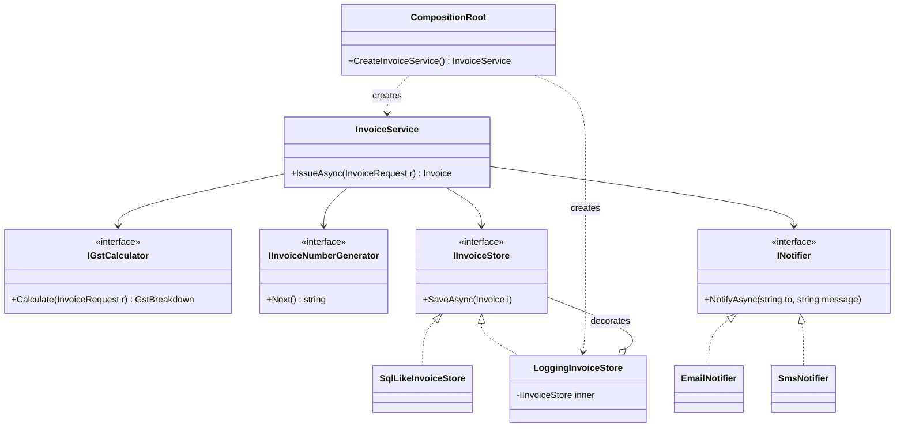
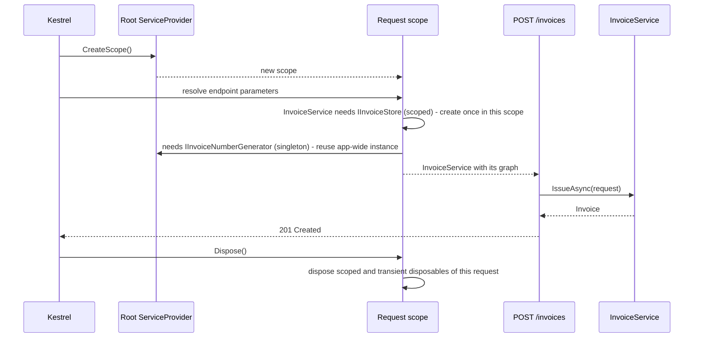

Dependency Injection (DI) is the pattern that every other pattern in modern .NET leans on. Strategies, decorators, repositories and options all reach their users through it. The pattern is older and simpler than any container: **an object gets what it needs from outside, instead of building it itself.** The container is just one convenient way to do the wiring.

## Learning objectives

By the end of this lesson you will be able to:

1. Explain the problem DI solves (hard-wired, untestable dependencies) and separate the *pattern* from the *container*.
2. Use constructor, method and property injection, and say when each fits.
3. Build a composition root by hand (pure DI), then the same graph with `IServiceCollection`.
4. Choose singleton, scoped and transient lifetimes correctly, and detect a captive dependency.
5. Use keyed services and register decorators without third-party libraries.
6. Recognise when DI is overused: too many abstractions, or injecting things that should just be `new`ed.

## Prerequisites

- [Dependency Inversion Principle](#/lesson/m04-dip): DI is one way to *apply* DIP.
- [Dependency injection versus service locator](#/lesson/m04-di-vs-service-locator): why pulling from the container is different from being given things.
- [Decorator](#/lesson/m06-decorator): we register one at the end of this lesson.

## Explain it like I'm a beginner

Think of a **delivery rider** joining a food-delivery company. On day one, two things could happen.

**Option A:** the rider must find their own kit. They buy a scooter, a phone and an insulated food bag themselves. They can only work with *that* scooter and *that* bag. If the scooter breaks, deliveries stop, and you can't train them on a practice route without the same scooter.

**Option B:** the **local hub** hands the rider a kit on arrival: a scooter, a phone with the rider app, and an insulated bag. The rider only says what they *need* ("something that keeps food hot for 30 minutes"). The hub decides which brand. On a training day, the hub hands over a practice kit, and the rider works exactly the same way.

Option B is Dependency Injection.

- The rider is the **class** (the consumer).
- "Something that keeps food hot" is an **interface** (the abstraction).
- The kit handed over is the set of **dependencies** passed in, usually through the constructor.
- The hub, the one place that decides what goes in every kit, is the **composition root**.
- An automated locker that assembles kits from a checklist is a **DI container**. It's helpful, but the hub manager could do it by hand.

## First-principles explanation

### What it is

A class declares its dependencies, usually as constructor parameters typed as abstractions. Someone else creates those dependencies and passes them in. The term was coined by Martin Fowler in 2004 to name a specific kind of Inversion of Control: the *wiring* of objects is inverted. The class no longer controls which concrete dependencies it gets.

### Why it exists — the problem

```csharp
public sealed class InvoiceService
{
    private readonly SqlInvoiceStore _store = new("Host=prod-db;...");
    private readonly SmsGateway _sms = new(apiKey: "live-key");
    public Invoice Issue(InvoiceRequest r) { var now = DateTime.Now; /* ... */ }
}
```

Four problems hide here:

1. **Untestable.** A unit test would write to the production database, send real SMS, and depend on the wall clock.
2. **Rigid.** Switching to an email notifier means editing `InvoiceService`.
3. **Hidden dependencies.** You can't tell from the constructor what this class needs. You have to read its body.
4. **Lifetime chaos.** Each `InvoiceService` creates its own connection and gateway. Nobody decides how many should exist.

### The three injection styles

| Style | Looks like | Use when |
|---|---|---|
| **Constructor injection** | `InvoiceService(IInvoiceStore store, TimeProvider clock)` | The default. The dependency is required for the object to work. |
| **Method injection** | `Issue(InvoiceRequest r, IExchangeRateProvider rates)` | The dependency varies per call, or only one method needs it. ASP.NET Core endpoint parameters and `[FromServices]` are method injection. |
| **Property injection** | `public ILogger Logger { get; set; } = NullLogger.Instance;` | Truly optional dependencies with a safe default. Microsoft's container **doesn't support it**, which is a hint to use it rarely. |

Constructor injection wins by default because the object can never exist in a half-wired state, and the constructor documents every dependency.

### The composition root

The **composition root** is the single place, as close to the application's entry point as possible, where the whole object graph is assembled. In ASP.NET Core that is `Program.cs`, plus `AddXyz()` extension methods it calls. Rules:

- Only the composition root knows concrete types. Everything else depends on abstractions.
- Business code never asks the container for things (`GetService` inside a service). That is the Service Locator anti-pattern.

### Pure DI vs a container

**Pure DI** means writing the composition root by hand with `new`. It's compile-time checked, and there's no magic. For a console tool with 10 classes it's often the best choice. A **container** (`Microsoft.Extensions.DependencyInjection`) earns its place when the graph is large, when you need **lifetimes** managed per HTTP request, and when frameworks (ASP.NET Core, hosted services, `IOptions`) plug into it.

### Lifetimes

| Lifetime | One instance per… | Typical examples | Watch out for |
|---|---|---|---|
| **Singleton** | application | `TimeProvider`, `IHttpClientFactory`, in-memory caches, price or rate tables | Must be thread-safe. Must not hold scoped things. |
| **Scoped** | scope (an HTTP request) | `DbContext`, unit of work, current-user/tenant context | Don't resolve from the root provider. Don't share across threads. |
| **Transient** | resolution | Lightweight stateless helpers | A disposable transient resolved from the root provider is kept until the app shuts down. |

**Captive dependency**: a longer-lived service holds a shorter-lived one. The classic example is a singleton that takes a scoped `DbContext` in its constructor. The first request's `DbContext` is captured forever and shared by every request on every thread. The result is data leaking between users and random concurrency exceptions. `ValidateScopes` makes the container throw when a singleton depends on a scoped service, or when a scoped service is resolved from the root provider. `ValidateOnBuild` checks at start-up that every registration can be constructed. ASP.NET Core turns both on in the Development environment only, so also turn them on in a test of your real registrations (shown later) to catch problems in CI.

### When DI is unnecessary

- **Values and data objects.** Never inject `Invoice`, `Money` or DTOs. Just `new` them.
- **Stable, pure helpers.** `Math.Round`, a `static` GST rounding function or `StringBuilder` don't need interfaces.
- **One-implementation interfaces "for testability"** around code that has no I/O. Test the real class instead.
- **Small scripts and tools**, where pure DI or plain `new` is clearer than a container.

### Trade-offs

| You gain | You pay |
|---|---|
| Testability: pass fakes in | More interfaces and indirection to navigate |
| Swappable implementations, decorators, keyed variants | Wiring errors move from compile time to start-up (mitigated by `ValidateOnBuild`) |
| Lifetimes managed in one place | Lifetime bugs (captive dependencies) are subtle |
| Constructors document dependencies | Constructors with 8+ parameters hide a class doing too much |

## Visual explanation

### Class diagram



How to read it: `InvoiceService` points only at interfaces. It has no idea which store, notifier or number generator it gets. `LoggingInvoiceStore` is a [Decorator](#/lesson/m06-decorator): it *is* an `IInvoiceStore` and *holds* another one. Only `CompositionRoot` (or `Program.cs` with a container) knows the concrete classes, shown by the dashed "creates" arrows. That is the whole pattern in one picture: **knowledge of concrete types is concentrated in one place.**

### Sequence diagram



Each HTTP request gets a **scope**. Scoped services (the store, the request context) are created at most once per scope and disposed when the request ends. Singletons come from the root and are shared by every request. If a singleton held a scoped object, that object would outlive its scope's `Dispose()`. That's why the container refuses it when scope validation is on.

## Step-by-step example

### Step 1 — the hard-wired class

The `InvoiceService` above with `new SqlInvoiceStore(...)` and `DateTime.Now`.

### Step 2 — extract what varies into parameters

```csharp
public sealed class InvoiceService(IGstCalculator gst, IInvoiceNumberGenerator numbers,
    IInvoiceStore store, INotifier notifier, TimeProvider clock) { /* ... */ }
```

The class now *declares* its needs. Notice that `TimeProvider` is a BCL abstraction (.NET 8+), so there's no need to invent `IClock`.

### Step 3 — wire it by hand (pure DI)

A `CompositionRoot` class creates singletons once, and creates scoped objects per "request".

### Step 4 — move to the container when lifetimes and frameworks need it

`services.AddSingleton<IInvoiceNumberGenerator, ...>()`, `AddScoped<IInvoiceStore, ...>()`, then decorate, then add keyed notifiers.

## Production-style C# implementation

```text
Invoicing.Api/
  Program.cs
  Invoicing/Model.cs, Abstractions.cs, GstCalculator.cs, InvoiceNumberGenerator.cs,
            InvoiceStores.cs, Notifiers.cs, InvoiceService.cs
  Composition/PureDiCompositionRoot.cs, InvoicingServiceCollectionExtensions.cs, ServiceCollectionDecorateExtensions.cs
```

### Model and abstractions

```csharp file=Invoicing/Model.cs
namespace Invoicing;

public sealed record InvoiceLine(string Description, decimal TaxableAmount, decimal GstRatePercent);
public sealed record InvoiceRequest(string CustomerName, string CustomerEmail, string CustomerStateCode, IReadOnlyList<InvoiceLine> Lines);
public sealed record GstBreakdown(decimal Taxable, decimal Cgst, decimal Sgst, decimal Igst)
{
    public decimal Total => Taxable + Cgst + Sgst + Igst;
}
public sealed record Invoice(string Number, DateTimeOffset IssuedAt, string CustomerName, GstBreakdown Amounts);

public sealed class CompanyOptions
{
    public string SupplierStateCode { get; set; } = "06";    // 06 = Haryana (GST state code)
    public string DefaultChannel { get; set; } = "email";
}
```

```csharp file=Invoicing/Abstractions.cs
namespace Invoicing;

public interface IGstCalculator { GstBreakdown Calculate(InvoiceRequest request); }
public interface IInvoiceNumberGenerator { string Next(DateTimeOffset issuedAt); }
public interface IInvoiceStore { Task SaveAsync(Invoice invoice, CancellationToken ct); Task<Invoice?> FindAsync(string number, CancellationToken ct); }
public interface INotifier { Task NotifyAsync(string to, string message, CancellationToken ct); }

/// <summary>Scoped: who is calling, for this request only.</summary>
public sealed class RequestContext
{
    public string CorrelationId { get; set; } = Guid.NewGuid().ToString("N");
}
```

### Implementations

```csharp file=Invoicing/GstCalculator.cs
using Microsoft.Extensions.Options;

namespace Invoicing;

/// <summary>Stateless, so a singleton. Intra-state supply: CGST + SGST (half each). Inter-state: IGST.</summary>
public sealed class GstCalculator(IOptions<CompanyOptions> options) : IGstCalculator
{
    private readonly string _supplierState = options.Value.SupplierStateCode;

    public GstBreakdown Calculate(InvoiceRequest request)
    {
        decimal taxable = 0, tax = 0;
        foreach (var l in request.Lines)
        {
            taxable += l.TaxableAmount;
            tax += Math.Round(l.TaxableAmount * l.GstRatePercent / 100m, 2, MidpointRounding.AwayFromZero);
        }
        if (request.CustomerStateCode == _supplierState)
        {
            var half = Math.Round(tax / 2m, 2, MidpointRounding.AwayFromZero);
            return new GstBreakdown(taxable, half, tax - half, 0m);
        }
        return new GstBreakdown(taxable, 0m, 0m, tax);
    }
}
```

```csharp file=Invoicing/InvoiceNumberGenerator.cs
namespace Invoicing;

/// <summary>Singleton WITH state: must be thread-safe. Format INV/2026-27/000042 (Indian financial year, April–March).
/// In production the counter lives in the database (a PostgreSQL sequence), not in memory.</summary>
public sealed class InMemoryInvoiceNumberGenerator : IInvoiceNumberGenerator
{
    private long _counter;

    public string Next(DateTimeOffset issuedAt)
    {
        var n = Interlocked.Increment(ref _counter);
        var startYear = issuedAt.Month >= 4 ? issuedAt.Year : issuedAt.Year - 1;
        return $"INV/{startYear}-{(startYear + 1) % 100:D2}/{n:D6}";
    }
}
```

```csharp file=Invoicing/InvoiceStores.cs
using System.Collections.Concurrent;
using Microsoft.Extensions.Logging;

namespace Invoicing;

/// <summary>The "database". Singleton.</summary>
public sealed class InvoiceDatabase
{
    public ConcurrentDictionary<string, Invoice> Rows { get; } = new();
}

/// <summary>Scoped, like a DbContext-backed store. Depends on a scoped RequestContext, which is fine: scoped -> scoped.</summary>
public sealed class SqlLikeInvoiceStore(InvoiceDatabase db, RequestContext request) : IInvoiceStore
{
    public string CorrelationId => request.CorrelationId;

    public Task SaveAsync(Invoice invoice, CancellationToken ct)
    {
        if (!db.Rows.TryAdd(invoice.Number, invoice)) throw new InvalidOperationException($"Duplicate invoice {invoice.Number}.");
        return Task.CompletedTask;
    }

    public Task<Invoice?> FindAsync(string number, CancellationToken ct) => Task.FromResult(db.Rows.GetValueOrDefault(number));
}

/// <summary>Decorator: adds logging without touching the real store or its callers.</summary>
public sealed class LoggingInvoiceStore(IInvoiceStore inner, ILogger<LoggingInvoiceStore> logger) : IInvoiceStore
{
    public async Task SaveAsync(Invoice invoice, CancellationToken ct)
    {
        logger.LogInformation("Saving invoice {Number} total {Total}", invoice.Number, invoice.Amounts.Total);
        await inner.SaveAsync(invoice, ct);
    }

    public Task<Invoice?> FindAsync(string number, CancellationToken ct) => inner.FindAsync(number, ct);
}
```

```csharp file=Invoicing/Notifiers.cs
using Microsoft.Extensions.Logging;

namespace Invoicing;

public sealed class EmailNotifier(ILogger<EmailNotifier> logger) : INotifier
{
    public Task NotifyAsync(string to, string message, CancellationToken ct)
    {
        logger.LogInformation("EMAIL to {To}: {Message}", to, message);   // a real one would call an SMTP/API client
        return Task.CompletedTask;
    }
}

public sealed class SmsNotifier(ILogger<SmsNotifier> logger) : INotifier
{
    public Task NotifyAsync(string to, string message, CancellationToken ct)
    {
        logger.LogInformation("SMS to {To}: {Message}", to, message);
        return Task.CompletedTask;
    }
}
```

### The consumer

```csharp file=Invoicing/InvoiceService.cs
using Microsoft.Extensions.DependencyInjection;

namespace Invoicing;

/// <summary>Constructor injection only. Knows no concrete types. Scoped, because it uses a scoped store.</summary>
public sealed class InvoiceService(
    IGstCalculator gst,
    IInvoiceNumberGenerator numbers,
    IInvoiceStore store,
    [FromKeyedServices("email")] INotifier notifier,
    TimeProvider clock)
{
    public async Task<Invoice> IssueAsync(InvoiceRequest request, CancellationToken ct)
    {
        ArgumentNullException.ThrowIfNull(request);
        if (request.Lines.Count == 0) throw new ArgumentException("An invoice needs at least one line.", nameof(request));

        var now = clock.GetUtcNow();
        var invoice = new Invoice(numbers.Next(now), now, request.CustomerName, gst.Calculate(request));
        await store.SaveAsync(invoice, ct);
        await notifier.NotifyAsync(request.CustomerEmail, $"Invoice {invoice.Number} for ₹{invoice.Amounts.Total:N2} issued.", ct);
        return invoice;
    }
}
```

`[FromKeyedServices("email")]` picks one of several `INotifier` registrations by key (.NET 8+). The class still depends only on the abstraction. The *key* is a small piece of wiring knowledge that leaks into it. If that bothers you, register `InvoiceService` with a factory in the composition root instead.

### Pure DI: the same graph without a container

```csharp file=Composition/PureDiCompositionRoot.cs
using Microsoft.Extensions.Logging;
using Microsoft.Extensions.Logging.Abstractions;
using Microsoft.Extensions.Options;
using Invoicing;

namespace Invoicing.Composition;

/// <summary>Hand-written composition root. Singletons are fields; "scoped" objects are created per BeginRequest().
/// Every dependency is checked by the compiler.</summary>
public sealed class PureDiCompositionRoot(CompanyOptions company, TimeProvider clock, ILoggerFactory? loggerFactory = null)
{
    private readonly ILoggerFactory _logs = loggerFactory ?? NullLoggerFactory.Instance;
    private readonly InvoiceDatabase _db = new();                                      // singleton
    private readonly IInvoiceNumberGenerator _numbers = new InMemoryInvoiceNumberGenerator();   // singleton
    private readonly IGstCalculator _gst = new GstCalculator(Options.Create(company));  // singleton (stateless)

    public InvoiceDatabase Database => _db;

    /// <summary>One call = one "request scope".</summary>
    public InvoiceService BeginRequest()
    {
        var request = new RequestContext();                                             // scoped
        IInvoiceStore store = new LoggingInvoiceStore(
            new SqlLikeInvoiceStore(_db, request), _logs.CreateLogger<LoggingInvoiceStore>());   // decorator by hand
        INotifier notifier = company.DefaultChannel == "sms"
            ? new SmsNotifier(_logs.CreateLogger<SmsNotifier>())
            : new EmailNotifier(_logs.CreateLogger<EmailNotifier>());
        return new InvoiceService(_gst, _numbers, store, notifier, clock);
    }
}
```

The compiler checks every dependency, and decoration is just nesting `new` calls. The cost: lifetimes are your responsibility, and nothing disposes objects for you.

### The same graph with Microsoft.Extensions.DependencyInjection

```csharp file=Composition/ServiceCollectionDecorateExtensions.cs
using Microsoft.Extensions.DependencyInjection;

namespace Invoicing.Composition;

public static class ServiceCollectionDecorateExtensions
{
    /// <summary>Wraps the last non-keyed registration of TService with TDecorator, keeping its lifetime.
    /// A small, dependency-free version of what libraries such as Scrutor provide.</summary>
    public static IServiceCollection Decorate<TService, TDecorator>(this IServiceCollection services)
        where TService : class
        where TDecorator : class, TService
    {
        for (var i = services.Count - 1; i >= 0; i--)
        {
            var d = services[i];
            if (d.ServiceType != typeof(TService) || d.IsKeyedService) continue;

            Func<IServiceProvider, object> createInner =
                d.ImplementationInstance is { } instance ? _ => instance :
                d.ImplementationFactory is { } factory ? factory :
                d.ImplementationType is { } type ? sp => ActivatorUtilities.CreateInstance(sp, type) :
                throw new InvalidOperationException($"Cannot decorate {typeof(TService).Name}.");

            services[i] = ServiceDescriptor.Describe(typeof(TService),
                sp => ActivatorUtilities.CreateInstance<TDecorator>(sp, createInner(sp)), d.Lifetime);
            return services;
        }
        throw new InvalidOperationException($"{typeof(TService).Name} is not registered; register it before decorating.");
    }
}
```

```csharp file=Composition/InvoicingServiceCollectionExtensions.cs
using Microsoft.Extensions.Configuration;
using Microsoft.Extensions.DependencyInjection;
using Invoicing;

namespace Invoicing.Composition;

public static class InvoicingServiceCollectionExtensions
{
    /// <summary>The invoicing module's slice of the composition root.</summary>
    public static IServiceCollection AddInvoicing(this IServiceCollection services, IConfiguration config)
    {
        services.Configure<CompanyOptions>(config.GetSection("Company"));
        services.AddSingleton(TimeProvider.System);
        services.AddSingleton<InvoiceDatabase>();
        services.AddSingleton<IGstCalculator, GstCalculator>();                         // stateless
        services.AddSingleton<IInvoiceNumberGenerator, InMemoryInvoiceNumberGenerator>(); // stateful but thread-safe

        services.AddScoped<RequestContext>();
        services.AddScoped<IInvoiceStore, SqlLikeInvoiceStore>();
        services.Decorate<IInvoiceStore, LoggingInvoiceStore>();                         // stays scoped

        services.AddKeyedSingleton<INotifier, EmailNotifier>("email");
        services.AddKeyedSingleton<INotifier, SmsNotifier>("sms");

        services.AddScoped<InvoiceService>();                                            // scoped: depends on a scoped store
        return services;
    }
}
```

```csharp file=Program.cs
using Invoicing;
using Invoicing.Composition;

var builder = WebApplication.CreateBuilder(args);

// Catch captive dependencies and unresolvable registrations at start-up in every environment, not just Development.
builder.Host.UseDefaultServiceProvider(o =>
{
    o.ValidateScopes = true;
    o.ValidateOnBuild = true;
});

builder.Services.AddInvoicing(builder.Configuration);
builder.Services.AddProblemDetails();

var app = builder.Build();

// Endpoint parameters are method injection: InvoiceService is resolved from this request's scope.
app.MapPost("/invoices", async (InvoiceRequest request, InvoiceService invoices, CancellationToken ct) =>
{
    var invoice = await invoices.IssueAsync(request, ct);
    return Results.Created($"/invoices/{Uri.EscapeDataString(invoice.Number)}", invoice);
});

app.MapGet("/invoices/{**number}", async (string number, IInvoiceStore store, CancellationToken ct) =>
    await store.FindAsync(number, ct) is { } inv ? Results.Ok(inv) : Results.NotFound());

app.Run();
```

## Bad design vs good design

**Bad 1: Service Locator.**

```csharp
public sealed class InvoiceService(IServiceProvider sp)
{
    public Task IssueAsync(InvoiceRequest r) { var store = sp.GetRequiredService<IInvoiceStore>(); /* ... */ }
}
```

Dependencies are invisible in the constructor. Tests must build a container. A missing registration fails only when *that line* runs, maybe in production at 2 a.m.

**Bad 2: the captive dependency.**

```csharp
services.AddSingleton<InvoiceService>();      // singleton...
services.AddScoped<IInvoiceStore, SqlLikeInvoiceStore>();   // ...holding a scoped store
```

With `ValidateScopes` off, the first request's store and its `RequestContext` live forever and are shared across all requests. With a real `DbContext`, concurrent requests then corrupt its change tracker and throw "A second operation was started on this context". With validation on, start-up fails with a clear message. **Fix:** make `InvoiceService` scoped, or inject `IServiceScopeFactory` into a singleton that genuinely needs scoped work (such as a `BackgroundService`) and create a scope per unit of work.

**Bad 3: constructor over-injection.** A controller with 11 constructor parameters isn't a DI problem. It's a class with too many responsibilities. Split it, for example into one handler per endpoint, rather than hiding the parameters behind a facade or a container lookup.

**Good:** constructor injection of abstractions, one composition root, lifetimes chosen deliberately, validation turned on, and decorators registered in the root.

:::callout type=tip title="A quick lifetime rule"
A service's lifetime must be **equal to or shorter than** the lifetime of everything that holds it. Put the other way, a service may only depend on things that live **at least as long** as it does. Singleton → singleton only. Scoped → scoped or singleton. Transient → anything.
:::

## Practical playground

The playground builds the same tiny graph with pure DI and with the container, prints instance IDs to show lifetimes, and then triggers a captive-dependency error with `ValidateScopes`. Try changing `AddSingleton<Greeter>` to `AddScoped<Greeter>` and run again.

:::playground type=csharp title="Lifetimes and the captive dependency"
```csharp file=Program.cs
using System;
using Microsoft.Extensions.DependencyInjection;

public sealed class TenantContext { public string Id { get; } = Guid.NewGuid().ToString("N")[..6]; }
public sealed class RateTable { public string Id { get; } = Guid.NewGuid().ToString("N")[..6]; }
public sealed class Greeter(TenantContext tenant, RateTable rates)
{
    public string Hello() => $"tenant {tenant.Id}, rates {rates.Id}";
}

public static class Program
{
    public static void Main()
    {
        // Pure DI: we decide lifetimes by where we call `new`.
        var rates = new RateTable();
        for (var request = 1; request <= 2; request++)
            Console.WriteLine($"Pure DI request {request}: {new Greeter(new TenantContext(), rates).Hello()}");

        // Container: lifetimes are declared.
        var good = new ServiceCollection()
            .AddSingleton<RateTable>().AddScoped<TenantContext>().AddScoped<Greeter>()
            .BuildServiceProvider(new ServiceProviderOptions { ValidateScopes = true, ValidateOnBuild = true });
        for (var request = 1; request <= 2; request++)
        {
            using var scope = good.CreateScope();
            Console.WriteLine($"Container request {request}: {scope.ServiceProvider.GetRequiredService<Greeter>().Hello()}");
        }

        // Captive dependency: a singleton Greeter would capture one TenantContext forever.
        try
        {
            new ServiceCollection()
                .AddSingleton<RateTable>().AddScoped<TenantContext>().AddSingleton<Greeter>()
                .BuildServiceProvider(new ServiceProviderOptions { ValidateScopes = true, ValidateOnBuild = true });
        }
        catch (AggregateException ex)
        {
            Console.WriteLine("Rejected at build: " + ex.InnerExceptions[0].Message);
        }
    }
}
```
:::

## Exercises

:::exercise id=m06-dependency-injection-pattern-ex1 difficulty=beginner kind=code title="Refactor a hard-wired reminder service"
A gym chain's original `MembershipExpiryReminder` looked like this:

```csharp
public int SendReminders()
{
    var sms = new TwilioLikeSms("live-key");
    var members = new MemberDb("Host=prod").All();
    var today = DateOnly.FromDateTime(DateTime.Now);
    // send SMS to every member whose membership expires within 30 days...
}
```

The constructor has already been changed to receive its dependencies. Implement `SendReminders` using **only** the injected dependencies.
::requirements
- A member whose membership expires between today and today + 30 days (inclusive) gets one SMS.
- Already expired or later than 30 days: no SMS.
- Message text: `"Dear {Name}, your gym membership expires on {date:dd-MM-yyyy}. Please renew."`
- Return the number of SMS sent. "Today" comes from `TimeProvider` (UTC date).
::acceptance
- Tests with a fake clock, a fake SMS sender and a fake directory pass.
- No `DateTime.Now`, and no `new` of infrastructure classes inside the method.
::hint
Every dependency the method needs is already a constructor parameter. Use them.
::hint
`DateOnly.FromDateTime(clock.GetUtcNow().UtcDateTime)` gives today's date from a `TimeProvider`.
::hint
Filter with `m.MembershipExpiresOn >= today && m.MembershipExpiresOn <= today.AddDays(30)`.
::hint
Format the date with `ToString("dd-MM-yyyy", CultureInfo.InvariantCulture)` so the output doesn't depend on the machine's culture.
::starter
```csharp file=MembershipExpiryReminder.cs
using System;
using System.Collections.Generic;
using System.Globalization;
using System.Linq;

public sealed record Member(string Name, string Mobile, DateOnly MembershipExpiresOn);
public interface ISmsSender { void Send(string mobile, string text); }
public interface IMemberDirectory { IReadOnlyList<Member> All(); }

public sealed class MembershipExpiryReminder(TimeProvider clock, ISmsSender sms, IMemberDirectory directory)
{
    public int SendReminders() => throw new NotImplementedException();
}
```
::tests
```csharp file=MembershipExpiryReminderTests.cs
using System;
using System.Collections.Generic;
using Xunit;

public class MembershipExpiryReminderTests
{
    private sealed class FixedClock(DateTimeOffset now) : TimeProvider { public override DateTimeOffset GetUtcNow() => now; }
    private sealed class FakeSms : ISmsSender { public List<(string To, string Text)> Sent = new(); public void Send(string m, string t) => Sent.Add((m, t)); }
    private sealed class FakeDirectory(params Member[] all) : IMemberDirectory { public IReadOnlyList<Member> All() => all; }

    private static readonly DateTimeOffset Now = new(2026, 10, 18, 9, 0, 0, TimeSpan.Zero);

    [Fact]
    public void Sends_only_to_memberships_expiring_within_30_days()
    {
        var sms = new FakeSms();
        var dir = new FakeDirectory(
            new Member("Ravi Kumar", "9800000001", new DateOnly(2026, 10, 18)),    // today
            new Member("Kavya Iyer", "9800000002", new DateOnly(2026, 11, 17)),    // +30
            new Member("Old Member", "9800000003", new DateOnly(2026, 10, 17)),    // expired
            new Member("Later Member", "9800000004", new DateOnly(2026, 11, 18))); // +31
        var count = new MembershipExpiryReminder(new FixedClock(Now), sms, dir).SendReminders();
        Assert.Equal(2, count);
        Assert.Equal(new[] { "9800000001", "9800000002" }, sms.Sent.ConvertAll(s => s.To).ToArray());
    }

    [Fact]
    public void Message_text_is_exact()
    {
        var sms = new FakeSms();
        new MembershipExpiryReminder(new FixedClock(Now), sms,
            new FakeDirectory(new Member("Kavya Iyer", "98", new DateOnly(2026, 11, 2)))).SendReminders();
        Assert.Equal("Dear Kavya Iyer, your gym membership expires on 02-11-2026. Please renew.", sms.Sent[0].Text);
    }

    [Fact]
    public void No_members_no_sms() =>
        Assert.Equal(0, new MembershipExpiryReminder(new FixedClock(Now), new FakeSms(), new FakeDirectory()).SendReminders());
}
```
::solution
```csharp file=MembershipExpiryReminder.cs
using System;
using System.Collections.Generic;
using System.Globalization;
using System.Linq;

public sealed record Member(string Name, string Mobile, DateOnly MembershipExpiresOn);
public interface ISmsSender { void Send(string mobile, string text); }
public interface IMemberDirectory { IReadOnlyList<Member> All(); }

public sealed class MembershipExpiryReminder(TimeProvider clock, ISmsSender sms, IMemberDirectory directory)
{
    public int SendReminders()
    {
        var today = DateOnly.FromDateTime(clock.GetUtcNow().UtcDateTime);
        var last = today.AddDays(30);
        var due = directory.All().Where(m => m.MembershipExpiresOn >= today && m.MembershipExpiresOn <= last).ToList();
        foreach (var m in due)
            sms.Send(m.Mobile, $"Dear {m.Name}, your gym membership expires on {m.MembershipExpiresOn.ToString("dd-MM-yyyy", CultureInfo.InvariantCulture)}. Please renew.");
        return due.Count;
    }
}
```

The method's logic barely changed. What changed is **who decides** which SMS gateway, which data source and which "now" are used. Tests now run in milliseconds and send nothing.
::mistakes
- Keeping a fallback such as `sms ??= new TwilioLikeSms()`. That reintroduces the hard-wiring through the back door.
- Using local time (`GetLocalNow()`) on one server and UTC on another. Pick one, and document it.
- Injecting `IServiceProvider` and resolving `ISmsSender` inside the method (Service Locator).
:::

:::exercise id=m06-dependency-injection-pattern-ex2 difficulty=beginner kind=code title="Write a pure-DI composition root"
A small CLI tool for a neighbourhood grocery shop prices customers' baskets. Write `CompositionRoot` by hand, with no container.
::requirements
- `PriceList` is created **once** per `CompositionRoot` (a singleton).
- `CreateHandler()` returns a new `BasketHandler` each call, with a **new** `Basket` (scoped per call) and the shared `PriceList`.
- `BasketHandler` receives an `IPriceFormatter`. Use `RupeeFormatter`.
::acceptance
- Two handlers share the same `PriceList` instance but have different `Basket` instances.
- `handler.Add("RICE-5KG", 10)` followed by `handler.Total()` returns `"₹4,100.00"` with the default price list (₹410 per 5 kg bag of rice).
::hint
Singletons become fields initialised in the composition root's constructor. Scoped objects are created inside `CreateHandler()`.
::hint
Expose `PriceList` and the handler's `Cart` as properties so the tests can check identity.
::hint
```csharp
private readonly PriceList _prices = new();
public BasketHandler CreateHandler() => new(_prices, new Basket(), new RupeeFormatter());
```
::starter
```csharp file=CompositionRoot.cs
using System;
using System.Collections.Generic;
using System.Globalization;
using System.Linq;

public sealed class PriceList
{
    private readonly Dictionary<string, decimal> _rates = new() { ["RICE-5KG"] = 410m, ["GHEE-1L"] = 620m };
    public decimal RateOf(string code) => _rates.TryGetValue(code, out var r) ? r : throw new KeyNotFoundException(code);
}

public sealed class Basket { public List<(string Code, decimal Qty)> Lines { get; } = new(); }

public interface IPriceFormatter { string Format(decimal amount); }
public sealed class RupeeFormatter : IPriceFormatter
{
    public string Format(decimal amount) => "₹" + amount.ToString("#,##0.00", CultureInfo.InvariantCulture);
}

public sealed class BasketHandler(PriceList prices, Basket cart, IPriceFormatter formatter)
{
    public PriceList Prices => prices;
    public Basket Cart => cart;
    public void Add(string code, decimal qty) => cart.Lines.Add((code, qty));
    public string Total() => formatter.Format(cart.Lines.Sum(l => prices.RateOf(l.Code) * l.Qty));
}

public sealed class CompositionRoot
{
    public PriceList PriceList => throw new NotImplementedException();
    public BasketHandler CreateHandler() => throw new NotImplementedException();
}
```
::tests
```csharp file=CompositionRootTests.cs
using Xunit;

public class CompositionRootTests
{
    [Fact]
    public void Price_list_is_shared_carts_are_not()
    {
        var root = new CompositionRoot();
        var a = root.CreateHandler();
        var b = root.CreateHandler();
        Assert.Same(a.Prices, b.Prices);
        Assert.Same(root.PriceList, a.Prices);
        Assert.NotSame(a.Cart, b.Cart);
    }

    [Fact]
    public void Totals_are_formatted_in_rupees()
    {
        var h = new CompositionRoot().CreateHandler();
        h.Add("RICE-5KG", 10);
        Assert.Equal("₹4,100.00", h.Total());
    }

    [Fact]
    public void Separate_roots_have_separate_singletons() =>
        Assert.NotSame(new CompositionRoot().PriceList, new CompositionRoot().PriceList);
}
```
::solution
```csharp file=CompositionRoot.cs
using System;
using System.Collections.Generic;
using System.Globalization;
using System.Linq;

public sealed class PriceList
{
    private readonly Dictionary<string, decimal> _rates = new() { ["RICE-5KG"] = 410m, ["GHEE-1L"] = 620m };
    public decimal RateOf(string code) => _rates.TryGetValue(code, out var r) ? r : throw new KeyNotFoundException(code);
}

public sealed class Basket { public List<(string Code, decimal Qty)> Lines { get; } = new(); }

public interface IPriceFormatter { string Format(decimal amount); }
public sealed class RupeeFormatter : IPriceFormatter
{
    public string Format(decimal amount) => "₹" + amount.ToString("#,##0.00", CultureInfo.InvariantCulture);
}

public sealed class BasketHandler(PriceList prices, Basket cart, IPriceFormatter formatter)
{
    public PriceList Prices => prices;
    public Basket Cart => cart;
    public void Add(string code, decimal qty) => cart.Lines.Add((code, qty));
    public string Total() => formatter.Format(cart.Lines.Sum(l => prices.RateOf(l.Code) * l.Qty));
}

public sealed class CompositionRoot
{
    private readonly PriceList _priceList = new();                       // singleton
    private readonly IPriceFormatter _formatter = new RupeeFormatter();  // stateless: share it

    public PriceList PriceList => _priceList;

    public BasketHandler CreateHandler() => new(_priceList, new Basket(), _formatter);   // new cart per "scope"
}
```

That's the entire "container". For a tool with a handful of classes, it's clearer than `ServiceCollection`, and a missing dependency is a compile error, not a runtime one.
::mistakes
- Making `PriceList` `static`. That's a hidden global, and two roots (for example two tests) would share state.
- Creating `PriceList` inside `CreateHandler()`, so each handler reloads the price list.
:::

:::exercise id=m06-dependency-injection-pattern-ex3 difficulty=intermediate kind=code title="Fix the lifetimes"
The original registration was:

```csharp
services.AddSingleton<TenantContext>();
services.AddSingleton<TenantGreeting>();     // depends on TenantContext and RateTable
services.AddScoped<RateTable>();
services.AddSingleton<IdGenerator>();
```

This is a restaurant-ordering SaaS where each restaurant is a tenant. Every restaurant saw the first restaurant's name, and the delivery-fee table never refreshed. Implement `AppServices.Register` with correct lifetimes.
::requirements
- `TenantContext` holds the current request's tenant, so it's **scoped**.
- `RateTable` is loaded once and shared, so it's a **singleton**.
- `TenantGreeting` depends on both, so pick the right lifetime.
- `IdGenerator` must give a **new instance on every resolution** (transient).
- The provider must build with `ValidateScopes = true` and `ValidateOnBuild = true`.
::acceptance
- `TenantContext` and `TenantGreeting` are the same within a scope and different across scopes.
- `RateTable` is the same instance across scopes.
- Two `IdGenerator` resolutions in one scope are different instances.
::hint
Apply the rule: a service may only depend on services that live at least as long as it does.
::hint
`TenantGreeting` depends on a scoped service, so it can't be a singleton.
::hint
`services.AddScoped<TenantContext>(); services.AddSingleton<RateTable>(); services.AddScoped<TenantGreeting>(); services.AddTransient<IdGenerator>();`
::starter
```csharp file=AppServices.cs
using System;
using Microsoft.Extensions.DependencyInjection;

public sealed class TenantContext { public string TenantId { get; set; } = "unknown"; }
public sealed class RateTable { public decimal DeliveryFeePerKm { get; } = 12m; }
public sealed class TenantGreeting(TenantContext tenant, RateTable rates)
{
    public TenantContext Tenant => tenant;
    public string Text() => $"Welcome {tenant.TenantId}. Delivery today: ₹{rates.DeliveryFeePerKm}/km";
}
public sealed class IdGenerator { public Guid Id { get; } = Guid.NewGuid(); }

public static class AppServices
{
    public static IServiceCollection Register(IServiceCollection services) => throw new NotImplementedException();
}
```
::tests
```csharp file=AppServicesTests.cs
using Microsoft.Extensions.DependencyInjection;
using Xunit;

public class AppServicesTests
{
    private static ServiceProvider Build() =>
        AppServices.Register(new ServiceCollection())
            .BuildServiceProvider(new ServiceProviderOptions { ValidateScopes = true, ValidateOnBuild = true });

    [Fact]
    public void Scoped_per_request()
    {
        using var sp = Build();
        using var s1 = sp.CreateScope();
        using var s2 = sp.CreateScope();
        s1.ServiceProvider.GetRequiredService<TenantContext>().TenantId = "dosa-corner-pune";
        s2.ServiceProvider.GetRequiredService<TenantContext>().TenantId = "biryani-house-patna";
        Assert.Contains("dosa-corner-pune", s1.ServiceProvider.GetRequiredService<TenantGreeting>().Text());
        Assert.Contains("biryani-house-patna", s2.ServiceProvider.GetRequiredService<TenantGreeting>().Text());
        Assert.Same(s1.ServiceProvider.GetRequiredService<TenantGreeting>(), s1.ServiceProvider.GetRequiredService<TenantGreeting>());
    }

    [Fact]
    public void Rate_table_is_singleton()
    {
        using var sp = Build();
        using var s1 = sp.CreateScope();
        using var s2 = sp.CreateScope();
        Assert.Same(s1.ServiceProvider.GetRequiredService<RateTable>(), s2.ServiceProvider.GetRequiredService<RateTable>());
    }

    [Fact]
    public void Id_generator_is_transient()
    {
        using var sp = Build();
        using var s = sp.CreateScope();
        Assert.NotSame(s.ServiceProvider.GetRequiredService<IdGenerator>(), s.ServiceProvider.GetRequiredService<IdGenerator>());
    }

    [Fact]
    public void Greeting_lifetime_is_scoped()
    {
        var services = AppServices.Register(new ServiceCollection());
        var d = Assert.Single(services, x => x.ServiceType == typeof(TenantGreeting));
        Assert.Equal(ServiceLifetime.Scoped, d.Lifetime);
    }
}
```
::solution
```csharp file=AppServices.cs
using System;
using Microsoft.Extensions.DependencyInjection;

public sealed class TenantContext { public string TenantId { get; set; } = "unknown"; }
public sealed class RateTable { public decimal DeliveryFeePerKm { get; } = 12m; }
public sealed class TenantGreeting(TenantContext tenant, RateTable rates)
{
    public TenantContext Tenant => tenant;
    public string Text() => $"Welcome {tenant.TenantId}. Delivery today: ₹{rates.DeliveryFeePerKm}/km";
}
public sealed class IdGenerator { public Guid Id { get; } = Guid.NewGuid(); }

public static class AppServices
{
    public static IServiceCollection Register(IServiceCollection services)
    {
        services.AddScoped<TenantContext>();      // per request
        services.AddSingleton<RateTable>();       // shared, loaded once
        services.AddScoped<TenantGreeting>();     // depends on scoped -> at most scoped
        services.AddTransient<IdGenerator>();     // new every time
        return services;
    }
}
```

The original had two bugs. A singleton `TenantContext` meant one tenant for the whole app. A scoped `RateTable` *inside* a singleton `TenantGreeting` was a captive dependency, created once and never refreshed. `ValidateScopes` would have caught the second at start-up.
::mistakes
- Making everything scoped "to be safe". Then `RateTable` reloads on every request, which costs time and database load.
- Making `TenantGreeting` transient. That works, but it creates a new object every resolution for no benefit. Scoped matches its dependency.
:::

:::exercise id=m06-dependency-injection-pattern-ex4 difficulty=intermediate kind=code title="Route notifications with keyed services"
Customers of an online store choose how they want to be notified about their orders: `"sms"`, `"email"` or `"whatsapp"`. Register three notifiers as keyed services, and implement a `NotificationRouter` that picks one by the customer's preference.
::requirements
- `NotificationSetup.Register(services)` registers `SmsNotifier`, `EmailNotifier` and `WhatsAppNotifier` as **keyed singletons** for `INotifier`, plus `NotificationRouter` as a singleton.
- `NotificationRouter.Send(preference, to, text)` resolves the keyed `INotifier`, calls it, and returns the channel name it used.
- Unknown or empty preference: fall back to `"email"`.
- Keys are case-insensitive: `"SMS"` works.
::acceptance
- `"sms"` goes to `SmsNotifier`, and `"WhatsApp"` goes to `WhatsAppNotifier`.
- `"fax"` and `""` fall back to email.
- Each notifier records what it sent, which the tests check.
::hint
`services.AddKeyedSingleton<INotifier, SmsNotifier>("sms")`.
::hint
Inside the router, `sp.GetKeyedService<INotifier>(key)` returns `null` for unknown keys.
::hint
Normalise the key with `ToLowerInvariant()` before resolving.
::hint
The router holding `IServiceProvider` is acceptable here because it *is* infrastructure, and the key is only known at runtime. Keep it small, and keep business code out of it.
::starter
```csharp file=NotificationRouter.cs
using System;
using System.Collections.Generic;
using Microsoft.Extensions.DependencyInjection;

public interface INotifier { string Channel { get; } void Send(string to, string text); }

public abstract class RecordingNotifier : INotifier
{
    public List<(string To, string Text)> Sent { get; } = new();
    public abstract string Channel { get; }
    public void Send(string to, string text) => Sent.Add((to, text));
}
public sealed class SmsNotifier : RecordingNotifier { public override string Channel => "sms"; }
public sealed class EmailNotifier : RecordingNotifier { public override string Channel => "email"; }
public sealed class WhatsAppNotifier : RecordingNotifier { public override string Channel => "whatsapp"; }

public sealed class NotificationRouter(IServiceProvider services)
{
    public string Send(string? preference, string to, string text) => throw new NotImplementedException();
}

public static class NotificationSetup
{
    public static IServiceCollection Register(IServiceCollection services) => throw new NotImplementedException();
}
```
::tests
```csharp file=NotificationRouterTests.cs
using Microsoft.Extensions.DependencyInjection;
using Xunit;

public class NotificationRouterTests
{
    private static ServiceProvider Build() => NotificationSetup.Register(new ServiceCollection())
        .BuildServiceProvider(new ServiceProviderOptions { ValidateScopes = true, ValidateOnBuild = true });

    [Theory]
    [InlineData("sms", "sms")]
    [InlineData("SMS", "sms")]
    [InlineData("WhatsApp", "whatsapp")]
    [InlineData("email", "email")]
    [InlineData("fax", "email")]
    [InlineData("", "email")]
    public void Routes_by_preference(string preference, string expected)
    {
        using var sp = Build();
        Assert.Equal(expected, sp.GetRequiredService<NotificationRouter>().Send(preference, "x", "Order shipped"));
    }

    [Fact]
    public void Message_reaches_the_keyed_instance()
    {
        using var sp = Build();
        sp.GetRequiredService<NotificationRouter>().Send("whatsapp", "9800000001", "Order 7 shipped");
        var wa = (WhatsAppNotifier)sp.GetRequiredKeyedService<INotifier>("whatsapp");
        Assert.Equal(("9800000001", "Order 7 shipped"), Assert.Single(wa.Sent));
    }
}
```
::solution
```csharp file=NotificationRouter.cs
using System;
using System.Collections.Generic;
using Microsoft.Extensions.DependencyInjection;

public interface INotifier { string Channel { get; } void Send(string to, string text); }

public abstract class RecordingNotifier : INotifier
{
    public List<(string To, string Text)> Sent { get; } = new();
    public abstract string Channel { get; }
    public void Send(string to, string text) => Sent.Add((to, text));
}
public sealed class SmsNotifier : RecordingNotifier { public override string Channel => "sms"; }
public sealed class EmailNotifier : RecordingNotifier { public override string Channel => "email"; }
public sealed class WhatsAppNotifier : RecordingNotifier { public override string Channel => "whatsapp"; }

public sealed class NotificationRouter(IServiceProvider services)
{
    private const string Fallback = "email";

    public string Send(string? preference, string to, string text)
    {
        var key = string.IsNullOrWhiteSpace(preference) ? Fallback : preference.Trim().ToLowerInvariant();
        var notifier = services.GetKeyedService<INotifier>(key) ?? services.GetRequiredKeyedService<INotifier>(Fallback);
        notifier.Send(to, text);
        return notifier.Channel;
    }
}

public static class NotificationSetup
{
    public static IServiceCollection Register(IServiceCollection services)
    {
        services.AddKeyedSingleton<INotifier, SmsNotifier>("sms");
        services.AddKeyedSingleton<INotifier, EmailNotifier>("email");
        services.AddKeyedSingleton<INotifier, WhatsAppNotifier>("whatsapp");
        services.AddSingleton<NotificationRouter>();
        return services;
    }
}
```

The router is singleton and resolves singletons, so there's no captive-dependency risk. If a notifier were scoped (say it used a `DbContext` to log), the router would have to be scoped too, or resolve the notifier from a scope it creates.
::alternatives
Inject `IEnumerable<INotifier>` and build a `Dictionary<string, INotifier>` keyed by `Channel` in the constructor. That needs no `IServiceProvider` and no keyed services, works on any container, and is easy to test with plain `new`. This is the [Strategy](#/lesson/m06-strategy) resolver approach. Keyed services shine when the key is known at *registration* time and consumers use `[FromKeyedServices]`.
::mistakes
- Comparing keys case-sensitively, so `"SMS"` from a mobile app silently falls back to email.
- Throwing on an unknown preference, when a notification failure shouldn't block the order update.
:::

:::exercise id=m06-dependency-injection-pattern-ex5 difficulty=advanced kind=code title="Write a Decorate extension without a library"
`Microsoft.Extensions.DependencyInjection` has no built-in decorator support. Implement `services.Decorate<TService, TDecorator>()`, which wraps the existing registration of `TService` and **keeps its lifetime**.
::requirements
- Find the **last** non-keyed registration for `TService`, and replace it in place.
- Support registrations made by type (`AddScoped<I, Impl>()`), by factory (`AddScoped<I>(sp => ...)`) and by instance (`AddSingleton<I>(obj)`).
- Create the decorator with `ActivatorUtilities`, passing the inner instance, so the decorator's other constructor parameters come from the container.
- Throw `InvalidOperationException` if `TService` isn't registered.
- Decorating twice nests: the last decorator is outermost.
::acceptance
- Resolving `IRateSource` returns `CachingRateSource`, which wraps `CourierApiRateSource`.
- A scoped registration stays scoped: same within a scope, different across scopes.
- Decorating twice gives `Logging(Caching(CourierApi))`.
- Decorating an unregistered service throws.
::hint
`IServiceCollection` is an `IList<ServiceDescriptor>`, so you can replace `services[i]`.
::hint
A descriptor has exactly one of `ImplementationType`, `ImplementationFactory` or `ImplementationInstance` (check `IsKeyedService` first).
::hint
Turn each case into a `Func<IServiceProvider, object>` that creates the inner object.
::hint
`ActivatorUtilities.CreateInstance<TDecorator>(sp, inner)` fills the decorator's `TService` parameter with `inner`, and the rest from `sp`.
::hint
```csharp
services[i] = ServiceDescriptor.Describe(typeof(TService), sp => ActivatorUtilities.CreateInstance<TDecorator>(sp, createInner(sp)), d.Lifetime);
```
::starter
```csharp file=DecorateExtensions.cs
using System;
using Microsoft.Extensions.DependencyInjection;

public interface IRateSource { decimal DeliveryRate(string city); }

/// <summary>Calls a courier partner's rate API (pretend it's slow).</summary>
public sealed class CourierApiRateSource : IRateSource
{
    public int Calls { get; private set; }
    public decimal DeliveryRate(string city) { Calls++; return city == "Mumbai" ? 49m : 59m; }
}

public sealed class RateCache { public System.Collections.Generic.Dictionary<string, decimal> Items { get; } = new(); }

public sealed class CachingRateSource(IRateSource inner, RateCache cache) : IRateSource
{
    public IRateSource Inner => inner;
    public decimal DeliveryRate(string city) =>
        cache.Items.TryGetValue(city, out var r) ? r : cache.Items[city] = inner.DeliveryRate(city);
}

public sealed class LoggingRateSource(IRateSource inner) : IRateSource
{
    public IRateSource Inner => inner;
    public int Logged { get; private set; }
    public decimal DeliveryRate(string city) { Logged++; return inner.DeliveryRate(city); }
}

public static class DecorateExtensions
{
    public static IServiceCollection Decorate<TService, TDecorator>(this IServiceCollection services)
        where TService : class
        where TDecorator : class, TService => throw new NotImplementedException();
}
```
::tests
```csharp file=DecorateExtensionsTests.cs
using System;
using Microsoft.Extensions.DependencyInjection;
using Xunit;

public class DecorateExtensionsTests
{
    private static ServiceProvider Build(IServiceCollection s) =>
        s.BuildServiceProvider(new ServiceProviderOptions { ValidateScopes = true, ValidateOnBuild = true });

    [Fact]
    public void Wraps_type_registration_and_keeps_scoped_lifetime()
    {
        var s = new ServiceCollection().AddScoped<RateCache>().AddScoped<IRateSource, CourierApiRateSource>();
        s.Decorate<IRateSource, CachingRateSource>();
        using var sp = Build(s);
        using var a = sp.CreateScope();
        using var b = sp.CreateScope();
        var r1 = a.ServiceProvider.GetRequiredService<IRateSource>();
        Assert.IsType<CourierApiRateSource>(Assert.IsType<CachingRateSource>(r1).Inner);
        Assert.Same(r1, a.ServiceProvider.GetRequiredService<IRateSource>());
        Assert.NotSame(r1, b.ServiceProvider.GetRequiredService<IRateSource>());
    }

    [Fact]
    public void Caching_decorator_actually_caches()
    {
        var api = new CourierApiRateSource();
        var s = new ServiceCollection().AddSingleton<RateCache>().AddSingleton<IRateSource>(api);
        s.Decorate<IRateSource, CachingRateSource>();
        using var sp = Build(s);
        var r = sp.GetRequiredService<IRateSource>();
        Assert.Equal(49m, r.DeliveryRate("Mumbai"));
        Assert.Equal(49m, r.DeliveryRate("Mumbai"));
        Assert.Equal(1, api.Calls);
    }

    [Fact]
    public void Factory_registration_and_double_decoration_nest()
    {
        var s = new ServiceCollection().AddSingleton<RateCache>().AddSingleton<IRateSource>(_ => new CourierApiRateSource());
        s.Decorate<IRateSource, CachingRateSource>();
        s.Decorate<IRateSource, LoggingRateSource>();
        using var sp = Build(s);
        var outer = Assert.IsType<LoggingRateSource>(sp.GetRequiredService<IRateSource>());
        var mid = Assert.IsType<CachingRateSource>(outer.Inner);
        Assert.IsType<CourierApiRateSource>(mid.Inner);
        Assert.Same(outer, sp.GetRequiredService<IRateSource>());
    }

    [Fact]
    public void Unregistered_service_throws() =>
        Assert.Throws<InvalidOperationException>(() => new ServiceCollection().Decorate<IRateSource, LoggingRateSource>());
}
```
::solution
```csharp file=DecorateExtensions.cs
using System;
using Microsoft.Extensions.DependencyInjection;

public interface IRateSource { decimal DeliveryRate(string city); }

/// <summary>Calls a courier partner's rate API (pretend it's slow).</summary>
public sealed class CourierApiRateSource : IRateSource
{
    public int Calls { get; private set; }
    public decimal DeliveryRate(string city) { Calls++; return city == "Mumbai" ? 49m : 59m; }
}

public sealed class RateCache { public System.Collections.Generic.Dictionary<string, decimal> Items { get; } = new(); }

public sealed class CachingRateSource(IRateSource inner, RateCache cache) : IRateSource
{
    public IRateSource Inner => inner;
    public decimal DeliveryRate(string city) =>
        cache.Items.TryGetValue(city, out var r) ? r : cache.Items[city] = inner.DeliveryRate(city);
}

public sealed class LoggingRateSource(IRateSource inner) : IRateSource
{
    public IRateSource Inner => inner;
    public int Logged { get; private set; }
    public decimal DeliveryRate(string city) { Logged++; return inner.DeliveryRate(city); }
}

public static class DecorateExtensions
{
    public static IServiceCollection Decorate<TService, TDecorator>(this IServiceCollection services)
        where TService : class
        where TDecorator : class, TService
    {
        for (var i = services.Count - 1; i >= 0; i--)
        {
            var d = services[i];
            if (d.ServiceType != typeof(TService) || d.IsKeyedService) continue;

            Func<IServiceProvider, object> createInner =
                d.ImplementationInstance is { } instance ? _ => instance :
                d.ImplementationFactory is { } factory ? factory :
                d.ImplementationType is { } type ? sp => ActivatorUtilities.CreateInstance(sp, type) :
                throw new InvalidOperationException($"Unsupported registration for {typeof(TService).Name}.");

            services[i] = ServiceDescriptor.Describe(
                typeof(TService),
                sp => ActivatorUtilities.CreateInstance<TDecorator>(sp, createInner(sp)),
                d.Lifetime);
            return services;
        }
        throw new InvalidOperationException($"{typeof(TService).Name} must be registered before it can be decorated.");
    }
}
```

The lifetime is preserved because the new descriptor reuses `d.Lifetime`. The container caches the *decorator* per scope or app, and the inner object is created inside the same factory call, so it shares the decorator's lifetime.
::mistakes
- Registering the decorator as a *second* `TService`. `GetService` then returns the decorator, but `IEnumerable<TService>` returns both, and the decorator may end up wrapping itself.
- Resolving the inner with `sp.GetRequiredService<TService>()` inside the factory. That's infinite recursion, because it resolves the decorator again.
- Forgetting disposal. An inner created by `ActivatorUtilities` isn't tracked by the container, so if it's `IDisposable`, the decorator must dispose it. Scrutor-style libraries handle this for you.
::extensions
Support open generics (`Decorate(typeof(IRepository<>), typeof(AuditingRepository<>))`) and keyed services.
:::

## Automated testing

DI's main payoff is in tests. Three kinds are worth having.

**1. Unit tests with hand-written fakes.** Construct the class directly with `new`, passing fakes. No container is involved:

```csharp
var store = new FakeInvoiceStore();
var service = new InvoiceService(new GstCalculator(Options.Create(new CompanyOptions { SupplierStateCode = "06" })),
    new InMemoryInvoiceNumberGenerator(), store, new FakeNotifier(), new FixedClock(new DateTimeOffset(2026, 10, 18, 0, 0, 0, TimeSpan.Zero)));

var invoice = await service.IssueAsync(new InvoiceRequest("Sahyadri Foods", "a@b.in", "27",
    new[] { new InvoiceLine("Annual POS software subscription", 100_000m, 18m) }), default);

Assert.Equal(18_000m, invoice.Amounts.Igst);          // Maharashtra (27) ≠ Haryana (06) → IGST
Assert.Equal("INV/2026-27/000001", invoice.Number);
```

**2. A container validation test.** Build the real registrations with `ValidateOnBuild` and `ValidateScopes`, then resolve every endpoint dependency inside a scope. This catches missing registrations and captive dependencies before deployment:

```csharp
[Fact]
public void Container_is_valid()
{
    var config = new ConfigurationBuilder().Build();
    using var sp = new ServiceCollection().AddLogging().AddInvoicing(config)
        .BuildServiceProvider(new ServiceProviderOptions { ValidateOnBuild = true, ValidateScopes = true });
    using var scope = sp.CreateScope();
    Assert.IsType<LoggingInvoiceStore>(scope.ServiceProvider.GetRequiredService<IInvoiceStore>());
    scope.ServiceProvider.GetRequiredService<InvoiceService>();
}
```

**3. Integration tests with `WebApplicationFactory`.** In ASP.NET Core, `WebApplicationFactory<Program>` lets you replace registrations (`ConfigureTestServices`) with fakes, such as a fake notifier, while exercising the real HTTP pipeline.

**Extensibility.** New behaviour arrives as new registrations: a new `INotifier` key, another decorator (retry, metrics), or a different `IInvoiceStore`. `InvoiceService` doesn't change.

## Real-world application

- **ASP.NET Core itself** is built on DI. Controllers, minimal-API handlers, middleware, `IOptions<T>`, `ILogger<T>`, `IHttpClientFactory`, health checks and hosted services are all resolved from the container.
- **`BackgroundService` workers** are singletons. To use a scoped `DbContext` they inject `IServiceScopeFactory` and create a scope per message or batch. This is the standard fix for captive dependencies.
- **Multi-tenant SaaS** registers a scoped `ITenantContext`, filled by middleware from the subdomain or a token claim. Every scoped service downstream sees the right tenant.
- **Payment and notification routing** uses keyed services or a strategy resolver to pick UPI, card, SMS or email providers per request.

## Interview questions

:::interview
::q beginner
What is dependency injection, and how is it different from a DI container?
::a
DI is a pattern: a class receives its dependencies from outside (usually through its constructor) instead of creating them. A container is a library that automates the wiring and manages lifetimes. You can do DI with no container at all (pure DI) by writing the composition root with `new`.
::q beginner
What are the three service lifetimes in Microsoft.Extensions.DependencyInjection?
::a
Singleton (one instance for the app), scoped (one per scope, which in ASP.NET Core means per HTTP request), and transient (a new instance every time it's resolved). Singletons must be thread-safe, and services must not depend on anything with a shorter lifetime.
::q intermediate
What is a captive dependency, and how do you detect and fix it?
::a
A longer-lived service holds a shorter-lived one, typically a singleton capturing a scoped `DbContext`. The scoped object then outlives its scope and is shared across requests and threads. Detect it with `ValidateScopes = true` (on by default in Development) and `ValidateOnBuild = true`, ideally in a unit test of the real registrations. Fix it by shortening the consumer's lifetime, or by injecting `IServiceScopeFactory` (or `IDbContextFactory<T>`) and creating short-lived instances per unit of work.
::q intermediate
Why prefer constructor injection over injecting `IServiceProvider`?
::a
The constructor documents every dependency, the object can't exist half-wired, tests just pass fakes, and missing registrations are caught by `ValidateOnBuild`. Injecting `IServiceProvider` is the Service Locator anti-pattern: dependencies are hidden, failures happen at runtime on the line that resolves them, and tests must build a container. Small infrastructure classes that choose an implementation by a runtime key (factories, routers) are the reasonable exception.
::q advanced
How would you register a decorator in Microsoft's container, and what are the pitfalls?
::a
There's no built-in API. Either use a factory registration (`AddScoped<IStore>(sp => new LoggingStore(sp.GetRequiredService<SqlStore>(), ...))`, registering the inner by its concrete type), or write or borrow a `Decorate` extension that replaces the existing descriptor with one that creates the inner via `ActivatorUtilities` and wraps it, keeping the original lifetime. Pitfalls: infinite recursion if the factory resolves `IStore` itself, duplicate registrations appearing in `IEnumerable<IStore>`, an inner instance the container doesn't dispose, and the decorator accidentally getting a longer lifetime than the inner.
::q advanced
A colleague says "every class should have an interface for DI". Do you agree?
::a
No. Interfaces earn their place at **seams**: I/O (database, HTTP, clock, file system), policies with several implementations, and boundaries between modules. Value objects, DTOs, pure calculation classes and single-implementation internal helpers are better used directly, and tested directly. One-to-one interface/class pairs everywhere double the navigation cost and invite mocks that test implementation details. Use the real class until you need a second implementation or a seam for testing I/O.
:::

## Summary and revision

**Key takeaways**

- DI means **being given** dependencies, not creating or looking them up. The container is optional.
- Prefer **constructor injection**. Use method injection for per-call needs. Use property injection rarely, for optional dependencies with defaults.
- Assemble everything in one **composition root**. Only it knows concrete types.
- Choose **lifetimes** deliberately. Never let a longer-lived service hold a shorter-lived one, and turn on `ValidateScopes` and `ValidateOnBuild`.
- **Keyed services** select one implementation by key. **Decorators** need a factory or a small `Decorate` helper.
- Don't inject values, DTOs or pure helpers. Don't add interfaces without a reason.

**Terminology**: dependency injection, inversion of control, composition root, pure DI, container, singleton, scoped, transient, captive dependency, service locator, keyed service, decorator, `ActivatorUtilities`.

:::flashcards
Q: DI pattern vs DI container?
A: The pattern is "receive dependencies from outside"; a container is a library that automates wiring and lifetimes. Pure DI does it by hand.
Q: What is the composition root?
A: The one place near the entry point (Program.cs) where the object graph is assembled and concrete types are chosen.
Q: Which injection style is the default and why?
A: Constructor injection — required dependencies are explicit and the object can never be half-wired.
Q: Captive dependency?
A: A longer-lived service holding a shorter-lived one (singleton holding a scoped DbContext). Detected by ValidateScopes.
Q: What do ValidateScopes and ValidateOnBuild do?
A: ValidateScopes rejects resolving scoped services from the root (and hence singletons capturing them); ValidateOnBuild checks every registration can be constructed at startup.
Q: How does a BackgroundService use a scoped DbContext?
A: Inject IServiceScopeFactory and create a scope per unit of work; resolve the DbContext from that scope.
Q: How do you get one implementation by key in .NET 8+?
A: AddKeyed{Lifetime}<IFoo, Impl>("key") and [FromKeyedServices("key")] or GetKeyedService<IFoo>("key").
Q: Does Microsoft's container support property injection?
A: No — use constructor injection, or a default value for truly optional dependencies.
:::

## Knowledge check

:::quiz pass=70
::q single
A `ReportCache` is registered as a singleton and takes an `AppDbContext` (scoped) in its constructor. In production, with scope validation off, what's the most likely symptom?
- [ ] Nothing. EF Core handles it.
- [x] Intermittent "a second operation was started on this context" errors and stale data, because one context is shared by all requests.
- [ ] A compile error.
- [ ] Each request gets a fresh context.
> The singleton captures the first context forever. `DbContext` isn't thread-safe, and its change tracker accumulates entities from every request. Make the cache use `IDbContextFactory<AppDbContext>` or a scope per refresh.
::q single
Which class should know that `IInvoiceStore` is implemented by `SqlLikeInvoiceStore` wrapped in `LoggingInvoiceStore`?
- [ ] `InvoiceService`.
- [ ] The endpoint handler.
- [x] The composition root (`Program.cs` and its `AddInvoicing` extension).
- [ ] `LoggingInvoiceStore`.
> Only the composition root knows concrete types and how they're combined. Consumers depend on `IInvoiceStore` only.
::q multi
Which are reasonable uses of method injection? (Select all that apply.)
- [x] A minimal-API endpoint receiving `InvoiceService` as a parameter.
- [x] `Calculate(order, IExchangeRateProvider rates)` when only this method needs rates, and they vary per call.
- [ ] Passing `IServiceProvider` into every method "for flexibility".
- [ ] Replacing all constructor parameters with method parameters to shorten constructors.
> Method injection fits per-call or single-method dependencies. Passing the provider around is Service Locator, and moving required dependencies out of the constructor just hides them.
::q single
`TenantGreeting` depends on a scoped `TenantContext` and a singleton `RateTable`. What's the longest lifetime `TenantGreeting` may have?
- [ ] Singleton.
- [x] Scoped.
- [ ] Transient only.
- [ ] It can't depend on both.
> A service may depend only on things that live at least as long as it does. A scoped dependency caps it at scoped. Transient would also be legal, but isn't required.
::q single
You write `services.AddScoped<IStore>(sp => new LoggingStore(sp.GetRequiredService<IStore>()))` to add logging. What happens?
- [ ] It works.
- [x] Infinite recursion, because resolving `IStore` calls the same factory again.
- [ ] Logging is applied twice.
- [ ] The inner store becomes a singleton.
> The factory resolves itself. Resolve the inner by its concrete type (`sp.GetRequiredService<SqlStore>()`), or use a `Decorate` helper that captures the original descriptor.
::q single
A 300-line console tool has six classes and runs once a night. A teammate wants to add `Microsoft.Extensions.Hosting` and a container. What would you suggest?
- [ ] A container is mandatory for DI.
- [x] Pure DI in `Main` is enough, unless they need hosting features such as configuration, logging or `IOptions`.
- [ ] Use static classes instead of DI.
- [ ] Use a service locator.
> DI is the pattern. A container is a tool. For a small graph, `new` in one composition root is clear and compile-time checked. Adopt the generic host when you want its configuration, logging and lifetime features.
::q single
Why does `ValidateOnBuild` belong in a test even if Development already enables it?
- [ ] It makes production faster.
- [x] So missing or invalid registrations (including environment-specific ones) fail in CI, not at first request in staging or production.
- [ ] Because it's required for keyed services.
- [ ] It replaces unit tests.
> Validation at build time turns wiring errors into fast, deterministic test failures. Production defaults don't validate scopes, so a test is the safety net.
:::

## Completion criteria

You have finished this lesson when you can:

- [ ] Score at least 70 % on the knowledge check.
- [ ] Complete exercises 1 and 2 with all tests passing.
- [ ] Complete exercise 3 and explain, without notes, why the original registrations failed.
- [ ] Complete exercise 4 or 5.
- [ ] Draw the lifetime rule ("depend only on things that live at least as long as you") and give one real captive-dependency example.
