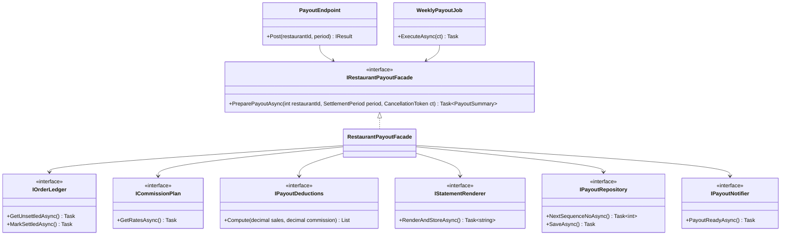
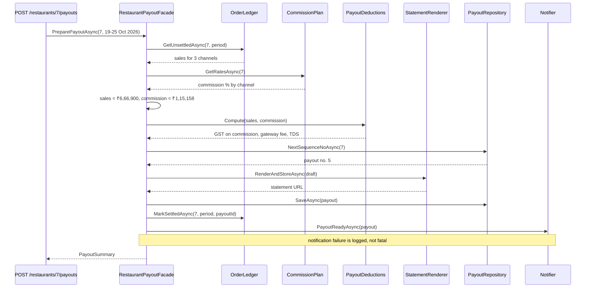

Facade is the pattern you've used most without knowing its name. Every time you call `File.ReadAllText(path)` instead of opening a `FileStream`, wrapping it in a `StreamReader`, detecting the encoding and disposing both, you're using a facade. The idea is simple: when doing one job takes many classes working together in the right order, give callers one easy method that does it for them.

## Learning objectives

By the end of this lesson you will be able to:

1. Explain the problem Facade solves: clients that must know and coordinate too many subsystem classes.
2. Name the participants (facade, subsystem classes, client) and draw the class and sequence diagrams.
3. Build a facade in ASP.NET Core that orchestrates several services (a weekly restaurant payout on a food-delivery platform) and register it in DI.
4. Handle failure inside a facade: compensation for partial work, and graceful degradation for optional subsystems.
5. Test a facade with fakes, and keep it thin enough that it doesn't become a god object.
6. Tell Facade apart from Adapter, Mediator, Decorator and API gateways or BFFs, and know when a facade adds nothing.

## Prerequisites

- [Interfaces and abstract classes](#/lesson/m01-interfaces-abstract): the facade depends on subsystem interfaces.
- [Controllers, services, repositories and domain models](#/lesson/m03-layers): a facade usually lives in the application (service) layer.
- [Dependency injection](#/lesson/m03-dependency-injection): the facade receives its subsystems through the constructor.

## Explain it like I'm a beginner

Picture opening a small café in an Indian city. You need a food-safety (FSSAI) licence, GST registration, a trade licence, a shop-and-establishment registration, a fire NOC and a signboard permit. Six offices, six forms, six queues, and some of them want a certificate from another one first.

Many states now offer a **single-window** system. You submit one application at one counter. Behind the counter, the single-window office sends the right papers to each department, in the right order, and gives you one combined status. The departments still exist and still do their own work. A licensing consultant can still visit the fire department directly. But a normal applicant only deals with one window.

That single window is a **facade**:

- The six departments are the **subsystem**: many classes, each doing one job well.
- The single window is the **facade**: one simple entry point that knows which departments to call and in what order.
- You, the applicant, are the **client**: you make one request instead of six.

Three points matter:

1. **The facade doesn't do the departments' work.** It doesn't inspect the kitchen itself. It coordinates.
2. **The departments don't know the facade exists.** They'd work the same without it.
3. **The facade doesn't lock the side doors.** Advanced users can still use the subsystems directly.

In code, a food-delivery platform pays each partner restaurant once a week. Producing one payout needs an order ledger, a commission plan, a deductions calculator, a PDF statement renderer, a payout repository and a notifier. Without a facade, every controller and background job repeats that six-step dance. With a facade, they call `PreparePayoutAsync(restaurantId, period)`.

## First-principles explanation

### The original problem

The *Design Patterns* book defines Facade as: "Provide a unified interface to a set of interfaces in a subsystem. Facade defines a higher-level interface that makes the subsystem easier to use."

Good design splits a system into small, focused classes. That's the [Single Responsibility Principle](#/lesson/m04-srp) at work. The side effect is that *using* the system now means knowing many classes:

- **Which classes** are involved (six services to produce one payout).
- **What order** to call them in (you need commission rates before you can work out the commission).
- **How to pass data** between them (the output of one is the input of the next).
- **What to do on failure** (if the PDF fails, don't mark the orders as settled).

When that knowledge lives in every client (two controllers, one background job, one admin tool), you get duplication, inconsistency, and high coupling. Every client depends on six interfaces, so changing any one subsystem ripples through all of them.

### How it works

A facade is an ordinary class:

1. Its constructor receives the subsystem objects (via DI).
2. It exposes a **few, task-shaped methods** in the client's language: `PreparePayoutAsync`, `ExportAsync`, `BookAppointmentAsync`, not `GetRates` and `Compute`.
3. Each method calls subsystems in the right order, passes data between them, and handles the failure rules for the workflow.
4. It returns a result shaped for the client (a summary DTO), not the subsystems' internal objects.

There's no inheritance trick and no interface the facade must share with the subsystems. Its value is entirely in **reducing what the client needs to know**.

### The simplest implementation

```csharp
public sealed class ReportExportFacade(IReportQuery query, IReportFormatter csv, IFileStore store)
{
    public async Task<string> ExportCsvAsync(int reportId, CancellationToken ct)
    {
        var data  = await query.LoadAsync(reportId, ct) ?? throw new KeyNotFoundException($"Report {reportId}");
        var bytes = csv.Render(data);
        return await store.SaveAsync($"report-{reportId}.csv", "text/csv", bytes, ct);   // returns a download URL
    }
}
```

Three subsystem calls behind one method. The client goes from "know three interfaces, call them in order, handle a missing report" to "call one method and get a URL". Exercise 1 extends this to several formats.

### Participants

| Participant | Role | In our example |
|---|---|---|
| **Facade** | Knows which subsystem classes handle a request, and delegates to them in the right order | `RestaurantPayoutFacade` |
| **Subsystem classes** | Do the real work; know nothing about the facade | `IOrderLedger`, `ICommissionPlan`, `IPayoutDeductions`, `IStatementRenderer`, `IPayoutRepository`, `IPayoutNotifier` |
| **Client** | Calls the facade instead of the subsystems | The payout endpoint, a weekly payout background job |

### What belongs in a facade, and what doesn't

This is the most important design decision.

**Belongs in the facade (orchestration):** the order of steps, passing data between subsystems, workflow-level failure rules ("don't mark orders as settled if saving the payout failed"), transaction boundaries, and shaping the result for the client.

**Does not belong in the facade (business rules):** how GST on commission is calculated, what the payment-gateway fee is, which commission percentage a restaurant's plan uses. Those are subsystem responsibilities. If the facade starts computing tax, it slowly turns into a *god object* that knows everything. Then you have one huge class instead of one simple entry point.

A useful test: **if you deleted the facade, would any business rule be lost?** If yes, that rule is in the wrong place.

### When it is useful

- A common task requires calling **three or more** collaborating classes in a specific order.
- The **same sequence** is repeated by several clients (API, background job, CLI, tests).
- You want to **decouple clients from a subsystem** that's likely to change, such as a legacy module being rewritten behind a stable entry point.
- You're **layering** a system. Each layer exposes a facade to the layer above (application services in front of the domain, a module's public API in a [modular monolith](#/lesson/m02-modular-monolith)).
- You're wrapping a **complicated library** for the 90 % case, as `File.ReadAllText` does for streams.

### When not to use it

- **The task is one call.** A facade with a method that just forwards to a single service adds a layer with nothing in it.
- **Clients genuinely need fine control.** A support tool that only re-sends a payout statement shouldn't be forced through `PreparePayoutAsync`. Let it use the subsystem directly. Facades simplify; they shouldn't imprison.
- **The facade would cover unrelated tasks.** A `RestaurantFacade` with payout, menu, ratings, rider-zone and HR methods is a god object with a pattern name. Create several focused facades instead.
- **The workflow spans services over the network and must survive crashes.** A facade method is an in-process sequence. If step 4 of 6 fails because the pod is restarted, nothing resumes it. For long-running or distributed workflows, use a [saga](#/lesson/m12-sagas) with durable state, or a workflow engine.

### Trade-offs

| You gain | You pay |
|---|---|
| Clients depend on one interface instead of many | One more class, which can grow into a god object if unguarded |
| The workflow is defined once, so behaviour is consistent across clients | Clients that need finer control must bypass it, so you now have two paths |
| Subsystems can change behind a stable entry point | The facade must change when the workflow changes |
| Easy to test clients: fake one facade instead of six services | Facade tests need several fakes |

## Visual explanation

### Class diagram



How to read it: on the left, two very different clients (an HTTP endpoint and a scheduled job) depend on **one** interface, `IRestaurantPayoutFacade`. On the right, the facade depends on six subsystem interfaces. Count the arrows: without the facade, each client would need six arrows (12 in total, and more for every new client). With it, each client needs one. Notice also what's missing: no arrows go from the subsystems back to the facade, because subsystems don't know it exists.

### Sequence diagram



The diagram makes the facade's real job visible: **order and hand-offs**. Rates come before the commission, the commission before the deductions, and the statement is rendered before the payout is saved, so a saved payout always has a statement. Orders are marked as settled only *after* the payout is saved, so a crash in between leaves orders unsettled (they get paid next run) rather than lost (never paid). The note on the last step records a workflow decision: a failed email shouldn't undo a valid payout. These are exactly the rules you don't want copied into every client.

## Step-by-step example

Scenario: a food-delivery platform settles with each partner restaurant once a week. The payout adds up the restaurant's food sales for the week by channel (delivery, takeaway, dine-out bookings), subtracts the platform's commission at the restaurant's plan rates, and subtracts other deductions such as GST on that commission, a payment-gateway fee and income-tax TDS (tax deducted at source). The percentages in this lesson are illustrative configuration values, not tax advice.

### Step 1 — the naive version: orchestration in the controller

```csharp
app.MapPost("/restaurants/{id}/payouts", async (int id, SettlementPeriod period, IOrderLedger ledger, ICommissionPlan plan,
    IPayoutDeductions pd, IStatementRenderer sr, IPayoutRepository repo, IPayoutNotifier n, CancellationToken ct) =>
{
    var sales = await ledger.GetUnsettledAsync(id, period, ct);
    var rates = await plan.GetRatesAsync(id, ct);
    // ... 40 more lines: commission, deductions, sequence number, render, save, mark settled, notify
});
```

Then the finance team asks for an automatic Monday-morning run. Someone copies the 40 lines into a `BackgroundService`. Six months later, the endpoint version marks orders settled *after* saving and the job version does it *before*. One crash later, a restaurant's orders are marked settled but no payout exists, and the restaurant isn't paid for a week of work.

### Step 2 — name the task

What do the clients want? "Prepare this week's payout for this restaurant." That becomes the facade's method name. Don't use names like `RunSettlementSteps`. Use the business task.

### Step 3 — move the orchestration, not the rules

Move the sequence into `RestaurantPayoutFacade`. Leave tax and fee rules in `IPayoutDeductions`, commission rates in `ICommissionPlan`, and so on.

### Step 4 — point both clients at the facade

The endpoint and the job each shrink to a few lines and can no longer drift apart.

## Production-style C# implementation

```text
FoodHub.Api/
  Program.cs
  Payouts/Model.cs              # records shared by the payouts module
  Payouts/Subsystems.cs         # subsystem interfaces
  Payouts/InMemorySubsystems.cs # simple implementations so the sample runs
  Payouts/RestaurantPayoutFacade.cs   # the facade
```

```csharp file=Payouts/Model.cs
namespace FoodHub.Payouts;

public sealed record SettlementPeriod(DateOnly From, DateOnly To)
{
    public void Validate()
    {
        if (To < From) throw new ArgumentException("Settlement period ends before it starts.");
    }
}

/// <summary>Food sales on one channel that have not been paid out yet.</summary>
public sealed record UnsettledSales(string Channel, string Description, int OrderCount, decimal FoodValue);

public sealed record PayoutLine(string Channel, string Description, int OrderCount, decimal FoodValue, decimal CommissionPercent)
{
    public decimal Commission => Math.Round(FoodValue * CommissionPercent / 100m, 2, MidpointRounding.AwayFromZero);
}

public sealed record Deduction(string Name, decimal Amount);

public sealed record Payout(
    Guid Id, int RestaurantId, int SequenceNo, SettlementPeriod Period, IReadOnlyList<PayoutLine> Lines,
    decimal FoodSales, decimal Commission, IReadOnlyList<Deduction> Deductions, decimal NetPayout, string StatementUrl);

/// <summary>What clients get back: a summary, not the subsystems' internals.</summary>
public sealed record PayoutSummary(Guid PayoutId, int SequenceNo, decimal FoodSales, decimal Commission, decimal OtherDeductions, decimal NetPayout, string StatementUrl);

public sealed class PayoutException(string message) : Exception(message);
```

```csharp file=Payouts/Subsystems.cs
namespace FoodHub.Payouts;

public interface IOrderLedger
{
    Task<IReadOnlyList<UnsettledSales>> GetUnsettledAsync(int restaurantId, SettlementPeriod period, CancellationToken ct);
    Task MarkSettledAsync(int restaurantId, SettlementPeriod period, Guid payoutId, CancellationToken ct);
}

public interface ICommissionPlan
{
    /// <returns>Commission percentage by channel for this restaurant's plan.</returns>
    Task<IReadOnlyDictionary<string, decimal>> GetRatesAsync(int restaurantId, CancellationToken ct);
}

/// <summary>Owns the tax and fee RULES. The facade only asks for the result.</summary>
public interface IPayoutDeductions
{
    IReadOnlyList<Deduction> Compute(decimal foodSales, decimal commission);
}

public interface IStatementRenderer
{
    /// <returns>URL of the stored PDF statement.</returns>
    Task<string> RenderAndStoreAsync(Payout draft, CancellationToken ct);
}

public interface IPayoutRepository
{
    Task<int> NextSequenceNoAsync(int restaurantId, CancellationToken ct);
    Task SaveAsync(Payout payout, CancellationToken ct);
}

public interface IPayoutNotifier
{
    Task PayoutReadyAsync(Payout payout, CancellationToken ct);
}
```

```csharp file=Payouts/InMemorySubsystems.cs
using System.Collections.Concurrent;
using Microsoft.Extensions.Options;

namespace FoodHub.Payouts;

public sealed class InMemoryOrderLedger : IOrderLedger
{
    private readonly ConcurrentDictionary<int, Guid> _settledRestaurants = new();

    public Task<IReadOnlyList<UnsettledSales>> GetUnsettledAsync(int restaurantId, SettlementPeriod period, CancellationToken ct)
    {
        IReadOnlyList<UnsettledSales> rows = _settledRestaurants.ContainsKey(restaurantId)
            ? []
            : [
                new("DELIVERY", "Delivery orders", 1_240, 4_46_400m),
                new("PICKUP", "Takeaway orders", 310, 93_000m),
                new("DINEOUT", "Table bookings paid in the app", 85, 1_27_500m),
            ];
        return Task.FromResult(rows);
    }

    public Task MarkSettledAsync(int restaurantId, SettlementPeriod period, Guid payoutId, CancellationToken ct)
    {
        _settledRestaurants[restaurantId] = payoutId;
        return Task.CompletedTask;
    }
}

public sealed class FixedCommissionPlan : ICommissionPlan
{
    private static readonly IReadOnlyDictionary<string, decimal> Rates = new Dictionary<string, decimal>
    {
        ["DELIVERY"] = 22m, ["PICKUP"] = 10m, ["DINEOUT"] = 6m,
    };

    public Task<IReadOnlyDictionary<string, decimal>> GetRatesAsync(int restaurantId, CancellationToken ct) => Task.FromResult(Rates);
}

public sealed class DeductionOptions
{
    // Illustrative percentages only. Real values come from the partner agreement and current tax rules.
    public decimal GstOnCommissionPercent { get; set; } = 18m;
    public decimal GatewayFeePercent { get; set; } = 1.5m;
    public decimal IncomeTaxTdsPercent { get; set; } = 0.1m;
}

public sealed class ConfiguredPayoutDeductions(IOptions<DeductionOptions> options) : IPayoutDeductions
{
    public IReadOnlyList<Deduction> Compute(decimal foodSales, decimal commission)
    {
        var o = options.Value;
        static decimal Pct(decimal amount, decimal pct) => Math.Round(amount * pct / 100m, 2, MidpointRounding.AwayFromZero);
        return
        [
            new Deduction("GST on commission", Pct(commission, o.GstOnCommissionPercent)),
            new Deduction("Payment-gateway fee", Pct(foodSales, o.GatewayFeePercent)),
            new Deduction("Income-tax TDS", Pct(foodSales, o.IncomeTaxTdsPercent)),
        ];
    }
}

public sealed class FakePdfStatementRenderer : IStatementRenderer
{
    public Task<string> RenderAndStoreAsync(Payout draft, CancellationToken ct) =>
        Task.FromResult($"/documents/payouts/{draft.RestaurantId}-{draft.SequenceNo:D3}.pdf");
}

public sealed class InMemoryPayoutRepository : IPayoutRepository
{
    private readonly ConcurrentDictionary<Guid, Payout> _payouts = new();

    public Task<int> NextSequenceNoAsync(int restaurantId, CancellationToken ct) =>
        Task.FromResult(_payouts.Values.Count(p => p.RestaurantId == restaurantId) + 1);

    public Task SaveAsync(Payout payout, CancellationToken ct)
    {
        _payouts[payout.Id] = payout;
        return Task.CompletedTask;
    }
}

public sealed class LoggingPayoutNotifier(ILogger<LoggingPayoutNotifier> logger) : IPayoutNotifier
{
    public Task PayoutReadyAsync(Payout payout, CancellationToken ct)
    {
        logger.LogInformation("Payout {Seq} for restaurant {Restaurant} ready: net {Net}", payout.SequenceNo, payout.RestaurantId, payout.NetPayout);
        return Task.CompletedTask;
    }
}
```

```csharp file=Payouts/RestaurantPayoutFacade.cs
namespace FoodHub.Payouts;

/// <summary>The single entry point for "prepare this week's payout for a restaurant".</summary>
public interface IRestaurantPayoutFacade
{
    Task<PayoutSummary> PreparePayoutAsync(int restaurantId, SettlementPeriod period, CancellationToken ct = default);
}

/// <summary>
/// Facade: orchestrates the payout subsystems in the correct order. It owns the WORKFLOW
/// (sequence, hand-offs, failure rules) but no business RULES (commission rates, tax, fees).
/// </summary>
public sealed class RestaurantPayoutFacade(
    IOrderLedger ledger,
    ICommissionPlan commissionPlan,
    IPayoutDeductions deductions,
    IStatementRenderer renderer,
    IPayoutRepository payouts,
    IPayoutNotifier notifier,
    ILogger<RestaurantPayoutFacade> logger) : IRestaurantPayoutFacade
{
    public async Task<PayoutSummary> PreparePayoutAsync(int restaurantId, SettlementPeriod period, CancellationToken ct = default)
    {
        ArgumentNullException.ThrowIfNull(period);
        period.Validate();

        // 1. What was sold and not yet paid out?
        var sales = await ledger.GetUnsettledAsync(restaurantId, period, ct);
        if (sales.Count == 0) throw new PayoutException("No unsettled orders in this period.");

        // 2. Apply the restaurant's commission plan.
        var rates = await commissionPlan.GetRatesAsync(restaurantId, ct);
        var lines = sales.Select(s => rates.TryGetValue(s.Channel, out var pct)
                ? new PayoutLine(s.Channel, s.Description, s.OrderCount, s.FoodValue, pct)
                : throw new PayoutException($"No commission rate for channel {s.Channel}."))
            .ToList();
        var foodSales = lines.Sum(l => l.FoodValue);
        var commission = lines.Sum(l => l.Commission);

        // 3. Taxes and fees: rules live in the subsystem.
        var otherDeductions = deductions.Compute(foodSales, commission);
        var otherTotal = otherDeductions.Sum(d => d.Amount);
        var net = foodSales - commission - otherTotal;

        // 4. Number, render, then save. A saved payout always has a statement.
        var sequenceNo = await payouts.NextSequenceNoAsync(restaurantId, ct);
        var draft = new Payout(Guid.NewGuid(), restaurantId, sequenceNo, period, lines, foodSales, commission, otherDeductions, net, StatementUrl: "");
        var payout = draft with { StatementUrl = await renderer.RenderAndStoreAsync(draft, ct) };

        // 5. Persist, and only then mark the orders as settled. In a real system, these two writes
        //    share one database transaction (unit of work) so they succeed or fail together.
        await payouts.SaveAsync(payout, ct);
        await ledger.MarkSettledAsync(restaurantId, period, payout.Id, ct);

        // 6. Notification is useful but not critical: a failed email must not undo a valid payout.
        try
        {
            await notifier.PayoutReadyAsync(payout, ct);
        }
        catch (Exception ex) when (ex is not OperationCanceledException)
        {
            logger.LogWarning(ex, "Payout {PayoutId} saved but notification failed", payout.Id);
        }

        return new PayoutSummary(payout.Id, payout.SequenceNo, foodSales, commission, otherTotal, net, payout.StatementUrl);
    }
}
```

```csharp file=Program.cs
using FoodHub.Payouts;

var builder = WebApplication.CreateBuilder(args);

// Subsystems: each one replaceable on its own (PostgreSQL repository, real PDF renderer, email notifier...).
builder.Services.Configure<DeductionOptions>(builder.Configuration.GetSection("Payouts:Deductions"));
builder.Services.AddSingleton<IOrderLedger, InMemoryOrderLedger>();
builder.Services.AddSingleton<ICommissionPlan, FixedCommissionPlan>();
builder.Services.AddSingleton<IPayoutDeductions, ConfiguredPayoutDeductions>();
builder.Services.AddSingleton<IStatementRenderer, FakePdfStatementRenderer>();
builder.Services.AddSingleton<IPayoutRepository, InMemoryPayoutRepository>();
builder.Services.AddSingleton<IPayoutNotifier, LoggingPayoutNotifier>();

// The facade: what clients depend on. Scoped, because real subsystems (DbContext) usually are.
builder.Services.AddScoped<IRestaurantPayoutFacade, RestaurantPayoutFacade>();

var app = builder.Build();

app.MapPost("/restaurants/{restaurantId:int}/payouts", async (int restaurantId, SettlementPeriod period, IRestaurantPayoutFacade payouts, CancellationToken ct) =>
{
    try
    {
        var summary = await payouts.PreparePayoutAsync(restaurantId, period, ct);
        return Results.Created($"/payouts/{summary.PayoutId}", summary);
    }
    catch (PayoutException ex)
    {
        return Results.Problem(ex.Message, statusCode: StatusCodes.Status422UnprocessableEntity);
    }
    catch (ArgumentException ex)
    {
        return Results.Problem(ex.Message, statusCode: StatusCodes.Status400BadRequest);
    }
});

app.Run();
```

With the sample data, the numbers work out like this (rounded to paise):

| Channel | Orders | Food sales | Commission rate | Commission |
|---|---|---|---|---|
| Delivery | 1,240 | ₹4,46,400 | 22 % | ₹98,208 |
| Takeaway | 310 | ₹93,000 | 10 % | ₹9,300 |
| Dine-out bookings | 85 | ₹1,27,500 | 6 % | ₹7,650 |
| **Total** | 1,635 | **₹6,66,900** | | **₹1,15,158** |

Other deductions: GST on commission 18 % of ₹1,15,158 = ₹20,728.44; gateway fee 1.5 % of ₹6,66,900 = ₹10,003.50; TDS 0.1 % = ₹666.90. Net payout = ₹6,66,900 − ₹1,15,158 − ₹31,398.84 = **₹5,20,343.16**. The facade did none of the percentage maths itself except adding up the lines. The rates came from the plan, and the tax and fee rules came from the deductions subsystem.

### Design notes

- **Why an interface for the facade?** So clients (the endpoint, the weekly job) can be tested with a one-method fake. The facade is the client's only dependency, which is a big simplification compared with faking six services.
- **The facade returns a summary**, not `Payout` with all its lines and internals. Clients get what they need, and the internal model can change.
- **Transactions.** Saving the payout and marking orders as settled must be atomic. With EF Core, both repositories share one scoped `DbContext`, and a single `SaveChangesAsync` (or an explicit transaction) commits both. The facade is the natural place to define that boundary, because it's the only class that sees the whole workflow.
- **Idempotency.** The weekly job may retry after a timeout. The ledger only returns *unsettled* orders, so a second run finds nothing to pay. In PostgreSQL, back this up with a unique constraint on `(restaurant_id, period_from)` in the payouts table, so two concurrent runs can't both insert a payout for the same week.
- **Notifications after commit.** Sending the email *after* saving is correct. For guaranteed delivery, the facade would instead write a "payout ready" message to an outbox table in the same transaction ([Transactional outbox](#/lesson/m12-outbox)).
- **Bypassing is allowed.** A "re-send statement" support action can call `IStatementRenderer` directly. The facade simplifies the common path; it doesn't hide the subsystem.

## Bad design vs good design

**Bad #1: no facade.** The orchestration is copied into each client, as in Step 1. The copies drift: different step order, different error handling, different rounding.

**Bad #2: a god facade.**

```csharp
public sealed class RestaurantFacade(/* 23 constructor parameters */)
{
    public Task<PayoutSummary> PreparePayoutAsync(...) { ... }
    public Task PublishMenuAsync(...) { ... }
    public Task<decimal> CalculateGstAsync(decimal amount) => Task.FromResult(amount * 0.18m);   // a business rule!
    public Task OnboardRestaurantAsync(...) { ... }
    public Task<IReadOnlyList<Review>> GetLowRatingsAsync(...) { ... }
    // ... 40 more methods
}
```

Problems:

- 23 dependencies is a strong signal that one class covers several unrelated jobs.
- `CalculateGstAsync` duplicates a rule that belongs in the deductions subsystem. Now there are two GST calculations, and they will diverge.
- Every team edits this file, so merge conflicts become routine.
- Its tests need 23 fakes.

**Good:** one focused facade per *task family* (`IRestaurantPayoutFacade`, `IMenuPublishingFacade`, `IRestaurantOnboardingFacade`), each with a handful of dependencies, orchestration only, and rules delegated to subsystems.

**Is it worth it?** If only one client performs the workflow and it's three short lines, a facade is optional. Introduce it when a second client appears, when the sequence has failure rules worth protecting, or when you want to shield clients from a subsystem that's changing.

:::callout type=tip title="Application services are facades"
In layered and clean architectures, an application service such as `PlaceOrderHandler` or `PayoutService` is usually a facade over the domain and infrastructure. Don't worry about the name. Worry about keeping it thin: orchestrate, don't calculate.
:::

:::callout type=warning title="A facade is not a saga"
A facade method runs in one process, in one request. If the process dies halfway, nothing resumes it. When steps span several services or take minutes to hours (approvals, bank transfers that settle later), use durable workflow state, such as a [saga](#/lesson/m12-sagas), instead of a longer facade method.
:::

## Practical playground

The playground has three subsystem classes, a facade, and two clients: one uses the facade, and one reaches past it to a subsystem. Run it, then add a fourth subsystem step (`HygieneAudit`, which schedules a kitchen inspection before go-live) and notice that only the facade changes.

:::playground type=csharp title="A facade over restaurant go-live"
```csharp file=Program.cs
using System;
using System.Collections.Generic;

// ----- Subsystem: each class does one job and knows nothing about the facade -----
public sealed class MenuCatalogue
{
    public string Publish(string restaurant, IReadOnlyList<string> dishes)
    {
        Console.WriteLine($"  [menu] {dishes.Count} dishes published for {restaurant}: {string.Join(", ", dishes)}");
        return $"MENU-{restaurant[..3].ToUpperInvariant()}-01";
    }
}

public sealed class DeliveryZones
{
    public int Enable(string restaurant, int radiusKm) { Console.WriteLine($"  [zones] delivery enabled within {radiusKm} km of {restaurant}"); return radiusKm; }
}

public sealed class PromoDesk
{
    public void CreateOffer(string restaurant, string offer) => Console.WriteLine($"  [promo] offer at {restaurant}: {offer}");
}

// ----- Facade: one task-shaped method in the client's language -----
public sealed class RestaurantLaunchFacade(MenuCatalogue menus, DeliveryZones zones, PromoDesk promos)
{
    public string GoLive(string restaurant)
    {
        Console.WriteLine($"Launching {restaurant}...");
        var menuId = menus.Publish(restaurant, new[] { "Masala dosa", "Idli vada", "Filter coffee" });
        var radius = zones.Enable(restaurant, 5);
        promos.CreateOffer(restaurant, "50% off first order, up to ₹100");
        return $"{restaurant}: {menuId}, delivers within {radius} km, launch offer live";
    }
}

public static class Program
{
    public static void Main()
    {
        var promos = new PromoDesk();
        var facade = new RestaurantLaunchFacade(new MenuCatalogue(), new DeliveryZones(), promos);

        // Client 1: the common case, one call.
        Console.WriteLine(facade.GoLive("Dosa Corner, Indiranagar"));

        // Client 2: an expert who needs one specific thing can still use the subsystem directly.
        Console.WriteLine("Extra request, bypassing the facade:");
        promos.CreateOffer("Dosa Corner, Indiranagar", "Free filter coffee on orders above ₹299");
    }
}
```
:::

The output shows one call fanning out into three subsystem calls in a fixed order, and a second client using `PromoDesk` directly for an unusual request. That's the healthy shape of a facade: a convenient front door with the side doors still open. If you find yourself adding parameters to `GoLive` for every special case (`bool skipLaunchOffer`, `int? radiusKm`), that's the signal to let those clients use the subsystem directly, or to add a second, differently named facade method.

## Exercises

:::exercise id=m06-facade-ex1 difficulty=beginner kind=code title="A report-export facade"
Three services are needed to export a report: a query that loads it, formatters (one per format) that render bytes, and a file store that saves bytes and returns a URL. Write `ReportExportFacade.ExportAsync(reportId, format)` so clients make one call.
::requirements
- Pick the formatter whose `Format` matches the requested format, case-insensitively. Unknown formats throw `NotSupportedException` **before** loading the report.
- A missing report throws `KeyNotFoundException`.
- File name: the report title in lowercase with spaces replaced by `-`, then `-{reportId}.{format}`. For example, "Monthly Sales Oct" with id 17 as CSV gives `monthly-sales-oct-17.csv`.
- Save with the formatter's content type and return `ExportResult(url, fileName, sizeInBytes)`.
::acceptance
- Exporting report 17 as `"CSV"` saves `monthly-sales-oct-17.csv` with content type `text/csv` and returns the store's URL.
- Requesting `"xlsx"` with no such formatter throws `NotSupportedException`, and the query is never called.
- A missing report throws `KeyNotFoundException`, and nothing is saved.
- The returned size equals the number of rendered bytes.
::hint
The facade's constructor receives `IReportQuery`, `IEnumerable<IReportFormatter>` and `IFileStore`. What should it do with the formatters once, in the constructor?
::hint
Build a dictionary keyed by `Format` with `StringComparer.OrdinalIgnoreCase`.
::hint
Order matters: check the format, then load, then render, then save. Failing fast on a bad format avoids a pointless database call.
::hint
```text
if !formatters.TryGetValue(format, out f) -> throw NotSupportedException
data = await query.LoadAsync(id) ?? throw KeyNotFoundException
bytes = f.Render(data); name = slug(data.Title) + "-" + id + "." + f.Format.ToLowerInvariant()
url = await store.SaveAsync(name, f.ContentType, bytes)
```
::starter
```csharp file=ReportExport.cs
using System;
using System.Collections.Generic;
using System.Linq;
using System.Threading;
using System.Threading.Tasks;

public sealed record ReportData(string Title, IReadOnlyList<string[]> Rows);

public interface IReportQuery
{
    Task<ReportData?> LoadAsync(int reportId, CancellationToken ct);
}

public interface IReportFormatter
{
    string Format { get; }
    string ContentType { get; }
    byte[] Render(ReportData data);
}

public interface IFileStore
{
    Task<string> SaveAsync(string fileName, string contentType, byte[] content, CancellationToken ct);
}

public sealed record ExportResult(string Url, string FileName, long SizeBytes);

public sealed class ReportExportFacade
{
    public ReportExportFacade(IReportQuery query, IEnumerable<IReportFormatter> formatters, IFileStore store) =>
        throw new NotImplementedException();

    public Task<ExportResult> ExportAsync(int reportId, string format, CancellationToken ct = default) =>
        throw new NotImplementedException();
}
```
::tests
```csharp file=ReportExportTests.cs
using System;
using System.Collections.Generic;
using System.Linq;
using System.Text;
using System.Threading;
using System.Threading.Tasks;
using Xunit;

public sealed class FakeQuery : IReportQuery
{
    public int Calls { get; private set; }
    public Task<ReportData?> LoadAsync(int reportId, CancellationToken ct)
    {
        Calls++;
        return Task.FromResult(reportId == 17
            ? new ReportData("Monthly Sales Oct", new List<string[]> { new[] { "Dish", "Sold" }, new[] { "Masala dosa", "412" } })
            : null);
    }
}

public sealed class CsvFormatter : IReportFormatter
{
    public string Format => "csv";
    public string ContentType => "text/csv";
    public byte[] Render(ReportData d) => Encoding.UTF8.GetBytes(string.Join("\n", d.Rows.Select(r => string.Join(",", r))));
}

public sealed class FakeStore : IFileStore
{
    public List<(string Name, string Type, int Size)> Saved { get; } = new();
    public Task<string> SaveAsync(string fileName, string contentType, byte[] content, CancellationToken ct)
    {
        Saved.Add((fileName, contentType, content.Length));
        return Task.FromResult("https://files.example.com/" + fileName);
    }
}

public class ReportExportTests
{
    [Fact]
    public async Task Exports_csv_with_slugged_file_name()
    {
        var store = new FakeStore();
        var facade = new ReportExportFacade(new FakeQuery(), new IReportFormatter[] { new CsvFormatter() }, store);
        var result = await facade.ExportAsync(17, "CSV");
        Assert.Equal("monthly-sales-oct-17.csv", result.FileName);
        Assert.Equal("https://files.example.com/monthly-sales-oct-17.csv", result.Url);
        var saved = Assert.Single(store.Saved);
        Assert.Equal("text/csv", saved.Type);
        Assert.Equal((long)saved.Size, result.SizeBytes);
    }

    [Fact]
    public async Task Unknown_format_fails_before_loading()
    {
        var query = new FakeQuery();
        var facade = new ReportExportFacade(query, new IReportFormatter[] { new CsvFormatter() }, new FakeStore());
        await Assert.ThrowsAsync<NotSupportedException>(() => facade.ExportAsync(17, "xlsx"));
        Assert.Equal(0, query.Calls);
    }

    [Fact]
    public async Task Missing_report_saves_nothing()
    {
        var store = new FakeStore();
        var facade = new ReportExportFacade(new FakeQuery(), new IReportFormatter[] { new CsvFormatter() }, store);
        await Assert.ThrowsAsync<KeyNotFoundException>(() => facade.ExportAsync(99, "csv"));
        Assert.Empty(store.Saved);
    }
}
```
::solution
```csharp file=ReportExport.cs
using System;
using System.Collections.Generic;
using System.Linq;
using System.Threading;
using System.Threading.Tasks;

public sealed record ReportData(string Title, IReadOnlyList<string[]> Rows);

public interface IReportQuery
{
    Task<ReportData?> LoadAsync(int reportId, CancellationToken ct);
}

public interface IReportFormatter
{
    string Format { get; }
    string ContentType { get; }
    byte[] Render(ReportData data);
}

public interface IFileStore
{
    Task<string> SaveAsync(string fileName, string contentType, byte[] content, CancellationToken ct);
}

public sealed record ExportResult(string Url, string FileName, long SizeBytes);

public sealed class ReportExportFacade
{
    private readonly IReportQuery _query;
    private readonly Dictionary<string, IReportFormatter> _formatters;
    private readonly IFileStore _store;

    public ReportExportFacade(IReportQuery query, IEnumerable<IReportFormatter> formatters, IFileStore store)
    {
        _query = query ?? throw new ArgumentNullException(nameof(query));
        _store = store ?? throw new ArgumentNullException(nameof(store));
        _formatters = formatters.ToDictionary(f => f.Format, StringComparer.OrdinalIgnoreCase);
    }

    public async Task<ExportResult> ExportAsync(int reportId, string format, CancellationToken ct = default)
    {
        if (!_formatters.TryGetValue(format ?? "", out var formatter))
            throw new NotSupportedException($"Export format '{format}' is not supported.");

        var data = await _query.LoadAsync(reportId, ct) ?? throw new KeyNotFoundException($"Report {reportId} not found.");
        var bytes = formatter.Render(data);
        var fileName = $"{Slug(data.Title)}-{reportId}.{formatter.Format.ToLowerInvariant()}";
        var url = await _store.SaveAsync(fileName, formatter.ContentType, bytes, ct);
        return new ExportResult(url, fileName, bytes.LongLength);
    }

    private static string Slug(string title) =>
        string.Join('-', title.Trim().ToLowerInvariant().Split(' ', StringSplitOptions.RemoveEmptyEntries));
}
```

The facade's three responsibilities are visible: choose the right subsystem object, call the subsystems in order, and shape the result. Rendering rules stay in the formatters, and storage rules stay in the store. Adding PDF export means adding one `IReportFormatter` registration. The facade doesn't change, because it selects formatters by data, not with a `switch`. That's a small use of [Strategy](#/lesson/m06-strategy) inside a facade.
::mistakes
- Loading the report before checking the format, which wastes a query on every bad request.
- A `switch (format)` inside the facade that calls `new CsvFormatter()`. The facade then needs editing for every new format.
- Returning the formatter's bytes to the client as well as saving them. Keep the result small.
::extensions
Add `ExportManyAsync(int[] reportIds, string format)` that exports several reports and zips them, reusing the facade from exercise 2.
:::

:::exercise id=m06-facade-ex2 difficulty=beginner kind=code title="A facade over System.IO.Compression"
Creating a zip file in memory with `ZipArchive` has some traps: you must dispose the archive *before* reading the stream, set `leaveOpen` correctly, choose an encoding, and remember the create/read modes. Write a static facade, `ZipBundle`, with three easy methods.
::requirements
- `Create(IReadOnlyDictionary<string, string> textFiles)` returns zip bytes. Each entry is UTF-8 text without a byte-order mark. Entry names may contain folders (`reports/oct.csv`).
- `List(byte[] zip)` returns the entry names, sorted ordinally.
- `ReadText(byte[] zip, string entryName)` returns the entry's text, or throws `FileNotFoundException` if the entry is missing.
::acceptance
- A round trip preserves text exactly, including Hindi (`बिक्री रिपोर्ट`).
- An empty dictionary produces a valid zip with no entries.
- Folder-style names are listed as given.
- A missing entry throws `FileNotFoundException`.
::hint
Write into a `MemoryStream` with `new ZipArchive(ms, ZipArchiveMode.Create, leaveOpen: true)`.
::hint
`ms.ToArray()` must run **after** the archive is disposed, because disposing it writes the zip's central directory. A `using` block that ends before `ToArray()` handles this.
::hint
For each entry: `archive.CreateEntry(name)`, then `entry.Open()`, wrapped in a `StreamWriter` with `new UTF8Encoding(false)` (no BOM).
::hint
For reading: `new ZipArchive(new MemoryStream(zip), ZipArchiveMode.Read)` and `archive.GetEntry(name)`, which returns `null` if missing.
::starter
```csharp file=ZipBundle.cs
using System;
using System.Collections.Generic;
using System.IO;
using System.IO.Compression;
using System.Linq;
using System.Text;

public static class ZipBundle
{
    public static byte[] Create(IReadOnlyDictionary<string, string> textFiles) => throw new NotImplementedException();

    public static IReadOnlyList<string> List(byte[] zip) => throw new NotImplementedException();

    public static string ReadText(byte[] zip, string entryName) => throw new NotImplementedException();
}
```
::tests
```csharp file=ZipBundleTests.cs
using System.Collections.Generic;
using System.IO;
using Xunit;

public class ZipBundleTests
{
    [Fact]
    public void Round_trips_text_including_unicode()
    {
        var zip = ZipBundle.Create(new Dictionary<string, string>
        {
            ["summary.txt"] = "बिक्री रिपोर्ट: 412 dosas sold",
            ["reports/oct.csv"] = "dish,qty\nMasala dosa,412",
        });
        Assert.Equal("बिक्री रिपोर्ट: 412 dosas sold", ZipBundle.ReadText(zip, "summary.txt"));
        Assert.Equal("dish,qty\nMasala dosa,412", ZipBundle.ReadText(zip, "reports/oct.csv"));
    }

    [Fact]
    public void Lists_entries_sorted()
    {
        var zip = ZipBundle.Create(new Dictionary<string, string> { ["b.txt"] = "2", ["a.txt"] = "1", ["reports/oct.csv"] = "x" });
        Assert.Equal(new List<string> { "a.txt", "b.txt", "reports/oct.csv" }, ZipBundle.List(zip));
    }

    [Fact]
    public void Empty_input_gives_valid_empty_zip()
    {
        var zip = ZipBundle.Create(new Dictionary<string, string>());
        Assert.NotEmpty(zip);
        Assert.Empty(ZipBundle.List(zip));
    }

    [Fact]
    public void Missing_entry_throws_file_not_found()
    {
        var zip = ZipBundle.Create(new Dictionary<string, string> { ["a.txt"] = "1" });
        Assert.Throws<FileNotFoundException>(() => ZipBundle.ReadText(zip, "nope.txt"));
    }

    [Fact]
    public void Text_is_written_without_bom()
    {
        var zip = ZipBundle.Create(new Dictionary<string, string> { ["a.txt"] = "x" });
        using var archive = new System.IO.Compression.ZipArchive(new MemoryStream(zip), System.IO.Compression.ZipArchiveMode.Read);
        using var raw = new MemoryStream();
        using (var entry = archive.GetEntry("a.txt")!.Open()) entry.CopyTo(raw);
        Assert.Equal(new byte[] { (byte)'x' }, raw.ToArray());
    }
}
```
::solution
```csharp file=ZipBundle.cs
using System;
using System.Collections.Generic;
using System.IO;
using System.IO.Compression;
using System.Linq;
using System.Text;

public static class ZipBundle
{
    private static readonly UTF8Encoding Utf8NoBom = new(encoderShouldEmitUTF8Identifier: false);

    public static byte[] Create(IReadOnlyDictionary<string, string> textFiles)
    {
        ArgumentNullException.ThrowIfNull(textFiles);
        using var ms = new MemoryStream();
        using (var archive = new ZipArchive(ms, ZipArchiveMode.Create, leaveOpen: true))
        {
            foreach (var (name, text) in textFiles)
            {
                var entry = archive.CreateEntry(name, CompressionLevel.Optimal);
                using var writer = new StreamWriter(entry.Open(), Utf8NoBom);
                writer.Write(text);
            }
        }   // disposing the archive writes the central directory; only now is the zip complete
        return ms.ToArray();
    }

    public static IReadOnlyList<string> List(byte[] zip)
    {
        using var archive = OpenRead(zip);
        return archive.Entries.Select(e => e.FullName).OrderBy(n => n, StringComparer.Ordinal).ToList();
    }

    public static string ReadText(byte[] zip, string entryName)
    {
        using var archive = OpenRead(zip);
        var entry = archive.GetEntry(entryName) ?? throw new FileNotFoundException($"Entry '{entryName}' not found in zip.", entryName);
        using var reader = new StreamReader(entry.Open(), Utf8NoBom);
        return reader.ReadToEnd();
    }

    private static ZipArchive OpenRead(byte[] zip)
    {
        ArgumentNullException.ThrowIfNull(zip);
        return new ZipArchive(new MemoryStream(zip, writable: false), ZipArchiveMode.Read);
    }
}
```

This is a facade over a *library*. The caller no longer needs to know about `ZipArchiveMode`, `leaveOpen`, dispose ordering or encodings. `File.ReadAllText` and `ZipFile.CreateFromDirectory` are Microsoft's own facades of exactly this kind.
::mistakes
- Calling `ms.ToArray()` inside the archive's `using` block. The bytes are an incomplete zip that many tools reject.
- Forgetting `leaveOpen: true`, so disposing the archive also disposes the `MemoryStream`. On .NET, `ToArray()` happens to still work on a disposed `MemoryStream`, but relying on that is fragile.
- Writing with `Encoding.UTF8`, which adds a BOM that some CSV consumers show as a stray character.
::extensions
Add `Create(IReadOnlyDictionary<string, byte[]>)` for binary files such as PDF statements and dish photos, and an option to choose `CompressionLevel.NoCompression` for already-compressed formats like JPEG.
:::

:::exercise id=m06-facade-ex3 difficulty=intermediate kind=code title="A booking facade with compensation"
A customer schedules a catering order for a party on a future date. Booking it takes three subsystems: hold capacity in the restaurant's kitchen for that day, reserve a delivery rider for the customer's zone, and charge the customer's wallet. If a later step fails, the earlier ones must be undone, so the facade doesn't leave a kitchen slot and a rider blocked for an order that will never happen. Write `CateringBookingFacade`.
::requirements
- Order: hold kitchen slot → reserve rider → charge wallet.
- If reserving the rider fails, release the kitchen slot, then rethrow the original exception.
- If the charge fails, cancel the rider, then release the kitchen slot (reverse order), then rethrow the original exception.
- If a compensation step itself fails, still attempt the remaining compensations, and rethrow the **original** exception, not the compensation's.
- Compensations must not use the caller's cancellation token (use `CancellationToken.None`), so a cancelled request still cleans up.
::acceptance
- On success, the calls are `hold`, `reserve`, `charge`, and the booking holds all three ids.
- On a rider failure, the calls are `hold`, `reserve`, `release`, and the rider service's exception reaches the caller.
- On a payment failure, the calls are `hold`, `reserve`, `charge`, `cancel`, `release`.
- If `cancel` throws during compensation, `release` still happens, and the caller sees the payment exception.
- If the caller's request is cancelled during the payment step, compensations still run with a non-cancellable token.
::hint
Keep track of what has succeeded so far, so you know what to undo.
::hint
A `List<Func<Task>>` of undo actions works well. Push an undo after each successful step, and on failure run them in reverse.
::hint
Wrap each undo in its own `try/catch`, so one failing compensation doesn't stop the rest. Then `throw;` the original.
::hint
```csharp
var undo = new Stack<Func<Task>>();
try { var k = await kitchen.HoldAsync(...); undo.Push(() => kitchen.ReleaseAsync(k, CancellationToken.None)); ... }
catch { while (undo.Count > 0) { try { await undo.Pop()(); } catch { /* log */ } } throw; }
```
::starter
```csharp file=CateringBooking.cs
using System;
using System.Collections.Generic;
using System.Threading;
using System.Threading.Tasks;

public interface IKitchenCapacity
{
    Task<string> HoldAsync(string restaurantId, DateOnly day, CancellationToken ct);
    Task ReleaseAsync(string holdId, CancellationToken ct);
}

public interface IRiderRoster
{
    Task<string> ReserveRiderAsync(string zoneId, DateOnly day, CancellationToken ct);
    Task CancelReservationAsync(string reservationId, CancellationToken ct);
}

public interface IWalletPayments
{
    Task<string> ChargeAsync(string customerId, decimal amount, string idempotencyKey, CancellationToken ct);
}

public sealed record CateringRequest(string OrderRef, string RestaurantId, DateOnly Day, string ZoneId, string CustomerId, decimal Amount);

public sealed record CateringBooking(string KitchenHoldId, string RiderReservationId, string PaymentId);

public sealed class CateringBookingFacade
{
    public CateringBookingFacade(IKitchenCapacity kitchen, IRiderRoster riders, IWalletPayments payments) =>
        throw new NotImplementedException();

    public Task<CateringBooking> BookAsync(CateringRequest request, CancellationToken ct = default) =>
        throw new NotImplementedException();
}
```
::tests
```csharp file=CateringBookingTests.cs
using System;
using System.Collections.Generic;
using System.Threading;
using System.Threading.Tasks;
using Xunit;

public sealed class Recorder : IKitchenCapacity, IRiderRoster, IWalletPayments
{
    public List<string> Calls { get; } = new();
    public bool FailReserve { get; set; }
    public bool FailCharge { get; set; }
    public bool FailCancel { get; set; }
    public CancellationTokenSource? CancelDuringCharge { get; set; }

    public Task<string> HoldAsync(string restaurantId, DateOnly day, CancellationToken ct) { Calls.Add("hold"); return Task.FromResult("KIT-9"); }
    public Task ReleaseAsync(string id, CancellationToken ct) { Calls.Add(ct.CanBeCanceled ? "release:cancellable" : "release"); return Task.CompletedTask; }

    public Task<string> ReserveRiderAsync(string zoneId, DateOnly day, CancellationToken ct)
    {
        Calls.Add("reserve");
        return FailReserve ? Task.FromException<string>(new InvalidOperationException("no rider available")) : Task.FromResult("RDR-3");
    }

    public Task CancelReservationAsync(string reservationId, CancellationToken ct)
    {
        Calls.Add(ct.CanBeCanceled ? "cancel:cancellable" : "cancel");
        return FailCancel ? Task.FromException(new TimeoutException("rider service down")) : Task.CompletedTask;
    }

    public Task<string> ChargeAsync(string customerId, decimal amount, string idempotencyKey, CancellationToken ct)
    {
        Calls.Add("charge");
        if (CancelDuringCharge is { } cts) { cts.Cancel(); return Task.FromException<string>(new OperationCanceledException(cts.Token)); }
        return FailCharge ? Task.FromException<string>(new InvalidOperationException("payment declined")) : Task.FromResult("PAY-1207");
    }
}

public class CateringBookingTests
{
    private static readonly CateringRequest Req = new("CAT-2026-0042", "dosa-corner", new DateOnly(2026, 11, 4), "BLR-INDIRANAGAR", "CUST-77", 18_500m);
    private static CateringBookingFacade Facade(Recorder r) => new(r, r, r);

    [Fact]
    public async Task Success_runs_all_steps_in_order()
    {
        var r = new Recorder();
        var booking = await Facade(r).BookAsync(Req);
        Assert.Equal(new List<string> { "hold", "reserve", "charge" }, r.Calls);
        Assert.Equal(new CateringBooking("KIT-9", "RDR-3", "PAY-1207"), booking);
    }

    [Fact]
    public async Task Rider_failure_releases_kitchen_slot()
    {
        var r = new Recorder { FailReserve = true };
        var ex = await Assert.ThrowsAsync<InvalidOperationException>(() => Facade(r).BookAsync(Req));
        Assert.Equal("no rider available", ex.Message);
        Assert.Equal(new List<string> { "hold", "reserve", "release" }, r.Calls);
    }

    [Fact]
    public async Task Payment_failure_compensates_in_reverse_order()
    {
        var r = new Recorder { FailCharge = true };
        await Assert.ThrowsAsync<InvalidOperationException>(() => Facade(r).BookAsync(Req));
        Assert.Equal(new List<string> { "hold", "reserve", "charge", "cancel", "release" }, r.Calls);
    }

    [Fact]
    public async Task Failing_compensation_does_not_mask_original_error()
    {
        var r = new Recorder { FailCharge = true, FailCancel = true };
        var ex = await Assert.ThrowsAsync<InvalidOperationException>(() => Facade(r).BookAsync(Req));
        Assert.Equal("payment declined", ex.Message);
        Assert.Contains("release", r.Calls);
    }

    [Fact]
    public async Task Cancelled_request_still_compensates_with_non_cancellable_token()
    {
        using var cts = new CancellationTokenSource();
        var r = new Recorder { CancelDuringCharge = cts };
        await Assert.ThrowsAnyAsync<OperationCanceledException>(() => Facade(r).BookAsync(Req, cts.Token));
        Assert.Equal(new List<string> { "hold", "reserve", "charge", "cancel", "release" }, r.Calls);
    }
}
```
::solution
```csharp file=CateringBooking.cs
using System;
using System.Collections.Generic;
using System.Threading;
using System.Threading.Tasks;

public interface IKitchenCapacity
{
    Task<string> HoldAsync(string restaurantId, DateOnly day, CancellationToken ct);
    Task ReleaseAsync(string holdId, CancellationToken ct);
}

public interface IRiderRoster
{
    Task<string> ReserveRiderAsync(string zoneId, DateOnly day, CancellationToken ct);
    Task CancelReservationAsync(string reservationId, CancellationToken ct);
}

public interface IWalletPayments
{
    Task<string> ChargeAsync(string customerId, decimal amount, string idempotencyKey, CancellationToken ct);
}

public sealed record CateringRequest(string OrderRef, string RestaurantId, DateOnly Day, string ZoneId, string CustomerId, decimal Amount);

public sealed record CateringBooking(string KitchenHoldId, string RiderReservationId, string PaymentId);

public sealed class CateringBookingFacade
{
    private readonly IKitchenCapacity _kitchen;
    private readonly IRiderRoster _riders;
    private readonly IWalletPayments _payments;

    public CateringBookingFacade(IKitchenCapacity kitchen, IRiderRoster riders, IWalletPayments payments)
    {
        _kitchen = kitchen ?? throw new ArgumentNullException(nameof(kitchen));
        _riders = riders ?? throw new ArgumentNullException(nameof(riders));
        _payments = payments ?? throw new ArgumentNullException(nameof(payments));
    }

    public async Task<CateringBooking> BookAsync(CateringRequest request, CancellationToken ct = default)
    {
        ArgumentNullException.ThrowIfNull(request);
        var undo = new Stack<Func<Task>>();
        try
        {
            var hold = await _kitchen.HoldAsync(request.RestaurantId, request.Day, ct);
            undo.Push(() => _kitchen.ReleaseAsync(hold, CancellationToken.None));

            var rider = await _riders.ReserveRiderAsync(request.ZoneId, request.Day, ct);
            undo.Push(() => _riders.CancelReservationAsync(rider, CancellationToken.None));

            // The order reference doubles as the idempotency key, so a retried request can't charge twice.
            var payment = await _payments.ChargeAsync(request.CustomerId, request.Amount, request.OrderRef, ct);
            return new CateringBooking(hold, rider, payment);
        }
        catch
        {
            while (undo.Count > 0)
            {
                try { await undo.Pop()(); }
                catch { /* in production: log the failed compensation for manual follow-up */ }
            }
            throw;   // the original failure, never a compensation's
        }
    }
}
```

The facade owns the **workflow-level failure rule**: what to undo, and in which order. None of the three subsystems could own that rule, because none of them knows about the others. This is the in-process version of the compensating-transaction idea behind [sagas](#/lesson/m12-sagas). It works for a single request, but it doesn't survive a process crash in the middle of compensation. Log failed compensations so someone can follow up.

The payment step is deliberately last. A charge is the hardest step to undo (a refund takes days to reach the customer and costs a fee), so the cheap, reversible holds go first. And if the charge *times out*, you don't know whether money moved. That's why the order reference is passed as an idempotency key: the client can safely retry, and a reconciliation job can ask the payment provider for the real status.
::alternatives
If the subsystems are tables in one PostgreSQL database, a single database transaction is simpler and stronger than compensation. Use compensation only when the steps really are separate systems.
::mistakes
- Compensating with the caller's `ct`. If the request was cancelled, every undo call fails at once and the kitchen slot and rider stay blocked.
- `throw ex;` or throwing the compensation's exception, which hides the real cause.
- Compensating in forward order (release the kitchen slot before cancelling the rider). Undo in reverse, as with nested `using` blocks.
- Charging the wallet first. Then every later failure needs a refund, which is slow, visible to the customer and sometimes charged a fee.
::extensions
Make the hold and rider steps idempotent too, by passing `OrderRef` to all three subsystems, so a client that retries `BookAsync` after a timeout doesn't double-book.
:::

:::exercise id=m06-facade-ex4 difficulty=intermediate kind=design title="Refactor: one workflow, three copies"
A restaurant-partner onboarding workflow on a food-delivery platform exists in three places: an MVC controller (150 lines), a bulk-import background job (120 lines, used when a restaurant chain joins with 200 outlets), and an admin console command (90 lines). Each one, in its own way: validates PAN, GSTIN and the FSSAI food licence through a verification API, creates the vendor in the ERP over SOAP, creates a user in the identity provider, creates a document folder in blob storage, assigns default permissions, and sends a welcome email. Bugs differ between the copies: the job doesn't send emails, and the console creates the user *before* the ERP vendor exists. Redesign it with a facade, and plan the migration.
::acceptance
- A facade interface with a task-shaped method and a result type.
- The step order is justified, including which step failures are fatal and which are not.
- A clear line between orchestration (facade) and rules (subsystems), with at least two examples of each.
- A migration plan that moves the three clients one at a time, with tests protecting behaviour.
::hint
Start from the client's sentence: "Onboard this restaurant." What do the three clients pass in, and what do they need back?
::hint
Which steps create things in *external* systems that would need undoing if a later step fails?
::hint
Is "the FSSAI licence must be valid" orchestration or a rule? What about "create the ERP vendor before the identity user"?
::hint
For bulk import, does the facade's method need a variant, or can the job just call it in a loop with limited concurrency?
::solution
**Interface**

```csharp
public interface IRestaurantOnboardingFacade
{
    Task<OnboardingResult> OnboardAsync(OnboardRestaurantRequest request, CancellationToken ct);
}
public sealed record OnboardingResult(string VendorCode, Guid UserId, string DocumentFolderUrl, IReadOnlyList<string> Warnings);
```

**Order and failure policy**

1. *Verify PAN, GSTIN and FSSAI licence* (`IComplianceVerifier`). Fatal; nothing has been created yet, so no undo is needed.
2. *Create ERP vendor* (`IErpVendorAdapter`, an [adapter](#/lesson/m06-adapter) over SOAP). Fatal. The undo is "deactivate vendor", because ERP records usually can't be deleted.
3. *Create identity user* (`IIdentityProvisioner`). Fatal; on failure, deactivate the ERP vendor. It comes after the ERP step because the user's profile stores the vendor code. That's the console's bug.
4. *Create document folder* (`IDocumentStore`). Fatal; on failure, disable the user and deactivate the vendor, in reverse order.
5. *Assign default permissions* (`IPermissionService`). Fatal, with the same compensation.
6. *Send welcome email* (`INotifier`). **Not fatal.** Add a warning to the result, log it, and allow a retry from the admin screen. That's the job's bug, fixed by policy rather than copy-paste.

**Orchestration in the facade**: step order, passing the vendor code to the identity step, the compensation stack, the fatal versus non-fatal decision, and building `OnboardingResult`.

**Rules in subsystems**: PAN and GSTIN format and checksum validation, FSSAI expiry checks (`IComplianceVerifier`), which permissions a new restaurant partner gets (`IPermissionService` reads a policy), ERP field mapping (adapter), the welcome email template (notifier).

**Migration**

1. Write characterisation tests of the controller version's observable behaviour, using fakes.
2. Create the facade by moving the controller's code into it, and switch the controller over. The tests stay green.
3. Switch the background job. It loops over rows with `Parallel.ForEachAsync` (degree 4, to respect ERP limits) and collects per-row results. Emails are now sent, which is a behaviour change worth announcing to the team.
4. Switch the console. This fixes the ordering bug.
5. Delete the three old copies. Add a wiring test that resolves the facade from DI.

**Later**: if onboarding grows to include human approval (days, not seconds), move it to a durable workflow or saga. A facade method can't wait for days.
::mistakes
- Putting PAN or FSSAI validation logic in the facade, which makes it a god object.
- One facade with `OnboardAsync`, `OffboardAsync`, `UpdateBankDetailsAsync`, `ChangeGstinAsync` and twelve more. Keep separate task families in separate facades.
- A "big bang" change of all three clients with no characterisation tests.
:::

:::exercise id=m06-facade-ex5 difficulty=advanced kind=code title="A dashboard facade that degrades gracefully"
The "track your order" screen of a food-delivery app needs data from four subsystems: order status (mandatory), rider location, offers for the next order and local weather (all optional). Calling them one after another takes the *sum* of their latencies. Write `OrderTrackingFacade`, which calls all four **concurrently**, gives each optional source a timeout, and returns whatever is available.
::requirements
- Start all four calls before awaiting any of them.
- Order status is mandatory: if it fails, the facade fails with that exception.
- Optional sources that throw, or exceed `optionalTimeout`, appear as `null`, with their name (`"rider"`, `"offers"`, `"weather"`) in `Unavailable`.
- If the *caller* cancels, throw an `OperationCanceledException` (or subclass) instead of reporting sources as unavailable.
- An optional source that ignores its cancellation token must still be cut off at the timeout.
::acceptance
- All four calls are in flight at the same time.
- A rider-location failure gives `Rider == null` and `Unavailable` containing `"rider"`, while the other sections are present.
- A weather source that never responds is reported unavailable after about 100 ms, and the call completes.
- An order-status failure propagates as the original exception type.
- Caller cancellation results in an `OperationCanceledException`.
::hint
Start the tasks first (store them in variables), then await. Awaiting each call as you start it makes the facade sequential.
::hint
Write a small helper: `Task<(T? Value, string? Missing)> Optional<T>(string name, Func<CancellationToken, Task<T>> call, CancellationToken ct)`.
::hint
Inside the helper, create a linked token source from the caller's token and call `CancelAfter(timeout)`. Also call `.WaitAsync(linked.Token)` on the task, to cut off sources that ignore tokens.
::hint
Catch with a filter: `catch (Exception) when (!ct.IsCancellationRequested) { return (null, name); }`. When the caller cancelled, the filter is false, so the exception propagates.
::starter
```csharp file=OrderTracking.cs
using System;
using System.Collections.Generic;
using System.Threading;
using System.Threading.Tasks;

public sealed record OrderSnapshot(string Status);
public sealed record RiderSnapshot(decimal DistanceKm);
public sealed record OffersSnapshot(int ActiveOffers);
public sealed record WeatherSnapshot(string Summary);

public interface IOrderStatusService { Task<OrderSnapshot> GetAsync(int orderId, CancellationToken ct); }
public interface IRiderLocationService { Task<RiderSnapshot> GetAsync(int orderId, CancellationToken ct); }
public interface IOffersService { Task<OffersSnapshot> GetAsync(int orderId, CancellationToken ct); }
public interface IWeatherService { Task<WeatherSnapshot> GetAsync(int orderId, CancellationToken ct); }

public sealed record OrderTrackingView(
    int OrderId, OrderSnapshot Order, RiderSnapshot? Rider, OffersSnapshot? Offers, WeatherSnapshot? Weather,
    IReadOnlyList<string> Unavailable);

public sealed class OrderTrackingFacade
{
    public OrderTrackingFacade(IOrderStatusService orders, IRiderLocationService riders, IOffersService offers,
        IWeatherService weather, TimeSpan optionalTimeout) => throw new NotImplementedException();

    public Task<OrderTrackingView> GetAsync(int orderId, CancellationToken ct = default) => throw new NotImplementedException();
}
```
::tests
```csharp file=OrderTrackingTests.cs
using System;
using System.Collections.Concurrent;
using System.Collections.Generic;
using System.Threading;
using System.Threading.Tasks;
using Xunit;

public enum Mode { Immediate, Gated, Throw, Never }

public sealed class FakeSources : IOrderStatusService, IRiderLocationService, IOffersService, IWeatherService
{
    public ConcurrentDictionary<string, bool> Started { get; } = new();
    public Dictionary<string, Mode> Modes { get; } = new();
    public TaskCompletionSource Gate { get; } = new(TaskCreationOptions.RunContinuationsAsynchronously);

    private async Task<T> Run<T>(string name, T value, CancellationToken ct)
    {
        Started[name] = true;
        switch (Modes.TryGetValue(name, out var m) ? m : Mode.Immediate)
        {
            case Mode.Throw: await Task.Yield(); throw new InvalidOperationException(name + " down");
            case Mode.Never: await new TaskCompletionSource().Task; break;   // ignores the token on purpose
            case Mode.Gated: await Gate.Task.WaitAsync(ct); break;
        }
        return value;
    }

    Task<OrderSnapshot> IOrderStatusService.GetAsync(int id, CancellationToken ct) => Run("order", new OrderSnapshot("Out for delivery"), ct);
    Task<RiderSnapshot> IRiderLocationService.GetAsync(int id, CancellationToken ct) => Run("rider", new RiderSnapshot(1.8m), ct);
    Task<OffersSnapshot> IOffersService.GetAsync(int id, CancellationToken ct) => Run("offers", new OffersSnapshot(2), ct);
    Task<WeatherSnapshot> IWeatherService.GetAsync(int id, CancellationToken ct) => Run("weather", new WeatherSnapshot("Light rain"), ct);
}

public class OrderTrackingTests
{
    private static OrderTrackingFacade Facade(FakeSources f, int timeoutMs = 100) => new(f, f, f, f, TimeSpan.FromMilliseconds(timeoutMs));

    [Fact]
    public async Task All_sections_present_when_everything_works()
    {
        var d = await Facade(new FakeSources()).GetAsync(7);
        Assert.Equal("Out for delivery", d.Order.Status);
        Assert.NotNull(d.Rider); Assert.NotNull(d.Offers); Assert.NotNull(d.Weather);
        Assert.Empty(d.Unavailable);
    }

    [Fact]
    public async Task Calls_run_concurrently()
    {
        var f = new FakeSources();
        foreach (var n in new[] { "order", "rider", "offers", "weather" }) f.Modes[n] = Mode.Gated;
        var task = Facade(f, timeoutMs: 5_000).GetAsync(7);
        await Task.Delay(100);
        Assert.Equal(4, f.Started.Count);
        f.Gate.SetResult();
        var d = await task.WaitAsync(TimeSpan.FromSeconds(2));
        Assert.Empty(d.Unavailable);
    }

    [Fact]
    public async Task Optional_failure_degrades()
    {
        var f = new FakeSources();
        f.Modes["rider"] = Mode.Throw;
        var d = await Facade(f).GetAsync(7);
        Assert.Null(d.Rider);
        Assert.Equal(new List<string> { "rider" }, d.Unavailable);
        Assert.NotNull(d.Offers);
    }

    [Fact]
    public async Task Optional_timeout_degrades_even_if_source_ignores_token()
    {
        var f = new FakeSources();
        f.Modes["weather"] = Mode.Never;
        var d = await Facade(f, timeoutMs: 100).GetAsync(7).WaitAsync(TimeSpan.FromSeconds(3));
        Assert.Null(d.Weather);
        Assert.Contains("weather", d.Unavailable);
    }

    [Fact]
    public async Task Mandatory_failure_propagates()
    {
        var f = new FakeSources();
        f.Modes["order"] = Mode.Throw;
        await Assert.ThrowsAsync<InvalidOperationException>(() => Facade(f).GetAsync(7));
    }

    [Fact]
    public async Task Caller_cancellation_is_not_reported_as_unavailable()
    {
        var f = new FakeSources();
        foreach (var n in new[] { "order", "rider", "offers", "weather" }) f.Modes[n] = Mode.Gated;
        using var cts = new CancellationTokenSource();
        var task = Facade(f, timeoutMs: 5_000).GetAsync(7, cts.Token);
        await Task.Delay(50);
        cts.Cancel();
        await Assert.ThrowsAnyAsync<OperationCanceledException>(() => task.WaitAsync(TimeSpan.FromSeconds(2)));
    }
}
```
::solution
```csharp file=OrderTracking.cs
using System;
using System.Collections.Generic;
using System.Threading;
using System.Threading.Tasks;

public sealed record OrderSnapshot(string Status);
public sealed record RiderSnapshot(decimal DistanceKm);
public sealed record OffersSnapshot(int ActiveOffers);
public sealed record WeatherSnapshot(string Summary);

public interface IOrderStatusService { Task<OrderSnapshot> GetAsync(int orderId, CancellationToken ct); }
public interface IRiderLocationService { Task<RiderSnapshot> GetAsync(int orderId, CancellationToken ct); }
public interface IOffersService { Task<OffersSnapshot> GetAsync(int orderId, CancellationToken ct); }
public interface IWeatherService { Task<WeatherSnapshot> GetAsync(int orderId, CancellationToken ct); }

public sealed record OrderTrackingView(
    int OrderId, OrderSnapshot Order, RiderSnapshot? Rider, OffersSnapshot? Offers, WeatherSnapshot? Weather,
    IReadOnlyList<string> Unavailable);

public sealed class OrderTrackingFacade
{
    private readonly IOrderStatusService _orders;
    private readonly IRiderLocationService _riders;
    private readonly IOffersService _offers;
    private readonly IWeatherService _weather;
    private readonly TimeSpan _optionalTimeout;

    public OrderTrackingFacade(IOrderStatusService orders, IRiderLocationService riders, IOffersService offers,
        IWeatherService weather, TimeSpan optionalTimeout)
    {
        _orders = orders; _riders = riders; _offers = offers; _weather = weather;
        _optionalTimeout = optionalTimeout;
    }

    public async Task<OrderTrackingView> GetAsync(int orderId, CancellationToken ct = default)
    {
        // Start everything first: total latency becomes the slowest call, not the sum.
        var orderTask = _orders.GetAsync(orderId, ct);
        var riderTask = Optional("rider", t => _riders.GetAsync(orderId, t), ct);
        var offersTask = Optional("offers", t => _offers.GetAsync(orderId, t), ct);
        var weatherTask = Optional("weather", t => _weather.GetAsync(orderId, t), ct);

        var order = await orderTask.WaitAsync(ct);   // mandatory: failures propagate
        var rider = await riderTask;
        var offers = await offersTask;
        var weather = await weatherTask;

        var unavailable = new List<string>();
        foreach (var missing in new[] { rider.Missing, offers.Missing, weather.Missing })
            if (missing is not null) unavailable.Add(missing);

        return new OrderTrackingView(orderId, order, rider.Value, offers.Value, weather.Value, unavailable);
    }

    private async Task<(T? Value, string? Missing)> Optional<T>(string name, Func<CancellationToken, Task<T>> call, CancellationToken ct)
        where T : class
    {
        using var linked = CancellationTokenSource.CreateLinkedTokenSource(ct);
        linked.CancelAfter(_optionalTimeout);
        try
        {
            // WaitAsync cuts off sources that ignore the token.
            return (await call(linked.Token).WaitAsync(linked.Token), null);
        }
        catch (Exception) when (!ct.IsCancellationRequested)
        {
            return (null, name);   // failed or timed out: degrade
        }
    }
}
```

At architecture scale, this facade is a small **Backend for Frontend** (BFF): one endpoint that aggregates several backends for one screen ([API gateway and BFF](#/lesson/m16-gateway-bff)). The workflow decisions (what is mandatory, how long to wait, how to report missing parts) belong to the facade, because only it knows what this screen needs.
::alternatives
If optional sections are slow but rarely change (weather, active offers), cache them with a [decorator](#/lesson/m06-decorator) around each service, and keep the facade's timeout for the cache-miss path.
::mistakes
- `var o = await _orders.GetAsync(...); var r = await ...` makes it sequential, so the screen takes the sum of all latencies.
- `catch (Exception)` without the `when` filter turns a user closing the app into "rider unavailable" and keeps working for nobody.
- Relying only on the token: a source that ignores it hangs the dashboard. `WaitAsync` enforces the timeout anyway. The orphaned call keeps running in the background, so report it in metrics.
::extensions
Return the tracking view with HTTP 200 and a `Warning`-style field when sections are missing, and add an OpenTelemetry metric per unavailable source so you can alert when one is regularly missing.
:::

## Automated testing

A facade has a lot of collaborators, but it's straightforward to test because each collaborator is an interface.

**1. Workflow tests with fakes.** Give each subsystem a small fake that records calls into a shared list (as in exercise 3). Then assert:

- the **order** of calls on the happy path,
- **what is passed between steps** (the payout id passed to `MarkSettledAsync` is the id of the saved payout),
- the **failure policy**: which failures stop the workflow, what gets undone, and which failures are only logged.

```csharp
[Fact]
public async Task Notification_failure_does_not_fail_the_payout()
{
    var notifier = new ThrowingNotifier();   // throws InvalidOperationException
    var facade = new RestaurantPayoutFacade(new InMemoryOrderLedger(), new FixedCommissionPlan(),
        new ConfiguredPayoutDeductions(Options.Create(new DeductionOptions())), new FakePdfStatementRenderer(),
        new InMemoryPayoutRepository(), notifier, NullLogger<RestaurantPayoutFacade>.Instance);

    var summary = await facade.PreparePayoutAsync(7, new SettlementPeriod(new(2026, 10, 19), new(2026, 10, 25)));

    Assert.Equal(1, summary.SequenceNo);
    Assert.Equal(520_343.16m, summary.NetPayout);
}

[Fact]
public async Task Missing_commission_rate_stops_before_anything_is_saved()
{
    var repo = new RecordingPayoutRepository();
    var facade = CreateFacade(plan: new EmptyCommissionPlan(), repository: repo);
    await Assert.ThrowsAsync<PayoutException>(() => facade.PreparePayoutAsync(7, LastWeek));
    Assert.Empty(repo.Saved);
}
```

**2. Don't re-test subsystem rules through the facade.** GST-on-commission and gateway-fee arithmetic are tested in `ConfiguredPayoutDeductions`' own tests. The facade test only checks that the facade *used* the result correctly (net = sales − commission − other deductions). Otherwise every rule change breaks two sets of tests.

**3. Client tests use a fake facade.** The endpoint and the weekly job each need a one-method fake of `IRestaurantPayoutFacade`. That's one of the main benefits of the pattern.

**4. One integration test per facade method**, with real subsystem implementations against a test database (Testcontainers for PostgreSQL), covering the transaction boundary. Make the ledger throw after the payout insert in a test-only hook, and confirm that neither the payout nor the "settled" flags were committed, so the next run pays the restaurant exactly once.

**Extensibility.** New steps (for example, "push the payout to the bank's payouts API") are added in one place. New clients (a partner mobile app, a CLI) reuse the same method. When a method starts gaining flags (`skipPdf`, `dryRun`), split it into separately named methods, or let those clients use subsystems directly.

## Real-world application

- **.NET's own facades.** `File.ReadAllText` / `WriteAllText` over `FileStream`, `StreamReader` and encodings. `ZipFile.CreateFromDirectory` over `ZipArchive`. `HttpClient.GetFromJsonAsync` over request, response, content and serializer. `WebApplication.CreateBuilder(args)` over host, configuration, logging, DI and Kestrel setup. `Process.Start(...)` over the operating system's process APIs.
- **Application services.** In layered or clean architecture, each use case (`PlaceOrder`, `CancelBooking`, `PreparePayout`) is typically a thin facade over domain objects and infrastructure, as described in Martin Fowler's *Service Layer*.
- **Module APIs in a modular monolith.** Each module exposes a small facade (`IPayoutsModule`), and other modules may call only that, never the module's internals. This keeps the boundaries enforceable.
- **API gateways and BFFs.** At system scale, a Backend for Frontend aggregates several microservices for one client (mobile app, web dashboard). It's a network-level facade.
- **SDK convenience layers.** Cloud SDKs often provide a high-level client (upload a file in one call) over lower-level REST operations (initiate, upload blocks, commit).
- **Marketplaces and delivery platforms.** Partner payouts, restaurant or seller onboarding, and order tracking screens are classic multi-step workflows that benefit from one well-tested entry point used by the UI, scheduled jobs and integrations alike.

### Comparison with similar patterns

| Pattern | What it wraps | Interface | Purpose |
|---|---|---|---|
| **Facade** | *Many* subsystem classes | A new, simpler one | Make a subsystem easy to use for common tasks |
| [Adapter](#/lesson/m06-adapter) | *One* existing class | The one the client already expects | Make an incompatible interface fit |
| [Decorator](#/lesson/m06-decorator) | One object | The same as the wrapped object | Add behaviour, stackable |
| [Mediator](#/lesson/m06-mediator) | Many *peer* objects that talk to each other | Colleagues know the mediator | Centralise communication *between* colleagues; colleagues are aware of it. With Facade, subsystems are unaware |
| [Abstract Factory](#/lesson/m06-abstract-factory) | Creation of related objects | Factory methods | Often used *with* a facade to create subsystem objects consistently |
| API gateway / [BFF](#/lesson/m16-gateway-bff) | Many services over the network | An HTTP API | Facade at the architecture level, plus routing, auth and rate limiting |

The quickest test: **one wrapped class with a changed interface → Adapter. Many classes behind one simpler interface → Facade.** If the wrapped objects know about and talk *through* the coordinator, it's a Mediator. See [Choosing between similar patterns](#/lesson/m06-pattern-comparison).

## Interview questions

:::interview
::q beginner
What is the Facade pattern? Give an example from .NET.
::a
Facade provides one simple, higher-level interface over a set of classes in a subsystem, so clients can perform common tasks with a single call instead of coordinating many classes themselves. The subsystem classes still exist and can be used directly. Example: `File.ReadAllText(path)` hides `FileStream`, `StreamReader`, encoding detection and disposal. Another: `WebApplication.CreateBuilder(args)` sets up configuration, logging, DI and the host in one call.
::q beginner
What's the difference between Facade and Adapter?
::a
Adapter wraps *one* existing class to make its interface match one the client already expects. The goal is compatibility. Facade wraps *many* classes and defines a *new*, simpler interface. The goal is ease of use. An adapter changes the shape of one thing; a facade hides the coordination of several things. They often appear together: a facade might call an adapter that wraps a legacy SOAP service.
::q intermediate
What should and shouldn't go into a facade?
::a
Into it: orchestration, meaning the order of steps, passing data between subsystems, workflow-level failure handling (compensation, deciding which failures are fatal), transaction boundaries, and shaping the result for clients. Not into it: business rules such as tax calculation, pricing or eligibility. Those belong in the subsystems, or the facade becomes a god object that duplicates rules. A good check: deleting the facade should lose no business rules, only coordination. Also keep each facade focused on one task family. Twenty-plus constructor dependencies is a warning sign.
::q intermediate
Should a facade prevent clients from using the subsystem directly?
::a
Generally no. The GoF intent is to *simplify* common use, not to hide the subsystem. Advanced clients, such as an admin tool that re-renders a document, may legitimately use subsystem classes directly. The exception is when the facade is a deliberate *boundary*, such as a module API in a modular monolith or a public SDK surface. There, you enforce it with `internal` types, separate assemblies or architecture tests, because uncontrolled access would break the module's encapsulation.
::q advanced
A facade method calls four external services. How do you handle partial failure?
::a
First classify each step: mandatory or optional, and whether it creates something that must be undone. For optional data (dashboard widgets), call in parallel with per-call timeouts and degrade gracefully, reporting what's missing. For steps that create state in separate systems, keep an undo stack and compensate in reverse order on failure. Use a non-cancellable token for compensations, keep going if one compensation fails, rethrow the original error, and log failed compensations for manual follow-up. Make steps idempotent (a correlation or idempotency key) so client retries are safe. If the steps share one database, use a transaction instead. If the workflow must survive process crashes or spans long durations, move from a facade method to a saga or workflow engine with durable state, often using an outbox for reliable messaging.
::q advanced
How do you stop a facade from becoming a god object over time?
::a
Name facades after task families (payouts, onboarding, refunds), not after the whole system. Watch constructor size and method count, and split when unrelated workflows accumulate. Keep business rules in subsystems and review pull requests for calculations creeping into the facade. Avoid boolean flags that create hidden variants. Give special cases their own methods, or let those clients use the subsystem. Return client-shaped results rather than leaking subsystem internals. Test the facade's orchestration separately from the subsystems' rules. And use architecture tests or code ownership so changes to the facade get reviewed by the people who own the workflow.
:::

## Summary and revision

**Key takeaways**

- Facade gives one simple, task-shaped entry point over a subsystem of many classes. Clients make one call instead of coordinating many.
- Subsystems don't know the facade exists and remain usable directly. A facade simplifies; it doesn't imprison.
- The facade owns **orchestration**: order, hand-offs, failure policy, transaction boundaries, result shaping. Subsystems own **rules**.
- Handle partial failure deliberately: compensation in reverse order, graceful degradation for optional data, and sagas for long or distributed workflows.
- Keep facades focused on one task family to avoid god objects. Test orchestration with fakes and test rules in the subsystems.
- Adapter = one class, changed interface. Facade = many classes, new simpler interface. BFF and API gateway = facade at network scale.

**Terminology**: facade, subsystem, client, orchestration, application service, god object, compensation, graceful degradation, Backend for Frontend (BFF).

:::flashcards
Q: Facade's intent in one sentence?
A: Provide a unified, higher-level interface to a set of subsystem interfaces so the subsystem is easier to use.
Q: Do subsystem classes know about the facade?
A: No. They work the same without it, and clients may still use them directly.
Q: What belongs in a facade, and what does not?
A: Orchestration (order, hand-offs, failure policy, transactions, result shaping) belongs; business rules (tax, pricing, eligibility) do not.
Q: Facade vs Adapter?
A: Adapter wraps one class to match an expected interface; Facade wraps many classes behind a new, simpler interface.
Q: Facade vs Mediator?
A: With Mediator, colleagues know and talk through the mediator; with Facade, subsystems are unaware of it and communication is one-way.
Q: How should a facade undo partial work across separate systems?
A: An undo stack, compensating in reverse order with a non-cancellable token, continuing past failed compensations, and rethrowing the original error.
Q: When is a facade method the wrong tool for a workflow?
A: When it must survive crashes or span long durations or multiple services; use a saga or workflow engine with durable state.
Q: Name two facades in .NET.
A: File.ReadAllText (streams + encoding), WebApplication.CreateBuilder (host + config + logging + DI), ZipFile.CreateFromDirectory, HttpClient.GetFromJsonAsync.
:::

## Knowledge check

:::quiz pass=70
::q single
An endpoint and a background job each call the same six services in the same order to prepare a restaurant payout, and their copies have started to differ. What's the most direct fix?
- [ ] Merge the six services into one class.
- [x] Introduce a facade with a `PreparePayoutAsync` method and point both clients at it.
- [ ] Add a decorator around each service.
- [ ] Make the six services static.
> The duplicated orchestration belongs in one place. Merging the services would destroy their separation, and decorators add behaviour to one object, not coordination across many.
::q single
Your `PayoutFacade` has a method `CalculateGst(decimal amount) => amount * 0.18m`, and the deductions subsystem has its own GST calculation. What's wrong?
- [ ] Nothing; facades may contain any code.
- [x] A business rule has leaked into the facade and now exists twice. The facade should ask the deductions subsystem.
- [ ] GST should be calculated in the controller.
- [ ] The facade should inherit from the tax subsystem.
> Facades orchestrate; subsystems own rules. Duplicated rules diverge.
::q single
Which statement about Facade is true?
- [ ] Subsystem classes must hold a reference to the facade.
- [ ] Clients must never use subsystem classes directly.
- [x] Subsystems are unaware of the facade, and clients may still use them directly when needed.
- [ ] A facade must implement the same interface as its subsystem classes.
> That's the GoF intent: simplify the common path without hiding the subsystem. Only deliberate module boundaries restrict direct access.
::q multi
A catering-booking facade holds a kitchen slot, reserves a rider, then the wallet charge is declined. Which actions are correct? (Select all that apply.)
- [x] Cancel the rider reservation, then release the kitchen slot.
- [x] Use a non-cancellable token for compensation calls.
- [ ] Throw the compensation's exception if cancelling the rider fails.
- [x] Rethrow the original payment exception after compensating.
> Undo in reverse order, don't let the caller's cancellation block cleanup, and never mask the real cause.
::q single
An order-tracking facade awaits four services one after another, taking 300 + 250 + 400 + 200 ms (estimated). What change gives the biggest latency improvement?
- [ ] Add retries to each call.
- [x] Start all four calls first, then await them, so latency approaches the slowest call (about 400 ms).
- [ ] Cache the facade instance as a singleton.
- [ ] Convert the facade to an adapter.
> Independent calls should run concurrently. Sequential awaits add up latencies.
::q single
Which is a Facade rather than an Adapter?
- [ ] A class that makes a vendor SMS SDK implement your `ISmsSender`.
- [x] `File.ReadAllText`, which combines `FileStream`, `StreamReader` and encoding handling behind one call.
- [ ] `StreamWriter`, which lets you write text to a byte `Stream`.
- [ ] A class that converts a callback API to `Task`.
> The others each make one class fit a different interface. `File.ReadAllText` hides the coordination of several classes.
::q single
A restaurant-onboarding workflow needs a food-safety officer's approval that can take up to three days. Is a facade method the right home for the whole workflow?
- [ ] Yes; just `await` the approval for up to three days.
- [x] No. A facade method is an in-process, short-lived sequence. Use a saga or workflow with durable state, possibly with a facade for each short step.
- [ ] Yes, if the facade is registered as a singleton.
- [ ] No; use a Decorator instead.
> Long-running, crash-surviving workflows need persisted state. A facade method can't wait for days or resume after a restart.
:::

## Completion criteria

You have finished this lesson when you can:

- [ ] Score at least 70 % on the knowledge check.
- [ ] Complete exercises 1 and 2 with all tests passing.
- [ ] Complete exercise 3 or 5 and compare with the solution.
- [ ] Explain, using the single-window analogy, what a facade does and why the departments don't know it exists.
- [ ] State where the line between orchestration (facade) and business rules (subsystems) falls, with one example of each.
