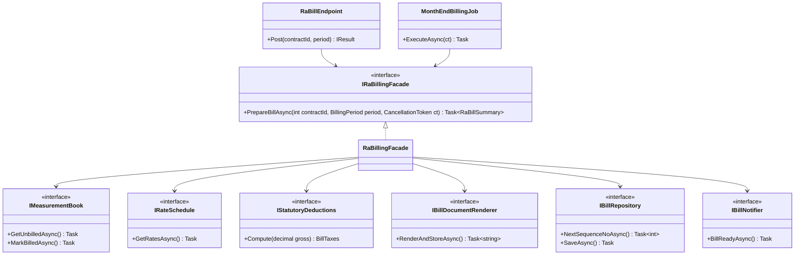
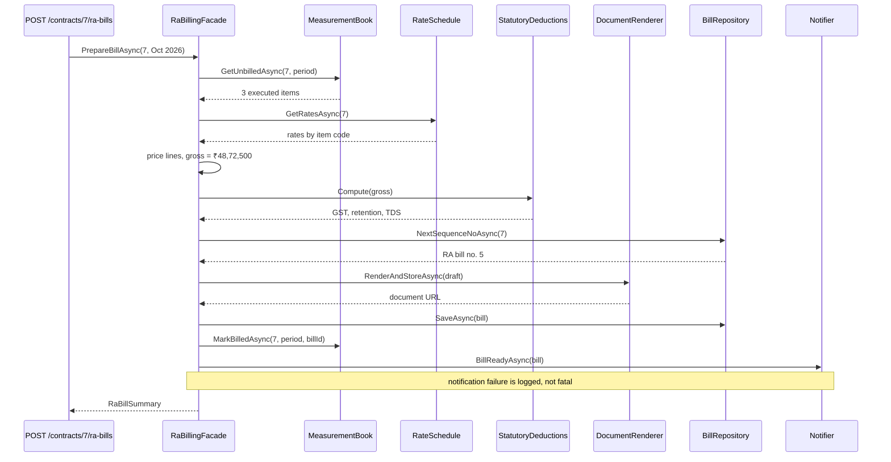

Facade is the pattern you've used most without knowing its name. Every time you call `File.ReadAllText(path)` instead of opening a `FileStream`, wrapping it in a `StreamReader`, detecting the encoding and disposing both, you're using a facade. The idea is simple: when doing one job takes many classes working together in the right order, give callers one easy method that does it for them.

## Learning objectives

By the end of this lesson you will be able to:

1. Explain the problem Facade solves: clients that must know and coordinate too many subsystem classes.
2. Name the participants (facade, subsystem classes, client) and draw the class and sequence diagrams.
3. Build a facade in ASP.NET Core that orchestrates several services (a running-account bill for a construction contract) and register it in DI.
4. Handle failure inside a facade: compensation for partial work, and graceful degradation for optional subsystems.
5. Test a facade with fakes, and keep it thin enough that it doesn't become a god object.
6. Tell Facade apart from Adapter, Mediator, Decorator and API gateways or BFFs, and know when a facade adds nothing.

## Prerequisites

- [Interfaces and abstract classes](#/lesson/m01-interfaces-abstract): the facade depends on subsystem interfaces.
- [Controllers, services, repositories and domain models](#/lesson/m03-layers): a facade usually lives in the application (service) layer.
- [Dependency injection](#/lesson/m03-dependency-injection): the facade receives its subsystems through the constructor.

## Explain it like I'm a beginner

Picture starting a small factory in an Indian industrial area. You need a building-plan approval, a fire NOC, a pollution-control consent, an electricity connection, a water connection and a trade licence. Six offices, six forms, six queues, and some of them want a certificate from another one first.

Many states now offer a **single-window** system. You submit one application at one counter. Behind the counter, the single-window office sends the right papers to each department, in the right order, and gives you one combined status. The departments still exist and still do their own work. An expert consultant can still visit the fire department directly. But a normal applicant only deals with one window.

That single window is a **facade**:

- The six departments are the **subsystem**: many classes, each doing one job well.
- The single window is the **facade**: one simple entry point that knows which departments to call and in what order.
- You, the applicant, are the **client**: you make one request instead of six.

Three points matter:

1. **The facade doesn't do the departments' work.** It doesn't inspect fire exits itself. It coordinates.
2. **The departments don't know the facade exists.** They'd work the same without it.
3. **The facade doesn't lock the side doors.** Advanced users can still use the subsystems directly.

In code, a construction-billing module might need a measurement book, a rate schedule, a tax calculator, a PDF renderer, a bill repository and a notifier to produce one contractor bill. Without a facade, every controller and background job repeats that six-step dance. With a facade, they call `PrepareBillAsync(contractId, period)`.

## First-principles explanation

### The original problem

The *Design Patterns* book defines Facade as: "Provide a unified interface to a set of interfaces in a subsystem. Facade defines a higher-level interface that makes the subsystem easier to use."

Good design splits a system into small, focused classes. That's the [Single Responsibility Principle](#/lesson/m04-srp) at work. The side effect is that *using* the system now means knowing many classes:

- **Which classes** are involved (six services to produce one bill).
- **What order** to call them in (you need rates before you can price quantities).
- **How to pass data** between them (the output of one is the input of the next).
- **What to do on failure** (if the PDF fails, don't mark the measurements as billed).

When that knowledge lives in every client (two controllers, one background job, one admin tool), you get duplication, inconsistency, and high coupling. Every client depends on six interfaces, so changing any one subsystem ripples through all of them.

### How it works

A facade is an ordinary class:

1. Its constructor receives the subsystem objects (via DI).
2. It exposes a **few, task-shaped methods** in the client's language: `PrepareBillAsync`, `ExportAsync`, `BookVisitAsync`, not `GetRates` and `Compute`.
3. Each method calls subsystems in the right order, passes data between them, and handles the failure rules for the workflow.
4. It returns a result shaped for the client (a summary DTO), not the subsystems' internal objects.

There's no inheritance trick and no interface the facade must share with the subsystems. Its value is entirely in **reducing what the client needs to know**.

### The simplest implementation

```csharp
public sealed class ReportExportFacade(IReportQuery query, IReportFormatter csv, IFileStore store)
{
    public async Task<string> ExportCsvAsync(int reportId, CancellationToken ct)
    {
        var data  = await query.LoadAsync(reportId, ct) ?? throw new KeyNotFoundException($"Report {reportId}");
        var bytes = csv.Render(data);
        return await store.SaveAsync($"report-{reportId}.csv", "text/csv", bytes, ct);   // returns a download URL
    }
}
```

Three subsystem calls behind one method. The client goes from "know three interfaces, call them in order, handle a missing report" to "call one method and get a URL". Exercise 1 extends this to several formats.

### Participants

| Participant | Role | In our example |
|---|---|---|
| **Facade** | Knows which subsystem classes handle a request, and delegates to them in the right order | `RaBillingFacade` |
| **Subsystem classes** | Do the real work; know nothing about the facade | `IMeasurementBook`, `IRateSchedule`, `IStatutoryDeductions`, `IBillDocumentRenderer`, `IBillRepository`, `IBillNotifier` |
| **Client** | Calls the facade instead of the subsystems | The bill endpoint, a month-end background job |

### What belongs in a facade, and what doesn't

This is the most important design decision.

**Belongs in the facade (orchestration):** the order of steps, passing data between subsystems, workflow-level failure rules ("don't mark quantities as billed if saving failed"), transaction boundaries, and shaping the result for the client.

**Does not belong in the facade (business rules):** how GST is calculated, what the retention percentage is, how a rate is chosen for an item. Those are subsystem responsibilities. If the facade starts computing tax, it slowly turns into a *god object* that knows everything. Then you have one huge class instead of one simple entry point.

A useful test: **if you deleted the facade, would any business rule be lost?** If yes, that rule is in the wrong place.

### When it is useful

- A common task requires calling **three or more** collaborating classes in a specific order.
- The **same sequence** is repeated by several clients (API, background job, CLI, tests).
- You want to **decouple clients from a subsystem** that's likely to change, such as a legacy module being rewritten behind a stable entry point.
- You're **layering** a system. Each layer exposes a facade to the layer above (application services in front of the domain, a module's public API in a [modular monolith](#/lesson/m02-modular-monolith)).
- You're wrapping a **complicated library** for the 90 % case, as `File.ReadAllText` does for streams.

### When not to use it

- **The task is one call.** A facade with a method that just forwards to a single service adds a layer with nothing in it.
- **Clients genuinely need fine control.** An admin tool that recalculates only GST for a bill shouldn't be forced through `PrepareBillAsync`. Let it use the subsystem directly. Facades simplify; they shouldn't imprison.
- **The facade would cover unrelated tasks.** A `ProjectFacade` with billing, scheduling, document management and HR methods is a god object with a pattern name. Create several focused facades instead.
- **The workflow spans services over the network and must survive crashes.** A facade method is an in-process sequence. If step 4 of 6 fails after a power cut, nothing resumes it. For long-running or distributed workflows, use a [saga](#/lesson/m12-sagas) with durable state, or a workflow engine.

### Trade-offs

| You gain | You pay |
|---|---|
| Clients depend on one interface instead of many | One more class, which can grow into a god object if unguarded |
| The workflow is defined once, so behaviour is consistent across clients | Clients that need finer control must bypass it, so you now have two paths |
| Subsystems can change behind a stable entry point | The facade must change when the workflow changes |
| Easy to test clients: fake one facade instead of six services | Facade tests need several fakes |

## Visual explanation

### Class diagram



How to read it: on the left, two very different clients (an HTTP endpoint and a scheduled job) depend on **one** interface, `IRaBillingFacade`. On the right, the facade depends on six subsystem interfaces. Count the arrows: without the facade, each client would need six arrows (12 in total, and more for every new client). With it, each client needs one. Notice also what's missing: no arrows go from the subsystems back to the facade, because subsystems don't know it exists.

### Sequence diagram



The diagram makes the facade's real job visible: **order and hand-offs**. Rates come before pricing, pricing before deductions, and the document is rendered before the bill is saved, so a saved bill always has a document. Measurements are marked as billed only *after* the bill is saved, so a crash in between leaves quantities unbilled rather than lost. The note on the last step records a workflow decision: a failed email shouldn't undo a valid bill. These are exactly the rules you don't want copied into every client.

## Step-by-step example

Scenario: an infrastructure contractor submits a **running-account (RA) bill** each month for work done. The bill prices the executed quantities recorded in the measurement book at contract rates, adds GST, and subtracts statutory and contractual deductions such as retention money and TDS (tax deducted at source). The percentages in this lesson are illustrative configuration values, not tax advice.

### Step 1 — the naive version: orchestration in the controller

```csharp
app.MapPost("/contracts/{id}/ra-bills", async (int id, BillingPeriod period, IMeasurementBook mb, IRateSchedule rs,
    IStatutoryDeductions sd, IBillDocumentRenderer dr, IBillRepository repo, IBillNotifier n, CancellationToken ct) =>
{
    var qty = await mb.GetUnbilledAsync(id, period, ct);
    var rates = await rs.GetRatesAsync(id, ct);
    // ... 40 more lines: pricing, deductions, sequence number, render, save, mark billed, notify
});
```

Then the finance team asks for an automatic month-end run. Someone copies the 40 lines into a `BackgroundService`. Six months later, the endpoint version marks quantities billed *after* saving and the job version does it *before*. One crash later, a contractor's quantities have vanished from billing.

### Step 2 — name the task

What do the clients want? "Prepare the RA bill for this contract and period." That becomes the facade's method name. Don't use names like `RunBillingSteps`. Use the business task.

### Step 3 — move the orchestration, not the rules

Move the sequence into `RaBillingFacade`. Leave tax rules in `IStatutoryDeductions`, rates in `IRateSchedule`, and so on.

### Step 4 — point both clients at the facade

The endpoint and the job each shrink to a few lines and can no longer drift apart.

## Production-style C# implementation

```text
Infra.Api/
  Program.cs
  Billing/Model.cs              # records shared by the billing module
  Billing/Subsystems.cs         # subsystem interfaces
  Billing/InMemorySubsystems.cs # simple implementations so the sample runs
  Billing/RaBillingFacade.cs    # the facade
```

```csharp file=Billing/Model.cs
namespace Infra.Billing;

public sealed record BillingPeriod(DateOnly From, DateOnly To)
{
    public void Validate()
    {
        if (To < From) throw new ArgumentException("Billing period ends before it starts.");
    }
}

/// <summary>A quantity of work recorded in the measurement book, not yet billed.</summary>
public sealed record ExecutedQuantity(string ItemCode, string Description, string Unit, decimal Quantity);

public sealed record BillLine(string ItemCode, string Description, string Unit, decimal Quantity, decimal Rate)
{
    public decimal Amount => Math.Round(Quantity * Rate, 2, MidpointRounding.AwayFromZero);
}

public sealed record Deduction(string Name, decimal Amount);

public sealed record BillTaxes(decimal Gst, IReadOnlyList<Deduction> Deductions);

public sealed record RaBill(
    Guid Id, int ContractId, int SequenceNo, BillingPeriod Period, IReadOnlyList<BillLine> Lines,
    decimal GrossAmount, decimal Gst, IReadOnlyList<Deduction> Deductions, decimal NetPayable, string DocumentUrl);

/// <summary>What clients get back: a summary, not the subsystems' internals.</summary>
public sealed record RaBillSummary(Guid BillId, int SequenceNo, decimal GrossAmount, decimal Gst, decimal TotalDeductions, decimal NetPayable, string DocumentUrl);

public sealed class BillingException(string message) : Exception(message);
```

```csharp file=Billing/Subsystems.cs
namespace Infra.Billing;

public interface IMeasurementBook
{
    Task<IReadOnlyList<ExecutedQuantity>> GetUnbilledAsync(int contractId, BillingPeriod period, CancellationToken ct);
    Task MarkBilledAsync(int contractId, BillingPeriod period, Guid billId, CancellationToken ct);
}

public interface IRateSchedule
{
    Task<IReadOnlyDictionary<string, decimal>> GetRatesAsync(int contractId, CancellationToken ct);
}

/// <summary>Owns the tax and deduction RULES. The facade only asks for the result.</summary>
public interface IStatutoryDeductions
{
    BillTaxes Compute(decimal grossAmount);
}

public interface IBillDocumentRenderer
{
    /// <returns>URL of the stored PDF.</returns>
    Task<string> RenderAndStoreAsync(RaBill draft, CancellationToken ct);
}

public interface IBillRepository
{
    Task<int> NextSequenceNoAsync(int contractId, CancellationToken ct);
    Task SaveAsync(RaBill bill, CancellationToken ct);
}

public interface IBillNotifier
{
    Task BillReadyAsync(RaBill bill, CancellationToken ct);
}
```

```csharp file=Billing/InMemorySubsystems.cs
using System.Collections.Concurrent;
using Microsoft.Extensions.Options;

namespace Infra.Billing;

public sealed class InMemoryMeasurementBook : IMeasurementBook
{
    private readonly ConcurrentDictionary<int, Guid> _billedContracts = new();

    public Task<IReadOnlyList<ExecutedQuantity>> GetUnbilledAsync(int contractId, BillingPeriod period, CancellationToken ct)
    {
        IReadOnlyList<ExecutedQuantity> rows = _billedContracts.ContainsKey(contractId)
            ? []
            : [
                new("EW-01", "Embankment with approved soil", "cum", 4_500m),
                new("GSB-02", "Granular sub-base, grading III", "cum", 1_250m),
                new("DBM-04", "Dense bituminous macadam, 50 mm", "cum", 310m),
            ];
        return Task.FromResult(rows);
    }

    public Task MarkBilledAsync(int contractId, BillingPeriod period, Guid billId, CancellationToken ct)
    {
        _billedContracts[contractId] = billId;
        return Task.CompletedTask;
    }
}

public sealed class FixedRateSchedule : IRateSchedule
{
    private static readonly IReadOnlyDictionary<string, decimal> Rates = new Dictionary<string, decimal>
    {
        ["EW-01"] = 310m, ["GSB-02"] = 1_650m, ["DBM-04"] = 4_500m,
    };

    public Task<IReadOnlyDictionary<string, decimal>> GetRatesAsync(int contractId, CancellationToken ct) => Task.FromResult(Rates);
}

public sealed class DeductionOptions
{
    // Illustrative percentages only. Real values come from the contract and current statutory rules.
    public decimal GstPercent { get; set; } = 18m;
    public decimal RetentionPercent { get; set; } = 5m;
    public decimal IncomeTaxTdsPercent { get; set; } = 2m;
}

public sealed class ConfiguredStatutoryDeductions(IOptions<DeductionOptions> options) : IStatutoryDeductions
{
    public BillTaxes Compute(decimal grossAmount)
    {
        var o = options.Value;
        static decimal Pct(decimal amount, decimal pct) => Math.Round(amount * pct / 100m, 2, MidpointRounding.AwayFromZero);
        return new BillTaxes(
            Pct(grossAmount, o.GstPercent),
            [
                new Deduction("Retention money", Pct(grossAmount, o.RetentionPercent)),
                new Deduction("Income-tax TDS", Pct(grossAmount, o.IncomeTaxTdsPercent)),
            ]);
    }
}

public sealed class FakePdfRenderer : IBillDocumentRenderer
{
    public Task<string> RenderAndStoreAsync(RaBill draft, CancellationToken ct) =>
        Task.FromResult($"/documents/ra-bills/{draft.ContractId}-{draft.SequenceNo:D3}.pdf");
}

public sealed class InMemoryBillRepository : IBillRepository
{
    private readonly ConcurrentDictionary<Guid, RaBill> _bills = new();

    public Task<int> NextSequenceNoAsync(int contractId, CancellationToken ct) =>
        Task.FromResult(_bills.Values.Count(b => b.ContractId == contractId) + 1);

    public Task SaveAsync(RaBill bill, CancellationToken ct)
    {
        _bills[bill.Id] = bill;
        return Task.CompletedTask;
    }
}

public sealed class LoggingBillNotifier(ILogger<LoggingBillNotifier> logger) : IBillNotifier
{
    public Task BillReadyAsync(RaBill bill, CancellationToken ct)
    {
        logger.LogInformation("RA bill {Seq} for contract {Contract} ready: net {Net}", bill.SequenceNo, bill.ContractId, bill.NetPayable);
        return Task.CompletedTask;
    }
}
```

```csharp file=Billing/RaBillingFacade.cs
namespace Infra.Billing;

/// <summary>The single entry point for "prepare this month's RA bill".</summary>
public interface IRaBillingFacade
{
    Task<RaBillSummary> PrepareBillAsync(int contractId, BillingPeriod period, CancellationToken ct = default);
}

/// <summary>
/// Facade: orchestrates the billing subsystems in the correct order. It owns the WORKFLOW
/// (sequence, hand-offs, failure rules) but no business RULES (rates, tax, retention).
/// </summary>
public sealed class RaBillingFacade(
    IMeasurementBook measurementBook,
    IRateSchedule rateSchedule,
    IStatutoryDeductions deductions,
    IBillDocumentRenderer renderer,
    IBillRepository bills,
    IBillNotifier notifier,
    ILogger<RaBillingFacade> logger) : IRaBillingFacade
{
    public async Task<RaBillSummary> PrepareBillAsync(int contractId, BillingPeriod period, CancellationToken ct = default)
    {
        ArgumentNullException.ThrowIfNull(period);
        period.Validate();

        // 1. What was executed and not yet billed?
        var quantities = await measurementBook.GetUnbilledAsync(contractId, period, ct);
        if (quantities.Count == 0) throw new BillingException("No unbilled measurements in this period.");

        // 2. Price it at contract rates.
        var rates = await rateSchedule.GetRatesAsync(contractId, ct);
        var lines = quantities.Select(q => rates.TryGetValue(q.ItemCode, out var rate)
                ? new BillLine(q.ItemCode, q.Description, q.Unit, q.Quantity, rate)
                : throw new BillingException($"No contract rate for item {q.ItemCode}."))
            .ToList();
        var gross = lines.Sum(l => l.Amount);

        // 3. Taxes and deductions: rules live in the subsystem.
        var taxes = deductions.Compute(gross);
        var totalDeductions = taxes.Deductions.Sum(d => d.Amount);
        var net = gross + taxes.Gst - totalDeductions;

        // 4. Number, render, then save. A saved bill always has a document.
        var sequenceNo = await bills.NextSequenceNoAsync(contractId, ct);
        var draft = new RaBill(Guid.NewGuid(), contractId, sequenceNo, period, lines, gross, taxes.Gst, taxes.Deductions, net, DocumentUrl: "");
        var bill = draft with { DocumentUrl = await renderer.RenderAndStoreAsync(draft, ct) };

        // 5. Persist, and only then mark measurements as billed. In a real system, steps 5a and 5b
        //    share one database transaction (unit of work) so they succeed or fail together.
        await bills.SaveAsync(bill, ct);
        await measurementBook.MarkBilledAsync(contractId, period, bill.Id, ct);

        // 6. Notification is useful but not critical: a failed email must not undo a valid bill.
        try
        {
            await notifier.BillReadyAsync(bill, ct);
        }
        catch (Exception ex) when (ex is not OperationCanceledException)
        {
            logger.LogWarning(ex, "RA bill {BillId} saved but notification failed", bill.Id);
        }

        return new RaBillSummary(bill.Id, bill.SequenceNo, gross, taxes.Gst, totalDeductions, net, bill.DocumentUrl);
    }
}
```

```csharp file=Program.cs
using Infra.Billing;

var builder = WebApplication.CreateBuilder(args);

// Subsystems: each one replaceable on its own (PostgreSQL repository, real PDF renderer, email notifier...).
builder.Services.Configure<DeductionOptions>(builder.Configuration.GetSection("Billing:Deductions"));
builder.Services.AddSingleton<IMeasurementBook, InMemoryMeasurementBook>();
builder.Services.AddSingleton<IRateSchedule, FixedRateSchedule>();
builder.Services.AddSingleton<IStatutoryDeductions, ConfiguredStatutoryDeductions>();
builder.Services.AddSingleton<IBillDocumentRenderer, FakePdfRenderer>();
builder.Services.AddSingleton<IBillRepository, InMemoryBillRepository>();
builder.Services.AddSingleton<IBillNotifier, LoggingBillNotifier>();

// The facade: what clients depend on. Scoped, because real subsystems (DbContext) usually are.
builder.Services.AddScoped<IRaBillingFacade, RaBillingFacade>();

var app = builder.Build();

app.MapPost("/contracts/{contractId:int}/ra-bills", async (int contractId, BillingPeriod period, IRaBillingFacade billing, CancellationToken ct) =>
{
    try
    {
        var summary = await billing.PrepareBillAsync(contractId, period, ct);
        return Results.Created($"/ra-bills/{summary.BillId}", summary);
    }
    catch (BillingException ex)
    {
        return Results.Problem(ex.Message, statusCode: StatusCodes.Status422UnprocessableEntity);
    }
    catch (ArgumentException ex)
    {
        return Results.Problem(ex.Message, statusCode: StatusCodes.Status400BadRequest);
    }
});

app.Run();
```

### Design notes

- **Why an interface for the facade?** So clients (the endpoint, the month-end job) can be tested with a one-method fake. The facade is the client's only dependency, which is a big simplification compared with faking six services.
- **The facade returns a summary**, not `RaBill` with all its lines and internals. Clients get what they need, and the internal model can change.
- **Transactions.** Saving the bill and marking measurements must be atomic. With EF Core, both repositories share one scoped `DbContext`, and a single `SaveChangesAsync` (or an explicit transaction) commits both. The facade is the natural place to define that boundary, because it's the only class that sees the whole workflow.
- **Notifications after commit.** Sending the email *after* saving is correct. For guaranteed delivery, the facade would instead write an "RA bill ready" message to an outbox table in the same transaction ([Transactional outbox](#/lesson/m12-outbox)).
- **Bypassing is allowed.** A "re-render PDF" admin action can call `IBillDocumentRenderer` directly. The facade simplifies the common path; it doesn't hide the subsystem.

## Bad design vs good design

**Bad #1: no facade.** The orchestration is copied into each client, as in Step 1. The copies drift: different step order, different error handling, different rounding.

**Bad #2: a god facade.**

```csharp
public sealed class ProjectFacade(/* 23 constructor parameters */)
{
    public Task<RaBillSummary> PrepareBillAsync(...) { ... }
    public Task ApproveDrawingAsync(...) { ... }
    public Task<decimal> CalculateGstAsync(decimal amount) => Task.FromResult(amount * 0.18m);   // a business rule!
    public Task OnboardSubcontractorAsync(...) { ... }
    public Task<IReadOnlyList<Incident>> GetSafetyIncidentsAsync(...) { ... }
    // ... 40 more methods
}
```

Problems:

- 23 dependencies is a strong signal that one class covers several unrelated jobs.
- `CalculateGstAsync` duplicates a rule that belongs in the deductions subsystem. Now there are two GST calculations, and they will diverge.
- Every team edits this file, so merge conflicts become routine.
- Its tests need 23 fakes.

**Good:** one focused facade per *task family* (`IRaBillingFacade`, `IDrawingApprovalFacade`, `ISubcontractorOnboardingFacade`), each with a handful of dependencies, orchestration only, and rules delegated to subsystems.

**Is it worth it?** If only one client performs the workflow and it's three short lines, a facade is optional. Introduce it when a second client appears, when the sequence has failure rules worth protecting, or when you want to shield clients from a subsystem that's changing.

:::callout type=tip title="Application services are facades"
In layered and clean architectures, an application service such as `PlaceOrderHandler` or `RaBillingService` is usually a facade over the domain and infrastructure. Don't worry about the name. Worry about keeping it thin: orchestrate, don't calculate.
:::

:::callout type=warning title="A facade is not a saga"
A facade method runs in one process, in one request. If the process dies halfway, nothing resumes it. When steps span several services or take minutes to hours (approvals, external payments), use durable workflow state, such as a [saga](#/lesson/m12-sagas), instead of a longer facade method.
:::

## Practical playground

The playground has three subsystem classes, a facade, and two clients: one uses the facade, and one reaches past it to a subsystem. Run it, then add a fourth subsystem step (`SafetyBriefing`) and notice that only the facade changes.

:::playground type=csharp title="A facade over a site-mobilisation subsystem"
```csharp file=Program.cs
using System;
using System.Collections.Generic;

// ----- Subsystem: each class does one job and knows nothing about the facade -----
public sealed class EquipmentYard
{
    public string Dispatch(string site, string machine) { Console.WriteLine($"  [yard] dispatching {machine} to {site}"); return $"EQ-{machine[..3].ToUpperInvariant()}-01"; }
}

public sealed class LabourContractor
{
    public int AssignCrew(string site, int workers) { Console.WriteLine($"  [labour] {workers} workers assigned to {site}"); return workers; }
}

public sealed class SiteStores
{
    public void OpenIndent(string site, IReadOnlyList<string> materials) =>
        Console.WriteLine($"  [stores] indent opened at {site}: {string.Join(", ", materials)}");
}

// ----- Facade: one task-shaped method in the client's language -----
public sealed class SiteMobilisationFacade(EquipmentYard yard, LabourContractor labour, SiteStores stores)
{
    public string MobiliseForEarthwork(string site)
    {
        Console.WriteLine($"Mobilising {site} for earthwork...");
        var excavator = yard.Dispatch(site, "excavator");
        yard.Dispatch(site, "roller");
        var crew = labour.AssignCrew(site, 25);
        stores.OpenIndent(site, new[] { "diesel", "geotextile", "survey pegs" });
        return $"{site}: {excavator}, crew of {crew}, stores open";
    }
}

public static class Program
{
    public static void Main()
    {
        var yard = new EquipmentYard();
        var facade = new SiteMobilisationFacade(yard, new LabourContractor(), new SiteStores());

        // Client 1: the common case, one call.
        Console.WriteLine(facade.MobiliseForEarthwork("Km 18 to Km 24, Package 2"));

        // Client 2: an expert who needs one specific thing can still use the subsystem directly.
        Console.WriteLine("Extra request, bypassing the facade:");
        yard.Dispatch("Km 18 to Km 24, Package 2", "water tanker");
    }
}
```
:::

The output shows one call fanning out into four subsystem calls in a fixed order, and a second client using `EquipmentYard` directly for an unusual request. That's the healthy shape of a facade: a convenient front door with the side doors still open. If you find yourself adding parameters to `MobiliseForEarthwork` for every special case (`bool skipRoller`, `int? crewSize`), that's the signal to let those clients use the subsystem directly, or to add a second, differently named facade method.

## Exercises

:::exercise id=m06-facade-ex1 difficulty=beginner kind=code title="A report-export facade"
Three services are needed to export a report: a query that loads it, formatters (one per format) that render bytes, and a file store that saves bytes and returns a URL. Write `ReportExportFacade.ExportAsync(reportId, format)` so clients make one call.
::requirements
- Pick the formatter whose `Format` matches the requested format, case-insensitively. Unknown formats throw `NotSupportedException` **before** loading the report.
- A missing report throws `KeyNotFoundException`.
- File name: the report title in lowercase with spaces replaced by `-`, then `-{reportId}.{format}`. For example, "Monthly Progress Oct" with id 17 as CSV gives `monthly-progress-oct-17.csv`.
- Save with the formatter's content type and return `ExportResult(url, fileName, sizeInBytes)`.
::acceptance
- Exporting report 17 as `"CSV"` saves `monthly-progress-oct-17.csv` with content type `text/csv` and returns the store's URL.
- Requesting `"xlsx"` with no such formatter throws `NotSupportedException`, and the query is never called.
- A missing report throws `KeyNotFoundException`, and nothing is saved.
- The returned size equals the number of rendered bytes.
::hint
The facade's constructor receives `IReportQuery`, `IEnumerable<IReportFormatter>` and `IFileStore`. What should it do with the formatters once, in the constructor?
::hint
Build a dictionary keyed by `Format` with `StringComparer.OrdinalIgnoreCase`.
::hint
Order matters: check the format, then load, then render, then save. Failing fast on a bad format avoids a pointless database call.
::hint
```text
if !formatters.TryGetValue(format, out f) -> throw NotSupportedException
data = await query.LoadAsync(id) ?? throw KeyNotFoundException
bytes = f.Render(data); name = slug(data.Title) + "-" + id + "." + f.Format.ToLowerInvariant()
url = await store.SaveAsync(name, f.ContentType, bytes)
```
::starter
```csharp file=ReportExport.cs
using System;
using System.Collections.Generic;
using System.Linq;
using System.Threading;
using System.Threading.Tasks;

public sealed record ReportData(string Title, IReadOnlyList<string[]> Rows);

public interface IReportQuery
{
    Task<ReportData?> LoadAsync(int reportId, CancellationToken ct);
}

public interface IReportFormatter
{
    string Format { get; }
    string ContentType { get; }
    byte[] Render(ReportData data);
}

public interface IFileStore
{
    Task<string> SaveAsync(string fileName, string contentType, byte[] content, CancellationToken ct);
}

public sealed record ExportResult(string Url, string FileName, long SizeBytes);

public sealed class ReportExportFacade
{
    public ReportExportFacade(IReportQuery query, IEnumerable<IReportFormatter> formatters, IFileStore store) =>
        throw new NotImplementedException();

    public Task<ExportResult> ExportAsync(int reportId, string format, CancellationToken ct = default) =>
        throw new NotImplementedException();
}
```
::tests
```csharp file=ReportExportTests.cs
using System;
using System.Collections.Generic;
using System.Linq;
using System.Text;
using System.Threading;
using System.Threading.Tasks;
using Xunit;

public sealed class FakeQuery : IReportQuery
{
    public int Calls { get; private set; }
    public Task<ReportData?> LoadAsync(int reportId, CancellationToken ct)
    {
        Calls++;
        return Task.FromResult(reportId == 17
            ? new ReportData("Monthly Progress Oct", new List<string[]> { new[] { "Item", "Done" }, new[] { "Earthwork", "62%" } })
            : null);
    }
}

public sealed class CsvFormatter : IReportFormatter
{
    public string Format => "csv";
    public string ContentType => "text/csv";
    public byte[] Render(ReportData d) => Encoding.UTF8.GetBytes(string.Join("\n", d.Rows.Select(r => string.Join(",", r))));
}

public sealed class FakeStore : IFileStore
{
    public List<(string Name, string Type, int Size)> Saved { get; } = new();
    public Task<string> SaveAsync(string fileName, string contentType, byte[] content, CancellationToken ct)
    {
        Saved.Add((fileName, contentType, content.Length));
        return Task.FromResult("https://files.example.com/" + fileName);
    }
}

public class ReportExportTests
{
    [Fact]
    public async Task Exports_csv_with_slugged_file_name()
    {
        var store = new FakeStore();
        var facade = new ReportExportFacade(new FakeQuery(), new IReportFormatter[] { new CsvFormatter() }, store);
        var result = await facade.ExportAsync(17, "CSV");
        Assert.Equal("monthly-progress-oct-17.csv", result.FileName);
        Assert.Equal("https://files.example.com/monthly-progress-oct-17.csv", result.Url);
        var saved = Assert.Single(store.Saved);
        Assert.Equal("text/csv", saved.Type);
        Assert.Equal((long)saved.Size, result.SizeBytes);
    }

    [Fact]
    public async Task Unknown_format_fails_before_loading()
    {
        var query = new FakeQuery();
        var facade = new ReportExportFacade(query, new IReportFormatter[] { new CsvFormatter() }, new FakeStore());
        await Assert.ThrowsAsync<NotSupportedException>(() => facade.ExportAsync(17, "xlsx"));
        Assert.Equal(0, query.Calls);
    }

    [Fact]
    public async Task Missing_report_saves_nothing()
    {
        var store = new FakeStore();
        var facade = new ReportExportFacade(new FakeQuery(), new IReportFormatter[] { new CsvFormatter() }, store);
        await Assert.ThrowsAsync<KeyNotFoundException>(() => facade.ExportAsync(99, "csv"));
        Assert.Empty(store.Saved);
    }
}
```
::solution
```csharp file=ReportExport.cs
using System;
using System.Collections.Generic;
using System.Linq;
using System.Threading;
using System.Threading.Tasks;

public sealed record ReportData(string Title, IReadOnlyList<string[]> Rows);

public interface IReportQuery
{
    Task<ReportData?> LoadAsync(int reportId, CancellationToken ct);
}

public interface IReportFormatter
{
    string Format { get; }
    string ContentType { get; }
    byte[] Render(ReportData data);
}

public interface IFileStore
{
    Task<string> SaveAsync(string fileName, string contentType, byte[] content, CancellationToken ct);
}

public sealed record ExportResult(string Url, string FileName, long SizeBytes);

public sealed class ReportExportFacade
{
    private readonly IReportQuery _query;
    private readonly Dictionary<string, IReportFormatter> _formatters;
    private readonly IFileStore _store;

    public ReportExportFacade(IReportQuery query, IEnumerable<IReportFormatter> formatters, IFileStore store)
    {
        _query = query ?? throw new ArgumentNullException(nameof(query));
        _store = store ?? throw new ArgumentNullException(nameof(store));
        _formatters = formatters.ToDictionary(f => f.Format, StringComparer.OrdinalIgnoreCase);
    }

    public async Task<ExportResult> ExportAsync(int reportId, string format, CancellationToken ct = default)
    {
        if (!_formatters.TryGetValue(format ?? "", out var formatter))
            throw new NotSupportedException($"Export format '{format}' is not supported.");

        var data = await _query.LoadAsync(reportId, ct) ?? throw new KeyNotFoundException($"Report {reportId} not found.");
        var bytes = formatter.Render(data);
        var fileName = $"{Slug(data.Title)}-{reportId}.{formatter.Format.ToLowerInvariant()}";
        var url = await _store.SaveAsync(fileName, formatter.ContentType, bytes, ct);
        return new ExportResult(url, fileName, bytes.LongLength);
    }

    private static string Slug(string title) =>
        string.Join('-', title.Trim().ToLowerInvariant().Split(' ', StringSplitOptions.RemoveEmptyEntries));
}
```

The facade's three responsibilities are visible: choose the right subsystem object, call the subsystems in order, and shape the result. Rendering rules stay in the formatters, and storage rules stay in the store. Adding PDF export means adding one `IReportFormatter` registration. The facade doesn't change, because it selects formatters by data, not with a `switch`. That's a small use of [Strategy](#/lesson/m06-strategy) inside a facade.
::mistakes
- Loading the report before checking the format, which wastes a query on every bad request.
- A `switch (format)` inside the facade that calls `new CsvFormatter()`. The facade then needs editing for every new format.
- Returning the formatter's bytes to the client as well as saving them. Keep the result small.
::extensions
Add `ExportManyAsync(int[] reportIds, string format)` that exports several reports and zips them, reusing the facade from exercise 2.
:::

:::exercise id=m06-facade-ex2 difficulty=beginner kind=code title="A facade over System.IO.Compression"
Creating a zip file in memory with `ZipArchive` has some traps: you must dispose the archive *before* reading the stream, set `leaveOpen` correctly, choose an encoding, and remember the create/read modes. Write a static facade, `ZipBundle`, with three easy methods.
::requirements
- `Create(IReadOnlyDictionary<string, string> textFiles)` returns zip bytes. Each entry is UTF-8 text without a byte-order mark. Entry names may contain folders (`reports/oct.csv`).
- `List(byte[] zip)` returns the entry names, sorted ordinally.
- `ReadText(byte[] zip, string entryName)` returns the entry's text, or throws `FileNotFoundException` if the entry is missing.
::acceptance
- A round trip preserves text exactly, including Hindi (`प्रगति रिपोर्ट`).
- An empty dictionary produces a valid zip with no entries.
- Folder-style names are listed as given.
- A missing entry throws `FileNotFoundException`.
::hint
Write into a `MemoryStream` with `new ZipArchive(ms, ZipArchiveMode.Create, leaveOpen: true)`.
::hint
`ms.ToArray()` must run **after** the archive is disposed, because disposing it writes the zip's central directory. A `using` block that ends before `ToArray()` handles this.
::hint
For each entry: `archive.CreateEntry(name)`, then `entry.Open()`, wrapped in a `StreamWriter` with `new UTF8Encoding(false)` (no BOM).
::hint
For reading: `new ZipArchive(new MemoryStream(zip), ZipArchiveMode.Read)` and `archive.GetEntry(name)`, which returns `null` if missing.
::starter
```csharp file=ZipBundle.cs
using System;
using System.Collections.Generic;
using System.IO;
using System.IO.Compression;
using System.Linq;
using System.Text;

public static class ZipBundle
{
    public static byte[] Create(IReadOnlyDictionary<string, string> textFiles) => throw new NotImplementedException();

    public static IReadOnlyList<string> List(byte[] zip) => throw new NotImplementedException();

    public static string ReadText(byte[] zip, string entryName) => throw new NotImplementedException();
}
```
::tests
```csharp file=ZipBundleTests.cs
using System.Collections.Generic;
using System.IO;
using Xunit;

public class ZipBundleTests
{
    [Fact]
    public void Round_trips_text_including_unicode()
    {
        var zip = ZipBundle.Create(new Dictionary<string, string>
        {
            ["summary.txt"] = "प्रगति रिपोर्ट: 62% complete",
            ["reports/oct.csv"] = "item,qty\nEW-01,4500",
        });
        Assert.Equal("प्रगति रिपोर्ट: 62% complete", ZipBundle.ReadText(zip, "summary.txt"));
        Assert.Equal("item,qty\nEW-01,4500", ZipBundle.ReadText(zip, "reports/oct.csv"));
    }

    [Fact]
    public void Lists_entries_sorted()
    {
        var zip = ZipBundle.Create(new Dictionary<string, string> { ["b.txt"] = "2", ["a.txt"] = "1", ["reports/oct.csv"] = "x" });
        Assert.Equal(new List<string> { "a.txt", "b.txt", "reports/oct.csv" }, ZipBundle.List(zip));
    }

    [Fact]
    public void Empty_input_gives_valid_empty_zip()
    {
        var zip = ZipBundle.Create(new Dictionary<string, string>());
        Assert.NotEmpty(zip);
        Assert.Empty(ZipBundle.List(zip));
    }

    [Fact]
    public void Missing_entry_throws_file_not_found()
    {
        var zip = ZipBundle.Create(new Dictionary<string, string> { ["a.txt"] = "1" });
        Assert.Throws<FileNotFoundException>(() => ZipBundle.ReadText(zip, "nope.txt"));
    }

    [Fact]
    public void Text_is_written_without_bom()
    {
        var zip = ZipBundle.Create(new Dictionary<string, string> { ["a.txt"] = "x" });
        using var archive = new System.IO.Compression.ZipArchive(new MemoryStream(zip), System.IO.Compression.ZipArchiveMode.Read);
        using var raw = new MemoryStream();
        using (var entry = archive.GetEntry("a.txt")!.Open()) entry.CopyTo(raw);
        Assert.Equal(new byte[] { (byte)'x' }, raw.ToArray());
    }
}
```
::solution
```csharp file=ZipBundle.cs
using System;
using System.Collections.Generic;
using System.IO;
using System.IO.Compression;
using System.Linq;
using System.Text;

public static class ZipBundle
{
    private static readonly UTF8Encoding Utf8NoBom = new(encoderShouldEmitUTF8Identifier: false);

    public static byte[] Create(IReadOnlyDictionary<string, string> textFiles)
    {
        ArgumentNullException.ThrowIfNull(textFiles);
        using var ms = new MemoryStream();
        using (var archive = new ZipArchive(ms, ZipArchiveMode.Create, leaveOpen: true))
        {
            foreach (var (name, text) in textFiles)
            {
                var entry = archive.CreateEntry(name, CompressionLevel.Optimal);
                using var writer = new StreamWriter(entry.Open(), Utf8NoBom);
                writer.Write(text);
            }
        }   // disposing the archive writes the central directory; only now is the zip complete
        return ms.ToArray();
    }

    public static IReadOnlyList<string> List(byte[] zip)
    {
        using var archive = OpenRead(zip);
        return archive.Entries.Select(e => e.FullName).OrderBy(n => n, StringComparer.Ordinal).ToList();
    }

    public static string ReadText(byte[] zip, string entryName)
    {
        using var archive = OpenRead(zip);
        var entry = archive.GetEntry(entryName) ?? throw new FileNotFoundException($"Entry '{entryName}' not found in zip.", entryName);
        using var reader = new StreamReader(entry.Open(), Utf8NoBom);
        return reader.ReadToEnd();
    }

    private static ZipArchive OpenRead(byte[] zip)
    {
        ArgumentNullException.ThrowIfNull(zip);
        return new ZipArchive(new MemoryStream(zip, writable: false), ZipArchiveMode.Read);
    }
}
```

This is a facade over a *library*. The caller no longer needs to know about `ZipArchiveMode`, `leaveOpen`, dispose ordering or encodings. `File.ReadAllText` and `ZipFile.CreateFromDirectory` are Microsoft's own facades of exactly this kind.
::mistakes
- Calling `ms.ToArray()` inside the archive's `using` block. The bytes are an incomplete zip that many tools reject.
- Forgetting `leaveOpen: true`, so disposing the archive also disposes the `MemoryStream`. On .NET, `ToArray()` happens to still work on a disposed `MemoryStream`, but relying on that is fragile.
- Writing with `Encoding.UTF8`, which adds a BOM that some CSV consumers show as a stray character.
::extensions
Add `Create(IReadOnlyDictionary<string, byte[]>)` for binary files such as PDFs and photos, and an option to choose `CompressionLevel.NoCompression` for already-compressed formats like JPEG.
:::

:::exercise id=m06-facade-ex3 difficulty=intermediate kind=code title="A booking facade with compensation"
Booking a site inspection takes three subsystems: reserve a vehicle, book the inspector's slot, and issue a site gate pass. If a later step fails, the earlier ones must be undone, so the facade doesn't leave a vehicle reserved for a visit that will never happen. Write `SiteVisitBookingFacade`.
::requirements
- Order: reserve vehicle → book slot → issue gate pass.
- If booking the slot fails, release the vehicle, then rethrow the original exception.
- If issuing the gate pass fails, cancel the slot, then release the vehicle (reverse order), then rethrow the original exception.
- If a compensation step itself fails, still attempt the remaining compensations, and rethrow the **original** exception, not the compensation's.
- Compensations must not use the caller's cancellation token (use `CancellationToken.None`), so a cancelled request still cleans up.
::acceptance
- On success, the calls are `reserve`, `book`, `issue`, and the booking holds all three ids.
- On a slot failure, the calls are `reserve`, `book`, `release`, and the slot's exception reaches the caller.
- On a gate-pass failure, the calls are `reserve`, `book`, `issue`, `cancel`, `release`.
- If `cancel` throws during compensation, `release` still happens, and the caller sees the gate-pass exception.
- If the caller's request is cancelled during the gate-pass step, compensations still run with a non-cancellable token.
::hint
Keep track of what has succeeded so far, so you know what to undo.
::hint
A `List<Func<Task>>` of undo actions works well. Push an undo after each successful step, and on failure run them in reverse.
::hint
Wrap each undo in its own `try/catch`, so one failing compensation doesn't stop the rest. Then `throw;` the original.
::hint
```csharp
var undo = new Stack<Func<Task>>();
try { var v = await vehicles.ReserveAsync(...); undo.Push(() => vehicles.ReleaseAsync(v, CancellationToken.None)); ... }
catch { while (undo.Count > 0) { try { await undo.Pop()(); } catch { /* log */ } } throw; }
```
::starter
```csharp file=SiteVisitBooking.cs
using System;
using System.Collections.Generic;
using System.Threading;
using System.Threading.Tasks;

public interface IVehiclePool
{
    Task<string> ReserveAsync(DateOnly day, CancellationToken ct);
    Task ReleaseAsync(string reservationId, CancellationToken ct);
}

public interface IInspectorCalendar
{
    Task<string> BookSlotAsync(string inspectorId, DateOnly day, CancellationToken ct);
    Task CancelSlotAsync(string slotId, CancellationToken ct);
}

public interface IGatePassService
{
    Task<string> IssueAsync(string siteCode, DateOnly day, string visitorName, CancellationToken ct);
}

public sealed record SiteVisitRequest(string SiteCode, DateOnly Day, string InspectorId, string VisitorName);

public sealed record SiteVisitBooking(string VehicleReservationId, string SlotId, string GatePassNo);

public sealed class SiteVisitBookingFacade
{
    public SiteVisitBookingFacade(IVehiclePool vehicles, IInspectorCalendar calendar, IGatePassService gatePasses) =>
        throw new NotImplementedException();

    public Task<SiteVisitBooking> BookAsync(SiteVisitRequest request, CancellationToken ct = default) =>
        throw new NotImplementedException();
}
```
::tests
```csharp file=SiteVisitBookingTests.cs
using System;
using System.Collections.Generic;
using System.Threading;
using System.Threading.Tasks;
using Xunit;

public sealed class Recorder : IVehiclePool, IInspectorCalendar, IGatePassService
{
    public List<string> Calls { get; } = new();
    public bool FailBook { get; set; }
    public bool FailIssue { get; set; }
    public bool FailCancel { get; set; }
    public CancellationTokenSource? CancelDuringIssue { get; set; }

    public Task<string> ReserveAsync(DateOnly day, CancellationToken ct) { Calls.Add("reserve"); return Task.FromResult("VEH-9"); }
    public Task ReleaseAsync(string id, CancellationToken ct) { Calls.Add(ct.CanBeCanceled ? "release:cancellable" : "release"); return Task.CompletedTask; }

    public Task<string> BookSlotAsync(string inspectorId, DateOnly day, CancellationToken ct)
    {
        Calls.Add("book");
        return FailBook ? Task.FromException<string>(new InvalidOperationException("slot taken")) : Task.FromResult("SLOT-3");
    }

    public Task CancelSlotAsync(string slotId, CancellationToken ct)
    {
        Calls.Add(ct.CanBeCanceled ? "cancel:cancellable" : "cancel");
        return FailCancel ? Task.FromException(new TimeoutException("calendar down")) : Task.CompletedTask;
    }

    public Task<string> IssueAsync(string siteCode, DateOnly day, string visitorName, CancellationToken ct)
    {
        Calls.Add("issue");
        if (CancelDuringIssue is { } cts) { cts.Cancel(); return Task.FromException<string>(new OperationCanceledException(cts.Token)); }
        return FailIssue ? Task.FromException<string>(new InvalidOperationException("gate system offline")) : Task.FromResult("GP-1207");
    }
}

public class SiteVisitBookingTests
{
    private static readonly SiteVisitRequest Req = new("PKG2-KM18", new DateOnly(2026, 11, 4), "INSP-07", "R. Iyer");
    private static SiteVisitBookingFacade Facade(Recorder r) => new(r, r, r);

    [Fact]
    public async Task Success_runs_all_steps_in_order()
    {
        var r = new Recorder();
        var booking = await Facade(r).BookAsync(Req);
        Assert.Equal(new List<string> { "reserve", "book", "issue" }, r.Calls);
        Assert.Equal(new SiteVisitBooking("VEH-9", "SLOT-3", "GP-1207"), booking);
    }

    [Fact]
    public async Task Slot_failure_releases_vehicle()
    {
        var r = new Recorder { FailBook = true };
        var ex = await Assert.ThrowsAsync<InvalidOperationException>(() => Facade(r).BookAsync(Req));
        Assert.Equal("slot taken", ex.Message);
        Assert.Equal(new List<string> { "reserve", "book", "release" }, r.Calls);
    }

    [Fact]
    public async Task Gate_failure_compensates_in_reverse_order()
    {
        var r = new Recorder { FailIssue = true };
        await Assert.ThrowsAsync<InvalidOperationException>(() => Facade(r).BookAsync(Req));
        Assert.Equal(new List<string> { "reserve", "book", "issue", "cancel", "release" }, r.Calls);
    }

    [Fact]
    public async Task Failing_compensation_does_not_mask_original_error()
    {
        var r = new Recorder { FailIssue = true, FailCancel = true };
        var ex = await Assert.ThrowsAsync<InvalidOperationException>(() => Facade(r).BookAsync(Req));
        Assert.Equal("gate system offline", ex.Message);
        Assert.Contains("release", r.Calls);
    }

    [Fact]
    public async Task Cancelled_request_still_compensates_with_non_cancellable_token()
    {
        using var cts = new CancellationTokenSource();
        var r = new Recorder { CancelDuringIssue = cts };
        await Assert.ThrowsAnyAsync<OperationCanceledException>(() => Facade(r).BookAsync(Req, cts.Token));
        Assert.Equal(new List<string> { "reserve", "book", "issue", "cancel", "release" }, r.Calls);
    }
}
```
::solution
```csharp file=SiteVisitBooking.cs
using System;
using System.Collections.Generic;
using System.Threading;
using System.Threading.Tasks;

public interface IVehiclePool
{
    Task<string> ReserveAsync(DateOnly day, CancellationToken ct);
    Task ReleaseAsync(string reservationId, CancellationToken ct);
}

public interface IInspectorCalendar
{
    Task<string> BookSlotAsync(string inspectorId, DateOnly day, CancellationToken ct);
    Task CancelSlotAsync(string slotId, CancellationToken ct);
}

public interface IGatePassService
{
    Task<string> IssueAsync(string siteCode, DateOnly day, string visitorName, CancellationToken ct);
}

public sealed record SiteVisitRequest(string SiteCode, DateOnly Day, string InspectorId, string VisitorName);

public sealed record SiteVisitBooking(string VehicleReservationId, string SlotId, string GatePassNo);

public sealed class SiteVisitBookingFacade
{
    private readonly IVehiclePool _vehicles;
    private readonly IInspectorCalendar _calendar;
    private readonly IGatePassService _gatePasses;

    public SiteVisitBookingFacade(IVehiclePool vehicles, IInspectorCalendar calendar, IGatePassService gatePasses)
    {
        _vehicles = vehicles ?? throw new ArgumentNullException(nameof(vehicles));
        _calendar = calendar ?? throw new ArgumentNullException(nameof(calendar));
        _gatePasses = gatePasses ?? throw new ArgumentNullException(nameof(gatePasses));
    }

    public async Task<SiteVisitBooking> BookAsync(SiteVisitRequest request, CancellationToken ct = default)
    {
        ArgumentNullException.ThrowIfNull(request);
        var undo = new Stack<Func<Task>>();
        try
        {
            var vehicle = await _vehicles.ReserveAsync(request.Day, ct);
            undo.Push(() => _vehicles.ReleaseAsync(vehicle, CancellationToken.None));

            var slot = await _calendar.BookSlotAsync(request.InspectorId, request.Day, ct);
            undo.Push(() => _calendar.CancelSlotAsync(slot, CancellationToken.None));

            var gatePass = await _gatePasses.IssueAsync(request.SiteCode, request.Day, request.VisitorName, ct);
            return new SiteVisitBooking(vehicle, slot, gatePass);
        }
        catch
        {
            while (undo.Count > 0)
            {
                try { await undo.Pop()(); }
                catch { /* in production: log the failed compensation for manual follow-up */ }
            }
            throw;   // the original failure, never a compensation's
        }
    }
}
```

The facade owns the **workflow-level failure rule**: what to undo, and in which order. None of the three subsystems could own that rule, because none of them knows about the others. This is the in-process version of the compensating-transaction idea behind [sagas](#/lesson/m12-sagas). It works for a single request, but it doesn't survive a process crash in the middle of compensation. Log failed compensations so someone can follow up.
::alternatives
If the subsystems are tables in one PostgreSQL database, a single database transaction is simpler and stronger than compensation. Use compensation only when the steps really are separate systems.
::mistakes
- Compensating with the caller's `ct`. If the request was cancelled, every undo call fails at once and the vehicle stays reserved.
- `throw ex;` or throwing the compensation's exception, which hides the real cause.
- Compensating in forward order (release the vehicle before cancelling the slot). Undo in reverse, as with nested `using` blocks.
::extensions
Make each step idempotent with a booking reference passed to all three subsystems, so a client that retries `BookAsync` after a timeout doesn't double-book.
:::

:::exercise id=m06-facade-ex4 difficulty=intermediate kind=design title="Refactor: one workflow, three copies"
A contractor-onboarding workflow exists in three places: an MVC controller (150 lines), a bulk-import background job (120 lines), and an admin console command (90 lines). Each one, in its own way: validates PAN and GSTIN through a verification API, creates the vendor in the ERP over SOAP, creates a user in the identity provider, creates a document folder in blob storage, assigns default permissions, and sends a welcome email. Bugs differ between the copies: the job doesn't send emails, and the console creates the user *before* the ERP vendor exists. Redesign it with a facade, and plan the migration.
::acceptance
- A facade interface with a task-shaped method and a result type.
- The step order is justified, including which step failures are fatal and which are not.
- A clear line between orchestration (facade) and rules (subsystems), with at least two examples of each.
- A migration plan that moves the three clients one at a time, with tests protecting behaviour.
::hint
Start from the client's sentence: "Onboard this contractor." What do the three clients pass in, and what do they need back?
::hint
Which steps create things in *external* systems that would need undoing if a later step fails?
::hint
Is "PAN must be valid" orchestration or a rule? What about "create the ERP vendor before the identity user"?
::hint
For bulk import, does the facade's method need a variant, or can the job just call it in a loop with limited concurrency?
::solution
**Interface**

```csharp
public interface IContractorOnboardingFacade
{
    Task<OnboardingResult> OnboardAsync(OnboardContractorRequest request, CancellationToken ct);
}
public sealed record OnboardingResult(string VendorCode, Guid UserId, string DocumentFolderUrl, IReadOnlyList<string> Warnings);
```

**Order and failure policy**

1. *Verify PAN and GSTIN* (`ITaxIdVerifier`). Fatal; nothing has been created yet, so no undo is needed.
2. *Create ERP vendor* (`IErpVendorAdapter`, an [adapter](#/lesson/m06-adapter) over SOAP). Fatal. The undo is "deactivate vendor", because ERP records usually can't be deleted.
3. *Create identity user* (`IIdentityProvisioner`). Fatal; on failure, deactivate the ERP vendor. It comes after the ERP step because the user's profile stores the vendor code. That's the console's bug.
4. *Create document folder* (`IDocumentStore`). Fatal; on failure, disable the user and deactivate the vendor, in reverse order.
5. *Assign default permissions* (`IPermissionService`). Fatal, with the same compensation.
6. *Send welcome email* (`INotifier`). **Not fatal.** Add a warning to the result, log it, and allow a retry from the admin screen. That's the job's bug, fixed by policy rather than copy-paste.

**Orchestration in the facade**: step order, passing the vendor code to the identity step, the compensation stack, the fatal versus non-fatal decision, and building `OnboardingResult`.

**Rules in subsystems**: PAN format and checksum validation (`ITaxIdVerifier`), which permissions a new contractor gets (`IPermissionService` reads a policy), ERP field mapping (adapter), the welcome email template (notifier).

**Migration**

1. Write characterisation tests of the controller version's observable behaviour, using fakes.
2. Create the facade by moving the controller's code into it, and switch the controller over. The tests stay green.
3. Switch the background job. It loops over rows with `Parallel.ForEachAsync` (degree 4, to respect ERP limits) and collects per-row results. Emails are now sent, which is a behaviour change worth announcing to the team.
4. Switch the console. This fixes the ordering bug.
5. Delete the three old copies. Add a wiring test that resolves the facade from DI.

**Later**: if onboarding grows to include human approval (days, not seconds), move it to a durable workflow or saga. A facade method can't wait for days.
::mistakes
- Putting PAN validation logic in the facade, which makes it a god object.
- One facade with `OnboardAsync`, `OffboardAsync`, `UpdateBankDetailsAsync`, `ChangeGstinAsync` and twelve more. Keep separate task families in separate facades.
- A "big bang" change of all three clients with no characterisation tests.
:::

:::exercise id=m06-facade-ex5 difficulty=advanced kind=code title="A dashboard facade that degrades gracefully"
A project dashboard needs data from four subsystems: progress (mandatory), finance, safety and weather (all optional). Calling them one after another takes the *sum* of their latencies. Write `ProjectDashboardFacade`, which calls all four **concurrently**, gives each optional source a timeout, and returns whatever is available.
::requirements
- Start all four calls before awaiting any of them.
- Progress is mandatory: if it fails, the facade fails with that exception.
- Optional sources that throw, or exceed `optionalTimeout`, appear as `null`, with their name (`"finance"`, `"safety"`, `"weather"`) in `Unavailable`.
- If the *caller* cancels, throw an `OperationCanceledException` (or subclass) instead of reporting sources as unavailable.
- An optional source that ignores its cancellation token must still be cut off at the timeout.
::acceptance
- All four calls are in flight at the same time.
- A finance failure gives `Finance == null` and `Unavailable` containing `"finance"`, while the other sections are present.
- A weather source that never responds is reported unavailable after about 100 ms, and the call completes.
- A progress failure propagates as the original exception type.
- Caller cancellation results in an `OperationCanceledException`.
::hint
Start the tasks first (store them in variables), then await. Awaiting each call as you start it makes the facade sequential.
::hint
Write a small helper: `Task<(T? Value, string? Missing)> Optional<T>(string name, Func<CancellationToken, Task<T>> call, CancellationToken ct)`.
::hint
Inside the helper, create a linked token source from the caller's token and call `CancelAfter(timeout)`. Also call `.WaitAsync(linked.Token)` on the task, to cut off sources that ignore tokens.
::hint
Catch with a filter: `catch (Exception) when (!ct.IsCancellationRequested) { return (null, name); }`. When the caller cancelled, the filter is false, so the exception propagates.
::starter
```csharp file=ProjectDashboard.cs
using System;
using System.Collections.Generic;
using System.Threading;
using System.Threading.Tasks;

public sealed record ProgressSnapshot(decimal PhysicalPercent);
public sealed record FinanceSnapshot(decimal SpentCrore);
public sealed record SafetySnapshot(int OpenIncidents);
public sealed record WeatherSnapshot(string Summary);

public interface IProgressService { Task<ProgressSnapshot> GetAsync(int projectId, CancellationToken ct); }
public interface IFinanceService { Task<FinanceSnapshot> GetAsync(int projectId, CancellationToken ct); }
public interface ISafetyService { Task<SafetySnapshot> GetAsync(int projectId, CancellationToken ct); }
public interface IWeatherService { Task<WeatherSnapshot> GetAsync(int projectId, CancellationToken ct); }

public sealed record ProjectDashboard(
    int ProjectId, ProgressSnapshot Progress, FinanceSnapshot? Finance, SafetySnapshot? Safety, WeatherSnapshot? Weather,
    IReadOnlyList<string> Unavailable);

public sealed class ProjectDashboardFacade
{
    public ProjectDashboardFacade(IProgressService progress, IFinanceService finance, ISafetyService safety,
        IWeatherService weather, TimeSpan optionalTimeout) => throw new NotImplementedException();

    public Task<ProjectDashboard> GetAsync(int projectId, CancellationToken ct = default) => throw new NotImplementedException();
}
```
::tests
```csharp file=ProjectDashboardTests.cs
using System;
using System.Collections.Concurrent;
using System.Collections.Generic;
using System.Threading;
using System.Threading.Tasks;
using Xunit;

public enum Mode { Immediate, Gated, Throw, Never }

public sealed class FakeSources : IProgressService, IFinanceService, ISafetyService, IWeatherService
{
    public ConcurrentDictionary<string, bool> Started { get; } = new();
    public Dictionary<string, Mode> Modes { get; } = new();
    public TaskCompletionSource Gate { get; } = new(TaskCreationOptions.RunContinuationsAsynchronously);

    private async Task<T> Run<T>(string name, T value, CancellationToken ct)
    {
        Started[name] = true;
        switch (Modes.TryGetValue(name, out var m) ? m : Mode.Immediate)
        {
            case Mode.Throw: await Task.Yield(); throw new InvalidOperationException(name + " down");
            case Mode.Never: await new TaskCompletionSource().Task; break;   // ignores the token on purpose
            case Mode.Gated: await Gate.Task.WaitAsync(ct); break;
        }
        return value;
    }

    Task<ProgressSnapshot> IProgressService.GetAsync(int id, CancellationToken ct) => Run("progress", new ProgressSnapshot(62.5m), ct);
    Task<FinanceSnapshot> IFinanceService.GetAsync(int id, CancellationToken ct) => Run("finance", new FinanceSnapshot(148.2m), ct);
    Task<SafetySnapshot> ISafetyService.GetAsync(int id, CancellationToken ct) => Run("safety", new SafetySnapshot(2), ct);
    Task<WeatherSnapshot> IWeatherService.GetAsync(int id, CancellationToken ct) => Run("weather", new WeatherSnapshot("Light rain"), ct);
}

public class ProjectDashboardTests
{
    private static ProjectDashboardFacade Facade(FakeSources f, int timeoutMs = 100) => new(f, f, f, f, TimeSpan.FromMilliseconds(timeoutMs));

    [Fact]
    public async Task All_sections_present_when_everything_works()
    {
        var d = await Facade(new FakeSources()).GetAsync(7);
        Assert.Equal(62.5m, d.Progress.PhysicalPercent);
        Assert.NotNull(d.Finance); Assert.NotNull(d.Safety); Assert.NotNull(d.Weather);
        Assert.Empty(d.Unavailable);
    }

    [Fact]
    public async Task Calls_run_concurrently()
    {
        var f = new FakeSources();
        foreach (var n in new[] { "progress", "finance", "safety", "weather" }) f.Modes[n] = Mode.Gated;
        var task = Facade(f, timeoutMs: 5_000).GetAsync(7);
        await Task.Delay(100);
        Assert.Equal(4, f.Started.Count);
        f.Gate.SetResult();
        var d = await task.WaitAsync(TimeSpan.FromSeconds(2));
        Assert.Empty(d.Unavailable);
    }

    [Fact]
    public async Task Optional_failure_degrades()
    {
        var f = new FakeSources();
        f.Modes["finance"] = Mode.Throw;
        var d = await Facade(f).GetAsync(7);
        Assert.Null(d.Finance);
        Assert.Equal(new List<string> { "finance" }, d.Unavailable);
        Assert.NotNull(d.Safety);
    }

    [Fact]
    public async Task Optional_timeout_degrades_even_if_source_ignores_token()
    {
        var f = new FakeSources();
        f.Modes["weather"] = Mode.Never;
        var d = await Facade(f, timeoutMs: 100).GetAsync(7).WaitAsync(TimeSpan.FromSeconds(3));
        Assert.Null(d.Weather);
        Assert.Contains("weather", d.Unavailable);
    }

    [Fact]
    public async Task Mandatory_failure_propagates()
    {
        var f = new FakeSources();
        f.Modes["progress"] = Mode.Throw;
        await Assert.ThrowsAsync<InvalidOperationException>(() => Facade(f).GetAsync(7));
    }

    [Fact]
    public async Task Caller_cancellation_is_not_reported_as_unavailable()
    {
        var f = new FakeSources();
        foreach (var n in new[] { "progress", "finance", "safety", "weather" }) f.Modes[n] = Mode.Gated;
        using var cts = new CancellationTokenSource();
        var task = Facade(f, timeoutMs: 5_000).GetAsync(7, cts.Token);
        await Task.Delay(50);
        cts.Cancel();
        await Assert.ThrowsAnyAsync<OperationCanceledException>(() => task.WaitAsync(TimeSpan.FromSeconds(2)));
    }
}
```
::solution
```csharp file=ProjectDashboard.cs
using System;
using System.Collections.Generic;
using System.Threading;
using System.Threading.Tasks;

public sealed record ProgressSnapshot(decimal PhysicalPercent);
public sealed record FinanceSnapshot(decimal SpentCrore);
public sealed record SafetySnapshot(int OpenIncidents);
public sealed record WeatherSnapshot(string Summary);

public interface IProgressService { Task<ProgressSnapshot> GetAsync(int projectId, CancellationToken ct); }
public interface IFinanceService { Task<FinanceSnapshot> GetAsync(int projectId, CancellationToken ct); }
public interface ISafetyService { Task<SafetySnapshot> GetAsync(int projectId, CancellationToken ct); }
public interface IWeatherService { Task<WeatherSnapshot> GetAsync(int projectId, CancellationToken ct); }

public sealed record ProjectDashboard(
    int ProjectId, ProgressSnapshot Progress, FinanceSnapshot? Finance, SafetySnapshot? Safety, WeatherSnapshot? Weather,
    IReadOnlyList<string> Unavailable);

public sealed class ProjectDashboardFacade
{
    private readonly IProgressService _progress;
    private readonly IFinanceService _finance;
    private readonly ISafetyService _safety;
    private readonly IWeatherService _weather;
    private readonly TimeSpan _optionalTimeout;

    public ProjectDashboardFacade(IProgressService progress, IFinanceService finance, ISafetyService safety,
        IWeatherService weather, TimeSpan optionalTimeout)
    {
        _progress = progress; _finance = finance; _safety = safety; _weather = weather;
        _optionalTimeout = optionalTimeout;
    }

    public async Task<ProjectDashboard> GetAsync(int projectId, CancellationToken ct = default)
    {
        // Start everything first: total latency becomes the slowest call, not the sum.
        var progressTask = _progress.GetAsync(projectId, ct);
        var financeTask = Optional("finance", t => _finance.GetAsync(projectId, t), ct);
        var safetyTask = Optional("safety", t => _safety.GetAsync(projectId, t), ct);
        var weatherTask = Optional("weather", t => _weather.GetAsync(projectId, t), ct);

        var progress = await progressTask.WaitAsync(ct);   // mandatory: failures propagate
        var finance = await financeTask;
        var safety = await safetyTask;
        var weather = await weatherTask;

        var unavailable = new List<string>();
        foreach (var missing in new[] { finance.Missing, safety.Missing, weather.Missing })
            if (missing is not null) unavailable.Add(missing);

        return new ProjectDashboard(projectId, progress, finance.Value, safety.Value, weather.Value, unavailable);
    }

    private async Task<(T? Value, string? Missing)> Optional<T>(string name, Func<CancellationToken, Task<T>> call, CancellationToken ct)
        where T : class
    {
        using var linked = CancellationTokenSource.CreateLinkedTokenSource(ct);
        linked.CancelAfter(_optionalTimeout);
        try
        {
            // WaitAsync cuts off sources that ignore the token.
            return (await call(linked.Token).WaitAsync(linked.Token), null);
        }
        catch (Exception) when (!ct.IsCancellationRequested)
        {
            return (null, name);   // failed or timed out: degrade
        }
    }
}
```

At architecture scale, this facade is a small **Backend for Frontend** (BFF): one endpoint that aggregates several backends for one screen ([API gateway and BFF](#/lesson/m16-gateway-bff)). The workflow decisions (what is mandatory, how long to wait, how to report missing parts) belong to the facade, because only it knows what this screen needs.
::alternatives
If optional sections are slow but rarely change (weather, finance totals), cache them with a [decorator](#/lesson/m06-decorator) around each service, and keep the facade's timeout for the cache-miss path.
::mistakes
- `var p = await _progress.GetAsync(...); var f = await ...` makes it sequential, so the dashboard takes the sum of all latencies.
- `catch (Exception)` without the `when` filter turns a user closing the browser into "finance unavailable" and keeps working for nobody.
- Relying only on the token: a source that ignores it hangs the dashboard. `WaitAsync` enforces the timeout anyway. The orphaned call keeps running in the background, so report it in metrics.
::extensions
Return the dashboard with HTTP 200 and a `Warning`-style field when sections are missing, and add an OpenTelemetry metric per unavailable source so you can alert when one is regularly missing.
:::

## Automated testing

A facade has a lot of collaborators, but it's straightforward to test because each collaborator is an interface.

**1. Workflow tests with fakes.** Give each subsystem a small fake that records calls into a shared list (as in exercise 3). Then assert:

- the **order** of calls on the happy path,
- **what is passed between steps** (the bill id passed to `MarkBilledAsync` is the id of the saved bill),
- the **failure policy**: which failures stop the workflow, what gets undone, and which failures are only logged.

```csharp
[Fact]
public async Task Notification_failure_does_not_fail_the_bill()
{
    var notifier = new ThrowingNotifier();   // throws InvalidOperationException
    var facade = new RaBillingFacade(new InMemoryMeasurementBook(), new FixedRateSchedule(),
        new ConfiguredStatutoryDeductions(Options.Create(new DeductionOptions())), new FakePdfRenderer(),
        new InMemoryBillRepository(), notifier, NullLogger<RaBillingFacade>.Instance);

    var summary = await facade.PrepareBillAsync(7, new BillingPeriod(new(2026, 10, 1), new(2026, 10, 31)));

    Assert.Equal(1, summary.SequenceNo);
    Assert.True(summary.NetPayable > 0);
}

[Fact]
public async Task Missing_rate_stops_before_anything_is_saved()
{
    var repo = new RecordingBillRepository();
    var facade = CreateFacade(rates: new EmptyRateSchedule(), repository: repo);
    await Assert.ThrowsAsync<BillingException>(() => facade.PrepareBillAsync(7, October));
    Assert.Empty(repo.Saved);
}
```

**2. Don't re-test subsystem rules through the facade.** GST and retention arithmetic are tested in `ConfiguredStatutoryDeductions`' own tests. The facade test only checks that the facade *used* the result correctly (net = gross + GST − deductions). Otherwise every rule change breaks two sets of tests.

**3. Client tests use a fake facade.** The endpoint and the month-end job each need a one-method fake of `IRaBillingFacade`. That's one of the main benefits of the pattern.

**4. One integration test per facade method**, with real subsystem implementations against a test database (Testcontainers for PostgreSQL), covering the transaction boundary. Save a bill, then kill the process between steps in a test-only hook, and confirm that measurements aren't lost.

**Extensibility.** New steps (for example, "upload to the client's e-measurement portal") are added in one place. New clients (a mobile app, a CLI) reuse the same method. When a method starts gaining flags (`skipPdf`, `dryRun`), split it into separately named methods, or let those clients use subsystems directly.

## Real-world application

- **.NET's own facades.** `File.ReadAllText` / `WriteAllText` over `FileStream`, `StreamReader` and encodings. `ZipFile.CreateFromDirectory` over `ZipArchive`. `HttpClient.GetFromJsonAsync` over request, response, content and serializer. `WebApplication.CreateBuilder(args)` over host, configuration, logging, DI and Kestrel setup. `Process.Start(...)` over the operating system's process APIs.
- **Application services.** In layered or clean architecture, each use case (`PlaceOrder`, `ApproveDrawing`, `PrepareRaBill`) is typically a thin facade over domain objects and infrastructure, as described in Martin Fowler's *Service Layer*.
- **Module APIs in a modular monolith.** Each module exposes a small facade (`IBillingModule`), and other modules may call only that, never the module's internals. This keeps the boundaries enforceable.
- **API gateways and BFFs.** At system scale, a Backend for Frontend aggregates several microservices for one client (mobile app, web dashboard). It's a network-level facade.
- **SDK convenience layers.** Cloud SDKs often provide a high-level client (upload a file in one call) over lower-level REST operations (initiate, upload blocks, commit).
- **Infrastructure project platforms.** Month-end billing, progress-report generation and contractor onboarding are classic multi-step workflows that benefit from one well-tested entry point used by the UI, scheduled jobs and integrations alike.

### Comparison with similar patterns

| Pattern | What it wraps | Interface | Purpose |
|---|---|---|---|
| **Facade** | *Many* subsystem classes | A new, simpler one | Make a subsystem easy to use for common tasks |
| [Adapter](#/lesson/m06-adapter) | *One* existing class | The one the client already expects | Make an incompatible interface fit |
| [Decorator](#/lesson/m06-decorator) | One object | The same as the wrapped object | Add behaviour, stackable |
| [Mediator](#/lesson/m06-mediator) | Many *peer* objects that talk to each other | Colleagues know the mediator | Centralise communication *between* colleagues; colleagues are aware of it. With Facade, subsystems are unaware |
| [Abstract Factory](#/lesson/m06-abstract-factory) | Creation of related objects | Factory methods | Often used *with* a facade to create subsystem objects consistently |
| API gateway / [BFF](#/lesson/m16-gateway-bff) | Many services over the network | An HTTP API | Facade at the architecture level, plus routing, auth and rate limiting |

The quickest test: **one wrapped class with a changed interface → Adapter. Many classes behind one simpler interface → Facade.** If the wrapped objects know about and talk *through* the coordinator, it's a Mediator. See [Choosing between similar patterns](#/lesson/m06-pattern-comparison).

## Interview questions

:::interview
::q beginner
What is the Facade pattern? Give an example from .NET.
::a
Facade provides one simple, higher-level interface over a set of classes in a subsystem, so clients can perform common tasks with a single call instead of coordinating many classes themselves. The subsystem classes still exist and can be used directly. Example: `File.ReadAllText(path)` hides `FileStream`, `StreamReader`, encoding detection and disposal. Another: `WebApplication.CreateBuilder(args)` sets up configuration, logging, DI and the host in one call.
::q beginner
What's the difference between Facade and Adapter?
::a
Adapter wraps *one* existing class to make its interface match one the client already expects. The goal is compatibility. Facade wraps *many* classes and defines a *new*, simpler interface. The goal is ease of use. An adapter changes the shape of one thing; a facade hides the coordination of several things. They often appear together: a facade might call an adapter that wraps a legacy SOAP service.
::q intermediate
What should and shouldn't go into a facade?
::a
Into it: orchestration, meaning the order of steps, passing data between subsystems, workflow-level failure handling (compensation, deciding which failures are fatal), transaction boundaries, and shaping the result for clients. Not into it: business rules such as tax calculation, pricing or eligibility. Those belong in the subsystems, or the facade becomes a god object that duplicates rules. A good check: deleting the facade should lose no business rules, only coordination. Also keep each facade focused on one task family. Twenty-plus constructor dependencies is a warning sign.
::q intermediate
Should a facade prevent clients from using the subsystem directly?
::a
Generally no. The GoF intent is to *simplify* common use, not to hide the subsystem. Advanced clients, such as an admin tool that re-renders a document, may legitimately use subsystem classes directly. The exception is when the facade is a deliberate *boundary*, such as a module API in a modular monolith or a public SDK surface. There, you enforce it with `internal` types, separate assemblies or architecture tests, because uncontrolled access would break the module's encapsulation.
::q advanced
A facade method calls four external services. How do you handle partial failure?
::a
First classify each step: mandatory or optional, and whether it creates something that must be undone. For optional data (dashboard widgets), call in parallel with per-call timeouts and degrade gracefully, reporting what's missing. For steps that create state in separate systems, keep an undo stack and compensate in reverse order on failure. Use a non-cancellable token for compensations, keep going if one compensation fails, rethrow the original error, and log failed compensations for manual follow-up. Make steps idempotent (a correlation or idempotency key) so client retries are safe. If the steps share one database, use a transaction instead. If the workflow must survive process crashes or spans long durations, move from a facade method to a saga or workflow engine with durable state, often using an outbox for reliable messaging.
::q advanced
How do you stop a facade from becoming a god object over time?
::a
Name facades after task families (billing, onboarding, approvals), not after the whole system. Watch constructor size and method count, and split when unrelated workflows accumulate. Keep business rules in subsystems and review pull requests for calculations creeping into the facade. Avoid boolean flags that create hidden variants. Give special cases their own methods, or let those clients use the subsystem. Return client-shaped results rather than leaking subsystem internals. Test the facade's orchestration separately from the subsystems' rules. And use architecture tests or code ownership so changes to the facade get reviewed by the people who own the workflow.
:::

## Summary and revision

**Key takeaways**

- Facade gives one simple, task-shaped entry point over a subsystem of many classes. Clients make one call instead of coordinating many.
- Subsystems don't know the facade exists and remain usable directly. A facade simplifies; it doesn't imprison.
- The facade owns **orchestration**: order, hand-offs, failure policy, transaction boundaries, result shaping. Subsystems own **rules**.
- Handle partial failure deliberately: compensation in reverse order, graceful degradation for optional data, and sagas for long or distributed workflows.
- Keep facades focused on one task family to avoid god objects. Test orchestration with fakes and test rules in the subsystems.
- Adapter = one class, changed interface. Facade = many classes, new simpler interface. BFF and API gateway = facade at network scale.

**Terminology**: facade, subsystem, client, orchestration, application service, god object, compensation, graceful degradation, Backend for Frontend (BFF).

:::flashcards
Q: Facade's intent in one sentence?
A: Provide a unified, higher-level interface to a set of subsystem interfaces so the subsystem is easier to use.
Q: Do subsystem classes know about the facade?
A: No. They work the same without it, and clients may still use them directly.
Q: What belongs in a facade, and what does not?
A: Orchestration (order, hand-offs, failure policy, transactions, result shaping) belongs; business rules (tax, pricing, eligibility) do not.
Q: Facade vs Adapter?
A: Adapter wraps one class to match an expected interface; Facade wraps many classes behind a new, simpler interface.
Q: Facade vs Mediator?
A: With Mediator, colleagues know and talk through the mediator; with Facade, subsystems are unaware of it and communication is one-way.
Q: How should a facade undo partial work across separate systems?
A: An undo stack, compensating in reverse order with a non-cancellable token, continuing past failed compensations, and rethrowing the original error.
Q: When is a facade method the wrong tool for a workflow?
A: When it must survive crashes or span long durations or multiple services; use a saga or workflow engine with durable state.
Q: Name two facades in .NET.
A: File.ReadAllText (streams + encoding), WebApplication.CreateBuilder (host + config + logging + DI), ZipFile.CreateFromDirectory, HttpClient.GetFromJsonAsync.
:::

## Knowledge check

:::quiz pass=70
::q single
An endpoint and a background job each call the same six services in the same order to prepare a bill, and their copies have started to differ. What's the most direct fix?
- [ ] Merge the six services into one class.
- [x] Introduce a facade with a `PrepareBillAsync` method and point both clients at it.
- [ ] Add a decorator around each service.
- [ ] Make the six services static.
> The duplicated orchestration belongs in one place. Merging the services would destroy their separation, and decorators add behaviour to one object, not coordination across many.
::q single
Your `BillingFacade` has a method `CalculateGst(decimal amount) => amount * 0.18m`, and the tax subsystem has its own GST calculation. What's wrong?
- [ ] Nothing; facades may contain any code.
- [x] A business rule has leaked into the facade and now exists twice. The facade should ask the tax subsystem.
- [ ] GST should be calculated in the controller.
- [ ] The facade should inherit from the tax subsystem.
> Facades orchestrate; subsystems own rules. Duplicated rules diverge.
::q single
Which statement about Facade is true?
- [ ] Subsystem classes must hold a reference to the facade.
- [ ] Clients must never use subsystem classes directly.
- [x] Subsystems are unaware of the facade, and clients may still use them directly when needed.
- [ ] A facade must implement the same interface as its subsystem classes.
> That's the GoF intent: simplify the common path without hiding the subsystem. Only deliberate module boundaries restrict direct access.
::q multi
A booking facade reserves a vehicle, books a slot, then fails to issue a gate pass. Which actions are correct? (Select all that apply.)
- [x] Cancel the slot, then release the vehicle.
- [x] Use a non-cancellable token for compensation calls.
- [ ] Throw the compensation's exception if cancelling the slot fails.
- [x] Rethrow the original gate-pass exception after compensating.
> Undo in reverse order, don't let the caller's cancellation block cleanup, and never mask the real cause.
::q single
A dashboard facade awaits four services one after another, taking 300 + 250 + 400 + 200 ms (estimated). What change gives the biggest latency improvement?
- [ ] Add retries to each call.
- [x] Start all four calls first, then await them, so latency approaches the slowest call (about 400 ms).
- [ ] Cache the facade instance as a singleton.
- [ ] Convert the facade to an adapter.
> Independent calls should run concurrently. Sequential awaits add up latencies.
::q single
Which is a Facade rather than an Adapter?
- [ ] A class that makes a vendor SMS SDK implement your `ISmsSender`.
- [x] `File.ReadAllText`, which combines `FileStream`, `StreamReader` and encoding handling behind one call.
- [ ] `StreamWriter`, which lets you write text to a byte `Stream`.
- [ ] A class that converts a callback API to `Task`.
> The others each make one class fit a different interface. `File.ReadAllText` hides the coordination of several classes.
::q single
An onboarding workflow needs manager approval that can take up to three days. Is a facade method the right home for the whole workflow?
- [ ] Yes; just `await` the approval for up to three days.
- [x] No. A facade method is an in-process, short-lived sequence. Use a saga or workflow with durable state, possibly with a facade for each short step.
- [ ] Yes, if the facade is registered as a singleton.
- [ ] No; use a Decorator instead.
> Long-running, crash-surviving workflows need persisted state. A facade method can't wait for days or resume after a restart.
:::

## Completion criteria

You have finished this lesson when you can:

- [ ] Score at least 70 % on the knowledge check.
- [ ] Complete exercises 1 and 2 with all tests passing.
- [ ] Complete exercise 3 or 5 and compare with the solution.
- [ ] Explain, using the single-window analogy, what a facade does and why the departments don't know it exists.
- [ ] State where the line between orchestration (facade) and business rules (subsystems) falls, with one example of each.
