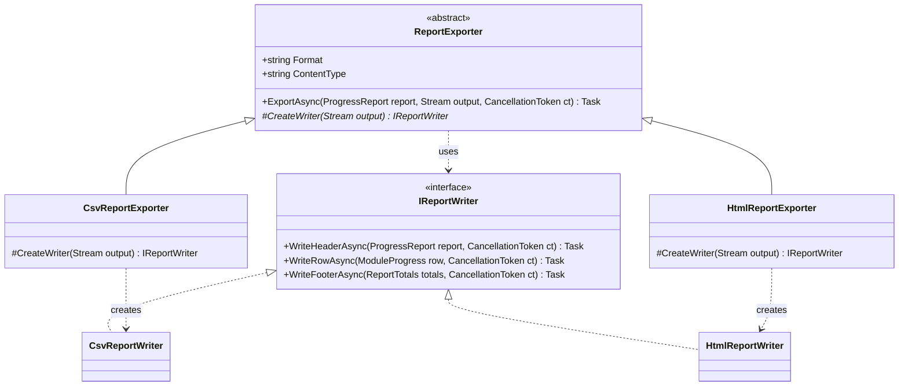
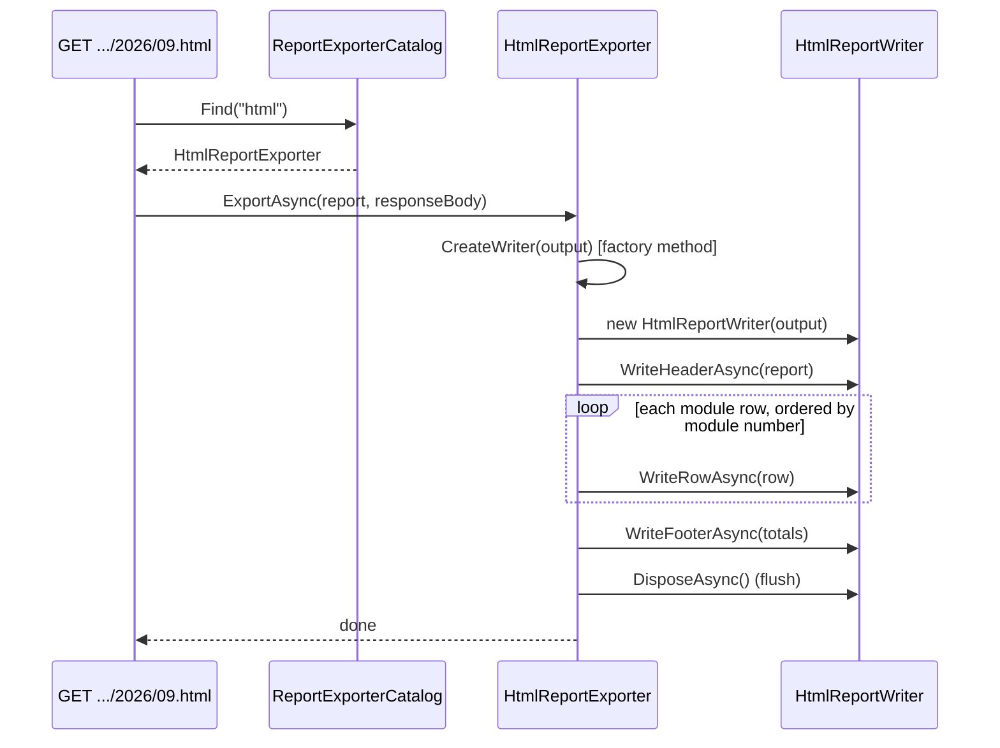
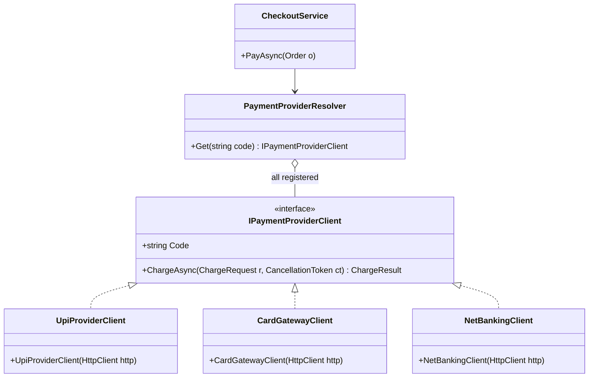

The word "factory" gets used for at least four different things in .NET code. This lesson starts with the precise GoF meaning, a method that subclasses override to decide what gets created, and then maps it onto the forms you will actually meet: static factory methods, simple factories, delegate factories and `IHttpClientFactory`-style services.

## Learning objectives

By the end of this lesson you will be able to:

1. Describe the problem Factory Method solves: shared code that must create an object whose exact class it can't know.
2. Name the four participants (product, concrete product, creator, concrete creator) and build them in C#.
3. Combine a factory method with a template method to build a report exporter where only the *writer* varies.
4. Tell the GoF Factory Method apart from a static factory method, a simple factory and Abstract Factory.
5. Use DI-friendly factory variants in ASP.NET Core: registered creators, `Func<T>` and `ActivatorUtilities`.
6. Test a creator by overriding its factory method with a fake product.
7. Recognise when `new` is perfectly fine.

## Prerequisites

- [Interfaces and abstract classes](#/lesson/m01-interfaces-abstract): the creator is usually an abstract class.
- [The four pillars of OOP](#/lesson/m01-oop-pillars): Factory Method relies on overriding (`abstract`/`override`).
- [Dependency injection](#/lesson/m03-dependency-injection): the modern variants register creators with the container.
- [Open/Closed Principle](#/lesson/m04-ocp): a new product means a new creator, not an edited one.

## Explain it like I'm a beginner

Think of a chain of tea stalls across India. Head office writes one standard process for every stall:

1. Greet the customer.
2. **Make the tea.**
3. Serve it in a cup with the logo.
4. Take payment.

Steps 1, 3 and 4 are identical everywhere. Step 2 isn't. The Kolkata stall makes lemon tea, the Hyderabad stall makes Irani chai, the Gurgaon stall makes masala chai. Head office doesn't want to write "if Kolkata then…, if Hyderabad then…" into its process document. So it writes: *"Step 2: make the local tea. Each stall decides what that means."*

In code:

- The head-office process is a method in a base class.
- "Make the local tea" is an **abstract method** that returns a tea.
- Each stall is a **subclass** that overrides that method and returns its own kind of tea.

That overridable "make the thing" method is the **factory method**. The base class uses whatever comes back without knowing its exact type. Opening a new stall in Chennai (filter coffee!) means writing one new subclass. The head-office process doesn't change.

## First-principles explanation

### The original problem

The GoF example was an application framework. A framework class `Application` knows *when* to create a document (the user clicks "New") and *what to do* with it (open, save, close). But only the application built on top of the framework knows *which* document class: a drawing app needs `DrawingDocument`, a text editor needs `TextDocument`. The framework can't write `new DrawingDocument()` because it was written before the drawing app existed.

The solution: the framework declares `protected abstract Document CreateDocument()`, and each application overrides it.

The general shape: **some shared code needs to create an object, and the decision about which concrete class belongs to someone else.**

In a business app this shows up as:

- A report export process (load data → write header → write rows → write totals) where the *writer* differs per format: CSV, HTML, PDF.
- A notification process (validate → build message → send → log) where the *message* differs per channel.
- An approval workflow engine that creates a step object per step type, where step types are added by different teams.

### The simplest implementation

```csharp
public interface IReportWriter { void WriteRow(string[] cells); string Result(); }

public abstract class ReportExporter                 // Creator
{
    protected abstract IReportWriter CreateWriter();  // the factory method

    public string Export(IEnumerable<string[]> rows) // shared code that USES the product
    {
        var writer = CreateWriter();
        foreach (var r in rows) writer.WriteRow(r);
        return writer.Result();
    }
}

public sealed class CsvExporter : ReportExporter      // Concrete creator
{
    protected override IReportWriter CreateWriter() => new CsvWriter();
}
```

`Export` contains no `new CsvWriter()` and no `if (format == "csv")`. It only knows `IReportWriter`.

### Participants

| Role | Responsibility | In our example |
|---|---|---|
| **Product** | The interface of the objects being created | `IReportWriter` |
| **Concrete product** | A real implementation | `CsvReportWriter`, `HtmlReportWriter` |
| **Creator** | Declares the factory method and contains the code that *uses* the product. May supply a default. | `ReportExporter` |
| **Concrete creator** | Overrides the factory method to return a specific product | `CsvReportExporter`, `HtmlReportExporter` |

Two details people miss:

1. **The creator's main job is not creating.** `ReportExporter` exists to export reports. Creating the writer is one step inside that job. If a class does *nothing but* create objects, it's a factory class (simple factory or Abstract Factory), not the Factory Method pattern.
2. **The factory method can have a default.** A virtual method returning a sensible product (`protected virtual IReportWriter CreateWriter() => new CsvReportWriter(...)`) lets most subclasses inherit it and only some override it.

### How it works internally

It is ordinary virtual dispatch. `ExportAsync` calls `CreateWriter(output)`. At runtime the CLR looks up the override on the actual object's type (`HtmlReportExporter`) and runs it. The cost is one virtual call per export, which is nothing next to writing a file.

### Factory Method often hosts a Template Method

Look at `Export` above: a fixed sequence of steps with one step deferred to subclasses. That is [Template Method](#/lesson/m06-template-method). The two patterns often appear together. Template Method varies a *step of behavior*; Factory Method varies *which object gets created* for the steps to use. Here, the template is "header → rows → footer", and the factory method supplies the object that does the writing.

### The many things called "factory" in .NET

| Name | What it is | Example | GoF Factory Method? |
|---|---|---|---|
| **Factory Method (GoF)** | Overridable method on a creator; subclasses choose the product | `ILoggerProvider.CreateLogger(category)`: each provider returns its own `ILogger` | Yes |
| **Static factory method** | A named static method instead of a constructor | `TimeSpan.FromMinutes(5)`, `Channel.CreateBounded<T>(100)`, `XmlReader.Create(stream)`, `Results.Ok(x)` | No, but useful (named constructors, can return subtypes or cached instances) |
| **Simple factory** | One class with a `switch` that returns different types | `ReportWriterFactory.Create("csv")` | No; a common idiom, fine when the list is small and stable |
| **Delegate factory** | A `Func<T>` or `Func<TArg, T>` injected into a class | `Func<Stream, IReportWriter>` | Same intent, with composition instead of inheritance |
| **Factory service** | A DI service that creates configured objects | `IHttpClientFactory.CreateClient("payments")`, `IDbContextFactory<T>` | Same intent; the container plays the concrete creator |
| **Abstract Factory** | An object that creates a *family* of related products | `DbProviderFactory` | No, a different pattern ([lesson](#/lesson/m06-abstract-factory)) |

You don't need to police names in code reviews. You do need to know which one you're looking at, because their trade-offs differ.

### Inheritance or composition?

The GoF form uses inheritance: one subclass per product. That works well when the creator *is naturally a base class* with real shared behavior (as the exporter is). When it isn't, modern C# prefers composition: inject a `Func<Stream, IReportWriter>` or a small factory interface. You get the same benefit (shared code never names the concrete class) without a class hierarchy.

### Trade-offs

| You gain | You pay |
|---|---|
| Shared code never hard-codes concrete classes | One more class (a concrete creator) per product |
| New products are added without editing the creator | The class hierarchy can grow parallel to the product hierarchy (`CsvExporter`/`CsvWriter`, `HtmlExporter`/`HtmlWriter`) |
| A test can override the factory method to return a fake | Inheritance couples subclasses to the base class's lifecycle and protected members |
| Construction details (buffer size, encoding) live in one place | Someone still has to *choose* the concrete creator, usually DI or a lookup |

### When not to use it

- **There's one product and no realistic second.** `new SmtpClient(...)` in one place is fine.
- **The object is a value or a DTO.** Records, `List<T>`, `DateOnly` and request models should be created with `new`. Wrapping them in factories is noise.
- **The DI container already does the choosing.** If `IReportWriter` is chosen once at startup from configuration, register it and inject it. No factory needed.
- **You're tempted to add a factory "for testability" only.** Constructor injection of the product (or of a `Func<T>`) usually gives a simpler seam.

## Visual explanation

### Class diagram



There are two parallel hierarchies. On the left, creators: the abstract `ReportExporter` (the `*` marks `CreateWriter` as abstract; `#` means protected) and two concrete creators. On the right, products: `IReportWriter` and two writers. The important arrow is `ReportExporter ..> IReportWriter`: the base class depends only on the product *interface*. The "creates" arrows go from each concrete creator to *its* concrete product, and they are the only places a concrete writer class is named.

### Sequence diagram



The endpoint picks an exporter by format. From then on, the flow is the *base class's* `ExportAsync`: it calls its own factory method, which is the only step that differs between HTML and CSV, and then drives the writer through header, rows and footer. Ordering rows by module number and computing the totals happen once, in the base class, for every format.

## Step-by-step example

Our scenario: an online coding school runs batches of its "ASP.NET Core Bootcamp". Each month it publishes a progress report per batch, one row per course module, for example "Module 3, Async and await: planned 80 % of learners finished, actual 64 %". Mentors want CSV for spreadsheets, and learners' managers (for company-sponsored batches) want HTML for email. A PDF version is coming next quarter.

### Step 1 — the naive version

```csharp
public async Task ExportAsync(ProgressReport r, Stream output, string format)
{
    using var sw = new StreamWriter(output);
    if (format == "csv") await sw.WriteLineAsync("Module,Title,Planned %,Actual %");
    else if (format == "html") await sw.WriteLineAsync($"<h1>{r.BatchName}</h1><table>");
    foreach (var row in r.Rows)
    {
        if (format == "csv") await sw.WriteLineAsync($"{row.ModuleNo},{row.Title},...");
        else if (format == "html") await sw.WriteLineAsync($"<tr><td>{row.ModuleNo}</td>...");
    }
    if (format == "html") await sw.WriteLineAsync("</table>");
}
```

Each format is spread across three `if` chains. Adding PDF means touching every one of them. A bug in HTML escaping lives in the same method as CSV quoting. And the module title isn't escaped at all, so a title like `EF Core, "tracking" vs no-tracking` breaks the CSV columns.

### Step 2 — find what varies and what doesn't

Fixed: the order (header, rows sorted by module number, totals) and the totals calculation. Varies: *how* each part is written. So the product is "a thing that writes header, row and footer": `IReportWriter`.

### Step 3 — gather each format into one class

All CSV-specific code moves into `CsvReportWriter`, all HTML-specific code into `HtmlReportWriter`. Each one owns its escaping rules: CSV doubles quotes, HTML encodes `<`, `>` and `&`.

### Step 4 — put the fixed process in a creator with a factory method

`ReportExporter.ExportAsync` runs the fixed steps and calls `protected abstract IReportWriter CreateWriter(Stream output)`. Each concrete exporter overrides it, and also provides its own `Format`, `ContentType` and `FileExtension`.

### Step 5 — let DI register creators, and a catalogue find them

Register each exporter as `ReportExporter`. A small catalogue builds a dictionary by `Format`. Next quarter, PDF support is one new exporter, one new writer and one registration line.

## Production-style C# implementation

```text
Courses.Api/
  Program.cs
  Reports/ProgressReport.cs
  Reports/IReportWriter.cs
  Reports/ReportExporter.cs
  Reports/Csv.cs
  Reports/Html.cs
  Reports/ReportExporterCatalog.cs
  Reports/SampleProgressReportSource.cs
```

```csharp file=Reports/ProgressReport.cs
namespace Courses.Reports;

/// <summary>One course module: the share of learners expected to have finished it by now, and the share who did.</summary>
public sealed record ModuleProgress(int ModuleNo, string Title, decimal PlannedPercent, decimal ActualPercent)
{
    public decimal SlippagePercent => PlannedPercent - ActualPercent;
}

public sealed record ProgressReport(string BatchName, DateOnly Month, IReadOnlyList<ModuleProgress> Rows);

public sealed record ReportTotals(int Rows, decimal AveragePlanned, decimal AverageActual, int RowsSlippingOver10);
```

```csharp file=Reports/IReportWriter.cs
namespace Courses.Reports;

/// <summary>Product: writes one report in one format. Disposing flushes the output.</summary>
public interface IReportWriter : IAsyncDisposable
{
    Task WriteHeaderAsync(ProgressReport report, CancellationToken ct);
    Task WriteRowAsync(ModuleProgress row, CancellationToken ct);
    Task WriteFooterAsync(ReportTotals totals, CancellationToken ct);
}
```

```csharp file=Reports/ReportExporter.cs
using System.Text.RegularExpressions;

namespace Courses.Reports;

/// <summary>Creator. ExportAsync is the fixed process (a template method);
/// CreateWriter is the factory method each format overrides.</summary>
public abstract partial class ReportExporter
{
    public abstract string Format { get; }
    public abstract string ContentType { get; }
    public abstract string FileExtension { get; }

    /// <summary>The factory method. Must not close <paramref name="output"/>; the caller owns it.</summary>
    protected abstract IReportWriter CreateWriter(Stream output);

    public async Task ExportAsync(ProgressReport report, Stream output, CancellationToken ct)
    {
        ArgumentNullException.ThrowIfNull(report);
        ArgumentNullException.ThrowIfNull(output);
        if (!output.CanWrite) throw new ArgumentException("Output stream is not writable.", nameof(output));

        await using var writer = CreateWriter(output);
        await writer.WriteHeaderAsync(report, ct);
        foreach (var row in report.Rows.OrderBy(r => r.ModuleNo))
            await writer.WriteRowAsync(row, ct);
        await writer.WriteFooterAsync(CalculateTotals(report), ct);
    }

    public string FileNameFor(ProgressReport report) =>
        $"{NonSlugChars().Replace(report.BatchName.ToLowerInvariant(), "-").Trim('-')}-{report.Month:yyyy-MM}.{FileExtension}";

    private static ReportTotals CalculateTotals(ProgressReport r) => r.Rows.Count == 0
        ? new ReportTotals(0, 0m, 0m, 0)
        : new ReportTotals(
            r.Rows.Count,
            Math.Round(r.Rows.Average(x => x.PlannedPercent), 1),
            Math.Round(r.Rows.Average(x => x.ActualPercent), 1),
            r.Rows.Count(x => x.SlippagePercent > 10m));

    [GeneratedRegex("[^a-z0-9]+")]
    private static partial Regex NonSlugChars();
}
```

```csharp file=Reports/Csv.cs
using System.Globalization;
using System.Text;

namespace Courses.Reports;

public sealed class CsvReportExporter : ReportExporter
{
    public override string Format => "csv";
    public override string ContentType => "text/csv";
    public override string FileExtension => "csv";
    protected override IReportWriter CreateWriter(Stream output) => new CsvReportWriter(output);
}

/// <summary>Concrete product. UTF-8 with a byte-order mark so spreadsheet apps detect the encoding
/// (₹ and Hindi text display correctly).</summary>
public sealed class CsvReportWriter(Stream output) : IReportWriter
{
    private readonly StreamWriter _w = new(output, new UTF8Encoding(encoderShouldEmitUTF8Identifier: true), bufferSize: 16 * 1024, leaveOpen: true);
    private static readonly CultureInfo Inv = CultureInfo.InvariantCulture;

    public Task WriteHeaderAsync(ProgressReport report, CancellationToken ct) =>
        _w.WriteLineAsync("Module,Title,Planned %,Actual %,Slippage %".AsMemory(), ct);

    public Task WriteRowAsync(ModuleProgress r, CancellationToken ct) =>
        _w.WriteLineAsync(string.Join(',',
            r.ModuleNo.ToString(Inv), Escape(r.Title),
            r.PlannedPercent.ToString(Inv), r.ActualPercent.ToString(Inv), r.SlippagePercent.ToString(Inv)).AsMemory(), ct);

    public Task WriteFooterAsync(ReportTotals t, CancellationToken ct) =>
        _w.WriteLineAsync($"TOTAL,{t.Rows} modules,{t.AveragePlanned.ToString(Inv)},{t.AverageActual.ToString(Inv)},".AsMemory(), ct);

    public async ValueTask DisposeAsync()
    {
        await _w.FlushAsync();
        await _w.DisposeAsync();   // leaveOpen: the caller's stream stays open
    }

    // RFC 4180: wrap in quotes if needed, double any embedded quotes. Also defuse spreadsheet formulas.
    private static string Escape(string value)
    {
        if (value.Length > 0 && "=+-@".Contains(value[0])) value = "'" + value;
        return value.IndexOfAny([',', '"', '\n', '\r']) >= 0 ? $"\"{value.Replace("\"", "\"\"")}\"" : value;
    }
}
```

```csharp file=Reports/Html.cs
using System.Globalization;
using System.Net;
using System.Text;

namespace Courses.Reports;

public sealed class HtmlReportExporter : ReportExporter
{
    public override string Format => "html";
    public override string ContentType => "text/html; charset=utf-8";
    public override string FileExtension => "html";
    protected override IReportWriter CreateWriter(Stream output) => new HtmlReportWriter(output);
}

public sealed class HtmlReportWriter(Stream output) : IReportWriter
{
    private readonly StreamWriter _w = new(output, new UTF8Encoding(false), bufferSize: 16 * 1024, leaveOpen: true);
    private static string E(string s) => WebUtility.HtmlEncode(s);
    private static string N(decimal d) => d.ToString("0.0", CultureInfo.InvariantCulture);

    public Task WriteHeaderAsync(ProgressReport r, CancellationToken ct) => _w.WriteLineAsync((
        $"<!doctype html><meta charset=\"utf-8\"><h1>{E(r.BatchName)}: {r.Month.ToString("MMMM yyyy", CultureInfo.InvariantCulture)}</h1>" +
        "<table><thead><tr><th>Module</th><th>Title</th><th>Planned %</th><th>Actual %</th></tr></thead><tbody>").AsMemory(), ct);

    public Task WriteRowAsync(ModuleProgress r, CancellationToken ct) => _w.WriteLineAsync((
        $"<tr{(r.SlippagePercent > 10m ? " class=\"slipping\"" : "")}><td>{r.ModuleNo}</td>" +
        $"<td>{E(r.Title)}</td><td>{N(r.PlannedPercent)}</td><td>{N(r.ActualPercent)}</td></tr>").AsMemory(), ct);

    public Task WriteFooterAsync(ReportTotals t, CancellationToken ct) => _w.WriteLineAsync((
        $"</tbody><tfoot><tr><td colspan=\"2\">{t.Rows} rows, {t.RowsSlippingOver10} slipping over 10 %</td>" +
        $"<td>{N(t.AveragePlanned)}</td><td>{N(t.AverageActual)}</td></tr></tfoot></table>").AsMemory(), ct);

    public async ValueTask DisposeAsync()
    {
        await _w.FlushAsync();
        await _w.DisposeAsync();
    }
}
```

```csharp file=Reports/ReportExporterCatalog.cs
namespace Courses.Reports;

/// <summary>Finds the concrete creator for a format. Built once from DI registrations.</summary>
public sealed class ReportExporterCatalog
{
    private readonly Dictionary<string, ReportExporter> _byFormat;

    public ReportExporterCatalog(IEnumerable<ReportExporter> exporters)
    {
        _byFormat = new(StringComparer.OrdinalIgnoreCase);
        foreach (var e in exporters)
            if (!_byFormat.TryAdd(e.Format, e))
                throw new InvalidOperationException($"Two exporters registered for format '{e.Format}'.");
    }

    public IReadOnlyCollection<string> Formats => _byFormat.Keys;

    public bool TryFind(string format, out ReportExporter exporter) => _byFormat.TryGetValue(format, out exporter!);
}
```

```csharp file=Reports/SampleProgressReportSource.cs
namespace Courses.Reports;

public interface IProgressReportSource
{
    Task<ProgressReport?> GetAsync(string batchId, DateOnly month, CancellationToken ct);
}

/// <summary>Stand-in for a PostgreSQL query over learners' module completions.</summary>
public sealed class SampleProgressReportSource : IProgressReportSource
{
    public Task<ProgressReport?> GetAsync(string batchId, DateOnly month, CancellationToken ct) =>
        Task.FromResult<ProgressReport?>(batchId != "aspnet-batch-12" ? null : new ProgressReport(
            "ASP.NET Core Bootcamp Batch 12", month,
            [
                new ModuleProgress(2, "Minimal APIs and routing", 95m, 91m),
                new ModuleProgress(3, "Async and await", 80m, 64m),
                new ModuleProgress(4, "EF Core, \"tracking\" vs no-tracking", 60m, 58m),
            ]));
}
```

```csharp file=Program.cs
using Courses.Reports;

var builder = WebApplication.CreateBuilder(args);

// Each concrete creator registered under the creator base type. Adding PDF = one more line.
builder.Services.AddSingleton<ReportExporter, CsvReportExporter>();
builder.Services.AddSingleton<ReportExporter, HtmlReportExporter>();
builder.Services.AddSingleton<ReportExporterCatalog>();
builder.Services.AddSingleton<IProgressReportSource, SampleProgressReportSource>();

var app = builder.Build();

app.MapGet("/batches/{batchId}/reports/{year:int}/{month:int}.{format}",
    async (string batchId, int year, int month, string format,
           ReportExporterCatalog catalog, IProgressReportSource source, CancellationToken ct) =>
    {
        if (!catalog.TryFind(format, out var exporter))
            return Results.Problem($"Unsupported format '{format}'. Supported: {string.Join(", ", catalog.Formats)}.",
                                   statusCode: StatusCodes.Status400BadRequest);
        if (month is < 1 or > 12) return Results.Problem("Month must be 1–12.", statusCode: StatusCodes.Status400BadRequest);

        var report = await source.GetAsync(batchId, new DateOnly(year, month, 1), ct);
        if (report is null) return Results.NotFound();

        // Stream straight into the response body: no buffering of large reports in memory.
        return Results.Stream(body => exporter.ExportAsync(report, body, ct), exporter.ContentType, exporter.FileNameFor(report));
    });

app.Run();
```

Design notes:

- **`ExportAsync` is not virtual.** The process (ordering, totals, disposal) is the creator's promise. Subclasses only answer "which writer?". That stops a future exporter from forgetting to sort modules.
- **The factory method's contract is documented**: it must not close the caller's stream. Both writers use `leaveOpen: true`. Write down contracts like this; subclasses can't guess them.
- **Security lives in the product.** CSV escaping, including a guard against spreadsheet formula injection (a cell starting with `=` or `+`), and HTML encoding are each in exactly one class.
- **Choosing the creator is not the pattern's job.** The catalogue does that. Factory Method answers "who creates the writer?", and DI plus the catalogue answer "which exporter?".

## Bad design vs good design

**Bad: a "factory" that is a hidden switch, called from everywhere.**

```csharp
public static class WriterFactory
{
    public static IReportWriter Create(string format, Stream s) => format switch
    {
        "csv" => new CsvReportWriter(s),
        "html" => new HtmlReportWriter(s),
        _ => throw new NotSupportedException(format),
    };
}
// ...used in 6 places, each also doing its own sorting, totals and file naming.
```

A simple factory isn't wrong in itself. The trouble here is that it is *static* (no test can substitute it), every new format edits it, and it only solves creation while the fixed process (sort, totals, naming) is copy-pasted around it.

**Good:** the creator owns the process and asks subclasses for the product. Adding PDF touches no existing class.

**Equally good, without inheritance:** if you dislike class hierarchies, inject the product's creation as a delegate:

```csharp
public sealed class ComposableReportExporter(string format, Func<Stream, IReportWriter> createWriter)
{
    public string Format => format;
    public async Task ExportAsync(ProgressReport r, Stream output, CancellationToken ct)
    {
        await using var w = createWriter(output);
        // ... same steps ...
    }
}

builder.Services.AddSingleton(new ComposableReportExporter("csv", s => new CsvReportWriter(s)));
```

Same intent, composition instead of inheritance. Choose it when there's no other reason for a base class.

:::callout type=tradeoff title="A switch is fine when the list is closed"
If you have three formats that are owned by one team, change twice a year and have no per-format dependencies, a `switch` expression in one well-tested place is perfectly reasonable. Move to Factory Method or registered creators when formats come from different teams or plugins, need their own dependencies, or keep growing.
:::

## Practical playground

The program builds a tiny report with two exporters. Run it, then complete the TODO: add a `MarkdownExporter` whose factory method returns a `MarkdownWriter`. You shouldn't need to change `Exporter.Export`.

:::playground type=csharp title="Factory Method exporters"
```csharp file=Program.cs
using System;
using System.Collections.Generic;
using System.Linq;
using System.Text;

public interface IRowWriter
{
    void Header(string[] columns);
    void Row(string[] cells);
    string Finish();
}

public abstract class Exporter
{
    protected abstract IRowWriter CreateWriter();   // factory method

    public string Export(string[] columns, IEnumerable<string[]> rows)
    {
        var w = CreateWriter();
        w.Header(columns);
        foreach (var r in rows) w.Row(r);
        return w.Finish();
    }
}

public sealed class CsvWriter : IRowWriter
{
    private readonly StringBuilder _sb = new();
    public void Header(string[] c) => _sb.AppendLine(string.Join(',', c));
    public void Row(string[] c) => _sb.AppendLine(string.Join(',', c));
    public string Finish() => _sb.ToString();
}

public sealed class TsvWriter : IRowWriter
{
    private readonly StringBuilder _sb = new();
    public void Header(string[] c) => _sb.AppendLine(string.Join('\t', c));
    public void Row(string[] c) => _sb.AppendLine(string.Join('\t', c));
    public string Finish() => _sb.ToString();
}

public sealed class CsvExporter : Exporter { protected override IRowWriter CreateWriter() => new CsvWriter(); }
public sealed class TsvExporter : Exporter { protected override IRowWriter CreateWriter() => new TsvWriter(); }

// TODO: MarkdownWriter producing "| a | b |" lines with a "|---|---|" separator after the header,
//       and MarkdownExporter returning it.

public static class Program
{
    public static void Main()
    {
        var cols = new[] { "Module", "Title", "Actual %" };
        var rows = new List<string[]> { new[] { "2", "Minimal APIs", "91" }, new[] { "3", "Async and await", "64" } };
        foreach (Exporter e in new Exporter[] { new CsvExporter(), new TsvExporter() })
            Console.WriteLine($"--- {e.GetType().Name}\n{e.Export(cols, rows)}");
    }
}
```
:::

## Exercises

:::exercise id=m06-factory-method-ex1 difficulty=beginner kind=code title="Add a Markdown exporter"
Using the creator below, add `MarkdownExporter`, whose factory method returns a `MarkdownWriter`. Don't change `Exporter`.
::requirements
- Output for columns `A,B` and one row `1,2` is exactly:
  `| A | B |`, then `|---|---|`, then `| 1 | 2 |`, each on its own line (`\n`).
- A pipe character `|` inside a cell is escaped as `\|`.
::acceptance
- `new MarkdownExporter().Export(...)` produces the exact text above.
- Escaping works for a cell containing `a|b`.
- `Exporter` is unchanged.
::hint
You need two new classes: a concrete product and a concrete creator.
::hint
The concrete creator is one line: `protected override IRowWriter CreateWriter() => new MarkdownWriter();`
::hint
The separator row has one `---` per column. You know the column count in `Header`.
::hint
```csharp
string Line(string[] cells) => "| " + string.Join(" | ", cells.Select(c => c.Replace("|", "\\|"))) + " |";
```
::starter
```csharp file=Exporters.cs
using System;
using System.Collections.Generic;
using System.Linq;
using System.Text;

public interface IRowWriter
{
    void Header(string[] columns);
    void Row(string[] cells);
    string Finish();
}

public abstract class Exporter
{
    protected abstract IRowWriter CreateWriter();

    public string Export(string[] columns, IEnumerable<string[]> rows)
    {
        var w = CreateWriter();
        w.Header(columns);
        foreach (var r in rows) w.Row(r);
        return w.Finish();
    }
}

public sealed class MarkdownWriter : IRowWriter
{
    public void Header(string[] columns) => throw new NotImplementedException();
    public void Row(string[] cells) => throw new NotImplementedException();
    public string Finish() => throw new NotImplementedException();
}

public sealed class MarkdownExporter : Exporter
{
    protected override IRowWriter CreateWriter() => throw new NotImplementedException();
}
```
::tests
```csharp file=MarkdownExporterTests.cs
using Xunit;

public class MarkdownExporterTests
{
    [Fact]
    public void Writes_table()
    {
        var md = new MarkdownExporter().Export(new[] { "A", "B" }, new[] { new[] { "1", "2" } });
        Assert.Equal("| A | B |\n|---|---|\n| 1 | 2 |\n", md);
    }

    [Fact]
    public void Escapes_pipes()
    {
        var md = new MarkdownExporter().Export(new[] { "X" }, new[] { new[] { "a|b" } });
        Assert.Contains("| a\\|b |", md);
    }

    [Fact]
    public void Is_an_exporter() => Assert.IsAssignableFrom<Exporter>(new MarkdownExporter());
}
```
::solution
```csharp file=Exporters.cs
using System;
using System.Collections.Generic;
using System.Linq;
using System.Text;

public interface IRowWriter
{
    void Header(string[] columns);
    void Row(string[] cells);
    string Finish();
}

public abstract class Exporter
{
    protected abstract IRowWriter CreateWriter();

    public string Export(string[] columns, IEnumerable<string[]> rows)
    {
        var w = CreateWriter();
        w.Header(columns);
        foreach (var r in rows) w.Row(r);
        return w.Finish();
    }
}

public sealed class MarkdownWriter : IRowWriter
{
    private readonly StringBuilder _sb = new();

    public void Header(string[] columns)
    {
        _sb.Append(Line(columns)).Append('\n');
        _sb.Append('|').Append(string.Concat(columns.Select(_ => "---|"))).Append('\n');
    }

    public void Row(string[] cells) => _sb.Append(Line(cells)).Append('\n');

    public string Finish() => _sb.ToString();

    private static string Line(string[] cells) =>
        "| " + string.Join(" | ", cells.Select(c => c.Replace("|", "\\|"))) + " |";
}

public sealed class MarkdownExporter : Exporter
{
    protected override IRowWriter CreateWriter() => new MarkdownWriter();
}
```

`Exporter.Export` never changed. That's the Open/Closed Principle delivered by Factory Method: new product, new creator, zero edits to the shared process.
::mistakes
- Using `AppendLine`, which writes `\r\n` on Windows and breaks the exact-match test. Be explicit about line endings in file formats.
- Creating the `MarkdownWriter` once in a field of the exporter. Each export needs a fresh writer, or the second export contains the first one's rows. That is exactly why the factory method is called *per export*.
::extensions
Right-align numeric columns using `|---:|` when every cell in a column parses as a decimal.
:::

:::exercise id=m06-factory-method-ex2 difficulty=beginner kind=code title="Refactor a switch of `new`s into factory methods"
This code sends payment receipts:

```csharp
public string SendReceipt(string channel, Receipt r)
{
    if (r.Amount <= 0) throw new ArgumentException("Bad amount");
    IMessage msg;
    switch (channel)
    {
        case "email": msg = new EmailMessage(r.CustomerEmail, $"Receipt {r.Number}", $"Paid ₹{r.Amount:N2}. Thank you!"); break;
        case "sms":   msg = new SmsMessage(r.Mobile, $"Rcpt {r.Number}: Rs {r.Amount:N2} paid."); break;
        default: throw new NotSupportedException(channel);
    }
    return msg.Render();
}
```

Refactor it into an abstract `ReceiptSender` creator with a `Send(Receipt)` method containing the shared validation, and a `protected abstract IMessage CreateMessage(Receipt r)` factory method. Implement `EmailReceiptSender` and `SmsReceiptSender`.
::requirements
- Validation (amount must be positive) happens once, in the base class.
- `SmsMessage.Render()` never exceeds 160 characters; longer text is cut to 157 characters plus `...`.
- `EmailMessage.Render()` returns `To: <email>\nSubject: <subject>\n\n<body>`.
::acceptance
- An email receipt renders with the right recipient and subject `Receipt R-1001`.
- An SMS receipt is at most 160 characters.
- A zero amount throws `ArgumentException` for both senders.
::hint
Which part is the same for every channel, and which part differs? The same part goes into `Send`, the different part into `CreateMessage`.
::hint
`Send` validates, calls `CreateMessage(r)`, then returns `message.Render()`.
::hint
Each subclass's `CreateMessage` contains exactly one `new`: the old `case` body.
::hint
For SMS truncation: `text.Length <= 160 ? text : text[..157] + "..."`.
::starter
```csharp file=Receipts.cs
using System;

public sealed record Receipt(string Number, decimal Amount, string CustomerEmail, string Mobile);

public interface IMessage { string Render(); }

public sealed record EmailMessage(string To, string Subject, string Body) : IMessage
{
    public string Render() => throw new NotImplementedException();
}

public sealed record SmsMessage(string Mobile, string Text) : IMessage
{
    public string Render() => throw new NotImplementedException();
}

public abstract class ReceiptSender
{
    protected abstract IMessage CreateMessage(Receipt r);
    public string Send(Receipt r) => throw new NotImplementedException();
}

public sealed class EmailReceiptSender : ReceiptSender
{
    protected override IMessage CreateMessage(Receipt r) => throw new NotImplementedException();
}

public sealed class SmsReceiptSender : ReceiptSender
{
    protected override IMessage CreateMessage(Receipt r) => throw new NotImplementedException();
}
```
::tests
```csharp file=ReceiptSenderTests.cs
using System;
using Xunit;

public class ReceiptSenderTests
{
    private static readonly Receipt R = new("R-1001", 2499m, "asha@example.in", "9876543210");

    [Fact]
    public void Email_has_recipient_and_subject()
    {
        var text = new EmailReceiptSender().Send(R);
        Assert.StartsWith("To: asha@example.in\nSubject: Receipt R-1001\n\n", text);
    }

    [Fact]
    public void Sms_is_at_most_160_chars()
    {
        var longReceipt = R with { Number = new string('X', 300) };
        var text = new SmsReceiptSender().Send(longReceipt);
        Assert.True(text.Length <= 160);
        Assert.EndsWith("...", text);
    }

    [Fact]
    public void Short_sms_is_not_truncated() =>
        Assert.Equal("Rcpt R-1001: Rs 2,499.00 paid.", new SmsReceiptSender().Send(R));

    [Fact]
    public void Zero_amount_rejected_for_every_channel()
    {
        Assert.Throws<ArgumentException>(() => new EmailReceiptSender().Send(R with { Amount = 0 }));
        Assert.Throws<ArgumentException>(() => new SmsReceiptSender().Send(R with { Amount = 0 }));
    }
}
```
::solution
```csharp file=Receipts.cs
using System;
using System.Globalization;

public sealed record Receipt(string Number, decimal Amount, string CustomerEmail, string Mobile);

public interface IMessage { string Render(); }

public sealed record EmailMessage(string To, string Subject, string Body) : IMessage
{
    public string Render() => $"To: {To}\nSubject: {Subject}\n\n{Body}";
}

public sealed record SmsMessage(string Mobile, string Text) : IMessage
{
    public const int MaxLength = 160;
    public string Render() => Text.Length <= MaxLength ? Text : Text[..(MaxLength - 3)] + "...";
}

/// <summary>Creator: shared validation and sending; the message type is decided by subclasses.</summary>
public abstract class ReceiptSender
{
    protected static readonly CultureInfo India = CultureInfo.GetCultureInfo("en-IN");

    protected abstract IMessage CreateMessage(Receipt r);

    public string Send(Receipt r)
    {
        ArgumentNullException.ThrowIfNull(r);
        if (r.Amount <= 0) throw new ArgumentException("Receipt amount must be positive.", nameof(r));
        return CreateMessage(r).Render();
    }
}

public sealed class EmailReceiptSender : ReceiptSender
{
    protected override IMessage CreateMessage(Receipt r) =>
        new EmailMessage(r.CustomerEmail, $"Receipt {r.Number}", $"Paid ₹{r.Amount.ToString("N2", India)}. Thank you!");
}

public sealed class SmsReceiptSender : ReceiptSender
{
    protected override IMessage CreateMessage(Receipt r) =>
        new SmsMessage(r.Mobile, $"Rcpt {r.Number}: Rs {r.Amount.ToString("N2", India)} paid.");
}
```

Each old `case` became one override. The `switch` disappeared because *choosing a subclass* replaced *choosing a branch*. Who chooses now? The caller or the DI container, for example `AddKeyedSingleton<ReceiptSender, SmsReceiptSender>("sms")`. Notice the explicit `en-IN` culture: `N2` with the server's default culture could print `2.499,00` on a machine set to German.
::alternatives
If the senders later need different dependencies (an SMTP client, an SMS gateway), they get them through their own constructors, which is one advantage over the switch, where every dependency had to be available in one method.
::mistakes
- Moving the validation into each subclass, so the next channel forgets it.
- Leaving a `switch` in the base class "for compatibility", so new channels still need edits there.
- Formatting money with the server's current culture.
:::

:::exercise id=m06-factory-method-ex3 difficulty=intermediate kind=code title="A registry of creators with clear errors"
Build `DocumentRendererFactory`, a DI-friendly parameterised factory for an approval system's documents (`pdf`, `docx`, `html`). Each format is registered as an `IRendererRegistration` with a `Format` and a `Func<IDocumentRenderer> Create`. The factory looks registrations up case-insensitively.
::requirements
- `Create("PDF")` and `Create("pdf")` return a fresh renderer of the right type each call.
- An unknown format throws `UnsupportedFormatException`, whose message lists the supported formats in alphabetical order.
- Registering the same format twice fails when the factory is *constructed*, not on first use.
- `services.AddRenderers()` registers the factory as a singleton and the three formats.
::acceptance
- Two calls return two different instances.
- The unknown-format message contains `docx, html, pdf`.
- A duplicate registration throws `InvalidOperationException` at construction.
- Resolving the factory from a real `ServiceCollection` works.
::hint
The factory is constructed by DI from `IEnumerable<IRendererRegistration>`. Build a dictionary once, in the constructor.
::hint
`Dictionary.TryAdd` returns false on a duplicate: that's your hook for the construction-time error.
::hint
Store `Func<IDocumentRenderer>` values, not renderer instances, so each call gets a new object.
::hint
`string.Join(", ", _map.Keys.Order(StringComparer.OrdinalIgnoreCase))` builds the message.
::starter
```csharp file=Renderers.cs
using System;
using System.Collections.Generic;
using System.Linq;
using Microsoft.Extensions.DependencyInjection;

public interface IDocumentRenderer { string Render(string title); }
public sealed class PdfRenderer : IDocumentRenderer { public string Render(string t) => $"%PDF {t}"; }
public sealed class DocxRenderer : IDocumentRenderer { public string Render(string t) => $"DOCX {t}"; }
public sealed class HtmlRenderer : IDocumentRenderer { public string Render(string t) => $"<h1>{t}</h1>"; }

public interface IRendererRegistration
{
    string Format { get; }
    Func<IDocumentRenderer> Create { get; }
}

public sealed record RendererRegistration(string Format, Func<IDocumentRenderer> Create) : IRendererRegistration;

public sealed class UnsupportedFormatException(string message) : Exception(message);

public sealed class DocumentRendererFactory
{
    public DocumentRendererFactory(IEnumerable<IRendererRegistration> registrations) { }
    public IDocumentRenderer Create(string format) => throw new NotImplementedException();
}

public static class RendererRegistrationExtensions
{
    public static IServiceCollection AddRenderers(this IServiceCollection services) => throw new NotImplementedException();
}
```
::tests
```csharp file=DocumentRendererFactoryTests.cs
using System;
using Microsoft.Extensions.DependencyInjection;
using Xunit;

public class DocumentRendererFactoryTests
{
    private static DocumentRendererFactory Factory() =>
        new ServiceCollection().AddRenderers().BuildServiceProvider().GetRequiredService<DocumentRendererFactory>();

    [Fact]
    public void Creates_by_format_case_insensitively()
    {
        var f = Factory();
        Assert.IsType<PdfRenderer>(f.Create("PDF"));
        Assert.IsType<HtmlRenderer>(f.Create("html"));
    }

    [Fact]
    public void Returns_fresh_instances() =>
        Assert.NotSame(Factory().Create("docx"), Factory().Create("docx"));

    [Fact]
    public void Same_factory_returns_fresh_instances()
    {
        var f = Factory();
        Assert.NotSame(f.Create("pdf"), f.Create("pdf"));
    }

    [Fact]
    public void Unknown_format_lists_supported()
    {
        var ex = Assert.Throws<UnsupportedFormatException>(() => Factory().Create("odt"));
        Assert.Contains("docx, html, pdf", ex.Message);
    }

    [Fact]
    public void Duplicate_registration_fails_at_construction() =>
        Assert.Throws<InvalidOperationException>(() => new DocumentRendererFactory(new IRendererRegistration[]
        {
            new RendererRegistration("pdf", () => new PdfRenderer()),
            new RendererRegistration("PDF", () => new PdfRenderer()),
        }));
}
```
::solution
```csharp file=Renderers.cs
using System;
using System.Collections.Generic;
using System.Linq;
using Microsoft.Extensions.DependencyInjection;

public interface IDocumentRenderer { string Render(string title); }
public sealed class PdfRenderer : IDocumentRenderer { public string Render(string t) => $"%PDF {t}"; }
public sealed class DocxRenderer : IDocumentRenderer { public string Render(string t) => $"DOCX {t}"; }
public sealed class HtmlRenderer : IDocumentRenderer { public string Render(string t) => $"<h1>{t}</h1>"; }

public interface IRendererRegistration
{
    string Format { get; }
    Func<IDocumentRenderer> Create { get; }
}

public sealed record RendererRegistration(string Format, Func<IDocumentRenderer> Create) : IRendererRegistration;

public sealed class UnsupportedFormatException(string message) : Exception(message);

public sealed class DocumentRendererFactory
{
    private readonly Dictionary<string, Func<IDocumentRenderer>> _map = new(StringComparer.OrdinalIgnoreCase);

    public DocumentRendererFactory(IEnumerable<IRendererRegistration> registrations)
    {
        foreach (var r in registrations)
            if (!_map.TryAdd(r.Format, r.Create))
                throw new InvalidOperationException($"Format '{r.Format}' is registered more than once.");
    }

    public IDocumentRenderer Create(string format) =>
        _map.TryGetValue(format, out var create)
            ? create()
            : throw new UnsupportedFormatException(
                $"Format '{format}' is not supported. Supported: {string.Join(", ", _map.Keys.Order(StringComparer.OrdinalIgnoreCase))}.");
}

public static class RendererRegistrationExtensions
{
    public static IServiceCollection AddRenderers(this IServiceCollection services)
    {
        services.AddSingleton<IRendererRegistration>(new RendererRegistration("pdf", () => new PdfRenderer()));
        services.AddSingleton<IRendererRegistration>(new RendererRegistration("docx", () => new DocxRenderer()));
        services.AddSingleton<IRendererRegistration>(new RendererRegistration("html", () => new HtmlRenderer()));
        services.AddSingleton<DocumentRendererFactory>();
        return services;
    }
}
```

Each registration is effectively a tiny concrete creator expressed as a delegate. The registry is the Factory Method idea with composition: shared code (`Create`) never names a concrete renderer, and new formats are added by registration.
::alternatives
.NET 8+ keyed services do the lookup for you: `AddKeyedTransient<IDocumentRenderer, PdfRenderer>("pdf")` plus `sp.GetRequiredKeyedService<IDocumentRenderer>(format)`. But keys are case-sensitive objects, there's no built-in "list supported keys", and an unknown key throws a generic `InvalidOperationException`. A small registry like this gives better errors.
::mistakes
- Storing renderer *instances* in the dictionary, so callers share one renderer object, which breaks if renderers hold per-document state.
- Detecting duplicates only on lookup, so a bad registration ships and fails in production.
- Throwing `KeyNotFoundException` with no list of valid options. Good errors save support time.
:::

:::exercise id=m06-factory-method-ex4 difficulty=intermediate kind=design title="Creating payment provider clients"
Your checkout supports three payment providers: a UPI aggregator, a card gateway and a net-banking gateway. Each needs an `HttpClient` with its own base address, timeout and auth header, and a provider client class that maps your `ChargeRequest` to the provider's API. The provider for a charge is chosen per request from the merchant's configuration.

Design how provider clients get created. Compare at least three options from this lesson (GoF Factory Method, simple factory with `switch`, keyed services, `IHttpClientFactory` typed or named clients), pick one, and draw the class diagram.
::acceptance
- At least three options compared, with a concrete downside for each one you reject.
- The chosen design handles per-request selection *and* correct `HttpClient` lifetime.
- The class diagram shows where concrete provider classes are named (ideally only in registration).
::hint
Two different creation problems are mixed here: creating `HttpClient`s correctly, and choosing a provider per request. Solve them separately.
::hint
`IHttpClientFactory` with typed clients (`AddHttpClient<UpiProviderClient>(...)`) already solves `HttpClient` creation and handler rotation.
::hint
For per-request choice, keyed services or a small resolver over `IEnumerable<IPaymentProviderClient>` both work. Which one gives better errors and can be faked in tests?
::hint
Watch the lifetimes: typed clients are transient. A singleton that captures one holds its `HttpClient` forever.
::solution
**Options compared**

| Option | Verdict |
|---|---|
| GoF Factory Method (abstract `CheckoutService.CreateProviderClient()` with a subclass per provider) | Rejected: the provider varies *per request*, not per checkout subclass. You'd need three checkout subclasses chosen at runtime, which is awkward. |
| Simple factory with `switch` and `new HttpClient()` | Rejected: creating `HttpClient` by hand risks socket exhaustion and stale DNS; every new provider edits the switch. |
| Keyed services (`AddKeyedScoped<IPaymentProviderClient, UpiProviderClient>("upi")`) | Viable, but keyed resolution needs `IServiceProvider` or `[FromKeyedServices]` with a constant key, and unknown keys give poor errors. |
| **Typed clients + a resolver** | **Chosen.** `IHttpClientFactory` handles `HttpClient` creation; a scoped `PaymentProviderResolver` picks the client by code with clear errors. |



Registration (the only place concrete classes are named):

```csharp
builder.Services.AddHttpClient<UpiProviderClient>(c => { c.BaseAddress = new("https://upi.example/"); c.Timeout = TimeSpan.FromSeconds(8); })
                .AddHttpMessageHandler<UpiAuthHandler>();
builder.Services.AddTransient<IPaymentProviderClient>(sp => sp.GetRequiredService<UpiProviderClient>());
// ... same for card and net banking ...
builder.Services.AddScoped<PaymentProviderResolver>();
```

`PaymentProviderResolver` is scoped (not singleton) because it holds transient typed clients. It builds a dictionary by `Code` and throws `UnknownPaymentProviderException("netbanking-x; supported: card, netbanking, upi")`.
::alternatives
If every provider differed only in base address and key, one `GenericPaymentClient` with named options per provider would replace three classes. Use subclasses or separate classes only when the API mappings really differ.
::mistakes
- Making the resolver a singleton that holds typed clients, which captures `HttpClient`s and defeats handler rotation.
- Choosing GoF Factory Method because it's the lesson's topic, even though the variation is per request.
:::

:::exercise id=m06-factory-method-ex5 difficulty=advanced kind=code title="Factory that mixes runtime data with DI services"
An approval workflow is defined in the database as a list of step definitions, for example `{ Type: "manager", Threshold: 50000 }` and `{ Type: "finance", Threshold: 500000 }`. Each step type has a class whose constructor needs **both** runtime data (its `StepDefinition`) **and** DI services (for example `IApproverDirectory`). Write `ApprovalStepFactory`, which creates steps using `ActivatorUtilities`, and caches a compiled `ObjectFactory` per step type.
::requirements
- `ApprovalStepFactory(IServiceProvider sp, IEnumerable<StepTypeRegistration> types)` where a `StepTypeRegistration` maps a type name to a `Type` implementing `IApprovalStep`.
- `Create(StepDefinition def)` returns a step built with `def` plus DI-provided services.
- Use `ActivatorUtilities.CreateFactory(type, new[] { typeof(StepDefinition) })` once per type (in the constructor), not per call.
- An unknown `Type` throws `ArgumentException` naming it.
::acceptance
- A `ManagerApprovalStep` created by the factory has the definition's threshold and the registered `IApproverDirectory`.
- Creating two steps gives two instances.
- A step type registered with a class that doesn't implement `IApprovalStep` fails at construction.
- Unknown types throw `ArgumentException`.
::hint
`ActivatorUtilities.CreateInstance(sp, type, args)` fills constructor parameters from `args` first and the container for the rest.
::hint
`CreateFactory` returns an `ObjectFactory` delegate `(IServiceProvider, object?[]?) => object`. It does the reflection once, which matters if you create thousands of steps.
::hint
Validate in the constructor: `typeof(IApprovalStep).IsAssignableFrom(reg.StepType)`.
::hint
```csharp
_factories[reg.Name] = ActivatorUtilities.CreateFactory(reg.StepType, new[] { typeof(StepDefinition) });
// later
return (IApprovalStep)_factories[def.Type](_sp, new object[] { def });
```
::starter
```csharp file=ApprovalSteps.cs
using System;
using System.Collections.Generic;
using Microsoft.Extensions.DependencyInjection;

public sealed record StepDefinition(string Type, decimal Threshold);

public interface IApproverDirectory { string ApproverFor(string role); }
public sealed class StaticApproverDirectory : IApproverDirectory
{
    public string ApproverFor(string role) => role == "manager" ? "priya.pm" : "rahul.finance";
}

public interface IApprovalStep
{
    StepDefinition Definition { get; }
    string? RequiredApprover(decimal amount);
}

public sealed class ManagerApprovalStep(StepDefinition definition, IApproverDirectory directory) : IApprovalStep
{
    public StepDefinition Definition => definition;
    public IApproverDirectory Directory => directory;
    public string? RequiredApprover(decimal amount) => amount >= 0 ? directory.ApproverFor("manager") : null;
}

public sealed class FinanceApprovalStep(StepDefinition definition, IApproverDirectory directory) : IApprovalStep
{
    public StepDefinition Definition => definition;
    public string? RequiredApprover(decimal amount) => amount >= definition.Threshold ? directory.ApproverFor("finance") : null;
}

public sealed record StepTypeRegistration(string Name, Type StepType);

public sealed class ApprovalStepFactory
{
    public ApprovalStepFactory(IServiceProvider sp, IEnumerable<StepTypeRegistration> types) { }
    public IApprovalStep Create(StepDefinition definition) => throw new NotImplementedException();
}
```
::tests
```csharp file=ApprovalStepFactoryTests.cs
using System;
using Microsoft.Extensions.DependencyInjection;
using Xunit;

public class ApprovalStepFactoryTests
{
    private static (ApprovalStepFactory Factory, IApproverDirectory Directory) Build()
    {
        var services = new ServiceCollection();
        services.AddSingleton<IApproverDirectory, StaticApproverDirectory>();
        services.AddSingleton(new StepTypeRegistration("manager", typeof(ManagerApprovalStep)));
        services.AddSingleton(new StepTypeRegistration("finance", typeof(FinanceApprovalStep)));
        services.AddSingleton<ApprovalStepFactory>();
        var sp = services.BuildServiceProvider();
        return (sp.GetRequiredService<ApprovalStepFactory>(), sp.GetRequiredService<IApproverDirectory>());
    }

    [Fact]
    public void Combines_runtime_definition_and_di_service()
    {
        var (factory, directory) = Build();
        var step = Assert.IsType<ManagerApprovalStep>(factory.Create(new StepDefinition("manager", 50_000m)));
        Assert.Equal(50_000m, step.Definition.Threshold);
        Assert.Same(directory, step.Directory);
    }

    [Fact]
    public void Finance_step_uses_threshold()
    {
        var (factory, _) = Build();
        var step = factory.Create(new StepDefinition("finance", 500_000m));
        Assert.Null(step.RequiredApprover(4_99_999m));
        Assert.Equal("rahul.finance", step.RequiredApprover(6_00_000m));
    }

    [Fact]
    public void Each_call_creates_new_instance()
    {
        var (factory, _) = Build();
        var d = new StepDefinition("manager", 1m);
        Assert.NotSame(factory.Create(d), factory.Create(d));
    }

    [Fact]
    public void Unknown_type_throws()
    {
        var (factory, _) = Build();
        var ex = Assert.Throws<ArgumentException>(() => factory.Create(new StepDefinition("director", 1m)));
        Assert.Contains("director", ex.Message);
    }

    [Fact]
    public void Registration_of_wrong_type_fails_at_construction()
    {
        var sp = new ServiceCollection().BuildServiceProvider();
        Assert.Throws<ArgumentException>(() =>
            new ApprovalStepFactory(sp, new[] { new StepTypeRegistration("bad", typeof(string)) }));
    }
}
```
::solution
```csharp file=ApprovalSteps.cs
using System;
using System.Collections.Generic;
using Microsoft.Extensions.DependencyInjection;

public sealed record StepDefinition(string Type, decimal Threshold);

public interface IApproverDirectory { string ApproverFor(string role); }
public sealed class StaticApproverDirectory : IApproverDirectory
{
    public string ApproverFor(string role) => role == "manager" ? "priya.pm" : "rahul.finance";
}

public interface IApprovalStep
{
    StepDefinition Definition { get; }
    string? RequiredApprover(decimal amount);
}

public sealed class ManagerApprovalStep(StepDefinition definition, IApproverDirectory directory) : IApprovalStep
{
    public StepDefinition Definition => definition;
    public IApproverDirectory Directory => directory;
    public string? RequiredApprover(decimal amount) => amount >= 0 ? directory.ApproverFor("manager") : null;
}

public sealed class FinanceApprovalStep(StepDefinition definition, IApproverDirectory directory) : IApprovalStep
{
    public StepDefinition Definition => definition;
    public string? RequiredApprover(decimal amount) => amount >= definition.Threshold ? directory.ApproverFor("finance") : null;
}

public sealed record StepTypeRegistration(string Name, Type StepType);

/// <summary>Creates workflow steps from runtime definitions, with constructor dependencies from DI.
/// Register as scoped if any step depends on scoped services, so 'sp' is the request scope.</summary>
public sealed class ApprovalStepFactory
{
    private static readonly Type[] RuntimeArgs = [typeof(StepDefinition)];
    private readonly IServiceProvider _sp;
    private readonly Dictionary<string, ObjectFactory> _factories = new(StringComparer.OrdinalIgnoreCase);

    public ApprovalStepFactory(IServiceProvider sp, IEnumerable<StepTypeRegistration> types)
    {
        _sp = sp;
        foreach (var reg in types)
        {
            if (!typeof(IApprovalStep).IsAssignableFrom(reg.StepType) || reg.StepType.IsAbstract)
                throw new ArgumentException($"{reg.StepType.Name} must be a concrete IApprovalStep.", nameof(types));
            if (!_factories.TryAdd(reg.Name, ActivatorUtilities.CreateFactory(reg.StepType, RuntimeArgs)))
                throw new ArgumentException($"Step type '{reg.Name}' is registered twice.", nameof(types));
        }
    }

    public IApprovalStep Create(StepDefinition definition)
    {
        ArgumentNullException.ThrowIfNull(definition);
        if (!_factories.TryGetValue(definition.Type, out var factory))
            throw new ArgumentException($"Unknown approval step type '{definition.Type}'.", nameof(definition));
        return (IApprovalStep)factory(_sp, [definition]);
    }
}
```

Points to notice:

- **Runtime data and services meet in one constructor.** `ActivatorUtilities` matches `StepDefinition` from the argument array and resolves `IApproverDirectory` from the container. Without it, you'd write a hand-made factory per step type.
- **Reflection happens once per type**, in the constructor. `ObjectFactory` calls are cheap afterwards.
- **Lifetime caution:** the factory resolves services from the `IServiceProvider` it was given. As a singleton, that's the root provider, so steps must not depend on scoped services. If they do, register the factory as scoped.
::alternatives
For a handful of step types, a hand-written `Func<StepDefinition, IApprovalStep>` per type registered in DI is more explicit and needs no reflection. `ActivatorUtilities` pays off with many types or plugins discovered at startup.
::mistakes
- Calling `ActivatorUtilities.CreateInstance` per step without caching, which is fine for 10 steps but wasteful for 10,000.
- Registering the factory as a singleton while steps depend on a scoped `DbContext`, which is a captive dependency again.
- Using `Activator.CreateInstance` (the reflection API), which can't resolve constructor dependencies from DI.
:::

## Automated testing

Factory Method gives you a powerful test seam: **subclass the creator in the test and override the factory method to return a fake product.** That lets you test the creator's *process* without real files or formats.

```csharp
public class ReportExporterTests
{
    private sealed class RecordingWriter : IReportWriter
    {
        public List<string> Calls { get; } = new();
        public Task WriteHeaderAsync(ProgressReport r, CancellationToken ct) { Calls.Add("header"); return Task.CompletedTask; }
        public Task WriteRowAsync(ModuleProgress row, CancellationToken ct) { Calls.Add($"row {row.ModuleNo}"); return Task.CompletedTask; }
        public Task WriteFooterAsync(ReportTotals t, CancellationToken ct) { Calls.Add($"footer {t.Rows}/{t.RowsSlippingOver10}"); return Task.CompletedTask; }
        public ValueTask DisposeAsync() { Calls.Add("disposed"); return ValueTask.CompletedTask; }
    }

    private sealed class TestExporter(RecordingWriter writer) : ReportExporter
    {
        public override string Format => "test";
        public override string ContentType => "text/plain";
        public override string FileExtension => "txt";
        protected override IReportWriter CreateWriter(Stream output) => writer;   // the seam
    }

    [Fact]
    public async Task Writes_rows_sorted_by_module_then_footer_then_disposes()
    {
        var w = new RecordingWriter();
        var report = new ProgressReport("Batch", new DateOnly(2026, 9, 1), new[]
        {
            new ModuleProgress(3, "Async and await", 80, 64),   // slipping 16 %
            new ModuleProgress(2, "Minimal APIs", 95, 91),
        });
        await new TestExporter(w).ExportAsync(report, new MemoryStream(), CancellationToken.None);
        Assert.Equal(new[] { "header", "row 2", "row 3", "footer 2/1", "disposed" }, w.Calls);
    }
}
```

Then test each **concrete product** on its own with a `MemoryStream`: CSV quoting (`EF Core, "tracking"` becomes `"EF Core, ""tracking"""`), formula defusing (`=SUM(A1)` becomes `'=SUM(A1)`), HTML encoding (`<script>` becomes `&lt;script&gt;`), and that the caller's stream is still open after disposal (`Assert.True(ms.CanWrite)`).

Finally a **wiring test**: build the real `ServiceCollection`, resolve `ReportExporterCatalog`, and assert `Formats` contains `csv` and `html`. That catches the forgotten registration when someone adds PDF.

## Real-world application

- **Logging in .NET**: `ILoggerProvider.CreateLogger(categoryName)` is a textbook factory method. `ConsoleLoggerProvider`, `DebugLoggerProvider` and third-party providers are concrete creators, and each returns its own `ILogger`. `LoggerFactory` calls them without knowing their types.
- **ASP.NET Core MVC**: controller helpers such as `Ok()`, `NotFound()` and `File()` are factory methods returning `IActionResult` products; `IControllerActivator` creates controllers. Minimal APIs offer static factory methods in `Results` and `TypedResults`.
- **HTTP**: `IHttpClientFactory.CreateClient(name)` creates configured clients and manages handler lifetimes. `ConfigurePrimaryHttpMessageHandler(() => new SocketsHttpHandler { ... })` is a delegate factory method.
- **Streams and readers**: `XmlReader.Create`, `File.Create` and `Channel.CreateBounded<T>` are static factory methods that return the right subtype for the options you pass.
- **Business systems**: report exporters (CSV/Excel/PDF) in learning platforms, shops and clinics, notification messages per channel, document renderers in approval systems, and workflow step creation, as in this lesson's exercises.

## Interview questions

:::interview
::q beginner
What problem does Factory Method solve?
::a
Shared code needs to create an object but shouldn't, or can't, know its concrete class. The creator declares an overridable method that returns the product interface. Subclasses override it to return a specific product. The shared code then works with any product, and new products are added by new subclasses without editing the creator.
::q beginner
Who are the participants?
::a
**Product** (the interface being created), **concrete product** (an implementation), **creator** (declares the factory method and contains the logic that uses the product, possibly with a default implementation) and **concrete creator** (overrides the factory method to return a specific product).
::q intermediate
How does Factory Method differ from Abstract Factory?
::a
Factory Method is *one method* for *one product*, usually varied by inheritance: a subclass overrides it. The creator has other responsibilities and creating is one step. Abstract Factory is an *object* whose whole job is creating a *family* of related products (for example connection, command and parameter for one database), varied by swapping the factory object (composition). Abstract Factories are often implemented with several factory methods.
::q intermediate
Is `TimeSpan.FromMinutes(5)` the Factory Method pattern?
::a
Not in the GoF sense. It is a *static factory method*: a named alternative to a constructor. It can have a descriptive name, return a cached instance or a subtype, and validate input. It can't be overridden, so it doesn't let subclasses choose the product. It's still a valuable idiom; Joshua Bloch's *Effective Java* argues for static factory methods over constructors for those reasons.
::q advanced
In a DI-based ASP.NET Core app, when would you still use the inheritance-based Factory Method?
::a
When there's a real base class with a fixed process that subclasses must not change, and creation of a helper object is the one varying step, as in the exporter (sort, totals, disposal fixed; writer varies), or framework extension points like `ILoggerProvider`. If there's no meaningful shared process, prefer composition: inject a `Func<T>`, a small factory interface, or use typed/keyed registrations. Inheritance couples subclasses to protected members and the base class's lifecycle, so use it only when that shared process is the point.
::q advanced
How do you create objects that need both runtime data and DI services?
::a
Options: (1) a hand-written factory class that takes services in its constructor and runtime data in `Create(data)`; (2) `ActivatorUtilities.CreateInstance` or `CreateFactory`, which fill constructor parameters from supplied arguments first and the container for the rest (cache the `ObjectFactory` for performance); (3) `Func<TArg, T>` registrations. Watch lifetimes: the provider used to resolve dependencies decides whether scoped services are allowed, so a factory that creates objects needing scoped services must itself be scoped.
:::

## Summary and revision

**Key takeaways**

- Factory Method: a creator declares an overridable method that returns a product interface; concrete creators decide the concrete product.
- The creator's main job is *using* the product. Creation is one step, often inside a [Template Method](#/lesson/m06-template-method).
- Not everything called "factory" is the GoF pattern: static factory methods, simple factories, delegate factories and factory services are related idioms with different trade-offs.
- In ASP.NET Core, creators are usually registered with DI and picked by a catalogue or keys; `ActivatorUtilities` combines runtime data with DI services.
- Test the creator by overriding the factory method with a fake product; test each product alone.
- Use `new` for values, DTOs and single implementations. A factory with one product is noise.

**Terminology**: product, concrete product, creator, concrete creator, factory method, static factory method, simple factory, delegate factory, `ObjectFactory`, `ActivatorUtilities`, parallel hierarchies.

:::flashcards
Q: What are the four participants of Factory Method?
A: Product, concrete product, creator, concrete creator.
Q: What is the creator's main responsibility?
A: Using the product in some process — creating it is just one step, delegated to the factory method.
Q: Factory Method vs Abstract Factory in one line?
A: Factory Method: one overridable method, one product, via inheritance. Abstract Factory: an object creating a family of products, via composition.
Q: Is TimeSpan.FromMinutes a GoF Factory Method?
A: No — it is a static factory method (a named constructor). It can't be overridden.
Q: A .NET framework example of a true factory method?
A: ILoggerProvider.CreateLogger(category) — each provider returns its own ILogger.
Q: How can a test exploit Factory Method?
A: Subclass the creator and override the factory method to return a fake product.
Q: What does ActivatorUtilities.CreateFactory give you?
A: A cached ObjectFactory that builds a type with some constructor args supplied at runtime and the rest from DI.
Q: When is plain `new` the right choice?
A: For values, DTOs and records, and for single implementations with no variation.
:::

## Knowledge check

:::quiz pass=70
::q single
A base class `NotificationJob` validates, logs and retries, and needs a message object whose type depends on the channel. Subclasses `EmailJob` and `SmsJob` override `CreateMessage()`. Which pattern is this?
- [x] Factory Method
- [ ] Abstract Factory
- [ ] Builder
- [ ] Singleton
> An overridable creation method on a class whose main job is something else is the definition of Factory Method.
::q single
Your exporter caches the `IReportWriter` in a field and reuses it for every export. What goes wrong?
- [ ] Nothing; it's more efficient.
- [x] Writers hold per-export state (buffers, the output stream), so exports mix or write to a stream that's already closed.
- [ ] The DI container throws at startup.
- [ ] It turns the pattern into Abstract Factory.
> The factory method exists so that each export gets a fresh product. Products with per-use state must not be shared.
::q multi
Which of these are static factory methods rather than the GoF Factory Method? (Select all that apply.)
- [x] `TimeSpan.FromSeconds(30)`
- [x] `Channel.CreateBounded<Order>(1000)`
- [ ] `ILoggerProvider.CreateLogger("Billing")`, overridden by each provider
- [x] `XmlReader.Create(stream)`
> Static methods can't be overridden by subclasses. `ILoggerProvider.CreateLogger` is implemented differently by each provider, which makes it a true factory method.
::q single
There is exactly one implementation of `IInvoiceNumberGenerator` and no plans for another. A teammate adds `InvoiceNumberGeneratorFactory`. What is the best feedback?
- [ ] Good: factories always improve testability.
- [x] Register the implementation in DI and inject it. A factory with one product adds indirection without benefit.
- [ ] Make the factory static.
- [ ] Replace it with an Abstract Factory.
> Constructor injection already gives a test seam. Add a factory when there is real variation in what gets created.
::q single
Where should "rows are always sorted by module number before writing" live in the exporter design?
- [x] In the creator's non-virtual `ExportAsync`.
- [ ] In each concrete writer.
- [ ] In the endpoint.
- [ ] In the DI registration.
> Rules shared by every format belong in the fixed process. Putting them in each writer means a new format can forget them.
::q single
A singleton factory uses `ActivatorUtilities` to create objects that depend on a scoped `DbContext`. What happens?
- [ ] It works; `ActivatorUtilities` creates a new scope automatically.
- [x] It resolves `DbContext` from the root provider, which is a captive or invalid scope, and scope validation rejects it.
- [ ] The objects become singletons.
- [ ] It throws a compile error.
> `ActivatorUtilities` uses the provider you give it. Register the factory as scoped, or create a scope explicitly.
::q single
Which situation best fits the inheritance-based GoF Factory Method rather than a delegate or keyed service?
- [ ] Choosing a payment provider per request.
- [x] A framework base class with a fixed process, where plug-ins only need to supply the helper object it uses.
- [ ] Creating a `List<string>`.
- [ ] Creating DTOs from JSON.
> Inheritance pays off when there is a real shared process in a base class. Per-request choice is better solved by lookup; values and DTOs just need `new`.
:::

## Completion criteria

You have finished this lesson when you can:

- [ ] Score at least 70 % on the knowledge check.
- [ ] Complete exercises 1 and 2. Your downloaded projects' `dotnet test` should pass.
- [ ] Complete at least one of exercises 3–5 and compare your answer with the solution.
- [ ] Explain, in under two minutes, the difference between Factory Method, a static factory method and Abstract Factory.
