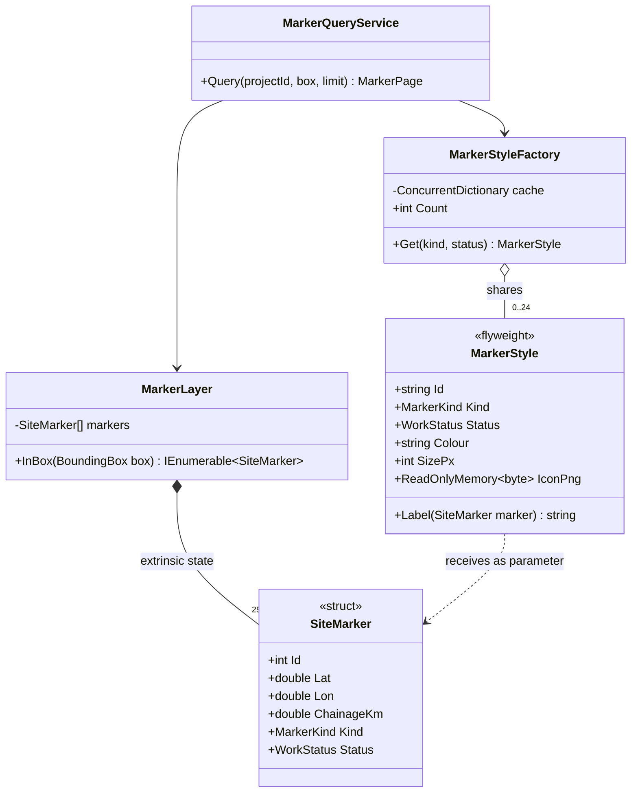
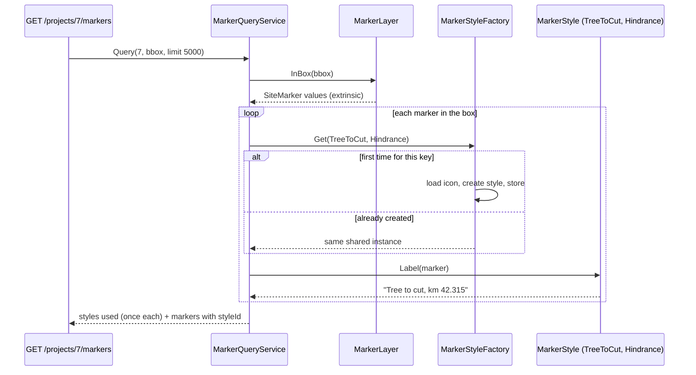

Most patterns are about making code easier to change. Flyweight is one of the few that is about **memory**. It matters when you have tens of thousands to millions of objects that are mostly the same: map markers along a 120 km highway, characters in a document, cells in a spreadsheet, particles in a game, repeated status strings in a 2-million-row import. Used well, it turns a gigabyte into a few megabytes. Used without measuring, it adds complexity for nothing.

## Learning objectives

By the end of this lesson you will be able to:

1. Recognise when Flyweight applies: many objects, mostly identical heavy data, and memory as the bottleneck.
2. Split an object's state into **intrinsic** (shared, immutable) and **extrinsic** (per-object, supplied by the client).
3. Estimate memory before and after with concrete .NET object-size numbers, and verify the estimate by measuring.
4. Build a thread-safe flyweight factory and a map marker layer for a highway project in C#.
5. Use string interning and string pools correctly, including their risks.
6. Apply Flyweight across the wire: send shared styles once and reference them by id.
7. Tell Flyweight apart from Object Pool, Singleton, Prototype and caching.

## Prerequisites

- [Value types, reference types and memory basics](#/lesson/m01-value-reference-memory): you need to know what an object header and a reference cost.
- [Collections and generics](#/lesson/m01-collections-generics): the factory is a dictionary.
- [Immutable objects](#/lesson/m07-immutability): flyweights *must* be immutable, because many clients share them.

## Explain it like I'm a beginner

Picture a big highway project map on the wall of the site office. It shows 250,000 pins: 1,200 kilometre stones, 9,000 culverts, 60,000 trees to be cut, 180,000 survey points, and so on. Each kind of pin has a picture (a little bridge icon, a tree icon), a colour that shows its status (green done, amber in progress, red hindrance) and a size.

Now imagine printing a **fresh copy of the tree icon** for every one of the 60,000 trees and sticking each one on the map. That's a lot of paper and ink for 60,000 identical pictures.

What people actually do is use **rubber stamps**. There's one tree stamp, one culvert stamp, one bridge stamp. For each tree, you press the same stamp at a different spot. The stamp is shared. The spot is different every time.

- The stamp is the **flyweight**: the heavy part that is the same for many items, shared by all of them. Its data is called **intrinsic state** (it belongs to the stamp).
- The position (and anything else that differs per item) is **extrinsic state**: it's kept outside the stamp and given to the stamp each time it's used.
- The drawer where you keep one stamp of each kind, and from which you always pick the existing stamp instead of making a new one, is the **flyweight factory**.

That's the whole pattern. The name comes from boxing: a flyweight is a very light boxer. Each item on the map becomes very light, because the heavy part is shared.

## First-principles explanation

### The original problem

The Gang of Four example is a document editor that wants to treat **every character as an object**, so that formatting, layout and drawing work uniformly on characters, rows and columns (a Composite). A 100,000-character document would need 100,000 character objects, each holding a font, size and glyph outline. That was far too much memory in 1994, and it would still be wasteful today.

The insight: there are only about a hundred distinct glyphs in a given font. Make one shared `Glyph` object per (character, font), and store each character's *position* in the row structure, not in the glyph. When drawing, the row passes the position to the glyph: `glyph.Draw(context, x, y)`.

### The general problem

You need **a very large number of objects**, and:

- most of each object's memory is spent on data that is **identical across many objects**;
- that shared data **doesn't change** (or can be made not to change);
- the objects' identity doesn't matter, so clients don't need `a != b` for two trees of the same species.

### Intrinsic vs extrinsic state

This is the key skill. Go through each field of the heavy object and ask: *"Is this the same for every object of this kind, and does it never change?"*

| Field of a map marker | Same for all markers of a kind? | Changes? | Verdict |
|---|---|---|---|
| Icon image (4 KB) | Yes | No | **Intrinsic** |
| Colour for status | Same per (kind, status) | No | **Intrinsic** (key includes status) |
| Display size, label font | Yes | No | **Intrinsic** |
| Latitude, longitude | No | Rarely | **Extrinsic** |
| Chainage (km) | No | No | **Extrinsic** |
| Work status | Differs | Yes | **Extrinsic**, but used to *pick* the flyweight |
| Marker id | No | No | **Extrinsic** |

A subtle point: `WorkStatus` is extrinsic (it belongs to each marker and changes), but the *style for a status* is intrinsic. The marker stores its status (1 byte); the factory key is (kind, status), and there are only 6 × 4 = 24 possible styles.

### The simplest implementation

```csharp
public sealed record TreeStyle(string Species, byte[] Icon);            // flyweight (intrinsic, immutable)

public sealed class TreeStyleFactory                                    // flyweight factory
{
    private readonly Dictionary<string, TreeStyle> _cache = new();
    public TreeStyle Get(string species) =>
        _cache.TryGetValue(species, out var s) ? s : _cache[species] = new TreeStyle(species, LoadIcon(species));
    private static byte[] LoadIcon(string species) => new byte[4096];
}

public readonly record struct Tree(double Lat, double Lon, TreeStyle Style);   // extrinsic + reference
```

Sixty thousand `Tree` values share a handful of `TreeStyle` objects. (This version isn't thread-safe; the production version below is.)

### Participants

| Participant | Role | Map example |
|---|---|---|
| **Flyweight** | The shared object. Holds intrinsic state only. Operations take extrinsic state as parameters. | `MarkerStyle` |
| **Flyweight factory** | Creates flyweights and guarantees sharing: returns the existing one for a key. | `MarkerStyleFactory` |
| **Client** | Stores or computes extrinsic state and passes it to the flyweight. | `MarkerLayer` (stores `SiteMarker` positions) |
| **Unshared concrete flyweight** (optional) | An object with the same interface that isn't shared, for rare one-off cases. | A custom marker for a single VIP inspection site |

### How it works in .NET memory, with numbers

You can't apply Flyweight well without knowing roughly what objects cost. On 64-bit .NET (these are well-known approximations, and the exact layout is a runtime detail):

- Every **object on the heap** has about **16 bytes of overhead** (object header + method table pointer), and the minimum object size is **24 bytes**.
- A **reference** is **8 bytes**.
- A **`double`** is 8 bytes, an **`int`** 4, a **`byte`** or small `enum : byte` 1, and fields are padded to alignment.
- A **`string`** costs about **22 + 2 × length** bytes, rounded up to a multiple of 8. `"InProgress"` (10 chars) is about 48 bytes.
- A **`byte[]`** costs about 24 bytes plus its length.
- An **array of structs** stores the structs inline: no per-element header.

Now the estimate for 250,000 markers. *These are estimates for reasoning, not measurements.*

**Design A, naive (each marker owns its style data):**

| Per marker | Bytes (est.) |
|---|---|
| Object overhead | 16 |
| Icon `byte[4096]` (24 + 4,096) | 4,120 |
| Colour string `"#2E7D32"` | 32 |
| Label template string (~40 chars) | 104 |
| Kind name string (~12 chars) | 48 |
| 3 doubles + int + status + 4 references | ~68 |
| **Total** | **~4,390** |

250,000 × 4,390 ≈ **1.1 GB**. Most of it is 250,000 copies of 24 different icons.

**Design B, flyweight styles, marker as a class:**

- Styles: 24 × ~4,400 bytes ≈ **105 KB** in total.
- Each marker: 16 overhead + 3 doubles (24) + int id (4) + kind and status (2) + style reference (8), padded ≈ **56 bytes**.
- 250,000 × 56 ≈ **14 MB**, plus the array of references to the markers (250,000 × 8 = 2 MB).

**Design C, flyweight styles, marker as a struct in an array:**

- No per-marker header and no reference array: `SiteMarker` is about 32 bytes (int + 3 doubles + 2 bytes, padded).
- 250,000 × 32 ≈ **8 MB** in one contiguous array, which is also friendlier to the CPU cache when scanning.

From ~1.1 GB to ~8 MB: more than **100×** less. A smaller but still real benefit is in garbage collection: the GC has to trace 250,000 objects in design B and almost none in design C (one large array), so collections are cheaper.

**Always verify.** Measure with `GC.GetTotalMemory(forceFullCollection: true)` before and after building the data (the playground does this), `dotnet-counters monitor` for a running app, `dotnet-gcdump` to see which types dominate the heap, or BenchmarkDotNet's `[MemoryDiagnoser]` for allocations per operation.

### When it is useful

All of these should be true:

1. There are **many** objects (thousands to millions).
2. **Memory** is an actual problem: the process is near its container limit, GC pauses are hurting, or a mobile or browser client is struggling.
3. Most per-object memory is **shareable intrinsic state**.
4. Intrinsic state is **immutable** (or can be made so).
5. Object **identity doesn't matter** to clients.

### When not to use it

- **You have 500 objects.** The saving is kilobytes. The added factory and the split of state cost more in clarity than they save.
- **The "shared" data is small.** If the intrinsic part is two ints, the per-object overhead of the reference to the flyweight may cost as much as you save.
- **The shared data must change per object.** If a user can recolour *one* tree, either that tree gets an unshared style or the colour becomes extrinsic. A mutable flyweight is a bug: change it for one marker and all 60,000 change.
- **Extrinsic state is expensive to compute.** If the client must recompute a complex position every time it draws, you've traded memory for CPU. Sometimes that's right; decide on purpose.
- **A cache or database is the real answer.** If you have a million rows but only display 500 at a time, don't hold a million objects in memory at all. Query the 500 (paging, bounding-box queries in PostgreSQL/PostGIS).

### Trade-offs it introduces

| You gain | You pay |
|---|---|
| Orders-of-magnitude less memory | State split across two places; harder to read |
| Fewer objects for the GC to trace | Extrinsic state must be passed around or recomputed |
| Equal flyweights can be compared by reference (fast) | Flyweights must be immutable and thread-safe |
| Shared resources (icons, fonts) loaded once | A factory to manage; if it never evicts, it can grow forever |

### String interning: Flyweight built into .NET

Strings are the most common flyweight in .NET:

- **String literals are interned automatically.** `"Completed"` appearing in 40 places in your code is one object at runtime.
- **`string.Intern(s)`** returns the canonical instance from the runtime's intern pool, adding `s` if it isn't there. `string.IsInterned(s)` checks without adding.
- **Strings created at runtime are not interned.** Deserialising 2 million JSON rows where `"status": "InProgress"` appears in each creates 2 million separate strings, about 48 bytes each: ~96 MB (estimate) for one repeated word.

Two warnings about `string.Intern`:

1. **Interned strings are generally never released** while the process runs. Interning user input (remarks, names, free text) is a memory leak by design.
2. Lookups go through a global table, so it isn't free; it pays off only when the same values really repeat a lot.

The safer approach for runtime data is your **own, bounded pool**: a `HashSet<string>` you look up with `TryGetValue`, with a capacity limit, which you can throw away when the import finishes. Exercise 3 builds one, including a `ReadOnlySpan<char>` lookup that avoids allocating the string at all when it's already pooled. (The `CommunityToolkit.HighPerformance` package ships a ready-made `StringPool`.)

### Flyweights you already use

- `Array.Empty<T>()` and `Enumerable.Empty<T>()` return one shared immutable instance per `T`.
- `CultureInfo.GetCultureInfo("en-IN")` returns a cached, read-only instance.
- `Encoding.UTF8`, `StringComparer.Ordinal` and `EqualityComparer<T>.Default` are shared, stateless instances.
- `Task.CompletedTask` is one shared completed task, and the runtime also caches some completed `Task<T>` results internally (for example for `bool`).

## Visual explanation

### Class diagram



How to read it: `MarkerLayer` *owns* 250,000 small `SiteMarker` structs (filled diamond: composition), and they hold only extrinsic data. `MarkerStyleFactory` holds at most 24 `MarkerStyle` flyweights. Notice there is **no** arrow from `SiteMarker` to `MarkerStyle`: a marker doesn't even store a reference, just its kind and status (2 bytes), which is enough to look up the style. The dotted dependency from `MarkerStyle` to `SiteMarker` shows the GoF rule: the flyweight receives extrinsic state as a *parameter* (`Label(marker)`) and never stores it.

### Sequence diagram



The factory creates each style at most once; every later request for the same key gets the same object. The style's `Label` method combines its intrinsic data (the kind's display name) with the marker's extrinsic data (chainage) passed in. The response itself is also flyweight-shaped: each style is sent once, and markers refer to it by id.

## Step-by-step example

### Step 1 — the naive marker

```csharp
public class Marker
{
    public int Id; public double Lat, Lon, ChainageKm;
    public string KindName = "";       // "Tree to cut"
    public string StatusName = "";     // "Hindrance"
    public string Colour = "";         // "#C62828"
    public byte[] Icon = [];           // 4 KB, loaded per marker!
    public string LabelTemplate = "";  // "{kind}, km {chainage}"
}
```

Loading 250,000 of these takes ~1.1 GB (estimate above), and loading 250,000 icon files from disk takes far longer than loading 24.

### Step 2 — classify each field

Use the intrinsic/extrinsic table from the previous section. The icon, colour, kind name and label template depend only on (kind, status). Id, coordinates and chainage are per marker.

### Step 3 — make the intrinsic part an immutable flyweight

`MarkerStyle` holds the icon, colour, size and display name. All properties are get-only, the icon is exposed as `ReadOnlyMemory<byte>` so no client can modify the shared bytes, and the constructor is `internal` so only the factory creates styles.

### Step 4 — add the factory

`MarkerStyleFactory.Get(kind, status)` returns the shared style for that key, creating it exactly once even under concurrent requests.

### Step 5 — shrink the extrinsic part

The marker becomes a `readonly record struct` of about 32 bytes, stored in one array. Kind and status become `byte`-sized enums.

### Step 6 — share across the wire too

The API returns `styles` (each used style once) and `markers` (with a `styleId`). A browser map library then creates one icon image per style rather than one per marker: the same pattern on the client.

## Production-style C# implementation

```text
Infra.Api/
  Program.cs
  Mapping/
    MarkerModel.cs           enums, SiteMarker (extrinsic), BoundingBox
    MarkerStyle.cs           flyweight
    MarkerStyleFactory.cs    flyweight factory + icon source
    MarkerLayer.cs           client storing extrinsic state
    MarkerQueryService.cs    API-facing service, flyweight-shaped response
```

```csharp file=Mapping/MarkerModel.cs
namespace Infra.Mapping;

public enum MarkerKind : byte { ChainageStone, Culvert, Bridge, UtilityPole, TreeToCut, SurveyPoint }

public enum WorkStatus : byte { NotStarted, InProgress, Completed, Hindrance }

/// <summary>Extrinsic state only: about 32 bytes, stored inline in an array.</summary>
public readonly record struct SiteMarker(int Id, double Lat, double Lon, double ChainageKm, MarkerKind Kind, WorkStatus Status);

public readonly record struct BoundingBox(double MinLat, double MinLon, double MaxLat, double MaxLon)
{
    public bool Contains(double lat, double lon) => lat >= MinLat && lat <= MaxLat && lon >= MinLon && lon <= MaxLon;
}
```

```csharp file=Mapping/MarkerStyle.cs
using System.Globalization;

namespace Infra.Mapping;

/// <summary>Flyweight: intrinsic, immutable, shared by every marker of one (kind, status).</summary>
public sealed class MarkerStyle
{
    internal MarkerStyle(MarkerKind kind, WorkStatus status, string displayName, string colour, int sizePx, byte[] iconPng)
    {
        Kind = kind;
        Status = status;
        Id = $"{kind}-{status}".ToLowerInvariant();
        DisplayName = displayName;
        Colour = colour;
        SizePx = sizePx;
        IconPng = iconPng;   // the factory hands over ownership; nothing else holds this array
    }

    public string Id { get; }
    public MarkerKind Kind { get; }
    public WorkStatus Status { get; }
    public string DisplayName { get; }
    public string Colour { get; }
    public int SizePx { get; }
    /// <summary>Read-only view: no client can modify bytes shared by 60,000 markers.</summary>
    public ReadOnlyMemory<byte> IconPng { get; }

    /// <summary>Extrinsic state comes in as a parameter and is never stored.</summary>
    public string Label(in SiteMarker marker) =>
        string.Create(CultureInfo.InvariantCulture, $"{DisplayName}, km {marker.ChainageKm:F3}");
}
```

```csharp file=Mapping/MarkerStyleFactory.cs
using System.Collections.Concurrent;

namespace Infra.Mapping;

public interface IIconSource
{
    byte[] Load(MarkerKind kind, WorkStatus status);
}

/// <summary>Stand-in for reading PNGs from disk or blob storage.</summary>
public sealed class GeneratedIconSource : IIconSource
{
    public byte[] Load(MarkerKind kind, WorkStatus status)
    {
        var bytes = new byte[4096];
        Array.Fill(bytes, (byte)((int)kind * 16 + (int)status));
        return bytes;
    }
}

/// <summary>Flyweight factory: at most one MarkerStyle per (kind, status), created exactly once.</summary>
public sealed class MarkerStyleFactory(IIconSource icons)
{
    // Lazy<T> guarantees one creation per key even if two requests race on GetOrAdd.
    private readonly ConcurrentDictionary<(MarkerKind Kind, WorkStatus Status), Lazy<MarkerStyle>> _styles = new();

    public MarkerStyle Get(MarkerKind kind, WorkStatus status) =>
        _styles.GetOrAdd((kind, status), key => new Lazy<MarkerStyle>(() => Create(key.Kind, key.Status))).Value;

    public int Count => _styles.Count;

    private MarkerStyle Create(MarkerKind kind, WorkStatus status) => new(
        kind,
        status,
        DisplayName(kind),
        status switch
        {
            WorkStatus.NotStarted => "#9E9E9E",
            WorkStatus.InProgress => "#F9A825",
            WorkStatus.Completed => "#2E7D32",
            _ => "#C62828",
        },
        kind is MarkerKind.Bridge ? 32 : 20,
        icons.Load(kind, status));

    private static string DisplayName(MarkerKind kind) => kind switch
    {
        MarkerKind.ChainageStone => "Chainage stone",
        MarkerKind.Culvert => "Culvert",
        MarkerKind.Bridge => "Bridge",
        MarkerKind.UtilityPole => "Utility pole",
        MarkerKind.TreeToCut => "Tree to cut",
        _ => "Survey point",
    };
}
```

```csharp file=Mapping/MarkerLayer.cs
namespace Infra.Mapping;

/// <summary>Client of the flyweight: owns the extrinsic state for one project.</summary>
public sealed class MarkerLayer
{
    private readonly SiteMarker[] _markers;

    public MarkerLayer(IEnumerable<SiteMarker> markers) => _markers = markers.ToArray();

    public int Count => _markers.Length;

    public IEnumerable<SiteMarker> InBox(BoundingBox box)
    {
        // Linear scan: ~250k comparisons, fast in memory. Use a spatial index (or PostGIS) for millions.
        for (var i = 0; i < _markers.Length; i++)
            if (box.Contains(_markers[i].Lat, _markers[i].Lon))
                yield return _markers[i];
    }

    /// <summary>Builds a deterministic sample along a highway: about 120 km, heading north-east.</summary>
    public static MarkerLayer Sample(int count, int seed = 42)
    {
        var rnd = new Random(seed);
        var kinds = Enum.GetValues<MarkerKind>();
        var statuses = Enum.GetValues<WorkStatus>();
        var markers = new SiteMarker[count];
        for (var i = 0; i < count; i++)
        {
            var km = rnd.NextDouble() * 120.0;
            markers[i] = new SiteMarker(i + 1,
                Lat: 28.40 + km * 0.0065 + (rnd.NextDouble() - 0.5) * 0.002,
                Lon: 76.90 + km * 0.0042 + (rnd.NextDouble() - 0.5) * 0.002,
                ChainageKm: Math.Round(km, 3),
                Kind: kinds[rnd.Next(kinds.Length)],
                Status: statuses[rnd.Next(statuses.Length)]);
        }
        return new MarkerLayer(markers);
    }
}
```

```csharp file=Mapping/MarkerQueryService.cs
namespace Infra.Mapping;

public sealed record MarkerStyleDto(string Id, string DisplayName, string Colour, int SizePx, string IconUrl);
public sealed record MarkerDto(int Id, double Lat, double Lon, string StyleId, string Label);
/// <summary>Flyweight across the wire: each style once, markers reference it by id.</summary>
public sealed record MarkerPage(IReadOnlyList<MarkerStyleDto> Styles, IReadOnlyList<MarkerDto> Markers, bool Truncated);

public interface IMarkerLayerStore
{
    MarkerLayer? Get(int projectId);
}

public sealed class SampleMarkerLayerStore : IMarkerLayerStore
{
    private readonly Lazy<MarkerLayer> _project7 = new(() => MarkerLayer.Sample(250_000));
    public MarkerLayer? Get(int projectId) => projectId == 7 ? _project7.Value : null;
}

public sealed class MarkerQueryService(IMarkerLayerStore layers, MarkerStyleFactory styles)
{
    public MarkerPage? Query(int projectId, BoundingBox box, int limit)
    {
        var layer = layers.Get(projectId);
        if (layer is null) return null;

        var used = new Dictionary<string, MarkerStyleDto>();
        var markers = new List<MarkerDto>(Math.Min(limit, 1024));
        var truncated = false;

        foreach (var m in layer.InBox(box))
        {
            if (markers.Count == limit) { truncated = true; break; }
            var style = styles.Get(m.Kind, m.Status);            // shared instance
            if (!used.ContainsKey(style.Id))
                used[style.Id] = new MarkerStyleDto(style.Id, style.DisplayName, style.Colour, style.SizePx, $"/marker-icons/{style.Id}.png");
            markers.Add(new MarkerDto(m.Id, m.Lat, m.Lon, style.Id, style.Label(m)));
        }
        return new MarkerPage(used.Values.ToList(), markers, truncated);
    }
}
```

```csharp file=Program.cs
using Infra.Mapping;

var builder = WebApplication.CreateBuilder(args);
builder.Services.AddSingleton<IIconSource, GeneratedIconSource>();
builder.Services.AddSingleton<MarkerStyleFactory>();         // flyweights must be shared app-wide
builder.Services.AddSingleton<IMarkerLayerStore, SampleMarkerLayerStore>();
builder.Services.AddSingleton<MarkerQueryService>();

var app = builder.Build();

// GET /projects/7/markers?minLat=28.5&minLon=76.95&maxLat=28.7&maxLon=77.1&limit=2000
app.MapGet("/projects/{projectId:int}/markers",
    (int projectId, double minLat, double minLon, double maxLat, double maxLon, int? limit, MarkerQueryService svc) =>
    {
        if (minLat > maxLat || minLon > maxLon) return Results.BadRequest("Invalid bounding box.");
        var page = svc.Query(projectId, new BoundingBox(minLat, minLon, maxLat, maxLon), Math.Clamp(limit ?? 2000, 1, 5000));
        return page is null ? Results.NotFound() : Results.Ok(page);
    });

// Icons are flyweights too: one URL per style, so browsers and CDNs cache 24 images, not 250,000.
app.MapGet("/marker-icons/{styleId}.png", (string styleId, MarkerStyleFactory styles, HttpContext http) =>
{
    var parts = styleId.Split('-');
    if (parts.Length != 2 || !Enum.TryParse<MarkerKind>(parts[0], true, out var kind) || !Enum.TryParse<WorkStatus>(parts[1], true, out var status))
        return Results.NotFound();
    http.Response.Headers.CacheControl = "public, max-age=86400";
    return Results.Bytes(styles.Get(kind, status).IconPng.ToArray(), "image/png");
});

app.Run();
```

Design notes:

- **Singleton factory.** If the factory were scoped, each request would create its own 24 styles, and you'd have sharing within a request but not across them. Flyweight factories are almost always app-wide singletons.
- **`Lazy<T>` inside `ConcurrentDictionary`.** `GetOrAdd(key, factory)` can run the factory more than once under a race (only one result is kept). Wrapping in `Lazy<T>` makes the expensive icon load happen exactly once.
- **Immutability is enforced, not assumed.** `internal` constructor, get-only properties, `ReadOnlyMemory<byte>`. If a developer could write `style.Colour = "#000"`, the next bug report would be "all hindrance trees turned black".
- **Bounded key space.** There are exactly 24 possible keys, so the factory never needs eviction. If keys come from user data (for example species names typed by surveyors), cap the factory size or use a cache with eviction.
- **Where the data really lives.** In production, the 250,000 markers come from PostgreSQL (with PostGIS, a `GiST` index on a geometry column makes the bounding-box query fast). Flyweight still matters for the in-memory working set and for the response shape.

## Bad design vs good design

**Bad 1, the naive marker** from Step 1: ~1.1 GB for one project (estimate), and the API process in a 2 GB container is killed under load by the out-of-memory killer. Restarting doesn't help, because loading the data is what kills it.

**Bad 2, a mutable flyweight:**

```csharp
var style = factory.Get(MarkerKind.TreeToCut, WorkStatus.Hindrance);
style.Colour = "#000000";   // someone "just highlights this one tree"
```

Every hindrance tree on every user's map is now black, until restart. If flyweights can be mutated, someone eventually will.

**Bad 3, flyweight without a factory:**

```csharp
markers.Add(new Marker(lat, lon, new MarkerStyle(kind, status, icons.Load(kind, status))));   // "shared" style created per marker
```

The code *looks* like Flyweight (there's a style class), but every marker gets its own style. The factory is what makes sharing happen.

**Bad 4, interning user input:** `string.Intern(row.Remarks)` during a 2-million-row import of site diaries. The remarks are mostly unique, so nothing is saved, and the intern pool keeps them alive for the life of the process.

**Good:** immutable styles from a singleton factory, small struct markers in an array, a bounded string pool for repeated imported values, and a response that sends each style once.

**Is it worth it?** If a project has 3,000 markers, the naive version uses about 13 MB (estimate). That's fine; skip the pattern. Flyweight is for when the numbers are large *and* you've measured a memory problem.

## Practical playground

The playground builds 20,000 markers twice, naively and with flyweights, and prints the measured memory. Your numbers will differ by machine and runtime version; compare them with the estimates in this lesson. Then change the struct to a class and see how the flyweight number moves.

:::playground type=csharp title="Measure the flyweight saving"
```csharp file=Program.cs
using System;
using System.Collections.Generic;

public sealed class NaiveMarker
{
    public double Lat, Lon;
    public string Kind = "";
    public byte[] Icon = Array.Empty<byte>();
}

public sealed class Style
{
    public Style(string kind, byte[] icon) { Kind = kind; Icon = icon; }
    public string Kind { get; }
    public byte[] Icon { get; }
}

public readonly record struct LightMarker(double Lat, double Lon, byte StyleIndex);

public static class Program
{
    const int Count = 20_000;
    static readonly string[] Kinds = { "Culvert", "Bridge", "Tree to cut", "Survey point", "Pole", "Chainage stone" };

    public static void Main()
    {
        var rnd = new Random(1);

        long before = GC.GetTotalMemory(true);
        var naive = new List<NaiveMarker>(Count);
        for (var i = 0; i < Count; i++)
            naive.Add(new NaiveMarker { Lat = rnd.NextDouble(), Lon = rnd.NextDouble(), Kind = new string(Kinds[i % Kinds.Length].AsSpan()), Icon = new byte[4096] });
        long naiveBytes = GC.GetTotalMemory(true) - before;
        GC.KeepAlive(naive);
        naive = null!;

        before = GC.GetTotalMemory(true);
        var styles = new Style[Kinds.Length];
        for (var k = 0; k < Kinds.Length; k++) styles[k] = new Style(Kinds[k], new byte[4096]);
        var light = new LightMarker[Count];
        for (var i = 0; i < Count; i++) light[i] = new LightMarker(rnd.NextDouble(), rnd.NextDouble(), (byte)(i % Kinds.Length));
        long flyBytes = GC.GetTotalMemory(true) - before;
        GC.KeepAlive(light); GC.KeepAlive(styles);

        Console.WriteLine($"Naive:     {naiveBytes / 1024.0 / 1024.0,8:F2} MB  ({naiveBytes / Count} bytes per marker)");
        Console.WriteLine($"Flyweight: {flyBytes / 1024.0 / 1024.0,8:F2} MB  ({flyBytes / Count} bytes per marker)");
        Console.WriteLine($"Ratio:     {(double)naiveBytes / Math.Max(1, flyBytes):F0}x");
        Console.WriteLine($"Same style object shared? {ReferenceEquals(styles[light[0].StyleIndex], styles[light[6].StyleIndex])}");
    }
}
```
:::

## Exercises

:::exercise id=m06-flyweight-ex1 difficulty=beginner kind=code title="A glyph flyweight factory"
A label renderer for drawing sheets draws text character by character. Each `Glyph` holds an outline that is expensive to build. Implement `GlyphFactory` so that each (character, font) pair produces exactly one `Glyph`, and `TextLine` stores only positions plus a reference to the shared glyph.
::requirements
- `GlyphFactory.Get(char c, string font)` returns the same instance for the same pair.
- Different fonts give different glyphs for the same character.
- `CreatedCount` reports how many glyphs were actually built.
- `TextLine.Layout(text, font, factory)` produces one `PlacedGlyph(Glyph, X)` per character, where `X` = index × 10.
::acceptance
- `Get('A', "Arial")` twice returns the same object.
- Laying out `"BRIDGE BRIDGE"` in one font creates 7 glyphs (B, R, I, D, G, E, space).
- The same text in a second font doubles the count to 14.
- Positions are 0, 10, 20, ...
::hint
The factory needs a dictionary whose key combines the character and the font.
::hint
A value tuple `(char, string)` works as a dictionary key: it has value equality and hashing built in.
::hint
`PlacedGlyph` is the extrinsic state (position) plus a reference to the intrinsic state (glyph).
::hint
```csharp
if (!_cache.TryGetValue((c, font), out var g)) { g = new Glyph(c, font); _cache[(c, font)] = g; CreatedCount++; }
return g;
```
::starter
```csharp file=Glyphs.cs
using System;
using System.Collections.Generic;

public sealed class Glyph
{
    public Glyph(char character, string font)
    {
        Character = character;
        Font = font;
        Outline = new float[256]; // pretend this is an expensive vector outline
    }
    public char Character { get; }
    public string Font { get; }
    public IReadOnlyList<float> Outline { get; }
}

public readonly record struct PlacedGlyph(Glyph Glyph, int X);

public sealed class GlyphFactory
{
    public int CreatedCount => throw new NotImplementedException();
    public Glyph Get(char c, string font) => throw new NotImplementedException();
}

public static class TextLine
{
    public static IReadOnlyList<PlacedGlyph> Layout(string text, string font, GlyphFactory factory) =>
        throw new NotImplementedException();
}
```
::tests
```csharp file=GlyphsTests.cs
using System.Linq;
using Xunit;

public class GlyphsTests
{
    [Fact]
    public void Same_pair_same_instance()
    {
        var f = new GlyphFactory();
        Assert.Same(f.Get('A', "Arial"), f.Get('A', "Arial"));
        Assert.Equal(1, f.CreatedCount);
    }

    [Fact]
    public void Different_font_different_instance()
    {
        var f = new GlyphFactory();
        Assert.NotSame(f.Get('A', "Arial"), f.Get('A', "Consolas"));
    }

    [Fact]
    public void Layout_shares_glyphs()
    {
        var f = new GlyphFactory();
        var line = TextLine.Layout("BRIDGE BRIDGE", "Arial", f);
        Assert.Equal(13, line.Count);
        Assert.Equal(7, f.CreatedCount);
        Assert.Same(line[0].Glyph, line[7].Glyph);
        Assert.Equal(new[] { 0, 10, 20 }, line.Take(3).Select(p => p.X).ToArray());
    }

    [Fact]
    public void Second_font_doubles_count()
    {
        var f = new GlyphFactory();
        TextLine.Layout("BRIDGE BRIDGE", "Arial", f);
        TextLine.Layout("BRIDGE BRIDGE", "Consolas", f);
        Assert.Equal(14, f.CreatedCount);
    }
}
```
::solution
```csharp file=Glyphs.cs
using System;
using System.Collections.Generic;

public sealed class Glyph
{
    public Glyph(char character, string font)
    {
        Character = character;
        Font = font;
        Outline = new float[256]; // pretend this is an expensive vector outline
    }
    public char Character { get; }
    public string Font { get; }
    public IReadOnlyList<float> Outline { get; }
}

public readonly record struct PlacedGlyph(Glyph Glyph, int X);

public sealed class GlyphFactory
{
    private readonly Dictionary<(char, string), Glyph> _cache = new();

    public int CreatedCount { get; private set; }

    public Glyph Get(char c, string font)
    {
        ArgumentNullException.ThrowIfNull(font);
        if (!_cache.TryGetValue((c, font), out var glyph))
        {
            glyph = new Glyph(c, font);
            _cache[(c, font)] = glyph;
            CreatedCount++;
        }
        return glyph;
    }
}

public static class TextLine
{
    public static IReadOnlyList<PlacedGlyph> Layout(string text, string font, GlyphFactory factory)
    {
        var result = new List<PlacedGlyph>(text.Length);
        for (var i = 0; i < text.Length; i++)
            result.Add(new PlacedGlyph(factory.Get(text[i], font), i * 10));
        return result;
    }
}
```

Memory check (estimate): each `Glyph` holds a 256-float outline, about 1 KB. A 100,000-character drawing-sheet legend would need ~100 MB without sharing, versus about 100 glyphs × 1 KB = 100 KB with it, plus 100,000 × 16-byte `PlacedGlyph` structs (1.6 MB).
::mistakes
- Using `$"{c}{font}"` as the key: it works, but it allocates a new string on *every* lookup, which is exactly the kind of garbage a flyweight is meant to avoid. A value tuple key allocates nothing.
- Incrementing `CreatedCount` on every `Get`, not only on creation.
- Storing the X position inside `Glyph`, which makes the glyph unshareable.
::extensions
Make the factory thread-safe with `ConcurrentDictionary`, and explain why `GetOrAdd` alone might build the same glyph twice.
:::

:::exercise id=m06-flyweight-ex2 difficulty=beginner kind=written title="Classify state and estimate memory"
A tree-felling survey for a road-widening project records 80,000 trees. Each record currently is a class with these fields:

- `TagNo` (string, e.g. `"T-004512"`), `Lat`, `Lon` (double), `GirthCm` (int)
- `SpeciesCommonName` (e.g. `"Neem"`), `SpeciesScientificName` (e.g. `"Azadirachta indica"`)
- `CompensationRatePerTree` (decimal, set per species by the forest department)
- `IconPng` (byte[3072], one image per species)
- `Status` (`"Marked"`, `"PermissionReceived"`, `"Felled"`) as a string

There are 38 species.

1. Classify each field as intrinsic or extrinsic.
2. Estimate memory before and after a flyweight refactor, showing your working. Use the approximate .NET sizes from the lesson.
3. Name one risk of the refactor.
::acceptance
- Species names, rate and icon are classified intrinsic; tag, coordinates, girth and status extrinsic.
- Before and after estimates with per-object working, labelled as estimates.
- The answer notices that `Status` strings may already be shared literals (or not, if deserialised).
- One concrete risk (mutability of the rate, rate changes over time, key choice).
::hint
Ask of each field: "is it the same for every tree of the same species?"
::hint
Approximate sizes: object overhead 16 B, reference 8 B, double 8 B, int 4 B, decimal 16 B, string ≈ 22 + 2 × length rounded up to 8, byte[] ≈ 24 + length.
::hint
After the refactor, each tree keeps tag, lat, lon, girth, a status enum and a reference to (or index of) a `Species` flyweight.
::solution
**1. Classification.** Intrinsic (per species): `SpeciesCommonName`, `SpeciesScientificName`, `CompensationRatePerTree`, `IconPng`. Extrinsic (per tree): `TagNo`, `Lat`, `Lon`, `GirthCm`, `Status`.

**2. Estimates** (approximate, 64-bit .NET):

*Before, per tree:* object 16 + 7 reference/value fields (5 refs × 8 = 40, 2 doubles 16, int 4, decimal 16 → about 76, padded to 80) = ~96 B for the object; `TagNo` string (8 chars) ≈ 40 B; common name (~5 chars) ≈ 32 B; scientific name (~18 chars) ≈ 64 B; icon 24 + 3,072 = 3,096 B; status string: if it's a literal assigned in code it's shared (0 extra), if deserialised ≈ 48 B. Total ≈ **3,330–3,380 B**. × 80,000 ≈ **265–270 MB**.

*After:* `Species` flyweights: 38 × (~3,300 B) ≈ **125 KB**. Each tree: object 16 + tag ref 8 + 2 doubles 16 + int 4 + status enum 1 + species ref 8 → ~56 B, plus tag string 40 B ≈ **96 B**. × 80,000 ≈ **7.7 MB**. As a struct array with a `short` species index instead of a reference, ~40 B + tag ≈ 6.4 MB.

So roughly **265 MB → 8 MB**, about 35× less. The icon accounts for over 90 % of the original.

**3. Risks.** (a) The compensation rate is set by the forest department and **changes over time**; trees felled under an old rate must keep it. If it lives in the shared `Species` and someone updates it, historical calculations change. Store the rate applied *on the felling record* (extrinsic, historical) and keep the current rate on the species. (b) Species names typed in the field ("neem", "Neem ", "NEEM") produce duplicate flyweights unless keys are normalised.
::mistakes
- Treating `Status` as intrinsic because there are only three values. It differs per tree and changes; only its *display style* could be a flyweight.
- Forgetting the per-object overhead, which dominates once the icon is removed.
:::

:::exercise id=m06-flyweight-ex3 difficulty=intermediate kind=code title="A bounded, allocation-free string pool"
A CSV import of 2 million site diary rows has columns like `Status`, `Activity` and `Contractor` whose values repeat heavily. Build `BoundedStringPool`, a flyweight factory for strings that is safer than `string.Intern`.
::requirements
- `Intern(string s)` returns the pooled instance equal to `s` (ordinal comparison), adding `s` if there is room.
- `Intern(ReadOnlySpan<char> s)` does the same **without allocating** a string when the value is already pooled (allocate only when adding or when the pool is full).
- The pool holds at most `capacity` strings. When full, `Intern` returns a non-pooled string (the input itself, or a new string from the span) and `Count` stays at `capacity`.
- Thread-safe: concurrent calls never corrupt the pool, and equal values always map to one pooled instance.
::acceptance
- Two equal strings created separately return the same instance.
- The span overload returns the pooled instance for an existing value.
- With capacity 2, a third distinct value isn't pooled and `Count` stays 2.
- 8 threads interning the same 100 values end with `Count == 100`, and all threads get identical instances.
::hint
`HashSet<string>.TryGetValue(equalValue, out actualValue)` returns the instance *stored* in the set, which is exactly what a pool needs.
::hint
For spans, .NET 9+ supports *alternate lookups*: `set.GetAlternateLookup<ReadOnlySpan<char>>()` lets you search a `HashSet<string>` with a span, if the comparer supports it (`StringComparer.Ordinal` does).
::hint
A simple `lock` around the set is fine here. Lookups are tens of nanoseconds; contention matters only at very high rates.
::hint
```csharp
lock (_gate)
{
    if (_lookup.TryGetValue(span, out var existing)) return existing;
    var s = span.ToString();
    if (_set.Count < _capacity) _set.Add(s);
    return s;
}
```
::starter
```csharp file=BoundedStringPool.cs
using System;
using System.Collections.Generic;

public sealed class BoundedStringPool
{
    public BoundedStringPool(int capacity)
    {
        // TODO
    }

    public int Count => throw new NotImplementedException();

    public string Intern(string value) => throw new NotImplementedException();

    public string Intern(ReadOnlySpan<char> value) => throw new NotImplementedException();
}
```
::tests
```csharp file=BoundedStringPoolTests.cs
using System;
using System.Linq;
using System.Threading.Tasks;
using Xunit;

public class BoundedStringPoolTests
{
    [Fact]
    public void Equal_strings_share_one_instance()
    {
        var pool = new BoundedStringPool(100);
        var a = new string("InProgress".ToCharArray());
        var b = new string("InProgress".ToCharArray());
        Assert.NotSame(a, b);
        Assert.Same(pool.Intern(a), pool.Intern(b));
        Assert.Equal(1, pool.Count);
    }

    [Fact]
    public void Span_lookup_returns_pooled_instance()
    {
        var pool = new BoundedStringPool(100);
        var pooled = pool.Intern("Completed");
        var line = "RFI-12,Completed,Embankment".AsSpan();
        var fromSpan = pool.Intern(line.Slice(7, 9));
        Assert.Same(pooled, fromSpan);
    }

    [Fact]
    public void Span_adds_when_missing()
    {
        var pool = new BoundedStringPool(100);
        var s = pool.Intern("Hindrance".AsSpan());
        Assert.Equal("Hindrance", s);
        Assert.Same(s, pool.Intern("Hindrance"));
    }

    [Fact]
    public void Capacity_is_respected()
    {
        var pool = new BoundedStringPool(2);
        pool.Intern("A");
        pool.Intern("B");
        var c1 = pool.Intern(new string('C', 1));
        var c2 = pool.Intern(new string('C', 1));
        Assert.Equal(2, pool.Count);
        Assert.Equal("C", c1);
        Assert.NotSame(c1, c2);
    }

    [Fact]
    public void Concurrent_interning_is_consistent()
    {
        var pool = new BoundedStringPool(1000);
        var values = Enumerable.Range(0, 100).Select(i => $"Contractor-{i}").ToArray();
        var results = new string[8][];
        Parallel.For(0, 8, t =>
        {
            results[t] = values.Select(v => pool.Intern(new string(v.ToCharArray()))).ToArray();
        });
        Assert.Equal(100, pool.Count);
        for (var t = 1; t < 8; t++)
            for (var i = 0; i < 100; i++)
                Assert.Same(results[0][i], results[t][i]);
    }

    [Fact]
    public void Capacity_must_be_positive() =>
        Assert.Throws<ArgumentOutOfRangeException>(() => new BoundedStringPool(0));
}
```
::solution
```csharp file=BoundedStringPool.cs
using System;
using System.Collections.Generic;

public sealed class BoundedStringPool
{
    private readonly HashSet<string> _set;
    private readonly HashSet<string>.AlternateLookup<ReadOnlySpan<char>> _spanLookup;
    private readonly int _capacity;
    private readonly object _gate = new();

    public BoundedStringPool(int capacity)
    {
        ArgumentOutOfRangeException.ThrowIfNegativeOrZero(capacity);
        _capacity = capacity;
        _set = new HashSet<string>(StringComparer.Ordinal);
        _spanLookup = _set.GetAlternateLookup<ReadOnlySpan<char>>();
    }

    public int Count { get { lock (_gate) return _set.Count; } }

    public string Intern(string value)
    {
        ArgumentNullException.ThrowIfNull(value);
        lock (_gate)
        {
            if (_set.TryGetValue(value, out var existing)) return existing;
            if (_set.Count < _capacity) _set.Add(value);
            return value;
        }
    }

    public string Intern(ReadOnlySpan<char> value)
    {
        lock (_gate)
        {
            if (_spanLookup.TryGetValue(value, out var existing)) return existing;   // no allocation
            var s = value.ToString();
            if (_set.Count < _capacity) _set.Add(s);
            return s;
        }
    }
}
```

Why this beats `string.Intern` for imports: the pool is bounded, so a column of unique values can't grow it forever; it can be discarded when the import ends; and the span overload means parsing `"…,Completed,…"` from a line buffer allocates nothing for the 99 % of rows whose status is already pooled.

Rough saving (estimate): 2 million rows × 3 repeated columns × ~48 B ≈ 288 MB of duplicate strings, down to a few KB of pooled values plus 8-byte references.
::alternatives
- `CommunityToolkit.HighPerformance.Buffers.StringPool` is a ready-made, high-performance version of this idea.
- If values are known in advance (status codes), map them to an `enum` and avoid strings entirely.
- `FrozenSet<string>` (from `System.Collections.Frozen`) is ideal for a fixed set built once and looked up many times, but it can't grow.
::mistakes
- Using `Dictionary<string,string>` and `ContainsKey` + indexer: two lookups, and with spans you'd have to allocate to look up.
- `string.Intern` on every column, including free-text remarks: unbounded memory growth for the life of the process.
- Unsynchronised `HashSet` access from `Parallel.ForEach`: `HashSet<T>` isn't thread-safe, and concurrent writes can corrupt it.
:::

:::exercise id=m06-flyweight-ex4 difficulty=intermediate kind=design title="Refactor a memory-hungry map layer"
A drone survey viewer loads change-detection results: up to 600,000 detected objects per survey (stockpiles, vehicles, excavation pits, rebar bundles). Today each object is:

```csharp
public class DetectedObject
{
    public Guid Id { get; set; }
    public double Lat { get; set; }
    public double Lon { get; set; }
    public float Confidence { get; set; }
    public string Category { get; set; } = "";        // 9 categories
    public string CategoryDescription { get; set; } = "";
    public string ColourHex { get; set; } = "";
    public Bitmap Thumbnail { get; set; } = null!;    // 64x64 RGBA icon, per category
    public string ModelVersion { get; set; } = "";    // e.g. "yolo-site-v7.2", same for the whole survey
    public DateTime SurveyDate { get; set; }          // same for the whole survey
}
```

The viewer API process uses 3.4 GB and is restarted daily. Redesign it with Flyweight. Provide the new types, where each field goes, a memory estimate, and how you'd verify the improvement.
::acceptance
- Identifies **two** levels of shared state: per category, and per survey.
- New types with fields assigned, flyweights immutable, factory or registry described.
- Memory estimate before and after, labelled as estimates.
- Verification plan with a tool (dotnet-counters, dotnet-gcdump, or a benchmark).
- Considers whether the API should hold 600,000 objects at all.
::hint
`ModelVersion` and `SurveyDate` are the same for every object in a survey: that's intrinsic state at a *different* level than category.
::hint
A 64 × 64 RGBA bitmap is 64 × 64 × 4 = 16,384 bytes of pixels.
::hint
Struct array plus two small flyweight tables (categories, surveys) is a good target.
::solution
**New model:**

```csharp
public sealed class CategoryStyle            // flyweight, 9 instances
{   public byte Index { get; } public string Name { get; } public string Description { get; }
    public string ColourHex { get; } public ReadOnlyMemory<byte> ThumbnailPng { get; } }

public sealed class SurveyInfo               // flyweight per survey, 1 instance per loaded survey
{   public int SurveyId { get; } public DateOnly Date { get; } public string ModelVersion { get; } }

public readonly record struct Detection(Guid Id, double Lat, double Lon, float Confidence, byte CategoryIndex);

public sealed class SurveyLayer             // client holding extrinsic state
{   public SurveyInfo Survey { get; } public Detection[] Items { get; } }
```

`CategoryStyle` instances come from a singleton `CategoryRegistry` (9 entries, a `FrozenDictionary` built at startup). `SurveyInfo` is created once per survey and held by its `SurveyLayer`.

**Estimate before** (per object): object 16 + Guid 16 + 2 doubles 16 + float 4 + DateTime 8 + 4 refs 32 ≈ 96 B; category/description/colour/model strings, if deserialised per row, ≈ 40 + 90 + 32 + 50 ≈ 212 B; `Bitmap` per object: at least 16 KB of pixels plus object overhead ≈ 16.5 KB. Total ≈ **16.8 KB × 600,000 ≈ 10 GB**. The process "only" uses 3.4 GB, which suggests not every survey is loaded or thumbnails are created lazily; either way, the thumbnails dominate.

**Estimate after:** `Detection` = 16 + 16 + 4 + 1 → 40 B padded. 600,000 × 40 = **24 MB** per survey. Categories: 9 × ~17 KB ≈ 150 KB total. Roughly **100× or more** smaller.

**Verify:** take a `dotnet-gcdump` of the current process and confirm `Bitmap`/`byte[]` dominate; after the change, watch `dotnet-counters monitor --counters System.Runtime` (GC heap size, gen-2 collections) under the same load test; add a BenchmarkDotNet test with `[MemoryDiagnoser]` for loading one survey.

**Question the premise:** the browser displays maybe 5,000 objects at a time. A PostGIS bounding-box query with paging (or vector tiles) means the API holds almost nothing in memory. Flyweight then still shapes the *response*: categories sent once, detections referencing a category index.
::mistakes
- Making `CategoryStyle` a class with settable properties "for the admin screen". Admin edits should create a new registry and swap it atomically.
- Keeping `Guid Id` as a string (`"3f2a…"`): 36 chars ≈ 96 B instead of 16 B.
:::

:::exercise id=m06-flyweight-ex5 difficulty=advanced kind=code title="Flyweight on the wire: a compact marker payload"
A mobile app for site inspectors downloads all markers for a 20 km stretch (about 15,000 markers) over patchy 3G/4G. Each marker currently serialises its full style. Build `CompactMarkerCodec`:

- `Encode(markers)` returns a `CompactPayload` with `Styles` (distinct styles, in **first-seen order**) and `Points` (for each marker: latitude and longitude as **integers in micro-degrees**, `round(value × 1,000,000)`, plus the style's index).
- `Decode(payload)` rebuilds the markers; coordinates are accurate to 1e-6 degrees (about 11 cm).
- `Decode` throws `FormatException` for a style index out of range.
- Two styles are the same if all their fields are equal.
::acceptance
- Round-trip returns the same styles and coordinates within 1e-6.
- 3 markers with 2 distinct styles give `Styles.Count == 2` and indices `[0, 1, 0]`.
- For 1,000 markers using 5 styles, the JSON of the compact payload is less than half the size of the naive JSON.
- Bad index throws `FormatException`.
::hint
A `record` gives you value equality for free, so it can be a dictionary key for de-duplication.
::hint
Keep a `Dictionary<MarkerStyleInfo, int>` from style to index while encoding; assign the next index when you see a new style.
::hint
`(int)Math.Round(lat * 1_000_000)` for encoding; `p.LatE6 / 1_000_000.0` for decoding.
::hint
An `int` holds ±2,147,483,647, so micro-degrees cover ±2,147 degrees: plenty for latitude (±90) and longitude (±180).
::hint
```csharp
if (!index.TryGetValue(m.Style, out var i)) { i = styles.Count; styles.Add(m.Style); index[m.Style] = i; }
points.Add(new CompactPoint(ToE6(m.Lat), ToE6(m.Lon), i));
```
::starter
```csharp file=CompactMarkerCodec.cs
using System;
using System.Collections.Generic;

public sealed record MarkerStyleInfo(string Icon, string Colour, int SizePx, string Category);

public sealed record FullMarker(double Lat, double Lon, MarkerStyleInfo Style);

public sealed record CompactPoint(int LatE6, int LonE6, int StyleIndex);

public sealed record CompactPayload(IReadOnlyList<MarkerStyleInfo> Styles, IReadOnlyList<CompactPoint> Points);

public static class CompactMarkerCodec
{
    public static CompactPayload Encode(IEnumerable<FullMarker> markers) => throw new NotImplementedException();
    public static IReadOnlyList<FullMarker> Decode(CompactPayload payload) => throw new NotImplementedException();
}
```
::tests
```csharp file=CompactMarkerCodecTests.cs
using System;
using System.Linq;
using System.Text.Json;
using Xunit;

public class CompactMarkerCodecTests
{
    private static readonly MarkerStyleInfo Culvert = new("culvert.png", "#F9A825", 20, "Culvert");
    private static readonly MarkerStyleInfo Bridge = new("bridge.png", "#2E7D32", 32, "Bridge");

    [Fact]
    public void Styles_deduplicated_in_first_seen_order()
    {
        var p = CompactMarkerCodec.Encode(new[]
        {
            new FullMarker(28.4595, 77.0266, Culvert),
            new FullMarker(28.4601, 77.0270, Bridge),
            new FullMarker(28.4610, 77.0281, new MarkerStyleInfo("culvert.png", "#F9A825", 20, "Culvert")),
        });
        Assert.Equal(2, p.Styles.Count);
        Assert.Equal(Culvert, p.Styles[0]);
        Assert.Equal(new[] { 0, 1, 0 }, p.Points.Select(x => x.StyleIndex).ToArray());
    }

    [Fact]
    public void Round_trip_keeps_coordinates()
    {
        var input = new[] { new FullMarker(28.4595123, 77.0266987, Culvert), new FullMarker(-12.5, 130.25, Bridge) };
        var output = CompactMarkerCodec.Decode(CompactMarkerCodec.Encode(input));
        Assert.Equal(2, output.Count);
        for (var i = 0; i < input.Length; i++)
        {
            Assert.True(Math.Abs(input[i].Lat - output[i].Lat) <= 1e-6);
            Assert.True(Math.Abs(input[i].Lon - output[i].Lon) <= 1e-6);
            Assert.Equal(input[i].Style, output[i].Style);
        }
    }

    [Fact]
    public void Coordinates_are_micro_degrees()
    {
        var p = CompactMarkerCodec.Encode(new[] { new FullMarker(28.4595126, 77.0266, Culvert) });
        Assert.Equal(28459513, p.Points[0].LatE6);
        Assert.Equal(77026600, p.Points[0].LonE6);
    }

    [Fact]
    public void Compact_json_is_much_smaller()
    {
        var styles = Enumerable.Range(0, 5).Select(i => new MarkerStyleInfo($"icon-{i}.png", "#C62828", 20, $"Category {i}")).ToArray();
        var rnd = new Random(3);
        var markers = Enumerable.Range(0, 1000)
            .Select(i => new FullMarker(28 + rnd.NextDouble(), 77 + rnd.NextDouble(), styles[i % 5])).ToArray();
        var naive = JsonSerializer.Serialize(markers).Length;
        var compact = JsonSerializer.Serialize(CompactMarkerCodec.Encode(markers)).Length;
        Assert.True(compact < naive * 0.5, $"compact {compact} vs naive {naive}");
    }

    [Fact]
    public void Bad_index_rejected()
    {
        var p = new CompactPayload(new[] { Culvert }, new[] { new CompactPoint(1, 1, 3) });
        Assert.Throws<FormatException>(() => CompactMarkerCodec.Decode(p));
    }
}
```
::solution
```csharp file=CompactMarkerCodec.cs
using System;
using System.Collections.Generic;

public sealed record MarkerStyleInfo(string Icon, string Colour, int SizePx, string Category);

public sealed record FullMarker(double Lat, double Lon, MarkerStyleInfo Style);

public sealed record CompactPoint(int LatE6, int LonE6, int StyleIndex);

public sealed record CompactPayload(IReadOnlyList<MarkerStyleInfo> Styles, IReadOnlyList<CompactPoint> Points);

public static class CompactMarkerCodec
{
    private const double Scale = 1_000_000.0;

    public static CompactPayload Encode(IEnumerable<FullMarker> markers)
    {
        ArgumentNullException.ThrowIfNull(markers);
        var styles = new List<MarkerStyleInfo>();
        var index = new Dictionary<MarkerStyleInfo, int>();   // record => value equality
        var points = new List<CompactPoint>();

        foreach (var m in markers)
        {
            if (!index.TryGetValue(m.Style, out var i))
            {
                i = styles.Count;
                styles.Add(m.Style);
                index[m.Style] = i;
            }
            points.Add(new CompactPoint(ToE6(m.Lat), ToE6(m.Lon), i));
        }
        return new CompactPayload(styles, points);
    }

    public static IReadOnlyList<FullMarker> Decode(CompactPayload payload)
    {
        ArgumentNullException.ThrowIfNull(payload);
        var result = new List<FullMarker>(payload.Points.Count);
        foreach (var p in payload.Points)
        {
            if ((uint)p.StyleIndex >= (uint)payload.Styles.Count)
                throw new FormatException($"Style index {p.StyleIndex} is out of range (0..{payload.Styles.Count - 1}).");
            // Every decoded marker references the SAME style instance: flyweight on the client too.
            result.Add(new FullMarker(p.LatE6 / Scale, p.LonE6 / Scale, payload.Styles[p.StyleIndex]));
        }
        return result;
    }

    private static int ToE6(double degrees) => (int)Math.Round(degrees * Scale, MidpointRounding.AwayFromZero);
}
```

What you'll typically see (measure it yourself, numbers depend on data): the naive JSON repeats `"Icon":"icon-3.png","Colour":"#C62828","SizePx":20,"Category":"Category 3"` and 17-digit doubles for every marker; the compact version sends each style once and two 8-digit integers per point. Gzip or Brotli compression on top (ASP.NET Core response compression) shrinks both, but the compact form usually stays clearly smaller *and* is cheaper to parse on a low-end phone.
::alternatives
- Send `Points` as a flat `int[]` (`[lat, lon, style, lat, lon, style, ...]`) to drop property names entirely.
- Delta-encode coordinates along the road (each point stored relative to the previous), then varint-encode: a classic technique in map formats such as Mapbox Vector Tiles and Google's encoded polyline algorithm.
- Use Protocol Buffers or MessagePack instead of JSON when both ends are under your control.
::mistakes
- De-duplicating styles by reference (`ReferenceEquals`), so identical styles from different sources don't merge.
- Truncating instead of rounding (`(int)(lat * 1e6)`), which biases every coordinate towards zero.
- Not validating indices on decode: a corrupted or malicious payload then throws `ArgumentOutOfRangeException` deep inside the app instead of a clear `FormatException` at the boundary.
:::

## Automated testing

Flyweight code needs three kinds of tests.

**1. Sharing (identity) tests.** The core promise is "same key, same instance". Use `Assert.Same`:

```csharp
[Fact]
public void Factory_returns_shared_instance()
{
    var f = new MarkerStyleFactory(new GeneratedIconSource());
    Assert.Same(f.Get(MarkerKind.TreeToCut, WorkStatus.Hindrance), f.Get(MarkerKind.TreeToCut, WorkStatus.Hindrance));
    Assert.Equal(1, f.Count);
}

[Fact]
public void Icon_loaded_once_under_contention()
{
    var icons = new CountingIconSource();          // hand-written fake with Interlocked.Increment
    var f = new MarkerStyleFactory(icons);
    Parallel.For(0, 64, _ => f.Get(MarkerKind.Bridge, WorkStatus.Completed));
    Assert.Equal(1, icons.Loads);
}
```

**2. Immutability tests.** Reflection can assert that a flyweight type has no public setters, and that byte data is exposed only as `ReadOnlyMemory<byte>` or `IReadOnlyList<T>`. It's a cheap guard against a future "small change" that breaks sharing:

```csharp
[Fact]
public void MarkerStyle_has_no_public_setters() =>
    Assert.DoesNotContain(typeof(MarkerStyle).GetProperties(), p => p.SetMethod?.IsPublic == true);
```

**3. Memory regression tests.** Don't assert exact byte counts in unit tests: they vary by runtime and GC mode and make tests flaky. Instead:

- keep a BenchmarkDotNet project with `[MemoryDiagnoser]` for "load 250,000 markers" and review its numbers in pull requests;
- in an integration test, assert a generous upper bound (for example, building the sample layer allocates less than 50 MB, measured with `GC.GetAllocatedBytesForCurrentThread()` before and after);
- in staging, alert on GC heap size from `dotnet-counters` or OpenTelemetry runtime metrics.

**Extensibility check:** adding a new marker kind (`StreetLight`) should require a new enum member, a display name and an icon. No marker data or query code should change.

## Real-world application

- **Map and GIS applications**: marker styles, symbol libraries and map tiles are shared; positions are per feature. Browser map libraries reuse one icon image across many markers, and vector tile formats store feature attributes in shared key/value tables, which is Flyweight in a file format.
- **Text rendering**: font engines cache one rasterised glyph per (character, font, size) and draw it at many positions.
- **Games**: thousands of trees or soldiers share mesh and texture data ("instancing" on the GPU); only transforms differ.
- **Spreadsheets and grids**: cell formats (font, border, number format) are stored in a shared style table, and each cell holds a style index. The `.xlsx` format does exactly this with its shared styles and shared strings tables.
- **.NET itself**: string literal interning, `Array.Empty<T>()`, cached `CultureInfo` instances, `Task.CompletedTask`.
- **Data imports and ETL**: pooling repeated strings (status codes, district names, contractor names) while parsing large CSV or JSON files.

## Interview questions

:::interview
::q beginner
What is the Flyweight pattern?
::a
A way to support huge numbers of similar objects efficiently by sharing the part of their state that is the same and doesn't change (intrinsic state) in shared flyweight objects, and keeping only the varying part (extrinsic state) per object or in the client. A factory guarantees that each distinct flyweight is created once and reused.
::q beginner
What's the difference between intrinsic and extrinsic state? Give an example.
::a
Intrinsic state is shared, context-independent and immutable, and it's stored in the flyweight: a tree icon, a species name, a glyph's outline. Extrinsic state depends on context and differs per use: a tree's GPS position, a character's position on the page. The client stores extrinsic state and passes it to the flyweight's methods.
::q intermediate
How does `string.Intern` relate to Flyweight, and when shouldn't you use it?
::a
The runtime's intern pool is a flyweight factory for strings: `string.Intern(s)` returns one canonical instance for equal content, and literals are interned automatically. Avoid it for unbounded or mostly-unique runtime data (user input, free text), because interned strings generally stay alive for the life of the process, and for small datasets where the saving is negligible. Prefer a bounded, disposable pool (a `HashSet<string>` with `TryGetValue`, or a library `StringPool`), ideally with span-based lookup to avoid allocations.
::q intermediate
Flyweight vs Object Pool: what's the difference?
::a
Flyweight **shares** immutable objects among many clients *at the same time*. Identity doesn't matter, and nothing is returned. Object Pool **reuses** mutable, expensive objects (buffers, connections) by lending each one to *one* client at a time; the client must return it, and it's reset between uses (for example `ArrayPool<T>.Shared.Rent/Return`, `ObjectPool<StringBuilder>`). Flyweight saves memory through sharing; Object Pool saves allocation and construction cost through reuse.
::q advanced
You need to show 2 million survey points in a web map. Walk through how you'd use Flyweight, and what else you'd do.
::a
First, don't send 2 million points: serve only what's visible. Use a PostGIS bounding-box query with a GiST index, clustering at low zoom levels, or vector tiles cached on a CDN. Within each response, apply Flyweight: send each style once and reference it by index, encode coordinates compactly (micro-degree integers, or delta encoding), and enable Brotli. On the server, if points are held in memory, store them as a struct array with a byte-sized style index and a singleton style registry. On the client, reuse one icon image per style. Measure each step (payload size, server heap, client frame time); stop when the numbers meet the target.
::q advanced
What are the thread-safety requirements of a flyweight and its factory?
::a
The flyweight itself must be immutable (get-only properties, read-only views of arrays), which makes it safe to share across threads without locks. The factory must handle concurrent creation: use `ConcurrentDictionary`, and if creation is expensive or has side effects, store `Lazy<T>` values so each flyweight is created exactly once (`GetOrAdd` may run its value factory more than once under a race). If the key space is unbounded, add a size cap or eviction, keeping in mind that evicting a flyweight which clients still reference breaks the "same key, same instance" guarantee.
:::

## Summary and revision

**Key takeaways**

- Flyweight shares heavy, immutable intrinsic state among many objects; extrinsic state stays per object or with the client and is passed in.
- It's a memory optimisation: use it when objects number in the tens of thousands or more and you've measured a memory problem.
- Estimate with real object sizes (≈16 B header, 8 B reference, strings ≈ 22 + 2n), then measure with the GC APIs, dotnet-counters or BenchmarkDotNet.
- The factory is essential: without it nothing is shared. Make it a singleton, thread-safe, and create each flyweight exactly once.
- Flyweights must be immutable. A mutable flyweight changes every object that shares it.
- Interning is built-in Flyweight for strings; prefer a bounded pool for runtime data.
- Apply it across the wire too: send shared definitions once and reference them by id.
- Flyweight ≠ Object Pool (shared at once vs lent one at a time), ≠ Singleton (one instance per key vs one per type), ≠ cache (identity and immutability guaranteed, not just speed).

**Terminology**: flyweight, intrinsic state, extrinsic state, flyweight factory, interning, intern pool, string pool, struct-of-arrays, micro-degrees, value equality.

:::flashcards
Q: What is intrinsic state in Flyweight?
A: State shared by many objects, independent of context and immutable; it's stored in the flyweight.
Q: What is extrinsic state?
A: Context-dependent state that differs per object (position, status); stored by the client and passed to the flyweight's methods.
Q: Why must flyweights be immutable?
A: Many objects share one instance; changing it for one changes it for all.
Q: Why use Lazy<T> inside a ConcurrentDictionary flyweight factory?
A: GetOrAdd may run the value factory more than once under contention; Lazy<T> ensures the expensive creation happens exactly once.
Q: Approximate overhead of a .NET heap object on 64-bit?
A: About 16 bytes (header + method table pointer), minimum object size 24 bytes; a reference is 8 bytes.
Q: Risk of string.Intern on user input?
A: Interned strings generally live for the whole process, so unique values leak memory without any saving.
Q: Flyweight vs Object Pool?
A: Flyweight shares immutable objects simultaneously; Object Pool lends mutable objects to one user at a time and takes them back.
Q: How do you apply Flyweight in an API response?
A: Send each shared definition (style) once and have items reference it by id or index.
:::

## Knowledge check

:::quiz pass=70
::q single
A layer holds 300,000 markers; each has its own copy of one of 12 icons (4 KB each). Roughly how much memory do the icons alone use, before and after Flyweight (estimate)?
- [ ] 1.2 MB before, 48 KB after
- [x] about 1.2 GB before, about 48 KB after
- [ ] 12 GB before, 1.2 GB after
- [ ] The same, because .NET deduplicates byte arrays automatically
> 300,000 × 4 KB ≈ 1.2 GB; 12 × 4 KB = 48 KB. The runtime does not deduplicate arrays; only string literals are interned automatically.
::q single
In a tree-felling survey, which field is extrinsic?
- [ ] Species icon
- [ ] Scientific name
- [x] GPS coordinates of each tree
- [ ] Display colour for the species
> Coordinates differ for every tree. The others are the same for every tree of a species.
::q single
A developer adds `public string Colour { get; set; }` to a shared marker style "so the admin page can change it". What is the main risk?
- [ ] Slower serialisation.
- [x] Changing it for one purpose silently changes every marker sharing that style, across all users.
- [ ] It breaks the factory's dictionary key.
- [ ] Nothing, because strings are immutable.
> The string is immutable, but the property can be reassigned on the shared object. Make flyweights immutable and publish a new registry to apply admin changes.
::q multi
Which are good reasons NOT to use Flyweight? (Select all that apply.)
- [x] The app holds about 400 objects.
- [x] The data that could be shared is two integers per object.
- [ ] Profiling shows 80 % of the heap is duplicated icon bytes.
- [x] Each object needs its own, independently editable copy of the "shared" data.
> Flyweight pays off only for many objects with large, immutable, shareable state. The third option is exactly the case for it.
::q single
`ConcurrentDictionary.GetOrAdd(key, k => LoadIcon(k))` is used in a flyweight factory, and logs show some icons loaded twice at startup. Why, and what's the fix?
- [ ] The dictionary is corrupted; use a lock everywhere.
- [x] GetOrAdd can run the value factory more than once under a race; store `Lazy<T>` values so loading happens once.
- [ ] The keys have bad hash codes.
- [ ] GetOrAdd isn't thread-safe; use Dictionary.
> Only one result is stored, but the factory delegate itself may run concurrently. `Lazy<T>` with the default thread-safety mode runs it once.
::q single
What best distinguishes Flyweight from Object Pool?
- [ ] Flyweight is creational; Object Pool is structural.
- [x] Flyweight shares immutable objects among many clients at once; Object Pool lends a mutable object to one client at a time and takes it back.
- [ ] Object Pool saves memory; Flyweight saves CPU.
- [ ] They are the same pattern with different names.
> `ArrayPool<T>` lends buffers exclusively and expects them back. A shared icon style is used by thousands of markers simultaneously and is never returned.
::q single
An import calls `string.Intern` on the `Remarks` column of 2 million site diary rows. Remarks are almost all unique. What happens?
- [ ] Memory drops sharply.
- [x] Almost nothing is saved, and the interned remarks stay in memory for the life of the process.
- [ ] The import fails because the intern pool is full.
- [ ] Interning is skipped automatically for long strings.
> Interning helps only for repeated values. Use a bounded pool for repeated columns and leave free text alone.
:::

## Completion criteria

You have finished this lesson when you can:

- [ ] Score at least 70 % on the knowledge check.
- [ ] Complete exercises 1 and 3 with all tests passing.
- [ ] Complete exercise 2 or 4, with memory estimates you can explain line by line.
- [ ] Run the playground and explain the gap between the measured numbers and the estimates.
- [ ] Explain, in under two minutes, the difference between Flyweight, Object Pool and Singleton.
