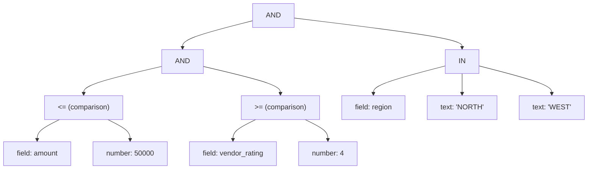
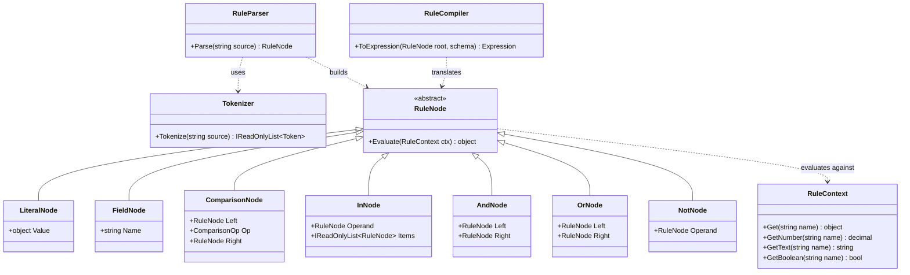
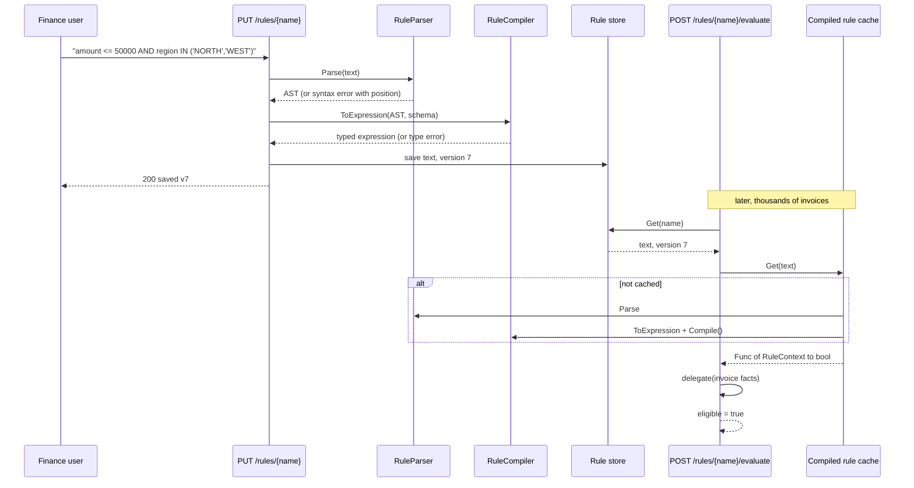
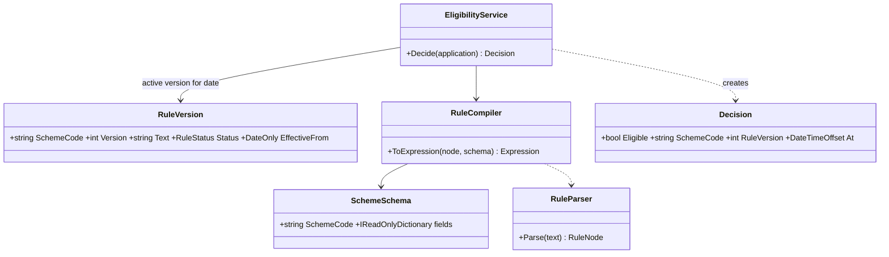

Sooner or later a business user asks: "Can we change the approval rule ourselves, without a release?" Today the rule is C# code: `if (invoice.Amount <= 50000 && vendor.Rating >= 4 && ...)`. Tomorrow finance wants `amount <= 75000 AND region IN ('NORTH', 'WEST')`. The Interpreter pattern is how you give them that power safely. You define a small language (a grammar), turn text into a tree of objects (an abstract syntax tree, or AST), and let each node evaluate itself. This lesson builds a complete rule language: a tokenizer, a recursive-descent parser, a tree-walking interpreter and a compiler to `System.Linq.Expressions`. Then it tells you, honestly, when to stop writing your own and use a library.

## Learning objectives

By the end of this lesson you will be able to:

1. Explain what Interpreter is: a grammar whose rules map to classes, and an AST whose nodes evaluate themselves.
2. Write a small grammar in EBNF notation, including operator precedence.
3. Build a tokenizer (lexer) and a recursive-descent parser that produces an AST with good error messages.
4. Evaluate the AST by walking it, with correct short-circuiting and type errors.
5. Compile the same AST into an `Expression<Func<RuleContext, bool>>`, type-checking at save time and running fast at evaluation time.
6. Secure a user-editable rule language with length limits, nesting limits, no arbitrary code, versioning and audit.
7. Decide when to use a parser library, an existing expression engine, or no DSL at all.

## Prerequisites

- [Composite](#/lesson/m06-composite): an AST is a composite tree.
- [Visitor](#/lesson/m06-visitor): the main alternative way to put operations on an AST, and the idea behind expression trees.
- [Specification](#/lesson/m06-specification): composable business rules written in code. Interpreter is the "rules written as text" cousin.

## Explain it like I'm a beginner

Think of a recipe card that says: "If the dough is sticky AND the room is warm, add 2 spoons of flour." A cook reads the sentence, understands its parts ("dough is sticky", "room is warm", "AND"), checks each part against the kitchen, and decides what to do. The cook is an **interpreter** of a tiny language of recipe conditions.

Software can do the same. Finance writes a rule as text:

```text
amount <= 50000 AND vendor_rating >= 4 AND region IN ('NORTH', 'WEST')
```

The program has to:

1. **Split the text into words** (tokens): `amount`, `<=`, `50000`, `AND`, and so on. Like separating a sentence into words.
2. **Understand the structure** (parse): which parts belong together. `AND` joins two conditions, and `<=` compares a field with a number. The result is a tree: an "AND" at the top, with comparisons hanging below it.
3. **Evaluate the tree** against a real invoice: amount ₹42,000, rating 4.5, region NORTH. Each comparison gives true or false, and the AND combines them.

Each kind of tree node (a number, a field name, a comparison, an AND) is a small class that knows how to evaluate itself. That's the Interpreter pattern: **one class per grammar rule, and the tree evaluates itself.**

Why not just let people type C#? Because then anyone could type *anything*: delete files, call the network, loop forever. A small language can only express what you allow: fields, numbers, text, comparisons, AND/OR/NOT. Its smallness is what makes it safe.

## First-principles explanation

### The original problem

Some problems keep recurring with different *parameters of structure*, not just different values:

- Eligibility and approval rules: `amount > 5000 AND region = 'NORTH'`.
- Pricing formulas: `base_rate * (1 + escalation / 100)`.
- Search filters typed by users: `status:open assignee:me priority>2`.
- Alert conditions: `cpu > 90 AND duration > 5m`.

If each new combination needs a code change and a deployment, the business waits for engineering. If you make them configurable as flat settings, you can't express "A AND (B OR C)". The GoF idea is: **define a grammar for the sentences, represent each sentence as a tree of objects, and interpret the tree.**

### Grammar first

A grammar lists the shapes a valid sentence can take. Here is our rule language in EBNF (Extended Backus–Naur Form), from the loosest-binding rule to the tightest:

```text
rule        = orExpr ;
orExpr      = andExpr { "OR" andExpr } ;
andExpr     = notExpr { "AND" notExpr } ;
notExpr     = "NOT" notExpr | primary ;
primary     = "(" orExpr ")" | operand [ comparison | inList ] ;
comparison  = ( "=" | "!=" | "<>" | ">" | ">=" | "<" | "<=" ) operand ;
inList      = "IN" "(" operand { "," operand } ")" ;
operand     = NUMBER | STRING | "TRUE" | "FALSE" | IDENTIFIER ;
```

Read `{ ... }` as "zero or more times", and `[ ... ]` as "optional". Two things matter:

1. **Precedence comes from nesting.** `orExpr` is built from `andExpr`s, so AND binds tighter than OR. `a OR b AND c` means `a OR (b AND c)`, exactly as in SQL and C#.
2. **Each rule becomes a parser method**, and each kind of resulting node becomes a class. That direct mapping is the heart of Interpreter.

### Participants

| Participant (GoF name) | Job | In our rule language |
|---|---|---|
| **AbstractExpression** | Declares `Interpret(context)` | `RuleNode.Evaluate(RuleContext)` |
| **TerminalExpression** | Leaves: values and names | `LiteralNode`, `FieldNode` |
| **NonterminalExpression** | Nodes built from other nodes | `ComparisonNode`, `InNode`, `AndNode`, `OrNode`, `NotNode` |
| **Context** | Information the sentence is evaluated against | `RuleContext`: field values of one invoice |
| **Client** | Builds the tree (usually via a parser) and calls `Interpret` | the API endpoint |

The GoF book leaves parsing out of the pattern. It assumes the tree is built somehow. In practice the parser is half the work, so this lesson builds it too.

### The simplest implementation

Without any parser, you can build trees in code:

```csharp
RuleNode rule = new AndNode(
    new ComparisonNode(new FieldNode("amount"), ComparisonOp.Greater, new LiteralNode(5000m)),
    new ComparisonNode(new FieldNode("region"), ComparisonOp.Equal, new LiteralNode("NORTH")));

bool eligible = (bool)rule.Evaluate(context);
```

`AndNode.Evaluate` evaluates its left child, and only if that is true, its right child. `ComparisonNode.Evaluate` evaluates both sides and compares them. Each class is a few lines. Composition does the rest.

### How it works internally: three stages

1. **Lexing (tokenizing).** Turn characters into tokens: `amount` (identifier), `>=` (operator), `5000` (number), `'NORTH'` (string). Handle whitespace, quotes and escapes (`'O''Brien'`). Record each token's **position**, so errors can say "unexpected '#' at position 7".
2. **Parsing.** A **recursive-descent parser** has one method per grammar rule. `ParseOr` calls `ParseAnd` and loops on `OR`. `ParseAnd` calls `ParseNot` and loops on `AND`. `ParsePrimary` handles parentheses and comparisons. The call stack mirrors the grammar, and the result is the AST.
3. **Evaluation**, in one of two ways:
   - **Tree-walking interpretation**: call `Evaluate` on the root, which recursively evaluates children. It is simple and flexible. Every evaluation re-walks the tree, checks types at runtime, and boxes values.
   - **Compilation**: translate the AST into a `System.Linq.Expressions` tree, then call `.Compile()` to get a real delegate (`Func<RuleContext, bool>`). Compiling costs much more than one evaluation, so compile once when the rule is saved or first used, cache the delegate, and evaluate it many times. Compiling also **type-checks**: comparing a number field with text fails when the rule is *saved*, not when an invoice hits it at 2 am.

### Types and errors are part of the design

A rule language for business users needs good errors more than it needs features. Three kinds:

- **Syntax errors**, at parse time: `amount >= AND region` gives "Expected a field or value, found 'AND' at position 10".
- **Type errors**, at save time with a schema: `region > 5000` gives "Cannot compare Text with Number". `amount` alone gives "A rule must evaluate to true or false".
- **Evaluation errors**, at runtime: a field missing from the data. Decide your policy explicitly: treat it as an error (this lesson's choice), as false, or as `null` with three-valued logic like SQL. Write the policy down.

### When to stop: parser libraries and existing engines

Hand-writing a parser is reasonable for a grammar of this size, roughly 10 rules. Consider alternatives when:

- **The grammar grows** (functions, arithmetic, dates, lists, nested objects). Use a **parser combinator library** such as Superpower, Sprache or Pidgin, where you write the grammar in C#, or a **parser generator** such as ANTLR, where you write the grammar in a `.g4` file and C# is generated. You get better error recovery and less hand-written code.
- **You need a general expression language.** Existing evaluators (for example NCalc, System.Linq.Dynamic.Core, or rule engines such as Microsoft's open-source RulesEngine) may already do what you need. Check how they restrict method calls and type access. General-purpose expression libraries have had security advisories, so keep them updated and lock them down.
- **Users need a decision table, not a language.** "If region is X and amount band is Y, then approver Z" is often clearer as a table in a database than as a DSL.
- **The rules change rarely.** If rules change twice a year, plain C# (or the [Specification](#/lesson/m06-specification) pattern) with a normal release is simpler, safer and fully tested.

:::callout type=warning title="Never interpret user text as C#"
Running user-supplied text through C# scripting (Roslyn scripting APIs), `eval`-style tricks, or reflection-based "call any method" engines gives anyone who can edit a rule the power to run code on your server. A small DSL is safe because its grammar *cannot* express file access, network calls or loops. Keep it that way.
:::

### When it is useful

- Rules or formulas change more often than you can release, and are owned by non-developers (finance, policy, operations).
- The sentences have **structure** (AND/OR/NOT, nesting), not just values.
- The grammar is **small** and stable, and you can type-check rules on save.
- You need to **store, version and audit** rules as data: "which rule approved invoice 8812 on 3 October?"

### When it is unnecessary or harmful

- A handful of thresholds would do. Use configuration (`MaxAutoApproveAmount = 50000`).
- The rules are complex algorithms. A DSL that grows loops, variables and functions becomes a bad programming language with no debugger, no tests and no IDE.
- Nobody outside engineering will edit the rules. Then they are just code, written in a worse language.
- Performance-critical evaluation of large trees by tree-walking alone. Compile instead, or use a mature engine.

### Trade-offs it introduces

| You gain | You pay |
|---|---|
| Business-editable rules without releases | You now own a language: grammar, parser, errors, docs, tooling |
| Rules stored as data: versioned, audited, diffable | Rules escape normal code review and unit tests unless you build both |
| Easy to add a node type (a new operator) | Each new feature makes the grammar harder to keep small |
| Safe by construction if the grammar is small | Unsafe the moment it can call arbitrary code |
| Compiled rules run fast | Compilation and caching add complexity, and cache keys must include the schema version |

## Visual explanation

### The AST for one rule



This is the tree for `amount <= 50000 AND vendor_rating >= 4 AND region IN ('NORTH', 'WEST')`. Because `AND` is parsed left to right in a loop, the first two conditions are grouped first and the `IN` joins at the top. Leaves are terminal expressions (fields and values). Inner nodes are nonterminal expressions. Evaluation starts at the root and works down. With short-circuiting, if `amount <= 50000` is false, the right side of the lower AND and the whole IN check are never evaluated.

### Class diagram



How to read it: the left side is the pattern itself, an abstract node and one subclass per grammar construct, which is a Composite. `RuleContext` is the GoF "Context". `Tokenizer` and `RuleParser` build the tree from text. `RuleCompiler` offers a second way to run the tree, translating it instead of interpreting it. Adding an operator such as `BETWEEN` means one new node class, one parser branch and one compiler branch.

### Sequence diagram — save once, evaluate many times



The expensive steps (parse, type-check, compile) happen when a rule is saved, and once more per instance on first use. The hot path is a dictionary lookup plus a delegate call. Errors surface to the person *writing* the rule, with a position, instead of to the system evaluating it. The store keeps the rule *text* and a version number. The AST and delegate are derived and can always be rebuilt.

## Step-by-step example

### Step 1 — the hard-coded rule

```csharp
public bool CanAutoApprove(Invoice i) =>
    i.Amount <= 50_000m && i.VendorRating >= 4m && (i.Region == "NORTH" || i.Region == "WEST");
```

Fine until finance changes it monthly. Each change is a ticket, a code review, a release, and a two-week wait.

### Step 2 — represent the rule as objects

Write the node classes and build the rule by hand in code. Nothing is configurable yet, but you've proven the model can represent the rule and evaluate it.

### Step 3 — write the grammar

Write the EBNF above on one page. Agree on it with finance *before* coding: keywords, quoting (`'NORTH'`), case rules (case-insensitive keywords and text comparison), and what a missing field means.

### Step 4 — tokenizer and parser

The tokenizer produces tokens with positions. The parser has one method per grammar rule. Test both with many small examples, including bad ones.

### Step 5 — schema and compilation

Define the fields a rule may use and their types (`amount: Number`, `region: Text`, `is_msme: Boolean`). Compile on save. Type errors are rejected before the rule is stored.

### Step 6 — store, version, cache, audit

Store rule text with a version. Log the rule version with every decision ("invoice 8812 approved by auto-approve v7"). Cache compiled delegates keyed by rule text and schema version.

## Production-style C# implementation

```text
Eligibility.Api/
  Program.cs
  Rules/Tokenizer.cs          # lexer with positions
  Rules/Ast.cs                # nodes that interpret themselves + RuleContext
  Rules/RuleParser.cs         # recursive descent
  Rules/RuleCompiler.cs       # AST -> Expression<Func<RuleContext,bool>> with type checking
  Rules/EligibilitySchema.cs
  Rules/RuleStore.cs          # versioned rule text + compiled cache
```

### Tokenizer

```csharp file=Rules/Tokenizer.cs
using System.Text;

namespace Eligibility.Rules;

public enum TokenKind
{
    Number, String, Identifier, True, False, And, Or, Not, In,
    Equal, NotEqual, Greater, GreaterOrEqual, Less, LessOrEqual,
    LeftParen, RightParen, Comma, End,
}

public readonly record struct Token(TokenKind Kind, string Text, int Position);

public sealed class RuleSyntaxException(string message, int position) : Exception($"{message} (at position {position})")
{
    public int Position { get; } = position;
}

public static class Tokenizer
{
    public const int MaxLength = 2_000;

    public static IReadOnlyList<Token> Tokenize(string source)
    {
        ArgumentNullException.ThrowIfNull(source);
        if (source.Length > MaxLength) throw new RuleSyntaxException($"Rule is longer than {MaxLength} characters", MaxLength);

        var tokens = new List<Token>();
        var i = 0;
        while (i < source.Length)
        {
            var c = source[i];
            if (char.IsWhiteSpace(c)) { i++; continue; }
            var start = i;

            if (char.IsDigit(c))
            {
                while (i < source.Length && (char.IsDigit(source[i]) || source[i] == '.')) i++;
                tokens.Add(new Token(TokenKind.Number, source[start..i], start));
                continue;
            }

            if (char.IsLetter(c) || c == '_')
            {
                while (i < source.Length && (char.IsLetterOrDigit(source[i]) || source[i] == '_')) i++;
                var word = source[start..i];
                tokens.Add(new Token(Keyword(word), word, start));
                continue;
            }

            if (c == '\'')
            {
                var text = new StringBuilder();
                i++;
                while (true)
                {
                    if (i >= source.Length) throw new RuleSyntaxException("Unterminated text value", start);
                    if (source[i] == '\'')
                    {
                        if (i + 1 < source.Length && source[i + 1] == '\'') { text.Append('\''); i += 2; continue; }   // '' escapes a quote
                        i++;
                        break;
                    }
                    text.Append(source[i++]);
                }
                tokens.Add(new Token(TokenKind.String, text.ToString(), start));
                continue;
            }

            var next = i + 1 < source.Length ? source[i + 1] : '\0';
            var (kind, length) = c switch
            {
                '(' => (TokenKind.LeftParen, 1),
                ')' => (TokenKind.RightParen, 1),
                ',' => (TokenKind.Comma, 1),
                '=' => (TokenKind.Equal, 1),
                '!' when next == '=' => (TokenKind.NotEqual, 2),
                '<' when next == '>' => (TokenKind.NotEqual, 2),
                '<' when next == '=' => (TokenKind.LessOrEqual, 2),
                '<' => (TokenKind.Less, 1),
                '>' when next == '=' => (TokenKind.GreaterOrEqual, 2),
                '>' => (TokenKind.Greater, 1),
                _ => throw new RuleSyntaxException($"Unexpected character '{c}'", i),
            };
            tokens.Add(new Token(kind, source.Substring(i, length), i));
            i += length;
        }
        tokens.Add(new Token(TokenKind.End, "", source.Length));
        return tokens;
    }

    private static TokenKind Keyword(string word) => word.ToUpperInvariant() switch
    {
        "AND" => TokenKind.And,
        "OR" => TokenKind.Or,
        "NOT" => TokenKind.Not,
        "IN" => TokenKind.In,
        "TRUE" => TokenKind.True,
        "FALSE" => TokenKind.False,
        _ => TokenKind.Identifier,
    };
}
```

### The AST: nodes that interpret themselves

```csharp file=Rules/Ast.cs
using System.Diagnostics;

namespace Eligibility.Rules;

public sealed class RuleEvaluationException(string message) : Exception(message);

/// <summary>The GoF "Context": the facts one rule is evaluated against.</summary>
public sealed class RuleContext
{
    private readonly Dictionary<string, object> _values = new(StringComparer.OrdinalIgnoreCase);

    public RuleContext(IEnumerable<KeyValuePair<string, object>> values)
    {
        foreach (var (key, value) in values) _values[key] = Normalise(value);
    }

    public object Get(string name) =>
        _values.TryGetValue(name, out var v) ? v : throw new RuleEvaluationException($"Field '{name}' has no value.");

    // Typed accessors, used by compiled rules.
    public decimal GetNumber(string name) => Get(name) is decimal d ? d : throw new RuleEvaluationException($"Field '{name}' is not a number.");
    public string GetText(string name) => Get(name) as string ?? throw new RuleEvaluationException($"Field '{name}' is not text.");
    public bool GetBoolean(string name) => Get(name) is bool b ? b : throw new RuleEvaluationException($"Field '{name}' is not true/false.");

    private static object Normalise(object value) => value switch
    {
        decimal or string or bool => value,
        int i => (decimal)i,
        long l => (decimal)l,
        double d => (decimal)d,
        _ => throw new ArgumentException($"Unsupported value type {value?.GetType().Name ?? "null"}."),
    };
}

public enum ComparisonOp { Equal, NotEqual, Greater, GreaterOrEqual, Less, LessOrEqual }

/// <summary>AbstractExpression. Values are decimal, string or bool.</summary>
public abstract record RuleNode
{
    public abstract object Evaluate(RuleContext ctx);

    protected static bool AsBoolean(object value, string where) =>
        value is bool b ? b : throw new RuleEvaluationException($"{where} needs true/false, got {Describe(value)}.");

    protected static string Describe(object value) => value switch
    {
        decimal => "a number",
        string => "text",
        bool => "true/false",
        _ => value.GetType().Name,
    };
}

// ---- Terminal expressions ----
public sealed record LiteralNode(object Value) : RuleNode
{
    public override object Evaluate(RuleContext ctx) => Value;
}

public sealed record FieldNode(string Name) : RuleNode
{
    public override object Evaluate(RuleContext ctx) => ctx.Get(Name);
}

// ---- Nonterminal expressions ----
public sealed record ComparisonNode(RuleNode Left, ComparisonOp Op, RuleNode Right) : RuleNode
{
    public override object Evaluate(RuleContext ctx) => Compare(Left.Evaluate(ctx), Op, Right.Evaluate(ctx));

    public static bool Compare(object left, ComparisonOp op, object right) => (left, right) switch
    {
        (decimal a, decimal b) => op switch
        {
            ComparisonOp.Equal => a == b,
            ComparisonOp.NotEqual => a != b,
            ComparisonOp.Greater => a > b,
            ComparisonOp.GreaterOrEqual => a >= b,
            ComparisonOp.Less => a < b,
            ComparisonOp.LessOrEqual => a <= b,
            _ => throw new UnreachableException(),
        },
        (string a, string b) when op is ComparisonOp.Equal or ComparisonOp.NotEqual =>
            string.Equals(a, b, StringComparison.OrdinalIgnoreCase) == (op == ComparisonOp.Equal),
        (bool a, bool b) when op is ComparisonOp.Equal or ComparisonOp.NotEqual =>
            (a == b) == (op == ComparisonOp.Equal),
        _ => throw new RuleEvaluationException($"Cannot apply {op} to {Describe(left)} and {Describe(right)}."),
    };
}

public sealed record InNode(RuleNode Operand, IReadOnlyList<RuleNode> Items) : RuleNode
{
    public override object Evaluate(RuleContext ctx)
    {
        var value = Operand.Evaluate(ctx);
        return Items.Any(item => ComparisonNode.Compare(value, ComparisonOp.Equal, item.Evaluate(ctx)));
    }
}

public sealed record AndNode(RuleNode Left, RuleNode Right) : RuleNode
{
    public override object Evaluate(RuleContext ctx) =>
        AsBoolean(Left.Evaluate(ctx), "AND") && AsBoolean(Right.Evaluate(ctx), "AND");   // short-circuits
}

public sealed record OrNode(RuleNode Left, RuleNode Right) : RuleNode
{
    public override object Evaluate(RuleContext ctx) =>
        AsBoolean(Left.Evaluate(ctx), "OR") || AsBoolean(Right.Evaluate(ctx), "OR");
}

public sealed record NotNode(RuleNode Operand) : RuleNode
{
    public override object Evaluate(RuleContext ctx) => !AsBoolean(Operand.Evaluate(ctx), "NOT");
}
```

### Parser: one method per grammar rule

```csharp file=Rules/RuleParser.cs
using System.Globalization;

namespace Eligibility.Rules;

public sealed class RuleParser
{
    public const int MaxNesting = 32;
    private readonly IReadOnlyList<Token> _tokens;
    private int _pos;
    private int _depth;

    private RuleParser(IReadOnlyList<Token> tokens) => _tokens = tokens;

    public static RuleNode Parse(string source)
    {
        var parser = new RuleParser(Tokenizer.Tokenize(source));
        var node = parser.ParseOr();
        parser.Expect(TokenKind.End, "Unexpected text after the end of the rule");
        return node;
    }

    // orExpr = andExpr { "OR" andExpr }
    private RuleNode ParseOr()
    {
        var left = ParseAnd();
        while (Match(TokenKind.Or)) left = new OrNode(left, ParseAnd());
        return left;
    }

    // andExpr = notExpr { "AND" notExpr }
    private RuleNode ParseAnd()
    {
        var left = ParseNot();
        while (Match(TokenKind.And)) left = new AndNode(left, ParseNot());
        return left;
    }

    // notExpr = "NOT" notExpr | primary
    private RuleNode ParseNot()
    {
        if (!Match(TokenKind.Not)) return ParsePrimary();
        Enter();
        var operand = ParseNot();
        _depth--;
        return new NotNode(operand);
    }

    // primary = "(" orExpr ")" | operand [ comparison | inList ]
    private RuleNode ParsePrimary()
    {
        if (Match(TokenKind.LeftParen))
        {
            Enter();
            var inner = ParseOr();
            Expect(TokenKind.RightParen, "Expected ')'");
            _depth--;
            return inner;
        }

        var left = ParseOperand();
        if (ComparisonFor(Current.Kind) is { } op)
        {
            _pos++;
            return new ComparisonNode(left, op, ParseOperand());
        }
        if (Match(TokenKind.In))
        {
            Expect(TokenKind.LeftParen, "Expected '(' after IN");
            var items = new List<RuleNode> { ParseOperand() };
            while (Match(TokenKind.Comma)) items.Add(ParseOperand());
            Expect(TokenKind.RightParen, "Expected ')' to close the IN list");
            return new InNode(left, items);
        }
        return left;   // a bare boolean field such as is_msme
    }

    // operand = NUMBER | STRING | TRUE | FALSE | IDENTIFIER
    private RuleNode ParseOperand()
    {
        var t = Current;
        _pos++;
        return t.Kind switch
        {
            TokenKind.Number when decimal.TryParse(t.Text, NumberStyles.AllowDecimalPoint, CultureInfo.InvariantCulture, out var d)
                => new LiteralNode(d),
            TokenKind.Number => throw new RuleSyntaxException($"'{t.Text}' is not a valid number", t.Position),
            TokenKind.String => new LiteralNode(t.Text),
            TokenKind.True => new LiteralNode(true),
            TokenKind.False => new LiteralNode(false),
            TokenKind.Identifier => new FieldNode(t.Text.ToLowerInvariant()),
            _ => throw new RuleSyntaxException($"Expected a field or value, found {Describe(t)}", t.Position),
        };
    }

    private static ComparisonOp? ComparisonFor(TokenKind kind) => kind switch
    {
        TokenKind.Equal => ComparisonOp.Equal,
        TokenKind.NotEqual => ComparisonOp.NotEqual,
        TokenKind.Greater => ComparisonOp.Greater,
        TokenKind.GreaterOrEqual => ComparisonOp.GreaterOrEqual,
        TokenKind.Less => ComparisonOp.Less,
        TokenKind.LessOrEqual => ComparisonOp.LessOrEqual,
        _ => null,
    };

    private Token Current => _tokens[_pos];

    private bool Match(TokenKind kind)
    {
        if (Current.Kind != kind) return false;
        _pos++;
        return true;
    }

    private void Expect(TokenKind kind, string message)
    {
        if (!Match(kind)) throw new RuleSyntaxException($"{message}, found {Describe(Current)}", Current.Position);
    }

    private void Enter()
    {
        if (++_depth > MaxNesting) throw new RuleSyntaxException($"Rule is nested more than {MaxNesting} levels deep", Current.Position);
    }

    private static string Describe(Token t) => t.Kind == TokenKind.End ? "end of rule" : $"'{t.Text}'";
}
```

### Compiler: AST to expression tree, with type checking

```csharp file=Rules/RuleCompiler.cs
using System.Linq.Expressions;
using System.Reflection;

namespace Eligibility.Rules;

public enum RuleType { Number, Text, Boolean }

public sealed class RuleTypeException(string message) : Exception(message);

public static class RuleCompiler
{
    private static readonly MethodInfo GetNumber = typeof(RuleContext).GetMethod(nameof(RuleContext.GetNumber))!;
    private static readonly MethodInfo GetText = typeof(RuleContext).GetMethod(nameof(RuleContext.GetText))!;
    private static readonly MethodInfo GetBoolean = typeof(RuleContext).GetMethod(nameof(RuleContext.GetBoolean))!;
    private static readonly MethodInfo TextEquals =
        typeof(string).GetMethod(nameof(string.Equals), [typeof(string), typeof(string), typeof(StringComparison)])!;

    /// <summary>Translates and type-checks. Throws RuleTypeException for any type error, before the rule is ever run.</summary>
    public static Expression<Func<RuleContext, bool>> ToExpression(RuleNode root, IReadOnlyDictionary<string, RuleType> schema)
    {
        var ctx = Expression.Parameter(typeof(RuleContext), "ctx");
        var body = Build(root, ctx, schema);
        if (body.Type != typeof(bool)) throw new RuleTypeException("A rule must evaluate to true or false.");
        return Expression.Lambda<Func<RuleContext, bool>>(body, ctx);
    }

    private static Expression Build(RuleNode node, ParameterExpression ctx, IReadOnlyDictionary<string, RuleType> schema)
    {
        Expression Sub(RuleNode n) => Build(n, ctx, schema);
        Expression Bool(RuleNode n, string where)
        {
            var e = Sub(n);
            return e.Type == typeof(bool) ? e : throw new RuleTypeException($"{where} needs true/false, got {Name(e.Type)}.");
        }

        return node switch
        {
            LiteralNode { Value: decimal or string or bool } lit => Expression.Constant(lit.Value),
            LiteralNode lit => throw new RuleTypeException($"Unsupported literal type {lit.Value.GetType().Name}."),
            FieldNode f when schema.TryGetValue(f.Name, out var type) =>
                Expression.Call(ctx, type switch { RuleType.Number => GetNumber, RuleType.Text => GetText, _ => GetBoolean }, Expression.Constant(f.Name)),
            FieldNode f => throw new RuleTypeException($"Unknown field '{f.Name}'."),
            AndNode a => Expression.AndAlso(Bool(a.Left, "AND"), Bool(a.Right, "AND")),
            OrNode o => Expression.OrElse(Bool(o.Left, "OR"), Bool(o.Right, "OR")),
            NotNode n => Expression.Not(Bool(n.Operand, "NOT")),
            ComparisonNode c => Compare(Sub(c.Left), c.Op, Sub(c.Right)),
            InNode i => InList(Sub(i.Operand), i.Items.Select(Sub).ToList()),
            _ => throw new RuleTypeException($"No compiler rule for {node.GetType().Name}."),
        };
    }

    private static Expression InList(Expression operand, IReadOnlyList<Expression> items) =>
        items.Select(item => Compare(operand, ComparisonOp.Equal, item)).Aggregate(Expression.OrElse);

    private static Expression Compare(Expression left, ComparisonOp op, Expression right)
    {
        if (left.Type != right.Type) throw new RuleTypeException($"Cannot compare {Name(left.Type)} with {Name(right.Type)}.");

        if (left.Type == typeof(decimal))
            return op switch
            {
                ComparisonOp.Equal => Expression.Equal(left, right),
                ComparisonOp.NotEqual => Expression.NotEqual(left, right),
                ComparisonOp.Greater => Expression.GreaterThan(left, right),
                ComparisonOp.GreaterOrEqual => Expression.GreaterThanOrEqual(left, right),
                ComparisonOp.Less => Expression.LessThan(left, right),
                _ => Expression.LessThanOrEqual(left, right),
            };

        if (op is not (ComparisonOp.Equal or ComparisonOp.NotEqual))
            throw new RuleTypeException($"{op} is only allowed on numbers, not {Name(left.Type)}.");

        Expression equal = left.Type == typeof(string)
            ? Expression.Call(TextEquals, left, right, Expression.Constant(StringComparison.OrdinalIgnoreCase))
            : Expression.Equal(left, right);
        return op == ComparisonOp.Equal ? equal : Expression.Not(equal);
    }

    private static string Name(Type t) => t == typeof(decimal) ? "Number" : t == typeof(string) ? "Text" : t == typeof(bool) ? "Boolean" : t.Name;
}
```

### Schema, store and cache

```csharp file=Rules/EligibilitySchema.cs
namespace Eligibility.Rules;

/// <summary>The fields a rule may use. Bump Version whenever a field is added, removed or retyped.</summary>
public static class EligibilitySchema
{
    public const int Version = 1;

    public static readonly IReadOnlyDictionary<string, RuleType> Fields =
        new Dictionary<string, RuleType>(StringComparer.OrdinalIgnoreCase)
        {
            ["amount"] = RuleType.Number,
            ["vendor_rating"] = RuleType.Number,
            ["region"] = RuleType.Text,
            ["category"] = RuleType.Text,
            ["is_msme"] = RuleType.Boolean,
        };
}
```

```csharp file=Rules/RuleStore.cs
using System.Collections.Concurrent;
using Microsoft.Extensions.Caching.Memory;

namespace Eligibility.Rules;

public sealed record StoredRule(string Name, string Text, int Version, DateTimeOffset SavedAt);

public interface IRuleStore
{
    StoredRule? Get(string name);
    StoredRule Save(string name, string text);
}

/// <summary>In production: a PostgreSQL table with (name, version) as key, never updated in place, for audit.</summary>
public sealed class InMemoryRuleStore(TimeProvider clock) : IRuleStore
{
    private readonly ConcurrentDictionary<string, StoredRule> _rules = new(StringComparer.OrdinalIgnoreCase);

    public StoredRule? Get(string name) => _rules.GetValueOrDefault(name);

    public StoredRule Save(string name, string text) =>
        _rules.AddOrUpdate(name,
            n => new StoredRule(n, text, 1, clock.GetUtcNow()),
            (n, old) => new StoredRule(n, text, old.Version + 1, clock.GetUtcNow()));
}

/// <summary>Parse + type-check + compile once; evaluate many times.</summary>
public sealed class CompiledRuleCache(IMemoryCache cache)
{
    public Func<RuleContext, bool> Get(string ruleText) =>
        cache.GetOrCreate($"rule:s{EligibilitySchema.Version}:{ruleText}", entry =>
        {
            entry.SlidingExpiration = TimeSpan.FromHours(1);
            return RuleCompiler.ToExpression(RuleParser.Parse(ruleText), EligibilitySchema.Fields).Compile();
        })!;
}
```

### Endpoints

```csharp file=Program.cs
using Eligibility.Rules;

var builder = WebApplication.CreateBuilder(args);
builder.Services.AddSingleton(TimeProvider.System);
builder.Services.AddMemoryCache();
builder.Services.AddSingleton<IRuleStore, InMemoryRuleStore>();
builder.Services.AddSingleton<CompiledRuleCache>();
var app = builder.Build();

app.MapPost("/rules/validate", (RuleText body) =>
    Check(body.Text) ?? Results.Ok(new { valid = true }));

app.MapPut("/rules/{name}", (string name, RuleText body, IRuleStore store) =>
    Check(body.Text) ?? Results.Ok(store.Save(name, body.Text)));

app.MapPost("/rules/{name}/evaluate", (string name, InvoiceFacts facts, IRuleStore store, CompiledRuleCache cache) =>
{
    if (store.Get(name) is not { } rule) return Results.NotFound();
    try
    {
        var eligible = cache.Get(rule.Text)(facts.ToContext());
        return Results.Ok(new { rule = rule.Name, rule.Version, eligible });   // log the version with every decision
    }
    catch (RuleEvaluationException ex)
    {
        return Results.Problem(ex.Message, statusCode: StatusCodes.Status422UnprocessableEntity);
    }
});

app.Run();

static IResult? Check(string text)
{
    try
    {
        RuleCompiler.ToExpression(RuleParser.Parse(text), EligibilitySchema.Fields);
        return null;
    }
    catch (RuleSyntaxException ex)
    {
        return Results.ValidationProblem(new Dictionary<string, string[]> { ["text"] = [ex.Message] },
            extensions: new Dictionary<string, object?> { ["position"] = ex.Position });
    }
    catch (RuleTypeException ex)
    {
        return Results.ValidationProblem(new Dictionary<string, string[]> { ["text"] = [ex.Message] });
    }
}

public sealed record RuleText(string Text);

public sealed record InvoiceFacts(decimal Amount, decimal VendorRating, string Region, string Category, bool IsMsme)
{
    public RuleContext ToContext() => new(new Dictionary<string, object>
    {
        ["amount"] = Amount,
        ["vendor_rating"] = VendorRating,
        ["region"] = Region,
        ["category"] = Category,
        ["is_msme"] = IsMsme,
    });
}
```

Two evaluation paths now exist for the same AST. `rule.Evaluate(ctx)` is the classic Interpreter: no schema needed, flexible, and good for previews, tests and small volumes. The compiled delegate is type-checked and fast, and it's what the hot path uses. Keeping both is useful: an equivalence test (both must agree on thousands of generated facts) catches bugs in either one.

## Bad design vs good design

**Bad: string tricks instead of a grammar.**

```csharp
// "amount > 5000 AND region = NORTH"
public bool Evaluate(string rule, Invoice i)
{
    foreach (var part in rule.Split(" AND "))
    {
        var bits = part.Split(' ');
        var value = bits[0] == "amount" ? i.Amount.ToString() : i.Region;
        if (bits[1] == ">" && decimal.Parse(value) <= decimal.Parse(bits[2])) return false;
        if (bits[1] == "=" && value != bits[2]) return false;
    }
    return true;
}
```

What goes wrong:

- `OR` and parentheses can't be expressed. The first request for "A AND (B OR C)" means a rewrite.
- `region = 'NEW DELHI'` breaks because of the space in the value.
- `decimal.Parse` uses the server culture. On a machine with a culture that uses a comma as the decimal separator, `12.5` parses differently or fails.
- Errors are `IndexOutOfRangeException` at 2 am, not "syntax error at position 14" when the rule is saved.
- Typos such as `amuont > 5000` silently compare the region instead.

**Also bad: a DSL that grew into a programming language.** Over two years someone adds variables, then `IF/ELSE`, then loops, then "call this C# method by name". Now nobody can test the rules, a rule with an infinite loop takes down the worker, and the method-call feature is a remote code execution hole.

**Good:** the implementation above. A written grammar, a real tokenizer with positions, a parser with nesting limits, a schema with type checking at save time, compiled and cached evaluation, versioned rule text, and an audit trail of the rule version used in each decision. The grammar stays small *on purpose*. When a request would need loops or variables, the answer is "that's code, let's write it in C#".

:::callout type=tradeoff title="Interpreter vs Specification"
Both build trees of composable conditions. **Specification** trees are built in C# by developers (`new AmountAtMost(50_000).And(new RegionIn("NORTH", "WEST"))`). They are compile-time safe, refactorable and unit-tested. **Interpreter** trees are built from *text* at runtime by non-developers. They are flexible, but you must build safety, errors and tests yourself. A common hybrid: the parser produces Specification objects, so the same evaluation code serves both.
:::

## Practical playground

The playground is a small rule language with a tokenizer, parser and tree-walking evaluator, around 100 lines. Run it against three invoices. Then try these changes. Add the `<>` operator. Make `region = 'north'` case-insensitive if it isn't. Type a broken rule (`amount > AND region`) and read the error. Add `NOT`.

:::playground type=csharp title="A rule language in one file"
```csharp file=Program.cs
using System;
using System.Collections.Generic;
using System.Globalization;
using System.Linq;

public abstract record Node { public abstract object Eval(IReadOnlyDictionary<string, object> facts); }
public sealed record Lit(object Value) : Node { public override object Eval(IReadOnlyDictionary<string, object> f) => Value; }
public sealed record Field(string Name) : Node { public override object Eval(IReadOnlyDictionary<string, object> f) => f[Name]; }
public sealed record Cmp(Node L, string Op, Node R) : Node
{
    public override object Eval(IReadOnlyDictionary<string, object> f) => (L.Eval(f), R.Eval(f), Op) switch
    {
        (decimal a, decimal b, ">") => a > b,
        (decimal a, decimal b, ">=") => a >= b,
        (decimal a, decimal b, "<") => a < b,
        (decimal a, decimal b, "<=") => a <= b,
        (var a, var b, "=") => Equals(a, b),
        var x => throw new InvalidOperationException($"Cannot apply {x.Op}"),
    };
}
public sealed record And(Node L, Node R) : Node { public override object Eval(IReadOnlyDictionary<string, object> f) => (bool)L.Eval(f) && (bool)R.Eval(f); }
public sealed record Or(Node L, Node R) : Node { public override object Eval(IReadOnlyDictionary<string, object> f) => (bool)L.Eval(f) || (bool)R.Eval(f); }

public sealed class Parser
{
    private readonly List<string> _t; private int _i;
    public Parser(string src) => _t = Tokenize(src);
    public Node Parse() { var n = ParseOr(); if (_i < _t.Count) throw new FormatException($"Unexpected '{_t[_i]}'"); return n; }

    private Node ParseOr() { var l = ParseAnd(); while (Peek("OR")) { _i++; l = new Or(l, ParseAnd()); } return l; }
    private Node ParseAnd() { var l = ParsePrimary(); while (Peek("AND")) { _i++; l = new And(l, ParsePrimary()); } return l; }
    private Node ParsePrimary()
    {
        if (Peek("(")) { _i++; var e = ParseOr(); Expect(")"); return e; }
        var left = Operand();
        var op = Next();
        return new Cmp(left, op, Operand());
    }
    private Node Operand()
    {
        var tok = Next();
        if (tok.StartsWith('\'')) return new Lit(tok.Trim('\''));
        if (decimal.TryParse(tok, NumberStyles.Number, CultureInfo.InvariantCulture, out var d)) return new Lit(d);
        return new Field(tok.ToLowerInvariant());
    }
    private bool Peek(string s) => _i < _t.Count && string.Equals(_t[_i], s, StringComparison.OrdinalIgnoreCase);
    private string Next() => _i < _t.Count ? _t[_i++] : throw new FormatException("Unexpected end of rule");
    private void Expect(string s) { if (!Peek(s)) throw new FormatException($"Expected '{s}'"); _i++; }

    private static List<string> Tokenize(string s)
    {
        var tokens = new List<string>(); var i = 0;
        while (i < s.Length)
        {
            if (char.IsWhiteSpace(s[i])) { i++; continue; }
            if (s[i] == '\'') { var j = s.IndexOf('\'', i + 1); tokens.Add(s[i..(j + 1)]); i = j + 1; continue; }
            if ("()".Contains(s[i])) { tokens.Add(s[i].ToString()); i++; continue; }
            if ("<>=".Contains(s[i])) { var j = i; while (j < s.Length && "<>=".Contains(s[j])) j++; tokens.Add(s[i..j]); i = j; continue; }
            var k = i; while (k < s.Length && (char.IsLetterOrDigit(s[k]) || s[k] == '_' || s[k] == '.')) k++;
            tokens.Add(s[i..k]); i = k;
        }
        return tokens;
    }
}

public static class Program
{
    public static void Main()
    {
        var rule = new Parser("amount <= 50000 AND (region = 'NORTH' OR region = 'WEST')").Parse();
        Console.WriteLine(rule);

        var invoices = new[]
        {
            new Dictionary<string, object> { ["amount"] = 42_000m, ["region"] = "NORTH" },
            new Dictionary<string, object> { ["amount"] = 42_000m, ["region"] = "SOUTH" },
            new Dictionary<string, object> { ["amount"] = 75_000m, ["region"] = "WEST" },
        };
        foreach (var inv in invoices)
            Console.WriteLine($"{inv["amount"],8} {inv["region"],-6} -> {rule.Eval(inv)}");
    }
}
```
:::

## Exercises

:::exercise id=m06-interpreter-ex1 difficulty=beginner kind=code title="Make the nodes interpret themselves"
The terminal nodes (`LiteralNode`, `FieldNode`) are done. Implement `Evaluate` for `ComparisonNode`, `AndNode`, `OrNode` and `NotNode`.
::requirements
- Numbers are `decimal`. All six comparison operators work on numbers.
- Text supports only `Equal`/`NotEqual`, compared case-insensitively. Booleans support only `Equal`/`NotEqual`.
- Any other combination (number vs text, `Greater` on text) throws `RuleEvaluationException`.
- `AND` and `OR` must short-circuit. A non-boolean operand of `AND`/`OR`/`NOT` throws `RuleEvaluationException`.
::acceptance
- `amount > 5000 AND region = 'NORTH'` is true for amount 7,200 / region "north", and false for amount 4,000.
- `false AND missing_field` returns false without touching the missing field; `true OR missing_field` returns true.
- Comparing `amount` with the text `'5000'` throws `RuleEvaluationException`.
::hint
`Evaluate` returns `object`. Inside a node, evaluate the children, then use pattern matching on the *pair* of results.
::hint
`(left, right) switch { (decimal a, decimal b) => ..., (string a, string b) when ... => ..., _ => throw ... }`
::hint
Short-circuiting comes for free if you use C#'s `&&` and `||` on the converted results. Just don't evaluate the right child before the operator.
::hint
```csharp
private static bool AsBool(object v) => v is bool b ? b : throw new RuleEvaluationException("Expected true/false");
public override object Evaluate(RuleContext ctx) => AsBool(Left.Evaluate(ctx)) && AsBool(Right.Evaluate(ctx));
```
::starter
```csharp file=RuleNodes.cs
using System;
using System.Collections.Generic;

public sealed class RuleEvaluationException(string message) : Exception(message);

public sealed class RuleContext(IReadOnlyDictionary<string, object> values)
{
    public object Get(string name) =>
        values.TryGetValue(name, out var v) ? v : throw new RuleEvaluationException($"Field '{name}' has no value.");
}

public enum ComparisonOp { Equal, NotEqual, Greater, GreaterOrEqual, Less, LessOrEqual }

public abstract record RuleNode { public abstract object Evaluate(RuleContext ctx); }

public sealed record LiteralNode(object Value) : RuleNode { public override object Evaluate(RuleContext ctx) => Value; }
public sealed record FieldNode(string Name) : RuleNode { public override object Evaluate(RuleContext ctx) => ctx.Get(Name); }

public sealed record ComparisonNode(RuleNode Left, ComparisonOp Op, RuleNode Right) : RuleNode
{
    public override object Evaluate(RuleContext ctx) => throw new NotImplementedException();
}

public sealed record AndNode(RuleNode Left, RuleNode Right) : RuleNode
{
    public override object Evaluate(RuleContext ctx) => throw new NotImplementedException();
}

public sealed record OrNode(RuleNode Left, RuleNode Right) : RuleNode
{
    public override object Evaluate(RuleContext ctx) => throw new NotImplementedException();
}

public sealed record NotNode(RuleNode Operand) : RuleNode
{
    public override object Evaluate(RuleContext ctx) => throw new NotImplementedException();
}
```
::tests
```csharp file=RuleNodesTests.cs
using System.Collections.Generic;
using Xunit;

public class RuleNodesTests
{
    private static RuleContext Ctx(decimal amount, string region) =>
        new(new Dictionary<string, object> { ["amount"] = amount, ["region"] = region });

    private static readonly RuleNode Rule = new AndNode(
        new ComparisonNode(new FieldNode("amount"), ComparisonOp.Greater, new LiteralNode(5000m)),
        new ComparisonNode(new FieldNode("region"), ComparisonOp.Equal, new LiteralNode("NORTH")));

    private static bool Eval(RuleNode n, RuleContext c) => (bool)n.Evaluate(c);

    [Fact] public void True_case() => Assert.True(Eval(Rule, Ctx(7200m, "north")));
    [Fact] public void False_case() => Assert.False(Eval(Rule, Ctx(4000m, "NORTH")));

    [Theory]
    [InlineData(ComparisonOp.Equal, false)]
    [InlineData(ComparisonOp.NotEqual, true)]
    [InlineData(ComparisonOp.GreaterOrEqual, true)]
    [InlineData(ComparisonOp.Less, false)]
    [InlineData(ComparisonOp.LessOrEqual, false)]
    public void Number_operators(ComparisonOp op, bool expected) =>
        Assert.Equal(expected, Eval(new ComparisonNode(new LiteralNode(10m), op, new LiteralNode(5m)), Ctx(0m, "")));

    [Fact]
    public void And_short_circuits() =>
        Assert.False(Eval(new AndNode(new LiteralNode(false), new FieldNode("missing")), Ctx(0m, "")));

    [Fact]
    public void Or_short_circuits() =>
        Assert.True(Eval(new OrNode(new LiteralNode(true), new FieldNode("missing")), Ctx(0m, "")));

    [Fact]
    public void Not_inverts() => Assert.True(Eval(new NotNode(Rule), Ctx(100m, "NORTH")));

    [Fact]
    public void Number_vs_text_throws() =>
        Assert.Throws<RuleEvaluationException>(() =>
            new ComparisonNode(new FieldNode("amount"), ComparisonOp.Greater, new LiteralNode("5000")).Evaluate(Ctx(1m, "")));

    [Fact]
    public void Ordering_on_text_throws() =>
        Assert.Throws<RuleEvaluationException>(() =>
            new ComparisonNode(new FieldNode("region"), ComparisonOp.Greater, new LiteralNode("A")).Evaluate(Ctx(1m, "NORTH")));

    [Fact]
    public void Not_on_number_throws() =>
        Assert.Throws<RuleEvaluationException>(() => new NotNode(new LiteralNode(5m)).Evaluate(Ctx(1m, "")));
}
```
::solution
Each nonterminal evaluates its children and combines them. Pattern matching on the pair of values handles the type rules in one place.

```csharp file=RuleNodes.cs
using System;
using System.Collections.Generic;

public sealed class RuleEvaluationException(string message) : Exception(message);

public sealed class RuleContext(IReadOnlyDictionary<string, object> values)
{
    public object Get(string name) =>
        values.TryGetValue(name, out var v) ? v : throw new RuleEvaluationException($"Field '{name}' has no value.");
}

public enum ComparisonOp { Equal, NotEqual, Greater, GreaterOrEqual, Less, LessOrEqual }

public abstract record RuleNode
{
    public abstract object Evaluate(RuleContext ctx);
    protected static bool AsBool(object v, string where) =>
        v is bool b ? b : throw new RuleEvaluationException($"{where} needs true/false.");
}

public sealed record LiteralNode(object Value) : RuleNode { public override object Evaluate(RuleContext ctx) => Value; }
public sealed record FieldNode(string Name) : RuleNode { public override object Evaluate(RuleContext ctx) => ctx.Get(Name); }

public sealed record ComparisonNode(RuleNode Left, ComparisonOp Op, RuleNode Right) : RuleNode
{
    public override object Evaluate(RuleContext ctx)
    {
        var l = Left.Evaluate(ctx);
        var r = Right.Evaluate(ctx);
        var equalityOnly = Op is ComparisonOp.Equal or ComparisonOp.NotEqual;
        return (l, r) switch
        {
            (decimal a, decimal b) => Op switch
            {
                ComparisonOp.Equal => a == b,
                ComparisonOp.NotEqual => a != b,
                ComparisonOp.Greater => a > b,
                ComparisonOp.GreaterOrEqual => a >= b,
                ComparisonOp.Less => a < b,
                _ => a <= b,
            },
            (string a, string b) when equalityOnly => string.Equals(a, b, StringComparison.OrdinalIgnoreCase) == (Op == ComparisonOp.Equal),
            (bool a, bool b) when equalityOnly => (a == b) == (Op == ComparisonOp.Equal),
            _ => throw new RuleEvaluationException($"Cannot apply {Op} to {l.GetType().Name} and {r.GetType().Name}."),
        };
    }
}

public sealed record AndNode(RuleNode Left, RuleNode Right) : RuleNode
{
    public override object Evaluate(RuleContext ctx) => AsBool(Left.Evaluate(ctx), "AND") && AsBool(Right.Evaluate(ctx), "AND");
}

public sealed record OrNode(RuleNode Left, RuleNode Right) : RuleNode
{
    public override object Evaluate(RuleContext ctx) => AsBool(Left.Evaluate(ctx), "OR") || AsBool(Right.Evaluate(ctx), "OR");
}

public sealed record NotNode(RuleNode Operand) : RuleNode
{
    public override object Evaluate(RuleContext ctx) => !AsBool(Operand.Evaluate(ctx), "NOT");
}
```
::mistakes
- Evaluating both children into variables *before* `&&`, which breaks short-circuiting.
- Using `Equals(l, r)` for numbers. `5m` and `5.0m` are equal by `==` and by `Equals`, but a boxed `int` 5 and a boxed `decimal` 5 are not, so normalise types in the context.
- Case-sensitive text comparison. `'north'` vs `'NORTH'` causes surprising "not eligible" results for business users.
::extensions
Add `InNode(Operand, Items)` and reuse the comparison logic for its equality checks.
:::

:::exercise id=m06-interpreter-ex2 difficulty=beginner kind=written title="Precedence and the shape of the tree"
Finance writes: `region = 'NORTH' OR region = 'EAST' AND amount > 5000`. They meant "North or East invoices, but only above ₹5,000".

(a) Using the grammar in this lesson, draw the AST the parser actually produces. (b) Evaluate it for a North invoice of ₹1,200, and explain whether that matches their intent. (c) Rewrite the rule so it means what they intended, in two different ways. (d) Explain, in terms of the grammar rules, *why* AND binds tighter than OR.
::acceptance
- The drawn tree has OR at the root, with the AND under its right branch.
- Correctly evaluates the ₹1,200 North invoice as eligible (true), contrary to intent.
- Gives a parenthesised rewrite and an `IN` rewrite.
- Explains precedence through nesting: `orExpr` is built from `andExpr`, so ANDs are grouped first.
::hint
Which method does the parser call first, `ParseOr` or `ParseAnd`? Which one finishes building its node first?
::hint
`ParseOr` collects `andExpr` pieces separated by OR. What is each piece here?
::hint
Is there a way to express "region is North or East" without OR?
::solution
(a)

```text
            OR
          /    \
 region='NORTH'  AND
                /   \
     region='EAST'   amount>5000
```

(b) For region NORTH and amount 1,200, the left branch `region = 'NORTH'` is true, so OR short-circuits to **true**. The invoice is eligible even though it is below ₹5,000. This does not match the intent.

(c) `(region = 'NORTH' OR region = 'EAST') AND amount > 5000`, or `region IN ('NORTH', 'EAST') AND amount > 5000`. The second is clearer and harder to get wrong.

(d) `orExpr = andExpr { "OR" andExpr }`: an OR expression is a list of AND expressions. `ParseOr` asks `ParseAnd` for each piece, and `ParseAnd` consumes `region = 'EAST' AND amount > 5000` as one piece before control returns to `ParseOr`. Whatever is parsed by the inner (more deeply nested) rule groups first, so it binds tighter. This is the same convention as SQL and C#. A good rule editor should display the parsed tree, or the rule with explicit parentheses, so authors can see this.
::mistakes
- Assuming left-to-right evaluation determines grouping. Grouping comes from the grammar; evaluation order only matters for short-circuiting.
:::

:::exercise id=m06-interpreter-ex3 difficulty=intermediate kind=code title="Write the tokenizer"
Implement `Tokenizer.Tokenize` for the rule language. It is the first stage of the interpreter, and the place where most user-facing error messages start.
::requirements
- Skip whitespace. Numbers are digits with an optional `.`; identifiers are letters, digits and `_` starting with a letter or `_`.
- Keywords `AND OR NOT IN TRUE FALSE` are case-insensitive. Everything else is an `Identifier`.
- Text is single-quoted. `''` inside text means one `'`. Token text excludes the quotes.
- Operators: `= != <> > >= < <=`, plus `( ) ,`. Both `!=` and `<>` are `NotEqual`.
- Each token records its start `Position`. The list always ends with an `End` token at `source.Length`.
- An unknown character, or unterminated text, throws `RuleSyntaxException` with the position of the problem (for text, where the quote started).
::acceptance
- `amount >= 5000 AND region = 'NORTH'` gives Identifier, GreaterOrEqual, Number, And, Identifier, Equal, String, End.
- `'O''Brien'` gives one String token with text `O'Brien`.
- `amount # 5` throws with position 7; `region = 'NOR` throws with position 9.
::hint
Loop with an index `i`. Look at `source[i]` to decide which kind of token starts here, then consume characters until that token ends.
::hint
For two-character operators, peek at `source[i + 1]` (if it exists) before deciding.
::hint
For text: remember `start`, skip the opening quote, and append characters until you see a quote. If the next character is also a quote, append one `'` and skip both.
::hint
```csharp
var next = i + 1 < source.Length ? source[i + 1] : '\0';
var (kind, length) = c switch
{
    '>' when next == '=' => (TokenKind.GreaterOrEqual, 2),
    '>' => (TokenKind.Greater, 1),
    // ...
    _ => throw new RuleSyntaxException($"Unexpected character '{c}'", i),
};
```
::starter
```csharp file=Tokenizer.cs
using System;
using System.Collections.Generic;
using System.Text;

public enum TokenKind
{
    Number, String, Identifier, True, False, And, Or, Not, In,
    Equal, NotEqual, Greater, GreaterOrEqual, Less, LessOrEqual,
    LeftParen, RightParen, Comma, End,
}

public readonly record struct Token(TokenKind Kind, string Text, int Position);

public sealed class RuleSyntaxException(string message, int position) : Exception(message)
{
    public int Position { get; } = position;
}

public static class Tokenizer
{
    public static IReadOnlyList<Token> Tokenize(string source) => throw new NotImplementedException();
}
```
::tests
```csharp file=TokenizerTests.cs
using System.Collections.Generic;
using System.Linq;
using Xunit;

public class TokenizerTests
{
    private static List<TokenKind> Kinds(string s) => Tokenizer.Tokenize(s).Select(t => t.Kind).ToList();

    [Fact]
    public void Simple_rule()
    {
        Assert.Equal(new List<TokenKind> { TokenKind.Identifier, TokenKind.GreaterOrEqual, TokenKind.Number, TokenKind.And,
            TokenKind.Identifier, TokenKind.Equal, TokenKind.String, TokenKind.End }, Kinds("amount >= 5000 AND region = 'NORTH'"));
    }

    [Fact]
    public void String_text_has_no_quotes() => Assert.Equal("NORTH", Tokenizer.Tokenize("'NORTH'")[0].Text);

    [Fact]
    public void Escaped_quote() => Assert.Equal("O'Brien", Tokenizer.Tokenize("'O''Brien'")[0].Text);

    [Fact]
    public void Operators()
    {
        Assert.Equal(new List<TokenKind> { TokenKind.NotEqual, TokenKind.NotEqual, TokenKind.Less, TokenKind.LessOrEqual, TokenKind.Greater, TokenKind.End },
            Kinds("!= <> < <= >"));
    }

    [Fact]
    public void Keywords_are_case_insensitive()
    {
        Assert.Equal(new List<TokenKind> { TokenKind.Identifier, TokenKind.And, TokenKind.Identifier, TokenKind.Or, TokenKind.Not,
            TokenKind.Identifier, TokenKind.End }, Kinds("a and b Or not c"));
    }

    [Fact]
    public void In_list()
    {
        Assert.Equal(new List<TokenKind> { TokenKind.Identifier, TokenKind.In, TokenKind.LeftParen, TokenKind.String, TokenKind.Comma,
            TokenKind.String, TokenKind.RightParen, TokenKind.End }, Kinds("region IN ('A', 'B')"));
    }

    [Fact]
    public void Decimal_number() => Assert.Equal("12.5", Tokenizer.Tokenize("12.5")[0].Text);

    [Fact]
    public void Positions_are_recorded()
    {
        var tokens = Tokenizer.Tokenize("a  >= 1");
        Assert.Equal(3, tokens[1].Position);
        Assert.Equal(7, tokens[^1].Position);
    }

    [Fact]
    public void Unknown_character()
    {
        var ex = Assert.Throws<RuleSyntaxException>(() => Tokenizer.Tokenize("amount # 5"));
        Assert.Equal(7, ex.Position);
    }

    [Fact]
    public void Unterminated_text()
    {
        var ex = Assert.Throws<RuleSyntaxException>(() => Tokenizer.Tokenize("region = 'NOR"));
        Assert.Equal(9, ex.Position);
    }
}
```
::solution
A single loop with one branch per token family. Every branch records `start` so errors and tokens carry positions.

```csharp file=Tokenizer.cs
using System;
using System.Collections.Generic;
using System.Text;

public enum TokenKind
{
    Number, String, Identifier, True, False, And, Or, Not, In,
    Equal, NotEqual, Greater, GreaterOrEqual, Less, LessOrEqual,
    LeftParen, RightParen, Comma, End,
}

public readonly record struct Token(TokenKind Kind, string Text, int Position);

public sealed class RuleSyntaxException(string message, int position) : Exception(message)
{
    public int Position { get; } = position;
}

public static class Tokenizer
{
    public static IReadOnlyList<Token> Tokenize(string source)
    {
        ArgumentNullException.ThrowIfNull(source);
        var tokens = new List<Token>();
        var i = 0;
        while (i < source.Length)
        {
            var c = source[i];
            if (char.IsWhiteSpace(c)) { i++; continue; }
            var start = i;

            if (char.IsDigit(c))
            {
                while (i < source.Length && (char.IsDigit(source[i]) || source[i] == '.')) i++;
                tokens.Add(new Token(TokenKind.Number, source[start..i], start));
                continue;
            }
            if (char.IsLetter(c) || c == '_')
            {
                while (i < source.Length && (char.IsLetterOrDigit(source[i]) || source[i] == '_')) i++;
                var word = source[start..i];
                tokens.Add(new Token(Keyword(word), word, start));
                continue;
            }
            if (c == '\'')
            {
                var text = new StringBuilder();
                i++;
                while (true)
                {
                    if (i >= source.Length) throw new RuleSyntaxException("Unterminated text value", start);
                    if (source[i] == '\'')
                    {
                        if (i + 1 < source.Length && source[i + 1] == '\'') { text.Append('\''); i += 2; continue; }
                        i++;
                        break;
                    }
                    text.Append(source[i++]);
                }
                tokens.Add(new Token(TokenKind.String, text.ToString(), start));
                continue;
            }

            var next = i + 1 < source.Length ? source[i + 1] : '\0';
            var (kind, length) = c switch
            {
                '(' => (TokenKind.LeftParen, 1),
                ')' => (TokenKind.RightParen, 1),
                ',' => (TokenKind.Comma, 1),
                '=' => (TokenKind.Equal, 1),
                '!' when next == '=' => (TokenKind.NotEqual, 2),
                '<' when next == '>' => (TokenKind.NotEqual, 2),
                '<' when next == '=' => (TokenKind.LessOrEqual, 2),
                '<' => (TokenKind.Less, 1),
                '>' when next == '=' => (TokenKind.GreaterOrEqual, 2),
                '>' => (TokenKind.Greater, 1),
                _ => throw new RuleSyntaxException($"Unexpected character '{c}'", i),
            };
            tokens.Add(new Token(kind, source.Substring(i, length), i));
            i += length;
        }
        tokens.Add(new Token(TokenKind.End, "", source.Length));
        return tokens;
    }

    private static TokenKind Keyword(string word) => word.ToUpperInvariant() switch
    {
        "AND" => TokenKind.And,
        "OR" => TokenKind.Or,
        "NOT" => TokenKind.Not,
        "IN" => TokenKind.In,
        "TRUE" => TokenKind.True,
        "FALSE" => TokenKind.False,
        _ => TokenKind.Identifier,
    };
}
```
::alternatives
A regular expression with named groups (`(?<num>\d+(\.\d+)?)|(?<id>[A-Za-z_]\w*)|...`) can tokenise in fewer lines. Hand-written loops give clearer error positions and handle escapes more simply. Parser-combinator libraries include tokenisers too.
::mistakes
- Checking `>` before `>=`, so `>=` becomes `Greater` followed by `Equal`.
- Using `char.IsLetterOrDigit` for the *first* identifier character, which lets `5000abc` become an identifier.
- Reporting the error position of an unterminated string at the end of input instead of at the opening quote. Users need to see where the bad text *starts*.
::extensions
Reject numbers with two dots (`1.2.3`) in the tokenizer with a precise position, and add `--` line comments.
:::

:::exercise id=m06-interpreter-ex4 difficulty=intermediate kind=design title="Refactor hard-coded scheme eligibility"
A state housing department's portal decides eligibility for three subsidy schemes. Today it's code in three controllers:

```csharp
if (scheme == "RURAL-HOUSING") eligible = income < 300000 && landOwned <= 2 && !hasPuccaHouse;
else if (scheme == "URBAN-RENTAL") eligible = income < 600000 && city is "Patna" or "Gaya" or "Muzaffarpur" && age >= 21;
else if (scheme == "WIDOW-SUPPORT") eligible = maritalStatus == "Widow" || maritalStatus == "Divorced" && income < 200000;
```

The policy cell revises thresholds and adds conditions about once a month, and every change waits for a release (2–3 weeks). Auditors want to know which rule version decided each application. Propose a refactor. Choose between (1) Specification classes in C#, (2) the rule DSL from this lesson stored in PostgreSQL, and (3) a decision table. Justify the choice, give the class diagram and the table design for storing rules, and describe how a rule change is tested and approved before it goes live.
::acceptance
- The choice is justified against change frequency, who edits rules, and audit needs, and states one reason the other options lose.
- The class diagram shows how stored rules become executable (parser/compiler or specification factory) and where the schema lives.
- The storage design includes versioning (never update in place), effective dates, an approval state, and a link from each decision to the rule version.
- Describes a test-and-approve workflow (preview against sample or past applications) before activation.
- Spots the bug in the `WIDOW-SUPPORT` line: `&&` binds tighter than `||`, so it does not mean what the policy says (income limit for both groups).
::hint
Who edits these rules, and how often? Does that make Specification-in-code a good fit?
::hint
What does the auditor need stored with each application decision?
::hint
Before activating version 8 of a rule, how could you show the policy cell what *would* change if it had been in force last month?
::hint
Look closely at the `WIDOW-SUPPORT` line, which mixes `||` and `&&`. Which one binds tighter in C#?
::solution
**Choice: the rule DSL, stored and versioned, with a schema per scheme.** Rules change monthly and are owned by the policy cell, so Specification-in-code (option 1) keeps the 2–3 week release dependency. A decision table (option 3) suits rules with a fixed shape and different values, but these schemes have *different shapes* (age conditions, city lists, boolean flags). A small typed DSL expresses them while staying safe.



**Storage (PostgreSQL):**

```sql
CREATE TABLE eligibility_rule (
  scheme_code    text NOT NULL,
  version        int  NOT NULL,
  rule_text      text NOT NULL,
  status         text NOT NULL CHECK (status IN ('draft','approved','retired')),
  effective_from date,
  created_by     text NOT NULL,
  approved_by    text,
  created_at     timestamptz NOT NULL DEFAULT now(),
  PRIMARY KEY (scheme_code, version)
);
-- application_decision stores (application_id, scheme_code, rule_version, eligible, decided_at)
```

Rows are never updated except for status transitions. A new threshold means a new version.

**Workflow:** the policy officer edits a draft and gets instant syntax and type validation. **Preview** runs the draft against the last 30 days of applications and shows "142 decisions would change: 120 newly eligible, 22 newly ineligible". A second officer approves with an effective date (maker-checker). The service picks the approved version whose `effective_from` is on or before the application date. Each decision stores the rule version for the auditor.

**The precedence bug:** in C#, `maritalStatus == "Widow" || maritalStatus == "Divorced" && income < 200000` parses as `Widow || (Divorced && income < 200000)`, because `&&` binds tighter than `||`. A widow earning ₹9 lakh is therefore eligible, although the policy caps income for both groups. This is exactly the kind of bug a rule language should make visible: in the DSL the intended rule is `marital_status IN ('Widow', 'Divorced') AND income < 200000`, and the editor shows the parsed tree, so the grouping is never a guess. Note that the `URBAN-RENTAL` line is correct: the `is "Patna" or "Gaya" or "Muzaffarpur"` pattern is complete before `&&` applies.
::mistakes
- Letting rules be edited in place, which destroys the audit trail.
- Activating a rule without a preview against real data.
- Building one global schema. Each scheme has different fields, so a shared schema allows nonsense rules.
:::

:::exercise id=m06-interpreter-ex5 difficulty=advanced kind=code title="Compile the AST to an expression tree"
Tree-walking works, but you want type errors at save time and fast evaluation. Implement `RuleCompiler.ToExpression`, which translates an AST into `Expression<Func<RuleContext, bool>>` using a schema of field types.
::requirements
- Fields compile to calls to `ctx.GetNumber(name)`, `ctx.GetText(name)` or `ctx.GetBoolean(name)`, according to the schema. An unknown field throws `RuleTypeException`.
- Literals must be `decimal`, `string` or `bool`. Anything else throws `RuleTypeException`.
- `AND`/`OR` compile to `AndAlso`/`OrElse` (short-circuit). `NOT` compiles to `Not`. Their operands must be boolean.
- Comparisons require both sides to have the same type. Ordering operators are allowed only on numbers. Text equality is case-insensitive (`string.Equals(a, b, StringComparison.OrdinalIgnoreCase)`).
- The root must be boolean. All type errors throw `RuleTypeException` from `ToExpression`, before anything runs.
::acceptance
- `amount > 5000 AND region = 'NORTH'` compiles, and is true for 7,200 / "north" and false for 100 / "NORTH".
- `amount > '5000'`, `region > 'A'`, an unknown field and a bare `amount` root each throw `RuleTypeException` at compile time.
- `is_msme OR amount > 5` with no `amount` value and `is_msme = true` returns true, proving `OrElse` short-circuits.
- The compiled body's root node type is `AndAlso` for an AND rule.
::hint
Write a recursive `Build(node)` that returns an `Expression`. Its `.Type` (decimal, string or bool) is your type checker.
::hint
`Expression.Call(ctx, typeof(RuleContext).GetMethod("GetNumber")!, Expression.Constant(name))` reads a number field.
::hint
For decimals, `Expression.GreaterThan(left, right)` finds `decimal`'s `>` operator automatically.
::hint
For text equality, call `string.Equals(string, string, StringComparison)` via `Expression.Call(methodInfo, left, right, Expression.Constant(StringComparison.OrdinalIgnoreCase))`, and wrap it in `Expression.Not` for `NotEqual`.
::hint
```csharp
Expression Bool(RuleNode n) { var e = Build(n); return e.Type == typeof(bool) ? e : throw new RuleTypeException("expected true/false"); }
// AndNode a => Expression.AndAlso(Bool(a.Left), Bool(a.Right)),
```
::starter
```csharp file=RuleCompiler.cs
using System;
using System.Collections.Generic;
using System.Linq.Expressions;
using System.Reflection;

public enum RuleType { Number, Text, Boolean }
public sealed class RuleTypeException(string message) : Exception(message);

public sealed class RuleContext(IReadOnlyDictionary<string, object> values)
{
    public decimal GetNumber(string name) => (decimal)values[name];
    public string GetText(string name) => (string)values[name];
    public bool GetBoolean(string name) => (bool)values[name];
}

public enum ComparisonOp { Equal, NotEqual, Greater, GreaterOrEqual, Less, LessOrEqual }

public abstract record RuleNode;
public sealed record LiteralNode(object Value) : RuleNode;
public sealed record FieldNode(string Name) : RuleNode;
public sealed record ComparisonNode(RuleNode Left, ComparisonOp Op, RuleNode Right) : RuleNode;
public sealed record AndNode(RuleNode Left, RuleNode Right) : RuleNode;
public sealed record OrNode(RuleNode Left, RuleNode Right) : RuleNode;
public sealed record NotNode(RuleNode Operand) : RuleNode;

public static class RuleCompiler
{
    public static Expression<Func<RuleContext, bool>> ToExpression(RuleNode root, IReadOnlyDictionary<string, RuleType> schema)
        => throw new NotImplementedException();

    public static Func<RuleContext, bool> Compile(RuleNode root, IReadOnlyDictionary<string, RuleType> schema)
        => ToExpression(root, schema).Compile();
}
```
::tests
```csharp file=RuleCompilerTests.cs
using System.Collections.Generic;
using System.Linq.Expressions;
using Xunit;

public class RuleCompilerTests
{
    private static readonly Dictionary<string, RuleType> Schema = new()
    {
        ["amount"] = RuleType.Number, ["region"] = RuleType.Text, ["is_msme"] = RuleType.Boolean,
    };

    private static readonly RuleNode AmountAndRegion = new AndNode(
        new ComparisonNode(new FieldNode("amount"), ComparisonOp.Greater, new LiteralNode(5000m)),
        new ComparisonNode(new FieldNode("region"), ComparisonOp.Equal, new LiteralNode("NORTH")));

    private static RuleContext Ctx(params (string Key, object Value)[] pairs)
    {
        var d = new Dictionary<string, object>();
        foreach (var (k, v) in pairs) d[k] = v;
        return new RuleContext(d);
    }

    [Fact]
    public void Compiles_and_evaluates()
    {
        var f = RuleCompiler.Compile(AmountAndRegion, Schema);
        Assert.True(f(Ctx(("amount", 7200m), ("region", "north"))));
        Assert.False(f(Ctx(("amount", 100m), ("region", "NORTH"))));
    }

    [Fact]
    public void Body_is_AndAlso() =>
        Assert.Equal(ExpressionType.AndAlso, RuleCompiler.ToExpression(AmountAndRegion, Schema).Body.NodeType);

    [Fact]
    public void Number_vs_text_is_a_compile_time_error() =>
        Assert.Throws<RuleTypeException>(() => RuleCompiler.ToExpression(
            new ComparisonNode(new FieldNode("amount"), ComparisonOp.Greater, new LiteralNode("5000")), Schema));

    [Fact]
    public void Ordering_on_text_rejected() =>
        Assert.Throws<RuleTypeException>(() => RuleCompiler.ToExpression(
            new ComparisonNode(new FieldNode("region"), ComparisonOp.Greater, new LiteralNode("A")), Schema));

    [Fact]
    public void Unknown_field_rejected() =>
        Assert.Throws<RuleTypeException>(() => RuleCompiler.ToExpression(
            new ComparisonNode(new FieldNode("amuont"), ComparisonOp.Greater, new LiteralNode(1m)), Schema));

    [Fact]
    public void Root_must_be_boolean() =>
        Assert.Throws<RuleTypeException>(() => RuleCompiler.ToExpression(new FieldNode("amount"), Schema));

    [Fact]
    public void Or_short_circuits()
    {
        var rule = new OrNode(new FieldNode("is_msme"),
            new ComparisonNode(new FieldNode("amount"), ComparisonOp.Greater, new LiteralNode(5m)));
        Assert.True(RuleCompiler.Compile(rule, Schema)(Ctx(("is_msme", true))));
    }

    [Fact]
    public void Not_and_not_equal()
    {
        var rule = new NotNode(new ComparisonNode(new FieldNode("region"), ComparisonOp.NotEqual, new LiteralNode("west")));
        Assert.True(RuleCompiler.Compile(rule, Schema)(Ctx(("region", "WEST"))));
    }
}
```
::solution
A recursive translator whose `Expression.Type` doubles as the type checker.

```csharp file=RuleCompiler.cs
using System;
using System.Collections.Generic;
using System.Linq.Expressions;
using System.Reflection;

public enum RuleType { Number, Text, Boolean }
public sealed class RuleTypeException(string message) : Exception(message);

public sealed class RuleContext(IReadOnlyDictionary<string, object> values)
{
    public decimal GetNumber(string name) => (decimal)values[name];
    public string GetText(string name) => (string)values[name];
    public bool GetBoolean(string name) => (bool)values[name];
}

public enum ComparisonOp { Equal, NotEqual, Greater, GreaterOrEqual, Less, LessOrEqual }

public abstract record RuleNode;
public sealed record LiteralNode(object Value) : RuleNode;
public sealed record FieldNode(string Name) : RuleNode;
public sealed record ComparisonNode(RuleNode Left, ComparisonOp Op, RuleNode Right) : RuleNode;
public sealed record AndNode(RuleNode Left, RuleNode Right) : RuleNode;
public sealed record OrNode(RuleNode Left, RuleNode Right) : RuleNode;
public sealed record NotNode(RuleNode Operand) : RuleNode;

public static class RuleCompiler
{
    private static readonly MethodInfo GetNumber = typeof(RuleContext).GetMethod(nameof(RuleContext.GetNumber))!;
    private static readonly MethodInfo GetText = typeof(RuleContext).GetMethod(nameof(RuleContext.GetText))!;
    private static readonly MethodInfo GetBoolean = typeof(RuleContext).GetMethod(nameof(RuleContext.GetBoolean))!;
    private static readonly MethodInfo TextEquals =
        typeof(string).GetMethod(nameof(string.Equals), new[] { typeof(string), typeof(string), typeof(StringComparison) })!;

    public static Expression<Func<RuleContext, bool>> ToExpression(RuleNode root, IReadOnlyDictionary<string, RuleType> schema)
    {
        var ctx = Expression.Parameter(typeof(RuleContext), "ctx");
        var body = Build(root, ctx, schema);
        if (body.Type != typeof(bool)) throw new RuleTypeException("A rule must evaluate to true or false.");
        return Expression.Lambda<Func<RuleContext, bool>>(body, ctx);
    }

    public static Func<RuleContext, bool> Compile(RuleNode root, IReadOnlyDictionary<string, RuleType> schema)
        => ToExpression(root, schema).Compile();

    private static Expression Build(RuleNode node, ParameterExpression ctx, IReadOnlyDictionary<string, RuleType> schema)
    {
        Expression Bool(RuleNode n)
        {
            var e = Build(n, ctx, schema);
            return e.Type == typeof(bool) ? e : throw new RuleTypeException($"Expected true/false, got {e.Type.Name}.");
        }

        switch (node)
        {
            case LiteralNode { Value: decimal or string or bool } lit:
                return Expression.Constant(lit.Value);
            case LiteralNode lit:
                throw new RuleTypeException($"Unsupported literal {lit.Value}.");
            case FieldNode f:
                if (!schema.TryGetValue(f.Name, out var type)) throw new RuleTypeException($"Unknown field '{f.Name}'.");
                var getter = type switch { RuleType.Number => GetNumber, RuleType.Text => GetText, _ => GetBoolean };
                return Expression.Call(ctx, getter, Expression.Constant(f.Name));
            case AndNode a:
                return Expression.AndAlso(Bool(a.Left), Bool(a.Right));
            case OrNode o:
                return Expression.OrElse(Bool(o.Left), Bool(o.Right));
            case NotNode n:
                return Expression.Not(Bool(n.Operand));
            case ComparisonNode c:
                return Compare(Build(c.Left, ctx, schema), c.Op, Build(c.Right, ctx, schema));
            default:
                throw new RuleTypeException($"No compiler rule for {node.GetType().Name}.");
        }
    }

    private static Expression Compare(Expression l, ComparisonOp op, Expression r)
    {
        if (l.Type != r.Type) throw new RuleTypeException($"Cannot compare {l.Type.Name} with {r.Type.Name}.");
        if (l.Type == typeof(decimal))
            return op switch
            {
                ComparisonOp.Equal => Expression.Equal(l, r),
                ComparisonOp.NotEqual => Expression.NotEqual(l, r),
                ComparisonOp.Greater => Expression.GreaterThan(l, r),
                ComparisonOp.GreaterOrEqual => Expression.GreaterThanOrEqual(l, r),
                ComparisonOp.Less => Expression.LessThan(l, r),
                _ => Expression.LessThanOrEqual(l, r),
            };
        if (op is not (ComparisonOp.Equal or ComparisonOp.NotEqual))
            throw new RuleTypeException($"{op} is only allowed on numbers.");
        Expression eq = l.Type == typeof(string)
            ? Expression.Call(TextEquals, l, r, Expression.Constant(StringComparison.OrdinalIgnoreCase))
            : Expression.Equal(l, r);
        return op == ComparisonOp.Equal ? eq : Expression.Not(eq);
    }
}
```

Compilation is a second interpreter. It walks the same AST but *emits code* instead of computing values. This is how many real systems work: interpret for previews, compile for production volume.
::alternatives
Instead of a schema and typed getters, compile against a concrete class (`Expression.Property(param, "Amount")` on `InvoiceFacts`). That is faster still, and the same expression can be handed to EF Core to run as SQL, but the field list is then fixed by a C# type.
::mistakes
- Using `Expression.And`/`Expression.Or` (bitwise, no short-circuit) instead of `AndAlso`/`OrElse`.
- Type-checking by evaluating the rule on sample data, which misses branches that aren't executed.
- Calling `.Compile()` on every request. Compilation is far more expensive than evaluation, so cache the delegate.
::extensions
Add `InNode` (compile to a chain of `OrElse` equality checks), then add an equivalence test that compares the compiled delegate with the tree-walking interpreter on 1,000 random fact sets.
:::

## Automated testing

A rule language needs more testing than ordinary code, because users will write sentences you never imagined.

**1. Tokenizer and parser unit tests**: many tiny cases, including the unhappy ones.

```csharp
public class RuleParserTests
{
    [Theory]
    [InlineData("amount > 5000 AND region = 'NORTH'")]
    [InlineData("NOT (is_msme OR amount <= 10)")]
    [InlineData("region IN ('NORTH', 'WEST') AND vendor_rating >= 4.5")]
    public void Parses_valid_rules(string text) => Assert.NotNull(RuleParser.Parse(text));

    [Theory]
    [InlineData("amount >", 8)]           // missing operand: points at end of rule
    [InlineData("amount > 5 region", 11)] // trailing text
    [InlineData("(amount > 5", 11)]        // missing ')'
    public void Reports_syntax_errors_with_position(string text, int position)
    {
        var ex = Assert.Throws<RuleSyntaxException>(() => RuleParser.Parse(text));
        Assert.Equal(position, ex.Position);
    }

    [Fact]
    public void And_binds_tighter_than_or() =>
        Assert.IsType<OrNode>(RuleParser.Parse("a = 1 OR b = 2 AND c = 3"));
}
```

**2. Type-checking tests**: each type rule has a test that it rejects the wrong thing *at compile time*: number vs text, ordering on text, unknown field, non-boolean root.

**3. Equivalence tests**: for many generated fact sets, `(bool)ast.Evaluate(ctx)` must equal `compiled(ctx)`. Disagreements reveal bugs in one of the two interpreters.

**4. Golden rules**: keep a file of real production rules, anonymised, with expected results on sample facts. Run it in CI so a grammar change can never silently change a live decision.

**5. Abuse tests**: 2,001-character input, 40 levels of parentheses, 10,000 `AND`s, and odd Unicode. All must fail fast with a `RuleSyntaxException`, never a stack overflow or a hang. Stack overflows can't be caught in .NET and kill the process, which is why the parser limits nesting.

**6. Business-level preview tests**: before activating a rule version, run it against the last N decisions and report the differences. This is an operational test, but it catches more real-world mistakes than unit tests do.

## Real-world application

- **Approval and eligibility rules** in finance, insurance, procurement and government scheme portals: "auto-approve invoices under ₹50,000 from vendors rated 4+".
- **Search and filter languages**: issue trackers, log search tools and monitoring systems let users type small query languages that are tokenised, parsed into ASTs, then translated, often into SQL or a search-engine query.
- **Alerting rules** in monitoring systems, such as "error_rate > 2 % for 5 minutes".
- **Formula fields** in spreadsheets, low-code platforms and estimate tools, for example rate analysis like `labour * 1.1 + material`.
- **Regular expressions and SQL itself** are interpreters: their engines parse a pattern or query into a tree or plan and execute it. That's the pattern at industrial scale.
- **.NET's expression trees** let you build and compile code at runtime, which is exactly what our compiler stage does.

## Interview questions

:::interview
::q beginner
What is the Interpreter pattern?
::a
A way to evaluate sentences in a small language. You define a grammar and represent each sentence as a tree of objects: terminal nodes for values and names, nonterminal nodes for operators. Each node class knows how to evaluate itself against a context. A parser usually builds the tree from text. It suits small, stable languages such as rules, filters and formulas.
::q beginner
What is the difference between a terminal and a nonterminal expression?
::a
A terminal expression is a leaf with no children, such as a number literal, a text literal or a field name. A nonterminal expression is built from other expressions, such as `AND`, `OR`, `NOT` and comparisons. It evaluates its children and combines their results.
::q intermediate
How does a recursive-descent parser implement operator precedence?
::a
Each precedence level is one grammar rule and one parser method, and lower-precedence methods call higher-precedence ones. `ParseOr` repeatedly calls `ParseAnd`, which repeatedly calls `ParseNot`, and so on. Because `ParseAnd` builds its complete node before returning to `ParseOr`, AND groups first and binds tighter. Left associativity comes from building nodes in a loop (`left = new AndNode(left, next)`).
::q intermediate
Tree-walking interpretation vs compiling to expression trees: when do you use each?
::a
Tree-walking is simple, needs no schema, and suits previews, tests and low volume. It re-walks the tree and boxes values on every evaluation, and type errors appear at runtime. Compiling to `System.Linq.Expressions` and calling `Compile()` gives a delegate that runs much faster, and the translation step doubles as a type checker at save time. Compilation itself is expensive, so compile once and cache the delegate, keyed by rule text and schema version.
::q advanced
Business users will edit rules in production. What safeguards do you build?
::a
(1) A small grammar with no loops, variables or arbitrary method calls, so it is safe by construction. (2) Input limits: length, nesting depth and list sizes, to prevent stack overflows and denial of service. (3) A schema per rule domain, with type checking at save time. (4) Clear errors with positions. (5) Versioned, append-only storage with maker-checker approval and effective dates. (6) A preview against historical data before activation. (7) The rule version recorded with every decision for audit. (8) Monitoring of evaluation errors and decision-rate changes after activation. (9) A fast rollback path: re-activate the previous version.
::q advanced
When would you not write your own interpreter?
::a
When the grammar is large or growing (functions, dates, arithmetic, nested data); then use a parser combinator library or a parser generator such as ANTLR. When an existing, well-maintained expression engine or rules engine fits, after checking its security model. When the rules are better as a decision table. When the rules change rarely and only developers edit them, in which case code plus the Specification pattern is simpler and better tested. And whenever the "DSL" starts needing loops and variables, because at that point it is becoming a programming language, and C# is a better one.
:::

## Summary and revision

**Key takeaways**

- Interpreter = a grammar + one class per construct + an AST that evaluates itself against a context.
- Real implementations add a **tokenizer** (with positions) and a **parser**. Recursive descent maps grammar rules to methods, and nesting defines precedence.
- Evaluate by walking the tree, or **compile** to `System.Linq.Expressions` for type-checking at save time and fast evaluation. Cache compiled delegates.
- Errors are a feature: syntax errors with positions, type errors at save time, and an explicit policy for missing data.
- Keep the language **small**, which is what keeps it safe. Never interpret user text as C#.
- Store rules as versioned text, preview before activation, and log the rule version with every decision.
- Use a parser library, an existing engine, a decision table, or plain code when they fit better.

**Terminology**: grammar, EBNF, token, lexer, parser, recursive descent, AST, terminal and nonterminal expression, context, precedence, associativity, short-circuit, expression tree, compilation, schema.

:::flashcards
Q: What are the two kinds of expression node in Interpreter?
A: Terminal (leaves: literals, field names) and nonterminal (operators built from other nodes: AND, OR, comparisons).
Q: In a recursive-descent parser, how does AND get higher precedence than OR?
A: ParseOr calls ParseAnd for each operand, so AND expressions are fully built before OR combines them.
Q: Why should tokens record their position?
A: So syntax errors can point to the exact character, e.g. "unexpected '#' at position 7".
Q: Why compile rules to expression trees?
A: Type errors surface at save time, and the compiled delegate evaluates much faster than tree-walking.
Q: Why must AND/OR compile to AndAlso/OrElse, not And/Or?
A: AndAlso/OrElse short-circuit; And/Or are bitwise and evaluate both sides.
Q: Why limit nesting depth in the parser?
A: Deep recursion can overflow the stack, which kills the .NET process and can't be caught.
Q: What should be logged with every rule-based decision?
A: The rule name and version (plus inputs), so audits can reproduce the decision.
Q: Interpreter vs Specification?
A: Specification trees are built in C# by developers; Interpreter trees are parsed from text at runtime.
:::

## Knowledge check

:::quiz pass=70
::q single
Finance changes invoice auto-approval conditions every two weeks, using AND/OR combinations of 5 known fields. Releases take 3 weeks. What is the best fit?
- [ ] Hard-code the rules and release faster.
- [x] A small typed rule language stored as versioned text, validated on save.
- [ ] Let finance write C# snippets that are compiled with Roslyn scripting.
- [ ] A single configuration value for the maximum amount.
> Structure (AND/OR) plus frequent change by non-developers fits Interpreter. Roslyn scripting would let rule authors run arbitrary code. One threshold can't express the combinations.
::q single
What does the parser in this lesson produce for `a = 1 OR b = 2 AND c = 3`?
- [ ] `AND(OR(a=1, b=2), c=3)`
- [x] `OR(a=1, AND(b=2, c=3))`
- [ ] A syntax error, because parentheses are required.
- [ ] `OR(a=1, b=2, c=3)`
> `orExpr` is a list of `andExpr`s, so AND groups first, as in SQL and C#.
::q single
A rule `region > 5000` is saved. With the compiler in this lesson, when is the error reported?
- [ ] When the first invoice is evaluated.
- [x] At save time, as a `RuleTypeException` from `ToExpression`.
- [ ] Never. It evaluates to false.
- [ ] At application startup.
> The compiler checks the types of both sides against the schema while building the expression, before any rule runs.
::q multi
Which safeguards prevent a user-edited rule from harming the service? (Select all that apply.)
- [x] Maximum rule length and nesting depth.
- [x] A grammar with no loops or arbitrary method calls.
- [ ] Catching `StackOverflowException`.
- [x] Type-checking on save against a schema.
> A stack overflow can't be caught in .NET, and it terminates the process. That's why depth limits are needed.
::q single
The evaluation endpoint calls `RuleCompiler.ToExpression(...).Compile()` on every request. What is the main problem?
- [ ] Results will be wrong.
- [x] Compilation is far more expensive than evaluation, so throughput drops. Cache the delegate.
- [ ] Compiled delegates leak memory immediately.
- [ ] Expression trees can't be compiled more than once.
> Compile once per rule version and schema version, and reuse the delegate.
::q single
Your rule grammar now has variables, IF/ELSE, loops and user-defined functions, and keeps growing. What should you do?
- [ ] Keep extending the hand-written parser.
- [x] Reconsider. Move complex logic back to code, or adopt a parser library or a mature engine for a richer language.
- [ ] Add a `CallMethod(name)` feature so users can reach C# directly.
- [ ] Switch to tree-walking only.
> A growing DSL becomes an untestable programming language. Keep the DSL small, and use proper tools if the language really must grow.
::q single
Two interpreters exist: tree-walking `Evaluate` and a compiled delegate. What is a cheap way to find bugs in either one?
- [ ] Delete one of them.
- [x] An equivalence test that runs both on many generated fact sets and asserts they agree.
- [ ] Run each one only in production.
- [ ] Log every evaluation.
> Two independent implementations of the same semantics are a powerful oracle for each other.
:::

## Completion criteria

You have finished this lesson when you can:

- [ ] Score at least 70 % on the knowledge check.
- [ ] Complete exercises 1, 3 and 5 with `dotnet test` passing.
- [ ] Write the EBNF for a small language from memory and explain how it sets precedence.
- [ ] Explain to a product manager, in under two minutes, the safeguards needed before business users edit rules, and when you would use a library or plain code instead.
