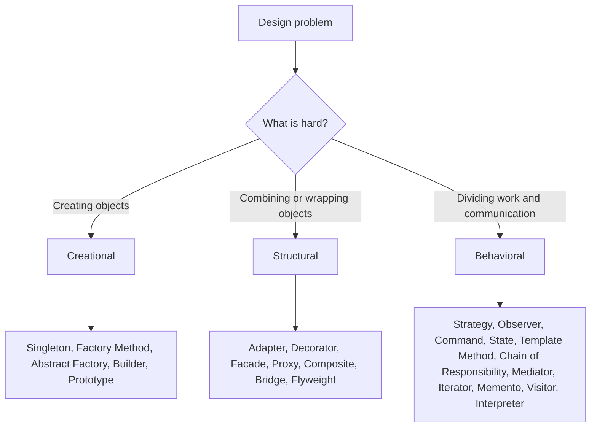
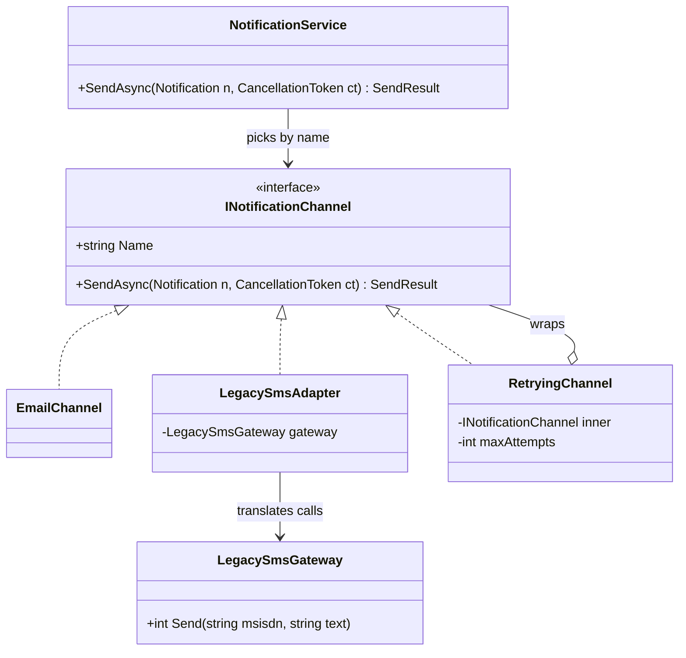
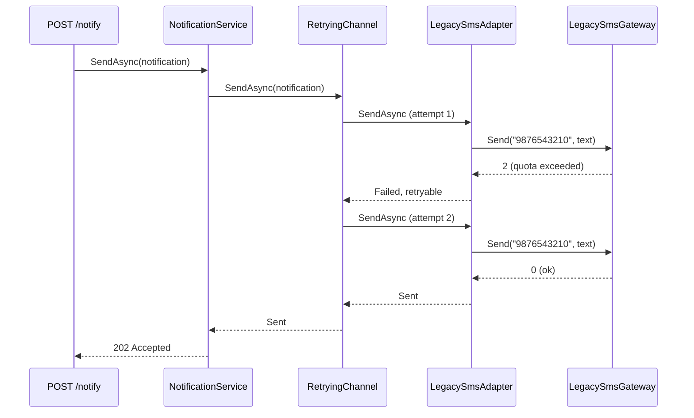
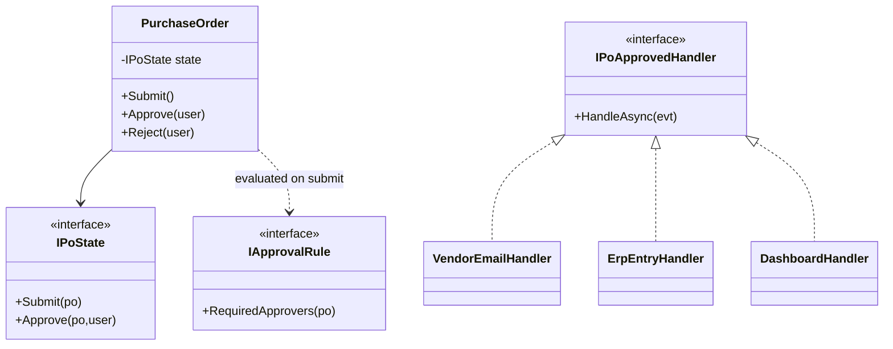

This module covers every classic pattern from the 1994 "Gang of Four" book, plus the patterns modern .NET teams use every day (Repository, Options, Result, Pipeline, Specification). This first lesson is the map. It teaches you *how* to learn patterns, so the next 30 lessons feel like variations on one idea instead of 30 things to memorise.

## Learning objectives

By the end of this lesson you will be able to:

1. Explain in one sentence what a design pattern is, and what it is *not*.
2. Describe where the classic catalogue came from and why it still matters in 2026.
3. Sort a design problem into the right family: creational, structural or behavioral.
4. Read any pattern description using a fixed checklist: intent, problem, participants, structure, consequences.
5. Tell a pattern apart from a principle (SOLID) and from an idiom (`using`, `async/await`).
6. Spot at least ten patterns that already live inside the .NET base class library and ASP.NET Core.
7. Decide when *not* to use a pattern, which is the most valuable skill of all.

## Prerequisites

- [Interfaces and abstract classes](#/lesson/m01-interfaces-abstract): almost every pattern is built from an interface plus a few classes.
- [The four pillars of OOP](#/lesson/m01-oop-pillars): polymorphism (one call, many behaviors) is the engine behind most patterns.
- [Open/Closed Principle](#/lesson/m04-ocp): many patterns are ways to follow it.
- [Class diagrams](#/lesson/m05-class-diagrams): every pattern lesson includes one.

## Explain it like I'm a beginner

Think about how houses are built in an Indian city. No two houses are the same, yet every good architect reuses the same small ideas: a verandah to keep the sun off the front wall, a courtyard to pull air through the house, a staircase near the entrance so upstairs tenants don't walk through the family's living room.

Nobody hands the architect a ready-made verandah. They hand over an *idea*: "when the afternoon sun heats the front wall, put a shaded space in front of it". The architect then builds a verandah that fits this plot, this budget and this family.

A design pattern in software is the same thing. It is a **named, reusable idea for a problem that keeps coming back**. It is not a library you download. You still write the code yourself, shaped to your program.

Three examples you will meet in this module:

- **"I need several ways to do one job, and I want to pick one at runtime."** Put each way in its own class behind a shared interface. That idea is called *Strategy*.
- **"I want to add logging to a class without editing it."** Wrap it in another class that has the same interface, does the extra work, then passes the call through. That idea is called *Decorator*.
- **"An old SMS library has an ugly method signature, and the rest of my code expects a clean one."** Write a small translator class between them. That idea is called *Adapter*.

The names matter as much as the ideas. When a teammate says "put a decorator around the file store", everyone on the team knows the shape of the code in four words. Patterns are a **shared vocabulary**.

## First-principles explanation

### What a pattern is

A design pattern is a description of a recurring design problem, the core of a solution, and the consequences of using it. The authors of the classic book put it this way: each pattern has four essential elements, a **name**, a **problem**, a **solution** and its **consequences**. Notice that "consequences" is one of the four. A pattern always has a cost, and a description that hides the cost is marketing, not engineering.

### Where the catalogue came from

- **1977.** The architect Christopher Alexander published *A Pattern Language*, 253 patterns for towns and buildings, such as "light on two sides of every room". The idea was that good design can be written down as a network of named, connected solutions.
- **1987.** Kent Beck and Ward Cunningham presented a small set of patterns for user-interface code at the OOPSLA conference, borrowing Alexander's idea for software.
- **1994.** Erich Gamma, Richard Helm, Ralph Johnson and John Vlissides published *Design Patterns: Elements of Reusable Object-Oriented Software*. People call them the "Gang of Four" (GoF). The book catalogues **23 patterns**, with examples in C++ and Smalltalk.
- **2002.** Martin Fowler's *Patterns of Enterprise Application Architecture* added patterns for business applications with databases: Repository, Unit of Work, Data Mapper, Service Layer and others.
- **Since then.** Languages absorbed many patterns. C# has `IEnumerable<T>` and `yield` (Iterator built in), `event` (Observer built in), delegates (one-method Strategy built in) and a dependency injection container in every ASP.NET Core app.

So why learn a 30-year-old catalogue? Because the *problems* haven't changed. Code still needs to create objects without hard-wiring their types, wrap objects to add behavior, and vary algorithms at runtime. The C++ code in the book has aged. The ideas haven't.

### The three families

The GoF grouped the 23 patterns by *what kind of problem* they solve.

| Family | Question it answers | Count | Members |
|---|---|---|---|
| **Creational** | How do objects get *made*, without the caller hard-wiring concrete classes? | 5 | Singleton, Factory Method, Abstract Factory, Builder, Prototype |
| **Structural** | How are objects *combined* or *wrapped* to form bigger structures? | 7 | Adapter, Bridge, Composite, Decorator, Facade, Flyweight, Proxy |
| **Behavioral** | How do objects *share work and talk* to each other? | 11 | Chain of Responsibility, Command, Interpreter, Iterator, Mediator, Memento, Observer, State, Strategy, Template Method, Visitor |

A quick way to remember: creational is about **`new`**, structural is about **references between objects**, behavioral is about **method calls between objects**.

### How to read a pattern (the checklist)

Use the same six questions for every pattern in this module. If you can answer all six, you understand the pattern.

1. **Intent.** One sentence: what does it do?
2. **Problem.** What pain shows up in code *without* it? Look for a concrete smell: a growing `switch`, `new` scattered everywhere, copy-pasted wrapping logic.
3. **Participants.** Which roles exist (for example *context*, *strategy*, *concrete strategy*), and what is each one responsible for?
4. **Structure.** The class diagram: who depends on whom, and which arrows point at interfaces.
5. **Collaboration.** The sequence diagram: who calls whom, in which order, at runtime.
6. **Consequences.** What you gain, what you pay, and when a simpler option wins.

Every pattern lesson in this module follows that order. Read the *problem* before the *solution*, always. A pattern you learned solution-first becomes a hammer looking for nails.

### Pattern vs principle vs idiom

These three words get mixed up. They live at different levels.

| | What it is | Size | Example |
|---|---|---|---|
| **Principle** | A rule of thumb about *good design in general*. It tells you what to aim for, not what to build. | No fixed shape | Open/Closed Principle, Dependency Inversion, "favour composition over inheritance" |
| **Pattern** | A *named structure of a few classes* that solves one recurring problem. It shows you one way to meet a principle. | 2–6 roles | Strategy, Decorator, Builder |
| **Idiom** | A *language-specific* habit for a small, local problem. | A few lines | `using` for disposal, `async/await`, `TryParse` with `out`, the `IDisposable` pattern |

A principle says "code should be open for extension and closed for modification". Strategy and Decorator are two patterns that achieve it. `await using var conn = ...` is a C# idiom that has nothing to do with object design and everything to do with cleaning up resources.

Above patterns sit **architectural styles** (layered, hexagonal, microservices), covered in [Module 2](#/lesson/m02-what-is-architecture). Below idioms sit **algorithms** (binary search, hashing). Keep the levels apart and you'll stop arguing about whether "microservices is a design pattern".

### Why patterns help, concretely

- **Shared vocabulary.** "This is a Chain of Responsibility" replaces a 10-minute whiteboard explanation.
- **Proven trade-offs.** Someone has already found the failure modes. For example: Singleton makes unit tests share hidden state, and Decorator stacks get hard to debug past 4–5 layers.
- **Faster code reading.** Once you know Builder, `WebApplication.CreateBuilder(args)` stops being magic.

### How patterns go wrong

- **Pattern fever.** Someone applies Abstract Factory + Builder + Strategy to a feature with two variants that never change. The result has 9 files where 1 would do. See [overengineering](#/lesson/m04-over-under-engineering) and [anti-patterns](#/lesson/m06-anti-patterns).
- **Name-dropping.** A class called `PaymentStrategyFactoryManager` doesn't make the design better. Name classes after what they *do* in the domain; mention the pattern in a comment or the pull request if it helps.
- **Copying the book's shape literally.** The GoF Singleton is a private constructor and a static field. In ASP.NET Core you almost always want `AddSingleton` in the DI container instead. Patterns adapt to the language and framework.

### The catalogue map for this module

Use this as your table of contents. Every link opens the lesson.

**Creational: how objects get made**
- [Singleton](#/lesson/m06-singleton): exactly one shared instance, and why DI does it better.
- [Factory Method](#/lesson/m06-factory-method): let a subclass or a registered function decide which class to create.
- [Abstract Factory](#/lesson/m06-abstract-factory): create *families* of related objects that must match.
- [Builder](#/lesson/m06-builder): build a complex object step by step, validated at the end.
- [Prototype](#/lesson/m06-prototype): create new objects by copying an existing one.
- [Object Pool](#/lesson/m06-object-pool): reuse expensive objects (`ArrayPool<T>`, `ObjectPool<T>`).

**Structural: how objects are wrapped and combined**
- [Adapter](#/lesson/m06-adapter): translate one interface into another.
- [Decorator](#/lesson/m06-decorator): add behavior by wrapping, keeping the same interface.
- [Facade](#/lesson/m06-facade): one simple entry point over a complicated subsystem.
- [Proxy](#/lesson/m06-proxy): a stand-in that controls access (lazy, caching, security).
- [Composite](#/lesson/m06-composite): treat a tree of objects like a single object.
- [Bridge](#/lesson/m06-bridge): split two independent dimensions of variation.
- [Flyweight](#/lesson/m06-flyweight): share small immutable objects to save memory.

**Behavioral: how objects share work**
- [Strategy](#/lesson/m06-strategy): swap algorithms behind one interface.
- [Observer](#/lesson/m06-observer): notify many listeners when something happens.
- [Command](#/lesson/m06-command): turn a request into an object you can queue, log or undo.
- [State](#/lesson/m06-state): behavior changes as an object moves through its lifecycle.
- [Template Method](#/lesson/m06-template-method): fixed steps, customisable parts.
- [Chain of Responsibility](#/lesson/m06-chain-of-responsibility): pass a request along handlers, like middleware.
- [Mediator](#/lesson/m06-mediator): objects talk through a hub instead of to each other.
- [Iterator](#/lesson/m06-iterator): walk a collection without knowing its insides.
- [Memento](#/lesson/m06-memento): save and restore snapshots.
- [Visitor](#/lesson/m06-visitor): add operations to a class hierarchy without editing it.
- [Interpreter](#/lesson/m06-interpreter): evaluate sentences in a small language.

**Enterprise and modern .NET patterns**
- [Specification](#/lesson/m06-specification), [Repository and Unit of Work](#/lesson/m06-repository-uow), [Null Object](#/lesson/m06-null-object), [Dependency Injection as a pattern](#/lesson/m06-dependency-injection-pattern), [Options and Result](#/lesson/m06-options-result), [Pipeline and middleware](#/lesson/m06-pipeline).

**Putting it together**
- [Choosing between similar patterns](#/lesson/m06-pattern-comparison) and [Anti-patterns](#/lesson/m06-anti-patterns).

A sensible order for a beginner: Strategy → Factory Method → Decorator → Adapter → Facade → Builder → Singleton → Observer → Template Method → Chain of Responsibility. Those ten cover most of what you will see in a typical ASP.NET Core codebase.

## Visual explanation

### The catalogue at a glance



Read it top to bottom. You start from a *problem*, never from a pattern name. The first question is "what is the hard part here?" If the pain is about `new` (which concrete class, how many, in what order), look in the creational family. If it is about *fitting objects together* (wrong interface, needs extra behavior, too many objects to talk to), look in structural. If it is about *who does what and who tells whom*, look in behavioral. Only then pick a specific member.

### Several patterns in one small feature

Real code rarely uses one pattern alone. Here is the notification feature we build in the implementation section, drawn as a class diagram.



Four patterns hide in this diagram:

- `INotificationChannel` with `EmailChannel` and `LegacySmsAdapter` is **Strategy**: one interface, several interchangeable ways of sending.
- `LegacySmsAdapter` is also an **Adapter**: it makes an old SDK with a `Send(string, string) → int` signature look like `INotificationChannel`.
- `RetryingChannel` is a **Decorator**: it implements the same interface *and* holds another channel. That "implements and wraps the same type" shape (the hollow-diamond arrow back to the interface) is the visual signature of Decorator.
- `NotificationService` is a small **Facade**: callers get one method and never see channels, retries or the SDK.

### The runtime flow



The sequence diagram shows *collaboration*, the fifth question on the checklist. The facade knows nothing about retries. The decorator knows nothing about SMS. The adapter knows nothing about retries. Each class does one job, and the call passes through them like a parcel through sorting centres. When you read unfamiliar code, drawing this kind of diagram for one request is often the fastest way to discover which patterns it uses.

## Step-by-step example

Let's learn to *recognise* patterns, which is a different skill from *applying* them. Here is a process you can use on any codebase.

### Step 1 — find the variation point

Ask: "what changes here, and what stays the same?" In the notification feature, the *message* stays the same, while the *delivery channel* and the *reliability policy* change. Every place where something varies is a candidate for a pattern.

### Step 2 — look for the structural signature

Patterns leave fingerprints in code:

| Fingerprint | Likely pattern |
|---|---|
| A class implements `IFoo` **and** takes an `IFoo` in its constructor | Decorator (or Proxy, if it controls access rather than adding behavior) |
| A class implements `IFoo` and holds a *different*, unrelated type | Adapter |
| A method returns an interface and contains `new ConcreteX()` chosen by a parameter or subclass | Factory Method (or a simple factory) |
| Chained calls that each return the builder, ending in `.Build()` | Builder |
| `IEnumerable<IFoo>` injected, then the class picks one or loops over them | Strategy (picking) or Chain/Composite (looping) |
| A `Func<HttpContext, Task>` called "next" | Chain of Responsibility (middleware pipeline) |
| A `private` constructor and a `static Instance` | Singleton |

### Step 3 — confirm with intent

Shape alone can mislead. Decorator and Proxy have the same class diagram. Strategy and State have the same class diagram. The deciding question is *intent*: why does this wrapper exist? Adding behavior (logging, retry) points to Decorator. Controlling access (lazy loading, permission checks, caching) points to Proxy. The [pattern comparison lesson](#/lesson/m06-pattern-comparison) collects these look-alikes.

### Step 4 — check it in the .NET library

You already use dozens of patterns. Some from the BCL and ASP.NET Core:

| You write | Pattern inside |
|---|---|
| `foreach (var x in list)`, `yield return` | Iterator (`IEnumerable<T>`/`IEnumerator<T>`) |
| `new GZipStream(fileStream, CompressionLevel.Optimal)` | Decorator: a `Stream` wrapping a `Stream` |
| `WebApplication.CreateBuilder(args)`, `new StringBuilder()`, `new UriBuilder()` | Builder |
| `app.Use(async (ctx, next) => { ...; await next(ctx); })` | Chain of Responsibility (middleware pipeline) |
| `list.Sort(comparer)` with an `IComparer<T>` | Strategy |
| `IHttpClientFactory.CreateClient("payments")`, `ILoggerFactory.CreateLogger<T>()` | Factory |
| `DbProviderFactory.CreateConnection()` / `CreateCommand()` | Abstract Factory |
| `event EventHandler`, `IObservable<T>` | Observer |
| `ArrayPool<byte>.Shared.Rent(4096)` | Object Pool |
| `Array.Empty<T>()`, `TimeProvider.System` | Shared single instances (Singleton/Flyweight flavour) |
| `ExpressionVisitor` over an `Expression` tree | Visitor (and Interpreter, when you evaluate the tree) |
| `services.AddSingleton<IFoo, Foo>()` | Dependency Injection, with singleton lifetime |
| `DispatchProxy.Create<T, TProxy>()` | Proxy |
| `record` with a `with` expression | Prototype (copy and change) |

When you study a pattern, find its .NET example and read the official docs for it. Seeing a pattern in code written by the platform team teaches you its practical shape far better than a textbook diagram.

### Step 5 — ask whether it earns its place

A pattern is justified when the variation is *real* (it exists today or is planned), the alternative is clearly worse, and the team can read the result. If the honest answer is "we might need it someday", that's speculation, and a plain `if` is better today.

## Production-style C# implementation

Here is the notification feature from the diagrams. It is deliberately small, so you can see four patterns cooperate without any one of them dominating. Each type has a comment naming its role.

```text
Notify.Api/
  Program.cs
  Notifications/
    Notification.cs
    INotificationChannel.cs
    EmailChannel.cs
    LegacySmsGateway.cs
    LegacySmsAdapter.cs
    RetryingChannel.cs
    NotificationService.cs
```

```csharp file=Notifications/Notification.cs
namespace Notify.Notifications;

public sealed record Notification(string Channel, string Recipient, string Subject, string Body);

public enum SendStatus { Sent, FailedRetryable, FailedPermanent }

public sealed record SendResult(SendStatus Status, string? Error = null)
{
    public static readonly SendResult Ok = new(SendStatus.Sent);
}
```

```csharp file=Notifications/INotificationChannel.cs
namespace Notify.Notifications;

/// <summary>Strategy interface: one way of delivering a notification.</summary>
public interface INotificationChannel
{
    string Name { get; }
    Task<SendResult> SendAsync(Notification notification, CancellationToken ct);
}
```

```csharp file=Notifications/EmailChannel.cs
using Microsoft.Extensions.Logging;

namespace Notify.Notifications;

/// <summary>Concrete strategy. A real one would call an SMTP server or an email API.</summary>
public sealed class EmailChannel(ILogger<EmailChannel> logger) : INotificationChannel
{
    public string Name => "email";

    public Task<SendResult> SendAsync(Notification n, CancellationToken ct)
    {
        if (!n.Recipient.Contains('@'))
            return Task.FromResult(new SendResult(SendStatus.FailedPermanent, "Invalid email address."));
        logger.LogInformation("Email to {Recipient}: {Subject}", n.Recipient, n.Subject);
        return Task.FromResult(SendResult.Ok);
    }
}
```

```csharp file=Notifications/LegacySmsGateway.cs
namespace Notify.Notifications;

/// <summary>Stands in for an old vendor SDK we cannot change.
/// Returns 0 = ok, 1 = invalid number, 2 = quota exceeded (try later).</summary>
public class LegacySmsGateway
{
    public virtual int Send(string msisdn, string text) => msisdn.Length == 10 ? 0 : 1;
}
```

```csharp file=Notifications/LegacySmsAdapter.cs
namespace Notify.Notifications;

/// <summary>Adapter: makes the legacy SDK look like an INotificationChannel.</summary>
public sealed class LegacySmsAdapter(LegacySmsGateway gateway) : INotificationChannel
{
    public string Name => "sms";

    public Task<SendResult> SendAsync(Notification n, CancellationToken ct)
    {
        ct.ThrowIfCancellationRequested();
        var digits = new string(n.Recipient.Where(char.IsDigit).ToArray());
        if (digits.Length == 12 && digits.StartsWith("91")) digits = digits[2..];   // +91 98765 43210 -> 9876543210

        var code = gateway.Send(digits, $"{n.Subject}: {n.Body}");
        return Task.FromResult(code switch
        {
            0 => SendResult.Ok,
            1 => new SendResult(SendStatus.FailedPermanent, "Invalid mobile number."),
            2 => new SendResult(SendStatus.FailedRetryable, "SMS quota exceeded."),
            _ => new SendResult(SendStatus.FailedRetryable, $"Unknown gateway code {code}."),
        });
    }
}
```

```csharp file=Notifications/RetryingChannel.cs
using Microsoft.Extensions.Logging;

namespace Notify.Notifications;

/// <summary>Decorator: same interface as the channel it wraps, adds retries for retryable failures.</summary>
public sealed class RetryingChannel(INotificationChannel inner, int maxAttempts, TimeSpan delay,
    TimeProvider clock, ILogger<RetryingChannel> logger) : INotificationChannel
{
    public string Name => inner.Name;

    public async Task<SendResult> SendAsync(Notification n, CancellationToken ct)
    {
        SendResult result = new(SendStatus.FailedRetryable, "Not attempted.");
        for (var attempt = 1; attempt <= maxAttempts; attempt++)
        {
            result = await inner.SendAsync(n, ct);
            if (result.Status != SendStatus.FailedRetryable) return result;
            logger.LogWarning("{Channel} attempt {Attempt}/{Max} failed: {Error}", Name, attempt, maxAttempts, result.Error);
            if (attempt < maxAttempts) await Task.Delay(delay * attempt, clock, ct);   // linear back-off
        }
        return result;
    }
}
```

```csharp file=Notifications/NotificationService.cs
namespace Notify.Notifications;

/// <summary>Facade: the only type the rest of the app talks to.</summary>
public sealed class NotificationService(IEnumerable<INotificationChannel> channels)
{
    private readonly Dictionary<string, INotificationChannel> _byName =
        channels.ToDictionary(c => c.Name, StringComparer.OrdinalIgnoreCase);

    public Task<SendResult> SendAsync(Notification n, CancellationToken ct) =>
        _byName.TryGetValue(n.Channel, out var channel)
            ? channel.SendAsync(n, ct)
            : Task.FromResult(new SendResult(SendStatus.FailedPermanent, $"Unknown channel '{n.Channel}'."));
}
```

```csharp file=Program.cs
using Notify.Notifications;

var builder = WebApplication.CreateBuilder(args);   // Builder pattern, provided by the framework

builder.Services.AddSingleton(TimeProvider.System);
builder.Services.AddSingleton<LegacySmsGateway>();
builder.Services.AddSingleton<INotificationChannel, EmailChannel>();
// The decorator is composed by hand: Retry( Adapter( LegacySdk ) ).
builder.Services.AddSingleton<INotificationChannel>(sp => new RetryingChannel(
    new LegacySmsAdapter(sp.GetRequiredService<LegacySmsGateway>()),
    maxAttempts: 3, delay: TimeSpan.FromMilliseconds(200),
    sp.GetRequiredService<TimeProvider>(),
    sp.GetRequiredService<ILogger<RetryingChannel>>()));
builder.Services.AddSingleton<NotificationService>();

var app = builder.Build();

app.MapPost("/notify", async (Notification n, NotificationService notifications, CancellationToken ct) =>
{
    var result = await notifications.SendAsync(n, ct);
    return result.Status == SendStatus.Sent
        ? Results.Accepted()
        : Results.Problem(result.Error, statusCode: StatusCodes.Status422UnprocessableEntity);
});

app.Run();
```

Points to notice:

- **Every class is small and has one reason to change.** A new SMS vendor changes only the adapter. A new retry policy changes only the decorator.
- **The patterns compose through one interface.** That is typical: most structural and behavioral patterns are "interface plus wrapping or swapping".
- **The DI container is the glue.** In 1994 the GoF wrote factories by hand. Today `Program.cs` (the *composition root*) builds the object graph. See [Dependency Injection as a pattern](#/lesson/m06-dependency-injection-pattern).
- **Lifetimes matter.** All of these classes are stateless, so singletons are safe. If one needed a `DbContext`, the lifetime choice would change. That is a lesson of its own in [Singleton](#/lesson/m06-singleton).

## Bad design vs good design

**Bad: the same feature without patterns.**

```csharp
public async Task<IResult> Notify(Notification n)
{
    if (n.Channel == "email")
    {
        if (!n.Recipient.Contains('@')) return Results.BadRequest();
        // ... send email ...
    }
    else if (n.Channel == "sms")
    {
        var sdk = new LegacySmsGateway();
        var number = n.Recipient.Replace("+91", "").Replace(" ", "");
        for (int i = 0; i < 3; i++)
        {
            var code = sdk.Send(number, n.Subject + ": " + n.Body);
            if (code == 0) return Results.Accepted();
            if (code == 1) return Results.BadRequest();
            await Task.Delay(200 * (i + 1));
        }
        return Results.Problem();
    }
    return Results.BadRequest();
}
```

What goes wrong as the product grows:

- Adding WhatsApp means editing this method and re-testing email and SMS.
- The retry loop exists only for SMS. When email needs retries, someone copies the loop, and now there are two slightly different retry loops.
- The SDK is created with `new` inside the method, so no unit test can make it return "quota exceeded".
- `Task.Delay` uses the real clock, so a test of three failed attempts waits 1.2 seconds.

**Good:** the implementation above. Each concern is in one class, each class can be tested alone with a fake, and new channels or policies are additive.

**But be honest about cost.** If your app sends *only* email, will *never* send SMS, and has no retry requirement, the "bad" version reduced to its email branch is perfectly good code. Patterns pay off when there is real variation. Seven small files for one email call is overengineering.

:::callout type=mistake title="Learning patterns from the solution side"
A common trap is to learn the class diagram of each pattern and then look for places to use it. Learn the *problem* first. If you can't describe the pain a pattern removes in one sentence about your own code, you don't need it yet.
:::

## Practical playground

The program below contains three small patterns. Run it, then answer for yourself: which type is the Strategy, which is the Decorator, and which is the Adapter? Then try the TODO: add a "UPPERCASE" decorator and stack it on top of the existing one.

:::playground type=csharp title="Spot the patterns"
```csharp file=Program.cs
using System;
using System.Collections.Generic;

public interface IPriceFormatter { string Format(decimal amount); }

public sealed class RupeeFormatter : IPriceFormatter
{
    public string Format(decimal amount) => $"₹{amount:N2}";
}

public sealed class DollarFormatter : IPriceFormatter
{
    public string Format(decimal amount) => $"${amount:N2}";
}

// Wraps any formatter and adds a "(incl. GST)" suffix.
public sealed class GstLabelFormatter(IPriceFormatter inner) : IPriceFormatter
{
    public string Format(decimal amount) => inner.Format(amount) + " (incl. GST)";
}

// An old class with a different shape that we cannot change.
public sealed class OldCurrencyPrinter
{
    public string PrintPaise(long paise) => $"Rs. {paise / 100}.{paise % 100:D2}";
}

public sealed class OldPrinterFormatter(OldCurrencyPrinter old) : IPriceFormatter
{
    public string Format(decimal amount) => old.PrintPaise((long)Math.Round(amount * 100m));
}

public static class Program
{
    public static void Main()
    {
        var formatters = new List<IPriceFormatter>
        {
            new RupeeFormatter(),
            new DollarFormatter(),
            new GstLabelFormatter(new RupeeFormatter()),
            new OldPrinterFormatter(new OldCurrencyPrinter()),
        };
        foreach (var f in formatters)
            Console.WriteLine($"{f.GetType().Name,-22} {f.Format(1499.5m)}");

        // TODO: write an UppercaseFormatter decorator and print
        // new UppercaseFormatter(new GstLabelFormatter(new RupeeFormatter())).Format(99m)
    }
}
```
:::

Answer: `IPriceFormatter` with `RupeeFormatter`/`DollarFormatter` is Strategy. `GstLabelFormatter` is a Decorator (it implements *and* wraps `IPriceFormatter`). `OldPrinterFormatter` is an Adapter (it implements `IPriceFormatter` but wraps an unrelated type).

## Exercises

:::exercise id=m06-intro-patterns-ex1 difficulty=beginner kind=written title="Sort problems into families"
For each problem below, name the family (creational, structural or behavioral) and, if you can, a likely pattern. Write one sentence of reasoning for each.

1. A report must be created as PDF, Excel or CSV, and the export code shouldn't know which class it is creating.
2. A third-party GST-filing API returns XML, but your code works with C# records.
3. Every outgoing HTTP call should be logged and timed, without editing each client class.
4. A purchase order moves Draft → Submitted → Approved → Paid, and which actions are allowed depends on where it is.
5. An `Invoice` has 14 optional fields, and half the combinations are invalid.
6. When a payment succeeds, the email, loyalty-points and analytics modules must all react.
7. A video-upload service has six subsystems (storage, transcoding, thumbnails, CDN, metadata, billing), and the mobile team wants one simple call.
8. User actions in a drawing editor must be undoable.
::acceptance
- Each item has a family and a one-sentence reason based on *what is hard* (creating, combining or communicating).
- At least six of eight families are correct.
- Pattern names are offered as "likely", not as the only answer.
::hint
Ask "what is the hard part?" for each problem: making the object, fitting objects together, or coordinating behavior?
::hint
Words like "create", "build" and "which class" point to creational. "Wrap", "translate" and "simplify" point to structural. "React", "moves through", "undo" and "choose an algorithm" point to behavioral.
::hint
Item 5 is about *making* a complicated object correctly. Item 7 is about *hiding* complexity behind one entry point.
::hint
Use the catalogue map in this lesson and match each problem to the one-line description of a pattern.
::solution
1. **Creational**, Factory Method (or Abstract Factory if each format also needs matching parts). The problem is *which class to instantiate*.
2. **Structural**, Adapter. Two interfaces don't fit, so translate between them.
3. **Structural**, Decorator (in .NET, a `DelegatingHandler` for `HttpClient`). Add behavior by wrapping.
4. **Behavioral**, State. Behavior depends on the object's lifecycle position.
5. **Creational**, Builder. Assemble step by step and validate once in `Build()`.
6. **Behavioral**, Observer (or domain events with a mediator). One event, many independent reactions.
7. **Structural**, Facade. One simple interface over many subsystems.
8. **Behavioral**, Command (each action is an object with `Execute`/`Undo`), often with Memento for snapshots.
::mistakes
- Answering with a pattern name but no family or reason. The reasoning is the skill being practised.
- Calling item 3 "Proxy". The intent is adding behavior (logging), which makes it Decorator. A Proxy controls access.
- Calling item 4 "Strategy". The variation is driven by the object's own lifecycle, which is the signature of State.
:::

:::exercise id=m06-intro-patterns-ex2 difficulty=beginner kind=code title="Add logging to a file store without editing it"
You have an `IFileStore` interface and an `InMemoryFileStore`. Operations wants every save and read logged, but the store class belongs to another team and you may not edit it. Write `LoggingFileStore`, which wraps any `IFileStore`, records a log line for each call, and passes the call through.
::requirements
- `SaveAsync` logs `SAVE <path> <n> bytes` and then delegates.
- `ReadAsync` logs `READ <path> hit` when the file exists and `READ <path> miss` when it returns `null`.
- The log goes to the `List<string> Log` passed into the constructor (a real app would use `ILogger`).
::acceptance
- Saving 3 bytes to `a.txt` adds `SAVE a.txt 3 bytes` and the inner store really contains the file.
- Reading an existing file returns its bytes and logs `hit`.
- Reading a missing file returns `null` and logs `miss`.
- `InMemoryFileStore` is unchanged.
::hint
You can't edit the class, but you can *wrap* it. What does the wrapper need to look like so callers can't tell the difference?
::hint
`LoggingFileStore` implements `IFileStore` **and** takes an `IFileStore` in its constructor. That shape is the Decorator pattern.
::hint
In each method: write the log line, then `await` the inner call (or call first, then log, for reads where you need the result).
::hint
```csharp
public async Task<byte[]?> ReadAsync(string path, CancellationToken ct)
{
    var data = await inner.ReadAsync(path, ct);
    log.Add($"READ {path} {(data is null ? "miss" : "hit")}");
    return data;
}
```
::starter
```csharp file=FileStores.cs
using System;
using System.Collections.Concurrent;
using System.Collections.Generic;
using System.Threading;
using System.Threading.Tasks;

public interface IFileStore
{
    Task SaveAsync(string path, byte[] content, CancellationToken ct);
    Task<byte[]?> ReadAsync(string path, CancellationToken ct);
}

public sealed class InMemoryFileStore : IFileStore
{
    private readonly ConcurrentDictionary<string, byte[]> _files = new();
    public Task SaveAsync(string path, byte[] content, CancellationToken ct) { _files[path] = content; return Task.CompletedTask; }
    public Task<byte[]?> ReadAsync(string path, CancellationToken ct) =>
        Task.FromResult(_files.TryGetValue(path, out var c) ? c : null);
}

public sealed class LoggingFileStore : IFileStore
{
    public LoggingFileStore(IFileStore inner, List<string> log) { }
    public Task SaveAsync(string path, byte[] content, CancellationToken ct) => throw new NotImplementedException();
    public Task<byte[]?> ReadAsync(string path, CancellationToken ct) => throw new NotImplementedException();
}
```
::tests
```csharp file=LoggingFileStoreTests.cs
using System.Collections.Generic;
using System.Threading;
using System.Threading.Tasks;
using Xunit;

public class LoggingFileStoreTests
{
    [Fact]
    public async Task Save_logs_and_delegates()
    {
        var inner = new InMemoryFileStore();
        var log = new List<string>();
        var store = new LoggingFileStore(inner, log);
        await store.SaveAsync("a.txt", new byte[] { 1, 2, 3 }, CancellationToken.None);
        Assert.Equal("SAVE a.txt 3 bytes", Assert.Single(log));
        Assert.NotNull(await inner.ReadAsync("a.txt", CancellationToken.None));
    }

    [Fact]
    public async Task Read_hit_returns_bytes_and_logs_hit()
    {
        var inner = new InMemoryFileStore();
        await inner.SaveAsync("b.txt", new byte[] { 9 }, CancellationToken.None);
        var log = new List<string>();
        var data = await new LoggingFileStore(inner, log).ReadAsync("b.txt", CancellationToken.None);
        Assert.Equal(new byte[] { 9 }, data);
        Assert.Equal("READ b.txt hit", Assert.Single(log));
    }

    [Fact]
    public async Task Read_miss_returns_null_and_logs_miss()
    {
        var log = new List<string>();
        var data = await new LoggingFileStore(new InMemoryFileStore(), log).ReadAsync("nope.txt", CancellationToken.None);
        Assert.Null(data);
        Assert.Equal("READ nope.txt miss", Assert.Single(log));
    }
}
```
::solution
The wrapper has the same interface as what it wraps, so every caller that accepts an `IFileStore` accepts it. This is the Decorator pattern.

```csharp file=FileStores.cs
using System;
using System.Collections.Concurrent;
using System.Collections.Generic;
using System.Threading;
using System.Threading.Tasks;

public interface IFileStore
{
    Task SaveAsync(string path, byte[] content, CancellationToken ct);
    Task<byte[]?> ReadAsync(string path, CancellationToken ct);
}

public sealed class InMemoryFileStore : IFileStore
{
    private readonly ConcurrentDictionary<string, byte[]> _files = new();
    public Task SaveAsync(string path, byte[] content, CancellationToken ct) { _files[path] = content; return Task.CompletedTask; }
    public Task<byte[]?> ReadAsync(string path, CancellationToken ct) =>
        Task.FromResult(_files.TryGetValue(path, out var c) ? c : null);
}

public sealed class LoggingFileStore(IFileStore inner, List<string> log) : IFileStore
{
    public Task SaveAsync(string path, byte[] content, CancellationToken ct)
    {
        log.Add($"SAVE {path} {content.Length} bytes");
        return inner.SaveAsync(path, content, ct);
    }

    public async Task<byte[]?> ReadAsync(string path, CancellationToken ct)
    {
        var data = await inner.ReadAsync(path, ct);
        log.Add($"READ {path} {(data is null ? "miss" : "hit")}");
        return data;
    }
}
```

In production you would inject `ILogger<LoggingFileStore>` instead of a list, and register the decorator in DI so that `IFileStore` resolves to `LoggingFileStore(InMemoryFileStore)`.
::mistakes
- Inheriting from `InMemoryFileStore` instead of wrapping `IFileStore`. Inheritance ties the logger to one implementation; wrapping works for any store.
- Logging `hit` before knowing the result.
- Forgetting to delegate, so the log is written but the file is never saved.
::extensions
Add a second decorator, `TimingFileStore`, that records elapsed milliseconds using a `Stopwatch`. Stack both and check the order of log lines.
:::

:::exercise id=m06-intro-patterns-ex3 difficulty=intermediate kind=written title="Identify the patterns in real .NET code"
Name the pattern (or patterns) in each snippet and explain the evidence in one or two sentences.

```csharp
// A
var handler = new HttpClientHandler();
var client = new HttpClient(new AuthHeaderHandler { InnerHandler = new LoggingHandler { InnerHandler = handler } });

// B
var host = Host.CreateApplicationBuilder(args);
host.Services.AddHostedService<Worker>();
host.Build().Run();

// C
app.Use(async (ctx, next) => { if (!ctx.Request.Headers.ContainsKey("X-Tenant")) { ctx.Response.StatusCode = 400; return; } await next(ctx); });

// D
IEnumerable<int> Evens() { for (var i = 0; ; i += 2) yield return i; }

// E
DbProviderFactory f = NpgsqlFactory.Instance;
using var conn = f.CreateConnection(); using var cmd = f.CreateCommand();

// F
orders.Sort(Comparer<Order>.Create((a, b) => b.Total.CompareTo(a.Total)));
```
::acceptance
- Each snippet has at least one correct pattern name.
- Each answer cites concrete evidence from the code (a type, a method or a shape).
- Snippet E mentions both the factory family and the shared instance.
::hint
Look for the fingerprints table in the step-by-step section: "implements and wraps the same type", "returns the builder", "calls next".
::hint
In A, what type is `InnerHandler`, and what type is the outer handler?
::hint
In E, `CreateConnection` and `CreateCommand` come from the *same* object. Why might that matter?
::hint
In C, the delegate can stop the request (return) or pass it on (`await next`). Which pattern lets each handler decide that?
::solution
- **A: Decorator** (in .NET terms, a chain of `DelegatingHandler`s). Each handler *is* an `HttpMessageHandler` and wraps another `HttpMessageHandler`, adding behavior (auth header, logging).
- **B: Builder.** `CreateApplicationBuilder` returns a builder you configure step by step; `Build()` produces the immutable host.
- **C: Chain of Responsibility.** Each middleware either handles the request (here, rejecting it with 400) or passes it to `next`.
- **D: Iterator.** `yield return` makes the compiler generate an `IEnumerator<int>` state machine. Callers walk the sequence lazily without knowing how it's produced.
- **E: Abstract Factory** plus a **Singleton-style shared instance**. One factory creates a *family* of matching ADO.NET objects (connection, command, parameter) for one database. `NpgsqlFactory.Instance` is a single shared factory object.
- **F: Strategy.** The comparison algorithm is passed in as an `IComparer<Order>`, so `Sort` stays the same while the ordering rule varies.
::mistakes
- Calling A "Chain of Responsibility". Handlers can short-circuit, so it has some of that flavour, but the defining shape is wrapping objects of the same type to add behavior.
- Missing that `Comparer<T>.Create` turns a lambda into a strategy object.
:::

:::exercise id=m06-intro-patterns-ex4 difficulty=intermediate kind=code title="Adapt a legacy SMS SDK"
A vendor SDK has this method: `int Send(string msisdn, string text)`. It wants a 10-digit Indian mobile number with no country code, and returns 0 (ok), 1 (invalid number) or 2 (quota exceeded). Your app expects `INotificationSender.SendAsync(string phone, string message)` returning a `DeliveryResult`. Write `VendorSmsAdapter`.
::requirements
- Accept phone numbers like `+91 98765 43210`, `09876543210` and `9876543210`, and pass `9876543210` to the SDK.
- Map 0 → `Delivered`, 1 → `Rejected`, 2 → `RetryLater`, any other code → `RetryLater`.
- Numbers that don't reduce to 10 digits are `Rejected` without calling the SDK.
::acceptance
- All three input formats reach the SDK as `9876543210`.
- Code 2 maps to `RetryLater`.
- `12345` returns `Rejected` and the SDK is never called.
::hint
Which class must change shape: the SDK or your interface? Neither. A third class sits between them.
::hint
The adapter implements `INotificationSender` and holds a `VendorSmsSdk`.
::hint
Normalise first: keep only digits; if 12 digits starting with `91`, drop the `91`; if 11 digits starting with `0`, drop the `0`.
::hint
Use a `switch` expression for the code mapping, with `_ => DeliveryStatus.RetryLater` as the default.
::starter
```csharp file=SmsAdapter.cs
using System;
using System.Linq;
using System.Threading.Tasks;

public enum DeliveryStatus { Delivered, Rejected, RetryLater }
public sealed record DeliveryResult(DeliveryStatus Status);

public interface INotificationSender
{
    Task<DeliveryResult> SendAsync(string phone, string message);
}

/// <summary>The vendor's SDK. Virtual so tests can fake it.</summary>
public class VendorSmsSdk
{
    public virtual int Send(string msisdn, string text) => 0;
}

public sealed class VendorSmsAdapter : INotificationSender
{
    public VendorSmsAdapter(VendorSmsSdk sdk) { }
    public Task<DeliveryResult> SendAsync(string phone, string message) => throw new NotImplementedException();
}
```
::tests
```csharp file=VendorSmsAdapterTests.cs
using System.Collections.Generic;
using System.Threading.Tasks;
using Xunit;

public class VendorSmsAdapterTests
{
    private sealed class FakeSdk(int code) : VendorSmsSdk
    {
        public List<string> Numbers { get; } = new();
        public override int Send(string msisdn, string text) { Numbers.Add(msisdn); return code; }
    }

    [Theory]
    [InlineData("+91 98765 43210")]
    [InlineData("09876543210")]
    [InlineData("9876543210")]
    public async Task Normalises_numbers(string input)
    {
        var sdk = new FakeSdk(0);
        var result = await new VendorSmsAdapter(sdk).SendAsync(input, "hi");
        Assert.Equal("9876543210", Assert.Single(sdk.Numbers));
        Assert.Equal(DeliveryStatus.Delivered, result.Status);
    }

    [Fact]
    public async Task Quota_maps_to_retry_later() =>
        Assert.Equal(DeliveryStatus.RetryLater, (await new VendorSmsAdapter(new FakeSdk(2)).SendAsync("9876543210", "x")).Status);

    [Fact]
    public async Task Invalid_code_maps_to_rejected() =>
        Assert.Equal(DeliveryStatus.Rejected, (await new VendorSmsAdapter(new FakeSdk(1)).SendAsync("9876543210", "x")).Status);

    [Fact]
    public async Task Short_number_rejected_without_calling_sdk()
    {
        var sdk = new FakeSdk(0);
        var result = await new VendorSmsAdapter(sdk).SendAsync("12345", "x");
        Assert.Equal(DeliveryStatus.Rejected, result.Status);
        Assert.Empty(sdk.Numbers);
    }
}
```
::solution
```csharp file=SmsAdapter.cs
using System;
using System.Linq;
using System.Threading.Tasks;

public enum DeliveryStatus { Delivered, Rejected, RetryLater }
public sealed record DeliveryResult(DeliveryStatus Status);

public interface INotificationSender
{
    Task<DeliveryResult> SendAsync(string phone, string message);
}

public class VendorSmsSdk
{
    public virtual int Send(string msisdn, string text) => 0;
}

public sealed class VendorSmsAdapter(VendorSmsSdk sdk) : INotificationSender
{
    public Task<DeliveryResult> SendAsync(string phone, string message)
    {
        var msisdn = Normalise(phone);
        if (msisdn is null) return Task.FromResult(new DeliveryResult(DeliveryStatus.Rejected));

        var status = sdk.Send(msisdn, message) switch
        {
            0 => DeliveryStatus.Delivered,
            1 => DeliveryStatus.Rejected,
            _ => DeliveryStatus.RetryLater,   // 2 = quota, unknown codes are treated as transient
        };
        return Task.FromResult(new DeliveryResult(status));
    }

    private static string? Normalise(string phone)
    {
        var digits = new string(phone.Where(char.IsDigit).ToArray());
        if (digits.Length == 12 && digits.StartsWith("91")) digits = digits[2..];
        else if (digits.Length == 11 && digits.StartsWith('0')) digits = digits[1..];
        return digits.Length == 10 ? digits : null;
    }
}
```

All vendor-specific knowledge (number format, error codes) lives in one class. If you switch vendors, you write a new adapter and change one DI registration.
::alternatives
If the SDK were async and threw exceptions instead of returning codes, the adapter would catch the vendor's exception types and map them. Callers should never see vendor exception types; that is part of what the adapter hides.
::mistakes
- Letting vendor codes (`0`, `1`, `2`) leak into the rest of the app.
- Treating unknown codes as success.
- Calling the SDK with an invalid number and relying on it to reject it, which wastes a paid API call.
:::

:::exercise id=m06-intro-patterns-ex5 difficulty=advanced kind=design title="Choose patterns for an approval workflow (and reject some)"
Your team is building purchase-order approvals for an infrastructure company. Requirements:

- A PO under ₹50,000 needs the project manager. ₹50,000–₹5,00,000 adds the finance head. Above ₹5,00,000 adds a director.
- Thresholds differ per business unit and change once or twice a year.
- When a PO is approved, three things happen: an email to the vendor, an entry in the ERP, and a dashboard update.
- A PO moves Draft → Submitted → Approved/Rejected → Closed, and only some actions are allowed in each state.
- A junior colleague proposes Abstract Factory for creating POs, a Singleton `ApprovalManager`, and Visitor for reports.

Produce a short design note: which patterns you would use, where, and why; which of the colleague's proposals you would reject, and why. Include a class diagram of the core.
::acceptance
- At least three patterns placed on specific requirements, each with a reason.
- Each of the colleague's three proposals is accepted or rejected with a reason.
- Thresholds are treated as data (configuration), not as one class per amount.
- The note names at least one simpler alternative you considered.
::hint
Split the requirements into: who must approve (rules), what happens after approval (reactions), and what is allowed when (lifecycle).
::hint
Lifecycle with allowed actions per stage → State. Several independent reactions to one event → Observer or domain events. A chain of approvers each deciding "mine or pass on" → Chain of Responsibility.
::hint
Thresholds that change by business unit are *data*. A rule object reads them from configuration; you don't need a class per amount.
::hint
For each of the colleague's proposals, ask: what problem does it solve here? Is there more than one *family* of POs? Is there shared mutable state that needs one instance? Is there a stable class hierarchy with many operations?
::hint
Core diagram: `PurchaseOrder` with a `IPoState` field; `IApprovalRule` list built from options; `IPoApprovedHandler` implementations for email, ERP and dashboard.
::solution
**Design note (model answer)**

| Requirement | Pattern | Why |
|---|---|---|
| Lifecycle Draft → … → Closed | **State** (or an explicit transition table) | Allowed actions depend on the current stage; each state class rejects invalid actions. With only 5 states, a transition table inside `PurchaseOrder` is a valid simpler alternative. |
| Approvers by amount | **Chain of Responsibility** or a simple **rule list** | Each rule says "I add the finance head when amount ≥ threshold". Rules read thresholds from `IOptionsMonitor<ApprovalOptions>` per business unit. |
| Reactions after approval | **Observer** via domain events | Email, ERP and dashboard are independent; a failure in the dashboard update must not block the ERP entry. In production use an outbox so reactions survive restarts. |
| Building a complex PO in tests | **Builder** (test data builder) | Keeps tests short: `new PoBuilder().ForUnit("Roads").WithAmount(6_00_000m).Build()`. |



**Rejected proposals**

- **Abstract Factory for POs:** rejected. There is one kind of PO, not several families of matching objects. A constructor or a factory method on `PurchaseOrder` is enough.
- **Singleton `ApprovalManager`:** rejected. It would hold per-request state globally and make tests share state. Register stateless services as DI singletons and keep PO state in the database.
- **Visitor for reports:** rejected for now. Visitor pays off with a *stable* class hierarchy and *many* operations. Reports here are database queries; a SQL view or a query service is simpler.
::alternatives
A workflow engine (for example Elsa Workflows) is worth considering only if business users must design new approval flows themselves. For three fixed thresholds per unit, code plus configuration is cheaper to run and to debug.
::mistakes
- One class per threshold amount (`Above50kRule`, `Above5LakhRule`). Thresholds are data.
- Using Strategy for the lifecycle. The stage changes as the PO moves forward, which is State.
- Accepting every proposal because "patterns are good".
:::

## Automated testing

Patterns make code testable mainly because they create **seams**: places where a test can swap a real dependency for a fake. When you review a design, ask "where would I put the fake?" If there is no answer, the design is hard to test.

For the notification feature:

- **Adapter:** fake the SDK (`LegacySmsGateway` has a `virtual Send`, so a test subclass can return code 2) and assert the mapping.
- **Decorator:** wrap a fake channel that fails twice and then succeeds; assert three calls and a final `Sent`. Pass a fake `TimeProvider` so the test doesn't actually wait.
- **Facade:** give it two fake channels and assert it routes by name, and returns a permanent failure for an unknown channel.

```csharp
public class RetryingChannelTests
{
    private sealed class FlakyChannel(int failures) : INotificationChannel
    {
        public int Calls { get; private set; }
        public string Name => "fake";
        public Task<SendResult> SendAsync(Notification n, CancellationToken ct) =>
            Task.FromResult(++Calls <= failures ? new SendResult(SendStatus.FailedRetryable, "busy") : SendResult.Ok);
    }

    [Fact]
    public async Task Retries_until_success()
    {
        var inner = new FlakyChannel(failures: 2);
        var sut = new RetryingChannel(inner, 3, TimeSpan.Zero, TimeProvider.System, NullLogger<RetryingChannel>.Instance);
        var result = await sut.SendAsync(new Notification("fake", "x", "s", "b"), CancellationToken.None);
        Assert.Equal(SendStatus.Sent, result.Status);
        Assert.Equal(3, inner.Calls);
    }
}
```

Notice there is no mocking library. A hand-written fake of a one-method interface is about five lines and is easier to read than mock setup code. Small interfaces, which most patterns produce, make this possible.

## Real-world application

- **ASP.NET Core** is a pattern showcase: the middleware pipeline is Chain of Responsibility, `WebApplicationBuilder` is Builder, `IOptions<T>` is the Options pattern, authentication handlers are Strategies chosen by scheme, and `IHttpClientFactory` is a Factory that also pools handlers.
- **Payment platforms** typically adapt each bank or gateway API behind one interface (Adapter + Strategy) and add retries, idempotency and logging with wrappers (Decorator).
- **Infrastructure project-management systems** (progress tracking, RFIs, billing) often use State for document lifecycles, Observer or domain events for notifications, and Builder for complex monthly reports.
- **Libraries you use daily** follow them too: `Stream` decorators (`BufferedStream`, `GZipStream`, `CryptoStream`), LINQ (Iterator plus deferred execution), `ExpressionVisitor` (Visitor).

The lesson for your career: when you meet a new framework, look for these shapes first. They are the fastest route to understanding how it's put together.

## Interview questions

:::interview
::q beginner
What is a design pattern?
::a
A named, reusable solution to a recurring design problem, described with its trade-offs. It is a template for a design, not a library: you adapt it to your code. The classic description has four parts: name, problem, solution and consequences.
::q beginner
What are the three GoF categories? Give an example of each.
::a
**Creational** (how objects are created): Builder, Factory Method, Singleton. **Structural** (how objects are composed): Adapter, Decorator, Facade. **Behavioral** (how objects interact and share responsibility): Strategy, Observer, Command. There are 23 GoF patterns: 5 creational, 7 structural, 11 behavioral.
::q intermediate
What is the difference between a design principle and a design pattern?
::a
A principle is a general guideline for good design, such as Open/Closed or Dependency Inversion. It tells you what qualities to aim for. A pattern is a concrete, named structure of a few classes that solves one specific recurring problem, often as a way of following a principle. For example, Strategy and Decorator are two patterns that let you follow Open/Closed. An idiom is lower still: a language-specific habit such as `using` for disposal.
::q intermediate
Name some patterns that are built into .NET or ASP.NET Core.
::a
Iterator (`IEnumerable<T>`, `yield`), Observer (`event`, `IObservable<T>`), Decorator (`Stream` wrappers, `DelegatingHandler`), Builder (`StringBuilder`, `WebApplication.CreateBuilder`), Chain of Responsibility (middleware), Strategy (`IComparer<T>`, authentication handlers), Factory (`IHttpClientFactory`, `ILoggerFactory`), Abstract Factory (`DbProviderFactory`), Object Pool (`ArrayPool<T>`), Proxy (`DispatchProxy`), Visitor (`ExpressionVisitor`).
::q advanced
Patterns are sometimes called "missing language features". Do you agree? Give .NET examples.
::a
Partly. Several GoF patterns exist because C++ and Smalltalk lacked features that modern languages have. In C#: Iterator is a language feature (`yield`), Observer is `event`, a one-method Strategy is a delegate (`Func<T, TResult>`), Prototype is `record` + `with`, and Singleton is often replaced by a DI container lifetime. But the *design problem* remains: you still decide where variation lives and who owns which responsibility. Structural patterns like Adapter, Facade and Decorator, and architectural decisions like State versus a transition table, aren't removed by language features. So the "how" of many patterns shrank, but the "why" didn't.
::q advanced
How do you stop a team from overusing patterns?
::a
Make the *problem* the entry point: in design reviews, ask for the concrete variation or pain before accepting a pattern. Prefer the simplest thing that works (`if`, `switch`, a delegate) and refactor towards a pattern when a second or third variant actually arrives, guided by tests. Watch for signs of speculative generality: interfaces with one implementation and no test fake, factories that create one type, and class names stuffed with pattern words. Keep a team catalogue of the few patterns your codebase *actually* uses, with examples, so new joiners copy proven local shapes instead of textbook ones.
:::

## Summary and revision

**Key takeaways**

- A pattern is a named solution to a recurring problem, *including its consequences*. It is a design idea, not a library.
- The GoF catalogue (1994) has 23 patterns in three families: creational (5), structural (7), behavioral (11). Enterprise patterns (Fowler, 2002) and modern .NET patterns extend it.
- Read every pattern with the same checklist: intent, problem, participants, structure, collaboration, consequences.
- Principles say *what* good design looks like. Patterns are *one way* to get there. Idioms are language-level habits.
- .NET and ASP.NET Core are full of patterns. Finding them is the quickest way to learn both the framework and the patterns.
- The hardest and most valuable skill is knowing when *not* to use one.

**Terminology**: GoF, pattern language, creational, structural, behavioral, intent, participants, consequences, principle, idiom, seam, composition root.

:::flashcards
Q: What are the four essential elements of a pattern in the GoF book?
A: Name, problem, solution, consequences.
Q: How many GoF patterns are there, and how are they split?
A: 23: 5 creational, 7 structural, 11 behavioral.
Q: Creational, structural, behavioral — what is each about in one word?
A: Creating (new), composing (references), communicating (calls).
Q: What is the code fingerprint of a Decorator?
A: A class that implements an interface AND takes the same interface in its constructor, adding behavior around the call.
Q: Principle vs pattern?
A: A principle is a general goal (e.g. Open/Closed). A pattern is a concrete, named structure that helps achieve it (e.g. Strategy).
Q: Name the pattern: app.Use(async (ctx, next) => ... await next(ctx));
A: Chain of Responsibility (the middleware pipeline).
Q: Name the pattern: DbProviderFactory.CreateConnection() and CreateCommand().
A: Abstract Factory — one object creates a family of matching products.
Q: What is the first question to ask before applying any pattern?
A: What concrete problem or variation does this solve in my code today?
:::

## Knowledge check

:::quiz pass=70
::q single
A teammate wraps an `IReportStore` in a class that also implements `IReportStore` and adds caching to `GetAsync`. Which pattern family is this?
- [ ] Creational
- [x] Structural
- [ ] Behavioral
- [ ] It is not a pattern
> Wrapping one object in another of the same interface is about composing objects, so it's structural. Adding caching to control access is Proxy; adding general behavior is Decorator. Both are structural.
::q single
Which statement best describes the relationship between the Open/Closed Principle and the Strategy pattern?
- [ ] They are two names for the same thing.
- [x] Strategy is one concrete way to follow the Open/Closed Principle.
- [ ] The Open/Closed Principle is a kind of creational pattern.
- [ ] Strategy violates the Open/Closed Principle.
> A principle states a goal. A pattern is one tested structure that reaches that goal.
::q single
A junior developer has learned Abstract Factory and wants to use it for a feature that creates one kind of object, with no planned variants. What is the best response?
- [ ] Approve it, because patterns improve code quality.
- [x] Ask what concrete problem it solves; with one product and no variation, a constructor or simple factory method is enough.
- [ ] Suggest Builder instead, because it is simpler.
- [ ] Suggest making the factory a Singleton.
> Patterns have a cost in files, indirection and onboarding time. Without real variation they're speculative generality.
::q multi
Which of these .NET types or features implement a classic pattern? (Select all that apply.)
- [x] `IEnumerable<T>` with `yield return` — Iterator
- [x] `GZipStream` wrapping a `FileStream` — Decorator
- [x] ASP.NET Core middleware with `next` — Chain of Responsibility
- [ ] `int.Parse` — Abstract Factory
> `int.Parse` is just a static conversion method. The other three are textbook pattern implementations inside the framework.
::q single
Two classes have identical class diagrams: each implements `IDocumentStore` and holds another `IDocumentStore`. One adds audit logging; the other blocks reads for users without permission. How do you tell the patterns apart?
- [ ] By the class names.
- [ ] By counting the methods.
- [x] By intent: adding behavior is Decorator, controlling access is Proxy.
- [ ] You can't; they are the same pattern.
> Several pattern pairs share structure. Intent, the first item on the reading checklist, is what separates them.
::q single
Which is an idiom rather than a design pattern?
- [ ] Observer
- [x] `await using var stream = File.OpenRead(path);`
- [ ] Facade
- [ ] Builder
> `await using` is a C#-specific habit for async disposal. It says nothing about how classes are structured or collaborate.
::q single
You are reading an unfamiliar ASP.NET Core codebase and want to understand how one request is handled. Which approach from this lesson helps most?
- [ ] Read every class in alphabetical order.
- [x] Trace one request and draw its sequence diagram, then look for pattern fingerprints in the classes it passes through.
- [ ] Search the code for the word "Pattern".
- [ ] Count the interfaces.
> Collaboration (the sequence of calls) plus structural fingerprints reveals patterns faster than reading files in isolation.
:::

## Completion criteria

You have finished this lesson when you can:

- [ ] Score at least 70 % on the knowledge check.
- [ ] Complete exercises 1, 2 and 4. Your downloaded projects' `dotnet test` should pass for 2 and 4.
- [ ] Name the family of any GoF pattern and give one .NET example for at least eight patterns.
- [ ] Explain, in under two minutes, the difference between a principle, a pattern and an idiom.
- [ ] Give one example from your own code where a pattern would be overkill.
