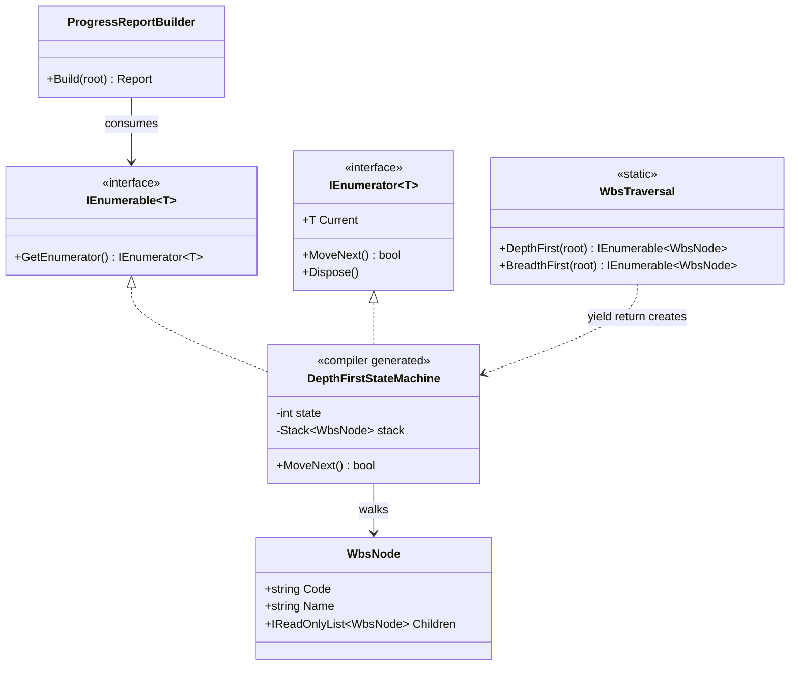
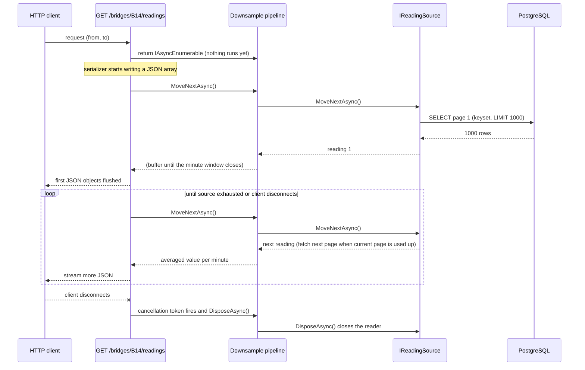

You've used Iterator thousands of times: every `foreach` in C# is one. Because the language builds it in, most developers never think about it as a pattern, and that's exactly how they get bitten by its sharp edges: a query that runs three times, an export that loads 3 million rows into memory, an exception that appears far from the code that caused it, a database connection that stays open. This lesson makes the pattern visible, then uses it deliberately: lazy pipelines, custom tree walks, and streaming database rows straight to an HTTP response.

## Learning objectives

By the end of this lesson you will be able to:

1. Explain the problem Iterator solves and name its participants, mapped to `IEnumerable<T>` and `IEnumerator<T>`.
2. Describe what the compiler generates for `foreach` and for a `yield return` method.
3. Use lazy evaluation (deferred execution) on purpose, and recognise when it surprises you.
4. Write custom iterators for trees (depth-first and breadth-first) that don't overflow the stack.
5. Stream rows with `IAsyncEnumerable<T>`, `await foreach` and cancellation, from a data source to an ASP.NET Core response, in constant memory.
6. Avoid the classic pitfalls: multiple enumeration, deferred exceptions, modifying a collection while iterating, and iterators that outlive their resources.
7. Compare Iterator with Visitor, Composite and plain pagination, and know when a materialised list is the better choice.

## Prerequisites

- [Collections, generics and common data structures](#/lesson/m01-collections-generics): `List<T>`, `Queue<T>`, `Stack<T>`, LINQ basics.
- [Asynchronous programming with async/await](#/lesson/m03-async-await): needed for `IAsyncEnumerable<T>`.
- [Cancellation tokens](#/lesson/m03-cancellation): streaming endpoints must stop when the client disconnects.

## Explain it like I'm a beginner

Imagine a site office with a cupboard full of **measurement books** (the registers where engineers record measured work). A visiting auditor wants to check every entry.

The auditor doesn't care *how* the cupboard is organised: by month, by contractor, in box files, or partly scanned into a computer. They want one thing: "give me the next entry, and tell me when there are no more."

So the office assigns a **clerk** to the auditor. The clerk knows the cupboard's system. Each time the auditor says "next", the clerk hands over one entry and remembers where they are. Two auditors can each have their own clerk and be at different places in the same cupboard at the same time. And if the auditor only needs entries until they find a problem, they stop early, and the clerk never pulls out the remaining boxes.

- The cupboard is the **collection** (in C#, something `IEnumerable<T>`: "can be walked through").
- The clerk is the **iterator** (an `IEnumerator<T>`: it has a position, a `MoveNext()` and a `Current`).
- "Hand me entries one at a time, only when I ask" is **lazy evaluation**.

That's the Iterator pattern: **a separate object that walks through a collection one item at a time, so the code using the items doesn't need to know how they're stored.**

## First-principles explanation

### The original problem

The Gang of Four describe it like this: an aggregate object such as a list should give you a way to access its elements *without exposing its internal structure*. You may also want to traverse it in different ways (forwards, backwards, filtered) and have several traversals going at once, without stuffing all those operations into the list's own interface.

Before iterators, client code depended on the internals. To loop over a linked list you followed `node.Next`; to loop over an array you used an index; to loop over a tree you wrote recursion. Change the structure and every loop broke.

### The participants

| GoF participant | Role | C# |
|---|---|---|
| **Iterator** | Interface for stepping through elements. | `IEnumerator<T>`: `bool MoveNext()`, `T Current`, `Dispose()` |
| **Concrete iterator** | Tracks the current position in one traversal. | `List<T>.Enumerator`, or a compiler-generated class from `yield return` |
| **Aggregate** | Interface for creating an iterator. | `IEnumerable<T>`: `GetEnumerator()` |
| **Concrete aggregate** | The collection that creates its iterators. | `List<T>`, `Dictionary<K,V>`, your `WbsTree`, a database result source |
| **Client** | Uses the iterator. | Your `foreach` loop, LINQ |

For async data, the same roles exist as `IAsyncEnumerable<T>` and `IAsyncEnumerator<T>` (with `ValueTask<bool> MoveNextAsync()` and `DisposeAsync()`).

### What `foreach` really does

The compiler rewrites this:

```csharp
foreach (var reading in readings) Process(reading);
```

into roughly this:

```csharp
var e = readings.GetEnumerator();
try
{
    while (e.MoveNext())
    {
        var reading = e.Current;
        Process(reading);
    }
}
finally
{
    e.Dispose();      // runs even if Process throws or you 'break'
}
```

Two details matter in practice:

1. **`foreach` uses a pattern, not just the interface.** Any type with a public `GetEnumerator()` returning something with `MoveNext()` and `Current` works. `List<T>` returns a *struct* enumerator, so `foreach` over a `List<T>` allocates nothing. Iterating the same list through an `IEnumerable<T>` variable boxes that enumerator onto the heap (a small allocation per loop). That only matters in very hot code.
2. **`Dispose` always runs.** That's how an iterator over a file or a database reader closes it when you `break` early.

### What `yield return` generates

A method that contains `yield return` is turned by the compiler into a **state machine**: a hidden class that implements both `IEnumerable<T>` and `IEnumerator<T>`. Your local variables become fields. Each `MoveNext()` call runs your code *until the next `yield return`*, saves where it stopped (the state), and returns `true`. When your method ends, `MoveNext()` returns `false`. `finally` blocks in your iterator run when the loop finishes *or* when the consumer disposes the enumerator early.

```csharp
static IEnumerable<decimal> Chainages(decimal fromKm, decimal toKm, decimal stepKm)
{
    for (var km = fromKm; km <= toKm; km += stepKm)
        yield return km;           // pause here, hand km to the caller, resume on next MoveNext()
}
```

Calling `Chainages(0, 120, 0.025m)` **runs none of this code**. It returns the state machine object. The loop body only runs as the consumer asks for items. Ask for the first 3 and only 3 iterations run; 4,801 are never computed.

### Lazy evaluation (deferred execution)

That "nothing runs until you ask" behaviour is **lazy evaluation**. LINQ operators such as `Where`, `Select`, `Take` and `Skip` are built on it: they return iterators that wrap other iterators. A pipeline like `readings.Where(r => r.StrainMicro > 900).Select(ToAlert).Take(10)` processes **one item at a time through all stages**, and stops after 10 matches, even if the source has 3 million readings.

Some operators must see everything before producing anything: `OrderBy`, `GroupBy`, `Reverse`, `Count`, `ToList`, `ToDictionary`, `Max`. These are **buffering** or **terminal** operators. A lazy pipeline with an `OrderBy` in the middle holds all items in memory at that point.

### Why the pattern matters beyond `foreach`

- **Memory.** Streaming 3 million sensor readings at ~64 bytes each would need roughly 190 MB as a list (estimate). As a stream, the process holds one page (say 1,000 rows, ~64 KB) at a time.
- **Latency to first result.** A streaming endpoint can send the first row in milliseconds instead of waiting until all rows are loaded.
- **Composability.** Small iterators (filter, batch, downsample) snap together into pipelines, a lightweight form of the [Pipeline pattern](#/lesson/m06-pipeline).
- **Encapsulation.** A `WbsTree` can expose `DepthFirst()` and `BreadthFirst()` without exposing its child lists.

### When it is useful

- You want to **hide how data is stored or produced** (list, tree, file, database, paged API) behind "give me the next one".
- Data is **large or unbounded** and you want constant memory.
- The consumer may **stop early**.
- You need **several traversal orders** over one structure.

### When not to use it (or when to materialise)

- **You'll iterate more than once.** If the source is expensive (a query, an API, a file), iterating twice does the work twice. Call `ToList()` once and pass the list.
- **The caller needs `Count`, indexing or random access.** Return `IReadOnlyList<T>`, not `IEnumerable<T>`.
- **The data must be consistent at a point in time.** A lazy query over a table that's being updated can return a mix of old and new rows across pages. Materialise inside a transaction or use a snapshot.
- **The underlying resource is short-lived.** Returning a lazy `IEnumerable<T>` from a method that disposes its `DbContext` at the end gives the caller an iterator that fails on first use.
- **Small, fixed collections.** For 12 items, a `List<T>` is simpler to debug than a pipeline of iterators.

### Trade-offs it introduces

| You gain | You pay |
|---|---|
| Constant memory for huge data | Work happens later, often far from the code that set it up |
| Early exit is free | Exceptions surface at enumeration time, not call time |
| Traversal hidden from clients | Multiple enumeration silently repeats expensive work |
| Composable pipelines | Debugging a chain of deferred calls is harder |
| Streaming responses | Resources (connections, files) stay open while the consumer is slow |

## Visual explanation

### Class diagram



How to read it: the two interfaces at the top are .NET's version of the GoF *Aggregate* and *Iterator*. `WbsTraversal.DepthFirst` is written with `yield return`, so the compiler generates a hidden state-machine class that implements **both** interfaces; its fields hold the traversal's progress (a stack of nodes still to visit, and the current state number). `ProgressReportBuilder` depends only on `IEnumerable<T>`: it doesn't know the data is a tree, or in what order it's walked, and `WbsNode` never exposes how to walk it.

### Sequence diagram



The endpoint returns an `IAsyncEnumerable<T>` without running anything. The JSON serializer *pulls* items one at a time. Each pull flows down the chain to the source, which fetches a new page from PostgreSQL only when the previous page is used up. Memory holds one page plus one downsample window. When the client disconnects, ASP.NET Core cancels `HttpContext.RequestAborted`; the token stops the iterator, and disposal flows down the chain, closing the database reader. Nothing is loaded that nobody reads.

## Step-by-step example

The scenario: a **bridge health monitoring** system records strain gauge readings from sensors on a river bridge every second: about 86,400 readings per sensor per day, 2.6 million per sensor per month. Engineers export a month for analysis.

### Step 1 — load everything

```csharp
app.MapGet("/bridges/{id}/readings", async (string id, DateTime from, DateTime to, AppDb db) =>
{
    var rows = await db.Readings.Where(r => r.BridgeId == id && r.Ts >= from && r.Ts < to)
                                .OrderBy(r => r.Ts).ToListAsync();      // 2.6 million objects
    return Results.Ok(rows);
});
```

Memory: millions of entity objects plus change-tracking data, plus the serialised JSON. Time to first byte: however long the whole query and load takes. One engineer exporting a month for four sensors can push the API process into the out-of-memory killer.

### Step 2 — return a stream

Replace `ToListAsync()` with an async iterator source and return `IAsyncEnumerable<T>`. ASP.NET Core serialises it as a JSON array while it's being produced.

### Step 3 — page with keyset pagination inside the iterator

A single long-running query holds a connection and a snapshot for minutes. Instead, the iterator fetches pages of 1,000 rows using keyset pagination (`WHERE (ts, id) > (@lastTs, @lastId) ORDER BY ts, id LIMIT 1000`), which stays fast at any depth, unlike `OFFSET` (see [Offset versus keyset pagination](#/lesson/m09-pagination)). The consumer can't tell: it still sees one continuous stream.

### Step 4 — compose

Add `Downsample(TimeSpan.FromMinutes(1))` so the export returns one average per minute (43,200 values per month instead of 2.6 million) and `Batch(500)` for writing to a file. Each is a small iterator.

### Step 5 — cancellation and cleanup

Pass the request's `CancellationToken` through `[EnumeratorCancellation]`, so a closed browser tab stops the database work within one page.

## Production-style C# implementation

```text
Infra.Api/
  Program.cs
  Monitoring/
    SensorReading.cs           record + source interface
    PagedReadingSource.cs      async iterator over keyset pages (in-memory simulation)
    ReadingPipelines.cs        Downsample, Batch, WhereAbove
  Wbs/
    WbsNode.cs                 tree node
    WbsTraversal.cs            depth-first and breadth-first iterators
```

```csharp file=Monitoring/SensorReading.cs
namespace Infra.Monitoring;

public sealed record SensorReading(long Id, string SensorId, DateTimeOffset Timestamp, double StrainMicro);

public sealed record ReadingPage(IReadOnlyList<SensorReading> Rows);

/// <summary>Aggregate: "something that can give me readings one at a time".</summary>
public interface IReadingSource
{
    IAsyncEnumerable<SensorReading> ReadAsync(string sensorId, DateTimeOffset from, DateTimeOffset to, CancellationToken ct = default);
}

/// <summary>One keyset page query. In production this runs SQL; here it is faked.</summary>
public interface IReadingPageQuery
{
    Task<ReadingPage> NextPageAsync(string sensorId, DateTimeOffset from, DateTimeOffset to,
        (DateTimeOffset Ts, long Id)? after, int pageSize, CancellationToken ct);
}
```

```csharp file=Monitoring/PagedReadingSource.cs
using System.Runtime.CompilerServices;

namespace Infra.Monitoring;

/// <summary>Concrete aggregate + iterator: hides paging behind a single continuous stream.</summary>
public sealed class PagedReadingSource(IReadingPageQuery pages, ILogger<PagedReadingSource> logger) : IReadingSource
{
    public const int PageSize = 1000;

    public IAsyncEnumerable<SensorReading> ReadAsync(string sensorId, DateTimeOffset from, DateTimeOffset to, CancellationToken ct = default)
    {
        // Validate EAGERLY: this runs when ReadAsync is called, not when someone starts iterating.
        ArgumentException.ThrowIfNullOrWhiteSpace(sensorId);
        if (to <= from) throw new ArgumentException("'to' must be after 'from'.", nameof(to));
        if (to - from > TimeSpan.FromDays(93)) throw new ArgumentException("Range is limited to 93 days.", nameof(to));
        return Iterate(sensorId, from, to, ct);
    }

    private async IAsyncEnumerable<SensorReading> Iterate(string sensorId, DateTimeOffset from, DateTimeOffset to,
        [EnumeratorCancellation] CancellationToken ct)
    {
        (DateTimeOffset Ts, long Id)? after = null;
        var pageCount = 0;
        try
        {
            while (true)
            {
                var page = await pages.NextPageAsync(sensorId, from, to, after, PageSize, ct);
                pageCount++;
                foreach (var row in page.Rows)
                {
                    ct.ThrowIfCancellationRequested();
                    yield return row;
                }
                if (page.Rows.Count < PageSize) yield break;      // last page
                var last = page.Rows[^1];
                after = (last.Timestamp, last.Id);
            }
        }
        finally
        {
            // Runs on normal completion, on 'break' by the consumer, on cancellation and on errors.
            logger.LogInformation("Read {Pages} page(s) for sensor {SensorId}", pageCount, sensorId);
        }
    }
}

/// <summary>Deterministic fake data: one reading per second. Stands in for PostgreSQL.</summary>
public sealed class SimulatedReadingPageQuery : IReadingPageQuery
{
    public async Task<ReadingPage> NextPageAsync(string sensorId, DateTimeOffset from, DateTimeOffset to,
        (DateTimeOffset Ts, long Id)? after, int pageSize, CancellationToken ct)
    {
        await Task.Delay(1, ct);                                   // simulate a round trip
        var start = after.HasValue ? after.Value.Item1.AddSeconds(1) : from;
        var rows = new List<SensorReading>(pageSize);
        for (var ts = start; ts < to && rows.Count < pageSize; ts = ts.AddSeconds(1))
        {
            var seconds = (ts - from).TotalSeconds;
            var strain = 420 + 180 * Math.Sin(seconds / 3600 * Math.PI) + (seconds % 97) * 0.5;  // daily traffic wave + noise
            rows.Add(new SensorReading(ts.ToUnixTimeSeconds(), sensorId, ts, Math.Round(strain, 2)));
        }
        return new ReadingPage(rows);
    }
}
```

```csharp file=Monitoring/ReadingPipelines.cs
using System.Runtime.CompilerServices;

namespace Infra.Monitoring;

public sealed record ReadingAverage(DateTimeOffset WindowStart, double AvgStrainMicro, double MaxStrainMicro, int Samples);

/// <summary>Small, composable async iterators. Each holds O(1) or O(batch) memory.</summary>
public static class ReadingPipelines
{
    /// <summary>One average per window. Input must be ordered by timestamp.</summary>
    public static async IAsyncEnumerable<ReadingAverage> Downsample(this IAsyncEnumerable<SensorReading> source,
        TimeSpan window, [EnumeratorCancellation] CancellationToken ct = default)
    {
        if (window <= TimeSpan.Zero) throw new ArgumentOutOfRangeException(nameof(window));
        DateTimeOffset? current = null;
        double sum = 0, max = double.MinValue;
        var n = 0;

        await foreach (var r in source.WithCancellation(ct))
        {
            var bucket = new DateTimeOffset(r.Timestamp.UtcTicks - r.Timestamp.UtcTicks % window.Ticks, TimeSpan.Zero);
            if (current is not null && bucket != current)
            {
                yield return new ReadingAverage(current.Value, Math.Round(sum / n, 2), max, n);
                sum = 0; max = double.MinValue; n = 0;
            }
            current = bucket;
            sum += r.StrainMicro;
            max = Math.Max(max, r.StrainMicro);
            n++;
        }
        if (n > 0) yield return new ReadingAverage(current!.Value, Math.Round(sum / n, 2), max, n);
    }

    public static async IAsyncEnumerable<IReadOnlyList<T>> Batch<T>(this IAsyncEnumerable<T> source, int size,
        [EnumeratorCancellation] CancellationToken ct = default)
    {
        ArgumentOutOfRangeException.ThrowIfNegativeOrZero(size);
        var batch = new List<T>(size);
        await foreach (var item in source.WithCancellation(ct))
        {
            batch.Add(item);
            if (batch.Count == size)
            {
                yield return batch;
                batch = new List<T>(size);    // new list: the consumer may keep the previous one
            }
        }
        if (batch.Count > 0) yield return batch;
    }

    public static async IAsyncEnumerable<SensorReading> WhereStrainAbove(this IAsyncEnumerable<SensorReading> source,
        double thresholdMicro, [EnumeratorCancellation] CancellationToken ct = default)
    {
        await foreach (var r in source.WithCancellation(ct))
            if (r.StrainMicro > thresholdMicro) yield return r;
    }
}
```

```csharp file=Wbs/WbsNode.cs
namespace Infra.Wbs;

/// <summary>Work breakdown structure node: project, package, activity, task.</summary>
public sealed class WbsNode(string code, string name, decimal weightPercent = 0)
{
    private readonly List<WbsNode> _children = [];

    public string Code { get; } = code;
    public string Name { get; } = name;
    public decimal WeightPercent { get; } = weightPercent;
    public IReadOnlyList<WbsNode> Children => _children;

    public WbsNode Add(WbsNode child)
    {
        _children.Add(child);
        return this;
    }
}
```

```csharp file=Wbs/WbsTraversal.cs
namespace Infra.Wbs;

public readonly record struct WbsVisit(WbsNode Node, int Depth);

/// <summary>Traversal orders as iterators. No recursion, so a 100,000-level chain can't overflow the stack.</summary>
public static class WbsTraversal
{
    /// <summary>Pre-order: parent before children, children in their original order.</summary>
    public static IEnumerable<WbsVisit> DepthFirst(WbsNode root)
    {
        ArgumentNullException.ThrowIfNull(root);     // eager, because this method has no 'yield'
        return Iterate(root);

        static IEnumerable<WbsVisit> Iterate(WbsNode root)
        {
            var stack = new Stack<WbsVisit>();
            stack.Push(new WbsVisit(root, 0));
            while (stack.Count > 0)
            {
                var visit = stack.Pop();
                yield return visit;
                var children = visit.Node.Children;
                for (var i = children.Count - 1; i >= 0; i--)          // push in reverse so the first child pops first
                    stack.Push(new WbsVisit(children[i], visit.Depth + 1));
            }
        }
    }

    /// <summary>Level by level: all packages, then all activities, then all tasks.</summary>
    public static IEnumerable<WbsVisit> BreadthFirst(WbsNode root)
    {
        ArgumentNullException.ThrowIfNull(root);
        return Iterate(root);

        static IEnumerable<WbsVisit> Iterate(WbsNode root)
        {
            var queue = new Queue<WbsVisit>();
            queue.Enqueue(new WbsVisit(root, 0));
            while (queue.Count > 0)
            {
                var visit = queue.Dequeue();
                yield return visit;
                foreach (var child in visit.Node.Children)
                    queue.Enqueue(new WbsVisit(child, visit.Depth + 1));
            }
        }
    }

    public static IEnumerable<WbsNode> Leaves(WbsNode root) =>
        DepthFirst(root).Select(v => v.Node).Where(n => n.Children.Count == 0);
}
```

```csharp file=Program.cs
using System.Globalization;
using System.Text;
using Infra.Monitoring;
using Infra.Wbs;

var builder = WebApplication.CreateBuilder(args);
builder.Services.AddSingleton<IReadingPageQuery, SimulatedReadingPageQuery>();
builder.Services.AddSingleton<IReadingSource, PagedReadingSource>();

var app = builder.Build();

// Streams a JSON array: one object per minute. Memory stays flat whatever the range.
app.MapGet("/sensors/{sensorId}/readings/per-minute",
    (string sensorId, DateTimeOffset from, DateTimeOffset to, IReadingSource source, CancellationToken ct) =>
        source.ReadAsync(sensorId, from, to, ct).Downsample(TimeSpan.FromMinutes(1), ct));

// Streams CSV, flushing every 500 rows so the browser shows download progress.
app.MapGet("/sensors/{sensorId}/readings.csv",
    async (string sensorId, DateTimeOffset from, DateTimeOffset to, IReadingSource source, HttpResponse response, CancellationToken ct) =>
    {
        response.ContentType = "text/csv; charset=utf-8";
        response.Headers.ContentDisposition = $"attachment; filename=\"{sensorId}.csv\"";
        await response.WriteAsync("timestamp_utc,strain_micro\r\n", ct);
        await foreach (var batch in source.ReadAsync(sensorId, from, to, ct).Batch(500, ct))
        {
            var sb = new StringBuilder(batch.Count * 32);
            foreach (var r in batch)
                sb.Append(r.Timestamp.UtcDateTime.ToString("O", CultureInfo.InvariantCulture)).Append(',')
                  .Append(r.StrainMicro.ToString(CultureInfo.InvariantCulture)).Append("\r\n");
            await response.WriteAsync(sb.ToString(), ct);
            await response.Body.FlushAsync(ct);
        }
    });

var wbs = new WbsNode("PKG3", "NH-48 Package 3")
    .Add(new WbsNode("PKG3.EW", "Earthwork", 18).Add(new WbsNode("PKG3.EW.01", "Embankment", 12)).Add(new WbsNode("PKG3.EW.02", "Subgrade", 6)))
    .Add(new WbsNode("PKG3.STR", "Structures", 34).Add(new WbsNode("PKG3.STR.B14", "Bridge B14", 21)));

app.MapGet("/wbs/outline", () =>
    WbsTraversal.DepthFirst(wbs).Select(v => new string(' ', v.Depth * 2) + v.Node.Code + " " + v.Node.Name));

app.Run();
```

Things worth noticing:

- **Eager validation, lazy work.** `ReadAsync` and `DepthFirst` are *not* iterators themselves: they validate arguments and return an inner iterator. If they contained `yield`, a bad argument would throw only when someone started iterating, possibly after the HTTP response had begun, which then can't become a clean 400 response.
- **`[EnumeratorCancellation]`.** It connects the token passed to the method with the token passed via `WithCancellation(...)` by the consumer, so either can stop the stream.
- **`finally` in iterators** runs when the consumer stops early. In a real source this is where the `NpgsqlDataReader` and connection are disposed (or rather, `await using` declarations inside the iterator do it for you).
- **New batch lists.** `Batch` creates a new list per batch. Reusing one list would be faster, but a consumer that stores batches (for example `await ...ToListAsync()`) would see every stored batch change. Safe by default; optimise only with a measured need.
- **Ordering matters for `Downsample`.** It assumes timestamps arrive in order, which the source guarantees with `ORDER BY ts, id`. Document assumptions like this on the iterator.

### What the real PostgreSQL page query looks like

```sql
-- index: CREATE INDEX ON sensor_readings (sensor_id, ts, id);
SELECT id, sensor_id, ts, strain_micro
FROM sensor_readings
WHERE sensor_id = @sensor
  AND ts >= @from AND ts < @to
  AND (@afterTs IS NULL OR (ts, id) > (@afterTs, @afterId))
ORDER BY ts, id
LIMIT 1000;
```

With EF Core you can stream a single query with `AsAsyncEnumerable()` (plus `AsNoTracking()` so the context doesn't keep every entity). That holds one connection open for the whole export; the paged design above releases it between pages, which is kinder to a connection pool of, say, 100 connections shared by every request.

## Bad design vs good design

**Bad 1, load-all export:** Step 1's `ToListAsync()` of 2.6 million rows. Memory and time grow with the date range; several concurrent exports crash the process.

**Bad 2, multiple enumeration of a lazy query:**

```csharp
IEnumerable<Rfi> overdue = db.Rfis.Where(r => r.DueDate < today && r.Status == "Open");   // IQueryable, lazy
if (!overdue.Any()) return;                                 // query 1
logger.LogInformation("{Count} overdue RFIs", overdue.Count());   // query 2
foreach (var rfi in overdue) await notifier.SendAsync(rfi); // query 3
```

Three round trips to the database. Worse, if an RFI is closed between query 2 and query 3, the log says 41 and 40 notifications go out. Fix: `var overdue = await query.ToListAsync();` once, then use the list.

**Bad 3, lazy result outliving its resource:**

```csharp
public IEnumerable<Bill> GetBills(int projectId)
{
    using var db = new AppDbContext();
    return db.Bills.Where(b => b.ProjectId == projectId);    // returned lazily...
}                                                            // ...and db is disposed here
// Caller: foreach (var b in GetBills(3))  -> ObjectDisposedException
```

Either materialise before returning (`ToList()`), or make the method an iterator itself (`foreach (var b in query) yield return b;`) so the `using` lives as long as the enumeration.

**Bad 4, modifying while iterating:**

```csharp
foreach (var item in boqItems)
    if (item.Quantity == 0) boqItems.Remove(item);   // InvalidOperationException: Collection was modified
```

`List<T>`'s enumerator checks a version number and throws on change. Use `boqItems.RemoveAll(i => i.Quantity == 0)`, or iterate over a copy.

**Bad 5, recursive `yield` for deep trees:**

```csharp
IEnumerable<WbsNode> Walk(WbsNode n)
{
    yield return n;
    foreach (var c in n.Children)
        foreach (var x in Walk(c)) yield return x;    // a chain of nested iterators
}
```

It reads nicely, but each item passes up through one iterator per level, so the total cost is O(n × depth), and every level allocates an iterator object. For a 5-level WBS that's fine. For user-generated hierarchies (comment threads, nested folders) use the explicit stack shown above.

**Good:** the implementation above. Eager validation, lazy work, paged source, composable stages, explicit-stack tree traversal, and materialisation where you need multiple passes.

## Practical playground

Watch lazy evaluation happen. The program logs every time the source produces an item. Predict the output before you run it, then try replacing `Take(3)` with `OrderBy(x => x).Take(3)` and see how many items get produced.

:::playground type=csharp title="Lazy evaluation and multiple enumeration"
```csharp file=Program.cs
using System;
using System.Collections.Generic;
using System.Linq;

public static class Program
{
    static int _produced;

    static IEnumerable<int> RfiAgesInDays()
    {
        int[] ages = { 2, 15, 9, 31, 4, 22, 7 };
        foreach (var a in ages)
        {
            _produced++;
            Console.WriteLine($"  source produced {a}");
            yield return a;
        }
    }

    public static void Main()
    {
        Console.WriteLine("1. Building the query (nothing should print):");
        var overdue = RfiAgesInDays().Where(a => a > 7);

        Console.WriteLine("2. Taking the first 2 overdue:");
        foreach (var a in overdue.Take(2)) Console.WriteLine($"  -> overdue {a}");
        Console.WriteLine($"   produced so far: {_produced}");

        _produced = 0;
        Console.WriteLine("3. Counting, then listing (two enumerations):");
        Console.WriteLine($"  count = {overdue.Count()}");
        Console.WriteLine($"  list  = {string.Join(", ", overdue)}");
        Console.WriteLine($"   produced: {_produced} (the source ran twice)");

        _produced = 0;
        Console.WriteLine("4. Materialise once with ToList():");
        var list = overdue.ToList();
        Console.WriteLine($"  count = {list.Count}, list = {string.Join(", ", list)}");
        Console.WriteLine($"   produced: {_produced}");
    }
}
```
:::

## Exercises

:::exercise id=m06-iterator-ex1 difficulty=beginner kind=code title="A chainage iterator with eager validation"
Road projects are surveyed at fixed intervals of chainage (distance along the road), for example every 25 m. Implement `Chainage.Range(fromKm, toKm, stepKm)` that yields `fromKm`, `fromKm + step`, ... up to and **including** `toKm` when it lands exactly on a step.
::requirements
- Values are `decimal` so 0.025 steps don't drift.
- `stepKm <= 0` throws `ArgumentOutOfRangeException` **when `Range` is called**, not when iterating.
- `toKm < fromKm` throws `ArgumentException` when called.
- The sequence is lazy: taking the first 3 values of a 0 → 1,000,000 km range must be instant.
::acceptance
- `Range(0, 1, 0.025m)` yields 41 values, the last being `1.000`.
- `Range(12.3m, 12.4m, 0.05m)` yields `12.3, 12.35, 12.4`.
- Calling `Range(0, 1, 0)` throws immediately, even if the result is never enumerated.
- `Range(0, 1_000_000, 0.025m).Take(3)` returns `0, 0.025, 0.05`.
::hint
If a method contains `yield return`, none of its code runs until the first `MoveNext()`, including your argument checks.
::hint
Split it in two: a public method that validates and returns, and a private (or local) iterator that yields.
::hint
Inside the iterator: `for (var km = from; km <= to; km += step) yield return km;`.
::hint
```csharp
public static IEnumerable<decimal> Range(decimal fromKm, decimal toKm, decimal stepKm)
{
    if (stepKm <= 0) throw new ArgumentOutOfRangeException(nameof(stepKm));
    if (toKm < fromKm) throw new ArgumentException("toKm must be >= fromKm", nameof(toKm));
    return Iterate(fromKm, toKm, stepKm);
}
```
::starter
```csharp file=Chainage.cs
using System;
using System.Collections.Generic;

public static class Chainage
{
    public static IEnumerable<decimal> Range(decimal fromKm, decimal toKm, decimal stepKm) =>
        throw new NotImplementedException();
}
```
::tests
```csharp file=ChainageTests.cs
using System;
using System.Linq;
using Xunit;

public class ChainageTests
{
    [Fact]
    public void Every_25m_for_1km()
    {
        var values = Chainage.Range(0m, 1m, 0.025m).ToList();
        Assert.Equal(41, values.Count);
        Assert.Equal(0m, values[0]);
        Assert.Equal(1.000m, values[^1]);
    }

    [Fact]
    public void Short_range()
    {
        Assert.Equal(new[] { 12.3m, 12.35m, 12.4m }, Chainage.Range(12.3m, 12.4m, 0.05m).ToArray());
    }

    [Fact]
    public void Zero_step_throws_eagerly()
    {
        Assert.Throws<ArgumentOutOfRangeException>(() => { Chainage.Range(0m, 1m, 0m); });
    }

    [Fact]
    public void Reversed_range_throws_eagerly()
    {
        Assert.Throws<ArgumentException>(() => { Chainage.Range(5m, 1m, 0.1m); });
    }

    [Fact]
    public void Is_lazy()
    {
        Assert.Equal(new[] { 0m, 0.025m, 0.05m }, Chainage.Range(0m, 1_000_000m, 0.025m).Take(3).ToArray());
    }
}
```
::solution
```csharp file=Chainage.cs
using System;
using System.Collections.Generic;

public static class Chainage
{
    public static IEnumerable<decimal> Range(decimal fromKm, decimal toKm, decimal stepKm)
    {
        if (stepKm <= 0) throw new ArgumentOutOfRangeException(nameof(stepKm), "Step must be positive.");
        if (toKm < fromKm) throw new ArgumentException("toKm must be greater than or equal to fromKm.", nameof(toKm));
        return Iterate(fromKm, toKm, stepKm);

        static IEnumerable<decimal> Iterate(decimal from, decimal to, decimal step)
        {
            for (var km = from; km <= to; km += step)
                yield return km;
        }
    }
}
```

The public method has no `yield`, so it runs immediately when called: the checks throw at the call site, where the bug is. The local function is the iterator and runs lazily. This "wrapper plus local iterator" shape is the standard C# idiom; LINQ's own operators are written this way.

Why `decimal`? With `double`, `0.025` can't be represented exactly. Repeated addition drifts (after 40 steps you may get `0.9999999999999999` or `1.0000000000000002`), so the last value is dropped or extra.
::mistakes
- Putting the checks inside the iterator: `Range(0, 1, 0)` then returns happily, and the exception appears later, inside some unrelated `foreach`.
- Using `double`, so `<= toKm` misses the final chainage.
- Building a `List<decimal>` and returning it: correct values, but the 1,000,000 km test allocates 40 million items.
:::

:::exercise id=m06-iterator-ex2 difficulty=beginner kind=written title="Predict the output and find the bugs"
Read the code and answer the questions without running it.

```csharp
int calls = 0;
IEnumerable<string> LoadContractors()
{
    calls++;
    Console.WriteLine("query");
    yield return "Alpha Infra";
    yield return "Bharat Roads";
    yield return "Coastal Bridges";
}

var contractors = LoadContractors();
var withB = contractors.Where(c => c.Contains('B'));
Console.WriteLine("ready");
Console.WriteLine(withB.Count());
Console.WriteLine(withB.First());
Console.WriteLine(calls);
```

1. Write the exact console output.
2. How many times does "query" print, and why?
3. If `LoadContractors` ran a real SQL query, what two problems does this cause?
4. Rewrite the last four lines so the query runs once.
::acceptance
- Output in the right order, including that "ready" prints before "query".
- Explains deferred execution and that each enumeration restarts the iterator.
- Names both the performance cost and the consistency risk.
- A fix that materialises once.
::hint
Calling `LoadContractors()` doesn't execute its body. When does it first run?
::hint
`Count()` enumerates everything. `First()` starts a brand-new enumeration and stops after one match.
::hint
`calls++` is inside the iterator, so it counts enumerations, not method calls.
::solution
1. Output:
```text
ready
query
2
query
Bharat Roads
2
```
2. **Twice.** `LoadContractors()` only creates the iterator. `Count()` enumerates it fully (first "query"), and `First()` starts a second enumeration from the beginning (second "query"), stopping at the first match. `calls` is incremented per enumeration, so it prints 2.
3. (a) **Performance:** two round trips to the database for one logical operation; with more uses (`Any`, `Count`, `foreach`) it's three or four. (b) **Consistency:** the two queries can see different data. If a contractor is added between them, the count says 2 but the list has 3 matches.
4. Fix:
```csharp
var withB = LoadContractors().Where(c => c.Contains('B')).ToList();
Console.WriteLine("ready");
Console.WriteLine(withB.Count);
Console.WriteLine(withB[0]);
```
Now "query" prints once, before "ready".
::mistakes
- Expecting "query" to print when `LoadContractors()` is called.
- Thinking `First()` reuses the enumeration from `Count()`.
:::

:::exercise id=m06-iterator-ex3 difficulty=intermediate kind=code title="Tree iterators that survive deep hierarchies"
Implement depth-first (pre-order) and breadth-first iterators for `Node`, plus `Ancestors()`. Folder hierarchies imported from a document management system can be very deep, so the iterators must work on a chain 100,000 levels deep without a `StackOverflowException`.
::requirements
- `Traverse.DepthFirst(root)` yields parent before children, children in original order.
- `Traverse.BreadthFirst(root)` yields level by level, left to right.
- `Traverse.Ancestors(node)` yields the parent, grandparent, ... up to the root (not the node itself).
- No recursion. Null arguments throw `ArgumentNullException` immediately.
::acceptance
- For the sample tree, depth-first gives `A B D E C F` and breadth-first gives `A B C D E F`.
- Ancestors of `E` are `B A`.
- A 100,000-deep chain is traversed completely by both iterators.
- `DepthFirst(null!)` throws when called.
::hint
Depth-first with a `Stack<Node>`; breadth-first with a `Queue<Node>`.
::hint
Pushing children onto a stack reverses their order. Push them last-to-first so the first child is popped first.
::hint
`Ancestors` doesn't need a collection at all: follow `Parent` until it's null.
::hint
Use the wrapper-plus-local-iterator idiom for eager null checks.
::hint
```csharp
var stack = new Stack<Node>();
stack.Push(root);
while (stack.Count > 0)
{
    var n = stack.Pop();
    yield return n;
    for (var i = n.Children.Count - 1; i >= 0; i--) stack.Push(n.Children[i]);
}
```
::starter
```csharp file=Traverse.cs
using System;
using System.Collections.Generic;

public sealed class Node
{
    private readonly List<Node> _children = new();
    public Node(string name) => Name = name;
    public string Name { get; }
    public Node? Parent { get; private set; }
    public IReadOnlyList<Node> Children => _children;

    public Node Add(Node child)
    {
        child.Parent = this;
        _children.Add(child);
        return this;
    }
}

public static class Traverse
{
    public static IEnumerable<Node> DepthFirst(Node root) => throw new NotImplementedException();
    public static IEnumerable<Node> BreadthFirst(Node root) => throw new NotImplementedException();
    public static IEnumerable<Node> Ancestors(Node node) => throw new NotImplementedException();
}
```
::tests
```csharp file=TraverseTests.cs
using System;
using System.Linq;
using Xunit;

public class TraverseTests
{
    //        A
    //      /   \
    //     B     C
    //    / \     \
    //   D   E     F
    private static (Node Root, Node E) Sample()
    {
        var e = new Node("E");
        var b = new Node("B").Add(new Node("D")).Add(e);
        var c = new Node("C").Add(new Node("F"));
        return (new Node("A").Add(b).Add(c), e);
    }

    private static string Names(System.Collections.Generic.IEnumerable<Node> nodes) => string.Join(" ", nodes.Select(n => n.Name));

    [Fact]
    public void Depth_first_pre_order() => Assert.Equal("A B D E C F", Names(Traverse.DepthFirst(Sample().Root)));

    [Fact]
    public void Breadth_first_levels() => Assert.Equal("A B C D E F", Names(Traverse.BreadthFirst(Sample().Root)));

    [Fact]
    public void Ancestors_up_to_root() => Assert.Equal("B A", Names(Traverse.Ancestors(Sample().E)));

    [Fact]
    public void Deep_chain_does_not_overflow()
    {
        var root = new Node("0");
        var current = root;
        for (var i = 1; i < 100_000; i++)
        {
            var next = new Node(i.ToString());
            current.Add(next);
            current = next;
        }
        Assert.Equal(100_000, Traverse.DepthFirst(root).Count());
        Assert.Equal(100_000, Traverse.BreadthFirst(root).Count());
        Assert.Equal(99_999, Traverse.Ancestors(current).Count());
    }

    [Fact]
    public void Null_root_throws_eagerly() =>
        Assert.Throws<ArgumentNullException>(() => { Traverse.DepthFirst(null!); });
}
```
::solution
```csharp file=Traverse.cs
using System;
using System.Collections.Generic;

public sealed class Node
{
    private readonly List<Node> _children = new();
    public Node(string name) => Name = name;
    public string Name { get; }
    public Node? Parent { get; private set; }
    public IReadOnlyList<Node> Children => _children;

    public Node Add(Node child)
    {
        child.Parent = this;
        _children.Add(child);
        return this;
    }
}

public static class Traverse
{
    public static IEnumerable<Node> DepthFirst(Node root)
    {
        ArgumentNullException.ThrowIfNull(root);
        return Iterate(root);

        static IEnumerable<Node> Iterate(Node root)
        {
            var stack = new Stack<Node>();
            stack.Push(root);
            while (stack.Count > 0)
            {
                var n = stack.Pop();
                yield return n;
                for (var i = n.Children.Count - 1; i >= 0; i--)
                    stack.Push(n.Children[i]);
            }
        }
    }

    public static IEnumerable<Node> BreadthFirst(Node root)
    {
        ArgumentNullException.ThrowIfNull(root);
        return Iterate(root);

        static IEnumerable<Node> Iterate(Node root)
        {
            var queue = new Queue<Node>();
            queue.Enqueue(root);
            while (queue.Count > 0)
            {
                var n = queue.Dequeue();
                yield return n;
                foreach (var c in n.Children) queue.Enqueue(c);
            }
        }
    }

    public static IEnumerable<Node> Ancestors(Node node)
    {
        ArgumentNullException.ThrowIfNull(node);
        return Iterate(node);

        static IEnumerable<Node> Iterate(Node node)
        {
            for (var p = node.Parent; p is not null; p = p.Parent)
                yield return p;
        }
    }
}
```

Memory: the explicit stack holds at most (depth × branching) nodes, and the queue holds at most one level's width. Both live on the heap, so depth is limited by memory, not by the thread's stack (about 1 MB by default on many platforms).

Note the client side: `Traverse.DepthFirst(root).Count()` works on a tree, a list or anything else. The caller never sees `Children`. That's the "access elements without exposing the structure" promise of the pattern.
::alternatives
A recursive iterator with nested `foreach ... yield return` is shorter but costs O(n × depth) and allocates one iterator per level; at 100,000 levels it's both slow and, depending on the platform, can still exhaust the stack because each nested `MoveNext` is a real call. For balanced trees of depth 5–10 it's perfectly fine.
::mistakes
- Pushing children in normal order, which visits them right-to-left.
- Building a `List<Node>` of the whole tree and returning it: correct but not lazy, and the consumer can't stop early cheaply.
- Recursion "because trees are recursive", then a `StackOverflowException`, which can't be caught in .NET and terminates the process.
:::

:::exercise id=m06-iterator-ex4 difficulty=intermediate kind=design title="Refactor a load-everything export to streaming"
This service exports a month of daily progress entries for every project to CSV. It works in testing; in production it takes 4 minutes and sometimes the API pod is killed for using too much memory.

```csharp
public async Task<byte[]> ExportAsync(int month)
{
    var entries = await _db.ProgressEntries.Where(e => e.Month == month).Include(e => e.Project).ToListAsync();   // ~3.1M rows
    if (!entries.Any()) return Array.Empty<byte>();
    var sb = new StringBuilder();
    foreach (var e in entries.OrderBy(e => e.Project.Code).ThenBy(e => e.Date))
        sb.AppendLine($"{e.Project.Code},{e.Date:yyyy-MM-dd},{e.Activity},{e.Quantity}");
    _log.LogInformation("Exported {Count} rows", entries.Count());
    return Encoding.UTF8.GetBytes(sb.ToString());
}
```

Redesign it using iterators. Cover: data access, ordering, the HTTP response, cancellation, logging the count, and what happens when the user closes the tab.
::acceptance
- Rows are streamed from the database in pages or as an async stream, never fully materialised.
- Sorting is pushed to PostgreSQL (with an index that supports it), not done in memory.
- The response is written incrementally; no `StringBuilder` or `byte[]` holding the whole file.
- Cancellation stops database work when the client disconnects.
- The row count is computed while streaming, without a second enumeration.
- Notes on `Include`, tracking, CSV escaping and the connection pool.
::hint
List every place where all 3.1 million rows exist in memory at once. There are at least four.
::hint
`OrderBy` in LINQ-to-objects is a buffering operator. Can the database do it instead?
::hint
Return `IAsyncEnumerable<T>` from the data layer, then `await foreach` in the endpoint while writing to `HttpResponse.Body`.
::hint
Count rows in the loop you're already running: `rows++` per line.
::solution
**Where the memory goes today:** (1) `ToListAsync` materialises 3.1M entities, (2) change tracking keeps a snapshot of each, (3) `Include` joins and fixes up project objects, (4) `OrderBy().ThenBy()` builds a sorted buffer, (5) the `StringBuilder` holds the whole CSV, (6) `GetBytes` copies it again. A rough estimate at a few hundred bytes per row across these copies puts it in the gigabytes.

**Redesign:**

```csharp
// Data layer: a projected, untracked, database-sorted stream.
public IAsyncEnumerable<ProgressRow> StreamMonth(int month, CancellationToken ct) =>
    _db.ProgressEntries.AsNoTracking()
       .Where(e => e.Month == month)
       .OrderBy(e => e.Project.Code).ThenBy(e => e.Date).ThenBy(e => e.Id)
       .Select(e => new ProgressRow(e.Project.Code, e.Date, e.Activity, e.Quantity))   // JOIN in SQL, no Include
       .AsAsyncEnumerable();

// Endpoint: write as you read.
app.MapGet("/exports/progress/{month:int}.csv", async (int month, ProgressExport svc, HttpResponse res, ILogger<ProgressExport> log, CancellationToken ct) =>
{
    res.ContentType = "text/csv; charset=utf-8";
    await using var writer = new StreamWriter(res.Body, new UTF8Encoding(false), bufferSize: 64 * 1024);
    await writer.WriteAsync("project,date,activity,quantity\r\n");
    long rows = 0;
    await foreach (var r in svc.StreamMonth(month, ct).WithCancellation(ct))
    {
        await writer.WriteAsync($"{Csv(r.ProjectCode)},{r.Date:yyyy-MM-dd},{Csv(r.Activity)},{r.Quantity.ToString(CultureInfo.InvariantCulture)}\r\n");
        rows++;
    }
    log.LogInformation("Exported {Rows} progress rows for month {Month}", rows, month);
});
```

- **Ordering:** a composite index on `(month, project_id, date, id)` (or a covering index) lets PostgreSQL return rows already sorted without a big sort step. The final `ThenBy(e => e.Id)` makes the order deterministic.
- **Projection instead of `Include`:** `Select` into a small record makes EF Core generate a JOIN returning only four columns. No entity objects, no tracking.
- **Cancellation:** `ct` is `HttpContext.RequestAborted`. When the tab closes, the next `MoveNextAsync` throws `OperationCanceledException`, the reader and connection are disposed by the iterator's cleanup, and the query is cancelled on the server.
- **Connection pool:** one export holds one connection for its whole duration. If many users export at once, use the keyset-paged source from the lesson (connection released between pages) or move exports to a background job that writes to object storage and emails a link.
- **Empty result:** the `if (!entries.Any())` check goes away. An empty month produces a header-only CSV, which is a valid answer.
- **CSV escaping:** `Csv()` quotes values containing commas, quotes or newlines (activity names often contain commas).
::mistakes
- Keeping `.OrderBy()` after `AsAsyncEnumerable()` (or on a list), which moves sorting back into memory.
- Calling `CountAsync()` first "to log the total": a second full query.
- Writing with `res.WriteAsync` for every tiny string without a buffer, which is slow. Use a `StreamWriter` with a reasonable buffer.
- Forgetting `AsNoTracking()`: the change tracker keeps every streamed entity alive, and memory grows anyway.
:::

:::exercise id=m06-iterator-ex5 difficulty=advanced kind=code title="Async paging iterator with early exit, cancellation and cleanup"
A national tender portal's API returns tenders in pages with a continuation token. Write `Paging.ReadAllAsync`, which turns a page-fetching function into one continuous `IAsyncEnumerable<T>`, and `Paging.BatchAsync`, which groups any async stream into lists.
::requirements
- `ReadAllAsync(fetch, ct)` calls `fetch(token, ct)` starting with a `null` token, yields each item, and continues with the returned `NextToken` until it is `null`.
- It is **lazy**: no page is fetched until the consumer asks for the first item, and if the consumer stops after 3 items, no further pages are fetched.
- The cancellation token passed via `WithCancellation(...)` **or** the method parameter reaches `fetch`.
- Pages with zero items but a non-null token are skipped (some APIs do this), but more than 3 empty pages in a row throw `InvalidOperationException` to avoid an infinite loop.
- `BatchAsync(source, size)` yields lists of `size` items, the last one possibly smaller; `size <= 0` throws `ArgumentOutOfRangeException` **when called**.
- When the consumer of `BatchAsync` stops early, the source iterator is disposed (its `finally` runs).
::acceptance
- Three pages of 2, 2, 1 items give 5 items, and fetch is called 3 times.
- Taking 3 items fetches only 2 pages.
- A cancelled token passed with `WithCancellation` is observed by `fetch`.
- Four consecutive empty pages throw; one empty page is skipped.
- Batches of a 7-item stream with size 3 are `[3, 3, 1]`.
- Breaking out of `BatchAsync` after the first batch runs the source's `finally`.
::hint
Use `async IAsyncEnumerable<T>` and `yield return` inside a `while` loop that follows the token.
::hint
Put `[EnumeratorCancellation]` on the `CancellationToken` parameter. The compiler then combines it with the token given to `WithCancellation`.
::hint
For eager validation in `BatchAsync`, use a non-async wrapper that checks `size` and returns a private async iterator.
::hint
`await foreach` over the source inside `BatchAsync` disposes the source enumerator automatically when your iterator is disposed. You don't need extra code; just don't swallow it.
::hint
```csharp
string? token = null; var empties = 0;
do
{
    var page = await fetch(token, ct);
    if (page.Items.Count == 0) { if (++empties > 3) throw new InvalidOperationException("..."); }
    else empties = 0;
    foreach (var item in page.Items) yield return item;
    token = page.NextToken;
} while (token is not null);
```
::starter
```csharp file=Paging.cs
using System;
using System.Collections.Generic;
using System.Runtime.CompilerServices;
using System.Threading;
using System.Threading.Tasks;

public sealed record Page<T>(IReadOnlyList<T> Items, string? NextToken);

public static class Paging
{
    public static IAsyncEnumerable<T> ReadAllAsync<T>(
        Func<string?, CancellationToken, Task<Page<T>>> fetch,
        CancellationToken ct = default) => throw new NotImplementedException();

    public static IAsyncEnumerable<IReadOnlyList<T>> BatchAsync<T>(IAsyncEnumerable<T> source, int size) =>
        throw new NotImplementedException();
}
```
::tests
```csharp file=PagingTests.cs
using System;
using System.Collections.Generic;
using System.Linq;
using System.Threading;
using System.Threading.Tasks;
using Xunit;

public class PagingTests
{
    private int _fetches;

    private Task<Page<string>> ThreePages(string? token, CancellationToken ct)
    {
        _fetches++;
        ct.ThrowIfCancellationRequested();
        var page = token switch
        {
            null => new Page<string>(new[] { "T1", "T2" }, "p2"),
            "p2" => new Page<string>(new[] { "T3", "T4" }, "p3"),
            "p3" => new Page<string>(new[] { "T5" }, null),
            _ => throw new InvalidOperationException("bad token"),
        };
        return Task.FromResult(page);
    }

    private static async Task<List<T>> Collect<T>(IAsyncEnumerable<T> source, int max = int.MaxValue)
    {
        var list = new List<T>();
        await foreach (var x in source)
        {
            list.Add(x);
            if (list.Count == max) break;
        }
        return list;
    }

    [Fact]
    public async Task Reads_all_pages()
    {
        var all = await Collect(Paging.ReadAllAsync<string>(ThreePages));
        Assert.Equal(new[] { "T1", "T2", "T3", "T4", "T5" }, all.ToArray());
        Assert.Equal(3, _fetches);
    }

    [Fact]
    public async Task Is_lazy_and_stops_early()
    {
        var stream = Paging.ReadAllAsync<string>(ThreePages);
        Assert.Equal(0, _fetches);
        var first3 = await Collect(stream, 3);
        Assert.Equal(new[] { "T1", "T2", "T3" }, first3.ToArray());
        Assert.Equal(2, _fetches);
    }

    [Fact]
    public async Task WithCancellation_token_reaches_fetch()
    {
        using var cts = new CancellationTokenSource();
        cts.Cancel();
        CancellationToken seen = default;
        var stream = Paging.ReadAllAsync<string>((t, ct) => { seen = ct; ct.ThrowIfCancellationRequested(); return Task.FromResult(new Page<string>(new[] { "x" }, null)); });
        await Assert.ThrowsAnyAsync<OperationCanceledException>(async () =>
        {
            await foreach (var _ in stream.WithCancellation(cts.Token)) { }
        });
        Assert.True(seen.IsCancellationRequested);
    }

    [Fact]
    public async Task Skips_one_empty_page()
    {
        var calls = 0;
        var stream = Paging.ReadAllAsync<int>((t, ct) =>
        {
            calls++;
            return Task.FromResult(calls switch
            {
                1 => new Page<int>(Array.Empty<int>(), "next"),
                _ => new Page<int>(new[] { 42 }, null),
            });
        });
        Assert.Equal(new[] { 42 }, (await Collect(stream)).ToArray());
    }

    [Fact]
    public async Task Too_many_empty_pages_throw()
    {
        var stream = Paging.ReadAllAsync<int>((t, ct) => Task.FromResult(new Page<int>(Array.Empty<int>(), "again")));
        await Assert.ThrowsAsync<InvalidOperationException>(() => Collect(stream));
    }

    private static async IAsyncEnumerable<int> Numbers(int count, Action onDispose)
    {
        try
        {
            for (var i = 1; i <= count; i++)
            {
                await Task.Yield();
                yield return i;
            }
        }
        finally { onDispose(); }
    }

    [Fact]
    public async Task Batches_with_remainder()
    {
        var batches = await Collect(Paging.BatchAsync(Numbers(7, () => { }), 3));
        Assert.Equal(new[] { 3, 3, 1 }, batches.ConvertAll(b => b.Count).ToArray());
        Assert.Equal(new[] { 7 }, batches[2]);
    }

    [Fact]
    public async Task Early_exit_disposes_source()
    {
        var disposed = false;
        var first = await Collect(Paging.BatchAsync(Numbers(1000, () => disposed = true), 10), 1);
        Assert.Single(first);
        Assert.True(disposed);
    }

    [Fact]
    public void Bad_size_throws_eagerly() =>
        Assert.Throws<ArgumentOutOfRangeException>(() => { Paging.BatchAsync(Numbers(1, () => { }), 0); });
}
```
::solution
```csharp file=Paging.cs
using System;
using System.Collections.Generic;
using System.Runtime.CompilerServices;
using System.Threading;
using System.Threading.Tasks;

public sealed record Page<T>(IReadOnlyList<T> Items, string? NextToken);

public static class Paging
{
    private const int MaxConsecutiveEmptyPages = 3;

    public static async IAsyncEnumerable<T> ReadAllAsync<T>(
        Func<string?, CancellationToken, Task<Page<T>>> fetch,
        [EnumeratorCancellation] CancellationToken ct = default)
    {
        ArgumentNullException.ThrowIfNull(fetch);   // note: deferred, because this method is an iterator
        string? token = null;
        var emptyInARow = 0;
        do
        {
            var page = await fetch(token, ct).ConfigureAwait(false);
            if (page.Items.Count == 0)
            {
                if (++emptyInARow > MaxConsecutiveEmptyPages)
                    throw new InvalidOperationException($"More than {MaxConsecutiveEmptyPages} empty pages in a row; stopping to avoid an infinite loop.");
            }
            else
            {
                emptyInARow = 0;
            }

            foreach (var item in page.Items)
                yield return item;

            token = page.NextToken;
        }
        while (token is not null);
    }

    public static IAsyncEnumerable<IReadOnlyList<T>> BatchAsync<T>(IAsyncEnumerable<T> source, int size)
    {
        ArgumentNullException.ThrowIfNull(source);
        ArgumentOutOfRangeException.ThrowIfNegativeOrZero(size);   // eager: this wrapper is not an iterator
        return Iterate(source, size);
    }

    private static async IAsyncEnumerable<IReadOnlyList<T>> Iterate<T>(IAsyncEnumerable<T> source, int size,
        [EnumeratorCancellation] CancellationToken ct = default)
    {
        var batch = new List<T>(size);
        await foreach (var item in source.WithCancellation(ct).ConfigureAwait(false))
        {
            batch.Add(item);
            if (batch.Count == size)
            {
                yield return batch;
                batch = new List<T>(size);
            }
        }
        if (batch.Count > 0) yield return batch;
    }
}
```

How early exit cleans up: when the test's `await foreach` hits `break`, it calls `DisposeAsync()` on the `BatchAsync` enumerator. That resumes the compiler-generated state machine into its cleanup path, which includes the hidden `finally` of the inner `await foreach`, which disposes the source enumerator, which runs the source's `finally`. Disposal flows down the chain exactly as items flowed up.

Why `[EnumeratorCancellation]`? Without it, a token passed through `WithCancellation(cts.Token)` is silently ignored by your iterator. The compiler would warn you (CS8425) if an async iterator has a `CancellationToken` parameter without the attribute.
::alternatives
- In .NET 10, LINQ for `IAsyncEnumerable<T>` ships in the base libraries (`System.Linq.AsyncEnumerable`), including a `Chunk` operator; check your target framework and prefer the built-in operators when available.
- `System.Threading.Channels` is a better fit when the producer should run *ahead* of the consumer (prefetching the next page while the current one is processed). An async iterator is pull-based and never prefetches.
- For SDKs that already expose `AsyncPageable<T>` (the Azure SDK does), use that rather than writing your own.
::mistakes
- Fetching all pages into a list first, then yielding: correct output, none of the laziness.
- Omitting `[EnumeratorCancellation]`, so `WithCancellation` does nothing.
- An endless loop on APIs that return empty pages with the same token forever.
- Reusing one `List<T>` for every batch: callers that keep batches see them all change.
:::

## Automated testing

Iterator code has failure modes ordinary code doesn't, so test for them directly.

**1. Order and content.** Compare to an expected array (`Assert.Equal(new[] { ... }, seq.ToArray())`). For trees, a small hand-drawn tree in a comment next to the test makes failures easy to read.

**2. Laziness.** Use a source that counts how many items it produced (as in the playground) and assert that `Take(3)` produced 3, or that a paging iterator fetched 2 pages, not all of them.

**3. Eager validation.** Call the method *without enumerating* inside `Assert.Throws`. If the test only passes when you add `.ToList()`, your validation is deferred.

```csharp
[Fact]
public void Read_rejects_reversed_range_at_call_time()
{
    var src = new PagedReadingSource(new SimulatedReadingPageQuery(), NullLogger<PagedReadingSource>.Instance);
    var t0 = DateTimeOffset.UtcNow;
    Assert.Throws<ArgumentException>(() => { src.ReadAsync("SG-14", t0, t0.AddHours(-1)); });
}
```

**4. Cleanup on early exit.** A source iterator with a `finally` that sets a flag (as in exercise 5) proves disposal reaches the source when the consumer `break`s.

**5. Cancellation.** Cancel a `CancellationTokenSource` and assert `OperationCanceledException` (use `ThrowsAnyAsync`, because `TaskCanceledException` derives from it), and that the source saw the token.

**6. Multiple enumeration.** If a method accepts `IEnumerable<T>` and must enumerate it more than once, a test with a counting source documents it. Better: change the parameter to `IReadOnlyCollection<T>` so callers know.

**7. Endpoint streaming.** With `WebApplicationFactory<Program>`, read the response with `HttpCompletionOption.ResponseHeadersRead` and assert you receive the first line of CSV before the whole export finishes. That's the test that proves streaming actually happens end to end.

**Extensibility check:** adding a new traversal order (post-order, or "only leaves") should be one new method returning `IEnumerable<T>`, with no change to the node class or its consumers.

## Real-world application

- **Every LINQ query** is a pipeline of iterators; `IQueryable<T>` is the same idea where the iterator's work is translated to SQL.
- **EF Core** exposes `AsAsyncEnumerable()` for streaming results, and Npgsql's `DbDataReader` is a forward-only iterator over rows.
- **ASP.NET Core** streams `IAsyncEnumerable<T>` return values as JSON arrays, and gRPC server streaming uses `IAsyncStreamReader<T>`/`IServerStreamWriter<T>`, the same pull/push idea over HTTP/2.
- **File processing**: `File.ReadLines` (lazy) vs `File.ReadAllLines` (loads everything). For a 4 GB survey log, only the first is safe.
- **Cloud SDKs**: the Azure SDK's `AsyncPageable<T>` hides continuation tokens behind `await foreach`, exactly like exercise 5.
- **Bridge health monitoring, telemetry and IoT**: sensor readings are naturally streams; downsampling, thresholding and batching are iterator stages.
- **Tree-shaped project data**: WBS, BOQ ([Composite](#/lesson/m06-composite)) and folder hierarchies expose traversal orders as iterators.

## Interview questions

:::interview
::q beginner
What is the Iterator pattern, and how does C# support it?
::a
Iterator gives sequential access to the elements of a collection without exposing how it's stored. In C#, `IEnumerable<T>` is the aggregate ("can give you an iterator") and `IEnumerator<T>` is the iterator (`MoveNext`, `Current`, `Dispose`). `foreach` uses them, and `yield return` lets the compiler generate an iterator for you. `IAsyncEnumerable<T>` with `await foreach` is the async version.
::q beginner
What does "deferred execution" mean in LINQ? Give an example where it surprises people.
::a
A LINQ query like `list.Where(...)` doesn't run when it's defined; it runs each time it's enumerated. Surprises: (1) enumerating twice (`Count()` then `foreach`) runs the query twice, which for a database query means two round trips and possibly different results; (2) changes to the source made after defining the query are visible when it runs; (3) exceptions inside the lambda appear at enumeration time, far from the definition.
::q intermediate
What does the compiler generate for a method that uses `yield return`?
::a
A hidden class implementing `IEnumerable<T>` and `IEnumerator<T>` (or the async interfaces). Parameters and locals become fields; a state field records where execution paused. Each `MoveNext()` resumes from the last `yield return` and runs to the next one. `yield break` or reaching the end makes `MoveNext()` return false. `finally` blocks and `using` disposals run when iteration completes or when the consumer calls `Dispose()` early. None of the method body runs until the first `MoveNext()`, which is why argument validation should go in a non-iterator wrapper.
::q intermediate
When should a method return `IEnumerable<T>`, and when `IReadOnlyList<T>`?
::a
Return `IEnumerable<T>` when the result is genuinely a stream: lazy, possibly large, consumed once, and you want callers to be able to stop early. Return `IReadOnlyList<T>` (or `IReadOnlyCollection<T>`) when the data is already materialised, when callers need `Count` or indexing, or when they're likely to iterate more than once. Returning a lazy `IEnumerable<T>` backed by a disposed resource (a `DbContext`) is a bug; materialise first or make the whole method an iterator that owns the resource.
::q advanced
Design an endpoint that exports 50 million rows from PostgreSQL to CSV without exhausting memory or the connection pool.
::a
Stream end to end. Data layer: an async iterator using keyset pagination (`WHERE (ts, id) > (@lastTs, @lastId) ORDER BY ts, id LIMIT 5000`) with a supporting index, projecting only needed columns, untracked. Each page uses a connection briefly and returns it to the pool. Endpoint: `await foreach` over the stream, writing through a buffered `StreamWriter` to `Response.Body`, flushing periodically; pass `RequestAborted` with `[EnumeratorCancellation]` so a closed tab stops the work. Consider consistency (pages may see concurrent changes; use a cutoff timestamp or a snapshot if needed). For very large or frequent exports, run it as a background job writing to object storage and send a link, so HTTP timeouts and proxies aren't an issue. Measure memory with dotnet-counters to confirm it stays flat.
::q advanced
Compare an `IAsyncEnumerable<T>` iterator, `System.Threading.Channels` and `IObservable<T>` for streaming data.
::a
**`IAsyncEnumerable<T>`** is pull-based: the consumer asks for the next item, and the producer runs only when asked. Natural backpressure, simple `await foreach`, but no prefetching or parallelism between producer and consumer. **Channels** decouple a producer and consumer running concurrently with a bounded or unbounded buffer; the producer can read the next page while the consumer processes the current one, and bounded channels give backpressure by making writers wait. **`IObservable<T>` (Rx)** is push-based: the source pushes items to subscribers whenever it likes, which is great for events and UI but needs explicit backpressure strategies (buffer, sample, throttle). Use iterators for "read this data source", channels for producer/consumer pipelines with concurrency, and observables for event streams. See [Observer](#/lesson/m06-observer).
:::

## Summary and revision

**Key takeaways**

- Iterator separates *walking through* data from *how it's stored*. In C#: `IEnumerable<T>`/`IEnumerator<T>`, `foreach`, `yield return`; async: `IAsyncEnumerable<T>`, `await foreach`.
- `yield return` methods compile into state machines; their body runs only as items are requested.
- Lazy evaluation gives constant memory and free early exit, but work and exceptions happen later, and multiple enumeration repeats work.
- Validate arguments in a non-iterator wrapper; put the `yield` in a local function.
- Use explicit stacks or queues for tree traversal; recursive `yield` is O(n × depth).
- Stream large database results with paged async iterators, `[EnumeratorCancellation]` and incremental response writing.
- Materialise (`ToList`) when you need multiple passes, counts, random access or a consistent snapshot, and before the underlying resource is disposed.

**Terminology**: aggregate, iterator, enumerator, `yield return`, state machine, deferred execution, lazy evaluation, buffering operator, multiple enumeration, async stream, keyset pagination, `[EnumeratorCancellation]`.

:::flashcards
Q: Which C# interfaces map to the GoF Aggregate and Iterator?
A: IEnumerable<T> (Aggregate: GetEnumerator) and IEnumerator<T> (Iterator: MoveNext, Current, Dispose); async: IAsyncEnumerable<T> and IAsyncEnumerator<T>.
Q: When does the body of a yield-return method start running?
A: On the first MoveNext() call, not when the method is called.
Q: How do you make argument validation eager in an iterator?
A: Validate in a public non-iterator method, then return a private or local iterator function.
Q: Name three buffering LINQ operators.
A: OrderBy, GroupBy, Reverse (also ToList, Count, Max and similar terminal operators).
Q: Why does foreach call Dispose, and why does it matter?
A: It runs the iterator's finally/using blocks on completion or early break, closing files, readers and connections.
Q: What does [EnumeratorCancellation] do?
A: Links the async iterator's CancellationToken parameter with the token supplied via WithCancellation, so either can cancel.
Q: Cost of recursive yield-based tree traversal?
A: O(n × depth), plus one iterator allocation per level; use an explicit Stack or Queue for deep trees.
Q: What is the multiple-enumeration pitfall?
A: Enumerating a lazy sequence twice repeats its work (e.g., two SQL queries) and may give inconsistent results; materialise once.
:::

## Knowledge check

:::quiz pass=70
::q single
`var q = db.Rfis.Where(r => r.Status == "Open");` is followed by `q.Count()` and then `foreach (var r in q)`. How many SQL queries run?
- [ ] One, because EF Core caches the result.
- [x] Two, because each enumeration executes the query again.
- [ ] Zero, until `ToList()` is called.
- [ ] Three, because `Where` also runs a query.
> Defining the query runs nothing; `Count()` runs a `SELECT COUNT(*)`, and `foreach` runs the `SELECT` again. Materialise once if you need both.
::q single
A method with `yield return` checks `if (step <= 0) throw new ArgumentOutOfRangeException()` at its top. A caller passes 0 and stores the result without enumerating it. What happens?
- [ ] The exception is thrown immediately.
- [x] Nothing yet; the exception is thrown on the first `MoveNext()`, wherever that happens.
- [ ] The compiler reports an error.
- [ ] The iterator yields nothing and no exception is ever thrown.
> The whole body, including the check, is deferred. Move validation into a non-iterator wrapper.
::q multi
Which LINQ operators must consume the entire source before yielding their first result? (Select all that apply.)
- [x] OrderBy
- [ ] Where
- [x] GroupBy
- [ ] Select
- [x] Reverse
- [ ] Take
> Sorting, grouping and reversing need all items. `Where`, `Select` and `Take` stream item by item.
::q single
An export endpoint streams `IAsyncEnumerable<Row>` from the database. The user closes the browser tab after 10 seconds of a 6-minute export. What makes the database work stop promptly?
- [ ] The garbage collector notices the abandoned enumerator.
- [x] The request's cancellation token flows into the iterator (via `[EnumeratorCancellation]`/`WithCancellation`) and disposal closes the reader.
- [ ] PostgreSQL detects the closed browser automatically.
- [ ] Nothing; it always runs to completion.
> ASP.NET Core signals `RequestAborted`. If the token is passed through, the next `MoveNextAsync` throws, and disposal closes the command and connection.
::q single
Why does `foreach (var item in items) if (item.Qty == 0) items.Remove(item);` throw on a `List<T>`?
- [ ] `Remove` is not thread-safe.
- [x] The list's enumerator detects that the collection was modified (its version changed) and throws `InvalidOperationException`.
- [ ] `foreach` variables are read-only.
- [ ] `Remove` returns `bool` and the result is ignored.
> Use `RemoveAll(predicate)` or iterate over a copy.
::q single
A WBS imported from a client's system has a branch nested 200,000 levels deep (a data error, but it exists). Which traversal is safest?
- [ ] Recursive method with nested `foreach ... yield return`.
- [x] An iterator using an explicit `Stack<T>` on the heap.
- [ ] Recursive method that adds to a `List<T>`.
- [ ] `ToString()` on the root.
> Recursion uses the thread's limited stack and a `StackOverflowException` kills the process. An explicit stack is limited only by heap memory.
::q single
You need to fetch the next page from an API while the current page is still being processed. Which tool fits best?
- [ ] A plain `async IAsyncEnumerable<T>` iterator.
- [x] `System.Threading.Channels` with a bounded channel between a producer task and the consumer.
- [ ] `IEnumerable<T>` with `yield return`.
- [ ] `ToList()` on the first page.
> Async iterators are pull-based and never run ahead. A bounded channel lets the producer prefetch while giving backpressure.
:::

## Completion criteria

You have finished this lesson when you can:

- [ ] Score at least 70 % on the knowledge check.
- [ ] Complete exercises 1, 3 and 5 with all tests passing.
- [ ] Complete exercise 4 and list every place the original code held all rows in memory.
- [ ] Predict the playground's output before running it, including the line counts.
- [ ] Explain deferred execution, multiple enumeration and eager validation to a colleague with one example each.
