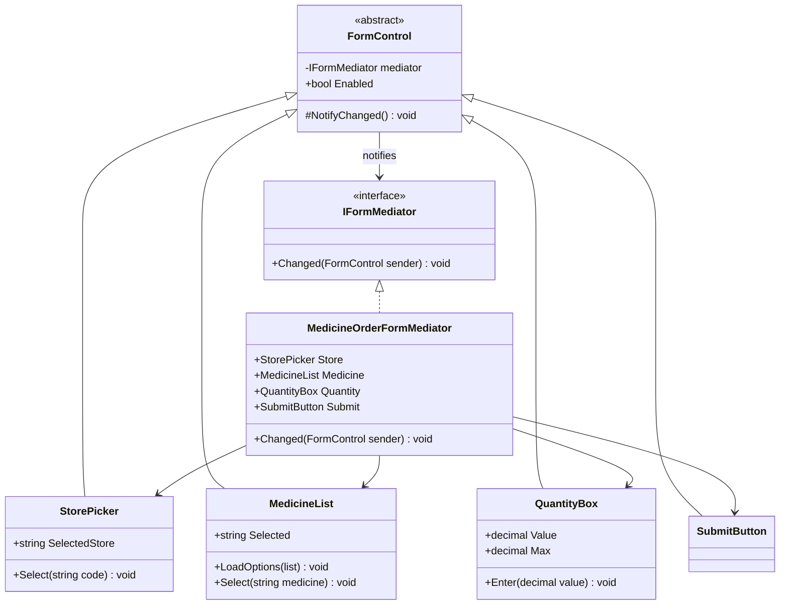
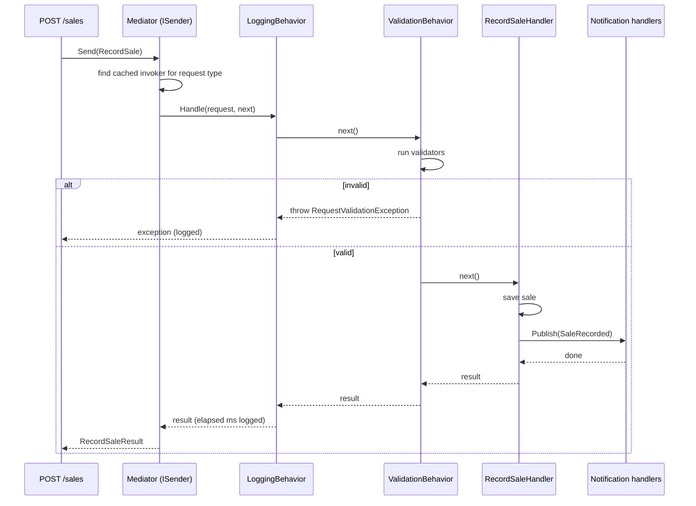
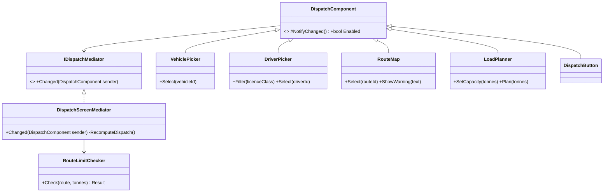

The word "Mediator" means two different things in .NET teams today. The first is the original Gang of Four (GoF) pattern: a coordinator that stops a group of objects from calling each other directly. The second is the "MediatR style": an in-process dispatcher that takes a request object and finds the one handler for it. They are related, but they solve different problems. This lesson teaches both, builds a small dispatcher from scratch, and spends real time on the criticism, because "mediator everywhere" is one of the most common over-engineering habits in ASP.NET Core codebases.

## Learning objectives

By the end of this lesson you will be able to:

1. Explain the problem the classic Mediator solves: many objects that all know about each other (a mesh of dependencies).
2. Name the participants (mediator, concrete mediator, colleagues) and implement a GoF mediator for a form with dependent fields.
3. Build a tiny in-process request/handler dispatcher (the MediatR idea) with dependency injection, notifications and pipeline behaviours.
4. Use pipeline behaviours for cross-cutting concerns such as validation and timing, and explain why their order matters.
5. Test handlers directly, test behaviours with fakes, and test the wiring.
6. Argue clearly when *not* to use a mediator: hidden control flow, "go to definition" that leads nowhere, and handlers calling handlers.
7. Tell Mediator apart from Observer, Facade, Chain of Responsibility and a plain service class.

## Prerequisites

- [Interfaces and abstract classes](#/lesson/m01-interfaces-abstract): every participant here is defined by an interface.
- [Dependency injection](#/lesson/m03-dependency-injection): our dispatcher resolves handlers from the container.
- [Observer](#/lesson/m06-observer): notifications in a mediator are a form of publish/subscribe, and we compare the two.

Generics with constraints (`where TRequest : IRequest<TResponse>`) appear in the production code. If they are new to you, read [Collections and generics](#/lesson/m01-collections-generics) first, or just follow the shape and come back.

## Explain it like I'm a beginner

Think about a busy airport. Forty planes are landing, taking off and taxiing. Imagine if every pilot had to radio every other pilot: "I'm on runway 2, are you about to land on runway 2?" With 40 planes that is 40 × 39 = 1,560 possible conversations. Nobody could keep track, and one missed message would mean a crash.

So airports have a control tower. Every pilot talks only to the tower. The tower knows where every plane is and tells each one what to do. Forty planes means forty radio links, not 1,560.

That control tower is a **Mediator**. The planes are called **colleagues**. The rule is simple: colleagues never talk to each other directly. They tell the mediator "something happened", and the mediator decides who else needs to react.

You see the same thing in software. Picture the order form in a pharmacy chain's app:

- When the customer picks a **store**, the **medicine** list must reload with what that store has in stock.
- When they pick a **medicine**, the **quantity** box unlocks and its limit changes (say, a maximum of 10 strips of a prescription medicine per order).
- The **Submit** button should only light up when all three are valid.

If each control talks to the others directly, the store picker must know about the medicine list, the quantity box *and* the button. The medicine list must know about the quantity box and the button. Add a "delivery slot" field and you edit four classes. With a mediator, each control only says "I changed", and one class, the form's mediator, holds all the "when X changes, update Y" rules.

The second, modern meaning is like the **reception desk of a hospital**. You don't walk around looking for the right department. You hand your form (a request) to reception, and the desk routes it to the one department that handles that form type (the handler). On the way, the desk may stamp it, check it is filled in, and log the time (pipeline behaviours). You don't need to know which department did the work.

## First-principles explanation

### The original problem: a mesh of objects

Say you have *n* objects that all need to react to each other. If each one holds references to the others, you can have up to n × (n − 1) dependencies. With 4 controls that is 12; with 8 controls it is 56. Three costs follow:

1. **Reuse dies.** The store picker can't be used on another screen, because it is hard-wired to this screen's medicine list.
2. **Rules are scattered.** "Submit is enabled when store, medicine and quantity are valid" is spread over three classes. Nobody can read it in one place.
3. **Change ripples.** Adding one control means editing several existing ones (shotgun surgery, see [Code smells](#/lesson/m04-code-smells)).

The GoF solution is to define an object that *encapsulates how a set of objects interact*. Colleagues hold a reference to the mediator only. The dependency count drops from n × (n − 1) to about 2n: each colleague knows the mediator, and the mediator knows each colleague.

### Participants (classic GoF)

| Participant | Job | In our form example |
|---|---|---|
| **Mediator** (interface) | The channel colleagues use to report events | `IFormMediator.Changed(FormControl sender)` |
| **Concrete mediator** | Knows the colleagues and holds the coordination rules | `MedicineOrderFormMediator` |
| **Colleague** (base) | Holds a reference to the mediator and notifies it | `FormControl` |
| **Concrete colleagues** | Do their own job; report changes; never reference each other | `StorePicker`, `MedicineList`, `QuantityBox`, `SubmitButton` |

The simplest implementation is just that: an interface with one method, a base class that stores the mediator, and a concrete mediator with a `switch` over "who changed".

### How it works internally

There is no framework magic in the classic version:

1. The concrete mediator creates (or is given) the colleagues and passes itself to each one.
2. A colleague changes its own state, for example `StorePicker.Select("BLR-KORAMANGALA")`, then calls `mediator.Changed(this)`.
3. The mediator looks at who changed and updates the others: it loads the medicine list, disables the quantity box and recomputes whether Submit is enabled.
4. Updates made *by the mediator* do not call back into the mediator. Otherwise you get loops: the mediator clears the quantity, the quantity reports "changed", the mediator clears the medicine list, and so on (re-entrancy).

### The modern meaning: in-process request dispatch

In ASP.NET Core, "mediator" usually means something else. A controller or endpoint creates a message object, for example `RecordSale`, and calls `sender.Send(message)`. The dispatcher finds the single class that implements `IRequestHandler<RecordSale, ...>` and runs it. This is the idea popularised by the MediatR library.

What it gives you:

- **One handler class per use case** (a "vertical slice"). The endpoint stays thin and the use case is easy to find by name.
- **A pipeline (pipeline behaviours).** Code that runs around *every* handler: validation, logging, timing, transactions, caching. You write it once instead of in every handler. This is the [Decorator](#/lesson/m06-decorator) and [Chain of Responsibility](#/lesson/m06-chain-of-responsibility) idea applied generically.
- **Notifications.** One event, many handlers, like [Observer](#/lesson/m06-observer), but resolved from DI.

How the dispatcher works internally:

1. `Send<TResponse>(IRequest<TResponse> request)` only knows `TResponse` at compile time. The concrete request type (`RecordSale`) is only known at runtime, from `request.GetType()`.
2. So the dispatcher builds a small generic helper for each (request type, response type) pair using reflection *once* (`MakeGenericType`), caches it in a `ConcurrentDictionary`, and reuses it. After the first call there is no more reflection, just a dictionary lookup and normal generic code.
3. The helper resolves `IRequestHandler<TRequest, TResponse>` and every `IPipelineBehavior<TRequest, TResponse>` from the current DI scope.
4. It wraps the handler in the behaviours like layers of an onion, so the first registered behaviour runs first and finishes last.

Is it still the GoF Mediator? Partly. It does remove direct dependencies: the endpoint no longer references the handler class. But GoF mediators *coordinate a conversation between peers*, while a request dispatcher *routes one message to one receiver*. Many authors argue it is closer to a Command bus or a Service Locator than a classic mediator. That is not just pedantry; it explains the criticism below.

### What happens without a mediator

Without the classic mediator, coordination logic spreads across the colleagues, and every new rule touches several classes. Without a request dispatcher, you have ordinary services: `SalesService.RecordAsync(...)` injected into the endpoint. That is often perfectly fine. The dispatcher earns its place only when the pipeline (cross-cutting behaviours applied uniformly) or the one-handler-per-use-case structure is genuinely useful.

### When it is useful

**Classic mediator**
- A screen, workflow or simulation where 4+ components react to each other.
- You want the components reusable on other screens.
- The coordination rules change more often than the components.

**Request dispatcher**
- A large application (dozens of use cases) organised as vertical slices.
- Cross-cutting concerns that must apply to *every* command, such as validation, audit and transactions, and that you want enforced in one place.
- Teams that want "one file per use case" as a navigation convention.

### When it is unnecessary or harmful

- Two or three components that interact simply. Direct calls or a C# event are clearer.
- Small APIs with 10–20 endpoints. Injecting a service is simpler and "go to definition" works.
- When the mediator becomes a **god object**: the concrete mediator grows to 2,000 lines because every rule in the system goes there.
- When handlers call `Send` on *other* handlers. Now you have a call graph that no tool can show you.

### Trade-offs it introduces

| You gain | You pay |
|---|---|
| Colleagues are decoupled and reusable | The mediator can turn into a god object |
| Coordination rules in one place | One more indirection to read through |
| (Dispatcher) uniform pipeline for validation, logging, transactions | Hidden control flow: "go to definition" on `Send` shows the dispatcher, not the handler |
| (Dispatcher) thin endpoints, one handler per use case | Runtime errors ("no handler registered") instead of compile-time errors |
| (Dispatcher) easy to add behaviours to every request | Small cost per call (allocations, delegate chain). Tiny next to I/O, but not zero |

## Visual explanation

### Class diagram — the classic GoF mediator



How to read it: every control (colleague) inherits from `FormControl`, which points only at the `IFormMediator` interface. No control has an arrow to another control. The concrete mediator is the only class that knows all four controls. To add a "delivery slot" control you add one class and edit one class, the mediator, instead of editing every control.

### Sequence diagram — a request through the in-process dispatcher



This shows the onion. The endpoint only knows `ISender`. The logging behaviour is outermost, so it times everything, including validation. The validation behaviour can short-circuit: if the request is invalid, the handler never runs. The handler then publishes a notification to zero or more notification handlers. Notice what this diagram hides from a reader of the endpoint code: none of these participants appear in the endpoint's source. That is the "hidden control flow" cost.

## Step-by-step example

We'll build the classic version first, then the dispatcher.

### Step 1 — the tangled version

```csharp
// Every control knows every other control. 4 controls, up to 12 references.
public sealed class StorePicker
{
    public MedicineList Medicines { get; set; } = null!;
    public QuantityBox Quantity { get; set; } = null!;
    public SubmitButton Submit { get; set; } = null!;

    public void Select(string code)
    {
        Selected = code;
        Medicines.LoadOptions(StockCatalogue.For(code));
        Quantity.Clear();
        Submit.Enabled = false;   // the "can submit?" rule, copy 1 of 3
    }
    public string? Selected { get; private set; }
}
```

The "can submit?" rule is copied into three classes. When the business adds "quantity must not exceed the refills left on the prescription", someone updates two copies and forgets the third.

### Step 2 — introduce the mediator interface

Ask: what do all controls need to say? Only "I changed". That is the whole interface:

```csharp
public interface IFormMediator { void Changed(FormControl sender); }
```

### Step 3 — controls only know the mediator

Each control keeps its own state and calls `NotifyChanged()` after a *user* action. The control does not know what will happen next.

### Step 4 — one place for the rules

The concrete mediator has a `switch` on the sender and one `RecomputeSubmit()` method. The full code is in the next section.

### Step 5 — from screens to requests

Now look at the API side. Your endpoints call `SalesService`, `ReturnsService`, `StockService`. Every service method starts with the same five lines: validate, log, start a timer, open a transaction. That repetition is what pipeline behaviours remove. We'll build `ISender`, `IRequestHandler<,>` and `IPipelineBehavior<,>` ourselves in about 80 lines, so there is no magic left.

## Production-style C# implementation

Project structure:

```text
PharmaOps.Api/
  Program.cs
  ClassicUi/MedicineOrderForm.cs        # GoF mediator (e.g. behind a Blazor or desktop form)
  Mediation/Abstractions.cs             # IRequest, IRequestHandler, IPipelineBehavior, notifications
  Mediation/Mediator.cs                 # the dispatcher
  Mediation/MediationRegistration.cs    # assembly scanning for handlers
  Behaviors/LoggingBehavior.cs
  Behaviors/ValidationBehavior.cs
  Features/Sales/RecordSale.cs
```

### The classic mediator

```csharp file=ClassicUi/MedicineOrderForm.cs
namespace PharmaOps.ClassicUi;

public interface IFormMediator
{
    void Changed(FormControl sender);
}

/// <summary>Colleague base class. A control knows the mediator, never another control.</summary>
public abstract class FormControl(IFormMediator mediator)
{
    public bool Enabled { get; set; } = true;
    protected void NotifyChanged() => mediator.Changed(this);
}

public sealed class StorePicker(IFormMediator mediator) : FormControl(mediator)
{
    public string? SelectedStore { get; private set; }
    public void Select(string storeCode) { SelectedStore = storeCode; NotifyChanged(); }
}

public sealed class MedicineList(IFormMediator mediator) : FormControl(mediator)
{
    public IReadOnlyList<string> Options { get; private set; } = [];
    public string? Selected { get; private set; }

    /// <summary>Called by the mediator. Does not notify, to avoid feedback loops.</summary>
    public void LoadOptions(IReadOnlyList<string> options) { Options = options; Selected = null; }

    public void Select(string medicine)
    {
        if (!Options.Contains(medicine)) throw new ArgumentException($"'{medicine}' is not in stock at this store.", nameof(medicine));
        Selected = medicine;
        NotifyChanged();
    }
}

public sealed class QuantityBox(IFormMediator mediator) : FormControl(mediator)
{
    public decimal? Value { get; private set; }
    public decimal Max { get; set; }
    public string? Error { get; set; }
    public void Enter(decimal value) { Value = value; NotifyChanged(); }
    public void Clear() { Value = null; Error = null; }
}

public sealed class SubmitButton(IFormMediator mediator) : FormControl(mediator);

/// <summary>Concrete mediator: owns every "when X changes, update Y" rule of the medicine order form.</summary>
public sealed class MedicineOrderFormMediator : IFormMediator
{
    private readonly IReadOnlyDictionary<string, IReadOnlyList<string>> _medicinesByStore;
    private readonly IReadOnlyDictionary<string, decimal> _maxPerRequest;

    public MedicineOrderFormMediator(
        IReadOnlyDictionary<string, IReadOnlyList<string>> medicinesByStore,
        IReadOnlyDictionary<string, decimal> maxPerRequest)
    {
        _medicinesByStore = medicinesByStore;
        _maxPerRequest = maxPerRequest;
        Store = new StorePicker(this);
        Medicine = new MedicineList(this) { Enabled = false };
        Quantity = new QuantityBox(this) { Enabled = false };
        Submit = new SubmitButton(this) { Enabled = false };
    }

    public StorePicker Store { get; }
    public MedicineList Medicine { get; }
    public QuantityBox Quantity { get; }
    public SubmitButton Submit { get; }

    public void Changed(FormControl sender)
    {
        switch (sender)
        {
            case StorePicker p:
                Medicine.LoadOptions(_medicinesByStore.TryGetValue(p.SelectedStore!, out var list) ? list : []);
                Medicine.Enabled = Medicine.Options.Count > 0;
                Quantity.Clear();
                Quantity.Enabled = false;
                break;
            case MedicineList m:
                Quantity.Clear();
                Quantity.Max = _maxPerRequest.GetValueOrDefault(m.Selected!, 0m);
                Quantity.Enabled = true;
                break;
            case QuantityBox q:
                q.Error = q.Value switch
                {
                    null or <= 0 => "Enter a quantity greater than zero.",
                    var v when v > q.Max => $"Maximum per request is {q.Max}.",
                    _ => null,
                };
                break;
        }
        Submit.Enabled = Store.SelectedStore is not null
                         && Medicine.Selected is not null
                         && Quantity.Value is > 0
                         && Quantity.Error is null;
    }
}
```

Notice three design decisions. First, `LoadOptions` and `Clear` are called by the mediator and deliberately do *not* notify, which prevents feedback loops. Second, the "can submit?" rule exists exactly once. Third, the mediator is plain C#, so it can sit behind a Blazor component, a WinForms dialog or a MAUI page, and you can unit-test it without any UI.

### The in-process dispatcher

```csharp file=Mediation/Abstractions.cs
namespace PharmaOps.Mediation;

/// <summary>A message with exactly one handler that returns <typeparamref name="TResponse"/>.</summary>
public interface IRequest<TResponse>;

public interface IRequestHandler<in TRequest, TResponse> where TRequest : IRequest<TResponse>
{
    Task<TResponse> Handle(TRequest request, CancellationToken ct);
}

/// <summary>Calls the next layer of the pipeline (another behaviour, or finally the handler).</summary>
public delegate Task<TResponse> RequestHandlerDelegate<TResponse>();

public interface IPipelineBehavior<in TRequest, TResponse> where TRequest : IRequest<TResponse>
{
    Task<TResponse> Handle(TRequest request, RequestHandlerDelegate<TResponse> next, CancellationToken ct);
}

/// <summary>A message with zero or more handlers and no return value.</summary>
public interface INotification;

public interface INotificationHandler<in TNotification> where TNotification : INotification
{
    Task Handle(TNotification notification, CancellationToken ct);
}

public interface ISender
{
    Task<TResponse> Send<TResponse>(IRequest<TResponse> request, CancellationToken ct = default);
}

public interface IPublisher
{
    Task Publish<TNotification>(TNotification notification, CancellationToken ct = default) where TNotification : INotification;
}
```

```csharp file=Mediation/Mediator.cs
using System.Collections.Concurrent;
using Microsoft.Extensions.DependencyInjection;

namespace PharmaOps.Mediation;

/// <summary>Registered as scoped, so handlers can depend on scoped services such as a DbContext.</summary>
public sealed class Mediator(IServiceProvider services) : ISender, IPublisher
{
    // One invoker per (request type, response type), built by reflection once and then reused.
    private static readonly ConcurrentDictionary<(Type Request, Type Response), object> Invokers = new();

    public Task<TResponse> Send<TResponse>(IRequest<TResponse> request, CancellationToken ct = default)
    {
        ArgumentNullException.ThrowIfNull(request);
        var invoker = (RequestInvoker<TResponse>)Invokers.GetOrAdd(
            (request.GetType(), typeof(TResponse)),
            static key => Activator.CreateInstance(typeof(RequestInvoker<,>).MakeGenericType(key.Request, key.Response))!);
        return invoker.Invoke(request, services, ct);
    }

    /// <summary>Runs handlers one after another in registration order. The first exception stops the rest.</summary>
    public async Task Publish<TNotification>(TNotification notification, CancellationToken ct = default)
        where TNotification : INotification
    {
        ArgumentNullException.ThrowIfNull(notification);
        foreach (var handler in services.GetServices<INotificationHandler<TNotification>>())
            await handler.Handle(notification, ct);
    }
}

internal abstract class RequestInvoker<TResponse>
{
    public abstract Task<TResponse> Invoke(IRequest<TResponse> request, IServiceProvider services, CancellationToken ct);
}

internal sealed class RequestInvoker<TRequest, TResponse> : RequestInvoker<TResponse>
    where TRequest : IRequest<TResponse>
{
    public override Task<TResponse> Invoke(IRequest<TResponse> request, IServiceProvider services, CancellationToken ct)
    {
        var typed = (TRequest)request;
        var handler = services.GetService<IRequestHandler<TRequest, TResponse>>()
            ?? throw new InvalidOperationException($"No handler registered for {typeof(TRequest).Name}.");

        RequestHandlerDelegate<TResponse> next = () => handler.Handle(typed, ct);

        // Wrap from the last behaviour to the first, so the first registered behaviour is outermost.
        foreach (var behavior in services.GetServices<IPipelineBehavior<TRequest, TResponse>>().Reverse())
        {
            var inner = next;
            next = () => behavior.Handle(typed, inner, ct);
        }
        return next();
    }
}
```

```csharp file=Mediation/MediationRegistration.cs
using System.Reflection;
using Microsoft.Extensions.DependencyInjection;

namespace PharmaOps.Mediation;

public static class MediationRegistration
{
    /// <summary>Registers the mediator and every request/notification handler found in <paramref name="assembly"/>.</summary>
    public static IServiceCollection AddMediation(this IServiceCollection services, Assembly assembly)
    {
        services.AddScoped<Mediator>();
        services.AddScoped<ISender>(sp => sp.GetRequiredService<Mediator>());
        services.AddScoped<IPublisher>(sp => sp.GetRequiredService<Mediator>());

        var handlerTypes = assembly.GetTypes()
            .Where(t => t is { IsClass: true, IsAbstract: false, IsGenericTypeDefinition: false });

        foreach (var type in handlerTypes)
            foreach (var iface in type.GetInterfaces().Where(i => i.IsGenericType))
            {
                var definition = iface.GetGenericTypeDefinition();
                if (definition == typeof(IRequestHandler<,>) || definition == typeof(INotificationHandler<>))
                    services.AddTransient(iface, type);
            }
        return services;
    }
}
```

### Pipeline behaviours

```csharp file=Behaviors/LoggingBehavior.cs
using System.Diagnostics;
using Microsoft.Extensions.Logging;
using PharmaOps.Mediation;

namespace PharmaOps.Behaviors;

public sealed class LoggingBehavior<TRequest, TResponse>(ILogger<LoggingBehavior<TRequest, TResponse>> logger)
    : IPipelineBehavior<TRequest, TResponse> where TRequest : IRequest<TResponse>
{
    private const int SlowThresholdMs = 500;

    public async Task<TResponse> Handle(TRequest request, RequestHandlerDelegate<TResponse> next, CancellationToken ct)
    {
        var name = typeof(TRequest).Name;
        var started = Stopwatch.GetTimestamp();
        try
        {
            var response = await next();
            var ms = Stopwatch.GetElapsedTime(started).TotalMilliseconds;
            if (ms > SlowThresholdMs) logger.LogWarning("{Request} was slow: {ElapsedMs:F0} ms", name, ms);
            else logger.LogInformation("{Request} handled in {ElapsedMs:F0} ms", name, ms);
            return response;
        }
        catch (Exception ex)
        {
            logger.LogWarning(ex, "{Request} failed after {ElapsedMs:F0} ms", name, Stopwatch.GetElapsedTime(started).TotalMilliseconds);
            throw;
        }
    }
}
```

```csharp file=Behaviors/ValidationBehavior.cs
using PharmaOps.Mediation;

namespace PharmaOps.Behaviors;

public interface IValidator<in T>
{
    IEnumerable<string> Validate(T instance);
}

public sealed class RequestValidationException(IReadOnlyList<string> errors) : Exception("Request validation failed.")
{
    public IReadOnlyList<string> Errors { get; } = errors;
}

/// <summary>Runs every validator registered for the request type. Short-circuits before the handler on failure.</summary>
public sealed class ValidationBehavior<TRequest, TResponse>(IEnumerable<IValidator<TRequest>> validators)
    : IPipelineBehavior<TRequest, TResponse> where TRequest : IRequest<TResponse>
{
    public Task<TResponse> Handle(TRequest request, RequestHandlerDelegate<TResponse> next, CancellationToken ct)
    {
        var errors = validators.SelectMany(v => v.Validate(request)).ToList();
        return errors.Count > 0 ? throw new RequestValidationException(errors) : next();
    }
}
```

### A feature slice

```csharp file=Features/Sales/RecordSale.cs
using Microsoft.Extensions.Logging;
using PharmaOps.Behaviors;
using PharmaOps.Mediation;

namespace PharmaOps.Features.Sales;

// ---- Messages ----
public sealed record RecordSale(int StoreId, DateOnly Date, string Medicine, decimal Quantity, string Unit)
    : IRequest<RecordSaleResult>;

public sealed record RecordSaleResult(Guid EntryId, decimal CumulativeQuantity);

public sealed record SaleRecorded(Guid EntryId, int StoreId, string Medicine, decimal Quantity) : INotification;

// ---- Persistence port (swap for PostgreSQL in production) ----
public sealed record SaleEntry(Guid Id, int StoreId, DateOnly Date, string Medicine, decimal Quantity, string Unit);

public interface ISalesStore
{
    /// <summary>Saves the sale and returns the quantity of that medicine sold so far at that store.</summary>
    Task<decimal> AddAsync(SaleEntry entry, CancellationToken ct);
}

public sealed class InMemorySalesStore : ISalesStore
{
    private readonly List<SaleEntry> _entries = [];
    private readonly Lock _gate = new();

    public Task<decimal> AddAsync(SaleEntry entry, CancellationToken ct)
    {
        lock (_gate)
        {
            _entries.Add(entry);
            return Task.FromResult(_entries
                .Where(e => e.StoreId == entry.StoreId && e.Medicine == entry.Medicine)
                .Sum(e => e.Quantity));
        }
    }
}

// ---- Validation ----
public sealed class RecordSaleValidator(TimeProvider clock) : IValidator<RecordSale>
{
    public IEnumerable<string> Validate(RecordSale r)
    {
        if (r.StoreId <= 0) yield return "StoreId must be positive.";
        if (string.IsNullOrWhiteSpace(r.Medicine)) yield return "Medicine is required.";
        if (r.Quantity <= 0) yield return "Quantity must be greater than zero.";
        if (r.Date > DateOnly.FromDateTime(clock.GetUtcNow().UtcDateTime)) yield return "A sale cannot be recorded for a future date.";
    }
}

// ---- Handler: the use case ----
public sealed class RecordSaleHandler(ISalesStore store, IPublisher publisher)
    : IRequestHandler<RecordSale, RecordSaleResult>
{
    public async Task<RecordSaleResult> Handle(RecordSale r, CancellationToken ct)
    {
        var entry = new SaleEntry(Guid.NewGuid(), r.StoreId, r.Date, r.Medicine.Trim(), r.Quantity, r.Unit);
        var cumulative = await store.AddAsync(entry, ct);
        // In production, write this to an outbox in the same transaction instead (see the callout below).
        await publisher.Publish(new SaleRecorded(entry.Id, r.StoreId, entry.Medicine, r.Quantity), ct);
        return new RecordSaleResult(entry.Id, cumulative);
    }
}

// ---- Side effects that react to the event ----
public sealed class NotifyStockPlanner(ILogger<NotifyStockPlanner> logger) : INotificationHandler<SaleRecorded>
{
    public Task Handle(SaleRecorded n, CancellationToken ct)
    {
        logger.LogInformation("Stock planner notified: store {StoreId} {Medicine} -{Quantity}", n.StoreId, n.Medicine, n.Quantity);
        return Task.CompletedTask;
    }
}
```

```csharp file=Program.cs
using PharmaOps.Behaviors;
using PharmaOps.Features.Sales;
using PharmaOps.Mediation;

var builder = WebApplication.CreateBuilder(args);

builder.Services.AddSingleton(TimeProvider.System);
builder.Services.AddSingleton<ISalesStore, InMemorySalesStore>();
builder.Services.AddMediation(typeof(RecordSaleHandler).Assembly);

// Order matters: the first registered behaviour is the outermost layer.
builder.Services.AddTransient(typeof(IPipelineBehavior<,>), typeof(LoggingBehavior<,>));
builder.Services.AddTransient(typeof(IPipelineBehavior<,>), typeof(ValidationBehavior<,>));
builder.Services.AddTransient<IValidator<RecordSale>, RecordSaleValidator>();

var app = builder.Build();

app.MapPost("/stores/{storeId:int}/sales",
    async (int storeId, SaleBody body, ISender sender, CancellationToken ct) =>
    {
        try
        {
            var result = await sender.Send(new RecordSale(storeId, body.Date, body.Medicine, body.Quantity, body.Unit), ct);
            return Results.Created($"/stores/{storeId}/sales/{result.EntryId}", result);
        }
        catch (RequestValidationException ex)
        {
            return Results.ValidationProblem(new Dictionary<string, string[]> { ["request"] = ex.Errors.ToArray() });
        }
    });

app.Run();

public sealed record SaleBody(DateOnly Date, string Medicine, decimal Quantity, string Unit);
```

**Why is the mediator scoped?** It resolves handlers from the `IServiceProvider` it was given. If it were a singleton, it would hold the *root* provider, and a handler that needs a scoped `DbContext` would either fail scope validation or, worse, share one context across all requests. Scoped means "resolve from this request's scope".

**Why open generic behaviours?** `AddTransient(typeof(IPipelineBehavior<,>), typeof(LoggingBehavior<,>))` registers one behaviour that the container closes for every request type on demand. That is how one class applies to 200 handlers.

:::callout type=warning title="Publishing inside the handler is not a transaction"
`Publish` runs notification handlers immediately, in-process. If the handler saves to PostgreSQL and the notification sends an email, and then the database commit fails, the email has already gone. For side effects that must not be lost or duplicated, write an *outbox* row in the same transaction and let a background worker deliver it. In-process notifications are fine for logging, cache invalidation and other best-effort work.
:::

:::callout type=note title="About MediatR"
You don't have to write your own dispatcher. MediatR is the best-known library, and several source-generator based alternatives exist. Recent MediatR versions moved to a commercial licence for some organisations, so check the current terms before adopting it. Building the 80-line version above is also a good way to see that the core is small, and that most of the value (and risk) is in how you use it.
:::

## Bad design vs good design

### Bad: mediator everywhere

```csharp
// Endpoint → Send → handler → Send → handler → Publish → handler → Send ...
public sealed class ApproveReturnHandler(ISender sender) : IRequestHandler<ApproveReturn, Unit>
{
    public async Task<Unit> Handle(ApproveReturn r, CancellationToken ct)
    {
        var ret = await sender.Send(new GetReturnById(r.ReturnId), ct);           // a query via the mediator
        await sender.Send(new UpdateReturnStatus(r.ReturnId, "Approved"), ct);   // another command
        await sender.Send(new RestockMedicine(ret.StoreId, ret.Medicine, ret.Quantity), ct);
        return Unit.Value;
    }
}
```

What goes wrong:

- **Hidden control flow.** Reading `ApproveReturnHandler`, you can't press F12 on `Send` to see what runs. You must search for `IRequestHandler<GetReturnById`.
- **Pipeline runs three extra times.** Logging, validation and perhaps a transaction behaviour wrap every nested call. A transaction behaviour that opens a new transaction per `Send` means approving a customer's medicine return is now three separate transactions. A failure halfway leaves the return approved but the stock never put back on the shelf.
- **Coupling by message.** The handlers are no longer coupled by type, but they are still coupled, by message shape and by behaviour you can't see.
- **The mediator is a service locator.** Any handler can reach any other use case without declaring it in its constructor.

### Good: handlers orchestrate with plain dependencies

```csharp
public sealed class ApproveReturnHandler(IReturnRepository returns, IStockService stock, IUnitOfWork uow)
    : IRequestHandler<ApproveReturn, Unit>
{
    public async Task<Unit> Handle(ApproveReturn r, CancellationToken ct)
    {
        var ret = await returns.GetAsync(r.ReturnId, ct) ?? throw new KeyNotFoundException($"Return {r.ReturnId}");
        ret.Approve();                                   // domain rule lives on the entity
        await stock.RestockAsync(ret.StoreId, ret.Medicine, ret.Quantity, ct);
        await uow.SaveChangesAsync(ct);                  // one transaction
        return Unit.Value;
    }
}
```

Rules that keep a dispatcher healthy:

1. **Only the edge sends.** Endpoints, message consumers and background jobs call `Send`. Handlers do not call `Send`.
2. **Handlers depend on ordinary services** (repositories, domain services) declared in their constructor.
3. **Behaviours are few and boring:** validation, logging/metrics, transactions, maybe authorisation. Business rules don't belong in behaviours.
4. **Notifications for side effects**, not for steps the use case depends on.

### Is a dispatcher worth it at all?

For a 15-endpoint internal API, honestly, often not. This is just as clean and keeps "go to definition":

```csharp
app.MapPost("/stores/{id:int}/sales", (int id, SaleBody b, SalesService svc, CancellationToken ct)
    => svc.RecordAsync(id, b, ct));
```

Cross-cutting concerns can live in ASP.NET Core endpoint filters (`AddEndpointFilter`), middleware, or a [Decorator](#/lesson/m06-decorator) around the service. Reach for a dispatcher when you have many use cases, want the vertical-slice structure, and want one uniform pipeline enforced for all of them.

## Practical playground

The playground has a minimal mediator without DI: a dictionary of handlers and a list of behaviours. Run it, then try these changes. Swap the order of the two behaviours and predict the output first. Make the validation behaviour reject zero quantity. Add a third behaviour that measures time.

:::playground type=csharp title="A 40-line mediator"
```csharp file=Program.cs
using System;
using System.Collections.Generic;
using System.Linq;

public interface IRequest<TResponse> { }
public sealed record RecordSale(string Medicine, decimal Quantity) : IRequest<string>;

public delegate object? Next();
public interface IBehavior { object? Handle(object request, Next next); }

public sealed class LogBehavior : IBehavior
{
    public object? Handle(object request, Next next)
    {
        Console.WriteLine($"[log] -> {request.GetType().Name}");
        var result = next();
        Console.WriteLine($"[log] <- {result}");
        return result;
    }
}

public sealed class ValidateBehavior : IBehavior
{
    public object? Handle(object request, Next next)
    {
        if (request is RecordSale { Quantity: < 0 }) return "rejected: negative quantity";
        return next();
    }
}

public sealed class TinyMediator
{
    private readonly Dictionary<Type, Func<object, object?>> _handlers = new();
    private readonly List<IBehavior> _behaviors = new();

    public void Handle<TRequest, TResponse>(Func<TRequest, TResponse> handler) where TRequest : IRequest<TResponse>
        => _handlers[typeof(TRequest)] = r => handler((TRequest)r);

    public void Use(IBehavior behavior) => _behaviors.Add(behavior);

    public TResponse Send<TResponse>(IRequest<TResponse> request)
    {
        if (!_handlers.TryGetValue(request.GetType(), out var handler))
            throw new InvalidOperationException($"No handler for {request.GetType().Name}");
        Next next = () => handler(request);
        foreach (var b in Enumerable.Reverse(_behaviors))
        {
            var inner = next;
            var behavior = b;
            next = () => behavior.Handle(request, inner);
        }
        return (TResponse)next()!;
    }
}

public static class Program
{
    public static void Main()
    {
        var m = new TinyMediator();
        m.Use(new LogBehavior());
        m.Use(new ValidateBehavior());
        m.Handle<RecordSale, string>(r => $"recorded {r.Quantity} x {r.Medicine}");

        Console.WriteLine(m.Send(new RecordSale("Paracetamol 650 mg", 3m)));
        Console.WriteLine(m.Send(new RecordSale("Paracetamol 650 mg", -5m)));
    }
}
```
:::

## Exercises

:::exercise id=m06-mediator-ex1 difficulty=beginner kind=code title="Hospital paging channel (classic mediator)"
Hospital teams (emergency, radiology, pharmacy) coordinate over one paging channel. Teams must never hold references to each other. Implement `PagingChannel`, the concrete mediator.
::requirements
- `Join(team)` registers the team and sets `team.Channel` to the channel. Joining twice with the same name throws `InvalidOperationException`.
- `Broadcast(from, message)` delivers `"<from>: <message>"` to every joined team **except** the sender.
- `SendTo(from, toName, message)` delivers to exactly one team. An unknown name throws `ArgumentException`.
- A team that has not joined calls `Say(...)` and gets `InvalidOperationException` (already implemented in `Team`).
::acceptance
- Three teams joined; Emergency broadcasts "Trauma patient arriving in 5 minutes"; Radiology and Pharmacy each have exactly one inbox message, Emergency has none.
- `SendTo(radiology, "Pharmacy", "Contrast needed in CT room 2")` reaches only Pharmacy.
- Duplicate names and unknown recipients throw the specified exceptions.
::hint
The mediator is the only class that knows all teams. What collection lets you find a team by name quickly?
::hint
Use a `Dictionary<string, Team>` with `StringComparer.OrdinalIgnoreCase`. Insertion order is enough for broadcast.
::hint
For broadcast, loop over the dictionary values and skip the one where `ReferenceEquals(team, from)`.
::hint
```csharp
public void Join(Team team)
{
    if (!_teams.TryAdd(team.Name, team)) throw new InvalidOperationException($"{team.Name} already joined");
    team.Channel = this;
}
```
::starter
```csharp file=PagingChannel.cs
using System;
using System.Collections.Generic;

public interface IPagingChannel
{
    void Join(Team team);
    void Broadcast(Team from, string message);
    void SendTo(Team from, string toName, string message);
}

public sealed class Team(string name)
{
    public string Name { get; } = name;
    public List<string> Inbox { get; } = new();
    public IPagingChannel? Channel { get; set; }

    public void Receive(string from, string message) => Inbox.Add($"{from}: {message}");

    public void Say(string message) =>
        (Channel ?? throw new InvalidOperationException($"{Name} has not joined a channel")).Broadcast(this, message);
}

public sealed class PagingChannel : IPagingChannel
{
    public void Join(Team team) => throw new NotImplementedException();
    public void Broadcast(Team from, string message) => throw new NotImplementedException();
    public void SendTo(Team from, string toName, string message) => throw new NotImplementedException();
}
```
::tests
```csharp file=PagingChannelTests.cs
using System;
using Xunit;

public class PagingChannelTests
{
    private static (PagingChannel ch, Team f, Team s, Team c) Setup()
    {
        var ch = new PagingChannel();
        var f = new Team("Emergency"); var s = new Team("Radiology"); var c = new Team("Pharmacy");
        ch.Join(f); ch.Join(s); ch.Join(c);
        return (ch, f, s, c);
    }

    [Fact]
    public void Broadcast_reaches_everyone_except_sender()
    {
        var (_, f, s, c) = Setup();
        f.Say("Trauma patient arriving in 5 minutes");
        Assert.Empty(f.Inbox);
        Assert.Equal("Emergency: Trauma patient arriving in 5 minutes", Assert.Single(s.Inbox));
        Assert.Single(c.Inbox);
    }

    [Fact]
    public void Direct_message_reaches_only_target()
    {
        var (ch, f, s, c) = Setup();
        ch.SendTo(s, "Pharmacy", "Contrast needed in CT room 2");
        Assert.Equal("Radiology: Contrast needed in CT room 2", Assert.Single(c.Inbox));
        Assert.Empty(f.Inbox);
        Assert.Empty(s.Inbox);
    }

    [Fact]
    public void Join_sets_channel() { var (ch, f, _, _) = Setup(); Assert.Same(ch, f.Channel); }

    [Fact]
    public void Duplicate_name_throws()
    {
        var (ch, _, _, _) = Setup();
        Assert.Throws<InvalidOperationException>(() => ch.Join(new Team("radiology")));
    }

    [Fact]
    public void Unknown_recipient_throws()
    {
        var (ch, f, _, _) = Setup();
        Assert.Throws<ArgumentException>(() => ch.SendTo(f, "Dermatology", "hello"));
    }

    [Fact]
    public void Not_joined_cannot_speak() =>
        Assert.Throws<InvalidOperationException>(() => new Team("Cardiology").Say("hi"));
}
```
::solution
The channel keeps a case-insensitive dictionary of teams. It is the only place that knows who is listening.

```csharp file=PagingChannel.cs
using System;
using System.Collections.Generic;

public interface IPagingChannel
{
    void Join(Team team);
    void Broadcast(Team from, string message);
    void SendTo(Team from, string toName, string message);
}

public sealed class Team(string name)
{
    public string Name { get; } = name;
    public List<string> Inbox { get; } = new();
    public IPagingChannel? Channel { get; set; }

    public void Receive(string from, string message) => Inbox.Add($"{from}: {message}");

    public void Say(string message) =>
        (Channel ?? throw new InvalidOperationException($"{Name} has not joined a channel")).Broadcast(this, message);
}

public sealed class PagingChannel : IPagingChannel
{
    private readonly Dictionary<string, Team> _teams = new(StringComparer.OrdinalIgnoreCase);

    public void Join(Team team)
    {
        ArgumentNullException.ThrowIfNull(team);
        if (!_teams.TryAdd(team.Name, team)) throw new InvalidOperationException($"{team.Name} has already joined.");
        team.Channel = this;
    }

    public void Broadcast(Team from, string message)
    {
        foreach (var team in _teams.Values)
            if (!ReferenceEquals(team, from)) team.Receive(from.Name, message);
    }

    public void SendTo(Team from, string toName, string message)
    {
        if (!_teams.TryGetValue(toName, out var to)) throw new ArgumentException($"No team named '{toName}' on this channel.", nameof(toName));
        to.Receive(from.Name, message);
    }
}
```

Adding a "night mode" rule (only urgent broadcasts after 10 pm) now means editing one class, the channel. No team changes.
::mistakes
- Letting `Team` hold a list of other teams "for convenience", which brings back the mesh.
- Comparing teams by name in broadcast instead of by reference, which breaks if two teams ever share a display name.
- Throwing `KeyNotFoundException` from the dictionary indexer instead of the documented `ArgumentException`.
::extensions
Add `Leave(team)` and make the channel log every message with a timestamp from an injected `TimeProvider`.
:::

:::exercise id=m06-mediator-ex2 difficulty=beginner kind=code title="Route a request to its one handler"
Build the core of a request dispatcher without DI: register handlers by request type and route `Send` to the right one.
::requirements
- `Register<TRequest, TResponse>(handler)` stores the handler. Registering a second handler for the same request type throws `InvalidOperationException`.
- `Send(request)` calls the handler for `request.GetType()` and returns its result.
- `Send(null)` throws `ArgumentNullException`. A request with no handler throws `InvalidOperationException` whose message contains the request type name.
::acceptance
- `Send(new GetStockLevel(7))` returns the value computed by the registered `GetStockLevelHandler`.
- Two different request types route to two different handlers.
- Error cases throw the exact exception types listed.
::hint
At `Send` time you only know `TResponse` statically. The concrete request type is only known at runtime. How can `Register`, which *does* know both types, prepare something that `Send` can call later?
::hint
Store a `Func<object, object?>` per request type. `Register` creates a lambda that casts the `object` back to `TRequest` and calls the handler.
::hint
In `Send`, look up `request.GetType()`, call the stored function, and cast the result to `TResponse`.
::hint
```csharp
_handlers.Add(typeof(TRequest), r => handler.Handle((TRequest)r));   // Add throws on duplicates, but with ArgumentException
```
Use `TryAdd` and throw your own `InvalidOperationException`.
::starter
```csharp file=SimpleMediator.cs
using System;
using System.Collections.Generic;

public interface IRequest<TResponse> { }

public interface IRequestHandler<TRequest, TResponse> where TRequest : IRequest<TResponse>
{
    TResponse Handle(TRequest request);
}

public sealed class SimpleMediator
{
    private readonly Dictionary<Type, Func<object, object?>> _handlers = new();

    public void Register<TRequest, TResponse>(IRequestHandler<TRequest, TResponse> handler)
        where TRequest : IRequest<TResponse> => throw new NotImplementedException();

    public TResponse Send<TResponse>(IRequest<TResponse> request) => throw new NotImplementedException();
}
```
::tests
```csharp file=SimpleMediatorTests.cs
using System;
using Xunit;

public sealed record GetStockLevel(int StoreId) : IRequest<decimal>;
public sealed record GetStoreName(int StoreId) : IRequest<string>;

public sealed class GetStockLevelHandler : IRequestHandler<GetStockLevel, decimal>
{
    public decimal Handle(GetStockLevel r) => r.StoreId * 1000m;
}
public sealed class GetStoreNameHandler : IRequestHandler<GetStoreName, string>
{
    public string Handle(GetStoreName r) => $"Store-{r.StoreId}";
}

public class SimpleMediatorTests
{
    private static SimpleMediator Create()
    {
        var m = new SimpleMediator();
        m.Register(new GetStockLevelHandler());
        m.Register(new GetStoreNameHandler());
        return m;
    }

    [Fact] public void Routes_to_correct_handler() => Assert.Equal(7000m, Create().Send(new GetStockLevel(7)));
    [Fact] public void Routes_second_type() => Assert.Equal("Store-3", Create().Send(new GetStoreName(3)));

    [Fact]
    public void Duplicate_registration_throws() =>
        Assert.Throws<InvalidOperationException>(() => Create().Register(new GetStockLevelHandler()));

    [Fact]
    public void Missing_handler_throws_with_type_name()
    {
        var m = new SimpleMediator();
        var ex = Assert.Throws<InvalidOperationException>(() => m.Send(new GetStockLevel(1)));
        Assert.Contains("GetStockLevel", ex.Message);
    }

    [Fact]
    public void Null_request_throws() =>
        Assert.Throws<ArgumentNullException>(() => Create().Send<decimal>(null!));
}
```
::solution
`Register` knows both generic types, so it captures them in a lambda. `Send` only needs to find that lambda by the runtime type.

```csharp file=SimpleMediator.cs
using System;
using System.Collections.Generic;

public interface IRequest<TResponse> { }

public interface IRequestHandler<TRequest, TResponse> where TRequest : IRequest<TResponse>
{
    TResponse Handle(TRequest request);
}

public sealed class SimpleMediator
{
    private readonly Dictionary<Type, Func<object, object?>> _handlers = new();

    public void Register<TRequest, TResponse>(IRequestHandler<TRequest, TResponse> handler)
        where TRequest : IRequest<TResponse>
    {
        ArgumentNullException.ThrowIfNull(handler);
        if (!_handlers.TryAdd(typeof(TRequest), r => handler.Handle((TRequest)r)))
            throw new InvalidOperationException($"A handler for {typeof(TRequest).Name} is already registered.");
    }

    public TResponse Send<TResponse>(IRequest<TResponse> request)
    {
        ArgumentNullException.ThrowIfNull(request);
        if (!_handlers.TryGetValue(request.GetType(), out var handler))
            throw new InvalidOperationException($"No handler registered for {request.GetType().Name}.");
        return (TResponse)handler(request)!;
    }
}
```

This is the same trick the production `Mediator` uses, except that version builds the lambda lazily from DI with `MakeGenericType` and caches it.
::mistakes
- Looking up `typeof(IRequest<TResponse>)` instead of `request.GetType()`, so every request returning `decimal` collides.
- Using `dynamic` to call `Handle`. It works but moves type errors to runtime and is slower on the first call.
- Silently replacing an existing handler on duplicate registration, which hides wiring bugs.
::extensions
Make `Send` async (`Task<TResponse>`) and add a `Publish` method for notifications with many handlers.
:::

:::exercise id=m06-mediator-ex3 difficulty=intermediate kind=code title="Pipeline order and a caching behaviour"
Implement `Pipeline.Build`, which wraps a handler in behaviours. Then implement `CachingBehavior`, which short-circuits for requests that implement `ICacheableRequest`.
::requirements
- The first behaviour in the list is the **outermost** layer: it runs first and finishes last.
- With zero behaviours, `Build` returns a function that just calls the handler.
- `CachingBehavior` returns a cached response for a repeated `CacheKey` without calling `next`. Requests that are not `ICacheableRequest` pass straight through.
::acceptance
- With behaviours A and B, the log is `A:before, B:before, handler, B:after, A:after`.
- Two sends of the same cacheable request call the handler once.
- Two sends of a non-cacheable request call the handler twice.
::hint
Start from the handler and wrap outward. Which behaviour must you wrap *first* so that A ends up outermost?
::hint
Loop over the behaviours from last to first. Each iteration wraps the current `next` in a new lambda.
::hint
Capture the current `next` in a local variable before creating the new lambda. Otherwise every layer points to itself.
::hint
```csharp
Func<TRequest, CancellationToken, Task<TResponse>> pipeline = (r, ct) => handler.Handle(r, ct);
for (var i = behaviors.Count - 1; i >= 0; i--)
{
    var behavior = behaviors[i];
    var inner = pipeline;
    pipeline = (r, ct) => behavior.Handle(r, () => inner(r, ct), ct);
}
```
::hint
For caching, use `if (request is not ICacheableRequest c) return await next();` then a `ConcurrentDictionary<string, TResponse>`.
::starter
```csharp file=Pipeline.cs
using System;
using System.Collections.Concurrent;
using System.Collections.Generic;
using System.Threading;
using System.Threading.Tasks;

public interface IRequest<TResponse> { }
public interface IRequestHandler<TRequest, TResponse> where TRequest : IRequest<TResponse>
{
    Task<TResponse> Handle(TRequest request, CancellationToken ct);
}
public delegate Task<TResponse> RequestHandlerDelegate<TResponse>();
public interface IPipelineBehavior<TRequest, TResponse> where TRequest : IRequest<TResponse>
{
    Task<TResponse> Handle(TRequest request, RequestHandlerDelegate<TResponse> next, CancellationToken ct);
}
public interface ICacheableRequest { string CacheKey { get; } }

public static class Pipeline
{
    public static Func<TRequest, CancellationToken, Task<TResponse>> Build<TRequest, TResponse>(
        IRequestHandler<TRequest, TResponse> handler,
        IReadOnlyList<IPipelineBehavior<TRequest, TResponse>> behaviors)
        where TRequest : IRequest<TResponse>
        => throw new NotImplementedException();
}

public sealed class CachingBehavior<TRequest, TResponse> : IPipelineBehavior<TRequest, TResponse>
    where TRequest : IRequest<TResponse>
{
    public Task<TResponse> Handle(TRequest request, RequestHandlerDelegate<TResponse> next, CancellationToken ct)
        => throw new NotImplementedException();
}
```
::tests
```csharp file=PipelineTests.cs
using System.Collections.Generic;
using System.Threading;
using System.Threading.Tasks;
using Xunit;

public sealed record GetRate(string Item) : IRequest<decimal>, ICacheableRequest { public string CacheKey => "rate:" + Item; }
public sealed record SaveRate(string Item, decimal Rate) : IRequest<decimal>;

public sealed class CountingHandler<T>(List<string> log) : IRequestHandler<T, decimal> where T : IRequest<decimal>
{
    public int Calls;
    public Task<decimal> Handle(T request, CancellationToken ct) { Calls++; log.Add("handler"); return Task.FromResult(42m); }
}

public sealed class Tagging<T>(string tag, List<string> log) : IPipelineBehavior<T, decimal> where T : IRequest<decimal>
{
    public async Task<decimal> Handle(T request, RequestHandlerDelegate<decimal> next, CancellationToken ct)
    {
        log.Add(tag + ":before");
        var r = await next();
        log.Add(tag + ":after");
        return r;
    }
}

public class PipelineTests
{
    [Fact]
    public async Task First_behavior_is_outermost()
    {
        var log = new List<string>();
        var h = new CountingHandler<SaveRate>(log);
        var behaviors = new List<IPipelineBehavior<SaveRate, decimal>> { new Tagging<SaveRate>("A", log), new Tagging<SaveRate>("B", log) };
        var run = Pipeline.Build(h, behaviors);
        Assert.Equal(42m, await run(new SaveRate("Paracetamol", 410m), CancellationToken.None));
        Assert.Equal(new List<string> { "A:before", "B:before", "handler", "B:after", "A:after" }, log);
    }

    [Fact]
    public async Task No_behaviors_calls_handler()
    {
        var h = new CountingHandler<SaveRate>(new List<string>());
        var run = Pipeline.Build(h, new List<IPipelineBehavior<SaveRate, decimal>>());
        await run(new SaveRate("Cetirizine", 60m), CancellationToken.None);
        Assert.Equal(1, h.Calls);
    }

    [Fact]
    public async Task Cacheable_request_hits_handler_once()
    {
        var h = new CountingHandler<GetRate>(new List<string>());
        var run = Pipeline.Build(h, new List<IPipelineBehavior<GetRate, decimal>> { new CachingBehavior<GetRate, decimal>() });
        await run(new GetRate("Amoxicillin"), CancellationToken.None);
        var second = await run(new GetRate("Amoxicillin"), CancellationToken.None);
        Assert.Equal(42m, second);
        Assert.Equal(1, h.Calls);
    }

    [Fact]
    public async Task Non_cacheable_request_passes_through()
    {
        var h = new CountingHandler<SaveRate>(new List<string>());
        var run = Pipeline.Build(h, new List<IPipelineBehavior<SaveRate, decimal>> { new CachingBehavior<SaveRate, decimal>() });
        await run(new SaveRate("Amoxicillin", 1m), CancellationToken.None);
        await run(new SaveRate("Amoxicillin", 1m), CancellationToken.None);
        Assert.Equal(2, h.Calls);
    }
}
```
::solution
Build the onion from the inside out, and keep the cache per behaviour instance.

```csharp file=Pipeline.cs
using System;
using System.Collections.Concurrent;
using System.Collections.Generic;
using System.Threading;
using System.Threading.Tasks;

public interface IRequest<TResponse> { }
public interface IRequestHandler<TRequest, TResponse> where TRequest : IRequest<TResponse>
{
    Task<TResponse> Handle(TRequest request, CancellationToken ct);
}
public delegate Task<TResponse> RequestHandlerDelegate<TResponse>();
public interface IPipelineBehavior<TRequest, TResponse> where TRequest : IRequest<TResponse>
{
    Task<TResponse> Handle(TRequest request, RequestHandlerDelegate<TResponse> next, CancellationToken ct);
}
public interface ICacheableRequest { string CacheKey { get; } }

public static class Pipeline
{
    public static Func<TRequest, CancellationToken, Task<TResponse>> Build<TRequest, TResponse>(
        IRequestHandler<TRequest, TResponse> handler,
        IReadOnlyList<IPipelineBehavior<TRequest, TResponse>> behaviors)
        where TRequest : IRequest<TResponse>
    {
        Func<TRequest, CancellationToken, Task<TResponse>> pipeline = (r, ct) => handler.Handle(r, ct);
        for (var i = behaviors.Count - 1; i >= 0; i--)
        {
            var behavior = behaviors[i];
            var inner = pipeline;
            pipeline = (r, ct) => behavior.Handle(r, () => inner(r, ct), ct);
        }
        return pipeline;
    }
}

public sealed class CachingBehavior<TRequest, TResponse> : IPipelineBehavior<TRequest, TResponse>
    where TRequest : IRequest<TResponse>
{
    private readonly ConcurrentDictionary<string, TResponse> _cache = new();

    public async Task<TResponse> Handle(TRequest request, RequestHandlerDelegate<TResponse> next, CancellationToken ct)
    {
        if (request is not ICacheableRequest cacheable) return await next();
        if (_cache.TryGetValue(cacheable.CacheKey, out var hit)) return hit;
        var response = await next();
        _cache[cacheable.CacheKey] = response;
        return response;
    }
}
```

In production, use `HybridCache` or `IMemoryCache` with an expiry instead of an unbounded dictionary, and register the caching behaviour *inside* validation, so invalid requests never get cached.
::alternatives
Instead of a marker interface, a behaviour can be registered only for specific request types (`IPipelineBehavior<GetRate, decimal>`). That is more explicit but needs one registration per cached query.
::mistakes
- Looping first-to-last, which makes the *last* behaviour outermost.
- Writing `pipeline = (r, ct) => behavior.Handle(r, () => pipeline(r, ct), ct)`. The lambda captures the variable, not its current value, so it calls itself forever.
- Caching command results. Only cache queries that have no side effects.
::extensions
Add a `RetryBehavior` that calls `next()` up to 3 times on a `TimeoutException`, and write a test proving the handler ran 3 times.
:::

:::exercise id=m06-mediator-ex4 difficulty=intermediate kind=design title="Refactor the tangled dispatch screen"
A courier hub's dispatch screen has five components. Each one holds direct references to the others:

```csharp
class VehiclePicker { DriverPicker drivers; RouteMap map; LoadPlanner load; DispatchButton button; ... }
class DriverPicker  { VehiclePicker vehicles; DispatchButton button; ... }
class RouteMap      { LoadPlanner load; DispatchButton button; ... }
class LoadPlanner   { VehiclePicker vehicles; RouteMap map; DispatchButton button; ... }
class DispatchButton { /* enabled when vehicle, driver, route and load are valid */ }
```

Rules: choosing a vehicle filters drivers by licence class and sets the load capacity (for example 1.5 t for a van, 9 t for a truck). Choosing a route checks the route's weight limits (many city roads ban heavy trucks during the day) against the planned load. Dispatch is enabled only when all four are valid. Refactor to a Mediator. Draw the class diagram and list which class owns each rule.
::acceptance
- No component references another component.
- Every cross-component rule lives in one class, and each rule is listed with its owner.
- Updates made by the mediator do not re-trigger the mediator (state how you prevent loops).
- You explain how you would unit-test the rules without any UI framework.
::hint
Count the references today, then count them after your refactor.
::hint
Each component only needs to say "I changed". What is the smallest interface for that?
::hint
Split methods into *user actions*, which notify the mediator, and *mediator commands*, which do not notify.
::hint
If the mediator grows past a few hundred lines, consider splitting it by concern (a capacity sub-mediator and a route-limit helper). The mediator can delegate to plain helper classes.
::solution
Before: 4 + 2 + 2 + 3 = 11 direct references. After: 5 references to `IDispatchMediator` plus 5 from the mediator, all pointing in one direction per role.



Rule ownership:

| Rule | Owner |
|---|---|
| Vehicle → filter drivers by licence | `DispatchScreenMediator` (case `VehiclePicker`) |
| Vehicle → set load capacity | `DispatchScreenMediator` |
| Load > capacity → error | `LoadPlanner` itself (single-component rule) |
| Route or load changed → check route weight limits | Mediator calls `RouteLimitChecker` (pure, separately tested) |
| Dispatch enabled | `DispatchScreenMediator.RecomputeDispatch()`, the only copy |

Loop prevention: `Filter`, `SetCapacity` and `ShowWarning` are mediator commands and never call `NotifyChanged`. Only `Select` and `Plan` (user actions) notify. Testing: construct the mediator with fake catalogue data, call `Vehicle.Select("TRK-01")`, and assert `Load.Capacity == 9` and `Button.Enabled == false`. No UI needed.
::mistakes
- Moving single-component validation (load ≤ capacity) into the mediator. Keep rules that involve one component in that component.
- Making the mediator an event bus where components subscribe to each other's events. That is Observer, and it brings the hidden mesh back.
:::

:::exercise id=m06-mediator-ex5 difficulty=advanced kind=written title="Review a codebase drowning in mediator"
You join a team of 12 maintaining a hospital-management platform (admissions, beds, pharmacy, billing). It has 340 request handlers. Investigation shows:
- 90 handlers call `sender.Send(...)` to other handlers, up to 4 levels deep.
- A `TransactionBehavior` opens a database transaction for every `Send`, including nested ones.
- 30 notification handlers write to the database; two of them send SMS alerts.
- New joiners say they "can't find where anything happens"; median time to locate the code for a bug is about 40 minutes (the team's own estimate).

Write a one-page review for the tech lead: diagnose the problems, propose rules, and give a migration plan that doesn't stop feature work.
::acceptance
- Explains why nested `Send` plus a per-`Send` transaction behaviour breaks atomicity, with a concrete failure example.
- Distinguishes notifications for side effects from steps the use case depends on, and addresses the SMS-before-commit risk.
- Proposes at least 4 enforceable rules, and how to enforce them (architecture tests, analyzers, code review checklist).
- Gives an incremental migration plan, ordered by risk, with a way to measure progress.
- Acknowledges what the mediator does well here and doesn't recommend a big-bang removal without justification.
::hint
Start with correctness problems (transactions, side effects) before readability problems.
::hint
For each nested `Send`, ask: is the callee a reusable *domain operation* or a separate *use case*? The first should be a service, the second probably shouldn't be called from a handler at all.
::hint
Enforcement ideas: an architecture test that fails if any type implementing `IRequestHandler<,>` has `ISender` in its constructor; a behaviour that throws if it detects nesting (an `AsyncLocal<int>` depth counter).
::hint
Measure: count of handlers injecting `ISender`, number of transactions per request (from tracing), time-to-locate in onboarding surveys.
::solution
**Model answer (abridged).**

*Diagnosis.* (1) **Atomicity is broken.** `ApproveDischarge → Send(UpdateBedStatus) → Send(RaiseFinalBill)` runs three transactions. If the third fails, the patient is discharged and the bed freed, but no final bill exists. (2) **Side effects escape before commit.** Notification handlers run inside `Publish`, often before the outer transaction commits. An SMS can go out for a change that is then rolled back. (3) **Hidden control flow.** With 4-level nesting, the real call graph exists only at runtime. That explains the 40-minute search. (4) **The mediator is acting as a service locator.** Handlers can call any use case without declaring it.

*What to keep.* One-handler-per-use-case at the edge, and validation/logging behaviours. They help.

*Rules.*
1. Only endpoints, consumers and jobs inject `ISender`. Enforce it with an architecture test that scans constructors.
2. Shared logic called by several handlers becomes a plain injected service (domain service or repository).
3. `TransactionBehavior` opens a transaction only at depth 0, tracked with an `AsyncLocal<int>`, until nesting is gone. Then nesting throws in development.
4. Notification handlers must not perform external side effects. SMS and email go through an outbox written in the same transaction and are delivered by a background worker.
5. Request names describe use cases (`ApproveDischarge`), never CRUD fragments (`UpdateBedStatus`).

*Migration plan.* Week 1: add the depth-0 transaction guard and the outbox for the two SMS handlers, since these are correctness fixes. Weeks 2–6: each team converts nested sends in the modules they touch (the boy-scout rule), tracked on a dashboard of the number of handlers injecting `ISender` (90 → 0). Add the architecture test in "warn" mode, then "fail" mode once the count reaches 0. Re-run the onboarding time-to-locate survey after a quarter.
::mistakes
- Recommending "remove MediatR" as the first step. The library isn't the problem; the usage rules are.
- Ignoring the transaction and SMS issues and writing only about readability.
- Rules with no enforcement mechanism. With 12 people, unenforced rules decay within weeks.
:::

## Automated testing

Test four things separately.

**1. Handlers directly.** A handler is a plain class. Construct it with fakes and call `Handle`. No mediator needed.

```csharp
public class RecordSaleHandlerTests
{
    private sealed class FakePublisher : IPublisher
    {
        public List<INotification> Published { get; } = new();
        public Task Publish<T>(T n, CancellationToken ct = default) where T : INotification { Published.Add(n); return Task.CompletedTask; }
    }

    [Fact]
    public async Task Saves_and_publishes_once()
    {
        var store = new InMemorySalesStore();
        var publisher = new FakePublisher();
        var handler = new RecordSaleHandler(store, publisher);

        var result = await handler.Handle(new RecordSale(12, new DateOnly(2026, 10, 1), "Paracetamol 650 mg", 3m, "strip"), CancellationToken.None);

        Assert.Equal(3m, result.CumulativeQuantity);
        Assert.IsType<SaleRecorded>(Assert.Single(publisher.Published));
    }
}
```

**2. Behaviours with a fake `next`.** Pass a delegate that records whether it was called.

```csharp
[Fact]
public async Task Validation_short_circuits_before_handler()
{
    var called = false;
    var behavior = new ValidationBehavior<RecordSale, RecordSaleResult>(
        new IValidator<RecordSale>[] { new RecordSaleValidator(TimeProvider.System) });

    await Assert.ThrowsAsync<RequestValidationException>(() => behavior.Handle(
        new RecordSale(12, new DateOnly(2026, 10, 1), "", 0m, "strip"),
        () => { called = true; return Task.FromResult(new RecordSaleResult(Guid.Empty, 0)); },
        CancellationToken.None));
    Assert.False(called);
}
```

**3. The classic mediator's rules.** Drive the colleagues and assert the others' state, for example selecting a store enables the medicine list and keeps Submit disabled. These are fast, UI-free tests.

**4. Wiring.** Build a real `ServiceCollection`, call `AddMediation`, build the provider with `ValidateOnBuild = true` and `ValidateScopes = true`, and for every request type in the assembly assert that exactly one handler resolves. This turns "no handler registered" from a production 500 error into a failed build. Also add the architecture rule from exercise 5: no handler constructor takes `ISender`.

Edge cases: a request type with two handlers (the scanner registers both and the last one wins silently, so make the wiring test fail on it), cancellation passed through every layer, and exceptions inside a notification handler (here they stop the remaining handlers; decide whether that is what you want).

## Real-world application

- **UI frameworks.** Dialogs and forms with dependent fields are the textbook case. A Blazor page component that coordinates its child components through parameters and callbacks is acting as a mediator.
- **Chat rooms and multiplayer lobbies.** A SignalR hub coordinating messages between connected clients behaves like a mediator: clients talk to the hub, never to each other.
- **Air-traffic control, railway signalling, lift (elevator) group controllers.** Physical systems where peers must not negotiate directly.
- **ASP.NET Core vertical-slice applications.** Request/handler dispatch with validation, logging and transaction behaviours, often combined with [CQRS](#/lesson/m08-cqrs-fundamentals) to separate commands from queries.
- **ASP.NET Core itself** does *not* use a request mediator. It uses middleware and endpoint filters, which are pipelines (see [Pipeline](#/lesson/m06-pipeline)). That is a useful reminder that a pipeline doesn't require a mediator.

## Interview questions

:::interview
::q beginner
What problem does the classic Mediator pattern solve?
::a
It removes direct dependencies among a group of collaborating objects. Instead of each object knowing all the others (up to n × (n − 1) links), each knows only the mediator, and the mediator holds the coordination rules. The objects become reusable, and the interaction rules live in one place.
::q beginner
Name the participants of Mediator.
::a
**Mediator** (the interface colleagues use to report events), **concrete mediator** (knows the colleagues and implements the coordination), **colleagues** (objects that notify the mediator instead of each other). In a request dispatcher, the equivalents are `ISender`, the dispatcher implementation and the handlers.
::q intermediate
How is Mediator different from Observer?
::a
In Observer, a subject broadcasts to subscribers it doesn't know, and subscribers decide what to do. Communication is one-to-many and the subject has no coordination logic. In Mediator, a central object knows the participants and *decides* who should react and how. The logic is centralised. Mediators are often *implemented* with observer-style notifications, but the intent differs: Observer distributes events, Mediator coordinates.
::q intermediate
What are pipeline behaviours, and why does registration order matter?
::a
They are generic wrappers that run around every handler: validation, logging, transactions, caching. Each receives the request and a `next` delegate, so it can act before, after, or instead of the handler. Order matters because they nest like an onion. If logging is outside validation, rejected requests are logged and timed. If a transaction behaviour is outside a retry behaviour, a retry reuses a failed transaction. Registration order defines nesting, so it should be deliberate and documented.
::q advanced
A colleague says "using MediatR is just a service locator with extra steps." Respond.
::a
There is truth in it. `ISender` lets any class reach any handler without declaring that dependency in its constructor, which is the defining trait of a service locator. It also hides the call graph. The defence is the pipeline and the convention: one handler per use case, and a uniform place for cross-cutting concerns. A reasonable position: use dispatch only at the application edge (endpoints, consumers), forbid handlers from sending, and keep real dependencies explicit in constructors. Then you get the pipeline benefits without most of the locator costs. For small apps, plain services plus endpoint filters are simpler.
::q advanced
How would you make notifications reliable when a handler both saves data and needs to notify another module?
::a
In-process `Publish` runs before or during the transaction, so a crash or rollback can either lose the notification or send it for data that was never committed. Use the transactional outbox: within the same database transaction, save the change and an outbox row describing the event. A background worker reads unsent rows, publishes them (in-process or to a broker), and marks them sent. Consumers must be idempotent, because delivery is at-least-once. Keep in-process notifications for best-effort work such as cache invalidation.
:::

## Summary and revision

**Key takeaways**

- Classic Mediator replaces a mesh of object-to-object links with a hub that owns the coordination rules. Use it for forms, dialogs, simulations and coordination-heavy workflows.
- Mediator-triggered updates must not re-notify the mediator, or you get loops.
- The modern request dispatcher routes one request to one handler and wraps it in pipeline behaviours. The core is about 80 lines, built on generics, `MakeGenericType` once, and a cache.
- Behaviour order is nesting order. The first registered is the outermost.
- The main risks are hidden control flow, handlers calling handlers, transactions per nested call, and a god-object mediator.
- Only the edge should send. Handlers use ordinary injected services.
- For small apps, a plain service plus endpoint filters or a decorator is often the better choice.

**Terminology**: mediator, concrete mediator, colleague, request, handler, notification, pipeline behaviour, open generic registration, vertical slice, outbox, service locator.

:::flashcards
Q: What does a colleague know in the classic Mediator pattern?
A: Only the mediator interface — never the other colleagues.
Q: How many dependencies does a full mesh of 6 objects have, and how many with a mediator?
A: Up to 6 × 5 = 30 direct links; with a mediator about 12 (6 colleague→mediator plus 6 mediator→colleague).
Q: Why must mediator-initiated updates not call back into the mediator?
A: To prevent feedback loops (re-entrancy) where updates trigger further updates endlessly.
Q: In a pipeline, which behaviour runs first — the first or last registered?
A: The first registered is the outermost layer: it runs first and finishes last.
Q: Why should a request dispatcher be registered as scoped in ASP.NET Core?
A: So it resolves handlers from the request scope; a singleton would hold the root provider and break scoped dependencies like DbContext.
Q: What is the biggest readability cost of a request mediator?
A: Hidden control flow — "go to definition" on Send leads to the dispatcher, not the handler.
Q: Rule of thumb for healthy dispatcher usage?
A: Only endpoints, consumers and jobs call Send; handlers use explicit injected services and never Send.
Q: Mediator vs Observer in one line?
A: Observer broadcasts events to unknown subscribers; Mediator centrally coordinates known participants.
:::

## Knowledge check

:::quiz pass=70
::q single
A clinic appointment form has 7 fields. Changing the department changes which doctors appear, the available slots and the maximum visit length. Today each field updates the others directly. What does a classic Mediator give you?
- [ ] Faster rendering of the form.
- [x] One class that owns all cross-field rules, with fields that no longer reference each other.
- [ ] Automatic persistence of the form.
- [ ] Elimination of all validation code.
> The benefit is structural: the coordination rules move into one place and the fields become reusable. Validation still exists, but it lives in the right place.
::q single
Your behaviours are registered in the order Logging, Validation, Transaction. A request fails validation. What happens?
- [ ] A transaction is opened and rolled back.
- [x] Logging records the failure; no transaction is opened and the handler doesn't run.
- [ ] Nothing is logged, because validation runs first.
- [ ] The handler runs, then validation rejects the result.
> The first registered behaviour is outermost. Validation short-circuits before reaching the transaction layer, and logging, which wraps everything, sees the exception.
::q single
A handler `ApproveReturnHandler` calls `sender.Send(new UpdateReturnStatus(...))` and `sender.Send(new RestockMedicine(...))`. A `TransactionBehavior` wraps every `Send`. What is the main risk?
- [ ] The code won't compile.
- [x] The approval spans multiple transactions, so a failure can leave data partly updated (return approved, stock not restored).
- [ ] Notifications will be sent twice.
- [ ] The mediator will deadlock.
> Each nested `Send` gets its own transaction, which breaks atomicity. Call plain services inside one transaction instead.
::q multi
Which are good reasons to adopt a request dispatcher? (Select all that apply.)
- [x] Dozens of use cases organised as vertical slices.
- [x] A uniform pipeline for validation, audit and transactions across all commands.
- [ ] Making "go to definition" work better.
- [ ] A 10-endpoint internal API that wants to look "clean".
> Dispatchers make navigation harder, not easier, and they are rarely worth it in small APIs.
::q single
Your notification handler sends an SMS when a sale is recorded. The database commit sometimes fails after `Publish` returns. What is the best fix?
- [ ] Publish the notification twice to be safe.
- [ ] Catch the exception and ignore it.
- [x] Save an outbox row in the same transaction and send the SMS from a background worker.
- [ ] Move the SMS call into a pipeline behaviour.
> The outbox makes "data saved" and "notification recorded" atomic. Delivery then happens reliably after commit.
::q single
Which situation is better solved with Observer than with Mediator?
- [ ] A dialog where five controls enable and disable each other.
- [x] A domain event "InvoicePaid" that several independent modules may react to, without the publisher knowing them.
- [ ] Air-traffic coordination of runway use.
- [ ] A chat room that routes direct messages.
> Observer fits independent subscribers with no central decision-making. The other three need a coordinator that knows the participants.
::q single
The scanner registers two handlers for the same request type. What does the production `Mediator` in this lesson do?
- [ ] Throws at startup.
- [ ] Calls both handlers.
- [x] Silently resolves the last registered handler, so add a wiring test that fails on duplicates.
- [ ] Picks one at random per request.
> Microsoft DI returns the last registration for a single-service resolve. That's why a wiring test that checks "exactly one handler per request type" is valuable.
:::

## Completion criteria

You have finished this lesson when you can:

- [ ] Score at least 70 % on the knowledge check.
- [ ] Complete exercises 1, 2 and 3, with `dotnet test` passing in your downloaded projects.
- [ ] Draw the class diagram for exercise 4 from memory, and explain how you prevent feedback loops.
- [ ] Explain in under two minutes when you would *not* use a request dispatcher, and the rules you would enforce if you did.
